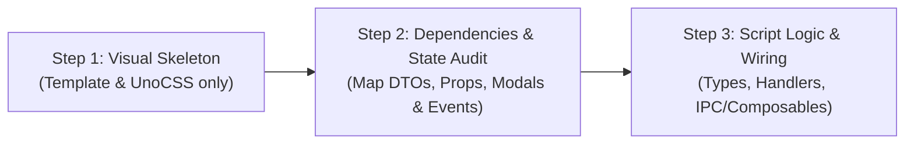

# 🏗️ Skill: Three-Step UI Implementation Workflow

This skill establishes a strict, phased engineering workflow for translating Figma designs and wireframes into clean, production-ready Vue 3 / UnoCSS components in **Palabrario**.

By separating **visual layout** from **reactive logic**, this workflow prevents common regressions: broken template references, reactive state tangling, premature script edits, and UI review friction.

---

## 1. The 3-Step Lifecycle

---

### 🧱 Step 1: The Visual Skeleton (`<template>` & UnoCSS Only)

**Goal:** Translate the Figma layout, typography, and spacing into code with zero script distractions.

1. **Strict Guardrails:**
   - **DO NOT** edit, refactor, or delete the existing `<script setup>` logic during this step.
   - Focus exclusively on the `<template>` structure, UnoCSS utility classes, and layout geometry.
   - Use the approved **two-color palette** (`ink` opacities for text/borders/surfaces, and `brand` for intentional accents and primary actions).
   - Mock dynamic content cleanly using existing template variables or safe inline fallbacks so the template compiles without errors.
2. **Review Checkpoint:**
   - Present the rendered visual result or template diff to the user.
   - Verify layout, hierarchy, mobile responsiveness, and visual fidelity before moving forward.

---

### 🔍 Step 2: Dependencies, Contracts & State Mapping (The Audit)

**Goal:** Identify all data inputs, state triggers, interactive controls, and role-based actions needed by the new skeleton.

1. **Audit Checklist:**
   - **Backend DTOs & Contracts:** What fields does this component actually receive from `pkg/models` or `IPalabrarioAPI`? Verify that no non-existent fields are referenced.
   - **User Session & RBAC:** Does this widget change based on user state (Anonymous vs. Learner vs. Editor vs. Admin)?
   - **Modals & Overlays:** What modals need to be wired up? (e.g., `AddToDeckModal`, `ReportModal`, `TabooWarningDialog`, `ImageLightboxModal`).
   - **Component Decomposition:** Should sub-sections be broken out into reusable `@palabrario/ui` components (e.g., `SenseRow`, `EtymologyBlock`)?
   - **Events & Navigation:** Identify required routing (`vue-router`), query params, and emitted events (`@click`, `@save`, `@report`).
2. **Review Checkpoint:**
   - Detail the mapped dependencies, composables, and proposed script changes clearly to the user before writing implementation logic.

---

### ⚡ Step 3: Script Logic & Wiring (`<script setup>` & Bindings)

**Goal:** Wire the template to real reactive state, composables, API calls, and event handlers.

1. **Implementation Rules:**
   - Bind DTOs with strict TypeScript interfaces (`import type { ... } from '@palabrario/ui'`).
   - Wire handlers (`handleOpenAddToDeck`, `handleOpenReport`, `useAuth`, `useAddToDeck`).
   - Ensure proper loading (`isLoading`), empty states, and error handling (`error.value`).
   - Ensure role-gated buttons conditionally render or display login prompts when accessed by anonymous visitors.
2. **Verification:**
   - Type-check the component and verify reactive behaviors (modal openings, navigation, reactivity upon route param changes).
