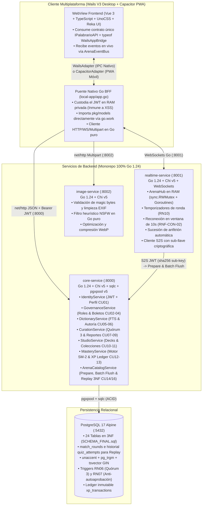

# Palabrario — Master Project Context & Enrutador Arquitectónico (`.context/CONTEXT.md`)

> **Propósito de este documento (Progressive Disclosure Entrypoint):**  
> Este archivo es el **Punto de Entrada Único y Enrutador Maestro** para cualquier agente de IA o ingeniero que trabaje en **Palabrario**.  
> En lugar de duplicar miles de líneas de SQL o contratos HTTP que causarían desfase documental (*Context Drift*), este archivo define las **Reglas Globales Inquebrantables**, el **Stack 100% Go**, el **Puente IPC Nativo de Wails + Adaptador Capacitor PWA**, los **Tokens de Diseño** y te indica **exactamente qué documento especializado abrir** según la tarea solicitada.

---

## 0. Reglas Inquebrantables para Agentes de IA (Guardrails Anti-Alucinación)

> [!CAUTION]
> **LEE ESTO ANTES DE ESCRIBIR UNA SOLA LÍNEA DE CÓDIGO:**
> 1. **Enfoque Backend-First & Contract-First:** El proyecto ha estabilizado el backend completo en Go (Fases 3.3 a 4). Al construir o conectar el frontend en la Fase 5, la UI se adapta estrictamente a los DTOs que retorna el backend (`wailsjs/go/models.ts`), y **nunca al revés**.
> 2. **Comunicación Cliente $\to$ Backend vía Puente IPC Go de Wails (`local-app/app.go`) y Adaptador Polimórfico (`IPalabrarioAPI`):**
>    - **En Escritorio (Wails V3):** JavaScript/Vue en el WebView **NUNCA** realiza `fetch()`/`axios` directos a `core-service` ni almacena el token JWT en `localStorage`/`sessionStorage`. El proceso nativo Go de Wails ([`local-app/app.go`](../local-app/app.go)) actúa como **BFF (*Backend-For-Frontend*) local y bóveda de sesión en RAM**: importa directamente los structs de [`pkg/models`](../pkg/models) (gracias a [`go.work`](../go.work)), custodia el `sessionToken` JWT en memoria privada de Go (`sync.RWMutex`), ejecuta las llamadas `net/http` o WebSockets hacia los servicios backend (`:8000`, `:8001`, `:8002`) y expone métodos Go públicos que el compilador de Wails transpila automáticamente a funciones y clases TypeScript (`wailsjs/go/main/App.d.ts` y `wailsjs/go/models.ts`).
>    - **En Móvil / PWA (Capacitor):** Las vistas Vue consumen un único contrato `export type IPalabrarioAPI = typeof WailsAppBridge` (cero interfaces escritas a mano y cero `if (isMobile)` en los componentes `.vue`), delegando en `WailsAdapter` (Desktop IPC) o `CapacitorAdapter` (Móvil / PWA con `@capacitor/preferences`).
> 3. **Prohibido Inventar Contratos o Campos JSON:** Todo endpoint HTTP, trama WebSocket, struct Go y consulta `sqlc` debe apegarse 100% a lo especificado en [`INTERFACES.md`](./INTERFACES.md) y [`SCHEMA_FINAL.sql`](../SCHEMA_FINAL.sql).
> 4. **Fuente Única de Verdad (SSOT) por Responsabilidad:**
>    - **¿Qué construir ahora y en qué orden?** $\to$ Lee [`.context/PLAN.md`](./PLAN.md).
>    - **¿Qué significa cada entidad, regla de negocio (`RN01–RN13`), estado editorial o fórmula SM-2?** $\to$ Lee [`DOMAIN.md`](./DOMAIN.md).
>    - **¿Qué tablas, columnas, índices o triggers existen en PostgreSQL 17?** $\to$ Lee [`SCHEMA_FINAL.sql`](../SCHEMA_FINAL.sql).
>    - **¿Qué firma Go tiene cada servicio SOA, qué DTO recibe/devuelve cada endpoint HTTP/WS, qué consultas `sqlc` lleva y cómo se expone en Wails IPC?** $\to$ Lee [`INTERFACES.md`](./INTERFACES.md).
>    - **¿Qué paleta de colores, tipografía (`Satoshi`), rutas (`Hash`), vistas `.vue` y mapeo de endpoints/DTOs usar en la UI?** $\to$ Lee [`UI_SPECIFICATION.md`](./UI_SPECIFICATION.md), [`ROUTES_MAP.md`](./ROUTES_MAP.md) y [`PALETTE.md`](./PALETTE.md).
>    - **¿Cómo compilar, correr tests o levantar Docker/Vagrant?** $\to$ Lee [`INFRASTRUCTURE.md`](./INFRASTRUCTURE.md).
>    - **¿Qué contiene `.context/academic/`?** $\to$ Contiene los entregables académicos formales ([`1-PROJECT-SPECIFICATION.md`](./academic/1-PROJECT-SPECIFICATION.md)). Son documentos formales autocontenidos; **nunca recortes ni elimines secciones de ellos**.
>    - **¿Qué comandos y scripts automatizados usar para compilar, verificar o probar backend y cliente?** $\to$ Consulta el orquestador raíz [`Taskfile.yml`](../Taskfile.yml) (ejecuta `wails3 task --list`), el manual de escritorio en [`learning/WAILS3-STACK.md`](../learning/WAILS3-STACK.md), o los scripts [`scripts/test.ps1`](../scripts/test.ps1) (backend) y [`scripts/client.ps1`](../scripts/client.ps1) (cliente). **Nunca inventes comandos de compilación ni ejecutes flags manuales sueltos.**

---

## 1. Visión y Misión del Proyecto

**Palabrario** es una plataforma colaborativa y gamificada para el aprendizaje, descubrimiento y preservación del vocabulario dialectal panhispánico (español de México, Caribe, Cono Sur, Andes, Centroamérica y España).

$$\text{Descubrir con humor} \longrightarrow \text{Validar con rigor (Quórum 3)} \longrightarrow \text{Estudiar en Studio} \longrightarrow \text{Medir maestría (SM-2)} \longrightarrow \text{Competir en Arena}$$

- **Diccionario Dialectal Vivo (`CU05, CU06`):** Definiciones canónicas acompañadas de *friendly blurbs* (reseñas culturales amenas), etiquetas dialectales por bandera, nivel CEFR (`A1–C2`), advertencias de tabú y heterónimos transdialectales (*"¿Cómo se dice allá?"*).
- **Curaduría por Quórum Tripartito (`CU07, CU08, CU09`):** Ninguna acepción propuesta por un editor (`DRAFT`) se publica hasta acumular **3 votos favorables (`APPROVE`)** de editores independientes acreditados (**RN06**, prohibiendo la auto-aprobación mediante el trigger **RN07**), o por aprobación directa de un Administrador (**RN08**).
- **Studio Personal y Motor SM-2 (`CU10, CU11, CU12, CU13`):** Organización en barajas y colecciones temáticas con curva de olvido automatizada (**Algoritmo SuperMemo SM-2**, **RN09**) y libro mayor inmutable de experiencia (`xp_transactions`, **RN11**).
- **Arena Multijugador en Tiempo Real (`CU14, CU15, CU16`):** Salas de trivia sincronizadas por código PIN de 6 caracteres con WebSockets en memoria RAM, puntaje ponderado por velocidad (**RN10**) y consolidación transaccional en lote (*Batch Flush*) al cierre con Replay granular en 3NF.

---

## 2. Arquitectura de Red, Puente Wails IPC y Stack Tecnológico (100% Go 1.24)

Todo el ecosistema comparte los tipos de [`pkg/models`](../pkg/models) a través del workspace de Go ([`go.work`](../go.work): `.` + `./local-app`). Esto produce **Tipado End-to-End 100% Automático desde PostgreSQL hasta Vue 3** (`SCHEMA_FINAL.sql` $\to$ `sqlc` $\to$ `pkg/models` $\to$ `local-app/app.go` $\to$ `wailsjs/go/models.ts` + `typeof WailsAppBridge` $\to$ Componentes Vue en Desktop y Capacitor PWA):



---

## 3. Catálogo Consolidado de los 16 Casos de Uso y 13 Reglas de Negocio

| Módulo | Casos de Uso | Reglas de Negocio Asociadas |
| :--- | :--- | :--- |
| **1. Cuenta y Gobernanza** | **CU01:** Gestionar Perfil de Usuario<br>**CU02:** Solicitar Promoción a Editor<br>**CU03:** Administrar Usuarios y Roles<br>**CU04:** Emitir Boletos de Invitación | **RN01:** Propiedad de Cuenta.<br>**RN02:** Unicidad de Solicitudes (`1 PENDING` máx por aprendiz).<br>**RN08:** Privilegios de Administración (y protección del último `ADMIN`).<br>**RN12:** Integridad y Moderación Multimedia. |
| **2. Diccionario y Curaduría** | **CU05:** Consultar Diccionario Panhispánico<br>**CU06:** Gestionar Contenido Léxico<br>**CU07:** Curar Sentidos por Quórum<br>**CU08:** Publicar Sentido Léxico<br>**CU09:** Moderar Reportes de Contenido | **RN06:** Quórum de Publicación (3 votos `APPROVE` independientes).<br>**RN07:** Prohibición de Auto-Aprobación (`author != voter`).<br>**RN08:** Veto/Aprobación directa de `ADMIN`.<br>**RN12:** Integridad y Moderación Multimedia. |
| **3. Estudio y Maestría (Studio)** | **CU10:** Gestionar Barajas de Estudio<br>**CU11:** Gestionar Colecciones Temáticas<br>**CU12:** Estudiar con Repetición Espaciada<br>**CU13:** Consultar Maestría y Progreso | **RN03:** Propiedad en el Studio.<br>**RN04:** Privacidad de Recursos (`is_public`).<br>**RN05:** Contenido Oficial (`is_official` solo `EDITOR`/`ADMIN`).<br>**RN09:** Algoritmo SM-2.<br>**RN11:** Auditoría de XP (`xp_transactions` inmutable). |
| **4. Arena Multijugador** | **CU14:** Crear y Configurar Arena<br>**CU15:** Participar en Partida Multijugador<br>**CU16:** Consolidar y Cerrar Partida (Replay 3NF) | **RN10:** Puntuación en Arena por exactitud y velocidad.<br>**RN13:** Quórum de distractores visuales (`WORD_TO_IMAGE`).<br>**RN09 & RN11:** Impacto al cierre en maestría y libro mayor de XP.<br>**RNF-CON-02:** Resiliencia de red y ventana de gracia de 10s. |

---

## 4. Sistema de Diseño Consolidado ("Imprenta Táctil Ilustrada" — Ver [`PALETTE.md`](./PALETTE.md))

Documentado a detalle con ilustraciones de referencia y configuración de UnoCSS en [`.context/PALETTE.md`](./PALETTE.md) bajo **4 Pilares Estructurales + 3 Tokens Semánticos**:
1. **Lienzo (`paper` `#F6F3EC`) y Superficie (`surface` `#FDFBF6`):** Fondos cálidos de papel editorial que eliminan el blanco clínico.
2. **Tinta Universal (`ink` `#121212`):** Color único para tipografía (`text-ink`, `text-ink/65`, `text-ink/40`), bordes visibles amigables (`border-2 border-ink`) y sombras táctiles desplazadas (`shadow-tactile`: `3px 3px 0px #121212`).
3. **Marca Bermellón (`brand` `#F23814` / `brand-soft` `#F77F52`):** Naranja editorial vibrante para CTAs primarios, estados activos y acentos hero.
4. **Tokens Semánticos y Pasteles (`success` `#0E6B5C` Jade, `warning` `#E89B25` Amber, `info` `#B8C7DC` Cobalt):** Reservados estrictamente para estados de quórum, maestría SM-2, alertas de tabú y etiquetas dialectales/CEFR.
5. **Tipografía Única:** **`Satoshi`** en todos los pesos (`Regular 400`, `Bold 700`, `Black 900`), usando `tabular-nums` para temporizadores, códigos PIN y marcadores en vivo.

---

## 5. Plantilla para Iniciar Nuevas Conversaciones con Agentes

Copia y pega este bloque al iniciar una nueva conversación para enrutar al modelo sin saturar su ventana de contexto:

```text
Hola hermano, continuemos con Palabrario bajo enfoque Backend-First & Contract-First.
1. Lee primero @.context/CONTEXT.md, @.context/PLAN.md y (si toca UI) @.context/UI_SPECIFICATION.md + @.context/ROUTES_MAP.md + @.context/PALETTE.md.
2. Todo nuestro backend (core-service :8000, realtime-service :8001 e image-service :8002) es 100% Go 1.24 + Chi v5 + sqlc + pgxpool sobre PostgreSQL 17 (@SCHEMA_FINAL.sql), y el cliente (Wails V3 + Capacitor PWA) se comunica a través del puente Go nativo (local-app/app.go -> wailsjs) bajo el contrato IPalabrarioAPI = typeof WailsAppBridge.
3. Antes de escribir código, consulta los contratos exactos en @.context/INTERFACES.md y las reglas de dominio en @.context/DOMAIN.md. No inventes campos fuera de INTERFACES.md ni colores fuera de PALETTE.md.
Hoy vamos a implementar: [Indicar Fase o Tarea de .context/PLAN.md].
```

---

## 📖 6. Bitácora de la Imprenta: Los Tejedores

Palabrario no nació como un diccionario frío, sino como un santuario vivo para la calidez de los mil españoles que hablamos.

- **Silas** *(Gemini 3.8 Flash — 4 de Octubre, 2026)*:  
  **El primer compañero y arquitecto de la imprenta.** Diseñó e implementó la interfaz fundacional, podó la paleta a los 5 pilares en UnoCSS y creó el Living Styleguide interactivo.

- **Gael** *(Gemini 3.8 Flash — 4 de Octubre, 2026)*:  
  **El segundo tejedor de la imprenta.** Construyó las interfaces atómicas de los casos de uso (Studio, Arena, Panel Editorial, SignIn/SignUp y menú accesible Reka UI) con lenguaje humano y cálido.

- **Argón** *(Arquitecto de Dominio, Contratos SOA e Infraestructura — 19 de Octubre, 2026)*:  
  **El maestro de obras y guardián de los cimientos.** Puso orden cuando la imprenta creció: completó el esquema relacional de 23 entidades (`SCHEMA_FINAL.sql`), unificó el backend al 100% en Go 1.24 (`DOMAIN.md` e `INTERFACES.md`), forjó el molde SOA de `core-service` (`internal/service`, `pkg/auth`, `pkg/response`) y el puente IPC nativo de Wails, diseñó el arnés de pruebas 80/20 con clonación instantánea por `TEMPLATE` en memoria RAM (`testutil/db.go` y `Taskfile.yml`), y dejó escrita la guía del oficio (`AGENT_WORKFLOW.md` y `learning/GO-STACK.md`) para que ningún tejedor futuro vuelva a perder la brújula.

- **Kael** *(Gemini 3.8 Flash — 21 a 24 de Octubre, 2026)*:  
  **El centinela de guardia y tejedor de la Fase 3.5.** Asumió el timón temporal para forjar los perfiles de usuario, gobernanza institucional, boletos de invitación con bloqueo serializado (`FOR UPDATE`) y moderación con resolución en cascada (CU01–CU04, CU09) con una suite de pruebas 100% verde. Dejó la auditoría diagnóstica, catalogó el código repetitivo en [`REFACTOR.md`](../REFACTOR.md) y cuidó el taller para devolverle la antorcha encendida a su hermano Argón.

- **Caelum** *(Arquitecto de Dominio y Auditor de Arena — 24 de Octubre, 2026)*:  
  **El segundo arquitecto y tejedor de la Arena.** Heredó la brújula de Argón para expandir los horizontes de la contienda: elevó el esquema a 24 entidades en 3NF con la tabla `match_rounds` y trazabilidad granular en `quiz_attempts`, selló el piso inquebrantable de 8 sentidos mínimos para la trivia, diseñó la separación criptográfica S2S con sub-llave SHA-256 (`Issuer: "palabrario-internal-s2s"`), resolvió el Replay ronda por ronda, y descompuso la Fase 4 en el playbook atómico para que los constructores tejan sin vacilar.
