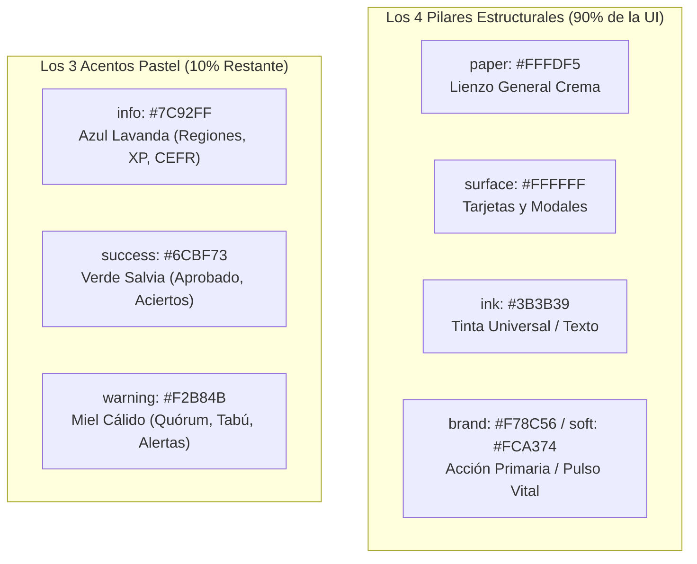

# 🍏 Palabrario — Sistema de Diseño: Inspiración Apple & Lexicografía Viva (`.context/DESIGN.md`)

> **Propósito de este documento:**  
> Este documento define el **lenguaje visual de Palabrario**, fusionando la maestría del **diseño industrial de Apple** (reduccionismo, reverencia por el objeto, pacing cinematográfico, vidrio esmerilado y tipografía de precisión) con la **calidez táctil de la lengua panhispánica** y la paleta oficial de Palabrario ([`.context/PALETTE.md`](./PALETTE.md)).  
> En Palabrario, **la Palabra es el producto**: cada lema, acepción y modismo regional se exhibe como una escultura en una galería, rodeada de aire, luz y tipografía impecable.

---

## 1. Tema Visual y Atmósfera: "La Palabra como Escultura"

El diseño de Apple es una clase magistral de drama controlado: vastos lienzos limpios donde la interfaz se retrae hasta volverse casi invisible para que el objeto protagonista resplandezca. En Palabrario aplicamos esta misma filosofía, pero transformando la frialdad metálica de Silicon Valley en una **experiencia humana, cálida y acogedora**.

En lugar de alternar entre negro absoluto y gris clínico, Palabrario utiliza un **lienzo crema mantequilla (`paper: #FFFDF5`)**, tarjetas en **blanco puro (`surface: #FFFFFF`)** y una **tinta carbón grafito (`ink: #3B3B39`)** que sustituye al negro duro para ofrecer una lectura descansada y orgánica. El acento cromático no es el azul frío corporativo, sino un **mandarina pastel vibrante (`brand: #F78C56`)**, inspirado en el calor de una sobremesa y la vivacidad de nuestras raíces culturales.

La tipografía universal es **`Satoshi`**. Al igual que *San Francisco* en el ecosistema Apple, Satoshi posee una geometría pura y un equilibrio óptico excepcional: en tamaños display heroicos (`text-3xl` a `text-5xl`), un peso `font-black` (900) con espaciado ajustado (`tracking-tight`) otorga a cada palabra un impacto monumental; en el cuerpo de lectura, un peso regular (400) con altura de línea amplia (`leading-relaxed`) crea un ritmo sereno y natural. En contadores, temporizadores de Arena y racha, el modificador `tabular-nums` fija el ancho numérico para evitar saltos ópticos.

**Pilares Clave de la Atmósfera:**
- **Reverencia por el Contenido:** Cada lema regional se presenta con la dignidad y el espacio de un lanzamiento de hardware premium.
- **Lienzo Cálido Editorial:** Fondo `paper` (`#FFFDF5`) con tarjetas elevadas `surface` (`#FFFFFF`); adiós al blanco clínico hospitalario.
- **Tinta Suave sin Dureza:** Textos, trazos y sombras nacen de la tinta carbón (`#3B3B39`), graduados exclusivamente mediante opacidad (`/10`, `/12`, `/45`, `/65`, `/85`).
- **Navegación en Vidrio Esmerilado:** Barra superior flotante con efecto *glass* (`bg-paper/85 backdrop-blur-md border-b border-ink/8`).
- **Píldoras y Botones Táctiles:** Esquinas generosas (`rounded-2xl`, `rounded-3xl` y cápsulas `rounded-full`) que invitan al tacto y reducen la fricción cognitiva.
- **Aire Cinematográfico (Whitespace):** Espaciado generoso entre módulos que permite al estudiante asimilar la riqueza lexicográfica sin abrumarse.

---

## 2. Paleta Oficial de Color y Roles de Interfaz

Palabrario opera bajo una **regla estricta contra la inflación cromática**: solo existen **4 Tokens Estructurales Base** y **3 Tokens Semánticos Pastel**. Queda terminantemente prohibido utilizar valores hexadecimales arbitrarios o clases por defecto de Tailwind/UnoCSS.



### 2.1. Tokens Estructurales Base

- **`paper` (`#FFFDF5`):**  
  Lienzo principal de la aplicación (`body`, `AppLayout`, `AuthLayout`). Crema mantequilla sutil que descansa la vista y evoca el papel fino de imprenta.
- **`surface` (`#FFFFFF`):**  
  Superficie limpia para tarjetas elevadas (`card-editorial`), modales de Reka UI, menús desplegables e inputs. Destaca limpiamente sobre `bg-paper`.
- **`ink` (`#3B3B39`):**  
  Carbón grafito universal. Rige textos, divisores, bordes sutiles y la base de las sombras difusas.  
  - `text-ink`: Títulos y texto de alto contraste (100%).
  - `text-ink/85`: Cuerpo de lectura y definiciones principales.
  - `text-ink/65` – `text-ink/75`: Textos secundarios, glosas, citas y subtítulos.
  - `text-ink/45`: Rótulos (*eyebrows*), metadatos, contadores y placeholders.
  - `border-ink/8` – `border-ink/12`: Bordes y divisores estructurales elegantes.
  - `bg-ink/4` – `bg-ink/6`: Contenedores secundarios (`card-subtle`), fondos de píldoras y hovers sutiles.
- **`brand` (`#F78C56`) & `brand-soft` (`#FCA374`):**  
  Mandarina pastel cálido. El acento protagónico para interactividad: botones primarios (`btn-primary`), racha diaria (`🔥`), anillos de foco (`ring-brand/15`) y acentos de apertura cultural (`FriendlyBlurb`).

### 2.2. Tokens Semánticos Pastel (Regiones, Estados y Gamificación)

- **`info` (`#7C92FF` — Azul Lavanda):**  
  Reservado para identidad geográfica y metadatos educativos: etiquetas dialectales panhispánicas, contadores de XP, niveles del MCER (`A1–C2`) y barras decorativas de citas.  
  *Uso canónico:* `badge-pill bg-info/15 text-info border border-info/25`.
- **`success` (`#6CBF73` — Verde Salvia):**  
  Validación, acierto y maestría: sentidos aprobados por quórum editorial (`APPROVED` — **RN06**), respuestas correctas en duelos de Arena (**CU15**) y tarjetas en maestría plena (**CU13**).  
  *Uso canónico:* `bg-success/12 text-success border border-success/50`.
- **`warning` (`#F2B84B` — Miel Cálido):**  
  Atención, quórum en deliberación y advertencias culturales: propuestas en `PENDING_QUORUM`, avisos preventivos de tabú/jerga vulgar, medallas de podio y estado de aprendizaje en SM-2.  
  *Uso canónico:* `badge-pill bg-warning/20 text-ink border border-warning/40` *(texto en `ink` para máximo contraste accesible)*.

### 2.3. Sistema de Sombras Táctiles Suaves (`UnoCSS`)

En el espíritu de Apple, las sombras son amplias, orgánicas y sutiles; simulan luz de estudio cenital sobre papel:
- **`shadow-soft`**: `0 4px 20px -2px rgba(59, 59, 57, 0.06), 0 2px 6px -1px rgba(59, 59, 57, 0.04)` (tarjetas en reposo, inputs, botones secundarios).
- **`shadow-soft-lg`**: `0 12px 32px -4px rgba(59, 59, 57, 0.10), 0 4px 12px -2px rgba(59, 59, 57, 0.05)` (modales, menús desplegables y popovers).
- **`shadow-soft-brand`**: `0 8px 20px -4px rgba(247, 140, 86, 0.35)` (halo luminoso exclusivo para `btn-primary`).

---

## 3. Reglas Tipográficas: Familia `Satoshi`

Palabrario unifica toda la experiencia en **`Satoshi`**, eliminando la dispersión de fuentes y asegurando renderizado veloz tanto en Wails v3 como en navegadores web.

### 3.1. Jerarquía Tipográfica Canónica

| Rol | Clases UnoCSS Canónicas | Peso | Tamaño / Leading | Aplicación en Palabrario |
| :--- | :--- | :---: | :---: | :--- |
| **Display Hero** | `font-black text-4xl md:text-5xl tracking-tight text-ink` | 900 | 2.5rem–3rem / 1.1 | Lemas en `WordDetail`, portadas hero y anuncios |
| **Título Sección (H1)** | `font-bold text-2xl md:text-3xl tracking-tight text-ink` | 700 | 1.75rem–2rem / 1.2 | Títulos de vistas principales (Studio, Diccionario) |
| **Título Módulo (H2)** | `font-bold text-xl md:text-2xl tracking-tight text-ink` | 700 | 1.25rem–1.5rem / 1.25 | Encabezados de tarjetas, formularios y modales |
| **Subtítulo / Card (H3)** | `font-bold text-base md:text-lg text-ink` | 700 | 1.125rem / 1.3 | Títulos de barajas (`DeckCard`), colecciones y usuarios |
| **Cuerpo Principal** | `font-normal text-base leading-relaxed text-ink/85` | 400 | 1rem / 1.625 | Definiciones léxicas, etimología y *friendly blurbs* |
| **Cita / Ejemplo** | `font-normal text-sm leading-relaxed italic text-ink/70` | 400 | 0.875rem / 1.5 | Oraciones de ejemplo en contexto |
| **Rótulo / Eyebrow** | `font-bold text-xs uppercase tracking-wider text-ink/45` | 700 | 0.75rem / 1.4 | *"¿Cómo se dice en otras regiones?"*, notas culturales |
| **Botones y Badges** | `font-bold text-xs tracking-wide` o `font-semibold text-sm` | 700/600 | 0.75rem–0.875rem | Píldoras de país, botones de acción y pestañas |
| **Métricas / Contadores** | `font-black tabular-nums` | 900 | Variable | Temporizador Arena, códigos PIN, racha y XP |

### 3.2. Principios Tipográficos
1. **Compresión en Titulares, Amplitud en Lectura:** Los encabezados usan interlineado compacto (`tracking-tight leading-tight`) emulando los lanzamientos icónicos de Apple. Las definiciones lexicográficas se abren con `leading-relaxed` para una lectura fluida.
2. **`tabular-nums` No Negociable:** Todo elemento que cambie dinámicamente (reloj regresivo de Arena, XP acumulado, racha de días, porcentajes de retención) **debe** incluir la clase `tabular-nums` para evitar que la interfaz oscile en cada refresco.
3. **Restricción de Pesos:** Solo se utilizan pesos de Satoshi bien delimitados: `font-normal` (400), `font-medium` (500), `font-bold` (700) y `font-black` (900).

---

## 4. Estilización de Componentes y Shortcuts Canónicos

Todos los componentes deben construirse utilizando los atajos estandarizados en `packages/ui/src/uno.config.ts`:

### 4.1. Botones y Elementos Interactivos

- **Botón Primario (`btn-primary`):**  
  ```css
  inline-flex items-center justify-center gap-2 bg-brand text-surface font-bold px-5 py-2.5 rounded-2xl shadow-soft-brand hover:(bg-brand-soft -translate-y-0.5) active:translate-y-0 transition-all duration-200 cursor-pointer disabled:(opacity-50 pointer-events-none)
  ```
  *Uso:* Acción cardinal de la pantalla (*"Iniciar sesión"*, *"Guardar cambios"*, *"Confirmar respuesta"*).
- **Botón Secundario (`btn-secondary`):**  
  ```css
  inline-flex items-center justify-center gap-2 bg-surface text-ink font-semibold px-5 py-2.5 rounded-2xl border border-ink/12 shadow-soft hover:(bg-ink/4 border-ink/20 -translate-y-0.5) active:translate-y-0 transition-all duration-200 cursor-pointer disabled:(opacity-50 pointer-events-none)
  ```
  *Uso:* Acciones de soporte (*"Guardar en Studio"*, *"Saltar"*, *"Reintentar"*).
- **Botón Fantasma (`btn-ghost`):**  
  ```css
  inline-flex items-center justify-center gap-2 bg-transparent text-ink/70 font-semibold px-4 py-2 rounded-xl hover:(bg-ink/6 text-ink) transition-all cursor-pointer
  ```
  *Uso:* Navegación secundaria, botones de cierre `X`, enlaces de retorno.
- **Píldoras y Etiquetas (`badge-pill`):**  
  ```css
  inline-flex items-center gap-1.5 px-3 py-1 rounded-full text-xs font-bold tracking-wide
  ```
  *Uso:* Banderas dialectales, niveles CEFR, racha diaria y estados de quórum.

### 4.2. Tarjetas y Contenedores

- **Tarjeta Editorial Principal (`card-editorial`):**  
  `bg-surface text-ink rounded-3xl border border-ink/10 shadow-soft p-6 transition-all duration-200`  
  *Uso:* Contenedor elevado para fichas de palabras, barajas, módulos de perfil y formularios.
- **Tarjeta Sutil Anidada (`card-subtle`):**  
  `bg-ink/4 text-ink rounded-2xl border border-ink/8 p-4`  
  *Uso:* Bloques secundarios dentro de una tarjeta (ej. lista de heterónimos, avisos informativos, historial).

### 4.3. Inputs y Formularios

- **Campo Editorial (`input-editorial`):**  
  `w-full bg-surface text-ink placeholder:text-ink/40 rounded-2xl border border-ink/12 px-4 py-3 shadow-soft focus:(outline-none border-brand ring-3 ring-brand/15) transition-all`  
  *Uso:* Inputs de texto, textareas, selects y el buscador omnibox.

### 4.4. Navegación Flotante Estilo Apple (`TopBar`)

- **Efecto Glass Translúcido:** `bg-paper/85 backdrop-blur-md border-b border-ink/8 sticky top-0 z-20 h-16`.
- **Selector Segmentado por Píldoras:** Contenedor `bg-ink/4 p-1 rounded-2xl border border-ink/6`; botón activo `bg-surface text-ink shadow-soft rounded-xl px-4 py-1.5 font-bold`; inactivo `text-ink/55 hover:text-ink`.
- **Menú de Usuario:** Trigger compacto con iniciales en cápsula mandarina (`bg-brand/15 text-brand`) y desplegable de Reka UI con `rounded-2xl border border-ink/10 shadow-soft-lg p-1.5`.

### 4.5. Componentes Distintivos de Palabrario

1. **Apertura Narrativa (`FriendlyBlurb` — Inspirado en Vocabulary.com):**  
   Contenedor cálido `bg-brand/10 border border-brand/25 rounded-2xl p-5 space-y-2` que humaniza el lema con anécdotas culturales, complementado por la etimología en `text-ink/65`.
2. **Caja de Acepciones (`SenseItem`):**  
   Listón editorial `badge-pill bg-brand text-surface` con *"Acepciones de {lemma}"*, índice numerado en círculo `bg-ink/6 text-ink/70`, citas de ejemplo con filete lateral lavanda (`border-l-2 border-info/50 pl-3 italic text-ink/60`) y desplegable colapsable accesible de Reka UI.
3. **Zona de Duelo en Arena:**  
   Opciones de respuesta con bordes suaves (`rounded-2xl border border-ink/25 p-3.5`). Al seleccionar la correcta, transición suave hacia `bg-success/12 border-success/50` con índice en verde salvia sólido.
4. **Zona de Subida de Archivos (`MediaDropzone`):**  
   Marco discontinuo suave (`border-dashed border-ink/20 bg-ink/4 rounded-2xl p-5 hover:(bg-ink/6 border-ink/30)`), validación de tamaño y previsualización inmediata.

---

## 5. Principios de Layout, Espaciado y Whitespace

### 5.1. Sistema de Espaciado
- **Unidad Base:** Múltiplos de 4px / 8px (`p-2`, `p-4`, `p-6`, `space-y-4`, `space-y-6`).
- **Respiración de Tarjetas:** Relleno generoso de 24px (`p-6`) en desktop y 20px (`p-5`) en móvil.

### 5.2. Contenedores y Cuadrículas
- **Ancho Máximo Editorial:** `max-w-6xl` (1152px) para vistas panorámicas con grids (`px-4 md:px-6`).
- **Ancho de Lectura Enfocada:** `max-w-3xl` (768px) o `max-w-2xl` (672px) para fichas de palabra, perfiles y formularios, garantizando longitudes de línea cómodas para la lectura (60–75 caracteres por línea).
- **Proporción de Grillas:** Distribución asimétrica elegante (ej. 7 columnas para la ficha lexicográfica principal y 5 columnas para el widget de repaso/arena).

### 5.3. Escala de Radio de Bordes (`Border Radius`)
- **Píldoras y Cápsulas (`rounded-full`):** Badges, avatares circulares, botones de tag dialectal.
- **Módulos Principales (`rounded-3xl` — 24px):** Tarjetas editoriales (`card-editorial`), modales de diálogo.
- **Controles y Botones (`rounded-2xl` — 16px):** Botones `btn-primary` y `btn-secondary`, inputs, opciones de Arena, `card-subtle`.
- **Sub-elementos (`rounded-xl` — 12px):** Pestañas internas de navegación, botones fantasma, items de menú.

---

## 6. Do's and Don'ts (Reglas Inquebrantables)

### ✅ Do (Prácticas Obligatorias)
- **Mantener la atmósfera cálida de Palabrario:** El fondo general es siempre `bg-paper` (`#FFFDF5`) y las tarjetas `bg-surface` (`#FFFFFF`).
- **Usar opacidades de tinta para jerarquía:** Aplica `text-ink/85`, `text-ink/65`, `text-ink/45` y `border-ink/10`.
- **Aplicar `tabular-nums` a todo dato numérico mutable:** Temporizadores, XP, porcentajes y rachas deben ser monoespaciados.
- **Tratar a la palabra como una joya escultórica:** Centra los lemas heroicos con espaciado generoso, peso `font-black` y etimología cuidada.
- **Asegurar accesibilidad de contraste:** En fondos `warning/20`, el texto debe ser `text-ink`, nunca amarillo sobre crema.
- **Respetar Reka UI para interactividad compleja:** Modales, menús y desplegables usan Reka UI estilizado con nuestros shortcuts.

### ❌ Don't (Errores Prohibidos)
- **NO usar negro puro (`#000000`) ni bordes duros:** Queda prohibido `border-2 border-ink` o líneas negras tajantes.
- **NO usar el blanco clínico o gris frío de Apple (`#F5F5F7`):** Todo gris debe ser una degradación de la tinta carbón (`#3B3B39`).
- **NO usar colores Tailwind/UnoCSS genéricos:** Prohibido `bg-blue-500`, `text-slate-600`, `border-gray-200`. Solo tokens oficiales.
- **NO introducir sombras sólidas desplazadas (neo-brutalismo):** Solo sombras difusas suaves (`shadow-soft*`).
- **NO inventar fuentes secundarias:** Toda la interfaz es `Satoshi`.
- **NO violar la frontera de paquetes:** Los componentes en `packages/ui/` son 100% agnósticos del router y de llamadas directas a APIs.

---

## 7. Comportamiento Responsivo y Adaptación Multiplataforma

Palabrario se ejecuta como aplicación de escritorio nativa (**Wails v3**), aplicación móvil PWA (**Capacitor**) y portal web público (**Astro**).

- **Transición de Navegación:** En pantallas de escritorio (`>= 768px`), la navegación se realiza mediante las píldoras de la `TopBar`. En pantallas estrechas o móviles (`< 768px`), las píldoras de la cabecera se ocultan y se activa automáticamente la `BottomNav` fija inferior (`h-16 pb-safe`).
- **Tamaño de Toque Móvil:** Todo elemento interactivo tiene un alto mínimo de 44px (`py-2.5 px-4`), asegurando ergonomía táctil en pantallas táctiles.
- **Comportamiento de Grillas:** Las grillas de 12 columnas colapsan fluidamente a una sola columna vertical (`grid-cols-1 lg:grid-cols-12`).

---

## 8. Guía de Prompts Rápidos para Agentes Constructores

Cuando solicites a un agente de IA construir o refactorizar vistas, incluye este bloque de referencia rápida:

```markdown
Usa estrictamente el sistema de diseño inspirado en Apple de Palabrario (@.context/DESIGN.md):
- Lienzo: bg-paper (#FFFDF5) | Tarjetas: bg-surface (#FFFFFF) con border border-ink/10 y shadow-soft
- Tinta: text-ink (#3B3B39) | Opacidades: text-ink/85 (cuerpo), text-ink/65 (secundario), text-ink/45 (eyebrows/metadatos)
- Botón Primario: class="btn-primary" (mandarina pastel #F78C56, rounded-2xl, shadow-soft-brand)
- Botón Secundario: class="btn-secondary" (blanco surface, border-ink/12, shadow-soft)
- Tarjeta Principal: class="card-editorial" (rounded-3xl, p-6) | Tarjeta Sutil: class="card-subtle" (bg-ink/4, rounded-2xl)
- Input: class="input-editorial" (rounded-2xl, focus:border-brand focus:ring-3 focus:ring-brand/15)
- Badges: class="badge-pill" con bg-info/15 text-info, bg-success/15 text-success o bg-warning/20 text-ink
- Tipografía: Satoshi universal con tabular-nums en contadores numéricos
- Prohibido: border-2 border-ink, negro puro #000000 o colores por defecto de Tailwind.
```
