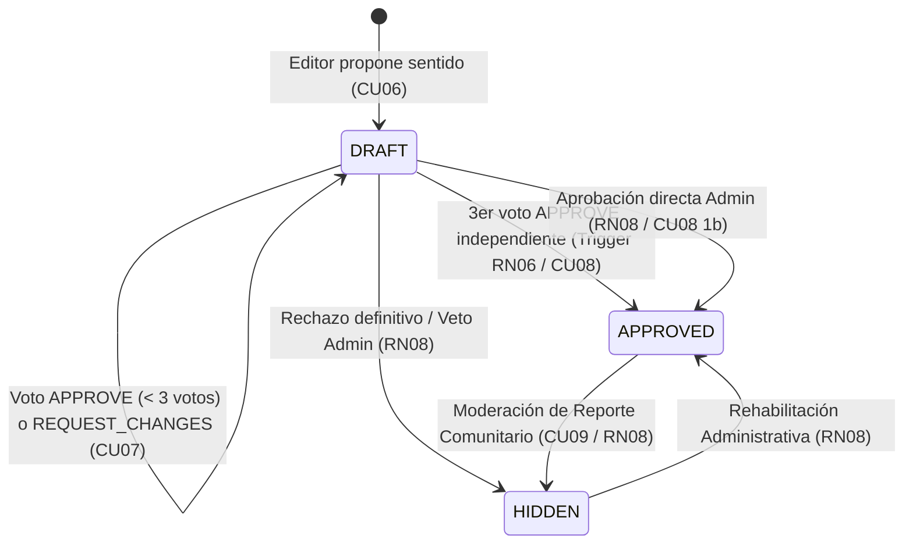

# 🏛️ Modelo de Dominio de Palabrario (`DOMAIN.md`)

> **Documento Arquitectónico Canónico — Diseño Guiado por el Dominio (DDD)**  
> **Proyecto:** Palabrario — Plataforma Gamificada de Aprendizaje y Preservación del Léxico Dialectal Panhispánico  
> **Enfoque Arquitectónico:** Monolito Modular Orientado a Servicios (SOA Interno) con Servicios Satélite Especializados  
> **Persistencia Canónica:** PostgreSQL 17 ([`SCHEMA_FINAL.sql`](../SCHEMA_FINAL.sql))

---

## 1. Filosofía y Visión del Dominio del Problema

El español es una lengua policéntrica hablada por más de 500 millones de personas en más de 20 países. En el dominio de **Palabrario**, una palabra **jamás es una simple clave-valor estática**: una misma forma léxica (*lema*) cambia radicalmente de significado, registro sociolingüístico, frecuencia y carga cultural según la geografía (*p. ej., «guagua» como transporte colectivo en el Caribe frente a bebé de brazos en la región Andina, o «coger» como verbo cotidiano en España frente a tabú sexual en México y el Río de la Plata*).

Para resolver la fragmentación entre los diccionarios académicos solemnes y las aplicaciones de tarjetas sin contexto cultural, el dominio de Palabrario articula cinco **Contextos Delimitados (*Bounded Contexts*)** que operan en un ciclo continuo:

$$\text{Identidad y Gobernanza} \longrightarrow \text{Lexicografía y Curaduría} \longrightarrow \text{Studio Personal} \longrightarrow \text{Maestría SM-2 y Gamificación} \longrightarrow \text{Arena Multijugador}$$

---

## 2. Mapa de Contextos Delimitados (*Bounded Contexts*) y Diagrama Entidad-Relación

```mermaid
erDiagram
    ACCOUNTS ||--|| USERS : "1:1 Identidad/Perfil"
    USERS ||--o{ EDITOR_REQUESTS : "solicita ascenso (CU02)"
    USERS ||--o{ INVITATION_TICKETS : "emite (CU04)"
    INVITATION_TICKETS ||--o{ TICKET_REDEMPTIONS : "redime"
    USERS ||--o{ TICKET_REDEMPTIONS : "consume"

    REGIONS ||--o{ WORDS : "origen endémico"
    REGIONS ||--o{ SENSES : "contextualiza dialecto"
    WORDS ||--|{ SENSES : "agrupa acepciones"
    SENSES ||--o{ EXAMPLES : "ejemplifica en contexto"
    USERS ||--o{ SENSES : "propone (id_editor)"
    USERS ||--o{ EXAMPLES : "redacta (id_editor)"

    SEMANTIC_CONCEPTS ||--|{ CONCEPT_MAPPINGS : "unifica significado"
    SENSES ||--o{ CONCEPT_MAPPINGS : "heterónimo regional"

    SENSES ||--o{ SENSE_APPROVALS : "evaluado en quórum (CU07)"
    USERS ||--o{ SENSE_APPROVALS : "dictamina (RN06/RN07)"
    USERS ||--o{ CONTENT_REPORTS : "reporta/modera (CU09)"
    SENSES ||--o{ CONTENT_REPORTS : "objeto de reporte"

    USERS ||--o{ DECKS : "propietario (RN03)"
    DECKS ||--o{ DECK_ITEMS : "contiene tarjetas"
    SENSES ||--o{ DECK_ITEMS : "sentido estudiado"
    USERS ||--o{ SAVED_DECKS : "guarda en Studio"
    DECKS ||--o{ SAVED_DECKS : "referenciado"

    USERS ||--o{ COLLECTIONS : "propietario (RN03)"
    COLLECTIONS ||--o{ COLLECTION_DECKS : "organiza ruta"
    DECKS ||--o{ COLLECTION_DECKS : "integra colección"
    USERS ||--o{ SAVED_COLLECTIONS : "guarda en Studio (CU11)"
    COLLECTIONS ||--o{ SAVED_COLLECTIONS : "referenciada"

    USERS ||--o{ USER_MASTERY : "curva de olvido SM-2 (CU12)"
    SENSES ||--o{ USER_MASTERY : "dominio por sentido"
    SENSES ||--o{ QUESTIONS : "evalúa reactivo"
    USERS ||--o{ QUIZ_ATTEMPTS : "registra intento"

    USERS ||--o{ XP_TRANSACTIONS : "libro mayor auditable (RN11)"
    ACHIEVEMENTS ||--o{ USER_ACHIEVEMENTS : "otorga medalla"
    USERS ||--o{ USER_ACHIEVEMENTS : "desbloquea"

    DECKS ||--o{ MATCHES : "banco de partida (CU14)"
    MATCHES ||--|{ MATCH_ROUNDS : "estructura rondas 3NF (CU14)"
    MATCHES ||--|{ MATCH_PARTICIPANTS : "consolida podio (CU16)"
    USERS ||--o{ MATCH_PARTICIPANTS : "compite (CU15)"
    MATCH_ROUNDS ||--o{ QUIZ_ATTEMPTS : "desglose replay por ronda (CU16)"
```

---

## 3. Catálogo Exhaustivo de Entidades por Contexto de Dominio

### 3.1. Contexto 1: Identidad, Cuentas y Gobernanza Institucional (`Account & Governance`)
Gestiona la seguridad criptográfica, el control de acceso basado en roles (**RBAC**), la identidad dialectal del usuario y los mecanismos institucionales de crecimiento comunitario (**CU01, CU02, CU03, CU04**).

#### 1. `Account` (Tabla: `accounts`)
Representa la credencial de seguridad e identidad autenticada en el sistema. Se separa deliberadamente de `User` para aislar secretos criptográficos (`password_hash`) y permisos (`role`) de los datos sociales y de gamificación.
* **Identificador:** `id_account` (`UUID`, PK).
* **Atributos Clave:**
  * `email` (`VARCHAR(255)`, único): Correo electrónico normalizado en minúsculas.
  * `password_hash` (`TEXT`): Hash derivado con `bcrypt` (costo $\ge 10$). Nunca viaja en DTOs de salida.
  * `role` (`account_role`: `LEARNER | EDITOR | ADMIN`): Nivel de privilegio RBAC. Todo registro estándar inicia en `LEARNER`.
  * `is_active` (`BOOLEAN`): Estado operativo de la cuenta para suspensión administrativa.
* **Invariantes y Reglas:** Solo el propio titular puede modificar sus credenciales (**RN01**), y solo un `ADMIN` puede alterar el `role` de una cuenta o evitar la degradación del último administrador activo (**CU03**).

#### 2. `User` / `UserProfile` (Tabla: `users`)
Representa el perfil público/privado del miembro, su punto de anclaje lingüístico y el estado consolidado de su progresión gamificada.
* **Identificador:** `id_user` (`UUID`, PK y FK $1:1$ hacia `accounts.id_account` con `ON DELETE CASCADE`).
* **Atributos Clave:**
  * `name` (`VARCHAR(100)`): Nombre visible del miembro.
  * `user_name` (`VARCHAR(50)`, único): Handle público (`@usuario`) para perfiles sociales (`/u/:username`).
  * `avatar_url` (`TEXT`, opcional): URL hacia imagen optimizada en WebP por `image-service` (**RN12**).
  * `anchor_dialect` (`VARCHAR(10)`, default `'MX'`): **Dialecto Ancla** del usuario. Es un concepto central del dominio: el buscador FTS y las fichas léxicas priorizan las acepciones y contrastes culturales respecto al dialecto ancla del estudiante.
  * `total_xp` (`INTEGER`), `current_level` (`INTEGER`): Saldo cacheado de experiencia (sincronizado con el ledger `xp_transactions`) y nivel calculado.
  * `current_streak` (`INTEGER`), `longest_streak` (`INTEGER`), `last_activity_at` (`TIMESTAMPTZ`): Métricas de constancia de estudio (**CU01, CU13**).

#### 3. `EditorRequest` (Tabla: `editor_requests`)
Formaliza el expediente de postulación de un `LEARNER` que solicita ser promovido al rol de `EDITOR` acreditando su perfil docente, filológico o lingüístico (**CU02, CU03**).
* **Identificador:** `id_request` (`UUID`, PK).
* **Atributos Clave:**
  * `id_user` (`UUID`, FK $\to$ `users`): Aprendiz solicitante.
  * `institution_name` (`VARCHAR(150)`): Universidad, academia o institución de adscripción.
  * `justification` (`TEXT`): Exposición de motivos pedagógicos/lingüísticos.
  * `credentials_url` (`TEXT`): Evidencia documental o enlace de verificación académica (**RN12**).
  * `status` (`request_status`: `PENDING | APPROVED | REJECTED`).
  * `reviewed_by` (`UUID`, FK $\to$ `users`), `review_notes` (`TEXT`), `resolved_at` (`TIMESTAMPTZ`): Auditoría de resolución administrativa.
* **Invariantes y Reglas:** **RN02 (Unicidad de Solicitudes):** Un aprendiz solo puede tener **una** solicitud en estado `PENDING` simultáneamente, garantizado a nivel de motor relacional mediante el índice único parcial `idx_unique_pending_editor_request`.

#### 4. `InvitationTicket` y `TicketRedemption` (Tablas: `invitation_tickets`, `ticket_redemptions`)
Materializan el modelo de acceso institucional sin pasarelas de pago (**CU04**). Permiten a los administradores emitir boletos alfanuméricos de un solo uso (individuales) o multiuso (para academias o grupos escolares), pudiendo incluso otorgar un rol predeterminado.
* **Identificador:** `id_ticket` (`UUID`, PK) y `code` (`VARCHAR(50)`, único).
* **Atributos Clave:**
  * `created_by` (`UUID`, FK $\to$ `users`): Administrador emisor.
  * `granted_role` (`account_role`, default `'LEARNER'`): Rol asignado al redimir el boleto.
  * `institution_name` (`VARCHAR(150)`): Etiqueta de convenio institucional.
  * `max_uses` (`INTEGER`), `current_uses` (`INTEGER`): Control de cupo con restricción `CHECK (current_uses <= max_uses)`.
  * `is_active` (`BOOLEAN`), `expires_at` (`TIMESTAMPTZ`): Vigencia temporal y lógica.
* **Invariantes y Reglas:** **RN08:** Solo un `ADMIN` puede emitir o revocar boletos. Cada redención incrementa `current_uses` transaccionalmente y deja rastro en `ticket_redemptions (id_ticket, id_user)`.

---

### 3.2. Contexto 2: Núcleo Lexicográfico Panhispánico y Heteronimia (`Lexicon & Dialectology`)
Es el corazón lingüístico de Palabrario (**CU05, CU06**). Modela la polisemia regional, el registro de habla, la carga de tabú y las equivalencias transdialectales.

#### 5. `Region` (Tabla: `regions`)
Representa un país hispanohablante o macro-zona dialectal reconocida (`MX`, `ES`, `AR`, `CO`, `CL`, `CU`, `CAM`, `PAN`).
* **Identificador:** `id_region` (`UUID`, PK) y clave natural `code` (`VARCHAR(10)`, único).
* **Atributos Clave:** `name` (`VARCHAR(100)`), `parent_zone` (`Norteamérica`, `Rioplatense`, `Andina`, `Caribe`, `Peninsular`, `General`), `country_code` (`ISO-3166-1 alpha-2`), `flag_emoji` (`VARCHAR(10)`).

#### 6. `Word` (Tabla: `words`)
Representa el **Lema Canónico** (sustantivo en singular, verbo en infinitivo o locución fija). Actúa como raíz agregada (*Aggregate Root*) de las acepciones de una palabra.
* **Identificador:** `id_word` (`SERIAL / INT`, PK).
* **Atributos Clave:**
  * `lemma` (`VARCHAR(100)`): Forma ortográfica canónica con tildes y diacríticos (ej. `"apapachar"`, `"tianguis"`).
  * `normalized_lemma` (`VARCHAR(100)`): Lema en minúsculas y sin tildes, indexado con `pg_trgm` (`gin_trgm_ops`) y `varchar_pattern_ops` para autocompletado instantáneo y tolerancia a erratas (**RF06**).
  * `part_of_speech` (`VARCHAR(50)`): Categoría gramatical (`sustantivo`, `verbo`, `adjetivo`, `modismo`).
  * `gender` (`word_gender`: `MALE | FEMALE | NEUTRAL | AMBIGUOUS`).
  * `etymology` (`TEXT`): Raíz histórica o indígena (náhuatl, quechua, maya, latín, lunfardo, etc.).
  * `friendly_blurb` (`TEXT`): **Reseña Cultural Amena**. Narrativa breve con humor e ingenio que explica el alma de la palabra y sus contrastes entre países hispanohablantes.
  * `image_url` (`TEXT`, opcional): URL hacia imagen conceptual o representativa generada y saneada por `image-service` (**RN12**).
  * `id_origin_region` (`UUID`, FK opcional $\to$ `regions`): Si el vocablo es endémico de una región específica, la señala; si es `NULL` o `PAN`, pertenece al español general.
  * `search_vector` (`tsvector` generado y almacenado): Pondera `lemma` con peso `'A'` y `friendly_blurb` con peso `'B'` bajo la configuración `spanish_unaccent`.

#### 7. `Sense` (Tabla: `senses`)
Representa una **Acepción o Sentido Dialectal** puntual de un `Word` en una `Region` determinada. Todas las mecánicas de estudio (`DeckItem`, `UserMastery`, `Question`) apuntan a `Sense` y **no** a `Word`, porque el estudiante aprende un significado concreto en un contexto regional específico.
* **Identificador:** `id_sense` (`SERIAL / INT`, PK).
* **Atributos Clave:**
  * `id_word` (`INT`, FK $\to$ `words`), `id_region` (`UUID`, FK $\to$ `regions`), `id_editor` (`UUID`, FK $\to$ `users`, autor de la propuesta).
  * `short_definition` (`VARCHAR(255)`): Glosa concisa para el buscador Master-Detail y las opciones de trivia.
  * `definition` (`TEXT`): Definición lexicográfica formal completa.
  * `is_primary` (`BOOLEAN`): Indica si es el sentido principal del lema para priorizarlo en búsquedas y trivias.
  * `is_taboo_or_vulgar` (`BOOLEAN`) y `cultural_note` (`TEXT`): Advertencia pragmática indispensable para falsos amigos interdialectales (ej. `"coger"` en México/Argentina vs España).
  * `image_url` (`TEXT`, opcional): URL hacia imagen específica de la acepción dialectal concreta procesada por `image-service` (**RN12**).
  * `cefr_level` (`cefr_level`: `A1 | A2 | B1 | B2 | C1 | C2 | NATIVO`) y `usage_frequency` (`EVERYDAY | COMMON | RARE | SLANG | ARCHAIC`).
  * `state` (`review_state`: `DRAFT | APPROVED | HIDDEN`): Ciclo de vida editorial. Solo los sentidos en estado `APPROVED` son visibles en consultas públicas del diccionario (**CU05, CU08**).
  * `sense_search_vector` (`tsvector` generado): Indexa `short_definition` (`A`), `definition` (`B`) y `cultural_note` (`C`).

#### 8. `Example` (Tabla: `examples`)
Oración contextual real (literaria, periodística o coloquial) que ilustra el uso pragmático de un `Sense` y sirve como insumo para reactivos de completar oraciones (`SENTENCE_COMPLETION`).
* **Identificador:** `id_example` (`SERIAL / INT`, PK).
* **Atributos Clave:** `id_sense` (`INT`, FK $\to$ `senses`), `id_editor` (`UUID`, FK $\to$ `users`), `sentence` (`TEXT`), `source` (`VARCHAR(255)`).

#### 9. `SemanticConcept` y `ConceptMapping` (Tablas: `semantic_concepts`, `concept_mappings`)
Modelan el fenómeno de la **Heteronimia Transdialectal** (*"¿Cómo se dice allá?"*).
* **Problema que resuelve:** Si asociáramos sinónimos directamente palabra contra palabra ($N \times N$), tendríamos un grafo inmanejable y ambiguo cuando una palabra es polisémica (como *guagua* = autobús y *guagua* = bebé).
* **Solución:** `SemanticConcept` define un concepto universal unívoco (`concept_key = 'public_bus'` vs `concept_key = 'infant_baby'`), y `ConceptMapping` vincula cada `id_sense` regional específico con dicho concepto. Así, al consultar *guagua* en su acepción cubana (`id_sense = 103`), el sistema descubre automáticamente sus heterónimos para `public_bus` (*camión*, *colectivo*, *micro*) sin mezclarlos con los de `infant_baby`.

---

### 3.3. Contexto 3: Curaduría Colaborativa por Quórum y Moderación (`Editorial Governance`)
Garantiza el rigor académico sin sacrificar la agilidad comunitaria (**CU06, CU07, CU08, CU09**).

#### 10. `SenseApproval` (Tabla: `sense_approvals`)
Representa el dictamen filológico emitido por un `EDITOR` revisor sobre un `Sense` en estado `DRAFT` (**CU07**).
* **Identificador Compuesto:** `(id_sense, id_editor)` — garantiza que un editor solo emita un voto contabilizable por sentido.
* **Atributos Clave:**
  * `decision` (`review_decision`: `APPROVE | REQUEST_CHANGES | REJECT`).
  * `feedback_notes` (`TEXT`, opcional): Observaciones pedagógicas cuando solicita correcciones al autor (**CU07 Flujo Alterno 4a**).
  * `approved_at` (`TIMESTAMPTZ`).
* **Reglas de Integridad en Base de Datos (Triggers PL/pgSQL):**
  * **RN07 (`trg_prevent_self_approval`):** Lanza excepción atómica si `NEW.id_editor == senses.id_editor`. Ningún autor puede votar su propia propuesta.
  * **RN06 (`trg_auto_approve_sense`):** Al acumular $\ge 3$ registros con `decision = 'APPROVE'` para un mismo `id_sense`, promueve automáticamente `senses.state = 'APPROVED'` (**CU08**), validando tanto la definición textual como la idoneidad de la imagen asociada (**RN12**).

#### 11. `ContentReport` (Tabla: `content_reports`)
Canaliza la vigilancia comunitaria donde cualquier `Miembro` o `Aprendiz` reporta errores lexicográficos, falta de etiqueta de tabú (`OFFENSIVE_UNMARKED`) o vandalismo sobre un lema, sentido o ejemplo, y el `Administrador` dictamina su resolución (**CU09**).
* **Identificador:** `id_report` (`UUID`, PK).
* **Atributos Clave:** `id_reporter` (`UUID`), `target_type` (`WORD | SENSE | EXAMPLE`), FKs opcionales (`id_word`, `id_sense`, `id_example`), `reason` (`report_reason`), `details` (`TEXT`), `status` (`PENDING | RESOLVED_HIDDEN | RESOLVED_AMENDED | DISMISSED`), `resolved_by` (`UUID`), `resolution_notes` (`TEXT`).

---

### 3.4. Contexto 4: Studio Personal, Repetición Espaciada (SM-2) y Gamificación (`Studio & Mastery`)
Transforma la consulta pasiva del diccionario en retención activa a largo plazo (**CU10, CU11, CU12, CU13**).

#### 12. `Deck`, `DeckItem` y `SavedDeck` (Tablas: `decks`, `deck_items`, `saved_decks`)
Una **Baraja (`Deck`)** es una lista ordenada de sentidos léxicos (`DeckItem`) lista para ser repasada con tarjetas SM-2 o jugada en la Arena.
* **Propiedad vs. Suscripción:**
  * `decks.id_user` define al propietario creador, quien es el único facultado para editar sus metadatos o composición (**RN03**), salvo las barajas marcadas como `is_official = true` que pueden ser curadas por Editores y Administradores (**RN05**).
  * `saved_decks (id_user, id_deck)` permite que otros miembros guarden en su Studio barajas públicas (`is_public = true`, **RN04**) de la comunidad sin clonar filas innecesariamente.

#### 13. `Collection`, `CollectionDeck` y `SavedCollection` (Tablas: `collections`, `collection_decks`, `saved_collections`)
Una **Colección (`Collection`)** agrupa múltiples barajas en orden pedagógico (`CollectionDeck.sort_order`) conformando una ruta temática de aprendizaje (*p. ej., «Ruta de la Gastronomía Mexicana»*).
* **Atributos Clave:** `title`, `description`, `is_public` (**RN04**), `is_featured` (destacada en portada), `is_official` (**RN05**).
* `saved_collections (id_user, id_collection)` materializa el flujo alterno **CU11 1a** (*Guardar colección comunitaria en el Studio personal*).

#### 14. `UserMastery` (Tabla: `user_mastery`)
Modela el estado de memoria a largo plazo de un usuario frente a un sentido específico mediante el algoritmo **SuperMemo SM-2** (**CU12, CU13, RN09**).
* **Identificador Compuesto:** `(id_user, id_sense)`.
* **Atributos y Matemática SM-2:**
  * Calificación de recuerdo $q \in \{1, 2, 3, 4\}$ en la UI (mapeada a escala SM-2):
    * Si la respuesta es **incorrecta** ($q < 3$): `consecutive_correct` se reinicia a `0`, `current_interval_days` vuelve a `1`, y `progress_stage` pasa a `LEARNING`.
    * Si la respuesta es **correcta** ($q \ge 3$): `consecutive_correct` incrementa en `1`; el intervalo se calcula como $I(1) = 1$, $I(2) = 6$, y para $n > 2$: $I(n) = \lceil I(n-1) \times EF \rceil$.
    * El factor de facilidad (`easiness_factor`, inicial `2.5`, mínimo `1.3`) se ajusta según:
      $$EF' = \max\left(1.3,\; EF + \left(0.1 - (5 - q) \cdot (0.08 + (5 - q) \cdot 0.02)\right)\right)$$
  * **Transición de Etapas (`progress_stage`):**
    * `NEW`: Nunca repasada (`times_reviewed = 0`).
    * `LEARNING`: En adquisición inicial (`consecutive_correct` entre `0` y `2`, o intervalo $< 6$ días).
    * `REVIEWING`: En consolidación (`consecutive_correct` $\ge 3$ e intervalo entre $6$ y $20$ días).
    * `MASTERED`: Dominada a largo plazo (`consecutive_correct` $\ge 5$ e intervalo $\ge 21$ días).

#### 15. `XPTransaction`, `Achievement` y `UserAchievement` (Tablas: `xp_transactions`, `achievements`, `user_achievements`)
Implementan la economía auditable de progreso (**RN11**).
* **`XPTransaction`:** Libro mayor (*ledger*) **inmutable** (`INSERT`-only). Cada ganancia de puntos (`amount_xp`) registra su causa (`QUIZ_CORRECT`, `MATCH_WIN`, `DAILY_STREAK`, `DECK_COMPLETED`, `ACHIEVEMENT_UNLOCKED`) y `metadata_id`. El saldo `users.total_xp` es la proyección materializada de este libro mayor, permitiendo reconstrucción y auditoría ante cualquier anomalía (**CU13 2a**).
* **`Achievement` y `UserAchievement`:** Catálogo de insignias por rareza (`BRONZE`, `SILVER`, `GOLD`, `PLATINUM`, `DIAMOND`) y categoría (`STREAK`, `COMPETITION`, `MASTERY`, `DIALECT_EXPLORER`).

---

### 3.5. Contexto 5: Evaluación Curricular, Arena Multijugador en Tiempo Real y Replay 3NF (`Quiz & Realtime Arena`)
Desacopla la competencia síncrona de baja latencia en RAM de la persistencia relacional en lote (**CU14, CU15, CU16, RN10, RN13, RNF-CON-02**), garantizando trazabilidad granular ronda por ronda (*Replay*) en Tercera Forma Normal (3NF).

#### 16. `Question`, `MatchRound` y `QuizAttempt` (Tablas: `questions`, `match_rounds`, `quiz_attempts`)
* **`Question`:** Reactivo curricular curado por un `EDITOR` para un `Sense`, con 6 modalidades pedagógicas (`DEFINITION_TO_WORD`, `WORD_TO_DEFINITION`, `SENTENCE_COMPLETION`, `REGIONAL_EQUIVALENT`, `TONE_OR_REGISTER`, `WORD_TO_IMAGE`), 3 distractores en JSONB (`custom_distractors`) y retroalimentación educativa (`explanation`). Si un sentido de una baraja aún no tiene pregunta artesanal, el motor genera un reactivo dinámico extrayendo definiciones o imágenes de otros sentidos distintos de la misma baraja.
* **`MatchRound` (Tabla `match_rounds` en 3NF):** Almacena de manera 100% relacional (sin blobs JSON corruptibles) cada una de las rondas generadas al preparar una partida (`id_match`, `round_number`, `id_sense`, `id_question`, `modality`, `prompt`, `option_a`, `option_b`, `option_c`, `option_d`, `correct_option`, `explanation`). Garantiza una relación biyectiva $1\text{ Ronda} = 1\text{ Sentido Único}$ dentro de la partida. En la modalidad `WORD_TO_IMAGE`, las opciones (`option_a` a `option_d`) y `correct_option` almacenan las URLs de las 4 imágenes en competencia.
* **`QuizAttempt` (Tabla `quiz_attempts`):** Registra tanto intentos individuales de práctica como el **desglose granular por ronda de cada competidor en la Arena** (`id_match`, `round_number`, `id_user`, `id_sense`, `selected_option`, `is_correct`, `time_spent_ms`, `points_earned`), con clave foránea compuesta hacia `match_rounds(id_match, round_number)` y restricción `UNIQUE (id_match, round_number, id_user)`. Esto habilita la retrospección completa (*Match Replay*) ronda por ronda.

#### 17. `Match` y `MatchParticipant` (Tablas: `matches`, `match_participants`)
Representan el ciclo de vida, las reglas operativas de la sala y el resultado consolidado de una partida multijugador en la Arena (**CU14, CU15, CU16**).
* **Invariantes y Reglas de Dominio de la Arena:**
  1. **Apertura y Límites de Baraja (`CU14`):**
     * **Piso absoluto de 8 sentidos:** La baraja seleccionada (`id_deck`) debe contar con al menos **8 sentidos en estado `APPROVED`**; de lo contrario, el sistema rechaza la apertura con `422 Unprocessable Entity` (`ErrUnprocessable`).
     * **Cero preguntas repetidas (`TotalRounds <= ApprovedSenses`):** El número de rondas (`total_rounds`, rango `8..20`, default `8`) no puede superar la cantidad de sentidos aprobados disponibles en la baraja.
     * **Quórum de Distractores Visuales (`RN13`):** Para generar una ronda de modalidad `WORD_TO_IMAGE`, la baraja debe contar con al menos 4 recursos visuales únicos (`image_url IS NOT NULL`); si no se cumple, esa ronda degrada automáticamente a modalidad textual (`WORD_TO_DEFINITION`).
     * **Persistencia inicial en 3NF:** Se inserta el registro en `matches` (`WAITING`) con un `room_code` (PIN alfanumérico único de 6 caracteres) y se insertan inmediatamente sus $N$ filas en `match_rounds`.
  2. **Topología de Sala, Rol del Host y Sucesión Automática (`CU15` / `RNF-CON-02`):**
     * **Capacidad máxima:** Hasta **8 participantes simultáneos** por sala (`MaxParticipants = 8`).
     * **Facultades del Host:** Quien prepara la sala es el `Host` inicial (`IsHost = true`) y posee la facultad exclusiva de disparar `START_MATCH` en estado `WAITING`. Durante `IN_PROGRESS`, compite en igualdad absoluta de condiciones (**RN10**).
     * **Ventana de Reconexión (`RNF-CON-02`):** Ante una caída de WebSocket, el participante conserva su lugar, puntaje (`Score`) y tiempos en RAM durante **10 segundos** (`IsReady = false` mientras está desconectado). Si reconecta dentro de los 10s, reanuda su sesión sin pérdida.
     * **Sucesión de Host por Antigüedad:** Si el `Host` se desconecta en estado `WAITING` y no regresa tras expirar los 10 segundos de gracia, el rol `IsHost = true` se transfiere automáticamente al **siguiente participante conectado más antiguo** (menor `JoinedAt`) y se difunde `ROOM_STATE`. Si no queda ningún jugador conectado, la sala se destruye en RAM.
  3. **Puntuación por Velocidad (`RN10`) y Desempate Determinístico (`total_time_spent_ms`):**
     * El tiempo de respuesta se mide exclusivamente con el reloj monotónico del servidor (`elapsedMs`), otorgando entre `500` y `1000` puntos por acierto según la velocidad, o `0` en fallo/timeout.
     * En cada ronda se acumula `total_time_spent_ms` por participante (sumando `round_time_sec * 1000` si no respondió antes del timeout).
     * **Ordenamiento Canónico de Podio (Tie-Breaker):** Al calcular `final_rank` (`1, 2, 3...`) y proclamar al `winner_user_id`, los participantes se ordenan por:
       $$\text{Score DESC} \;\longrightarrow\; \text{CorrectAnswers DESC} \;\longrightarrow\; \text{TotalTimeSpentMs ASC}$$
  4. **Consolidación Transaccional con Seguridad S2S (`CU16`):**
     * Al concluir la última ronda (`FINISHED`), `realtime-service` invoca a `core-service` autenticándose mediante un **JWT Interno Servicio-a-Servicio (S2S)** firmado con una sub-llave criptográfica derivada (`HMAC-SHA256`), imposible de falsificar con tokens de cliente.
     * En un único *Batch Flush* ACID (`pgx.Tx`), `core-service` cierra `matches`, inserta `match_participants`, persiste el desglose por ronda en `quiz_attempts` para el *Replay*, asienta los premios en `xp_transactions` (**RN11**: `+150`, `+100`, `+75`, `+40 XP`) y actualiza `user_mastery` (**RN09**: `qualityRating = 3` para sentidos acertados y `1` para sentidos fallados).

---

### 3.6. Incremento Arquitectónico a Largo Plazo: Eventos Culturales de Temporada (`Seasonal Events`)
Documentado en [`proposals/SEASONAL_EVENTS_SPECIFICATION.md`](../proposals/SEASONAL_EVENTS_SPECIFICATION.md) como expansión futura post-MVP. Contempla las entidades `Artwork` (obras de ilustradores hispanoamericanos o arte conceptual con atribución), `SeasonEvent` (festivales con vigencia calendario como *Día de Muertos*) y `SeasonEventCollection` (carrusel curado de colecciones temáticas del festival). Se mantiene aislado del esquema nuclear hasta completar los 16 casos de uso del MVP.
