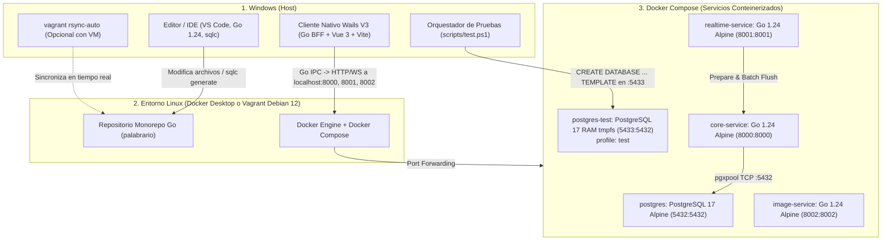

# Documentación de Infraestructura y Despliegue - Palabrario

Este documento describe la arquitectura de desarrollo y despliegue híbrida entre **Windows (Host)**, **Vagrant (VM Linux)** y **Docker Compose (Contenedores)**, diseñada para garantizar el máximo rendimiento, mínimo consumo de memoria RAM (`< 15 MiB` combinados para todo el backend en Go), aislamiento de dependencias y compilación estática.

---

## 1. Arquitectura de 3 Capas (Monorepo 100% Go)



---

## 2. Servicios y Puertos Expuestos

Todos los puertos están expuestos hacia la máquina local (`localhost`):

| Servicio | Tecnología / Runtime | Puerto | Huella RAM (Docker) | Descripción |
| :--- | :--- | :---: | :---: | :--- |
| **`postgres`** | PostgreSQL 17 Alpine | `5432` | `~30 MiB` | Base de datos relacional principal (`unaccent`, `pg_trgm`, FTS GIN, Triggers `RN06/RN07`). Persistida en volumen `postgres_data`. |
| **`postgres-test`** | PostgreSQL 17 Alpine (`tmpfs` RAM) | `5433` | Efímero (Solo en tests) | Base de datos efímera en memoria RAM (`profiles: ["test"]`). Sirve como plantilla maestra (`palabrario_test`) para clonar bases de datos aisladas por test en `~10 ms`. |
| **`core-service`** | Go 1.24 + Chi v5 + `sqlc` + `pgxpool` | `8000` | `< 5 MiB` | Monolito modular SOA (Auth JWT, Gobernanza, Diccionario FTS, Quórum, Studio, SM-2, Ledger de XP). |
| **`realtime-service`** | Go 1.24 + Chi v5 + WebSockets | `8001` | `< 5 MiB` | Salas de competencia multijugador en tiempo real en memoria RAM (`ArenaHub` + Goroutines) y *Batch Flush* al cierre (Migración a Go en Fase 4). |
| **`image-service`** | Go 1.24 + Chi v5 | `8002` | `< 5 MiB` | Validación binaria, eliminación EXIF y compresión de imágenes a WebP. |

---

## 3. Estrategia de Construcción en Monorepo Unificado Go (`go.mod` en Raíz)

En [`docker-compose.yml`](../docker-compose.yml), los tres servicios de backend (`core-service`, `realtime-service` e `image-service`) sitúan su `build.context` en la raíz (`.`):

```yaml
  core-service:
    build:
      context: .
      dockerfile: ./core-service/Dockerfile
```

* **Justificación:** Permite que el build multi-stage en Go acceda tanto al código propio de cada servicio (`./core-service`, `./realtime-service`, `./image-service`) como a los paquetes compartidos de modelos y autenticación (`./pkg/models`, `./pkg/auth`, `./pkg/response`) y al manifiesto unificado [`go.mod`](../go.mod), generando binarios estáticos compilados (`CGO_ENABLED=0`) sobre `alpine:3.21` de `~27 MB` y `< 5 MiB` de uso de RAM en ejecución.

---

## 4. Flujo de Base de Datos y Generación de Código (`SQL Schema-First` con `sqlc`)

El proyecto sigue una arquitectura **SQL Schema-First** estricta:

1. **Definición Canónica:** Todo el esquema relacional vive en [`SCHEMA_FINAL.sql`](../SCHEMA_FINAL.sql) en la raíz, incluyendo las tablas del dominio, extensiones (`unaccent`, `pg_trgm`), índices GIN de búsqueda FTS, triggers de integridad (`trg_prevent_self_approval`, `trg_auto_approve_sense`), datos semilla determinísticos y un bloque PL/pgSQL final que sincroniza dinámicamente todas las secuencias `SERIAL` (`setval`).
2. **Inicialización Automática en Docker:**
   En [`docker-compose.yml`](../docker-compose.yml), `SCHEMA_FINAL.sql` se monta en `/docker-entrypoint-initdb.d/init.sql:ro` para que PostgreSQL 17 lo ejecute automáticamente al crear el volumen.
3. **Consultas Tipadas en Tiempo de Compilación (`sqlc`):**
   Las consultas SQL de los módulos se escriben en `sql/queries/*.sql` y se compilan a código Go fuertemente tipado (`core-service/internal/db/*.sql.go`) según [`sqlc.yaml`](../sqlc.yaml):
   ```powershell
   sqlc generate
   ```

---

## 5. Arquitectura de Pruebas Automatizadas (Pirámide 80/20 + Clonado `TEMPLATE` en RAM)

Para probar la lógica SQL real (triggers `RN06`/`RN07`, `unaccent`, `pg_trgm`, algoritmo `SM-2`) sin contaminar la base de datos de desarrollo (`:5432`) ni acoplar el código de pruebas a nombres de tablas o IDs fijos:

1. **Contenedor Efímero en RAM (`postgres-test` en `:5433`):**
   Configurado bajo `profiles: ["test"]` con `tmpfs: /var/lib/postgresql/data`. No se enciende durante `docker compose up` normal; solo vive mientras se ejecutan las pruebas.
2. **Clonación Instantánea Agnóstica al Esquema (`core-service/internal/testutil/db.go`):**
   - `SetupTestDB(t)` se conecta a `postgres` en `:5433` y ejecuta `CREATE DATABASE test_<uuid> TEMPLATE palabrario_test` (toma `~10 ms` en RAM).
   - Al terminar cada test, `t.Cleanup()` ejecuta `DROP DATABASE IF EXISTS test_<uuid> WITH (FORCE)`.
   - Si `SCHEMA_FINAL.sql` cambia o añade tablas nuevas en el futuro, **`SetupTestDB` no requiere ningún cambio**.
3. **Distribución 80/20 de Pruebas:**
   - **80% Pruebas de Servicio / DAO (`core-service/internal/service/*_test.go`):** Invocan directamente los métodos de Go (`IdentityService`, `DictionaryService`, etc.) contra el clon de PostgreSQL sin sobrecarga HTTP.
   - **20% Smoke Tests HTTP (`core-service/internal/api/*_test.go`):** Verifican el router Chi, los middlewares JWT (`RequireAuth`, `RequireRole`, `OptionalAuth`) y los códigos de estado HTTP con `httptest.NewServer`.

---

## 6. Guía de Puesta en Marcha y Comandos Frecuentes

### Opción A: Ejecución Directa con Docker Compose (Local)
```powershell
# Levantar base de datos y servicios de backend
docker compose up -d --build

# Verificar salud de los 3 servicios
curl http://localhost:8000/health
curl http://localhost:8001/health
curl http://localhost:8002/health
```

### Opción B: Ejecución Automatizada de Pruebas (`scripts/test.ps1`)
```powershell
# Ciclo completo: Levanta postgres-test en RAM -> Espera healthcheck -> Corre tests -> Apaga y destruye
.\scripts\test.ps1

# Modo iteración rápida: Mantiene postgres-test encendido en :5433 para correr 'go test' múltiples veces
.\scripts\test.ps1 -KeepAlive

# Apagar manualmente postgres-test cuando se usó -KeepAlive
.\scripts\test.ps1 -Down
```

### Tabla Resumen de Comandos de Desarrollo

| Acción | Comando (en la raíz del repositorio) |
| :--- | :--- |
| **Generar código Go desde SQL (`sqlc`)** | `sqlc generate` |
| **Compilar todos los servicios Go localmente** | `go build ./core-service/... ./image-service/... ./pkg/...` |
| **Ejecutar suite completa de pruebas (Levanta DB RAM + Test + Apaga)** | `.\scripts\test.ps1` |
| **Reconstruir contenedor tras cambios en Go** | `docker compose up -d --build core-service` |
| **Reiniciar base de datos de desarrollo desde cero** | `docker compose down -v && docker compose up -d postgres` |

---

## 7. Procedimiento de Cerrado y Apagado Ordenado

Para evitar corrupción de datos en **PostgreSQL** y liberar recursos limpiamente:

1. **Detener los Contenedores Docker:**
   ```powershell
   docker compose down
   ```
2. **Si se utiliza Vagrant VM:**
   - Detener `vagrant rsync-auto` (`Ctrl + C`).
   - Salir de la sesión SSH (`exit`) y apagar la máquina virtual con `vagrant halt`.
