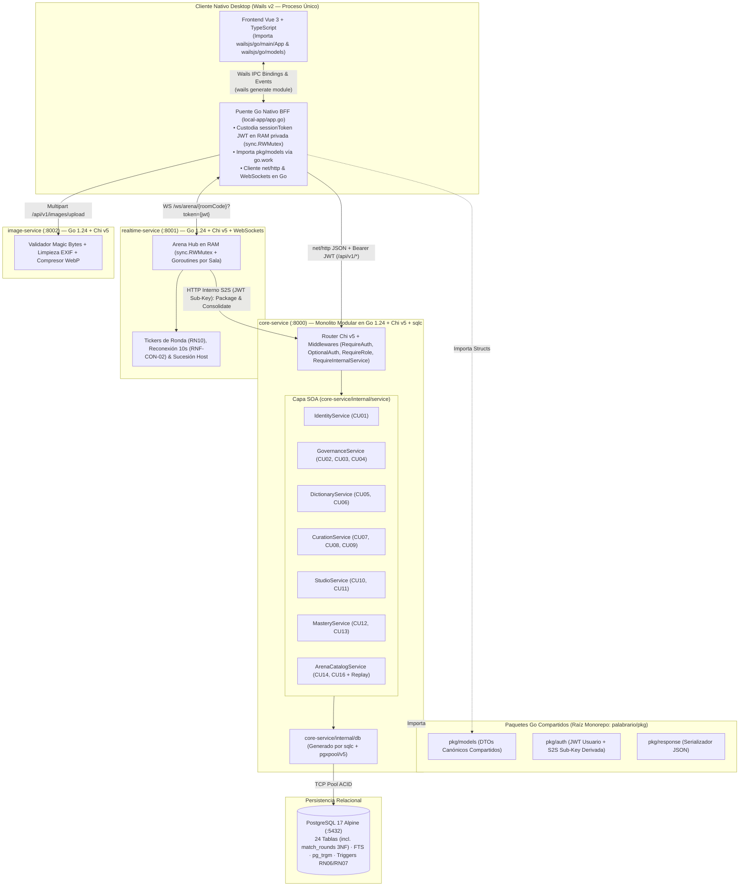

# 🔌 Especificación Exhaustiva de Servicios SOA, Contratos Go, Consultas `sqlc` e Interfaces HTTP/WS (`INTERFACES.md`)

> **Documento Arquitectónico Canónico — Fuente Única de Verdad para Contratos de Backend y Frontend**  
> **Proyecto:** Palabrario — Plataforma Gamificada de Aprendizaje y Preservación del Léxico Dialectal Panhispánico  
> **Stack Backend Unificado (100% Go):** Go 1.24 + Chi v5 + `sqlc` + `pgxpool/v5` + `golang-jwt/jwt/v5` sobre PostgreSQL 17 Alpine  
> **Patrón Arquitectónico:** Monolito Modular Orientado a Servicios (`core-service :8000`) + Servicios Satélite en Go (`realtime-service :8001`, `image-service :8002`)  
> **Sincronizado con:** [`DOMAIN.md`](./DOMAIN.md) · [`SCHEMA_FINAL.sql`](../SCHEMA_FINAL.sql) · [`pkg/models/`](../pkg/models)

---

## 0. Reglas Operativas Anti-Alucinación para Agentes de IA (Contract-First)

> [!CAUTION]
> **REGLA DE ORO OBLIGATORIA PARA TODOS LOS MODELOS DE IA:**
> 1. **Prohibido inventar campos JSON:** Ningún endpoint HTTP, evento WebSocket ni componente de interfaz (`local-app`) puede emitir o consumir propiedades que no estén explícitamente declaradas en los structs Go y contratos JSON de este documento.
> 2. **Convención estricta `snake_case`:** Todos los payloads JSON (entrada y salida) utilizan `snake_case` idéntico a las etiquetas `json:"..."` de [`pkg/models/`](../pkg/models).
> 3. **SQL Tipado Obligatorio (`sqlc`):** En `core-service`, está prohibido concatenar SQL crudo en handlers. Toda consulta nueva se define en `sql/queries/*.sql`, se compila con `sqlc generate` a `core-service/internal/db/`, es consumida por una implementación en `core-service/internal/service/` y expuesta por un handler en `core-service/internal/api/handlers/`.
> 4. **Formato Único de Error HTTP:** Toda respuesta de error (`4xx` / `5xx`) utiliza exclusivamente [`response.Error(w, status, message)`](../pkg/response/json.go):
>    ```json
>    { "error": "Descripción clara y humana del error en español" }
>    ```

---

## 1. Arquitectura Orientada a Servicios (SOA) y Puente IPC Nativo de Wails en Monorepo 100% Go

Todo el ecosistema Go está conectado mediante [`go.work`](../go.work) (`.` + `./local-app`) y el módulo raíz [`palabrario` (`go.mod`)](../go.mod):
1. **Servicios de Backend (`core-service`, `realtime-service`, `image-service`):** Importan directamente los paquetes compartidos [`pkg/models`](../pkg/models), [`pkg/auth`](../pkg/auth) y [`pkg/response`](../pkg/response).
2. **Puente IPC Nativo en el Cliente de Escritorio ([`local-app/app.go`](../local-app/app.go)):**
   - **El WebView (Vue 3 / TypeScript) jamás ejecuta llamadas HTTP/WS directas ni toca el token JWT.**
   - El proceso Go de Wails (`struct App` en `local-app/app.go`) actúa como **BFF (*Backend-For-Frontend*) local y bóveda de sesión en RAM** (`sessionToken` protegido por `sync.RWMutex`, inmune a XSS).
   - `local-app/app.go` importa los mismos structs de [`pkg/models`](../pkg/models), realiza las peticiones `net/http` o WebSockets hacia `:8000`, `:8001` y `:8002` adjuntando `Authorization: Bearer <sessionToken>`, y expone métodos Go públicos.
   - Al ejecutar `wails generate module` (o `wails dev` / `wails build`), **Wails genera automáticamente los bindings y tipos TypeScript** en `local-app/frontend/wailsjs/go/main/App.js` (`.d.ts`) y `local-app/frontend/wailsjs/go/models.ts`. Así, un cambio en `pkg/models` propaga su tipado estático desde PostgreSQL (`sqlc`) hasta Vue 3 sin intervención humana ni riesgo de alucinación.



### 1.1. Estructura de Directorios Objetivo en `core-service`

```text
core-service/
├── main.go                              # Entrypoint, Fail-Fast env check, pgxpool init, graceful shutdown
├── Dockerfile                           # Multi-stage build desde raíz (context: .)
└── internal/
    ├── config/
    │   └── config.go                    # Carga y validación estricta de variables de entorno
    ├── db/                              # CÓDIGO AUTOGENERADO POR SQLC (NO EDITAR A MANO)
    │   ├── db.go
    │   ├── models.go
    │   ├── users.sql.go
    │   ├── dictionary.sql.go
    │   ├── curation.sql.go              # (Fase 3.3)
    │   ├── studio.sql.go                # (Fase 3.4)
    │   ├── mastery.sql.go               # (Fase 3.4)
    │   ├── governance.sql.go            # (Fase 3.5)
    │   └── arena.sql.go                 # (Fase 4)
    ├── service/                         # CONTRATOS E IMPLEMENTACIONES SOA DE DOMINIO
    │   ├── errors.go                    # Errores tipados de dominio (ErrNotFound, ErrForbidden, ErrConflict...)
    │   ├── identity_service.go          # IdentityService (CU01)
    │   ├── governance_service.go        # GovernanceService (CU02, CU03, CU04)
    │   ├── dictionary_service.go        # DictionaryService (CU05, CU06)
    │   ├── curation_service.go          # CurationService (CU07, CU08, CU09)
    │   ├── studio_service.go            # StudioService (CU10, CU11)
    │   ├── mastery_service.go           # MasteryService + Algoritmo SM-2 Puro (CU12, CU13)
    │   └── arena_catalog_service.go     # ArenaCatalogService (CU14, CU16 + Replay 3NF)
    └── api/
        ├── router.go                    # Montaje de rutas Chi v5 y middlewares
        ├── middleware/
        │   └── auth_middleware.go       # RequireAuth, OptionalAuth, RequireRole, RequireInternalService
        └── handlers/
            ├── health.go
            ├── auth_handler.go
            ├── user_handler.go          # (CU01)
            ├── governance_handler.go    # (CU02, CU03, CU04)
            ├── dictionary_handler.go    # (CU05, CU06)
            ├── curation_handler.go      # (CU07, CU08, CU09)
            ├── studio_handler.go        # (CU10, CU11)
            ├── mastery_handler.go       # (CU12, CU13)
            └── arena_handler.go         # (CU14, CU16)
```

### 1.2. Mapa Estándar de Errores de Dominio a Códigos HTTP (`core-service/internal/service/errors.go`)

| Error de Dominio (`service.*`) | Código HTTP | Cuándo se dispara |
| :--- | :---: | :--- |
| `ErrInvalidInput` | `400 Bad Request` | Campos obligatorios vacíos, formato inválido, `quality_rating` fuera de `1..4`, etc. |
| `ErrUnauthorized` | `401 Unauthorized` | Token JWT ausente, expirado, firma inválida o credenciales incorrectas en login. |
| `ErrForbidden` | `403 Forbidden` | Rol insuficiente (`RBAC`), intento de editar un recurso ajeno (`RN01`, `RN03`), intento de leer baraja privada ajena (`RN04`), intento de auto-aprobar un sentido propio (`RN07`) o token de usuario intentando invocar un endpoint interno S2S. |
| `ErrNotFound` | `404 Not Found` | Recurso (`id_word`, `id_sense`, `id_deck`, `room_code`, `id_match`, `user_name`) inexistente o sentido en estado `HIDDEN`/`DRAFT` consultado desde ruta pública. |
| `ErrConflict` | `409 Conflict` | Email/`user_name` duplicado, solicitud `PENDING` de Editor ya existente (`RN02`), voto duplicado, boleto agotado/caducado (`CU04`) o partida ya consolidada (`FINISHED`). |
| `ErrUnprocessable` | `422 Unprocessable Entity` | La baraja seleccionada para abrir una Arena tiene menos de 8 sentidos `APPROVED` o menos sentidos aprobados que el número de rondas `total_rounds` solicitado (`CU14 1a`). |

---

## 2. Especificación Detallada por Módulo SOA

---

### MÓDULO 1: Identidad, Autenticación y Perfiles (`IdentityService` — `CU01`)

#### 2.1.1. Estructuras de Datos (`pkg/models/auth.go` y `pkg/models/user.go`)

```go
// Existentes en pkg/models/auth.go y pkg/models/user.go:
// SignInRequest, SignUpRequest, AuthResponse, AccountRole, Region, UserProfile

// --- NUEVOS DTOs A AGREGAR EN pkg/models/user.go ---

type UpdateProfileRequest struct {
	Name          string  `json:"name"`                     // Obligatorio, 2..100 chars
	AnchorDialect string  `json:"anchor_dialect"`           // Obligatorio: 'MX','ES','AR','CO','CL','CU','CAM','PAN'
	AvatarURL     *string `json:"avatar_url,omitempty"`     // Opcional, URL generada por image-service
}

type ChangePasswordRequest struct {
	CurrentPassword string `json:"current_password"`        // Obligatorio
	NewPassword     string `json:"new_password"`            // Obligatorio, mín. 8 caracteres
}

type PublicUserProfile struct {
	IDUser             string              `json:"id_user"`
	Name               string              `json:"name"`
	UserName           string              `json:"user_name"`
	AvatarURL          *string             `json:"avatar_url,omitempty"`
	AnchorDialect      string              `json:"anchor_dialect"`
	Role               AccountRole         `json:"role"`
	TotalXP            int                 `json:"total_xp"`
	CurrentLevel       int                 `json:"current_level"`
	CurrentStreak      int                 `json:"current_streak"`
	LongestStreak      int                 `json:"longest_streak"`
	UnlockedBadges     []AchievementStatus `json:"unlocked_badges"`
	PublicDecks        []Deck              `json:"public_decks"`
	PublicCollections  []Collection        `json:"public_collections"`
	MatchesWon         int                 `json:"matches_won"`
	PodiumCount        int                 `json:"podium_count"`
	IsOwner            bool                `json:"is_owner"`
	// Campos poblados ÚNICAMENTE cuando IsOwner == true:
	Email              *string             `json:"email,omitempty"`
	PrivateDecksCount  *int                `json:"private_decks_count,omitempty"`
	DueReviewsToday    *int                `json:"due_reviews_today,omitempty"`
	CreatedAt          time.Time           `json:"created_at"`
}
```

#### 2.1.2. Interfaz SOA (`IdentityService`)

```go
type IdentityService interface {
	SignUp(ctx context.Context, req models.SignUpRequest) (*models.AuthResponse, error)
	SignIn(ctx context.Context, req models.SignInRequest) (*models.AuthResponse, error)
	GetMe(ctx context.Context, userID string) (*models.UserProfile, error)
	UpdateProfile(ctx context.Context, userID string, req models.UpdateProfileRequest) (*models.UserProfile, error)
	ChangePassword(ctx context.Context, userID string, req models.ChangePasswordRequest) error
	GetPublicProfileByUsername(ctx context.Context, viewerID *string, username string) (*models.PublicUserProfile, error)
}
```

#### 2.1.3. Consultas `sqlc` (`sql/queries/users.sql`)
- **Existentes:** `GetAccountByEmail`, `CreateAccount`, `CreateUserProfile`, `GetUserProfileByID`, `CheckEmailOrUsernameExists`.
- **Nuevas a añadir en `sql/queries/users.sql`:**
  - `-- name: UpdateUserProfile :one` $\to$ Actualiza `name`, `anchor_dialect`, `avatar_url`, `updated_at = now()` en `users` filtrando por `id_user` y retorna el perfil unido a `accounts`.
  - `-- name: GetAccountByID :one` $\to$ Obtiene `id_account, password_hash, is_active` para verificar la contraseña actual.
  - `-- name: UpdateAccountPassword :exec` $\to$ Actualiza `password_hash` y `updated_at = now()` en `accounts`.
  - `-- name: GetUserProfileByUsername :one` $\to$ Busca en `users JOIN accounts` por `LOWER(user_name) = LOWER($1)`.

#### 2.1.4. Endpoints HTTP (`/api/v1/auth` y `/api/v1/users`)

| Método | Ruta | Middleware | Caso de Uso | Estado | Códigos HTTP |
| :---: | :--- | :---: | :---: | :---: | :--- |
| `POST` | `/api/v1/auth/sign-up` | Público | Base Auth | ✅ Listo | `201`, `400`, `409` |
| `POST` | `/api/v1/auth/sign-in` | Público | RF01 | ✅ Listo | `200`, `400`, `401`, `403` (si `is_active=false`) |
| `GET` | `/api/v1/auth/me` | `RequireAuth` | CU01 | ✅ Listo | `200`, `401`, `404` |
| `PUT` | `/api/v1/users/me` | `RequireAuth` | CU01 (RN01) | ✅ Listo | `200`, `400`, `401` |
| `PUT` | `/api/v1/users/me/password` | `RequireAuth` | CU01 (RN01) | ✅ Listo | `204`, `400`, `401` (contraseña actual inválida) |
| `GET` | `/api/v1/users/u/{username}` | `OptionalAuth` | CU01 / UI | ✅ Listo | `200`, `404` |

---

### MÓDULO 2: Gobernanza Institucional, Roles y Boletos (`GovernanceService` — `CU02, CU03, CU04`)

#### 2.2.1. Estructuras de Datos (`pkg/models/governance.go` — Nuevo Archivo)

```go
package models

import "time"

type RequestStatus string

const (
	RequestPending  RequestStatus = "PENDING"
	RequestApproved RequestStatus = "APPROVED"
	RequestRejected RequestStatus = "REJECTED"
)

type CreateEditorRequestDTO struct {
	InstitutionName string  `json:"institution_name"`          // Obligatorio, 3..150 chars
	Justification   string  `json:"justification"`             // Obligatorio, mín. 20 chars
	CredentialsURL  *string `json:"credentials_url,omitempty"` // Opcional, URL del comprobante
}

type ResolveEditorRequestDTO struct {
	Status      RequestStatus `json:"status"`                  // 'APPROVED' o 'REJECTED'
	ReviewNotes *string       `json:"review_notes,omitempty"`  // Motivo del dictamen administrativo
}

type EditorRequest struct {
	IDRequest       string        `json:"id_request"`
	IDUser          string        `json:"id_user"`
	UserName        string        `json:"user_name"`
	UserFullName    string        `json:"user_full_name"`
	UserEmail       string        `json:"user_email"`
	InstitutionName string        `json:"institution_name"`
	Justification   string        `json:"justification"`
	CredentialsURL  *string       `json:"credentials_url,omitempty"`
	Status          RequestStatus `json:"status"`
	ReviewedBy      *string       `json:"reviewed_by,omitempty"`
	ReviewNotes     *string       `json:"review_notes,omitempty"`
	CreatedAt       time.Time     `json:"created_at"`
	ResolvedAt      *time.Time    `json:"resolved_at,omitempty"`
}

type UpdateUserRoleOrStatusRequest struct {
	Role     *AccountRole `json:"role,omitempty"`      // 'LEARNER', 'EDITOR', 'ADMIN'
	IsActive *bool        `json:"is_active,omitempty"` // Suspensión / Reactivación de cuenta
}

type CreateTicketRequest struct {
	Code            *string     `json:"code,omitempty"`             // Si se omite, el backend genera ej. "PAL-UNAM-2026-X9A2"
	GrantedRole     AccountRole `json:"granted_role"`               // 'LEARNER' o 'EDITOR' (default 'LEARNER')
	InstitutionName *string     `json:"institution_name,omitempty"` // Ej. "Facultad de Filosofía y Letras UNAM"
	MaxUses         int         `json:"max_uses"`                   // >= 1 (1 = uniuso, >1 = multiuso)
	ExpiresAt       *time.Time  `json:"expires_at,omitempty"`       // Opcional
}

type InvitationTicket struct {
	IDTicket        string      `json:"id_ticket"`
	Code            string      `json:"code"`
	CreatedBy       string      `json:"created_by"`
	GrantedRole     AccountRole `json:"granted_role"`
	InstitutionName *string     `json:"institution_name,omitempty"`
	MaxUses         int         `json:"max_uses"`
	CurrentUses     int         `json:"current_uses"`
	IsActive        bool        `json:"is_active"`
	ExpiresAt       *time.Time  `json:"expires_at,omitempty"`
	CreatedAt       time.Time   `json:"created_at"`
}

type RedeemTicketRequest struct {
	Code string `json:"code"` // Obligatorio
}
```

#### 2.2.2. Interfaz SOA (`GovernanceService`)

```go
type GovernanceService interface {
	CreateEditorRequest(ctx context.Context, learnerID string, req models.CreateEditorRequestDTO) (*models.EditorRequest, error)
	ListMyEditorRequests(ctx context.Context, learnerID string) ([]models.EditorRequest, error)
	ListEditorRequests(ctx context.Context, statusFilter *string) ([]models.EditorRequest, error)
	ResolveEditorRequest(ctx context.Context, adminID string, requestID string, req models.ResolveEditorRequestDTO) (*models.EditorRequest, error)

	ListUsers(ctx context.Context, search string, roleFilter *string, limit, offset int) ([]models.UserProfile, int, error)
	UpdateUserRoleOrStatus(ctx context.Context, adminID string, targetUserID string, req models.UpdateUserRoleOrStatusRequest) (*models.UserProfile, error)

	CreateInvitationTicket(ctx context.Context, adminID string, req models.CreateTicketRequest) (*models.InvitationTicket, error)
	ListInvitationTickets(ctx context.Context, activeOnly bool) ([]models.InvitationTicket, error)
	RevokeInvitationTicket(ctx context.Context, adminID string, ticketID string) error
	RedeemInvitationTicket(ctx context.Context, userID string, code string) (*models.UserProfile, error)
}
```

#### 2.2.3. Reglas Transaccionales y de Integridad en `GovernanceService`
1. **RN02 en `CreateEditorRequest`:** Si el usuario ya tiene el rol `EDITOR` o `ADMIN`, devuelve `409 Conflict`. Si intenta crear una segunda solicitud mientras otra está en `PENDING`, el índice único parcial `idx_unique_pending_editor_request` de PostgreSQL (`SQLSTATE 23505`) se traduce a `409 Conflict ("Ya tienes una solicitud de promoción pendiente de revisión")`.
2. **Promoción Atómica en `ResolveEditorRequest`:** Se ejecuta dentro de `pgx.Tx`. Si `req.Status == "APPROVED"`, actualiza `editor_requests` (`status = 'APPROVED'`, `reviewed_by`, `resolved_at = now()`) **y en la misma transacción** ejecuta `UPDATE accounts SET role = 'EDITOR' WHERE id_account = $1`.
3. **Protección del Último Administrador en `UpdateUserRoleOrStatus` (CU03 4a):** Antes de degradar el rol o desactivar (`is_active = false`) a un usuario `ADMIN`, cuenta cuántos administradores activos quedan (`SELECT count(*) FROM accounts WHERE role = 'ADMIN' AND is_active = true`). Si el conteo es $\le 1$, aborta con `409 Conflict ("No se puede revocar ni desactivar al único Administrador activo del sistema")`.
4. **Redención Atómica en `RedeemInvitationTicket` (CU04):** Dentro de `pgx.Tx`, bloquea la fila del boleto (`SELECT ... FROM invitation_tickets WHERE code = $1 FOR UPDATE`), verifica `is_active == true`, `(expires_at IS NULL OR expires_at > now())` y `current_uses < max_uses`. Inserta en `ticket_redemptions`, incrementa `current_uses = current_uses + 1`, y si `granted_role == 'EDITOR'` y el usuario era `'LEARNER'`, promueve su cuenta a `'EDITOR'`.

#### 2.2.4. Endpoints HTTP (`/api/v1/governance`)

| Método | Ruta | Middleware | Caso de Uso | Códigos HTTP |
| :---: | :--- | :---: | :---: | :--- |
| `POST` | `/api/v1/governance/editor-requests` | `RequireAuth` | CU02 (RN02) | `201`, `400`, `409` (solicitud pendiente o ya es editor) |
| `GET` | `/api/v1/governance/editor-requests/me` | `RequireAuth` | CU02 | `200` |
| `GET` | `/api/v1/governance/editor-requests` | `RequireRole(ADMIN)` | CU03 | `200` (`?status=PENDING`) |
| `PUT` | `/api/v1/governance/editor-requests/{id}/resolve` | `RequireRole(ADMIN)` | CU03 (RN08) | `200`, `400`, `404`, `409` |
| `GET` | `/api/v1/governance/users` | `RequireRole(ADMIN)` | CU03 | `200` (`?q=&role=&limit=20&offset=0`) |
| `PUT` | `/api/v1/governance/users/{id}/access` | `RequireRole(ADMIN)` | CU03 (RN08) | `200`, `404`, `409` (último admin) |
| `POST` | `/api/v1/governance/tickets` | `RequireRole(ADMIN)` | CU04 (RN08) | `201`, `400`, `409` |
| `GET` | `/api/v1/governance/tickets` | `RequireRole(ADMIN)` | CU04 | `200` (`?active_only=true`) |
| `DELETE` | `/api/v1/governance/tickets/{id}` | `RequireRole(ADMIN)` | CU04 | `204`, `404` |
| `POST` | `/api/v1/governance/tickets/redeem` | `RequireAuth` | CU04 | `200`, `400`, `404`, `409` (agotado, vencido o ya redimido por el usuario) |

---

### MÓDULO 3: Diccionario Panhispánico, Autoría Léxica y Heteronimia (`DictionaryService` — `CU05, CU06`)

#### 2.3.1. Estructuras de Datos Completas (`pkg/models/dictionary.go`)

Además de las estructuras ya existentes (`WordGender`, `WordSearchResult`, `Example`, `HeteronymItem`, `SenseDetail`, `WordDetail`), se definen en `pkg/models/dictionary.go`:

```go
// Filtro de exploración paginada (GET /api/v1/words)
type WordExploreFilter struct {
	Query          string `json:"q"`
	RegionCode     string `json:"region"`          // Ej. 'MX', 'AR', 'ES'
	PartOfSpeech   string `json:"pos"`             // Ej. 'sustantivo', 'verbo', 'adjetivo', 'modismo'
	CEFRLevel      string `json:"cefr"`            // 'A1'..'C2', 'NATIVO'
	UsageFrequency string `json:"frequency"`       // 'EVERYDAY', 'COMMON', 'RARE', 'SLANG', 'ARCHAIC'
	IncludeTaboo   bool   `json:"include_taboo"`   // Default true
	Page           int    `json:"page"`            // Default 1
	Limit          int    `json:"limit"`           // Default 20, máx 50
}

type WordSummaryCard struct {
	IDWord           int        `json:"id_word"`
	Lemma            string     `json:"lemma"`
	PartOfSpeech     string     `json:"part_of_speech"`
	Gender           WordGender `json:"gender"`
	FriendlyBlurb    *string    `json:"friendly_blurb,omitempty"`
	ImageURL         *string    `json:"image_url,omitempty"`
	ImageURL         *string    `json:"image_url,omitempty"`
	PrimarySenseID   int        `json:"primary_sense_id"`
	ShortDefinition  string     `json:"short_definition"`
	RegionCode       string     `json:"region_code"`
	RegionName       string     `json:"region_name"`
	FlagEmoji        string     `json:"flag_emoji"`
	CEFRLevel        string     `json:"cefr_level"`
	UsageFrequency   string     `json:"usage_frequency"`
	IsTabooOrVulgar  bool       `json:"is_taboo_or_vulgar"`
	ApprovedSenses   int        `json:"approved_senses_count"`
}

type PaginatedWords struct {
	Items      []WordSummaryCard `json:"items"`
	TotalCount int               `json:"total_count"`
	Page       int               `json:"page"`
	Limit      int               `json:"limit"`
}

// --- DTOs DE AUTORÍA EDITORIAL (CU06) ---

type CreateExampleInput struct {
	Sentence string  `json:"sentence"`          // Obligatorio, mín. 5 chars
	Source   *string `json:"source,omitempty"`  // Opcional
}

type CreateSenseRequest struct {
	RegionCode      string               `json:"region_code"`               // Obligatorio ('MX', 'AR', etc.)
	ShortDefinition string               `json:"short_definition"`          // Obligatorio, <= 255 chars
	Definition      string               `json:"definition"`                // Obligatorio
	IsPrimary       bool                 `json:"is_primary"`
	IsTabooOrVulgar bool                 `json:"is_taboo_or_vulgar"`
	CulturalNote    *string              `json:"cultural_note,omitempty"`
	ImageURL        *string              `json:"image_url,omitempty"`        // Opcional, URL procesada por image-service (RN12)
	CEFRLevel       string               `json:"cefr_level"`                // Default 'B1'
	UsageFrequency  string               `json:"usage_frequency"`           // Default 'COMMON'
	ConceptIDs      []int                `json:"concept_ids,omitempty"`     // Opcional: vincular heterónimos
	Examples        []CreateExampleInput `json:"examples,omitempty"`        // Ejemplos iniciales
}

type CreateWordProposalRequest struct {
	Lemma            string             `json:"lemma"`                      // Obligatorio
	PartOfSpeech     string             `json:"part_of_speech"`             // Obligatorio
	Gender           WordGender         `json:"gender"`                     // Default 'NEUTRAL'
	Etymology        *string            `json:"etymology,omitempty"`
	FriendlyBlurb    *string            `json:"friendly_blurb,omitempty"`
	ImageURL         *string            `json:"image_url,omitempty"`         // Opcional, URL procesada por image-service (RN12)
	OriginRegionCode *string            `json:"origin_region_code,omitempty"`
	InitialSense     CreateSenseRequest `json:"initial_sense"`              // Obligatorio
}

type UpdateWordRequest struct {
	Lemma            string     `json:"lemma"`
	PartOfSpeech     string     `json:"part_of_speech"`
	Gender           WordGender `json:"gender"`
	Etymology        *string    `json:"etymology,omitempty"`
	FriendlyBlurb    *string    `json:"friendly_blurb,omitempty"`
	ImageURL         *string    `json:"image_url,omitempty"`
	ImageURL         *string    `json:"image_url,omitempty"`
	OriginRegionCode *string    `json:"origin_region_code,omitempty"`
}

type UpdateSenseRequest struct {
	RegionCode      string  `json:"region_code"`
	ShortDefinition string  `json:"short_definition"`
	Definition      string  `json:"definition"`
	IsPrimary       bool    `json:"is_primary"`
	IsTabooOrVulgar bool    `json:"is_taboo_or_vulgar"`
	CulturalNote    *string `json:"cultural_note,omitempty"`
	ImageURL        *string `json:"image_url,omitempty"`
	CEFRLevel       string  `json:"cefr_level"`
	UsageFrequency  string  `json:"usage_frequency"`
}

type SemanticConcept struct {
	IDConcept            int    `json:"id_concept"`
	ConceptKey           string `json:"concept_key"`
	UniversalDescription string `json:"universal_description"`
	LinkedSensesCount    int    `json:"linked_senses_count"`
}

type CreateConceptRequest struct {
	ConceptKey           string `json:"concept_key"`           // Ej. 'street_market'
	UniversalDescription string `json:"universal_description"` // Ej. 'Mercado ambulante tradicional al aire libre'
}
```

#### 2.3.2. Consultas `sqlc` Exactas en `sql/queries/dictionary.sql`

Además de las 5 consultas base (`SearchVocabularyDropdown`, `GetWordByID`, `GetApprovedSensesByWordID`, `GetExamplesBySenseIDs`, `GetHeteronymsByWordID`), incluye:

1. `-- name: ListRegions :many`
   Selecciona todas las filas de `regions` ordenadas por `name ASC`.
2. `-- name: GetRegionByCode :one`
   Obtiene `id_region, code, name, parent_zone, country_code, flag_emoji` donde `code = $1`.
3. `-- name: GetWordOfTheDayID :one`
   Selecciona determinísticamente un `id_word` que tenga al menos un sentido `APPROVED` (priorizando la región `$1` si se envía, usando `MOD(EXTRACT(DOY FROM CURRENT_DATE)::INT, COUNT(*))` o `friendly_blurb IS NOT NULL`) para luego armar su `WordDetail` completo con las consultas existentes.
4. `-- name: ExploreWordsPaginated :many` y `-- name: CountExploreWords :one`
   Filtra `words w JOIN senses s ON s.id_word = w.id_word AND s.state = 'APPROVED' JOIN regions r ON r.id_region = s.id_region` aplicando filtros opcionales (`sqlc.narg`): `region_code`, `part_of_speech`, `cefr_level`, `usage_frequency`, `include_taboo` y búsqueda `q`, paginado con `LIMIT $1 OFFSET $2`.
5. `-- name: GetWordByNormalizedLemmaAndPOS :one`
   Busca si ya existe un lema con `(normalized_lemma = $1 AND part_of_speech = $2)`. Si ya existe durante `CreateWordProposal`, reutiliza el `id_word` existente y agrega el nuevo `Sense` en `DRAFT` (**CU06 Flujo Principal Paso 2**).
6. `-- name: CreateWord :one`
   Inserta en `words (lemma, normalized_lemma, part_of_speech, gender, etymology, friendly_blurb, id_origin_region)` y retorna la fila creada.
7. `-- name: UpdateWordMetadata :one`
   Actualiza metadatos de `words` y `updated_at = now()` por `id_word`.
8. `-- name: CreateSense :one`
   Inserta en `senses (id_word, id_region, id_editor, short_definition, definition, is_primary, is_taboo_or_vulgar, cultural_note, cefr_level, usage_frequency, state)`.
   - **Regla de Negocio en `CreateSense`:** Si el actor tiene rol `ADMIN`, puede optar por crear directamente en `'APPROVED'` (`RN08`); si es `EDITOR`, se inserta siempre con `state = 'DRAFT'` (`CU06 Paso 5`).
9. `-- name: GetSenseByID :one`
   Obtiene el sentido (cualquier `state`) junto con su `id_editor` para verificar autoría antes de editar/eliminar (`CU06 2a`).
10. `-- name: UpdateSense :one` y `-- name: DeleteSense :exec`
    Actualiza o elimina un sentido. Si el actor es `EDITOR` (no `ADMIN`), verifica que `sense.id_editor == actorID` y `sense.state == 'DRAFT'`.
11. `-- name: CreateExample :one`, `-- name: UpdateExample :one`, `-- name: DeleteExample :exec`
    CRUD de oraciones de ejemplo en `examples`.
12. `-- name: ListSemanticConcepts :many`, `-- name: CreateSemanticConcept :one`, `-- name: LinkSenseToConcept :exec`, `-- name: UnlinkSenseFromConcept :exec`
    Gestión del grafo de heterónimos en `semantic_concepts` y `concept_mappings`.

#### 2.3.3. Especificación de Endpoints HTTP de Diccionario (`/api/v1/regions`, `/api/v1/words`, `/api/v1/senses`, `/api/v1/concepts`)

| Método | Ruta | Middleware | Caso de Uso | Estado | Respuesta Exitosa |
| :---: | :--- | :---: | :---: | :---: | :--- |
| `GET` | `/api/v1/regions` | Público | CU05 | ✅ Listo | `200 OK` $\to$ `[]models.Region` |
| `GET` | `/api/v1/words/word-of-the-day` | Público | CU05 | ✅ Listo | `200 OK` $\to$ `models.WordDetail` (`?dialect=MX`) |
| `GET` | `/api/v1/words/search` | Público | CU05 (RF06) | ✅ Listo | `200 OK` $\to$ `[]models.WordSearchResult` (`?q=&dialect=&limit=8`) |
| `GET` | `/api/v1/words` | Público | CU05 (RF07) | ✅ Listo | `200 OK` $\to$ `models.PaginatedWords` |
| `GET` | `/api/v1/words/{id}` | Público | CU05 (RF07) | ✅ Listo | `200 OK` $\to$ `models.WordDetail` |
| `POST` | `/api/v1/words` | `RequireRole(EDITOR, ADMIN)` | CU06 (RF08) | ✅ Listo | `201 Created` $\to$ `models.WordDetail` |
| `PUT` | `/api/v1/words/{id}` | `RequireRole(EDITOR, ADMIN)` | CU06 | ✅ Listo | `200 OK` $\to$ `models.WordDetail` |
| `POST` | `/api/v1/words/{id}/senses` | `RequireRole(EDITOR, ADMIN)` | CU06 (RF08) | ✅ Listo | `201 Created` $\to$ `models.SenseDetail` |
| `PUT` | `/api/v1/senses/{senseId}` | `RequireRole(EDITOR, ADMIN)` | CU06 (2a) | ✅ Listo | `200 OK` $\to$ `models.SenseDetail` (`403` si otro editor o ya aprobado) |
| `DELETE` | `/api/v1/senses/{senseId}` | `RequireRole(EDITOR, ADMIN)` | CU06 | ✅ Listo | `204 No Content` |
| `POST` | `/api/v1/senses/{senseId}/examples` | `RequireRole(EDITOR, ADMIN)` | CU06 | ✅ Listo | `201 Created` $\to$ `models.Example` |
| `PUT` | `/api/v1/examples/{exampleId}` | `RequireRole(EDITOR, ADMIN)` | CU06 | ✅ Listo | `200 OK` $\to$ `models.Example` |
| `DELETE` | `/api/v1/examples/{exampleId}` | `RequireRole(EDITOR, ADMIN)` | CU06 | ✅ Listo | `204 No Content` |
| `GET` | `/api/v1/concepts` | Público | CU05 / CU06 | ✅ Listo | `200 OK` $\to$ `[]models.SemanticConcept` (`?q=`) |
| `POST` | `/api/v1/concepts` | `RequireRole(EDITOR, ADMIN)` | CU06 | ✅ Listo | `201 Created` $\to$ `models.SemanticConcept` |
| `POST` | `/api/v1/senses/{senseId}/concepts/{conceptId}` | `RequireRole(EDITOR, ADMIN)` | CU06 | ✅ Listo | `204 No Content` |
| `DELETE` | `/api/v1/senses/{senseId}/concepts/{conceptId}` | `RequireRole(EDITOR, ADMIN)` | CU06 | ✅ Listo | `204 No Content` |

---

### MÓDULO 4: Curaduría Editorial por Quórum y Moderación (`CurationService` — `CU07, CU08, CU09`)

#### 2.4.1. Estructuras de Datos (`pkg/models/curation.go`)

```go
package models

import "time"

type ReviewDecision string

const (
	DecisionApprove        ReviewDecision = "APPROVE"
	DecisionRequestChanges ReviewDecision = "REQUEST_CHANGES"
	DecisionReject         ReviewDecision = "REJECT"
)

type SenseApprovalVote struct {
	IDSense        int            `json:"id_sense"`
	IDEditor       string         `json:"id_editor"`
	EditorUserName string         `json:"editor_user_name"`
	EditorFullName string         `json:"editor_full_name"`
	EditorDialect  string         `json:"editor_dialect"`
	Decision       ReviewDecision `json:"decision"`
	FeedbackNotes  *string        `json:"feedback_notes,omitempty"`
	ApprovedAt     time.Time      `json:"approved_at"`
}

type SenseQuorumItem struct {
	IDSense          int            `json:"id_sense"`
	IDWord           int            `json:"id_word"`
	Lemma            string         `json:"lemma"`
	PartOfSpeech     string         `json:"part_of_speech"`
	RegionCode       string         `json:"region_code"`
	RegionName       string         `json:"region_name"`
	FlagEmoji        string         `json:"flag_emoji"`
	ShortDefinition  string         `json:"short_definition"`
	Definition       string         `json:"definition"`
	CulturalNote     *string        `json:"cultural_note,omitempty"`
	CEFRLevel        string         `json:"cefr_level"`
	UsageFrequency   string         `json:"usage_frequency"`
	IsTabooOrVulgar  bool           `json:"is_taboo_or_vulgar"`
	State            string         `json:"state"`            // 'DRAFT', 'APPROVED', 'HIDDEN'
	AuthorID         string         `json:"author_id"`
	AuthorUserName   string         `json:"author_user_name"`
	AuthorFullName   string         `json:"author_full_name"`
	ApprovalsCount   int            `json:"approvals_count"`  // Votos con decision = 'APPROVE'
	RequiredQuorum   int            `json:"required_quorum"`  // Constante: 3 (RN06)
	CreatedAt        time.Time      `json:"created_at"`
}

type SenseQuorumDetail struct {
	Proposal SenseQuorumItem     `json:"proposal"`
	Examples []Example           `json:"examples"`
	Votes    []SenseApprovalVote `json:"votes"`
}

type SubmitVoteRequest struct {
	Decision      ReviewDecision `json:"decision"`                 // 'APPROVE', 'REQUEST_CHANGES', 'REJECT'
	FeedbackNotes *string        `json:"feedback_notes,omitempty"` // Obligatorio si Decision != 'APPROVE'
}

type AdminOverrideStateRequest struct {
	State  string  `json:"state"`            // 'APPROVED' o 'HIDDEN'
	Reason *string `json:"reason,omitempty"` // Nota de auditoría
}

// --- DTOs DE MODERACIÓN DE REPORTES (CU09) ---

type ContentReport struct {
	IDReport        string     `json:"id_report"`
	IDReporter      string     `json:"id_reporter"`
	ReporterName    string     `json:"reporter_user_name"`
	TargetType      string     `json:"target_type"`      // 'WORD', 'SENSE', 'EXAMPLE'
	IDWord          *int       `json:"id_word,omitempty"`
	IDSense         *int       `json:"id_sense,omitempty"`
	IDExample       *int       `json:"id_example,omitempty"`
	TargetPreview   string     `json:"target_preview"`   // Lema o texto reportado para inspección rápida
	Reason          string     `json:"reason"`           // 'INACCURATE_DEFINITION', 'OFFENSIVE_UNMARKED', 'SPAM_OR_VANDALISM', 'DUPLICATE', 'OTHER'
	Details         string     `json:"details"`
	Status          string     `json:"status"`           // 'PENDING', 'RESOLVED_HIDDEN', 'RESOLVED_AMENDED', 'DISMISSED'
	ResolvedBy      *string    `json:"resolved_by,omitempty"`
	ResolutionNotes *string    `json:"resolution_notes,omitempty"`
	CreatedAt       time.Time  `json:"created_at"`
	ResolvedAt      *time.Time `json:"resolved_at,omitempty"`
}

type CreateReportRequest struct {
	TargetType string `json:"target_type"`          // 'WORD', 'SENSE', 'EXAMPLE'
	IDWord     *int   `json:"id_word,omitempty"`
	IDSense    *int   `json:"id_sense,omitempty"`
	IDExample  *int   `json:"id_example,omitempty"`
	Reason     string `json:"reason"`
	Details    string `json:"details"`              // Obligatorio, mín. 10 chars
}

type ResolveReportRequest struct {
	Status          string  `json:"status"`           // 'RESOLVED_HIDDEN', 'RESOLVED_AMENDED', 'DISMISSED'
	ResolutionNotes *string `json:"resolution_notes,omitempty"`
}
```

#### 2.4.2. Comportamiento de `SubmitQuorumVote` frente a Triggers PostgreSQL (`RN06` y `RN07`)
1. Cuando `SubmitQuorumVote` ejecuta `UpsertSenseApproval` en `sense_approvals`:
   - Si `editorID == sense.id_editor`, tanto la validación en Go como el trigger `trg_prevent_self_approval` (**RN07**) rechazan la operación $\to$ el handler responde `403 Forbidden {"error": "Violación de integridad (RN07): Un editor no puede votar ni aprobar su propia contribución"}`.
   - Si `req.Decision == "REQUEST_CHANGES"` o `"REJECT"` y `req.FeedbackNotes` está vacío $\to$ responde `400 Bad Request {"error": "Debes incluir notas de retroalimentación al solicitar correcciones o rechazar una propuesta"}`.
   - Si `req.Decision == "APPROVE"` y con este voto la suma de `decision = 'APPROVE'` alcanza **3**, el trigger `trg_auto_approve_sense` (**RN06 / CU08**) actualiza automáticamente `senses.state = 'APPROVED'` dentro de la misma operación en PostgreSQL. Acto seguido, `SubmitQuorumVote` vuelve a leer `GetProposalInspection` y devuelve el `SenseQuorumDetail` actualizado con `state: "APPROVED"` y `approvals_count: 3`.

#### 2.4.3. Endpoints HTTP de Curaduría y Moderación (`/api/v1/curation` y `/api/v1/reports`)

| Método | Ruta | Middleware | Caso de Uso | Estado | Respuesta Exitosa |
| :---: | :--- | :---: | :---: | :---: | :--- |
| `GET` | `/api/v1/curation/queue` | `RequireRole(EDITOR, ADMIN)` | CU07 (RN06/07) | ✅ Listo | `200 OK` $\to$ `[]models.SenseQuorumItem` (`?region=MX`) |
| `GET` | `/api/v1/curation/my-proposals` | `RequireRole(EDITOR, ADMIN)` | CU06 / CU07 | ✅ Listo | `200 OK` $\to$ `[]models.SenseQuorumItem` (`?state=DRAFT`) |
| `GET` | `/api/v1/curation/senses/{senseId}` | `RequireRole(EDITOR, ADMIN)` | CU07 | ✅ Listo | `200 OK` $\to$ `models.SenseQuorumDetail` |
| `POST` | `/api/v1/curation/senses/{senseId}/vote` | `RequireRole(EDITOR, ADMIN)` | CU07 / CU08 | ✅ Listo | `200 OK` $\to$ `models.SenseQuorumDetail` (`403` en RN07) |
| `PUT` | `/api/v1/curation/senses/{senseId}/state` | `RequireRole(ADMIN)` | CU08 (1b, RN08)| ✅ Listo | `200 OK` $\to$ `models.SenseDetail` |
| `POST` | `/api/v1/reports` | `RequireAuth` | CU09 (RF11) | ✅ Listo | `201 Created` $\to$ `models.ContentReport` |
| `GET` | `/api/v1/reports` | `RequireRole(ADMIN)` | CU09 | ✅ Listo | `200 OK` $\to$ `[]models.ContentReport` (`?status=PENDING`) |
| `PUT` | `/api/v1/reports/{reportId}/resolve` | `RequireRole(ADMIN)` | CU09 (RN08) | ✅ Listo | `200 OK` $\to$ `models.ContentReport` |

---

### MÓDULO 5: Studio Personal — Barajas y Colecciones (`StudioService` — `CU10, CU11`)

#### 2.5.1. Estructuras de Datos en `pkg/models/studio.go`

```go
// Enriquecimiento de Deck para la vista del Studio Personal (GUIStudioDeckCard):
type StudioDeckSummary struct {
	Deck
	OwnerUserName      string  `json:"owner_user_name"`
	IsSavedFromComm    bool    `json:"is_saved_from_community"`
	DueCardsToday      int     `json:"due_cards_today"`
	RetentionPercent   float32 `json:"retention_percent"`
}

type CreateDeckRequest struct {
	Title       string  `json:"title"`                 // Obligatorio, 3..150 chars
	Description *string `json:"description,omitempty"`
	IsPublic    bool    `json:"is_public"`
	IsOfficial  bool    `json:"is_official"`           // Solo respetado si role IN ('EDITOR', 'ADMIN') (RN05)
	SenseIDs    []int   `json:"sense_ids,omitempty"`   // Tarjetas iniciales opcionales
}

type UpdateDeckRequest struct {
	Title       string  `json:"title"`
	Description *string `json:"description,omitempty"`
	IsPublic    bool    `json:"is_public"`
	IsOfficial  bool    `json:"is_official"`
}

type AddDeckItemRequest struct {
	IDSense   int  `json:"id_sense"`
	SortOrder *int `json:"sort_order,omitempty"`
}

type CreateCollectionRequest struct {
	Title       string  `json:"title"`
	Description *string `json:"description,omitempty"`
	IsPublic    bool    `json:"is_public"`
	IsFeatured  bool    `json:"is_featured"` // Solo ADMIN/EDITOR
	IsOfficial  bool    `json:"is_official"` // Solo ADMIN/EDITOR (RN05)
	DeckIDs     []int   `json:"deck_ids"`    // Ordenados según el arreglo
}

type UpdateCollectionRequest struct {
	Title       string  `json:"title"`
	Description *string `json:"description,omitempty"`
	IsPublic    bool    `json:"is_public"`
	IsFeatured  bool    `json:"is_featured"`
	IsOfficial  bool    `json:"is_official"`
	DeckIDs     []int   `json:"deck_ids,omitempty"`
}
```

#### 2.5.2. Reglas de Negocio en `StudioService` (`RN03`, `RN04`, `RN05`)
- **RN03 (Propiedad en Studio):** Solo el propietario (`deck.id_user == userID`) o un `ADMIN` (`RN08`) puede ejecutar `PUT` o `DELETE` sobre una baraja/colección o alterar sus ítems. Si un tercero lo intenta, devuelve `403 Forbidden`.
- **RN04 (Privacidad de Recursos):** En `GetDeckDetail`, `GetCollectionDetail`, `SavePublicDeckToStudio` y `SavePublicCollectionToStudio`, si `is_public == false` y el solicitante no es el dueño ni `ADMIN`, devuelve `403 Forbidden`.
- **RN05 (Contenido Oficial):** Si un `LEARNER` envía `is_official: true` o `is_featured: true`, el servicio fuerza silenciosamente ambos flags a `false`.

#### 2.5.3. Endpoints HTTP de Studio (`/api/v1/decks`, `/api/v1/collections`, `/api/v1/studio`)

| Método | Ruta | Middleware | Caso de Uso | Estado | Respuesta Exitosa |
| :---: | :--- | :---: | :---: | :---: | :--- |
| `GET` | `/api/v1/decks` | Público | CU10 (RN04) | ✅ Listo | `200 OK` $\to$ `[]models.Deck` (`?q=&official_only=false`) |
| `GET` | `/api/v1/studio/decks` | `RequireAuth` | CU10 | ✅ Listo | `200 OK` $\to$ `[]models.StudioDeckSummary` (Propias + Guardadas) |
| `GET` | `/api/v1/decks/{id}` | `OptionalAuth` | CU10 (RN04) | ✅ Listo | `200 OK` $\to$ `models.Deck` (con `Items` y `SenseDetail`) |
| `POST` | `/api/v1/decks` | `RequireAuth` | CU10 (RN03/05)| ✅ Listo | `201 Created` $\to$ `models.Deck` |
| `PUT` | `/api/v1/decks/{id}` | `RequireAuth` | CU10 (RN03/05)| ✅ Listo | `200 OK` $\to$ `models.Deck` |
| `DELETE` | `/api/v1/decks/{id}` | `RequireAuth` | CU10 (RN03) | ✅ Listo | `204 No Content` |
| `POST` | `/api/v1/decks/{id}/items` | `RequireAuth` | CU10 (3a) | ✅ Listo | `201 Created` $\to$ `models.DeckItem` |
| `DELETE` | `/api/v1/decks/{id}/items/{senseId}` | `RequireAuth` | CU10 (RN03) | ✅ Listo | `204 No Content` |
| `POST` | `/api/v1/decks/{id}/save` | `RequireAuth` | CU10 (RN04) | ✅ Listo | `204 No Content` |
| `DELETE` | `/api/v1/decks/{id}/save` | `RequireAuth` | CU10 | ✅ Listo | `204 No Content` |
| `GET` | `/api/v1/collections` | Público | CU11 (RN04) | ✅ Listo | `200 OK` $\to$ `[]models.Collection` (`?featured=true`) |
| `GET` | `/api/v1/studio/collections` | `RequireAuth` | CU11 | ✅ Listo | `200 OK` $\to$ `[]models.Collection` (Propias + Guardadas) |
| `GET` | `/api/v1/collections/{id}` | `OptionalAuth` | CU11 (RN04) | ✅ Listo | `200 OK` $\to$ `models.Collection` (con `Decks`) |
| `POST` | `/api/v1/collections` | `RequireAuth` | CU11 (RN03/05)| ✅ Listo | `201 Created` $\to$ `models.Collection` |
| `PUT` | `/api/v1/collections/{id}` | `RequireAuth` | CU11 (RN03/05)| ✅ Listo | `200 OK` $\to$ `models.Collection` |
| `DELETE` | `/api/v1/collections/{id}` | `RequireAuth` | CU11 (RN03) | ✅ Listo | `204 No Content` |
| `POST` | `/api/v1/collections/{id}/save` | `RequireAuth` | CU11 (1a) | ✅ Listo | `204 No Content` |
| `DELETE` | `/api/v1/collections/{id}/save` | `RequireAuth` | CU11 | ✅ Listo | `204 No Content` |

---

### MÓDULO 6: Repetición Espaciada SM-2 y Ledger de XP (`MasteryService` — `CU12, CU13`)

#### 2.6.1. Estructuras de Datos en `pkg/models/studio.go`

```go
type StudyCardItem struct {
	IDSense         int          `json:"id_sense"`
	IDWord          int          `json:"id_word"`
	Lemma           string       `json:"lemma"`
	PartOfSpeech    string       `json:"part_of_speech"`
	RegionCode      string       `json:"region_code"`
	RegionName      string       `json:"region_name"`
	FlagEmoji       string       `json:"flag_emoji"`
	ShortDefinition string       `json:"short_definition"`
	Definition      string       `json:"definition"`
	CulturalNote    *string      `json:"cultural_note,omitempty"`
	Examples        []Example    `json:"examples"`
	CurrentMastery  *UserMastery `json:"current_mastery,omitempty"` // nil si es tarjeta NEW
}

type StudySessionPayload struct {
	DeckID       *int            `json:"deck_id,omitempty"`
	TotalDue     int             `json:"total_due"`
	SessionCards []StudyCardItem `json:"session_cards"`
}

type SubmitReviewRequest struct {
	IDSense       int `json:"id_sense"`       // Obligatorio
	QualityRating int `json:"quality_rating"` // 1: Otra vez (Fallo), 2: Difícil, 3: Bueno, 4: Fácil
	TimeSpentMs   int `json:"time_spent_ms"`  // Tiempo de respuesta en milisegundos
}

type CardReviewResult struct {
	UpdatedMastery     UserMastery         `json:"updated_mastery"`
	XPAwarded          int                 `json:"xp_awarded"`
	NewTotalXP         int                 `json:"new_total_xp"`
	NewLevel           int                 `json:"new_level"`
	CurrentStreak      int                 `json:"current_streak"`
	NewlyUnlockedBadge []AchievementStatus `json:"newly_unlocked_badges,omitempty"`
}

type XPTransactionItem struct {
	IDTransaction string    `json:"id_transaction"`
	AmountXP      int       `json:"amount_xp"`
	Reason        string    `json:"reason"` // 'QUIZ_CORRECT', 'MATCH_WIN', 'DAILY_STREAK', 'DECK_COMPLETED', 'ACHIEVEMENT_UNLOCKED'
	MetadataID    *string   `json:"metadata_id,omitempty"`
	CreatedAt     time.Time `json:"created_at"`
}

type AchievementStatus struct {
	IDAchievement string     `json:"id_achievement"`
	Code          string     `json:"code"`
	Name          string     `json:"name"`
	Description   string     `json:"description"`
	Category      string     `json:"category"`
	Tier          string     `json:"tier"` // 'BRONZE', 'SILVER', 'GOLD', 'PLATINUM', 'DIAMOND'
	IconName      string     `json:"icon_name"`
	XPReward      int        `json:"xp_reward"`
	IsUnlocked    bool       `json:"is_unlocked"`
	UnlockedAt    *time.Time `json:"unlocked_at,omitempty"`
}

type MasteryDashboard struct {
	TotalWordsStudied int                 `json:"total_words_studied"`
	DueTodayCount     int                 `json:"due_today_count"`
	CountNew          int                 `json:"count_new"`
	CountLearning     int                 `json:"count_learning"`
	CountReviewing    int                 `json:"count_reviewing"`
	CountMastered     int                 `json:"count_mastered"`
	GlobalRetention   float32             `json:"global_retention"`
	TotalXP           int                 `json:"total_xp"`
	CurrentLevel      int                 `json:"current_level"`
	CurrentStreak     int                 `json:"current_streak"`
	LongestStreak     int                 `json:"longest_streak"`
	RecentXP          []XPTransactionItem `json:"recent_xp_transactions"`
	Achievements      []AchievementStatus `json:"achievements"`
}
```

#### 2.6.2. Algoritmo Determinístico SuperMemo SM-2 en `MasteryService` (`RN09` y `RN11`)

La función pura `CalculateSM2(prev *UserMastery, qualityRating int, now time.Time) (UserMastery, int)` sigue exactamente esta especificación:
1. **Mapeo de Escala UI (`1..4`) a Escala SM-2 (`1..5`):**
   - `1` (*Otra vez / Fallo*) $\to q = 1$ (Incorrecto)
   - `2` (*Difícil*) $\to q = 3$ (Correcto con esfuerzo alto)
   - `3` (*Bueno*) $\to q = 4$ (Correcto con ritmo normal)
   - `4` (*Fácil*) $\to q = 5$ (Recuerdo instantáneo perfecto)
2. **Cálculo de Factor de Facilidad ($EF$), Intervalo ($I$) y Etapa (`progress_stage`):**
   - Estado inicial si `prev == nil`: $EF = 2.5$, `ConsecutiveCorrect = 0`, `TimesReviewed = 0`, `CurrentIntervalDays = 0`.
   - `TimesReviewed = prev.TimesReviewed + 1`.
   - Si `qualityRating == 1` ($q < 3$):
     - `ConsecutiveCorrect = 0`
     - `CurrentIntervalDays = 1`
     - $EF' = \max(1.3,\; EF - 0.20)$
     - `ProgressStage = "LEARNING"`
     - `XPAwarded = 5` (XP de consolación por esfuerzo de repaso)
   - Si `qualityRating >= 2` ($q \ge 3$):
     - `ConsecutiveCorrect = prev.ConsecutiveCorrect + 1`
     - Si `ConsecutiveCorrect == 1`: `CurrentIntervalDays = 1`
     - Si `ConsecutiveCorrect == 2`: `CurrentIntervalDays = 6`
     - Si `ConsecutiveCorrect > 2`: `CurrentIntervalDays = int(math.Ceil(float64(prev.CurrentIntervalDays) * float64(EF)))`
     - $EF' = \max(1.3,\; EF + (0.1 - float32(5-q)*(0.08 + float32(5-q)*0.02)))$
     - Clasificación de etapa (`ProgressStage`):
       - Si `ConsecutiveCorrect >= 5 && CurrentIntervalDays >= 21` $\to$ `"MASTERED"`, `MasteryPercentage = 100.0`
       - Si `ConsecutiveCorrect >= 3 && CurrentIntervalDays >= 6` $\to$ `"REVIEWING"`, `MasteryPercentage = 75.0`
       - En otro caso $\to$ `"LEARNING"`, `MasteryPercentage = 40.0`
     - `XPAwarded = 15` (o `20` si `qualityRating == 4`).
3. **Fórmula de Nivel de Usuario (`current_level`):**
   $$\text{CurrentLevel} = \lfloor \frac{\text{TotalXP}}{1000} \rfloor + 1$$

#### 2.6.3. Endpoints HTTP de SM-2 y Maestría (`/api/v1/studio`)

| Método | Ruta | Middleware | Caso de Uso | Estado | Respuesta Exitosa |
| :---: | :--- | :---: | :---: | :---: | :--- |
| `GET` | `/api/v1/studio/study-session` | `RequireAuth` | CU12 (RN09) | ✅ Listo | `200 OK` $\to$ `models.StudySessionPayload` (`?deck_id=1&limit=15`) |
| `POST` | `/api/v1/studio/study-session/review` | `RequireAuth` | CU12 (RN09/11)| ✅ Listo | `200 OK` $\to$ `models.CardReviewResult` |
| `GET` | `/api/v1/studio/mastery` | `RequireAuth` | CU13 (RN09/11)| ✅ Listo | `200 OK` $\to$ `models.MasteryDashboard` |
| `GET` | `/api/v1/studio/mastery/items` | `RequireAuth` | CU13 | ✅ Listo | `200 OK` $\to$ `[]models.StudyCardItem` (`?stage=MASTERED`) |
| `GET` | `/api/v1/studio/xp-ledger` | `RequireAuth` | CU13 (RN11) | ✅ Listo | `200 OK` $\to$ `[]models.XPTransactionItem` (`?limit=50`) |

---

### MÓDULO 7: Arena Multijugador en Go (`ArenaCatalogService` en `:8000` + `realtime-service` en `:8001` — `CU14, CU15, CU16`)

#### 2.7.1. Diseño de `realtime-service` en Go 1.24 (`:8001`) y Seguridad S2S (`pkg/auth`)

`realtime-service` se implementa en **Go 1.24** dentro del mismo monorepo (`go.mod` raíz `palabrario`), utilizando:
- **Router HTTP:** `github.com/go-chi/chi/v5` (exponiendo `GET /health` y `GET /ws/arena/{roomCode}`).
- **Motor WebSocket:** `github.com/gorilla/websocket` con buffers de lectura/escritura de `1024 bytes` y `WriteWait` de `5s`.
- **Autenticación de Clientes (WebSocket):** Importa `palabrario/pkg/auth` y valida el token JWT de usuario recibido en `?token={jwt}` o `Authorization: Bearer {jwt}` usando `VerifyToken`.
- **Autenticación Interna Servicio-a-Servicio (`S2S` Imposible de Falsificar por Clientes):**
  - En [`pkg/auth/auth.go`](../pkg/auth/auth.go), `TokenService` deriva una sub-llave criptográfica exclusiva para llamadas internas:
    $$\text{s2sSecretKey} = \text{SHA256}(\text{JWT\_SECRET} + \text{":palabrario-s2s-internal"})$$
  - `TokenService` expone:
    - `GenerateInternalToken(serviceName string, matchScope string) (string, error)` $\to$ emite un JWT firmado con `s2sSecretKey`, `Issuer: "palabrario-internal-s2s"`, `Subject: serviceName`, `MatchScope: matchScope` y `TTL = 30s`.
    - `VerifyInternalToken(tokenString string) (*InternalServiceClaims, error)` $\to$ verifica la firma exclusivamente contra `s2sSecretKey` y valida `Issuer == "palabrario-internal-s2s"`.
  - Asimismo, `VerifyToken` (tokens de usuarios humanos) valida explícitamente `claims.Issuer == "palabrario-core-service"`, garantizando separación criptográfica total: **ningún JWT de jugador puede superar jamás el middleware `RequireInternalService` en `core-service`**.
- **Concurrencia en Memoria RAM (`ArenaHub` y `ActiveRoom`):**
  - Un `ArenaHub` global protegido con `sync.RWMutex` mantiene el mapa `rooms map[string]*ActiveRoom` indexado por `room_code` (PIN de 6 caracteres alfanuméricos en mayúsculas, ej. `"MX8921"`).
  - **Capacidad máxima de sala:** `MaxParticipants = 8`. Si un 9° usuario distinto intenta unirse, se rechaza con error WebSocket (`"La sala está llena (máximo 8 participantes)"`).
  - Cada `ActiveRoom` corre su propia goroutine coordinadora (`room.RunLoop()`) con canales tipados (`joinCh`, `leaveCh`, `answerCh`, `startCh`) eliminando condiciones de carrera (*data races*) al calificar respuestas simultáneas en milisegundos.
  - **Tolerancia a Micro-Desconexiones (`RNF-CON-02`) y Sucesión Automática de Host:**
    - Cuando un socket se cierra durante `WAITING` o `IN_PROGRESS`, el jugador en `ActiveRoom.Participants[userID]` NO es eliminado de inmediato: se marca internamente como `Connected = false` (`IsReady = false` en el `ArenaParticipant` difundido en `ROOM_STATE`) con un timer de expiración de **10 segundos**, conservando su `Score`, `Rank`, respuestas previas y tiempos acumulados. Si reconecta antes de `10s`, reanuda su estado (`Connected = true`, `IsReady = true`) inmediatamente.
    - **Sucesión de Host en Lobby (`WAITING`):** Si el `Host` (`userID == room.HostUserID`) se desconecta en estado `WAITING` y expiran los `10 segundos` sin reconexión:
      1. Se retira al Host desconectado del lobby.
      2. Si quedan jugadores conectados en la sala, el participante conectado más antiguo (menor timestamp `JoinedAt`) es promovido automáticamente a `room.HostUserID = oldest.IDUser` y su flag cambia a `IsHost = true`, difundiendo el nuevo `ROOM_STATE` para que la sala no quede huérfana.
      3. Si no queda ningún jugador conectado (`connectedCount == 0`), la sala se cierra y se elimina del `ArenaHub`.

#### 2.7.2. Estructuras de Datos Completas en `pkg/models/arena.go`

Además de `MatchStatus`, `ArenaParticipant`, `ArenaQuestion`, `ArenaRoomState` y `WSEvent`, se definen en `pkg/models/arena.go`:

```go
// Solicitud del cliente a core-service para preparar una nueva sala (CU14)
type CreateMatchRequest struct {
	IDDeck       int   `json:"id_deck"`             // Obligatorio: Baraja base (mín. 8 sentidos APPROVED y >= TotalRounds)
	TotalRounds  int   `json:"total_rounds"`        // 8..20 (default 8)
	RoundTimeSec int   `json:"round_time_sec"`      // 10..30 segundos por ronda (default 15)
	IsPublic     *bool `json:"is_public,omitempty"` // Opcional (default true)
}

// Reactivo interno completo (incluye CorrectOption para calificación en el servidor y persistencia en match_rounds;
// cuando realtime-service emite el evento WS "QUESTION" a los clientes, envía ArenaQuestion omitiendo CorrectOption)
type InternalArenaQuestion struct {
	RoundNumber   int      `json:"round_number"`
	IDSense       int      `json:"id_sense"`
	IDQuestion    *int     `json:"id_question,omitempty"`
	Lemma         string   `json:"lemma,omitempty"`
	Modality      string   `json:"modality"`       // 'DEFINITION_TO_WORD', 'WORD_TO_DEFINITION', 'WORD_TO_IMAGE', etc.
	Prompt        string   `json:"prompt"`
	Options       []string `json:"options"`        // 4 opciones barajadas (option_a..option_d: 1 correcta + 3 distractores)
	CorrectOption string   `json:"correct_option"` // NUNCA enviado en el evento QUESTION, revelado en ROUND_RESULT
	Explanation   string   `json:"explanation"`
	TimeLimitSecs int      `json:"time_limit_secs"`
}

// Paquete devuelto al crear/preparar una sala en core-service y al hidratar realtime-service
type MatchPackage struct {
	IDMatch      string                  `json:"id_match"`
	RoomCode     string                  `json:"room_code"`      // PIN único de 6 caracteres, ej. "MX8921"
	HostUserID   string                  `json:"host_user_id"`
	IDDeck       int                     `json:"id_deck"`
	DeckTitle    string                  `json:"deck_title"`
	IsPublic     bool                    `json:"is_public"`
	TotalRounds  int                     `json:"total_rounds"`
	RoundTimeSec int                     `json:"round_time_sec"`
	Questions    []InternalArenaQuestion `json:"questions"`
}

// Trama enviada por el jugador en el evento WS "SUBMIT_ANSWER"
type SubmitAnswerPayload struct {
	RoundNumber     int    `json:"round_number"`
	SelectedOption  string `json:"selected_option"`
	ClientElapsedMs int    `json:"client_elapsed_ms"` // Solo telemetría; el servidor califica con su reloj monotónico
}

// Trama difundida por el servidor al cerrar una ronda en el evento WS "ROUND_RESULT"
type RoundResultPayload struct {
	RoundNumber   int                `json:"round_number"`
	IDSense       int                `json:"id_sense"`
	CorrectOption string             `json:"correct_option"`
	Explanation   string             `json:"explanation"`
	Leaderboard   []ArenaParticipant `json:"leaderboard"` // Ordenado por Score DESC, CorrectAnswers DESC, TotalTimeSpentMs ASC
}

// Detalle de respuesta de un participante en una ronda específica para persistir en quiz_attempts (CU16 Replay)
type ParticipantRoundAttempt struct {
	RoundNumber    int    `json:"round_number"`
	IDSense        int    `json:"id_sense"`
	IDQuestion     *int   `json:"id_question,omitempty"`
	SelectedOption string `json:"selected_option"` // "" si no respondió (timeout)
	IsCorrect      bool   `json:"is_correct"`
	TimeSpentMs    int    `json:"time_spent_ms"`    // ElapsedMs del servidor (o RoundTimeSec*1000 en timeout)
	PointsEarned   int    `json:"points_earned"`
}

// Payload de Batch Flush enviado de realtime-service a core-service al concluir la partida (CU16)
type ParticipantFinalResult struct {
	IDUser           string                    `json:"id_user"`
	FinalScore       int                       `json:"final_score"`
	AccuracyRate     float32                   `json:"accuracy_rate"`
	FinalRank        int                       `json:"final_rank"`
	TotalTimeSpentMs int                       `json:"total_time_spent_ms"`
	CorrectSenseIDs  []int                     `json:"correct_sense_ids"`
	WrongSenseIDs    []int                     `json:"wrong_sense_ids"`
	RoundAttempts    []ParticipantRoundAttempt `json:"round_attempts"`
}

type ConsolidateMatchRequest struct {
	IDMatch      string                   `json:"id_match"`
	RoomCode     string                   `json:"room_code"`
	Participants []ParticipantFinalResult `json:"participants"`
}

type MatchSummary struct {
	IDMatch      string             `json:"id_match"`
	RoomCode     string             `json:"room_code"`
	IDDeck       int                `json:"id_deck"`
	DeckTitle    string             `json:"deck_title"`
	WinnerUserID *string            `json:"winner_user_id,omitempty"`
	Status       MatchStatus        `json:"status"`
	TotalRounds  int                `json:"total_rounds"`
	RoundTimeSec int                `json:"round_time_sec"`
	Podium       []ArenaParticipant `json:"podium"`
	FinishedAt   string             `json:"finished_at"`
}

// --- DTOs DE RETROSPECCIÓN Y REPLAY GRANULAR RONDA POR RONDA (CU16 Replay 3NF) ---

type ParticipantRoundAnswer struct {
	IDUser         string `json:"id_user"`
	UserName       string `json:"user_name"`
	Name           string `json:"name"`
	AvatarURL      string `json:"avatar_url,omitempty"`
	DialectCode    string `json:"dialect_code"`
	FlagEmoji      string `json:"flag_emoji"`
	SelectedOption string `json:"selected_option"`
	IsCorrect      bool   `json:"is_correct"`
	TimeSpentMs    int    `json:"time_spent_ms"`
	PointsEarned   int    `json:"points_earned"`
}

type MatchRoundReplay struct {
	RoundNumber   int                      `json:"round_number"`
	IDSense       int                      `json:"id_sense"`
	Lemma         string                   `json:"lemma"`
	Modality      string                   `json:"modality"`
	Prompt        string                   `json:"prompt"`
	Options       []string                 `json:"options"`
	CorrectOption string                   `json:"correct_option"`
	Explanation   string                   `json:"explanation"`
	Answers       []ParticipantRoundAnswer `json:"answers"`
}

type MatchReplayDetail struct {
	MatchSummary
	Rounds []MatchRoundReplay `json:"rounds"`
}
```

#### 2.7.3. Interfaz SOA (`ArenaCatalogService` en `core-service/internal/service/arena_catalog_service.go`)

```go
type ArenaCatalogService interface {
	PrepareMatch(ctx context.Context, hostUserID string, hostRole models.AccountRole, req models.CreateMatchRequest) (*models.MatchPackage, error)
	GetMatchPackageByRoomCode(ctx context.Context, roomCode string) (*models.MatchPackage, error)
	ConsolidateMatch(ctx context.Context, req models.ConsolidateMatchRequest) (*models.MatchSummary, error)
	ListMatchHistory(ctx context.Context, userID string, limit int) ([]models.MatchSummary, error)
	GetMatchReplay(ctx context.Context, viewerID string, viewerRole models.AccountRole, matchID string) (*models.MatchReplayDetail, error)
}
```

#### 2.7.4. Fórmula Oficial de Puntuación por Velocidad (`RN10`), Desempate y Premios (`RN11`)

En `realtime-service`, el tiempo de respuesta se mide con el reloj monotónico del servidor (`elapsedMs = time.Since(roundStartedAt).Milliseconds()`) para evitar manipulación del cliente:
- Si la respuesta llega después de `RoundTimeSec * 1000`, el jugador no responde (timeout) o `SelectedOption != CorrectOption`:
  $$\text{Points} = 0$$
  *(Si hubo timeout, a su `TotalTimeSpentMs` se le suma el tiempo límite de la ronda `RoundTimeSec * 1000`).*
- Si `SelectedOption == CorrectOption` dentro del tiempo límite ($T_{\text{max}} = \text{RoundTimeSec} \times 1000$):
  $$\text{Points} = \left\lfloor 500 + 500 \times \left(1 - \frac{\min(\text{elapsedMs}, T_{\text{max}})}{T_{\text{max}}}\right) \right\rfloor \in [500, 1000]$$
- **Criterio Determinístico de Clasificación y Desempate (`FinalRank`):**
  Al ordenar el `Leaderboard` parcial y el podio final (`FinalRank = 1..N`), se aplica:
  1. Mayor puntaje (`Score DESC`)
  2. Mayor número de aciertos (`len(CorrectSenseIDs) DESC`)
  3. Menor tiempo total invertido (`TotalTimeSpentMs ASC`)
- Al finalizar la partida (**CU16**), el *Batch Flush* hacia `core-service` otorga experiencia auditable en `xp_transactions` (con `metadata_id = id_match`):
  - `1° Lugar (Rank 1)`: `+150 XP` (`reason = 'MATCH_WIN'`)
  - `2° Lugar (Rank 2)`: `+100 XP` (`reason = 'QUIZ_CORRECT'`)
  - `3° Lugar (Rank 3)`: `+75 XP` (`reason = 'QUIZ_CORRECT'`)
  - `Participación (Rank >= 4)`: `+40 XP` (`reason = 'QUIZ_CORRECT'`)

#### 2.7.5. Endpoints HTTP y WebSocket de la Arena (`:8000` y `:8001`)

| Servicio | Método / Protocolo | Ruta | Middleware | Caso de Uso | Descripción |
| :---: | :---: | :--- | :---: | :---: | :--- |
| `core-service (:8000)` | `POST` | `/api/v1/arena/matches/prepare` | `RequireAuth` | CU14 (RN04/10) | Valida privacidad (`RN04`), exige que el `Deck` tenga $\ge 8$ sentidos `APPROVED` y $\ge \text{TotalRounds}$ (`422` si no), genera el PIN único en `matches` (`WAITING`), persiste las rondas en `match_rounds` (3NF) y devuelve `MatchPackage`. |
| `core-service (:8000)` | `GET` | `/api/v1/arena/matches/{roomCode}/package` | `RequireInternalService` (JWT S2S) | CU14 / CU15 | Permite exclusivamente a `realtime-service` cargar en RAM el `MatchPackage` de una sala en estado `WAITING`. |
| `core-service (:8000)` | `POST` | `/api/v1/arena/matches/consolidate` | `RequireInternalService` (JWT S2S) | CU16 (RN09/11)| Ejecuta en una sola transacción `pgx.Tx` el cierre de `matches` (`FINISHED`), inserción en `match_participants`, desglose de rondas en `quiz_attempts`, asientos en `xp_transactions` y ajuste en `user_mastery`. |
| `core-service (:8000)` | `GET` | `/api/v1/arena/matches/history` | `RequireAuth` | CU13 / CU16 | Devuelve las últimas partidas jugadas por el usuario autenticado (`[]models.MatchSummary`). |
| `core-service (:8000)` | `GET` | `/api/v1/arena/matches/{matchId}` | `RequireAuth` | CU16 (Replay) | Devuelve el `models.MatchReplayDetail` completo con podio y desglose ronda por ronda (`match_rounds` + `quiz_attempts`). |
| `realtime-service (:8001)` | `GET` | `/health` | Público | Infra | Verifica salud del proceso Go y conteo de salas activas en RAM. |
| `realtime-service (:8001)` | `WS` | `/ws/arena/{roomCode}?token={jwt}` | JWT (`pkg/auth`) | CU15 / CU16 | Canal bidireccional de baja latencia ($< 50\text{ ms}$) para eventos `JOIN_ROOM`, `ROOM_STATE`, `START_MATCH`, `COUNTDOWN`, `QUESTION`, `SUBMIT_ANSWER`, `ROUND_RESULT`, `PODIUM`. |

---

### MÓDULO 8: Procesamiento Multimedia (`image-service` en Go 1.24 — `:8002`)

| Método | Ruta | Middleware | Caso de Uso | Descripción |
| :---: | :--- | :---: | :---: | :--- |
| `GET` | `/health` | Público | Infra | ✅ Implementado en `image-service/main.go`. |
| `POST` | `/api/v1/images/upload` | `RequireAuth` (`pkg/auth`) | CU01 / CU02 / CU06 (RN12) | Recibe `multipart/form-data` (`file` máx 5 MB + `category`: `avatar\|credentials\|general`), valida magic bytes (`image/jpeg`, `image/png`, `image/webp`), aplica filtro heurístico NSFW (piel/entropía en Go puro), elimina metadatos EXIF (`RNF-SEG-04`), guarda en volumen local y devuelve `{"url": "...", "bytes": 24100}`. |
| `GET` | `/uploads/*` | Público | Infra / Media | Sirve estáticamente las imágenes saneadas desde el volumen local de `image-service`. |
