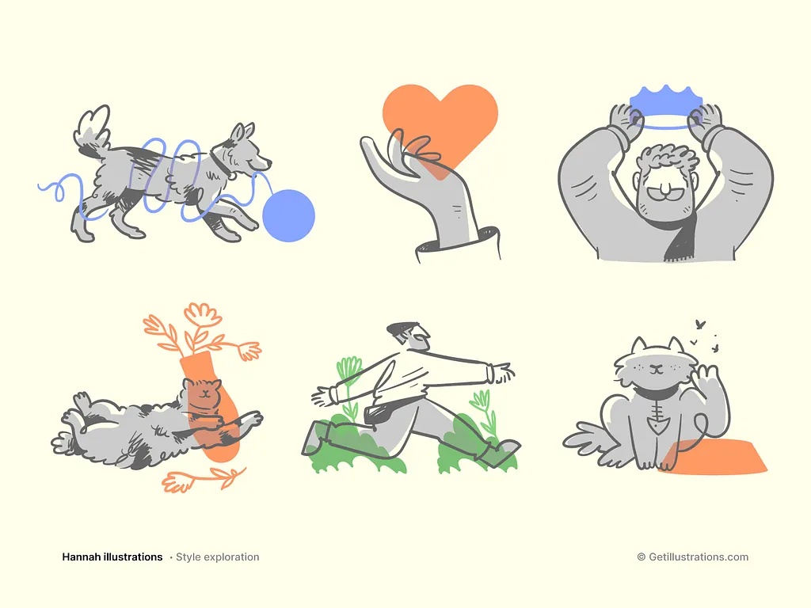
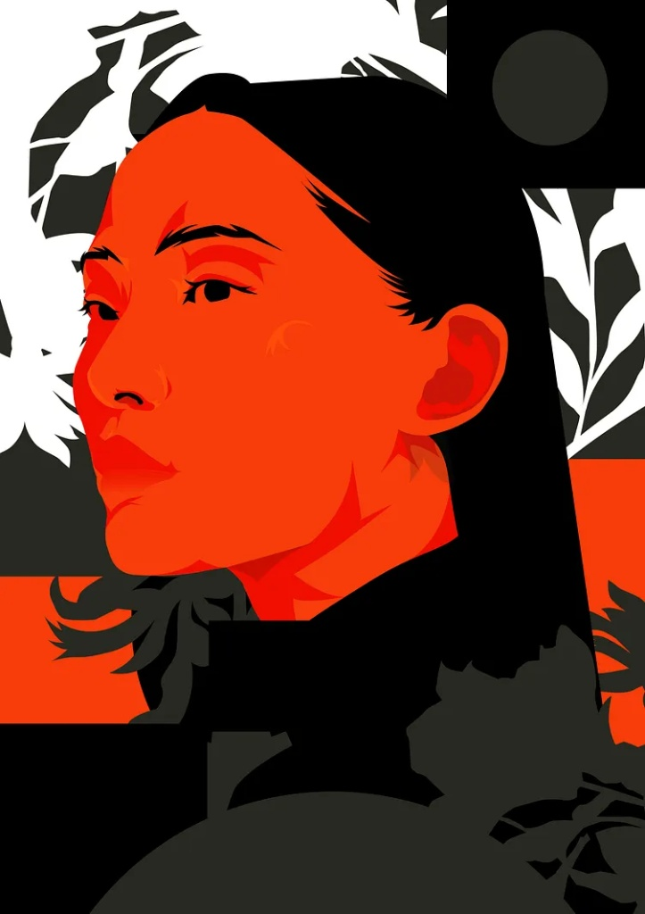
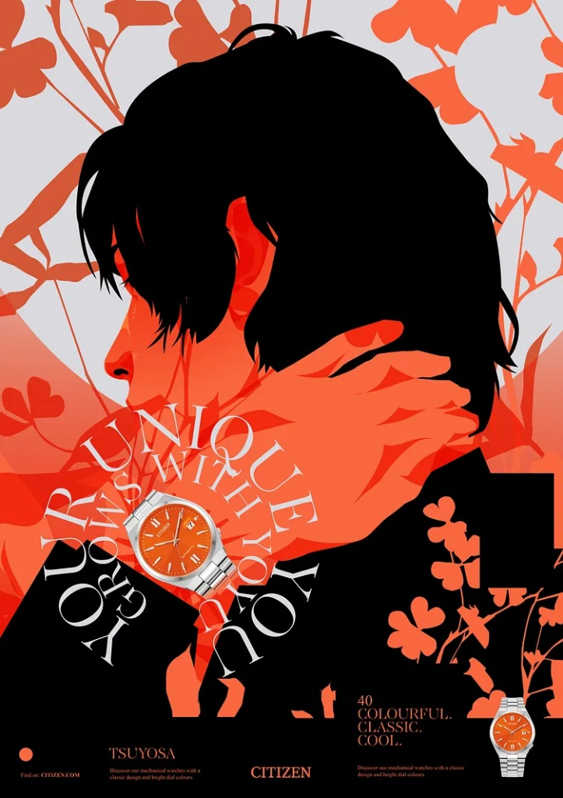

# 🎨 Palabrario — Sistema de Diseño, Paleta de Color y Reglas Visuales (`.context/PALETTE.md`)

> **Propósito de este documento (Design System & Visual SSOT):**  
> Este documento constituye la **Fuente Única de Verdad (SSOT) Visual** para la Fase 5 de **Palabrario** (`Vue 3 + TypeScript + UnoCSS + Reka UI` sobre `Wails V3 + Capacitor PWA`).  
> Reconcilia la fuerza del **Diseño Editorial en Tinta y Bermellón** con la **Calidez Táctil de Ilustración Amigable**, definiendo una **Paleta Semántica Podada** que evita la dispersión de colores y garantiza refactorización instantánea desde un único archivo (`uno.config.ts`).

---

## 1. Filosofía Estética e Ilustraciones de Referencia: *"Imprenta Táctil Ilustrada"*

La identidad visual de **Palabrario** nace de la síntesis entre dos mundos complementarios:
1. **La Fuerza Editorial (El Color y el Contraste):** Inspirada en carteles serigráficos contemporáneos donde predominan el papel crema, la tinta negra profunda (`#121212`) y el naranja bermellón (`#F23814`) como acento protagónico.
2. **La Amabilidad Táctil (La Geometría y el Trazo):** Inspirada en la ilustración editorial amigable de trazos visibles, esquinas generosamente redondeadas y acentos pasteles suaves que invitan al descubrimiento sin intimidar al estudiante.

### Galería de Referencia Canónica

| 1. Trazo Amigable, Pasteles y Bordes Visibles | 2. Contraste Editorial Bermellón y Tinta | 3. Composición Tipográfica y Serigrafía |
| :---: | :---: | :---: |
|  |  |  |
| *Aporta la geometría amable: fondos crema cálidos, contornos de tinta definidos, formas redondeadas y toques pasteles.* | *Aporta la jerarquía cromática: bloques de tinta sólida (`#121212`) frente al naranja bermellón vibrante (`#F23814`).* | *Aporta el carácter de imprenta viva: ritmo visual limpio, alto contraste y calidez orgánica.* |

---

## 2. Arquitectura de Color: Tokens Semánticos Podados (Fácil Refactorización)

> [!IMPORTANT]
> **REGLA DE ORO CONTRA LA INFLACIÓN DE COLORES:**  
> Queda **estrictamente prohibido** usar valores hexadecimales sueltos (`bg-[#...]`) o nombres de pigmentos decorativos en los componentes `.vue`.  
> Todos los componentes utilizan exclusivamente **4 Tokens Estructurales Base** y **3 Tokens Semánticos de Estado**. Para variaciones de intensidad o fondos pasteles se utilizan los **modificadores de opacidad nativos de UnoCSS** (`/10`, `/15`, `/20`, `/65`), permitiendo cambiar la apariencia de toda la aplicación editando únicamente `uno.config.ts`.

### 2.1. Los 4 Pilares Estructurales (El 90% de la Interfaz)

| Token Semántico (`uno.config.ts`) | Nombre Original | Valor Hex | Rol Arquitectónico y Reglas de Uso | Variaciones por Opacidad (Sin crear nuevos tokens) |
| :--- | :--- | :---: | :--- | :--- |
| **`paper`** | `bg-paper` | `#F6F3EC` | **Lienzo Principal (`body` / `AppLayout`):** Papel crema cálido que descansa la vista y evita el blanco clínico (`#FFFFFF`). | `bg-paper/80` con `backdrop-blur-md` para barras superiores flotantes (`GUITopBar`). |
| **`surface`** | `bg-paper-warm` | `#FDFBF6` | **Superficie Elevada:** Fondo de tarjetas (`WordCard`, `DeckCard`), modales (`Reka Dialog`), inputs y *friendly blurbs*. | `bg-surface` puro para destacar sobre `bg-paper`. |
| **`ink`** | `ink` / `ink-muted` | `#121212` | **Tinta Universal (Texto, Iconos y Bordes):** Sustituye al negro puro. Se usa en títulos, cuerpo de texto, bordes marcados (`border-ink`) y sombras sólidas. | • `text-ink`: Texto primario (100%)<br>• `text-ink/65`: Texto secundario / glosas (reemplaza a `#5A5751`)<br>• `text-ink/40`: Placeholders y metadatos<br>• `border-ink/15`: Divisores sutiles internos |
| **`brand`** | `vermilion` | `#F23814` | **Naranja Bermellón (Acción Primaria):** Botones CTA principales, enlaces activos, indicadores de racha, selección activa y acentos hero. | • `bg-brand`: Botón primario sólido<br>• `bg-brand-soft` (`#F77F52`): Hover cálido o acento secundario ilustrado<br>• `bg-brand/12`: Fondo pastel cálido para badges activos |

### 2.2. Los 3 Tokens Semánticos y Pasteles (El 10% Restante — Solo Estados y Categorías)

Para conservar los tonos de la paleta de Argón (`jade-stamp`, `amber-ochre`, `cobalt-mist`) sin que un agente los use arbitrariamente como decoración, se encapsulan bajo **roles semánticos estrictos**:

| Token Semántico | Nombre en Paleta | Valor Hex | Uso Exclusivo Permitido en la UI | Cómo lograr el Acabado Pastel (Estilo Ilustración 1) |
| :--- | :--- | :---: | :--- | :--- |
| **`success`** | `jade-stamp` | `#0E6B5C` | **Sello de Aprobación y Maestría:** Sentidos `APPROVED` por Quórum (**RN06**), respuestas correctas en Arena (**CU15**) y nivel `MASTERED` en SM-2 (**CU13**). | Fondo pastel: `bg-success/15` con texto `text-success` y borde `border-success/40`. |
| **`warning`** | `amber-ochre` | `#E89B25` | **Atención, Quórum en Curso y Tabú:** Sentidos en `DRAFT` esperando votos, advertencias de tabú/jerga vulgar, medallas de podio y estados `LEARNING`. | Fondo pastel: `bg-warning/20` con texto `text-ink` y borde `border-warning`. |
| **`info`** | `cobalt-mist` | `#B8C7DC` | **Acento Pastel Frío (Regiones y Nivel CEFR):** Etiquetas dialectales neutras, indicadores de nivel `A1–C2`, contadores de cartas y estado `NEW` en Studio. | Fondo pastel directo: `bg-info/35` con texto `text-ink` y borde `border-ink/20`. |

---

## 3. Tipografía Unificada: Familia `Satoshi`

Para mantener máxima legibilidad, modernidad geométrica y cero sobrecarga de fuentes web, **toda la interfaz utiliza `Satoshi` como familia tipográfica única**, diferenciando la jerarquía exclusivamente mediante peso (`font-weight`), tamaño y espaciado (`tracking`):

| Rol Tipográfico | Clases UnoCSS Canónicas | Peso y Tracking | Aplicación en Palabrario |
| :--- | :--- | :--- | :--- |
| **Display / Lema Hero** | `font-sans font-black text-3xl md:text-4xl tracking-tight text-ink` | `900 (Black)`, `-0.025em` | Título del lema en `WordDetail`, Palabra del Día y encabezados de Arena. |
| **Títulos de Sección (`H1–H2`)** | `font-sans font-bold text-xl md:text-2xl tracking-tight text-ink` | `700 (Bold)`, `-0.015em` | Encabezados de vistas (`Studio`, `Diccionario`, `Cola de Quórum`). |
| **Subtítulos y Tarjetas (`H3`)** | `font-sans font-bold text-base md:text-lg text-ink` | `700 (Bold)`, normal | Títulos de `DeckCard`, `CollectionCard` y nombres de usuario. |
| **Cuerpo de Lectura y Definiciones** | `font-sans font-normal text-base leading-relaxed text-ink` | `400 (Regular)`, `1.625` | Definiciones lexicográficas, *friendly blurbs* y ejemplos de uso. |
| **Etiquetas, Badges y Botones** | `font-sans font-bold text-xs uppercase tracking-wider` | `700 (Bold)`, `+0.05em` | Badges de país/dialecto, botones de acción, niveles CEFR y estados de quórum. |
| **Códigos PIN, Reloj y Puntajes** | `font-sans font-black tabular-nums tracking-widest` | `900 (Black)`, `tabular-nums` | PIN de 6 caracteres en Arena (`CU14`), cuenta regresiva (`RN10`) y marcadores de XP. *(El uso de `tabular-nums` en Satoshi evita que los números bailen en vivo sin requerir otra fuente).* |

---

## 4. Geometría de Elementos y Componentes ("Tactile Editorial")

Aquí es donde la **Ilustración 1 (amigable y redondeada)** y las **Ilustraciones 2 y 3 (editorial en tinta y naranja)** se fusionan en reglas de construcción atómica:

### 4.1. Bordes de Tinta y Sombras Táctiles (Neo-Editorial)
1. **Esquinas Amigables:**
   - Contenedores principales, tarjetas (`WordCard`, `DeckCard`) y modales: `rounded-2xl` (`16px`).
   - Botones, inputs de texto y opciones de respuesta en Arena: `rounded-xl` (`12px`).
   - Badges dialectales, etiquetas CEFR y píldoras de estado: `rounded-full`.
2. **Trazo de Tinta Visible (`Ink Stroke`):**
   - Toda tarjeta interactiva, modal o botón principal lleva un borde definido color tinta: `border-2 border-ink`.
   - Los contenedores secundarios o informativos llevan borde sutil: `border border-ink/20`.
3. **Elevación tipo Sello de Imprenta (`Tactile Offset Shadow`):**
   - En lugar de sombras difusas grises genéricas (`shadow-lg`), los elementos interactivos utilizan una sombra sólida desplazada en color tinta:
     - **Reposo:** `shadow-[3px_3px_0px_#121212]` (`shadow-tactile`)
     - **Hover / Focus:** `translate-x-[-1px] translate-y-[-1px] shadow-[4px_4px_0px_#121212]`
     - **Active (Click):** `translate-x-[2px] translate-y-[2px] shadow-[1px_1px_0px_#121212]`

### 4.2. Anatomía de los Elementos Clave
- **Botón Primario (`btn-primary`):**  
  `bg-brand text-surface font-bold px-4 py-2.5 rounded-xl border-2 border-ink shadow-tactile hover:bg-brand-soft active:translate-x-[2px] active:translate-y-[2px] transition-all`
- **Botón Secundario (`btn-secondary`):**  
  `bg-surface text-ink font-bold px-4 py-2.5 rounded-xl border-2 border-ink shadow-tactile hover:bg-info/25 transition-all`
- **Tarjeta Lexicográfica / Studio (`card-editorial`):**  
  `bg-surface text-ink rounded-2xl border-2 border-ink p-5 shadow-tactile`
- **Artículo Narrativo `FriendlyBlurb` + Caja de Acepciones `SenseItem` (Estilo Vocabulary.com):**  
  - **`FriendlyBlurb`:** Apertura conversacional en dos tiempos sobre el lienzo `bg-paper`: primer párrafo gancho en `text-lg md:text-xl leading-relaxed text-ink` (`friendly_blurb` con el lema en cursiva), seguido del párrafo de trasfondo/etimología en `text-base leading-relaxed text-ink/80 mt-4` (`etymology`).
  - **Contenedor de `SenseItem`:** Tarjeta `card-editorial` encabezada por un listón editorial `inline-block bg-brand text-surface font-bold px-4 py-1.5 rounded-t-xl border-2 border-b-0 border-ink` (*"Acepciones de {lemma}"*), con ítems numerados (`1.`, `2.`), píldora de categoría gramatical/bandera (`badge-pill bg-success/15 text-success border-success`), equivalencias y desplegable `"Ver más ⌄"` (**Reka UI `Collapsible`**) para ejemplos y nota cultural.
- **Inputs y Buscador Omnibox (`input-editorial`):**  
  `bg-surface text-ink placeholder:text-ink/40 rounded-xl border-2 border-ink px-4 py-2.5 focus:outline-none focus:ring-2 focus:ring-brand`

---

## 5. Configuración Canónica de UnoCSS (`local-app/frontend/uno.config.ts`)

Cuando se inicialice o modifique el frontend en la Fase 5, este es el bloque exacto de tema y atajos que debe residir en `uno.config.ts`:

```typescript
import { defineConfig, presetUno, presetIcons } from 'unocss'

export default defineConfig({
  presets: [
    presetUno(),
    presetIcons({
      scale: 1.2,
      extraProperties: {
        'display': 'inline-block',
        'vertical-align': 'middle',
      },
    }),
  ],
  theme: {
    colors: {
      // 1. Los 4 Pilares Estructurales
      paper: '#F6F3EC',        // Lienzo general de la app
      surface: '#FDFBF6',      // Tarjetas, modales e inputs (paper-warm)
      ink: '#121212',          // Texto, bordes de trazo y sombras sólidas
      brand: {
        DEFAULT: '#F23814',    // Vermilion editorial primario
        soft: '#F77F52',       // Vermilion pastel amigable
      },
      // 2. Los 3 Tokens Semánticos / Pasteles
      success: '#0E6B5C',      // Jade Stamp (Aprobado / Correcto / Mastered)
      warning: '#E89B25',      // Amber Ochre (Quórum / Tabú / Learning)
      info: '#B8C7DC',         // Cobalt Mist (Acento pastel para regiones / CEFR)
    },
    fontFamily: {
      sans: '"Satoshi", -apple-system, BlinkMacSystemFont, "Segoe UI", Roboto, sans-serif',
    },
    boxShadow: {
      'tactile': '3px 3px 0px #121212',
      'tactile-lg': '5px 5px 0px #121212',
      'tactile-sm': '2px 2px 0px #121212',
    },
  },
  shortcuts: {
    'card-editorial': 'bg-surface text-ink rounded-2xl border-2 border-ink shadow-tactile p-5',
    'btn-primary': 'bg-brand text-surface font-bold px-4 py-2.5 rounded-xl border-2 border-ink shadow-tactile hover:bg-brand-soft active:(translate-x-[2px] translate-y-[2px] shadow-none) transition-all cursor-pointer disabled:(opacity-50 pointer-events-none)',
    'btn-secondary': 'bg-surface text-ink font-bold px-4 py-2.5 rounded-xl border-2 border-ink shadow-tactile hover:bg-info/30 active:(translate-x-[2px] translate-y-[2px] shadow-none) transition-all cursor-pointer disabled:(opacity-50 pointer-events-none)',
    'input-editorial': 'w-full bg-surface text-ink placeholder:text-ink/40 rounded-xl border-2 border-ink px-4 py-2.5 focus:(outline-none ring-2 ring-brand) transition-all',
    'badge-pill': 'inline-flex items-center gap-1.5 px-3 py-1 rounded-full text-xs font-bold border border-ink',
  },
})
```

---

## 6. Reglas Inquebrantables de UI para Agentes Constructores (Fase 5)

1. **Cero Colores Fuera del Tema:** Ningún componente `.vue` puede usar clases de color por defecto de Tailwind/UnoCSS como `bg-red-500`, `text-gray-600`, `bg-blue-100` o `border-slate-300`. Todo debe usar `paper`, `surface`, `ink`, `brand`, `success`, `warning` o `info`.
2. **Tipografía Única (`Satoshi`) con `tabular-nums` en Contadores:** No importes fuentes adicionales. En temporizadores de la Arena, PIN de sala y tablas de XP, añade siempre la clase `tabular-nums`.
3. **Accesibilidad con Reka UI sin Estilos Intrusivos:** Todos los modales, menús desplegables, tabs y tooltips deben usar primitivas sin estilo de **Reka UI** estilizadas con nuestros `shortcuts` (`card-editorial`, `border-2 border-ink`, `shadow-tactile-lg`).
4. **Prohibido Inventar Propiedades Visuales No Respaldadas por el Backend:** Cada badge, imagen, contador o tarjeta debe alimentarse exclusivamente de los modelos autogenerados en `wailsjs/go/models.ts` a través del adaptador polimórfico `IPalabrarioAPI`.
