# 🗺️ Plan Maestro de Implementación y Estado Arquitectónico (`.context/PLAN.md`)

> **Documento de Planificación Estratégica y Hoja de Ruta a Largo Plazo (Backend-First)**  
> **Proyecto:** Palabrario — Plataforma Gamificada de Aprendizaje y Preservación del Léxico Dialectal Panhispánico  
> **Stack Backend Unificado (100% Go):** `Go 1.24 + Chi v5 + sqlc + pgxpool/v5` (`core-service :8000`, `realtime-service :8001`, `image-service :8002`) + Puente IPC Nativo Wails (`local-app/app.go`) sobre `PostgreSQL 17 Alpine (:5432)`  
> **Referencias Canónicas:** [`DOMAIN.md`](./DOMAIN.md) · [`INTERFACES.md`](./INTERFACES.md) · [`SCHEMA_FINAL.sql`](../SCHEMA_FINAL.sql) · [`.context/academic/1-PROJECT-SPECIFICATION.md`](./academic/1-PROJECT-SPECIFICATION.md)

---

## 0. Principio Rector de Ingeniería: Backend-First & Cadena Tipada End-to-End con Wails IPC

> [!IMPORTANT]
> **¿Por qué no se toca la UI (`local-app`) hasta cerrar las Fases 3.3 a 4, y cómo se conecta después?**
> 1. Cuando los modelos de IA trabajan primero sobre interfaces gráficas con mockups sin un backend estable, alucinan propiedades en el frontend que la base de datos o los endpoints jamás retornan.
> 2. En **Palabrario**, el frontend Vue 3 **no consume endpoints HTTP directamente con `fetch`/`axios`**. Toda comunicación hacia `core-service`, `realtime-service` e `image-service` pasa por el **backend nativo en Go de Wails ([`local-app/app.go`](../local-app/app.go))**, el cual:
>    - Custodia el token JWT en la memoria RAM privada del proceso Go (`sessionToken`), haciéndolo 100% inaccesible a ataques XSS desde el WebView.
>    - Importa directamente los structs de [`pkg/models`](../pkg/models) gracias al workspace de Go ([`go.work`](../go.work)).
>    - Al ejecutar `wails generate module` (o `wails dev` / `wails build`), **Wails transpila automáticamente las firmas de `local-app/app.go` y los structs de `pkg/models` a TypeScript** dentro de `local-app/frontend/wailsjs/go/main/App.js` (`.d.ts`) y `local-app/frontend/wailsjs/go/models.ts`.
>
> Por ello, **el desarrollo sigue estrictamente esta cadena de 6 eslabones sin alucinaciones:**
> $$\text{1. SQL (`SCHEMA_FINAL.sql`)} \to \text{2. `sqlc`} \to \text{3. `pkg/models` + SOA Go} \to \text{4. Tests} \to \text{5. Métodos Go en `local-app/app.go` (`wails generate`)} \to \text{6. Vistas Vue 3}$$

---

## 1. Diagnóstico Ejecutivo: ¿Dónde Estamos Hoy?

Al auditar el código real del repositorio frente a los **16 Casos de Uso (`CU01–CU16`)** y las **11 Reglas de Negocio (`RN01–RN11`)**, el proyecto ha cerrado con éxito la **Fase 3.3** (Diccionario y Curaduría por Quórum), la **Fase 3.4** (Studio Personal, Motor SM-2 y Ledger de XP), la **Fase 3.5** (Módulo de Cuenta, Perfiles Sociales, Gobernanza y Moderación), las **Sub-fases 4.1 y 4.2** (`core-service`: S2S JWT, DTOs de Arena, `ArenaCatalogService` y Replay 3NF) y la **Sub-fase 4.3** (`realtime-service`: motor `ArenaHub`, máquina de estados en RAM, reloj monotónico RN10, reconexión 10s RNF-CON-02, sucesión de host y WebSockets):

```mermaid
flowchart LR
    F1["✅ Fase 1\nEsquema SQL + Triggers\n(100%)"] --> F2["✅ Fase 2\nMonorepo Go + Contratos\n(100%)"]
    F2 --> F31["✅ Fase 3.1/3.2\nCore SOA Base + Auth JWT\n(100%)"]
    F31 --> F33["✅ Fase 3.3\nDiccionario & Curaduría\n(100%)"]
    F33 --> F34["✅ Fase 3.4\nStudio & Motor SM-2\n(100%)"]
    F34 --> F35["✅ Fase 3.5\nGobernanza & Reportes\n(100%)"]
    F35 --> F41["✅ Sub-fases 4.1 & 4.2\nS2S JWT + Arena 3NF\nReplay en core-service"]
    F41 --> F43["✅ Sub-fase 4.3\nArenaHub + ActiveRoom\nWebSockets & Sucesión Host"]
    F43 --> F44["🚧 Sub-fase 4.4 (ACTUAL)\nimage-service EXIF\n(:8002)"]
    F44 --> F5["⏳ Fase 5\nPuente Wails (app.go)\n+ Bindings TS & UI"]
    F5 --> F6["🌱 Fase 6 (Largo Plazo)\nEventos de Temporada"]
```

### 1.1. Matriz de Estado Real por Capa y Servicio

| Componente / Módulo | Estado Actual Real | Lo que YA existe y compila | Lo que FALTA por construir |
| :--- | :---: | :--- | :--- |
| **1. Base de Datos ([`SCHEMA_FINAL.sql`](../SCHEMA_FINAL.sql)) y `sqlc`** | **100% Completo** | 24 tablas en 3NF (incluyendo `match_rounds` y evolución de `quiz_attempts` para Replay ronda por ronda, más baraja semilla 1 con 8 sentidos aprobados), triggers `RN06` y `RN07`, y [`sql/queries/arena.sql`](../sql/queries/arena.sql) compilado a `core-service/internal/db/arena.sql.go`. | Nada en SQL ni `sqlc` (100% sellado y compilado). |
| **2. Paquetes Compartidos ([`pkg/`](../pkg))** | **100% Completo** | `pkg/auth` (JWT de usuario + sub-clave S2S derivada con `sha256` y TTL 30s), `pkg/response`, `pkg/utils`, modelos de Diccionario, Curaduría, Studio, Gobernanza, Usuario y Arena 3NF (`pkg/models/arena.go`). | Nada en paquetes compartidos. |
| **3. `core-service` — Auth & Cuentas (`CU01`)** | **100% Completo** | Capa SOA `IdentityService`, middleware `RequireAuth`, `RequireRole`, `OptionalAuth` y `RequireInternalService` para S2S. | Nada en Auth. |
| **4. `core-service` — Diccionario (`CU05, CU06`)** | **100% Completo** | Capa SOA `DictionaryService` completa con FTS + trigramas, palabra del día, explorador paginado y autoría de lemas, sentidos, ejemplos y conceptos semánticos. | Nada en Diccionario. |
| **5. `core-service` — Curaduría y Moderación (`CU07–CU09`)** | **100% Completo** | `CurationService` y endpoints para cola de quórum, votación (`RN06` y `RN07`), veto admin (`RN08`) y reportes comunitarios (`CU09`). | Nada en Curaduría. |
| **6. `core-service` — Studio y SM-2 (`CU10–CU13`)** | **100% Completo** | `StudioService` (`RN03`, `RN04`, `RN05`), `MasteryService` (`CalculateSM2` puro, transacción ACID `pgx.Tx` con `xp_transactions` **RN11** y rachas en `users`). | Nada en Studio. |
| **7. `core-service` — Gobernanza (`CU02–CU04`)** | **100% Completo** | `GovernanceService` (`RN02`, promoción atómica a `EDITOR`, protección del último `ADMIN`, boletos con `SELECT ... FOR UPDATE`). | Nada en Gobernanza. |
| **8. `core-service` — Arena & Replay (`CU14, CU16`)** | **100% Completo** | `ArenaCatalogService`, handlers en `/api/v1/arena/matches/*`, validación de 8 sentidos mínimos, generación de distractores fallback, consolidación Batch Flush ACID, desempate determinista, Replay 3NF con autorización y tests en `arena_service_test.go`. | Nada en `core-service`. |
| **9. `realtime-service` (`CU15, CU16`)** | **100% Completo** | `ArenaHub` y `ActiveRoom` en memoria RAM (`hub.go`, `room.go`, `core_client.go`, `scoring.go`), servidor WebSocket en `GET /ws/arena/{roomCode}`, límite estricto de 8 jugadores, reloj monotónico `RN10`, ventana de reconexión de 10s (`RNF-CON-02`), sucesión de Host al jugador más antiguo, Batch Flush S2S a `core-service` y suite de pruebas en `arena_test.go`. | Nada en `realtime-service`. |
| **10. `image-service` (Multimedia)** | **25% Esqueleto Go** | Ya migrado a Go 1.24 + Chi v5 en puerto `8002` con `/health`, graceful shutdown y `Dockerfile` multi-stage. | **Sub-fase 4.4:** Implementar `POST /api/v1/images/upload` con validación de magic bytes, limpieza EXIF (`RNF-SEG-04`) y pruebas. |
| **11. Puente Wails Go (`local-app/app.go`) + UI** | **25% Puente / 100% UI Mock** | `local-app/app.go` implementa bóveda JWT en RAM y consultas iniciales (`SearchWords`, `GetWordDetail`). | En **Fase 5**, exponer métodos puente para todos los módulos, correr `wails generate module` y conectar vistas Vue 3. |

---

## 2. Plan de Implementación Paso a Paso (Checklist Operativo para Agentes)

Cada fase y sub-fase de backend está diseñada como una unidad atómica de trabajo verificable mediante `sqlc generate && go build ./core-service/... ./realtime-service/... ./image-service/... ./pkg/...` y `.\scripts\test.ps1`.

---

### ✅ FASE 3.3 (COMPLETADA): Módulo de Diccionario y Curaduría por Quórum (`CU05, CU06, CU07, CU08`)

> **Objetivo:** Cerrar al 100% el corazón lexicográfico y editorial de Palabrario en `core-service` siguiendo las secciones **2.3** y **2.4** de [`INTERFACES.md`](./INTERFACES.md).

#### Tareas Exactas de Implementación (Verificadas en Commit `c0e651e`):
1. **[x] Modelos Compartidos (`pkg/models/`):** Ampliado `pkg/models/dictionary.go` y creado `pkg/models/curation.go`.
2. **[x] Consultas Tipadas (`sql/queries/`):** Ampliado `sql/queries/dictionary.sql` y creado `sql/queries/curation.sql`. Ejecutado `sqlc generate`.
3. **[x] Servicios SOA (`core-service/internal/service/`):** Implementados `dictionary_service.go` y `curation_service.go` (`RN06`, `RN07`, `RN08`).
4. **[x] Handlers, Router y Pruebas (`core-service/internal/`):** Actualizado `dictionary_handler.go`, creado `curation_handler.go`, rutas en `router.go` y pruebas en `service_test.go`.

---

### ✅ FASE 3.4 (COMPLETADA): Studio Personal, Motor Matemático SM-2 y Ledger de XP (`CU10, CU11, CU12, CU13`)

> **Objetivo:** Implementar la gestión de barajas/colecciones y el motor de repetición espaciada SuperMemo SM-2 siguiendo las secciones **2.5** y **2.6** de [`INTERFACES.md`](./INTERFACES.md).

#### Tareas Exactas de Implementación:
1. **[x] Modelos Compartidos (`pkg/models/studio.go`):** Ampliado con todos los DTOs de Studio, SM-2 y Ledger de XP.
2. **[x] Consultas Tipadas (`sql/queries/`):** Creados `sql/queries/studio.sql` y `sql/queries/mastery.sql`. Ejecutado `sqlc generate`.
3. **[x] Servicios SOA (`core-service/internal/service/`):** Implementados `studio_service.go` (`RN03`, `RN04`, `RN05`) y `mastery_service.go` (`CalculateSM2`, `RN09`, `RN11`).
4. **[x] Handlers, Router y Pruebas (`core-service/internal/`):** Creados `studio_handler.go`, `mastery_handler.go` y `studio_mastery_test.go`.

---

### ✅ FASE 3.5 (COMPLETADA + REFACTORIZADA): Módulo de Cuenta, Perfiles Sociales, Gobernanza y Moderación (`CU01, CU02, CU03, CU04, CU09`)

> **Objetivo:** Completar la gestión de perfil propio/público, el flujo de ascenso a Editor, los boletos de invitación y la resolución de reportes siguiendo las secciones **2.1**, **2.2** y **2.4** de [`INTERFACES.md`](./INTERFACES.md), más la consolidación de utilidades reportadas en [`REFACTOR.md`](../REFACTOR.md).

#### Tareas Exactas de Implementación:
1. **[x] Modelos y Consultas:** Creado `pkg/models/governance.go`, ampliados `pkg/models/user.go`, `sql/queries/users.sql`, `sql/queries/curation.sql` y creado `sql/queries/governance.sql`.
2. **[x] Servicios SOA, Handlers y Refactorización (`REFACTOR.md`):** Ampliados `identity_service.go`, `curation_service.go`, creado `governance_service.go`, handlers, helpers y pruebas en `governance_reports_test.go`.

---

### 📍 FASE 4: Arena Multijugador 3NF, Seguridad S2S, `realtime-service` e `image-service` (`CU14, CU15, CU16`)

> **Objetivo:** Implementar la Arena Multijugador de principio a fin respetando estrictamente la sección **2.7** de [`INTERFACES.md`](./INTERFACES.md) y el apartado **3.5** de [`DOMAIN.md`](./DOMAIN.md).

---

#### ✅ SUB-FASE 4.1 (COMPLETADA): Seguridad JWT Servicio-a-Servicio (`S2S`) y Contratos de Datos de Arena (`pkg/auth`, `pkg/models/arena.go`, `auth_middleware.go`)

1. **[x] Sub-Llave Criptográfica S2S en [`pkg/auth/auth.go`](../pkg/auth/auth.go):**
   - Campo `s2sSecretKey []byte` en `TokenService`, derivado en `NewTokenService` como `sha256.Sum256([]byte(secretKey + ":palabrario-s2s-internal"))`.
   - `InternalServiceClaims` con `ServiceName`, `MatchScope` e `Issuer: "palabrario-internal-s2s"`.
   - Implementados `GenerateInternalToken` (TTL 30s) y `VerifyInternalToken`.
   - `VerifyToken` valida estrictamente `claims.Issuer == "palabrario-core-service"`.
2. **[x] Middleware `RequireInternalService` en [`core-service/internal/api/middleware/auth_middleware.go`](../core-service/internal/api/middleware/auth_middleware.go):**
   - Valida el token interno con `m.tokenService.VerifyInternalToken(token)` (`403 Forbidden` si es inválido o de usuario humano) e inyecte `claims` en `auth.InternalServiceContextKey`.
3. **[x] Modelos Completos de Arena y Replay 3NF en [`pkg/models/arena.go`](../pkg/models/arena.go):**
   - Incorporadas todas las estructuras de la sección **2.7.2** de [`INTERFACES.md`](./INTERFACES.md): `CreateMatchRequest`, `InternalArenaQuestion`, `MatchPackage`, `SubmitAnswerPayload`, `RoundResultPayload`, `ParticipantRoundAttempt`, `ParticipantFinalResult`, `ConsolidateMatchRequest`, `MatchSummary`, `ParticipantRoundAnswer`, `MatchRoundReplay` y `MatchReplayDetail`.

---

#### ✅ SUB-FASE 4.2 (COMPLETADA): `ArenaCatalogService`, Generación de Rondas 3NF, Batch Flush ACID y Replay en `core-service` (`CU14, CU16`)

1. **[x] Implementar `ArenaCatalogService` en `core-service/internal/service/arena_catalog_service.go`:**
   - **`PrepareMatch` (`CU14`):**
     - Defaults (`TotalRounds: 8..20`, `RoundTimeSec: 10..30`, `IsPublic: true`).
     - Verificación de privacidad **RN04** con `GetDeckByID`.
     - **Regla de Límites de Arena (`CU14 1a`):** Rechazo con `ErrUnprocessable` si `len(senses) < 8` o `len(senses) < req.TotalRounds`.
     - Selección de sentidos únicos, carga de preguntas curadas con fallback automático `WORD_TO_DEFINITION` (distractores de la misma baraja).
     - Persistencia transaccional de partida y rondas en `matches` y `match_rounds` (3NF).
   - **`GetMatchPackageByRoomCode` (`CU14/CU15`):**
     - Consulta de cabecera y rondas 3NF. Retorna `ErrConflict` si `status == 'FINISHED'`.
   - **`ConsolidateMatch` (`CU16` — Batch Flush ACID + Replay + SM-2 + XP):**
     - Desempate determinista: `FinalScore DESC` $\to$ `len(CorrectSenseIDs) DESC` $\to$ `TotalTimeSpentMs ASC`.
     - Transacción atómica: `MarkMatchFinished`, `UpsertMatchParticipant`, `UpsertMatchRoundQuizAttempt`, `InsertXPTransaction` (+150/+100/+75/+40), `AddUserXPAndUpdateStreak` (**RN11**) y actualización de `user_mastery` con SM-2 (**RN09**).
   - **`ListMatchHistory` y `GetMatchReplay` (`CU13 / CU16`):**
     - `ListMatchHistory`: historial con podio enriquecido.
     - `GetMatchReplay`: detalle granular ronda por ronda en 3NF con autorización (partida pública, participante o rol `ADMIN`).
2. **[x] Handler y Rutas en `core-service/internal/api/`:**
   - Creado `arena_handler.go` con los 5 endpoints.
   - Enrutado en `router.go`: `/prepare`, `/history` y `/{matchId}` bajo `RequireAuth`; `/{roomCode}/package` y `/consolidate` bajo `RequireInternalService`.
3. **[x] Pruebas de Integración en `core-service/internal/service/arena_service_test.go`:**
   - Separación criptográfica S2S verificada.
   - Límites y rechazos `422 Unprocessable` validados.
   - Flujo completo de 8 rondas, persistencia en `match_rounds`, desempate determinista por tiempo, libro mayor de XP, SM-2 y Replay ronda por ronda verificado al 100%.

---

#### ✅ SUB-FASE 4.3 (COMPLETADA): Motor WebSocket en `realtime-service` (`ArenaHub`, `ActiveRoom`, `RN10`, `RNF-CON-02` y Sucesión de Host)

1. **[x] Cliente HTTP Interno S2S (`realtime-service/internal/arena/core_client.go`):**
   - Cliente HTTP hacia `CORE_SERVICE_URL` con `tokenService.GenerateInternalToken("realtime-service", roomCode)` en el header `Authorization: Bearer <s2sToken>` para `GET /api/v1/arena/matches/{roomCode}/package` y `POST /api/v1/arena/matches/consolidate`.
2. **[x] Motor de Salas en RAM (`realtime-service/internal/arena/hub.go`, `room.go`, `scoring.go` y `helpers.go`):**
   - `ArenaHub` concurrente con `sync.RWMutex` administrando `rooms map[string]*ActiveRoom`.
   - `ActiveRoom` gobernado por una única goroutine coordinadora (`RunLoop`) canalizando uniones, salidas, acciones y temporizadores sin condiciones de carrera.
   - Cupo máximo estricto de 8 participantes (`MaxParticipants = 8`).
   - Reconexión sin pérdida de estado dentro de la ventana de gracia de 10 segundos (`RNF-CON-02`).
   - Sucesión automática de anfitrión al participante conectado más antiguo (`oldest.JoinedAt`) tras expirar la ventana de desconexión del host en estado `WAITING`.
   - Ciclo de rondas con emisión de `models.ArenaQuestion` (sin revelar `CorrectOption`) y cálculo de puntaje monotónico exacto en servidor con `CalculateRoundPoints` (`RN10`).
   - Cierre de ronda por timeout o respuestas completas, cálculo de podio y consolidación transaccional S2S (`ConsolidateMatch`) con difusión de evento `PODIUM`.
3. **[x] Montaje en `realtime-service/main.go` y Pruebas Concurrentes (`realtime-service/internal/arena/arena_test.go`):**
   - Endpoint `GET /ws/arena/{roomCode}` autenticado por JWT y `GET /health` reportando `active_rooms`.
   - Suite de pruebas de integración completa validando: puntaje RN10, rechazo al 9° jugador, reconexión en ventana de gracia, sucesión de host y flujo de partida completo con Batch Flush hacia mock S2S.

---

#### 🔹 SUB-FASE 4.4 (Prioridad Inmediata): Procesamiento Multimedia Seguro en `image-service` (`:8002` — `RNF-SEG-04`)

1. **[ ] Implementar `POST /api/v1/images/upload` en `image-service`:**
   - Proteger la ruta con validación de Bearer JWT (`pkg/auth.TokenService`).
   - Recibir `multipart/form-data` con límite de `5 MB` (`http.MaxBytesReader`), leyendo el archivo `file` y el campo `category` (`"avatar"` o `"credentials"`).
   - Validar los primeros 512 bytes con `http.DetectContentType` aceptando únicamente `image/jpeg`, `image/png` o `image/webp` (`400 Bad Request` en cualquier otro formato).
   - Decodificar la imagen y re-codificarla limpia de metadatos EXIF (`RNF-SEG-04`), guardándola o sirviéndola y retornando `200 OK` con `{"url": "...", "bytes": ...}`.
2. **[ ] Pruebas en `image-service/main_test.go`:**
   - Verificar rechazo de archivos no válidos (ej. script ejecutable disfrazado de `.png`) y subida exitosa con token JWT válido.

---

### 📍 FASE 5: Puente Nativo Go en Wails (`local-app/app.go`), Generación de Bindings TypeScript e Integración UI

> **Objetivo:** Con el 100% del backend estable y probado, extender el puente IPC en [`local-app/app.go`](../local-app/app.go), autogenerar los bindings TypeScript con Wails y conectar los componentes Vue 3 sin ningún tipo de dato alucinado.

1. **Extensión del Puente Go (`local-app/app.go`):**
   - Añadir un helper interno `doAuthenticatedRequest(method, path string, body any, out any) error` en `local-app/app.go` que adjunte automáticamente `Authorization: Bearer <sessionToken>` desde la memoria privada de Go.
   - Exponer en `struct App` los métodos puente para cada módulo (`UpdateProfile`, `GetPublicProfile`, `ListRegions`, `GetWordOfTheDay`, `ExploreWords`, `CreateWordProposal`, `ListPendingQuorumQueue`, `SubmitQuorumVote`, `ListMyStudioDecks`, `GetDueStudySession`, `SubmitCardReview`, `PrepareArenaMatch`, `GetArenaMatchHistory`, `GetArenaMatchReplay`, `ConnectArenaRoom`, `SubmitArenaAnswer`, etc.) retornando directamente los tipos de [`pkg/models`](../pkg/models).
   - Para la Arena en vivo (`realtime-service`), el proceso Go de Wails mantiene el cliente WebSocket autenticado con el `sessionToken` privado y retransmite los eventos del servidor hacia Vue mediante `runtime.EventsEmit(a.ctx, "arena:event", event)`.
2. **Autogeneración de Tipos y Funciones TypeScript (`wails generate module`):**
   - Ejecutar `wails generate module` (o `wails build`) para que Wails genere automáticamente `local-app/frontend/wailsjs/go/main/App.js` (`.d.ts`) y `local-app/frontend/wailsjs/go/models.ts` a partir de `pkg/models`.
3. **Conexión en Vistas y Composables Vue 3:**
   - Importar en los composables de `local-app/frontend/src/composables/` únicamente las funciones generadas en `wailsjs/go/main/App` y los modelos de `wailsjs/go/models`.

---

### 🌱 FASE 6 (Incremento Post-MVP a Largo Plazo): Sistema de Eventos Culturales de Temporada

> **Objetivo:** Incorporar festivales estacionales (*Día de Muertos*, *Feria de las Flores*, *San Juan*) y galería de arte hispanoamericano según [`proposals/SEASONAL_EVENTS_SPECIFICATION.md`](../proposals/SEASONAL_EVENTS_SPECIFICATION.md), únicamente tras haber cerrado y verificado las Fases 3.3 a 5.
