# 🗺️ Plan Maestro de Implementación y Estado Arquitectónico (`.context/PLAN.md`)

> **Documento de Planificación Estratégica y Hoja de Ruta a Largo Plazo (Backend-First)**  
> **Proyecto:** Palabrario — Plataforma Gamificada de Aprendizaje y Preservación del Léxico Dialectal Panhispánico  
> **Stack Backend Unificado (100% Go):** `Go 1.24 + Chi v5 + sqlc + pgxpool/v5` (`core-service :8000`, `realtime-service :8001`, `image-service :8002`) + Puente IPC Nativo Wails (`local-app/app.go`) sobre `PostgreSQL 17 Alpine (:5432)`  
> **Referencias Canónicas:** [`DOMAIN.md`](./DOMAIN.md) · [`INTERFACES.md`](./INTERFACES.md) · [`SCHEMA_FINAL.sql`](../SCHEMA_FINAL.sql) · [`.context/academic/1-PROJECT-SPECIFICATION.md`](./academic/1-PROJECT-SPECIFICATION.md)

---

## 0. Principio Rector de Ingeniería: Backend-First & Cadena Tipada End-to-End con Wails IPC

> [!IMPORTANT]
> **¿Por qué no se toca la UI (`local-app`) hasta cerrar las Fases 3.3 a 4, y cómo se conecta después?**
> 1. Cuando los modelos de IA trabajan primero sobre interfaces gráficas con mockups sin un backend estable, alucinan propiedades en el frontend que la base de datos o los endpoints jamás retornan.
> 2. En **Palabrario**, el frontend Vue 3 **no consume endpoints HTTP directamente con `fetch`/`axios`**. Toda comunicación hacia `core-service`, `realtime-service` e `image-service` pasa por el **backend nativo en Go de Wails ([`local-app/app.go`](../local-app/app.go))**, el cual:
>    - Custodia el token JWT en la memoria RAM privada del proceso Go (`sessionToken`), haciéndolo 100% inaccesible a ataques XSS desde el WebView.
>    - Importa directamente los structs de [`pkg/models`](../pkg/models) gracias al workspace de Go ([`go.work`](../go.work)).
>    - Al ejecutar `wails generate module` (o `wails dev` / `wails build`), **Wails transpila automáticamente las firmas de `local-app/app.go` y los structs de `pkg/models` a TypeScript** dentro de `local-app/frontend/wailsjs/go/main/App.js` (`.d.ts`) y `wailsjs/go/models.ts`.
>
> Por ello, **el desarrollo sigue estrictamente esta cadena de 6 eslabones sin alucinaciones:**
> $$\text{1. SQL (`SCHEMA_FINAL.sql`)} \to \text{2. `sqlc`} \to \text{3. `pkg/models` + SOA Go} \to \text{4. Tests} \to \text{5. Métodos Go en `local-app/app.go` (`wails generate`)} \to \text{6. Vistas Vue 3}$$

---

## 1. Diagnóstico Ejecutivo: ¿Dónde Estamos Hoy?

Al auditar el código real del repositorio frente a los **16 Casos de Uso (`CU01–CU16`)** y las **13 Reglas de Negocio (`RN01–RN13`)**, el proyecto ha cerrado con éxito la **Fase 3.3** (Diccionario y Curaduría por Quórum), la **Fase 3.4** (Studio Personal, Motor SM-2 y Ledger de XP), la **Fase 3.5** (Módulo de Cuenta, Perfiles Sociales, Gobernanza y Moderación), las **Sub-fases 4.1 y 4.2** (`core-service`: S2S JWT, DTOs de Arena, `ArenaCatalogService` y Replay 3NF) y la **Sub-fase 4.3** (`realtime-service`: motor `ArenaHub`, máquina de estados en RAM, reloj monotónico RN10, reconexión 10s RNF-CON-02, sucesión de host y WebSockets):

```mermaid
flowchart LR
    F1["✅ Fase 1\nEsquema SQL + Triggers\n(100%)"] --> F2["✅ Fase 2\nMonorepo Go + Contratos\n(100%)"]
    F2 --> F31["✅ Fase 3.1/3.2\nCore SOA Base + Auth JWT\n(100%)"]
    F31 --> F33["✅ Fase 3.3\nDiccionario & Curaduría\n(100%)"]
    F33 --> F34["✅ Fase 3.4\nStudio & Motor SM-2\n(100%)"]
    F34 --> F35["✅ Fase 3.5\nGobernanza & Reportes\n(100%)"]
    F35 --> F41["✅ Sub-fases 4.1 & 4.2\nS2S JWT + Arena 3NF\nReplay en core-service"]
    F41 --> F43["✅ Sub-fase 4.3\nArenaHub + ActiveRoom\nWebSockets & Sucesión Host"]
    F43 --> F44["🚧 Sub-fases 4.4 & 4.5 (ACTUAL)\nimage-service EXIF/NSFW (:8002)\n+ WORD_TO_IMAGE (RN12/RN13)"]
    F44 --> F5["⏳ Fase 5\nPuente Wails (app.go)\n+ Bindings TS & UI"]
    F5 --> F6["🌱 Fase 6 (Largo Plazo)\nEventos de Temporada"]
```



### 1.1. Matriz de Estado Real por Capa y Servicio

| Componente / Módulo | Estado Actual Real | Lo que YA existe y compila | Lo que FALTA por construir |
| :--- | :---: | :--- | :--- |
| **1. Base de Datos ([`SCHEMA_FINAL.sql`](../SCHEMA_FINAL.sql)) y `sqlc`** | **95% Completo** | 24 tablas en 3NF (incluyendo `match_rounds` y evolución de `quiz_attempts` para Replay ronda por ronda, más baraja semilla 1 con 8 sentidos aprobados), triggers `RN06` y `RN07`, y [`sql/queries/arena.sql`](../sql/queries/arena.sql) compilado a `core-service/internal/db/arena.sql.go`. | **Sub-fase 4.5:** Añadir `image_url TEXT` en `words` y `senses`, `'WORD_TO_IMAGE'` en `question_type`, `selected_option TEXT` en `quiz_attempts` y regenerar `sqlc`. |
| **2. Paquetes Compartidos ([`pkg/`](../pkg))** | **95% Completo** | `pkg/auth` (JWT de usuario + sub-clave S2S derivada con `sha256` y TTL 30s), `pkg/response`, `pkg/utils`, modelos de Diccionario, Curaduría, Studio, Gobernanza, Usuario y Arena 3NF (`pkg/models/arena.go`). | **Sub-fase 4.5:** Añadir `ImageURL *string` en DTOs de `pkg/models/dictionary.go` y `pkg/models/curation.go`. |
| **3. `core-service` — Auth & Cuentas (`CU01`)** | **100% Completo** | Capa SOA `IdentityService`, middleware `RequireAuth`, `RequireRole`, `OptionalAuth` y `RequireInternalService` para S2S. | Nada en Auth. |
| **4. `core-service` — Diccionario (`CU05, CU06`)** | **95% Completo** | Capa SOA `DictionaryService` completa con FTS + trigramas, palabra del día, explorador paginado y autoría de lemas, sentidos, ejemplos y conceptos semánticos. | **Sub-fase 4.5:** Propagar `image_url` y validación de URL local (`RN12`) en `DictionaryService`. |
| **5. `core-service` — Curaduría y Moderación (`CU07–CU09`)** | **100% Completo** | `CurationService` y endpoints para cola de quórum, votación (`RN06` y `RN07`), veto admin (`RN08`) y reportes comunitarios (`CU09`). | Nada en Curaduría. |
| **6. `core-service` — Studio y SM-2 (`CU10–CU13`)** | **100% Completo** | `StudioService` (`RN03`, `RN04`, `RN05`), `MasteryService` (`CalculateSM2` puro, transacción ACID `pgx.Tx` con `xp_transactions` **RN11** y rachas en `users`). | Nada en Studio. |
| **7. `core-service` — Gobernanza (`CU02–CU04`)** | **100% Completo** | `GovernanceService` (`RN02`, promoción atómica a `EDITOR`, protección del último `ADMIN`, boletos con `SELECT ... FOR UPDATE`). | Nada en Gobernanza. |
| **8. `core-service` — Arena & Replay (`CU14, CU16`)** | **95% Completo** | `ArenaCatalogService`, handlers en `/api/v1/arena/matches/*`, validación de 8 sentidos mínimos, generación de distractores fallback, consolidación Batch Flush ACID, desempate determinista, Replay 3NF con autorización y tests en `arena_service_test.go`. | **Sub-fase 4.5:** Generación de rondas visuales `WORD_TO_IMAGE` con degradación elegante automática a `WORD_TO_DEFINITION` (`RN13`). |
| **9. `realtime-service` (`CU15, CU16`)** | **100% Completo** | `ArenaHub` y `ActiveRoom` en memoria RAM (`hub.go`, `room.go`, `core_client.go`, `scoring.go`), servidor WebSocket en `GET /ws/arena/{roomCode}`, límite estricto de 8 jugadores, reloj monotónico `RN10`, ventana de reconexión de 10s (`RNF-CON-02`), sucesión de Host al jugador más antiguo, Batch Flush S2S a `core-service` y suite de pruebas en `arena_test.go`. | Nada en `realtime-service`. |
| **10. `image-service` (Multimedia)** | **25% Esqueleto Go** | Ya migrado a Go 1.24 + Chi v5 en puerto `8002` con `/health`, graceful shutdown y `Dockerfile` multi-stage. | **Sub-fase 4.4:** Implementar `POST /api/v1/images/upload` y `GET /uploads/*` con magic bytes, filtro heurístico NSFW (`SafetyValidator`), limpieza EXIF (`RNF-SEG-04`), volumen local (`StorageProvider`) y pruebas. |
| **11. Puente Wails Go (`local-app/app.go`) + UI** | **25% Puente / 100% UI Mock** | `local-app/app.go` implementa bóveda JWT en RAM y consultas iniciales (`SearchWords`, `GetWordDetail`). | En **Fase 5**, exponer métodos puente para todos los módulos (incluyendo `UploadImage`), correr `wails generate module` y conectar vistas Vue 3. |

---

## 2. Plan de Implementación Paso a Paso (Checklist Operativo para Agentes)

Cada fase y sub-fase de backend está diseñada como una unidad atómica de trabajo verificable mediante `sqlc generate && go build ./core-service/... ./realtime-service/... ./image-service/... ./pkg/...` y `.\scripts\test.ps1`.

---

### ✅ FASE 3.3 (COMPLETADA): Módulo de Diccionario y Curaduría por Quórum (`CU05, CU06, CU07, CU08`)

> **Objetivo:** Cerrar al 100% el corazón lexicográfico y editorial de Palabrario en `core-service` siguiendo las secciones **2.3** y **2.4** de [`INTERFACES.md`](./INTERFACES.md).

#### Tareas Exactas de Implementación (Verificadas en Commit `c0e651e`):
1. **[x] Modelos Compartidos (`pkg/models/`):** Ampliado `pkg/models/dictionary.go` y creado `pkg/models/curation.go`.
2. **[x] Consultas Tipadas (`sql/queries/`):** Ampliado `sql/queries/dictionary.sql` y creado `sql/queries/curation.sql`. Ejecutado `sqlc generate`.
3. **[x] Servicios SOA (`core-service/internal/service/`):** Implementados `dictionary_service.go` y `curation_service.go` (`RN06`, `RN07`, `RN08`).
4. **[x] Handlers, Router y Pruebas (`core-service/internal/`):** Actualizado `dictionary_handler.go`, creado `curation_handler.go`, rutas en `router.go` y pruebas en `service_test.go`.

---

### ✅ FASE 3.4 (COMPLETADA): Studio Personal, Motor Matemático SM-2 y Ledger de XP (`CU10, CU11, CU12, CU13`)

> **Objetivo:** Implementar la gestión de barajas/colecciones y el motor de repetición espaciada SuperMemo SM-2 siguiendo las secciones **2.5** y **2.6** de [`INTERFACES.md`](./INTERFACES.md).

#### Tareas Exactas de Implementación:
1. **[x] Modelos Compartidos (`pkg/models/studio.go`):** Ampliado con todos los DTOs de Studio, SM-2 y Ledger de XP.
2. **[x] Consultas Tipadas (`sql/queries/`):** Creados `sql/queries/studio.sql` y `sql/queries/mastery.sql`. Ejecutado `sqlc generate`.
3. **[x] Servicios SOA (`core-service/internal/service/`):** Implementados `studio_service.go` (`RN03`, `RN04`, `RN05`) y `mastery_service.go` (`CalculateSM2`, `RN09`, `RN11`).
4. **[x] Handlers, Router y Pruebas (`core-service/internal/`):** Creados `studio_handler.go`, `mastery_handler.go` y `studio_mastery_test.go`.

---

### ✅ FASE 3.5 (COMPLETADA + REFACTORIZADA): Módulo de Cuenta, Perfiles Sociales, Gobernanza y Moderación (`CU01, CU02, CU03, CU04, CU09`)

> **Objetivo:** Completar la gestión de perfil propio/público, el flujo de ascenso a Editor, los boletos de invitación y la resolución de reportes siguiendo las secciones **2.1**, **2.2** y **2.4** de [`INTERFACES.md`](./INTERFACES.md), más la consolidación de utilidades reportadas en [`REFACTOR.md`](../REFACTOR.md).

#### Tareas Exactas de Implementación:
1. **[x] Modelos y Consultas:** Creado `pkg/models/governance.go`, ampliados `pkg/models/user.go`, `sql/queries/users.sql`, `sql/queries/curation.sql` y creado `sql/queries/governance.sql`.
2. **[x] Servicios SOA, Handlers y Refactorización (`REFACTOR.md`):** Ampliados `identity_service.go`, `curation_service.go`, creado `governance_service.go`, handlers, helpers y pruebas en `governance_reports_test.go`.

---

### 📍 FASE 4: Arena Multijugador 3NF, Seguridad S2S, `realtime-service` e `image-service` (`CU14, CU15, CU16`)

> **Objetivo:** Implementar la Arena Multijugador de principio a fin respetando estrictamente la sección **2.7** y **Módulo 8** de [`INTERFACES.md`](./INTERFACES.md) y el apartado **3.5** de [`DOMAIN.md`](./DOMAIN.md).

---

#### ✅ SUB-FASE 4.1 (COMPLETADA): Seguridad JWT Servicio-a-Servicio (`S2S`) y Contratos de Datos de Arena (`pkg/auth`, `pkg/models/arena.go`, `auth_middleware.go`)

1. **[x] Sub-Llave Criptográfica S2S en [`pkg/auth/auth.go`](../pkg/auth/auth.go):**
   - Campo `s2sSecretKey []byte` en `TokenService`, derivado en `NewTokenService` como `sha256.Sum256([]byte(secretKey + ":palabrario-s2s-internal"))`.
   - `InternalServiceClaims` con `ServiceName`, `MatchScope` e `Issuer: "palabrario-internal-s2s"`.
   - Implementados `GenerateInternalToken` (TTL 30s) y `VerifyInternalToken`.
   - `VerifyToken` valida estrictamente `claims.Issuer == "palabrario-core-service"`.
2. **[x] Middleware `RequireInternalService` en [`core-service/internal/api/middleware/auth_middleware.go`](../core-service/internal/api/middleware/auth_middleware.go):**
   - Valida el token interno con `m.tokenService.VerifyInternalToken(token)` (`403 Forbidden` si es inválido o de usuario humano) e inyecte `claims` en `auth.InternalServiceContextKey`.
3. **[x] Modelos Completos de Arena y Replay 3NF en [`pkg/models/arena.go`](../pkg/models/arena.go):**
   - Incorporadas todas las estructuras de la sección **2.7.2** de [`INTERFACES.md`](./INTERFACES.md): `CreateMatchRequest`, `InternalArenaQuestion`, `MatchPackage`, `SubmitAnswerPayload`, `RoundResultPayload`, `ParticipantRoundAttempt`, `ParticipantFinalResult`, `ConsolidateMatchRequest`, `MatchSummary`, `ParticipantRoundAnswer`, `MatchRoundReplay` y `MatchReplayDetail`.

---

#### ✅ SUB-FASE 4.2 (COMPLETADA): `ArenaCatalogService`, Generación de Rondas 3NF, Batch Flush ACID y Replay en `core-service` (`CU14, CU16`)

1. **[x] Implementar `ArenaCatalogService` en `core-service/internal/service/arena_catalog_service.go`:**
   - **`PrepareMatch` (`CU14`):**
     - Defaults (`TotalRounds: 8..20`, `RoundTimeSec: 10..30`, `IsPublic: true`).
     - Verificación de privacidad **RN04** con `GetDeckByID`.
     - **Regla de Límites de Arena (`CU14 1a`):** Rechazo con `ErrUnprocessable` si `len(senses) < 8` o `len(senses) < req.TotalRounds`.
     - Selección de sentidos únicos, carga de preguntas curadas con fallback automático `WORD_TO_DEFINITION` (distractores de la misma baraja).
     - Persistencia transaccional de partida y rondas en `matches` y `match_rounds` (3NF).
   - **`GetMatchPackageByRoomCode` (`CU14/CU15`):**
     - Consulta de cabecera y rondas 3NF. Retorna `ErrConflict` si `status == 'FINISHED'`.
   - **`ConsolidateMatch` (`CU16` — Batch Flush ACID + Replay + SM-2 + XP):**
     - Desempate determinista: `FinalScore DESC` $\to$ `len(CorrectSenseIDs) DESC` $\to$ `TotalTimeSpentMs ASC`.
     - Transacción atómica: `MarkMatchFinished`, `UpsertMatchParticipant`, `UpsertMatchRoundQuizAttempt`, `InsertXPTransaction` (+150/+100/+75/+40), `AddUserXPAndUpdateStreak` (**RN11**) y actualización de `user_mastery` con SM-2 (**RN09**).
   - **`ListMatchHistory` y `GetMatchReplay` (`CU13 / CU16`):**
     - `ListMatchHistory`: historial con podio enriquecido.
     - `GetMatchReplay`: detalle granular ronda por ronda en 3NF con autorización (partida pública, participante o rol `ADMIN`).
2. **[x] Handler y Rutas en `core-service/internal/api/`:**
   - Creado `arena_handler.go` con los 5 endpoints.
   - Enrutado en `router.go`: `/prepare`, `/history` y `/{matchId}` bajo `RequireAuth`; `/{roomCode}/package` y `/consolidate` bajo `RequireInternalService`.
3. **[x] Pruebas de Integración en `core-service/internal/service/arena_service_test.go`:**
   - Separación criptográfica S2S verificada.
   - Límites y rechazos `422 Unprocessable` validados.
   - Flujo completo de 8 rondas, persistencia en `match_rounds`, desempate determinista por tiempo, libro mayor de XP, SM-2 y Replay ronda por ronda verificado al 100%.

---

#### ✅ SUB-FASE 4.3 (COMPLETADA): Motor WebSocket en `realtime-service` (`ArenaHub`, `ActiveRoom`, `RN10`, `RNF-CON-02` y Sucesión de Host)

1. **[x] Cliente HTTP Interno S2S (`realtime-service/internal/arena/core_client.go`):**
   - Cliente HTTP hacia `CORE_SERVICE_URL` con `tokenService.GenerateInternalToken("realtime-service", roomCode)` en el header `Authorization: Bearer <s2sToken>` para `GET /api/v1/arena/matches/{roomCode}/package` y `POST /api/v1/arena/matches/consolidate`.
2. **[x] Motor de Salas en RAM (`realtime-service/internal/arena/hub.go`, `room.go`, `scoring.go` y `helpers.go`):**
   - `ArenaHub` concurrente con `sync.RWMutex` administrando `rooms map[string]*ActiveRoom`.
   - `ActiveRoom` gobernado por una única goroutine coordinadora (`RunLoop`) canalizando uniones, salidas, acciones y temporizadores sin condiciones de carrera.
   - Cupo máximo estricto de 8 participantes (`MaxParticipants = 8`).
   - Reconexión sin pérdida de estado dentro de la ventana de gracia de 10 segundos (`RNF-CON-02`).
   - Sucesión automática de anfitrión al participante conectado más antiguo (`oldest.JoinedAt`) tras expirar la ventana de desconexión del host en estado `WAITING`.
   - Ciclo de rondas con emisión de `models.ArenaQuestion` (sin revelar `CorrectOption`) y cálculo de puntaje monotónico exacto en servidor con `CalculateRoundPoints` (`RN10`).
   - Cierre de ronda por timeout o respuestas completas, cálculo de podio y consolidación transaccional S2S (`ConsolidateMatch`) con difusión de evento `PODIUM`.
3. **[x] Montaje en `realtime-service/main.go` y Pruebas Concurrentes (`realtime-service/internal/arena/arena_test.go`):**
   - Endpoint `GET /ws/arena/{roomCode}` autenticado por JWT y `GET /health` reportando `active_rooms`.
   - Suite de pruebas de integración completa validando: puntaje RN10, rechazo al 9° jugador, reconexión en ventana de gracia, sucesión de host y flujo de partida completo con Batch Flush hacia mock S2S.

---

#### 🔹 SUB-FASE 4.4 (Prioridad Inmediata): Procesamiento Multimedia Seguro, Moderación NSFW y Storage Local en `image-service` (`:8002` — `RNF-SEG-04` / `RN12`)

1. **[ ] Arquitectura con Strategy Pattern en `image-service/internal/`:**
   - **Moderación Visual (`image-service/internal/safety/validator.go`):**
     - Definir la interfaz `SafetyValidator` con `Validate(ctx context.Context, img image.Image) (bool, string, error)`.
     - Implementar `HeuristicSkinEntropyValidator` en **Go 100% puro (`CGO_ENABLED=0`)**: muestreo de píxeles en espacios **YCbCr** (`77 <= Cb <= 127` y `133 <= Cr <= 173`) y **HSV** (`0 <= H <= 50` y `0.20 <= S <= 0.68`) combinado con cálculo de entropía de luminancia de Shannon (para no rechazar bloques sólidos planos color crema/durazno de UI). Si el ratio de exposición dérmica supera el umbral (ej. `> 0.45`) con entropía fotográfica (`> 3.2 bits`), rechazar la imagen.
   - **Saneamiento EXIF y Re-codificación (`image-service/internal/processor/processor.go`):**
     - Inspeccionar los primeros 512 bytes con `http.DetectContentType`, aceptando únicamente `image/jpeg`, `image/png` o `image/webp`.
     - Decodificar hacia un `image.Image` en memoria RAM (eliminando de raíz todos los bloques EXIF, GPS, IPTC y payloads esteganográficos conforme a `RNF-SEG-04`), redimensionar si excede dimensiones máximas y re-codificar limpio.
   - **Almacenamiento en Volumen Local (`image-service/internal/storage/storage.go`):**
     - Definir la interfaz `StorageProvider` con `Save(ctx context.Context, category string, ext string, data []byte) (string, error)`.
     - Implementar `LocalDiskStorage` que guarde en `{UPLOAD_DIR}/{category}/{uuid}.{ext}` y retorne la URL pública `{PUBLIC_BASE_URL}/uploads/{category}/{uuid}.{ext}`.
2. **[ ] Endpoints HTTP, Auth Middleware y Infraestructura Docker (`image-service/main.go`, `docker-compose.yml`, `.env`):**
   - Proteger `POST /api/v1/images/upload` con validación Bearer JWT usando `pkg/auth.TokenService` (`JWT_SECRET`).
   - Aplicar `http.MaxBytesReader` con límite de `5 MB`, validar `category` en `{"avatar", "credentials", "word", "sense"}` y retornar `200 OK` con `{"url": "...", "bytes": ...}` usando `pkg/response`.
   - Montar el servidor de archivos estáticos en `GET /uploads/*`.
   - Configurar `JWT_SECRET`, `UPLOAD_DIR` y `PUBLIC_BASE_URL` en `image-service/.env`, y montar el volumen persistente `image_uploads:/app/uploads` en `docker-compose.yml` (ajustando permisos en `image-service/Dockerfile`).
3. **[ ] Suite de Pruebas en `image-service/main_test.go`:**
   - Verificar `401 Unauthorized` sin JWT válido, `400 Bad Request` en categorías inválidas, `400 Bad Request` en archivos no válidos (ejecutable/script disfrazado de `.png`), `400 Bad Request` por filtro heurístico NSFW, subida exitosa `200 OK` verificando ausencia de metadatos EXIF y descarga del archivo en `GET /uploads/...`.

---

#### 🔹 SUB-FASE 4.5: Imágenes en `words` y `senses` + Modalidad Visual `WORD_TO_IMAGE` en Arena (`RN12` / `RN13`)

1. **[ ] Esquema SQL (`SCHEMA_FINAL.sql`) y Consultas Tipadas (`sql/queries/`):**
   - Añadir `image_url TEXT` opcional en las tablas `words` y `senses`.
   - Añadir el valor `'WORD_TO_IMAGE'` al tipo enumerado `question_type`.
   - Cambiar `selected_option VARCHAR(255)` a `selected_option TEXT` en `quiz_attempts` para admitir URLs completas sin truncamiento.
   - Actualizar `sql/queries/dictionary.sql`, `sql/queries/curation.sql` y `sql/queries/arena.sql` para proyectar y persistir `image_url`, y ejecutar `sqlc generate`.
2. **[ ] Modelos Compartidos (`pkg/models/`) y Validación `RN12` en `DictionaryService`:**
   - Añadir `ImageURL *string` (`json:"image_url,omitempty"`) en `WordDetail`, `SenseDetail`, `WordSummaryCard`, `CreateWordProposalRequest`, `CreateSenseRequest`, `UpdateWordRequest`, `UpdateSenseRequest` y `PendingSenseItem`.
   - Validar en `DictionaryService` y `IdentityService` (**RN12**) que cualquier `image_url` / `avatar_url` / `credentials_url` no nulo sea una ruta local válida emitida por `image-service` (conteniendo `/uploads/`), rechazando URLs externas arbitrarias con `ErrValidation` (`400 Bad Request`).
3. **[ ] Generador de Rondas Visuales `WORD_TO_IMAGE` y Degradación Elegante (`RN13`) en `ArenaCatalogService`:**
   - En `ArenaCatalogService.PrepareMatch`, recolectar el pool de sentidos de la baraja que tengan imagen válida (`coalesce(s.image_url, w.image_url)` no vacío).
   - Si la pregunta es de modalidad `WORD_TO_IMAGE` y existen $\ge 4$ imágenes únicas en el mazo: armar `Prompt: "¿Cuál de estas imágenes representa «" + lemma + "»?"`, poblar `Options` con la URL correcta y 3 URLs distractoras barajadas, y `CorrectOption` con la URL correcta.
   - **Degradación Elegante (`RN13`):** Si el mazo tiene $< 4$ imágenes únicas, conmutar automáticamente la ronda a `WORD_TO_DEFINITION` usando `short_definition` sin abortar la partida.
4. **[ ] Pruebas de Integración en `core-service/internal/service/`:**
   - Añadir tests en `arena_service_test.go` y `service_test.go` verificando: rechazo de URLs externas (`RN12`), generación de ronda `WORD_TO_IMAGE` con $\ge 4$ imágenes y degradación automática a `WORD_TO_DEFINITION` con $< 4$ imágenes (`RN13`).

---

### 📍 FASE 5: Puente Nativo Go en Wails (`local-app/app.go`), Generación de Bindings TypeScript e Integración UI

> **Objetivo:** Con el 100% del backend estable y probado, extender el puente IPC en [`local-app/app.go`](../local-app/app.go), autogenerar los bindings TypeScript con Wails y conectar los componentes Vue 3 sin ningún tipo de dato alucinado.

1. **Extensión del Puente Go (`local-app/app.go`):**
   - Añadir un helper interno `doAuthenticatedRequest(method, path string, body any, out any) error` en `local-app/app.go` que adjunte automáticamente `Authorization: Bearer <sessionToken>` desde la memoria privada de Go.
   - Añadir el método `UploadImage(category string, filePath string) (*models.ImageUploadResponse, error)` en `local-app/app.go` que construya el stream `multipart/form-data` en Go nativo hacia `http://localhost:8002/api/v1/images/upload` adjuntando el `sessionToken`.
   - Exponer en `struct App` los métodos puente para cada módulo (`UpdateProfile`, `GetPublicProfile`, `ListRegions`, `GetWordOfTheDay`, `ExploreWords`, `CreateWordProposal`, `ListPendingQuorumQueue`, `SubmitQuorumVote`, `ListMyStudioDecks`, `GetDueStudySession`, `SubmitCardReview`, `PrepareArenaMatch`, `GetArenaMatchHistory`, `GetArenaMatchReplay`, `ConnectArenaRoom`, `SubmitArenaAnswer`, etc.) retornando directamente los tipos de [`pkg/models`](../pkg/models).
   - Para la Arena en vivo (`realtime-service`), el proceso Go de Wails mantiene el cliente WebSocket autenticado con el `sessionToken` privado y retransmite los eventos del servidor hacia Vue mediante `runtime.EventsEmit(a.ctx, "arena:event", event)`.
2. **Autogeneración de Tipos y Funciones TypeScript (`wails generate module`):**
   - Ejecutar `wails generate module` (o `wails build`) para que Wails genere automáticamente `local-app/frontend/wailsjs/go/main/App.js` (`.d.ts`) y `local-app/frontend/wailsjs/go/models.ts` a partir de `pkg/models`.
3. **Conexión en Vistas y Composables Vue 3:**
   - Importar en los composables de `local-app/frontend/src/composables/` únicamente las funciones generadas en `wailsjs/go/main/App` y los modelos de `wailsjs/go/models`, integrando `MediaDropzone`, `ImageChoiceGrid` (con precarga de las 4 imágenes durante `COUNTDOWN` conforme a `RN10`) e `ImageLightboxModal`.

---

### 🌱 FASE 6 (Incremento Post-MVP a Largo Plazo): Sistema de Eventos Culturales de Temporada

> **Objetivo:** Incorporar festivales estacionales (*Día de Muertos*, *Feria de las Flores*, *San Juan*) y galería de arte hispanoamericano según [`proposals/SEASONAL_EVENTS_SPECIFICATION.md`](../proposals/SEASONAL_EVENTS_SPECIFICATION.md), únicamente tras haber cerrado y verificado las Fases 3.3 a 5.

---

## 3. Playbook de Prompts Atómicos para Agentes Constructores (Flash 3.8 High)

Copia y pega secuencialmente cada uno de estos **3 prompts autocontenidos** en nuevas sesiones de trabajo con **Flash 3.8 High** para ejecutar desde la **Sub-fase 4.4** hasta la **Fase 5** sin desviaciones ni alucinaciones:

---

### ⚡ PROMPT 1: Ejecución Atómica de la Sub-Fase 4.4 (`image-service` completo en `:8002`)

```text
Hola hermano, actúa como Ingeniero Senior en Go 1.24 de Palabrario bajo enfoque Backend-First.
1. Lee primero @.context/CONTEXT.md, @.context/PLAN.md (Sub-fase 4.4) y @.context/INTERFACES.md (Módulo 8).
2. Objetivo de hoy: Implementar al 100% la Sub-Fase 4.4 en `image-service` (:8002) manteniendo compilación estática `CGO_ENABLED=0` (100% Go puro, cero dependencias C/Python).

Sigue al pie de la letra estas tareas exactas:

PASO 1: Modelos y Respuesta Compartida (`pkg/models/media.go`)
- Crea `pkg/models/media.go` con:
  `type ImageUploadResponse struct { URL string `json:"url"`; Bytes int `json:"bytes"` }`

PASO 2: Strategy Pattern para Moderación Visual NSFW (`image-service/internal/safety/validator.go`)
- Define la interfaz:
  `type SafetyValidator interface { Validate(ctx context.Context, img image.Image) (safe bool, reason string, err error) }`
- Implementa `HeuristicSkinEntropyValidator` en Go puro:
  - Analiza una cuadrícula de muestreo (hasta 128x128 píxeles) convirtiendo cada píxel RGB a:
    a) Espacio YCbCr: detecta tono dérmico cuando `Y > 40`, `77 <= Cb <= 127` y `133 <= Cr <= 173`.
    b) Espacio HSV/RGB adicional: `R > 95 && G > 40 && B > 20 && (max(R,G,B)-min(R,G,B)) > 15 && abs(R-G) > 15 && R > G && R > B`.
  - Calcula el porcentaje de píxeles de piel (`skinRatio`) y la entropía de Shannon de la luminancia `Y` (histograma de 32 bins) para distinguir fotografías reales de íconos planos o fondos sólidos color crema/durazno.
  - Si `skinRatio > 0.45 && entropy > 2.5`, retorna `safe = false, reason = "imagen rechazada por el filtro de moderación visual (NSFW)"`.

PASO 3: Procesador de Magic Bytes y Limpieza EXIF (`image-service/internal/processor/processor.go`)
- Inspecciona los primeros 512 bytes con `http.DetectContentType(data[:min(512, len(data))])`.
- Acepta únicamente `"image/jpeg"`, `"image/png"` o `"image/webp"`. Si es otro MIME type, retorna error de validación.
- Decodifica la imagen a un `image.Image` en RAM (usando `image/jpeg`, `image/png` y `golang.org/x/image/webp` si está disponible o decodificador estándar) y re-codifícala desde el bitmap puro hacia un buffer nuevo (`png.Encode` o `jpeg.Encode` con calidad 85), garantizando la destrucción total de metadatos EXIF/GPS/IPTC (`RNF-SEG-04`).

PASO 4: Strategy Pattern para Almacenamiento Local (`image-service/internal/storage/storage.go`)
- Define la interfaz:
  `type StorageProvider interface { Save(ctx context.Context, category string, ext string, data []byte) (publicURL string, err error) }`
- Implementa `LocalDiskStorage`:
  - Recibe `uploadDir` (default `"./uploads"`) y `publicBaseURL` (default `"http://localhost:8002"`).
  - Crea el subdirectorio `{uploadDir}/{category}` (`os.MkdirAll`), genera un nombre único con `uuid.NewString()` y escribe el archivo de forma segura.
  - Retorna `fmt.Sprintf("%s/uploads/%s/%s.%s", strings.TrimRight(publicBaseURL, "/"), category, id, ext)`.

PASO 5: Handler HTTP, Auth JWT y Servidor Estático (`image-service/main.go`, `Dockerfile`, `docker-compose.yml`, `.env`)
- En `image-service/main.go`:
  - Extrae una función `NewServer(jwtSecret, uploadDir, publicBaseURL string, maxFileSizeMB int64) http.Handler` para facilitar tests con `httptest`.
  - Protege `POST /api/v1/images/upload` con validación de `Authorization: Bearer <token>` mediante `auth.NewTokenService(jwtSecret, 72*time.Hour).VerifyToken`.
  - Aplica `http.MaxBytesReader` con `maxFileSizeMB * 1024 * 1024` (default 5 MB).
  - Valida que `r.FormValue("category")` sea estrictamente `"avatar"`, `"credentials"`, `"word"` o `"sense"` (`400 Bad Request` si no).
  - Ejecuta `Processor` -> `SafetyValidator.Validate` -> `StorageProvider.Save` y responde `200 OK` con `response.JSON(w, http.StatusOK, models.ImageUploadResponse{...})`.
  - Monta `r.Handle("/uploads/*", http.StripPrefix("/uploads/", http.FileServer(http.Dir(uploadDir))))`.
- En `image-service/.env`, añade `JWT_SECRET=super-secret-jwt-key-palabrario-2026`, `UPLOAD_DIR=./uploads` y `PUBLIC_BASE_URL=http://localhost:8002`.
- En `image-service/Dockerfile`, crea `/app/uploads` con permisos para `appuser`.
- En `docker-compose.yml`, añade el volumen `image_uploads:/app/uploads` al servicio `image-service` y decláralo en la sección `volumes:`.

PASO 6: Suite de Pruebas Automatizadas (`image-service/main_test.go`)
- Escribe pruebas exhaustivas con `httptest.NewServer` y `t.TempDir()` verificando:
  1. `401 Unauthorized` cuando falta el token o es inválido.
  2. `400 Bad Request` cuando `category` no es una de las 4 permitidas.
  3. `400 Bad Request` cuando se sube un script/ejecutable disfrazado con extensión `.png` (fallo de magic bytes).
  4. `400 Bad Request` cuando el archivo supera el límite de tamaño.
  5. `400 Bad Request` cuando se sube una imagen sintética con alta densidad de tonos piel y variación de luminancia (bloqueo por `HeuristicSkinEntropyValidator`).
  6. `200 OK` al subir una imagen válida con datos extra/EXIF simulados, comprobando que `bytes > 0`, que los bytes basura/EXIF desaparecieron y que `GET /uploads/...` sirve la imagen con `200 OK`.

Verifica todo ejecutando: `go test -v ./image-service/...` y `go build ./core-service/... ./realtime-service/... ./image-service/... ./pkg/...`.
```

---

### ⚡ PROMPT 2: Ejecución Atómica de la Sub-Fase 4.5 (SQL `image_url` + Modalidad `WORD_TO_IMAGE` en `core-service`)

```text
Hola hermano, actúa como Ingeniero Senior en Go 1.24 de Palabrario bajo enfoque Backend-First.
1. Lee primero @.context/CONTEXT.md, @.context/PLAN.md (Sub-fase 4.5), @.context/DOMAIN.md y @.context/INTERFACES.md (Módulos 3 y 7).
2. Objetivo de hoy: Implementar la Sub-Fase 4.5 agregando soporte de `image_url` en `words` y `senses` (con validación RN12) y la nueva modalidad de juego visual `WORD_TO_IMAGE` en la Arena con degradación elegante (RN13).

Sigue al pie de la letra estas tareas exactas:

PASO 1: Esquema Relacional (`SCHEMA_FINAL.sql`)
- En `CREATE TYPE question_type AS ENUM`: agrega `'WORD_TO_IMAGE'`.
- En `CREATE TABLE words`: agrega `image_url TEXT,` justo después de `friendly_blurb TEXT,`.
- En `CREATE TABLE senses`: agrega `image_url TEXT,` justo después de `cultural_note TEXT,`.
- En `CREATE TABLE quiz_attempts`: cambia `selected_option VARCHAR(255) NOT NULL` a `selected_option TEXT NOT NULL`.

PASO 2: Consultas SQL (`sql/queries/*.sql`) y Generación con `sqlc`
- En `sql/queries/dictionary.sql`:
  - Incluye `w.image_url` en `GetWordByID`, `ExploreWordsPaginated` (`coalesce(s.image_url, w.image_url) AS image_url`), `CreateWord` y `UpdateWord`.
  - Incluye `s.image_url` en `GetApprovedSensesByWordID`, `GetSenseByID`, `CreateSense` y `UpdateSense`.
- En `sql/queries/curation.sql`:
  - Incluye `s.image_url` en `ListPendingQuorumQueue`.
- En `sql/queries/arena.sql`:
  - En `GetApprovedSensesForDeck`, proyecta `coalesce(s.image_url, w.image_url) AS image_url` para que `PrepareMatch` conozca la imagen efectiva de cada sentido del mazo.
- Ejecuta `sqlc generate` para regenerar `core-service/internal/db/*.sql.go`.

PASO 3: Modelos Compartidos (`pkg/models/dictionary.go` y `pkg/models/curation.go`)
- Añade `ImageURL *string `json:"image_url,omitempty"`` en:
  - `WordDetail`, `SenseDetail`, `WordSummaryCard`, `CreateWordProposalRequest`, `CreateSenseRequest`, `UpdateWordRequest`, `UpdateSenseRequest` (`pkg/models/dictionary.go`) y `PendingSenseItem` (`pkg/models/curation.go`).

PASO 4: Regla de Negocio RN12 en `DictionaryService`, `IdentityService` y `GovernanceService`
- Crea una función validadora reutilizable (ej. en `pkg/utils` o en `core-service/internal/service/`):
  `ValidateInternalMediaURL(rawURL *string) error`
  - Si `rawURL == nil || strings.TrimSpace(*rawURL) == ""` -> es válido (`nil`).
  - Verifica que la URL contenga el segmento `/uploads/` (emitida por `image-service`) y no contenga `..` ni esquemas maliciosos (`javascript:`, `data:`). Si es una URL externa arbitraria que no proviene de `/uploads/`, retorna `ErrValidation` (`400 Bad Request`: `"RN12: solo se admiten URLs multimedia procesadas por image-service"`).
- Aplícala en `CreateWordProposal`, `CreateSense`, `UpdateWord`, `UpdateSense`, `UpdateProfile` (`AvatarURL`) y `CreateEditorRequest` (`CredentialsURL`).

PASO 5: Modalidad `WORD_TO_IMAGE` y Degradación Elegante RN13 en `ArenaCatalogService.PrepareMatch`
- En `core-service/internal/service/arena_catalog_service.go`:
  - Construye un slice `visualPool` con los sentidos aprobados de la baraja que tengan `image_url` no vacía y única.
  - Cuando una pregunta curada tenga `type == "WORD_TO_IMAGE"` (o cuando el generador dinámico decida alternar una ronda visual si `len(visualPool) >= 4` y el sentido actual tiene imagen):
    - Si `len(visualPool) >= 4` y el sentido de la ronda tiene `image_url`:
      - `Modality = "WORD_TO_IMAGE"`
      - `Prompt = fmt.Sprintf("¿Cuál de estas imágenes representa «%s»?", sense.Lemma)`
      - Selecciona 3 URLs distractoras distintas del `visualPool` (o de `custom_distractors` si son URLs válidas), mézclalas con la URL correcta en `Options` (`option_a..option_d`) y asigna `CorrectOption = senseImageURL`.
    - **Degradación Elegante (RN13):** Si `len(visualPool) < 4` o el sentido no tiene imagen, degrada automáticamente esa ronda a `Modality = "WORD_TO_DEFINITION"` usando `sense.ShortDefinition` y 3 definiciones distractoras del mazo, garantizando que ninguna partida falle jamás por falta de imágenes.

PASO 6: Pruebas de Integración (`core-service/internal/service/`)
- En `service_test.go` / `arena_service_test.go`:
  1. Verifica que `CreateWordProposal` rechace con `ErrValidation` una `image_url` externa arbitraria (ej. `"https://malicious.site/hack.jpg"`) y acepte `"http://localhost:8002/uploads/word/test.png"` (`RN12`).
  2. Verifica en `PrepareMatch` que un mazo con `< 4` imágenes degrade una pregunta `WORD_TO_IMAGE` a `WORD_TO_DEFINITION` (`RN13`).
  3. Verifica en `PrepareMatch` que un mazo con `>= 4` sentidos con imagen genere correctamente rondas `WORD_TO_IMAGE` cuyas 4 opciones y `CorrectOption` sean las URLs de imagen.

Verifica que todo compile y pase los tests ejecutando `sqlc generate`, `go build ./...` y `.\scripts\test.ps1`.
```

---

### ⚡ PROMPT 3: Ejecución Atómica de la Fase 5 (Puente Nativo Wails `local-app/app.go` + Bindings TS + Vistas Vue 3)

```text
Hola hermano, actúa como Arquitecto Full-Stack en Go 1.24 + Wails v2 + Vue 3 de Palabrario.
1. Lee primero @.context/CONTEXT.md, @.context/PLAN.md (Fase 5), @.context/INTERFACES.md y @.context/UI_SPECIFICATION.md.
2. Recuerda la Regla Inquebrantable #2 de CONTEXT.md: El frontend Vue 3 NUNCA usa `fetch()` ni `axios` directos hacia los servicios ni guarda el JWT en `localStorage`. Toda comunicación pasa por el puente nativo Go en `local-app/app.go` usando los structs compartidos de `pkg/models`.

Sigue al pie de la letra estas tareas exactas:

PASO 1: Extender el Puente BFF Nativo en `local-app/app.go`
- Añade `imageServiceURL string` (default `"http://localhost:8002"`) y `realtimeServiceURL string` (default `"ws://localhost:8001"`) en `struct App`.
- Crea un helper interno autenticado `doJSONRequest(method, baseURL, path string, reqBody any, respOut any) error` que lea `a.sessionToken` con `a.mu.RLock()`, adjunte `Authorization: Bearer <token>` y decodifique errores estandarizados de `pkg/response.ErrorBody`.
- Implementa el método público `UploadImage(category string, fileName string, fileBytes []byte) (*models.ImageUploadResponse, error)` en `local-app/app.go` que construya un `multipart/form-data` en memoria Go y lo envíe a `POST http://localhost:8002/api/v1/images/upload` con el Bearer JWT custodiado en RAM.
- Expón los métodos públicos Go en `App` para todos los módulos de `INTERFACES.md` retornando los tipos exactos de `pkg/models`:
  - Identidad y Perfil (`CU01`): `GetMe`, `UpdateProfile`, `ChangePassword`, `GetPublicProfile`.
  - Gobernanza (`CU02–CU04`): `CreateEditorRequest`, `ListMyEditorRequests`, `ListAllEditorRequests`, `ResolveEditorRequest`, `ListUsersAdmin`, `UpdateUserAccess`, `CreateInvitationTicket`, `ListInvitationTickets`, `RevokeInvitationTicket`, `RedeemInvitationTicket`.
  - Diccionario y Curaduría (`CU05–CU09`): `ListRegions`, `GetWordOfTheDay`, `ExploreWords`, `CreateWordProposal`, `CreateSense`, `UpdateWord`, `UpdateSense`, `ListPendingQuorumQueue`, `SubmitQuorumVote`, `AdminDirectReviewSense`, `CreateContentReport`, `ListContentReports`, `ResolveContentReport`.
  - Studio y SM-2 (`CU10–CU13`): `ListMyDecks`, `GetDeckDetail`, `CreateDeck`, `UpdateDeck`, `DeleteDeck`, `AddSenseToDeck`, `RemoveSenseFromDeck`, `ListPublicDecks`, `SavePublicDeck`, `ListMyCollections`, `CreateCollection`, `GetStudySession`, `SubmitStudyReview`, `GetMasteryDashboard`, `ListXPTransactions`.
  - Arena (`CU14–CU16`): `PrepareArenaMatch`, `GetArenaMatchHistory`, `GetArenaMatchReplay`, más los métodos WebSocket en Go (`ConnectArenaRoom`, `StartArenaMatch`, `SubmitArenaAnswer`, `LeaveArenaRoom`) que retransmiten eventos al WebView vía `runtime.EventsEmit(a.ctx, "arena:event", event)`.

PASO 2: Regenerar Bindings TypeScript de Wails
- Verifica que `local-app` compile limpiamente con `go build ./local-app/...`.
- Actualiza/sincroniza los bindings TypeScript en `local-app/frontend/wailsjs/go/main/App.js` (`.d.ts`) y `local-app/frontend/wailsjs/go/models.ts` para que reflejen todos los métodos de `App` y los modelos de `pkg/models` (incluyendo `image_url` y `ImageUploadResponse`).

PASO 3: Componentes Visuales y Conexión en Vue 3 (`local-app/frontend/src/`)
- Respeta estrictamente los 5 pilares de color de `CONTEXT.md` (`brand`, `canvas`, `surface`, `chocolate`, `border`).
- Crea/actualiza los 3 componentes especificados en `UI_SPECIFICATION.md`:
  1. `MediaDropzone.vue`: Drag & drop para imágenes (`<= 5 MB`), lee los bytes del archivo seleccionado y llama a `UploadImage(category, file.name, bytes)` del puente Wails, mostrando barra de progreso y alertas si el filtro NSFW o magic bytes lo rechaza.
  2. `ImageChoiceGrid.vue`: Grilla 2x2 para rondas `WORD_TO_IMAGE` en `game-room`, con precarga (`new Image()`) de las 4 URLs durante el estado `COUNTDOWN` (`RN10`), soporte para teclas `1–4` y estados visuales (`brand`, `pastel-mint`, `pastel-clay`).
  3. `ImageLightboxModal.vue`: Modal accesible para ampliar la imagen de una palabra o sentido en la ficha del diccionario.
- Conecta las vistas existentes de `local-app/frontend/src/` a las funciones de `wailsjs/go/main/App`.

Verifica que todo el monorepo Go compile sin errores (`go build ./core-service/... ./realtime-service/... ./image-service/... ./pkg/... ./local-app/...`) y que el frontend construya limpiamente (`npm run build` en `local-app/frontend`).
```
