# 🗺️ Plan Maestro de Implementación y Estado Arquitectónico (`.context/PLAN.md`)

> **Documento de Planificación Estratégica y Hoja de Ruta a Largo Plazo (Backend-First)**  
> **Proyecto:** Palabrario — Plataforma Gamificada de Aprendizaje y Preservación del Léxico Dialectal Panhispánico  
> **Stack Backend Unificado (100% Go):** `Go 1.24 + Chi v5 + sqlc + pgxpool/v5` (`core-service :8000`, `realtime-service :8001`, `image-service :8002`) + Puente IPC Nativo Wails (`local-app/app.go`) sobre `PostgreSQL 17 Alpine (:5432)`  
> **Referencias Canónicas:** [`DOMAIN.md`](./DOMAIN.md) · [`INTERFACES.md`](./INTERFACES.md) · [`SCHEMA_FINAL.sql`](../SCHEMA_FINAL.sql) · [`.context/academic/1-PROJECT-SPECIFICATION.md`](./academic/1-PROJECT-SPECIFICATION.md)

---

## 0. Principio Rector de Ingeniería: Backend-First & Cadena Tipada End-to-End con Wails IPC

> [!IMPORTANT]
> **¿Por qué no se toca la UI (`local-app`) hasta cerrar las Fases 3.3 a 4, y cómo se conecta después?**
> 1. Cuando los modelos de IA trabajan primero sobre interfaces gráficas con mockups sin un backend estable, alucinan propiedades en el frontend que la base de datos o los endpoints jamás retornan.
> 2. En **Palabrario**, el frontend Vue 3 **no consume endpoints HTTP directamente con `fetch`/`axios`**. Toda comunicación hacia `core-service`, `realtime-service` e `image-service` pasa por el **backend nativo en Go de Wails ([`local-app/app.go`](../local-app/app.go))**, el cual:
>    - Custodia el token JWT en la memoria RAM privada del proceso Go (`sessionToken`), haciéndolo 100% inaccesible a ataques XSS desde el WebView.
>    - Importa directamente los structs de [`pkg/models`](../pkg/models) gracias al workspace de Go ([`go.work`](../go.work)).
>    - Al ejecutar `wails generate module` (o `wails dev` / `wails build`), **Wails transpila automáticamente las firmas de `local-app/app.go` y los structs de `pkg/models` a TypeScript** dentro de `local-app/frontend/wailsjs/go/main/App.js` (`.d.ts`) y `local-app/frontend/wailsjs/go/models.ts`.
>
> Por ello, **el desarrollo sigue estrictamente esta cadena de 6 eslabones sin alucinaciones:**
> $$\text{1. SQL (`SCHEMA_FINAL.sql`)} \to \text{2. `sqlc`} \to \text{3. `pkg/models` + SOA Go} \to \text{4. Tests} \to \text{5. Métodos Go en `local-app/app.go` (`wails generate`)} \to \text{6. Vistas Vue 3}$$

---

## 1. Diagnóstico Ejecutivo: ¿Dónde Estamos Hoy?

Al auditar el código real del repositorio frente a los **16 Casos de Uso (`CU01–CU16`)** y las **11 Reglas de Negocio (`RN01–RN11`)**, el proyecto ha cerrado con éxito la **Fase 3.3** (Diccionario y Curaduría por Quórum), la **Fase 3.4** (Studio Personal, Motor SM-2 y Ledger de XP) y la **Fase 3.5** (Módulo de Cuenta, Perfiles Sociales, Gobernanza y Moderación, más la refactorización de utilidades en `REFACTOR.md`), y cuenta con el esquema relacional en 3NF (`match_rounds` + `quiz_attempts`) y las consultas `sqlc` de Arena ya compiladas para ejecutar los pasos atómicos de la **Fase 4 (`realtime-service` en Go 1.24, `ArenaCatalogService` con Replay 3NF, Seguridad S2S y `image-service`)**:

```mermaid
flowchart LR
    F1["✅ Fase 1\nEsquema SQL + Triggers\n(100%)"] --> F2["✅ Fase 2\nMonorepo Go + Contratos\n(100%)"]
    F2 --> F31["✅ Fase 3.1/3.2\nCore SOA Base + Auth JWT\n(100%)"]
    F31 --> F33["✅ Fase 3.3\nDiccionario & Curaduría\n(100%)"]
    F33 --> F34["✅ Fase 3.4\nStudio & Motor SM-2\n(100%)"]
    F34 --> F35["✅ Fase 3.5\nGobernanza & Reportes\n(100%)"]
    F35 --> F4["🚧 Fase 4 (ACTUAL)\nArena 3NF + S2S JWT +\nRealtime WS & ImageSvc\n(Sub-fases 4.1–4.4)"]
    F4 --> F5["⏳ Fase 5\nPuente Wails (app.go)\n+ Bindings TS & UI\n(Auth & Search listos)"]
    F5 --> F6["🌱 Fase 6 (Largo Plazo)\nEventos de Temporada"]
```



### 1.1. Matriz de Estado Real por Capa y Servicio

| Componente / Módulo | Estado Actual Real | Lo que YA existe y compila | Lo que FALTA por construir |
| :--- | :---: | :--- | :--- |
| **1. Base de Datos ([`SCHEMA_FINAL.sql`](../SCHEMA_FINAL.sql)) y `sqlc`** | **100% Completo** | 24 tablas en 3NF (incluyendo `match_rounds` y evolución de `quiz_attempts` para Replay ronda por ronda, más baraja semilla 1 con 8 sentidos aprobados), triggers `RN06` y `RN07`, y [`sql/queries/arena.sql`](../sql/queries/arena.sql) compilado a `core-service/internal/db/arena.sql.go`. | Nada en SQL ni `sqlc` (100% sellado y compilado). |
| **2. Paquetes Compartidos ([`pkg/`](../pkg))** | **95% Completo** | `pkg/auth` (JWT de usuario + `bcrypt`), `pkg/response` (JSON/Error unificados), `pkg/utils` (`ToPtr[T]`), modelos de Diccionario, Curaduría, Studio, Gobernanza y Usuario completos. | **Sub-fase 4.1:** Añadir JWT S2S con sub-llave derivada en `pkg/auth/auth.go` y ampliar `pkg/models/arena.go` con los DTOs de la sección 2.7.2 de `INTERFACES.md`. |
| **3. `core-service` — Auth & Cuentas (`CU01`)** | **100% Completo** | Capa SOA `IdentityService` (`SignUp`, `SignIn` con verificación de `is_active`, `GetMe`, `UpdateProfile`, `ChangePassword`, `GetPublicProfileByUsername` con vista dual **RN01**), handlers y middlewares base. | **Sub-fase 4.1:** Añadir middleware `RequireInternalService` en `auth_middleware.go`. |
| **4. `core-service` — Diccionario (`CU05, CU06`)** | **100% Completo** | Capa SOA `DictionaryService` completa con FTS + trigramas, palabra del día, explorador paginado y autoría de lemas, sentidos, ejemplos y conceptos semánticos. | Nada en `core-service`. |
| **5. `core-service` — Curaduría y Moderación (`CU07–CU09`)** | **100% Completo** | `CurationService` y endpoints para cola de quórum, votación (`RN06` y `RN07`), veto admin (`RN08`) y reportes comunitarios (`CU09`). | Nada en `core-service`. |
| **6. `core-service` — Studio y SM-2 (`CU10–CU13`)** | **100% Completo** | `StudioService` (`RN03`, `RN04`, `RN05`), `MasteryService` (`CalculateSM2` puro, transacción ACID `pgx.Tx` con `xp_transactions` **RN11** y rachas en `users`). | Nada en `core-service`. |
| **7. `core-service` — Gobernanza (`CU02–CU04`)** | **100% Completo** | `GovernanceService` (`RN02`, promoción atómica a `EDITOR`, protección del último `ADMIN`, boletos con `SELECT ... FOR UPDATE`). | Nada en `core-service`. |
| **8. `core-service` — Arena & Replay (`CU14, CU16`)** | **25% Base SQL** | Tablas `matches`, `match_rounds`, `match_participants`, `quiz_attempts` y código `sqlc` en `core-service/internal/db/arena.sql.go`. | **Sub-fase 4.2:** Implementar `arena_catalog_service.go`, `arena_handler.go`, rutas `/api/v1/arena/matches/*` en `router.go` y pruebas en `arena_service_test.go`. |
| **9. `realtime-service` (`CU15, CU16`)** | **25% Esqueleto Go** | Ya migrado a Go 1.24 + Chi v5 en puerto `8001` ([`realtime-service/main.go`](../realtime-service/main.go) y `Dockerfile` multi-stage). | **Sub-fase 4.3:** Implementar `ArenaHub` y `ActiveRoom` (`hub.go`, `room.go`, `client_core.go`), WebSockets con cupo 8, reloj monotónico `RN10`, reconexión 10s (`RNF-CON-02`), sucesión de Host al más antiguo, Batch Flush S2S y pruebas en `arena_test.go`. |
| **10. `image-service` (Multimedia)** | **25% Esqueleto Go** | Ya migrado a Go 1.24 + Chi v5 en puerto `8002` con `/health`, graceful shutdown y `Dockerfile` multi-stage. | **Sub-fase 4.4:** Implementar `POST /api/v1/images/upload` con validación de magic bytes, limpieza EXIF (`RNF-SEG-04`) y pruebas. |
| **11. Puente Wails Go (`local-app/app.go`) + UI** | **25% Puente / 100% UI Mock** | `local-app/app.go` implementa bóveda JWT en RAM y consultas iniciales (`SearchWords`, `GetWordDetail`). | En **Fase 5**, exponer métodos puente para todos los módulos, correr `wails generate module` y conectar vistas Vue 3. |

---

## 2. Plan de Implementación Paso a Paso (Checklist Operativo para Agentes)

Cada fase y sub-fase de backend está diseñada como una unidad atómica de trabajo verificable mediante `sqlc generate && go build ./core-service/... ./realtime-service/... ./image-service/... ./pkg/...` y `.\scripts\test.ps1`.

---

### ✅ FASE 3.3 (COMPLETADA): Módulo de Diccionario y Curaduría por Quórum (`CU05, CU06, CU07, CU08`)

> **Objetivo:** Cerrar al 100% el corazón lexicográfico y editorial de Palabrario en `core-service` siguiendo las secciones **2.3** y **2.4** de [`INTERFACES.md`](./INTERFACES.md).

#### Tareas Exactas de Implementación (Verificadas en Commit `c0e651e`):
1. **[x] Modelos Compartidos (`pkg/models/`):** Ampliado `pkg/models/dictionary.go` y creado `pkg/models/curation.go`.
2. **[x] Consultas Tipadas (`sql/queries/`):** Ampliado `sql/queries/dictionary.sql` y creado `sql/queries/curation.sql`. Ejecutado `sqlc generate`.
3. **[x] Servicios SOA (`core-service/internal/service/`):** Implementados `dictionary_service.go` y `curation_service.go` (`RN06`, `RN07`, `RN08`).
4. **[x] Handlers, Router y Pruebas (`core-service/internal/`):** Actualizado `dictionary_handler.go`, creado `curation_handler.go`, rutas en `router.go` y pruebas en `service_test.go`.

---

### ✅ FASE 3.4 (COMPLETADA): Studio Personal, Motor Matemático SM-2 y Ledger de XP (`CU10, CU11, CU12, CU13`)

> **Objetivo:** Implementar la gestión de barajas/colecciones y el motor de repetición espaciada SuperMemo SM-2 siguiendo las secciones **2.5** y **2.6** de [`INTERFACES.md`](./INTERFACES.md).

#### Tareas Exactas de Implementación:
1. **[x] Modelos Compartidos (`pkg/models/studio.go`):** Ampliado con todos los DTOs de Studio, SM-2 y Ledger de XP.
2. **[x] Consultas Tipadas (`sql/queries/`):** Creados `sql/queries/studio.sql` y `sql/queries/mastery.sql`. Ejecutado `sqlc generate`.
3. **[x] Servicios SOA (`core-service/internal/service/`):** Implementados `studio_service.go` (`RN03`, `RN04`, `RN05`) y `mastery_service.go` (`CalculateSM2`, `RN09`, `RN11`).
4. **[x] Handlers, Router y Pruebas (`core-service/internal/`):** Creados `studio_handler.go`, `mastery_handler.go` y `studio_mastery_test.go`.

---

### ✅ FASE 3.5 (COMPLETADA + REFACTORIZADA): Módulo de Cuenta, Perfiles Sociales, Gobernanza y Moderación (`CU01, CU02, CU03, CU04, CU09`)

> **Objetivo:** Completar la gestión de perfil propio/público, el flujo de ascenso a Editor, los boletos de invitación y la resolución de reportes siguiendo las secciones **2.1**, **2.2** y **2.4** de [`INTERFACES.md`](./INTERFACES.md), más la consolidación de utilidades reportadas en [`REFACTOR.md`](../REFACTOR.md).

#### Tareas Exactas de Implementación:
1. **[x] Modelos y Consultas:** Creado `pkg/models/governance.go`, ampliados `pkg/models/user.go`, `sql/queries/users.sql`, `sql/queries/curation.sql` y creado `sql/queries/governance.sql`.
2. **[x] Servicios SOA, Handlers y Refactorización (`REFACTOR.md`):** Ampliados `identity_service.go`, `curation_service.go`, creado `governance_service.go`, handlers, helpers y pruebas en `governance_reports_test.go`.

---

### 📍 FASE 4 (Prioridad Inmediata — Descompuesta en 4 Pasos Atómicos): Arena Multijugador 3NF, Seguridad S2S, `realtime-service` e `image-service` (`CU14, CU15, CU16`)

> **Objetivo:** Implementar la Arena Multijugador de principio a fin respetando estrictamente la sección **2.7** de [`INTERFACES.md`](./INTERFACES.md) y el apartado **3.5** de [`DOMAIN.md`](./DOMAIN.md).
> **Trabajo Previo Ya Sellado por el Arquitecto:**
> - [x] Migrado el esqueleto de `realtime-service` a Go 1.24 + Chi v5 (`realtime-service/main.go` y `Dockerfile`).
> - [x] Actualizado [`SCHEMA_FINAL.sql`](../SCHEMA_FINAL.sql) con la tabla relacional 3NF `match_rounds`, la evolución de `quiz_attempts` para Replay ronda por ronda y la baraja semilla `id_deck = 1` con 8 sentidos aprobados.
> - [x] Creado [`sql/queries/arena.sql`](../sql/queries/arena.sql) y generado `core-service/internal/db/arena.sql.go` con `sqlc generate`.

Para garantizar cero desviaciones y ejecución limpia con **Gemini 3.8 Flash High**, la Fase 4 se divide en **4 Sub-Fases Atómicas Secuenciales**:

---

#### 🔹 SUB-FASE 4.1: Seguridad JWT Servicio-a-Servicio (`S2S`) y Contratos de Datos de Arena (`pkg/auth`, `pkg/models/arena.go`, `auth_middleware.go`)

1. **[ ] Sub-Llave Criptográfica S2S en [`pkg/auth/auth.go`](../pkg/auth/auth.go):**
   - Añadir el campo `s2sSecretKey []byte` en `TokenService`, inicializado en `NewTokenService` como el hash `sha256.Sum256([]byte(secretKey + ":palabrario-s2s-internal"))`.
   - Definir `const InternalServiceContextKey contextKey = "internal_service_claims"` y el struct:
     ```go
     type InternalServiceClaims struct {
         ServiceName string `json:"service_name"`
         MatchScope  string `json:"match_scope"`
         jwt.RegisteredClaims
     }
     ```
   - Implementar `(s *TokenService) GenerateInternalToken(serviceName string, matchScope string) (string, error)` que firme con `jwt.SigningMethodHS256` usando `s.s2sSecretKey`, `Issuer: "palabrario-internal-s2s"`, `Subject: serviceName`, `MatchScope: matchScope` y expiración de `30 * time.Second`.
   - Implementar `(s *TokenService) VerifyInternalToken(tokenString string) (*InternalServiceClaims, error)` que verifique la firma exclusivamente con `s.s2sSecretKey` y valide que `claims.Issuer == "palabrario-internal-s2s"`.
   - En `VerifyToken` (tokens de usuarios humanos), validar además que `claims.Issuer == "palabrario-core-service"` para impedir cualquier cruce de tokens.
2. **[ ] Middleware `RequireInternalService` en [`core-service/internal/api/middleware/auth_middleware.go`](../core-service/internal/api/middleware/auth_middleware.go):**
   - Añadir `(m *AuthMiddleware) RequireInternalService(next http.Handler) http.Handler` que extraiga el header `Authorization: Bearer <token>`, invoque `m.tokenService.VerifyInternalToken(token)` (respondiendo `403 Forbidden` si se envía un token inválido o de usuario humano, o `401 Unauthorized` si falta el header) e inyecte `InternalServiceClaims` en `auth.InternalServiceContextKey`.
3. **[ ] Modelos Completos de Arena y Replay 3NF en [`pkg/models/arena.go`](../pkg/models/arena.go):**
   - Añadir todas las estructuras de datos especificadas en la sección **2.7.2** de [`INTERFACES.md`](./INTERFACES.md): `CreateMatchRequest`, `InternalArenaQuestion`, `MatchPackage`, `SubmitAnswerPayload`, `RoundResultPayload`, `ParticipantRoundAttempt`, `ParticipantFinalResult`, `ConsolidateMatchRequest`, `MatchSummary`, `ParticipantRoundAnswer`, `MatchRoundReplay` y `MatchReplayDetail`.

---

#### 🔹 SUB-FASE 4.2: `ArenaCatalogService`, Generación de Rondas 3NF, Batch Flush ACID y Replay en `core-service` (`CU14, CU16`)

1. **[ ] Implementar `ArenaCatalogService` en `core-service/internal/service/arena_catalog_service.go`:**
   - Definir e implementar la interfaz `ArenaCatalogService` de la sección **2.7.3** de `INTERFACES.md`:
     - **`PrepareMatch` (`CU14`):**
       - Normalizar defaults: si `req.TotalRounds == 0` $\to$ `8`; validar `req.TotalRounds` entre `8` y `20` (`ErrInvalidInput` si fuera de rango). Si `req.RoundTimeSec == 0` $\to$ `15`; validar entre `10` y `30` (`ErrInvalidInput`). `isPublic = true` por defecto si `req.IsPublic == nil`.
       - Obtener la baraja con `GetDeckByID` (`ErrNotFound` si no existe) y validar privacidad **RN04** (si `!deck.IsPublic` y el solicitante no es propietario ni `ADMIN`, devolver `ErrForbidden`).
       - Consultar los sentidos aprobados de la baraja con `GetApprovedDeckSensesForArena`.
       - **Regla de Límites de Arena (`CU14 1a`):** Si `len(senses) < 8` o `len(senses) < req.TotalRounds`, devolver `NewDomainError(ErrUnprocessable, "La baraja debe tener al menos 8 sentidos aprobados y al menos tantos sentidos como el número de rondas solicitadas")`.
       - Seleccionar `req.TotalRounds` sentidos únicos barajados aleatoriamente (`math/rand/v2`), consultar si tienen pregunta curada en `GetCuratedQuestionsBySenseIDs` y, para cada sentido que no tenga fila en `questions`, generar dinámicamente un reactivo `WORD_TO_DEFINITION` (Prompt: `"¿Cuál es el significado de «" + lemma + "» (" + regionName + ")?"`, `CorrectOption = sense.ShortDefinition`, más 3 `ShortDefinition` distractoras tomadas de otros 3 sentidos distintos de la misma baraja, barajando las 4 opciones).
       - Dentro de una transacción `pgx.Tx`, generar un `room_code` alfanumérico único de 6 caracteres en mayúsculas, insertar en `matches` (`CreateMatch`) e insertar cada una de las `TotalRounds` rondas en `match_rounds` (`InsertMatchRound`). Retornar `*models.MatchPackage`.
     - **`GetMatchPackageByRoomCode` (`CU14/CU15`):**
       - Consultar `GetMatchByRoomCode` y `ListMatchRoundsByMatchID`. Si no existe, devolver `ErrNotFound`; si `status == 'FINISHED'`, devolver `ErrConflict`. Construir y retornar `*models.MatchPackage`.
     - **`ConsolidateMatch` (`CU16` — Batch Flush ACID + Replay + SM-2 + XP):**
       - Validar `req.IDMatch` y `GetMatchByID` (`ErrNotFound` si no existe, `ErrConflict` si ya está en `'FINISHED'`).
       - Ordenar una copia de `req.Participants` aplicando el criterio determinístico de desempate:
         1. `FinalScore DESC`
         2. `len(CorrectSenseIDs) DESC`
         3. `TotalTimeSpentMs ASC`
       - Asignar `FinalRank = i + 1` ($1 \dots N$) y determinar `winnerUserID` (el `IDUser` con `FinalRank == 1`).
       - Abrir transacción `pgx.Tx`:
         1. Ejecutar `MarkMatchFinished` actualizando `status = 'FINISHED'`, `winner_user_id` y `finished_at = now()`.
         2. Por cada participante:
            - Calcular `xpEarned` según la sección **2.7.4** de `INTERFACES.md`: Rank 1 $\to$ `150` (`reason = 'MATCH_WIN'`), Rank 2 $\to$ `100` (`reason = 'QUIZ_CORRECT'`), Rank 3 $\to$ `75` (`reason = 'QUIZ_CORRECT'`), Rank $\ge 4$ $\to$ `40` (`reason = 'QUIZ_CORRECT'`).
            - Ejecutar `UpsertMatchParticipant` guardando `score`, `final_rank`, `correct_answers` (`len(CorrectSenseIDs)`), `total_time_spent_ms` y `xp_earned`.
            - Por cada intento en `p.RoundAttempts`, ejecutar `UpsertMatchRoundQuizAttempt` guardando el desglose de esa ronda en `quiz_attempts` (`quality_rating = 3` si `is_correct` else `1`).
            - Insertar el asiento de XP en `xp_transactions` (`InsertXPTransaction` con `metadata_id = req.IDMatch`) y actualizar el saldo/nivel/racha del jugador con `AddUserXPAndUpdateStreak` (**RN11**).
            - Actualizar la maestría SM-2 (**RN09**) en `user_mastery` (`GetUserMasteryForSense` + `CalculateSM2` + `UpsertUserMastery`): para cada `senseID` en `p.CorrectSenseIDs` aplicar `qualityRating = 3`, y para cada `senseID` en `p.WrongSenseIDs` aplicar `qualityRating = 1`.
         3. Confirmar `tx.Commit(ctx)` y retornar `*models.MatchSummary`.
     - **`ListMatchHistory` y `GetMatchReplay` (`CU13 / CU16`):**
       - `ListMatchHistory`: usa `ListUserMatchHistory` (default `limit = 20`) y `ListMatchParticipantsByMatchIDs` para poblar el `Podium` de cada partida.
       - `GetMatchReplay`: obtiene la partida (`GetMatchByID`), los participantes (`ListMatchParticipantsByMatchIDs`), las rondas en 3NF (`ListMatchRoundsByMatchID`) y los intentos por ronda (`ListMatchQuizAttemptsByMatchID`), ensamblando `*models.MatchReplayDetail` con las respuestas de cada jugador anidadas en su `RoundNumber` correspondiente.
2. **[ ] Implementar Handler y Rutas en `core-service/internal/api/`:**
   - Crear `core-service/internal/api/handlers/arena_handler.go` exponiendo los 5 endpoints de la sección **2.7.5** de `INTERFACES.md`.
   - Montar en [`core-service/internal/api/router.go`](../core-service/internal/api/router.go) el grupo `/api/v1/arena/matches`:
     - `POST /prepare`, `GET /history` y `GET /{matchId}` protegidos con `authMiddleware.RequireAuth`.
     - `GET /{roomCode}/package` y `POST /consolidate` protegidos exclusivamente con `authMiddleware.RequireInternalService`.
3. **[ ] Pruebas de Integración en `core-service/internal/service/arena_service_test.go`:**
   - Usando `testutil.SetupTestDB(t)`, verificar:
     1. Rechazo `ErrUnprocessable` (`422`) cuando una baraja tiene $< 8$ sentidos aprobados o cuando `TotalRounds > ApprovedSenses`.
     2. Éxito en `PrepareMatch` con la baraja semilla 1 (8 sentidos aprobados), verificando que las 8 rondas tienen sentidos únicos y quedan persistidas en `match_rounds`.
     3. Rechazo `403 Forbidden` si un token JWT de usuario normal intenta llamar a `/package` o `/consolidate`, y éxito con token generado por `GenerateInternalToken`.
     4. Ejecución de `ConsolidateMatch` verificando el desempate por `TotalTimeSpentMs ASC`, los premios de XP (`+150`, `+100`), la actualización de `user_mastery` (`RN09`) y la consulta completa de `GetMatchReplay` ronda por ronda.

---

#### 🔹 SUB-FASE 4.3: Motor WebSocket en `realtime-service` (`ArenaHub`, `ActiveRoom`, `RN10`, `RNF-CON-02` y Sucesión de Host)

1. **[ ] Cliente HTTP Interno S2S (`realtime-service/internal/arena/core_client.go`):**
   - Implementar un cliente HTTP hacia `CORE_SERVICE_URL` (default `http://localhost:8000`) que utilice `tokenService.GenerateInternalToken("realtime-service", roomCode)` en el header `Authorization: Bearer <s2sToken>` para invocar `GET /api/v1/arena/matches/{roomCode}/package` y `POST /api/v1/arena/matches/consolidate`.
2. **[ ] Motor de Salas en RAM (`realtime-service/internal/arena/hub.go` y `room.go`):**
   - `ArenaHub` con `sync.RWMutex` manteniendo `rooms map[string]*ActiveRoom`.
   - `ActiveRoom` con constante `MaxParticipants = 8` y goroutine coordinadora (`RunLoop`) gobernada por canales:
     - **Unión (`JOIN_ROOM`):** Si el usuario ya existía en `Participants[userID]` (reconexión), cancela su timer de desconexión, marca `Connected = true`, `IsReady = true`, reemplaza su conexión WebSocket y le envía el estado actual (`ROOM_STATE` y la `QUESTION` activa si está en `IN_PROGRESS`). Si es nuevo y `len(Participants) >= 8` o la sala no está en `WAITING`, rechaza la unión.
     - **Desconexión (`RNF-CON-02` — Ventana de 10s) y Sucesión de Host:**
       - Al cerrarse el socket de un participante, se marca `Connected = false` e `IsReady = false` y se programa un timer de `10 segundos` (configurable en tests para rapidez).
       - Si pasan los `10 segundos` sin que el usuario se reconecte:
         - Si la sala está en `WAITING`: se elimina al jugador de `Participants`. Si era el Host (`userID == room.HostUserID`), se busca entre los participantes conectados restantes aquel con menor `JoinedAt` (el más antiguo), se le asigna `room.HostUserID = oldest.IDUser` y `IsHost = true`, y se difunde `ROOM_STATE`. Si no queda ningún participante conectado, se cierra la sala y se elimina del `ArenaHub`.
         - Si la sala está en `IN_PROGRESS`: el jugador conserva sus puntos acumulados pero deja de bloquear el cierre anticipado de las rondas restantes.
     - **Inicio de Partida (`START_MATCH`):** Solo permitido si el emisor es `userID == room.HostUserID` y `Status == WAITING`. Cambia estado a `IN_PROGRESS`, emite `COUNTDOWN` y arranca la Ronda 1.
     - **Ciclo de Ronda y Puntaje Monotónico (`RN10`):**
       - Emite `QUESTION` usando `models.ArenaQuestion` (sin `CorrectOption`).
       - Al recibir `SUBMIT_ANSWER`, mide `elapsedMs = time.Since(roundStartedAt).Milliseconds()` con el reloj del servidor, aplica la fórmula exacta de la sección **2.7.4** de `INTERFACES.md`, suma `elapsedMs` a `TotalTimeSpentMs` y guarda el `ParticipantRoundAttempt`.
       - Cuando todos los participantes conectados respondieron o expira el timer de la ronda (`RoundTimeSec`), a quienes no respondieron se les registra un intento en timeout (`PointsEarned = 0`, `TimeSpentMs = RoundTimeSec * 1000`, `WrongSenseIDs`), se recalcula el ranking (`Score DESC, CorrectAnswers DESC, TotalTimeSpentMs ASC`) y se difunde `ROUND_RESULT`.
     - **Cierre y Consolidación (`PODIUM` / `CU16`):**
       - Al concluir la última ronda, cambia a `FINISHED`, construye `ConsolidateMatchRequest` con todos los `RoundAttempts` y `TotalTimeSpentMs`, invoca `coreClient.ConsolidateMatch`, difunde el evento `PODIUM` y libera la sala del `ArenaHub`.
3. **[ ] Montaje en `realtime-service/main.go` y Pruebas Concurrentes (`realtime-service/internal/arena/arena_test.go`):**
   - Exponer `GET /ws/arena/{roomCode}` validando el JWT de cliente con `pkg/auth` y actualizando `GET /health` para incluir `active_rooms`.
   - Escribir pruebas unitarias/integración en `realtime-service/internal/arena/arena_test.go` verificando: fórmula `RN10`, límite de 8 jugadores, reconexión dentro de la ventana de gracia, sucesión automática del Host al jugador más antiguo tras expirar la desconexión en `WAITING`, y disparo del Batch Flush S2S.

---

#### 🔹 SUB-FASE 4.4: Procesamiento Multimedia Seguro en `image-service` (`:8002` — `RNF-SEG-04`)

1. **[ ] Implementar `POST /api/v1/images/upload` en `image-service`:**
   - Proteger la ruta con validación de Bearer JWT (`pkg/auth.TokenService`).
   - Recibir `multipart/form-data` con límite de `5 MB` (`http.MaxBytesReader`), leyendo el archivo `file` y el campo `category` (`"avatar"` o `"credentials"`).
   - Validar los primeros 512 bytes con `http.DetectContentType` aceptando únicamente `image/jpeg`, `image/png` o `image/webp` (`400 Bad Request` en cualquier otro formato).
   - Decodificar la imagen y re-codificarla limpia de metadatos EXIF (`RNF-SEG-04`), guardándola o sirviéndola y retornando `200 OK` con `{"url": "...", "bytes": ...}`.
2. **[ ] Pruebas en `image-service/main_test.go`:**
   - Verificar rechazo de archivos no válidos (ej. script ejecutable disfrazado de `.png`) y subida exitosa con token JWT válido.

---

### 📍 FASE 5: Puente Nativo Go en Wails (`local-app/app.go`), Generación de Bindings TypeScript e Integración UI

> **Objetivo:** Con el 100% del backend estable y probado, extender el puente IPC en [`local-app/app.go`](../local-app/app.go), autogenerar los bindings TypeScript con Wails y conectar los componentes Vue 3 sin ningún tipo de dato alucinado.

1. **Extensión del Puente Go (`local-app/app.go`):**
   - Añadir un helper interno `doAuthenticatedRequest(method, path string, body any, out any) error` en `local-app/app.go` que adjunte automáticamente `Authorization: Bearer <sessionToken>` desde la memoria privada de Go.
   - Exponer en `struct App` los métodos puente para cada módulo (`UpdateProfile`, `GetPublicProfile`, `ListRegions`, `GetWordOfTheDay`, `ExploreWords`, `CreateWordProposal`, `ListPendingQuorumQueue`, `SubmitQuorumVote`, `ListMyStudioDecks`, `GetDueStudySession`, `SubmitCardReview`, `PrepareArenaMatch`, `GetArenaMatchHistory`, `GetArenaMatchReplay`, `ConnectArenaRoom`, `SubmitArenaAnswer`, etc.) retornando directamente los tipos de [`pkg/models`](../pkg/models).
   - Para la Arena en vivo (`realtime-service`), el proceso Go de Wails mantiene el cliente WebSocket autenticado con el `sessionToken` privado y retransmite los eventos del servidor hacia Vue mediante `runtime.EventsEmit(a.ctx, "arena:event", event)`.
2. **Autogeneración de Tipos y Funciones TypeScript (`wails generate module`):**
   - Ejecutar `wails generate module` (o `wails build`) para que Wails genere automáticamente `local-app/frontend/wailsjs/go/main/App.js` (`.d.ts`) y `local-app/frontend/wailsjs/go/models.ts` a partir de `pkg/models`.
3. **Conexión en Vistas y Composables Vue 3:**
   - Importar en los composables de `local-app/frontend/src/composables/` únicamente las funciones generadas en `wailsjs/go/main/App` y los modelos de `wailsjs/go/models`.

---

### 🌱 FASE 6 (Incremento Post-MVP a Largo Plazo): Sistema de Eventos Culturales de Temporada

> **Objetivo:** Incorporar festivales estacionales (*Día de Muertos*, *Feria de las Flores*, *San Juan*) y galería de arte hispanoamericano según [`proposals/SEASONAL_EVENTS_SPECIFICATION.md`](../proposals/SEASONAL_EVENTS_SPECIFICATION.md), únicamente tras haber cerrado y verificado las Fases 3.3 a 5.
