# 🗺️ Plan Maestro de Implementación y Estado Arquitectónico (`.context/PLAN.md`)

> **Propósito de este documento:**  
> Este archivo es el **tablero de control operativo y mapa de ruta paso a paso** de Palabrario.  
> Cada agente que inicie una sesión de trabajo debe consultar este documento para saber con precisión milimétrica **qué fase está completada**, **cuál es la prioridad inmediata** y **qué archivos exactos le corresponde crear o modificar**, evitando duplicidad de esfuerzo o dispersión.

---

## 0. Principio Rector de Ingeniería: Backend-First & Cadena Tipada End-to-End con Wails IPC

Palabrario sigue una metodología estricta de construcción en cascada tipada:
1. **Base de Datos Relacional y Contratos de Dominio:** Diseñados e indexados en PostgreSQL 17 ([`SCHEMA_FINAL.sql`](../SCHEMA_FINAL.sql)) y formalizados en Go en [`pkg/models`](../pkg/models).
2. **Consultas Estrictamente Tipadas (`sqlc`):** Cero strings SQL sueltos en el código de backend. Todo se compila a código Go con validación de tipos en compile-time (`sql/queries/*.sql` $\to$ `core-service/internal/db/*.sql.go`).
3. **Servicios SOA y Handlers HTTP:** La lógica de negocio, validaciones transaccionales y endpoints REST/WebSocket se construyen y prueban exhaustivamente en el backend (Go 1.24 + Chi v5).
4. **Puente Nativo IPC de Wails (`local-app/app.go`):** El cliente de escritorio **no realiza peticiones HTTP directas desde JavaScript**. En su lugar, el proceso nativo de Wails importa los structs de `pkg/models`, custodia el token JWT en memoria privada de Go (`sessionToken`) y expone métodos Go tipados.
5. **Autogeneración de Bindings Frontend:** Al compilar Wails (`wails generate module` o `wails build`), se generan automáticamente los bindings en TypeScript (`local-app/frontend/wailsjs/go/main/App.d.ts` y `models.ts`), garantizando que la UI en Vue 3 consuma datos idénticos a los del backend sin desalineación posible.

---

## 1. Diagnóstico Ejecutivo: ¿Dónde Estamos Hoy?

Al auditar el código real del repositorio frente a los **16 Casos de Uso (`CU01–CU16`)** y las **13 Reglas de Negocio (`RN01–RN13`)**, el proyecto ha cerrado con éxito la **Fase 3.3** (Diccionario y Curaduría por Quórum), la **Fase 3.4** (Studio Personal, Motor SM-2 y Ledger de XP), la **Fase 3.5** (Módulo de Cuenta, Perfiles Sociales, Gobernanza y Moderación), y la **Fase 4 completa** (Seguridad S2S, `ArenaCatalogService` 3NF, motor WebSocket `realtime-service`, `image-service` con moderación NSFW y redimensionado, y modalidad visual `WORD_TO_IMAGE` con degradación `RN13`):

```mermaid
flowchart LR
    F1["✅ Fase 1\nEsquema SQL + Triggers\n(100%)"] --> F2["✅ Fase 2\nMonorepo Go + Contratos\n(100%)"]
    F2 --> F31["✅ Fase 3.1/3.2\nCore SOA Base + Auth JWT\n(100%)"]
    F31 --> F33["✅ Fase 3.3\nDiccionario & Curaduría\n(100%)"]
    F33 --> F34["✅ Fase 3.4\nStudio & Motor SM-2\n(100%)"]
    F34 --> F35["✅ Fase 3.5\nGobernanza & Reportes\n(100%)"]
    F35 --> F4["✅ Fase 4 (COMPLETADA)\nArena 3NF + S2S + WS\n+ image-service + WORD_TO_IMAGE"]
    F4 --> F5["🚧 Fase 5 (EN DEFINICIÓN)\nPuente Wails (app.go)\n+ Bindings TS & UI"]
    F5 --> F6["🌱 Fase 6 (Largo Plazo)\nEventos de Temporada"]
```

### 1.1. Matriz de Estado Real por Capa y Servicio

| Componente / Módulo | Estado Actual Real | Lo que YA existe y compila | Lo que FALTA por construir |
| :--- | :---: | :--- | :--- |
| **1. Base de Datos ([`SCHEMA_FINAL.sql`](../SCHEMA_FINAL.sql)) y `sqlc`** | **100% Completo** | 24 tablas en 3NF (incluyendo `match_rounds`, `image_url TEXT` en `words`/`senses`, `'WORD_TO_IMAGE'` en `question_type`, `quiz_attempts.selected_option TEXT` para URLs completas, triggers `RN06`/`RN07` y barajas semilla). | Esquema DDL cerrado y compilado al 100%. |
| **2. Paquetes Compartidos ([`pkg/`](../pkg))** | **100% Completo** | `pkg/auth` (JWT de usuario + sub-clave S2S derivada con `sha256` y TTL 30s), `pkg/response`, `pkg/utils`, modelos de Diccionario, Curaduría, Studio, Gobernanza, Usuario, Multimedia (`pkg/models/media.go`) y Arena 3NF (`pkg/models/arena.go` con `Modality` en `ArenaQuestion`). | Modelos cerrados al 100%. |
| **3. `core-service` — Auth & Cuentas (`CU01`)** | **100% Completo** | Capa SOA `IdentityService`, middleware `RequireAuth`, `RequireRole`, `OptionalAuth`, validación `RN12` en `AvatarURL` y `RequireInternalService` para S2S. | Nada en Auth. |
| **4. `core-service` — Diccionario (`CU05, CU06`)** | **100% Completo** | Capa SOA `DictionaryService` completa con FTS + trigramas, palabra del día, explorador paginado, autoría de lemas, sentidos, ejemplos, conceptos semánticos y validación `RN12` de URL multimedia. | Nada en Diccionario. |
| **5. `core-service` — Curaduría y Moderación (`CU07–CU09`)** | **100% Completo** | `CurationService` y endpoints para cola de quórum con proyección `ImageURL`, votación (`RN06` y `RN07`), veto admin (`RN08`) y reportes comunitarios (`CU09`). | Nada en Curaduría. |
| **6. `core-service` — Studio y SM-2 (`CU10–CU13`)** | **100% Completo** | `StudioService` (`RN03`, `RN04`, `RN05`), `MasteryService` (`CalculateSM2` puro, transacción ACID `pgx.Tx` con `xp_transactions` **RN11** y rachas en `users`). | Nada en Studio. |
| **7. `core-service` — Gobernanza (`CU02–CU04`)** | **100% Completo** | `GovernanceService` (`RN02`, validación `RN12` en `CredentialsURL`, promoción atómica a `EDITOR`, protección del último `ADMIN`, boletos con `SELECT ... FOR UPDATE`). | Nada en Gobernanza. |
| **8. `core-service` — Arena & Replay (`CU14, CU16`)** | **100% Completo** | `ArenaCatalogService`, handlers en `/api/v1/arena/matches/*`, validación de 8 sentidos mínimos, generación de rondas `WORD_TO_IMAGE`, degradación elegante a `WORD_TO_DEFINITION` (`RN13`), consolidación Batch Flush ACID, desempate determinista, Replay 3NF con autorización y tests en `arena_service_test.go`. | Nada en Arena Backend. |
| **9. `realtime-service` (`CU15, CU16`)** | **100% Completo** | `ArenaHub` y `ActiveRoom` en memoria RAM (`hub.go`, `room.go`, `core_client.go`, `scoring.go`), servidor WebSocket en `GET /ws/arena/{roomCode}`, límite estricto de 8 jugadores, difusión de evento `QUESTION` con `Modality`, reloj monotónico `RN10`, ventana de reconexión de 10s (`RNF-CON-02`), sucesión de Host al jugador más antiguo, Batch Flush S2S a `core-service` y suite de pruebas en `arena_test.go`. | Nada en `realtime-service`. |
| **10. `image-service` (Multimedia)** | **100% Completo** | Enrutador Go 1.24 + Chi v5 en puerto `:8002`, `POST /api/v1/images/upload` protegido con Bearer JWT, `http.MaxBytesReader` (5 MB), detección de magic bytes (`image/jpeg`, `image/png`, `image/webp`), sanitización EXIF mediante re-codificación en RAM, redimensionado proporcional bounding box Go puro (`400px` para avatar, `800px` para general), Strategy Pattern de moderación NSFW (`SafetyValidator` con YCbCr/HSV + Shannon), `StorageProvider` en `/app/uploads`, file server estático en `GET /uploads/*` con `X-Content-Type-Options: nosniff` y suite de tests unitarios y de integración con `go test -v -race` pasando al 100%. | Nada en `image-service`. |
| **11. Puente Wails Go (`local-app/app.go`) + UI** | **En Definición / Arquitectura** | `local-app/app.go` cuenta con esqueleto básico de sesión en RAM. | **Fase 5:** Actualmente en proceso de definición arquitectónica para acordar la exposición de métodos en Wails, autogeneración tipada TypeScript e integración de componentes Vue 3. |

---

## 2. Plan de Implementación Paso a Paso (Checklist Operativo para Agentes)

Cada fase y sub-fase de backend está diseñada como una unidad atómica de trabajo verificable mediante `sqlc generate && go build ./core-service/... ./realtime-service/... ./image-service/... ./pkg/...` y `.\scripts\test.ps1`.

---

### ✅ FASE 3.3 (COMPLETADA): Módulo de Diccionario y Curaduría por Quórum (`CU05, CU06, CU07, CU08`)

> **Objetivo:** Cerrar al 100% el corazón lexicográfico y editorial de Palabrario en `core-service` siguiendo las secciones **2.3** y **2.4** de [`INTERFACES.md`](./INTERFACES.md).

#### Tareas Exactas de Implementación (Verificadas en Commit `c0e651e`):
1. **[x] Modelos Compartidos (`pkg/models/`):** Ampliado `pkg/models/dictionary.go` y creado `pkg/models/curation.go`.
2. **[x] Consultas Tipadas (`sql/queries/`):** Ampliado `sql/queries/dictionary.sql` y creado `sql/queries/curation.sql`. Ejecutado `sqlc generate`.
3. **[x] Servicios SOA (`core-service/internal/service/`):** Implementados `dictionary_service.go` y `curation_service.go` (`RN06`, `RN07`, `RN08`).
4. **[x] Handlers, Router y Pruebas (`core-service/internal/`):** Actualizado `dictionary_handler.go`, creado `curation_handler.go`, rutas en `router.go` y pruebas en `service_test.go`.

---

### ✅ FASE 3.4 (COMPLETADA): Studio Personal, Motor Matemático SM-2 y Ledger de XP (`CU10, CU11, CU12, CU13`)

> **Objetivo:** Implementar la gestión de barajas/colecciones y el motor de repetición espaciada SuperMemo SM-2 siguiendo las secciones **2.5** y **2.6** de [`INTERFACES.md`](./INTERFACES.md).

#### Tareas Exactas de Implementación:
1. **[x] Modelos Compartidos (`pkg/models/studio.go`):** Ampliado con todos los DTOs de Studio, SM-2 y Ledger de XP.
2. **[x] Consultas Tipadas (`sql/queries/`):** Creados `sql/queries/studio.sql` y `sql/queries/mastery.sql`. Ejecutado `sqlc generate`.
3. **[x] Servicios SOA (`core-service/internal/service/`):** Implementados `studio_service.go` (`RN03`, `RN04`, `RN05`) y `mastery_service.go` (`CalculateSM2`, `RN09`, `RN11`).
4. **[x] Handlers, Router y Pruebas (`core-service/internal/`):** Creados `studio_handler.go`, `mastery_handler.go` y `studio_mastery_test.go`.

---

### ✅ FASE 3.5 (COMPLETADA + REFACTORIZADA): Módulo de Cuenta, Perfiles Sociales, Gobernanza y Moderación (`CU01, CU02, CU03, CU04, CU09`)

> **Objetivo:** Completar la gestión de perfil propio/público, el flujo de ascenso a Editor, los boletos de invitación y la resolución de reportes siguiendo las secciones **2.1**, **2.2** y **2.4** de [`INTERFACES.md`](./INTERFACES.md), más la consolidación de utilidades reportadas en [`REFACTOR.md`](../REFACTOR.md).

#### Tareas Exactas de Implementación:
1. **[x] Modelos y Consultas:** Creado `pkg/models/governance.go`, ampliados `pkg/models/user.go`, `sql/queries/users.sql`, `sql/queries/curation.sql` y creado `sql/queries/governance.sql`.
2. **[x] Servicios SOA, Handlers y Refactorización (`REFACTOR.md`):** Ampliados `identity_service.go`, `curation_service.go`, creado `governance_service.go`, handlers, helpers y pruebas en `governance_reports_test.go`.

---

### ✅ FASE 4 (COMPLETADA): Arena Multijugador 3NF, Seguridad S2S, `realtime-service`, `image-service` y Soporte Multimedia (`CU14, CU15, CU16`)

> **Objetivo:** Implementar la Arena Multijugador de principio a fin, el servicio satélite multimedia seguro y el pipeline de imágenes para la plataforma respetando estrictamente las secciones **2.7** y **Módulo 8** de [`INTERFACES.md`](./INTERFACES.md) y el apartado **3.5** de [`DOMAIN.md`](./DOMAIN.md).

---

#### ✅ SUB-FASE 4.1 (COMPLETADA): Seguridad JWT Servicio-a-Servicio (`S2S`) y Contratos de Datos de Arena (`pkg/auth`, `pkg/models/arena.go`, `auth_middleware.go`)

1. **[x] Sub-Llave Criptográfica S2S en [`pkg/auth/auth.go`](../pkg/auth/auth.go):**
   - Campo `s2sSecretKey []byte` en `TokenService`, derivado en `NewTokenService` como `sha256.Sum256([]byte(secretKey + ":palabrario-s2s-internal"))`.
   - `InternalServiceClaims` con `ServiceName`, `MatchScope` e `Issuer: "palabrario-internal-s2s"`.
   - Implementados `GenerateInternalToken` (TTL 30s) y `VerifyInternalToken`.
   - `VerifyToken` valida estrictamente `claims.Issuer == "palabrario-core-service"`.
2. **[x] Middleware `RequireInternalService` en [`core-service/internal/api/middleware/auth_middleware.go`](../core-service/internal/api/middleware/auth_middleware.go):**
   - Valida el token interno con `m.tokenService.VerifyInternalToken(token)` (`403 Forbidden` si es inválido o de usuario humano) e inyecte `claims` en `auth.InternalServiceContextKey`.
3. **[x] Modelos Completos de Arena y Replay 3NF en [`pkg/models/arena.go`](../pkg/models/arena.go):**
   - Incorporadas todas las estructuras de la sección **2.7.2** de [`INTERFACES.md`](./INTERFACES.md): `CreateMatchRequest`, `InternalArenaQuestion`, `MatchPackage`, `SubmitAnswerPayload`, `RoundResultPayload`, `ParticipantRoundAttempt`, `ParticipantFinalResult`, `ConsolidateMatchRequest`, `MatchSummary`, `ParticipantRoundAnswer`, `MatchRoundReplay` y `MatchReplayDetail`.

---

#### ✅ SUB-FASE 4.2 (COMPLETADA): `ArenaCatalogService`, Generación de Rondas 3NF, Batch Flush ACID y Replay en `core-service` (`CU14, CU16`)

1. **[x] Consultas Tipadas en [`sql/queries/arena.sql`](../sql/queries/arena.sql) y Regeneración `sqlc`:**
   - Creadas todas las consultas SQL para creación de partidas, inserción de rondas 3NF, consolidación atómica, intentos de ronda e historial/replay.
2. **[x] Servicio SOA `ArenaCatalogService` en [`core-service/internal/service/arena_catalog_service.go`](../core-service/internal/service/arena_catalog_service.go):**
   - Validación estricta de 8 sentidos mínimos aprobados por baraja (`ErrUnprocessable`).
   - Generación de PIN de sala de 6 caracteres alfanuméricos.
   - Algoritmo de desempate determinista: `FinalScore DESC` $\to$ `CorrectAnswers DESC` $\to$ `TotalTimeSpentMs ASC`.
   - Consolidación transaccional ACID con otorgamiento de XP (`RN11`) y actualización de maestría SM-2 (`RN09`).
3. **[x] Replay Granular 3NF con Verificación de Privacidad (`CU16`):**
   - Autorización estricta: si la partida es privada, solo los participantes o administradores pueden acceder.
4. **[x] Handlers HTTP, Router y Pruebas Unitarias:**
   - Endpoints montados y probados en `core-service/internal/service/arena_service_test.go`.

---

#### ✅ SUB-FASE 4.3 (COMPLETADA): Motor WebSocket en `realtime-service` (`ArenaHub`, `ActiveRoom`, `RN10`, `RNF-CON-02` y Sucesión de Host)

1. **[x] Migración a Go 1.24 y `CoreClient` S2S en `realtime-service`:**
   - Estructura Go limpia y cliente HTTP interno autenticado con `GenerateInternalToken`.
2. **[x] `ArenaHub` y `ActiveRoom` en RAM (`realtime-service/internal/arena/`):**
   - Cupo máximo estricto de 8 participantes (`MaxParticipants = 8`).
   - Reconexión sin pérdida de estado dentro de la ventana de gracia de 10 segundos (`RNF-CON-02`).
   - Sucesión automática de anfitrión al participante conectado más antiguo (`oldest.JoinedAt`) tras expirar la ventana de desconexión del host en estado `WAITING`.
   - Ciclo de rondas con emisión de `models.ArenaQuestion` (sin revelar `CorrectOption`) y cálculo de puntaje monotónico exacto en servidor con `CalculateRoundPoints` (`RN10`).
   - Cierre de ronda por timeout o respuestas completas, cálculo de podio y consolidación transaccional S2S (`ConsolidateMatch`) con difusión de evento `PODIUM`.
3. **[x] Montaje en `realtime-service/main.go` y Pruebas Concurrentes:**
   - Endpoint `GET /ws/arena/{roomCode}` autenticado por JWT y `GET /health` reportando `active_rooms`.
   - Suite de pruebas de integración completa pasando con `0` errores.

---

#### ✅ SUB-FASE 4.4 (COMPLETADA): Procesamiento Multimedia Seguro, Moderación NSFW y Storage Local en `image-service` (`:8002` — `RNF-SEG-04` / `RN12`)

1. **[x] Arquitectura con Strategy Pattern en `image-service/internal/`:**
   - **Moderación Visual (`image-service/internal/safety/validator.go`):** Interfaz `SafetyValidator` e implementación `HeuristicSkinEntropyValidator` 100% Go puro (`CGO_ENABLED=0`) con conteo de píxeles YCbCr y HSV + entropía de Shannon (`422 Unprocessable Entity` si `skinRatio > 0.45 && entropy > 2.5`).
   - **Saneamiento EXIF y Redimensionado (`image-service/internal/processor/processor.go`):** Inspección de magic bytes (512 bytes) vía `http.DetectContentType` (`415 Unsupported Media Type` en tipos inválidos), decodificación a `image.Image` en RAM (destrucción total de EXIF/GPS/IPTC según `RNF-SEG-04`), redimensionado proporcional por bounding box (`400px` avatar, `800px` general) y re-codificación limpia en RAM.
   - **Almacenamiento Local (`image-service/internal/storage/storage.go`):** Interfaz `StorageProvider` e implementación `LocalDiskStorage` en `/app/uploads` (`docker-compose.yml`), con nombres UUID únicos.
2. **[x] Endpoints HTTP, Hardening y Pruebas:**
   - `POST /api/v1/images/upload` protegido con Bearer JWT (`pkg/auth`), límite de 5 MB con `http.MaxBytesReader` (`413 Payload Too Large`), respuesta `201 Created` con DTO canónico `models.ImageUploadResponse`.
   - Servidor de archivos estáticos en `GET /uploads/*` inyectando encabezado `X-Content-Type-Options: nosniff`.
   - Suite de pruebas completa en `image-service/main_test.go` verificando todos los casos y pasando con `go test -v -race`.

---

#### ✅ SUB-FASE 4.5 (COMPLETADA): Imágenes en `words` y `senses` + Modalidad Visual `WORD_TO_IMAGE` en Arena (`RN12` / `RN13`)

1. **[x] Esquema SQL (`SCHEMA_FINAL.sql`) y Consultas Tipadas (`sql/queries/`):**
   - Agregado `image_url TEXT` en `words` y `senses`.
   - Agregado `'WORD_TO_IMAGE'` al enum `question_type`.
   - Cambiado `quiz_attempts.selected_option` a `TEXT` para prevenir truncamiento de URLs en replay.
   - Actualizadas consultas `dictionary.sql`, `curation.sql` y `arena.sql` con `coalesce(s.image_url, w.image_url)` y regenerado `sqlc`.
2. **[x] Modelos Compartidos y Validación `RN12`:**
   - Agregado `ImageURL *string` en DTOs de diccionario y curaduría, y `Modality` en `ArenaQuestion`.
   - Validada la regla de negocio `RN12` en `DictionaryService`, `IdentityService` y `GovernanceService` mediante `ValidateInternalMediaURL` estricto con `net/url.Parse`, asegurando que apunte a `/uploads/{category}/`.
3. **[x] Generación de Rondas `WORD_TO_IMAGE` y Degradación Elegante (`RN13`):**
   - Generación de rondas visuales con pool de imágenes únicas $\ge 4$.
   - Degradación automática a `WORD_TO_DEFINITION` cuando la baraja tiene $< 4$ imágenes sin abortar la partida.
4. **[x] Pruebas de Integración:**
   - Suite de pruebas en `core-service/internal/service/` pasando al 100% (25/25 tests).

---

### 📍 FASE 5: Puente Nativo Go en Wails (`local-app/app.go`), Generación de Bindings TypeScript e Integración UI

> [!WARNING]
> **ESTADO ACTUAL: EN PROCESO DE DEFINICIÓN ARQUITECTÓNICA (PAUSA PREVIA A IMPLEMENTACIÓN)**
> La integración del cliente de escritorio (`local-app/`) se encuentra actualmente en estado inestable / en proceso de definición.  
> Antes de escribir código en la UI o modificar `local-app/app.go`, el Arquitecto (Argón) y el Tech Lead deben acordar y formalizar la estrategia exacta de acoplamiento:
> 1. **Estructura del Puente IPC en Go (`local-app/app.go`):** Métodos exactos a exponer en `struct App`, manejo de sesión en RAM (`sync.RWMutex`), streaming multipart hacia `image-service` (:8002) para `UploadImage` y conexión WebSocket hacia `realtime-service` (:8001) retransmitida a Vue mediante eventos de Wails (`runtime.EventsEmit`).
> 2. **Autogeneración de Bindings TypeScript:** Flujo de ejecución reproducible de `wails generate module` (o `wails build`) para sincronizar `local-app/frontend/wailsjs/` a partir de `pkg/models` sin discrepancias de tipos.
> 3. **Componentes y Vistas en Vue 3:** Definición del estado reactivo de las pantallas (Diccionario, Studio, Curaduría, Arena Multijugador) y componentes especializados (`MediaDropzone`, `ImageChoiceGrid`, `ImageLightboxModal`), garantizando que la UI consuma estrictamente los contratos emitidos por el backend.

---

### 🌱 FASE 6 (Incremento Post-MVP a Largo Plazo): Sistema de Eventos Culturales de Temporada

> **Objetivo:** Incorporar festivales estacionales (*Día de Muertos*, *Feria de las Flores*, *San Juan*) y galería de arte hispanoamericano según [`proposals/SEASONAL_EVENTS_SPECIFICATION.md`](../proposals/SEASONAL_EVENTS_SPECIFICATION.md), únicamente tras haber cerrado y verificado las Fases 3.3 a 5.
