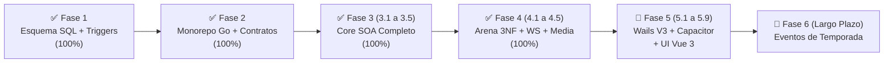
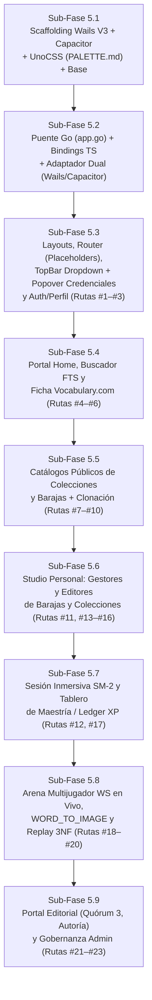

# 🗺️ Plan Maestro de Implementación y Estado Arquitectónico (`.context/PLAN.md`)

> **Propósito de este documento:**  
> Este archivo es el **tablero de control operativo y mapa de ruta paso a paso** de Palabrario.  
> Cada agente que inicie una sesión de trabajo debe consultar este documento para saber con precisión milimétrica **qué fase está completada**, **cuál es la prioridad inmediata** y **qué alcance exacto le corresponde construir**, evitando duplicidad de esfuerzo o dispersión.

---

## 0. Principio Rector de Ingeniería: Backend-First & Cadena Tipada End-to-End con Wails V3 + Capacitor

Palabrario sigue una metodología estricta de construcción en cascada tipada:
1. **Base de Datos Relacional y Contratos de Dominio:** Diseñados e indexados en PostgreSQL 17 ([`SCHEMA_FINAL.sql`](../SCHEMA_FINAL.sql)) y formalizados en Go en [`pkg/models`](../pkg/models).
2. **Consultas Estrictamente Tipadas (`sqlc`) y Servicios SOA (`:8000`, `:8001`, `:8002`):** Cero strings SQL sueltos y 100% de lógica de negocio verificada en el backend (Go 1.24 + Chi v5).
3. **Puente Nativo IPC de Wails V3 (`local-app/app.go`):** El proceso Go de escritorio importa `pkg/models`, custodia el `sessionToken` JWT en memoria privada (`sync.RWMutex`) y expone los métodos de los 7 módulos SOA + subida multimedia.
4. **Autogeneración de Tipos y Contrato Polimórfico (`IPalabrarioAPI`):** Wails genera `models.ts` y `App.d.ts`, de donde se deriva `export type IPalabrarioAPI = typeof WailsAppBridge` para gobernar tanto a `WailsDesktopAdapter` como a `CapacitorMobileAdapter`.
5. **Interfaz Unificada (`Vue 3 + UnoCSS + Reka UI`):** Consume exclusivamente `IPalabrarioAPI`, los tokens visuales de [`.context/PALETTE.md`](./PALETTE.md), las rutas de [`.context/ROUTES_MAP.md`](./ROUTES_MAP.md) y los flujos de [`.context/UI_FLOWS.md`](./UI_FLOWS.md).

---

## 1. Diagnóstico Ejecutivo e Histórico: ¿Dónde Estamos Hoy?

El proyecto ha completado y verificado al **100% toda la arquitectura de Backend (Fases 1 a 4)** cubriendo los **16 Casos de Uso (`CU01–CU16`)** y las **13 Reglas de Negocio (`RN01–RN13`)**. Actualmente nos encontramos en el arranque limpio de la **Fase 5 (Cliente Multiplataforma Wails V3 + Capacitor PWA)**.



### 1.1. Breakdown Histórico de Fases Completadas (Backend 100% Cerrado)

- **✅ Fase 1 & Fase 2 — Cimientos Relacionales y Monorepo Go:**
  - Esquema PostgreSQL 17 ([`SCHEMA_FINAL.sql`](../SCHEMA_FINAL.sql)) con 24 tablas en 3NF, triggers `RN06`/`RN07`, búsqueda FTS + `pg_trgm` y paquetes compartidos (`pkg/auth`, `pkg/models`, `pkg/response`, `pkg/utils`).
- **✅ Fase 3.1 a 3.3 — Core SOA Base, Diccionario y Curaduría por Quórum (`CU05–CU08`):**
  - `DictionaryService` (FTS, palabra del día, explorador paginado, autoría de lemas/sentidos/ejemplos/conceptos) y `CurationService` (cola de quórum tripartito `RN06`, anti-autoaprobación `RN07`, veto admin `RN08`).
- **✅ Fase 3.4 — Studio Personal, Motor Matemático SM-2 y Ledger de XP (`CU10–CU13`):**
  - `StudioService` (`RN03`, `RN04`, `RN05`) y `MasteryService` (`CalculateSM2` puro `RN09`, transacciones ACID con libro mayor inmutable `xp_transactions` `RN11` y rachas).
- **✅ Fase 3.5 — Identidad, Perfiles Sociales, Gobernanza y Moderación (`CU01–CU04, CU09`):**
  - `IdentityService` (perfiles público/privado duales), `GovernanceService` (`RN02`, promoción a `EDITOR`, protección del último `ADMIN`, boletos con `FOR UPDATE`) y resolución de reportes comunitarios (`CU09`).
- **✅ Fase 4 (Sub-fases 4.1 a 4.5) — Arena Multijugador 3NF, Seguridad S2S, `realtime-service` e `image-service` (`CU14–CU16`):**
  - Sub-llave criptográfica S2S (`sha256`, TTL 30s), `ArenaCatalogService` (piso de 8 sentidos, desempate determinista, Batch Flush ACID y Replay 3NF), `realtime-service` (`:8001`, `ArenaHub` en RAM, reloj monotónico `RN10`, reconexión 10s `RNF-CON-02`, sucesión de Host), `image-service` (`:8002`, magic bytes, limpieza EXIF, moderación heurística NSFW `RN12`) y modalidad visual `WORD_TO_IMAGE` con degradación elegante (`RN13`).

### 1.2. Matriz de Estado Real por Capa y Servicio

| Componente / Módulo | Estado Actual | Resumen de Verificación |
| :--- | :---: | :--- |
| **1. Base de Datos ([`SCHEMA_FINAL.sql`](../SCHEMA_FINAL.sql)) y `sqlc`** | **100% Completo** | 24 tablas en 3NF, triggers `RN06`/`RN07` y código Go autogenerado en `core-service/internal/db/`. |
| **2. Paquetes Compartidos ([`pkg/`](../pkg))** | **100% Completo** | `pkg/auth`, `pkg/response`, `pkg/utils` y todos los DTOs canónicos en `pkg/models/`. |
| **3. `core-service` (`:8000` — `CU01–CU14, CU16`)** | **100% Completo** | Los 7 servicios SOA implementados, enrutados en `router.go` y con suite de pruebas pasando al 100%. |
| **4. `realtime-service` (`:8001` — `CU15, CU16`)** | **100% Completo** | `ArenaHub` WebSocket concurrente en RAM con tests pasando con `-race`. |
| **5. `image-service` (`:8002` — `RN12 / RNF-SEG-04`)** | **100% Completo** | Sanitización EXIF, redimensionado y filtro NSFW en Go puro con tests pasando con `-race`. |
| **6. Cliente Multiplataforma (`local-app/`)** | **🚧 En Construcción (Fase 5)** | Directorio limpio listo para inicializar desde cero en **9 sub-fases atómicas (5.1 a 5.9)** bajo la arquitectura de [`.context/UI_SPECIFICATION.md`](./UI_SPECIFICATION.md), [`.context/ROUTES_MAP.md`](./ROUTES_MAP.md), [`.context/UI_FLOWS.md`](./UI_FLOWS.md) y [`.context/PALETTE.md`](./PALETTE.md). |

---

## 2. Plan de Implementación Detallado de la Fase 5 (9 Sub-Fases Atómicas)

**Metodología de Ejecución:** Siguiendo [`AGENT_WORKFLOW.md`](../AGENT_WORKFLOW.md), hemos granularizado la Fase 5 en **9 sub-fases atómicas, independientes y fáciles de auditar**.  
Cada sub-fase corresponde a **1 sesión limpia con un agente constructor** y debe cerrar obligatoriamente con:
```powershell
wails3 task client:check # (o powershell -File .\scripts\client.ps1 check)
```
con código de salida `0` (cadena automatizada de bindings Go -> TS, chequeo de tipos, empaquetado Vite y `go build .`).



---

### 📍 Sub-Fase 5.1: Inicialización de `local-app` (Scaffolding Wails V3 + Capacitor + UnoCSS + Arquitectura de Carpetas) — **[SIGUIENTE EN COLA]**

- **Objetivo:** Crear desde cero el esqueleto multiplataforma limpio en `local-app/`, enlazado al workspace `go.work`, con el sistema de diseño *"Imprenta Táctil Ilustrada"* configurado y documentado.
- **Entregables y Checklist:**
  - [ ] **`local-app/go.mod`, `local-app/main.go`, `local-app/app.go` (base) y `local-app/wails.json`:** Configurar aplicación de escritorio Go vinculada a `palabrario/pkg/models`, ventana nativa (`1280x820`, min `390x680`) y estructura `App` con `sessionToken` privado protegido por `sync.RWMutex`.
  - [ ] **`local-app/frontend/` (Vue 3 + TypeScript + Vite + Reka UI + Capacitor):**
    - `package.json` con `vue`, `vue-router`, `reka-ui`, `@capacitor/core`, `@capacitor/cli`, `@capacitor/preferences`, `unocss`, `@unocss/preset-uno`, `@unocss/preset-icons`, `@iconify-json/lucide`, `vue-tsc`, `typescript`, `vite` y `@vitejs/plugin-vue`.
    - `capacitor.config.ts` configurado apuntando a `dist`.
    - Tipografía `Satoshi` auto-alojada o cargada limpiamente en `index.html` / `src/assets/fonts/` y variables globales.
  - [ ] **`local-app/frontend/uno.config.ts`:** Copiar exactamente la configuración canónica de [`.context/PALETTE.md`](./PALETTE.md) (tokens `paper`, `surface`, `ink`, `brand`, `brand-soft`, `success`, `warning`, `info`, sombras `tactile-*` y shortcuts `card-editorial`, `btn-brand`, `btn-surface`, `badge-pill`, `input-editorial`).
  - [ ] **Estructura limpia de directorios en `local-app/frontend/src/`:** Crear las carpetas `api/`, `assets/`, `components/ui/`, `components/dictionary/`, `components/studio/`, `components/arena/`, `components/editorial/`, `composables/`, `layouts/`, `router/`, `views/` y un `App.vue` mínimo verificable.
  - [ ] **`local-app/README.md`:** Documentación arquitectónica clara explicando la estructura del cliente, el flujo de desarrollo dual (Wails Desktop vs Capacitor PWA) y los comandos de compilación/verificación.
- **Criterio de Cierre:** `wails3 task client:check` (o `.\scripts\client.ps1 check`) pasa con 0 errores.

---

### 📍 Sub-Fase 5.2: Puente Nativo Go (`local-app/app.go`), Bindings TypeScript y Adaptador Polimórfico (`IPalabrarioAPI`)

- **Objetivo:** Construir la capa de comunicación 100% tipada que conecta el cliente con `core-service (:8000)`, `realtime-service (:8001)` e `image-service (:8002)` sin permitir llamadas HTTP/WS sueltas en componentes Vue.
- **Entregables y Checklist:**
  - [ ] **`local-app/app.go` Completo:**
    - Gestión de sesión en memoria (`HasActiveSession`, `SignOut`, `GetMyProfile` con auto-hidratación).
    - Métodos IPC que envuelven los **7 módulos de `core-service (:8000)`** retornando tipos exactos de `pkg/models` (`auth.go`, `identity.go`, `governance.go`, `dictionary.go`, `curation.go`, `studio.go`, `arena.go`).
    - Método `UploadImage(category, filename string, fileBytes []byte) (*models.ImageUploadResponse, error)` hacia `image-service (:8002)`.
    - Cliente WebSocket Go (`ConnectArenaRoom`, `SubmitArenaAnswer`, `LeaveArenaRoom`) hacia `realtime-service (:8001)` que inyecta el `sessionToken` privado y reenvía cada `models.WSMessage` como evento IPC (`arena:ws_message`, `arena:ws_disconnected`).
  - [ ] **Generación de Bindings TypeScript (`wailsjs/go/models.ts` y `wailsjs/go/main/App.d.ts`):** Generados o sincronizados fielmente con las firmas de `local-app/app.go` y los structs de `pkg/models`.
  - [ ] **Adaptador Polimórfico Dual (`local-app/frontend/src/api/`):**
    - `client.ts`: Define `export type IPalabrarioAPI = typeof WailsAppBridge` y exporta el singleton `api` que selecciona automáticamente entre `WailsDesktopAdapter` (`window.go`) y `CapacitorMobileAdapter`.
    - `wails.adapter.ts`: Delega 1:1 en `window.go.main.App`.
    - `capacitor.adapter.ts`: Implementa exactamente `IPalabrarioAPI` usando `fetch` tipado y custodia el JWT con `@capacitor/preferences` (Keystore/Keychain nativo en móvil o memoria efímera en PWA).
    - `arena.events.ts`: Implementa `ArenaEventBus` unificando `EventsOn("arena:ws_message")` en Wails y `WebSocket.onmessage` en Capacitor/PWA.
- **Criterio de Cierre:** `wails3 task client:check` pasa con 0 errores, verificando que `WailsDesktopAdapter` y `CapacitorMobileAdapter` satisfacen al 100% el contrato `IPalabrarioAPI`.

---

### 📍 Sub-Fase 5.3: Shell de Navegación (`Layouts` + `Router` con Placeholders), `TopBar` + `CredentialsRolePopover` y Autenticación/Perfil (`Rutas #1, #2, #3` — `CU01, CU02, CU04`)

- **Objetivo:** Levantar el esqueleto completo de enrutamiento de las 23 rutas, la barra superior con el flujo de credenciales/rol en la imprenta, y cerrar las vistas de Autenticación y Perfil Social.
- **Entregables y Checklist:**
  - [ ] **`src/composables/useAuth.ts`:** Estado reactivo global (`currentUser`, `isAuthenticated`, `isEditor`, `isAdmin`, `hydrateSession`, `signIn`, `signUp`, `signOut`) siguiendo el **Flujo 1 de [`.context/UI_FLOWS.md`](./UI_FLOWS.md)**.
  - [ ] **Vistas Placeholder (`Rutas #4 a #23`):** Crear los archivos `.vue` en sus rutas exactas según [`.context/ROUTES_MAP.md`](./ROUTES_MAP.md) con una tarjeta editorial limpia mostrando el nombre de la vista, ruta y resumen en texto plano de lo que se construirá en su sub-fase.
  - [ ] **`src/router/index.ts`:** Configurar `createWebHashHistory()` con las 23 rutas y las guardias de navegación (`OptionalAuth`, `guestOnly`, `requireAuth`, `requireRole`).
  - [ ] **Layouts y Navegación (`src/layouts/` y `src/components/ui/`):**
    - `AppLayout.vue`, `AuthLayout.vue`, `ImmersiveLayout.vue`, `BottomNav.vue` y `MediaDropzone.vue` (`category: 'avatar' | 'credentials' | 'general'`, validación máx 5 MB).
    - `TopBar.vue`: Conmutador de espacio, racha (`🔥`), nivel, disparador `Ctrl + K` y **`DropdownMenu` de Reka UI** en el avatar/estado del usuario (Ver Perfil, Credenciales y Rol en la Imprenta, Configuraciones, Cerrar Sesión).
    - `CredentialsRolePopover.vue`: Popover/Dialog invocado desde el menú de `TopBar.vue` siguiendo el **Flujo 2 de [`.context/UI_FLOWS.md`](./UI_FLOWS.md)** (muestra rol actual, pestaña *Canjear Boleto VIP* `CU04`, pestaña *Solicitar Ascenso a Editor* `CU02` con bloqueo `RN02` si `xp < 500 && !is_verified` y subida de credencial `RN12`, e historial `ListMyEditorRequests`).
  - [ ] **Vistas Funcionales (`Rutas #1, #2 y #3`):**
    - `views/auth/SignInView.vue` (`/#/auth/sign-in` — `RF01`).
    - `views/auth/SignUpView.vue` (`/#/auth/sign-up` — selector `ListRegions`).
    - `views/profile/UserProfileView.vue` (`/#/u/:username` — `CU01`): Ficha pública (avatar, bio, región, `reputation_score`, `current_level`, `streak_days`, estadísticas de autoría) + panel de edición de perfil (`UpdateProfile` + `MediaDropzone(category='avatar')`) y cambio de contraseña (`ChangePassword`) cuando `is_owner == true`.
- **Criterio de Cierre:** Navegación funcional entre las 23 rutas, login/registro/logout operativos, Popover de Credenciales funcional desde `TopBar`, y `wails3 task client:check` en verde (0 errores).

---

### 📍 Sub-Fase 5.4: Portal Comunitario, Buscador FTS y Ficha Léxica Estilo Vocabulary.com (`Rutas #4, #5, #6` + Modales — `CU05, CU09`)

- **Objetivo:** Reemplazar los placeholders de las rutas `#4, #5 y #6` construyendo la experiencia nuclear de consulta del diccionario panhispánico e interacción comunitaria.
- **Entregables y Checklist:**
  - [ ] **Componentes de Diccionario (`src/components/dictionary/` y `src/components/ui/`):**
    - `FriendlyBlurb.vue`: Apertura narrativa estilo Vocabulary.com (Párrafo 1 con `word.friendly_blurb` en `text-lg/xl leading-relaxed`, Párrafo 2 con `word.etymology` e ilustración opcional `word.image_url`).
    - `SenseItem.vue`: Ficha numerada dentro del contenedor con listón `bg-brand` (*"Acepciones de {lemma}"*), pills de región/categoría/CEFR (`bg-success/15 text-success border-success`), definición, `HeteronymPills.vue` clicables y desplegable `Collapsible` de Reka UI (*"Ver más ⌄"*) con citas de uso (`examples`), `usage_note`, miniatura clicable y botones *"Guardar en Deck"* y *"Reportar"*.
    - `TabooWarningDialog.vue`: `AlertDialog` preventivo cuando `word.is_taboo == true`.
    - `ImageLightboxModal.vue`: Visor ampliado con `alt_text` y `image_credit`.
    - `ReportModal.vue` (`CU09`): Modal Reka `Dialog` para denunciar `WORD` o `SENSE` (`reason_category`: `SPAM`, `OFFENSIVE`, `INCORRECT`, `DUPLICATE`, `OTHER`).
    - `AddToDeckModal.vue` (`CU10`): Modal rápido para agregar una acepción (`id_sense`) a un Deck del usuario o crear uno al vuelo (`RN04`).
    - `SearchModal.vue`: Paleta global `Ctrl + K` con debounce de 250ms sobre `SearchWords`.
  - [ ] **Vistas Funcionales (`Rutas #4, #5 y #6`):**
    - `views/community/HomeView.vue` (`/#/`): Palabra del Día (`GetWordOfTheDay`), accesos rápidos y escaparates de colecciones/decks públicos.
    - `views/community/DictionaryView.vue` (`/#/dictionary`): Buscador FTS + `pg_trgm`, filtros por país (`ListRegions`), categoría gramatical y nivel CEFR (`ExploreWords`).
    - `views/community/WordDetailView.vue` (`/#/dictionary/:id`): Ficha completa integrando `FriendlyBlurb`, lista de `SenseItem` y modales según el **Flujo 3 de [`.context/UI_FLOWS.md`](./UI_FLOWS.md)**.
- **Criterio de Cierre:** `wails3 task client:check` pasa con 0 errores; trazabilidad completa de `CU05` y `CU09`.

---

### 📍 Sub-Fase 5.5: Catálogos Públicos de Colecciones y Barajas + Clonación (`Rutas #7, #8, #9, #10` — `CU10, CU11`)

- **Objetivo:** Reemplazar los placeholders de las rutas `#7 a #10` para permitir explorar colecciones y barajas comunitarias y clonar barajas públicas hacia el Studio personal (`RN03`).
- **Entregables y Checklist:**
  - [ ] **`views/community/PublicCollectionsView.vue` (`/#/collections` — Ruta #7):** Catálogo paginado de colecciones públicas (`ExplorePublicCollections`) con buscador y filtro de oficiales (`is_official`).
  - [ ] **`views/community/CollectionDetailView.vue` (`/#/collections/:id` — Ruta #8):** Portada editorial de la colección (`GetCollectionDetail`), descripción y grilla de barajas que la componen con enlace a cada una.
  - [ ] **`views/community/PublicDecksView.vue` (`/#/decks` — Ruta #9):** Catálogo paginado de barajas comunitarias (`ExplorePublicDecks`) mostrando autor, conteo de tarjetas (`word_count`) y contador de clones (`clone_count`).
  - [ ] **`views/community/PublicDeckDetailView.vue` (`/#/decks/:id` — Ruta #10):** Vista previa de las tarjetas (`SenseSummary`) de una baraja pública (`GetDeckDetail`) y botón táctil **"Clonar a Mi Studio"** (`ClonePublicDeck` — `RN03`) que redirige al nuevo deck clonado o inicia repaso.
- **Criterio de Cierre:** `wails3 task client:check` limpio (0 errores); clonación de decks públicos verificada contra `IPalabrarioAPI`.

---

### 📍 Sub-Fase 5.6: Studio Personal — Gestores y Editores de Barajas y Colecciones (`Rutas #11, #13, #14, #15, #16` — `CU10, CU11`)

- **Objetivo:** Construir el taller privado del aprendiz para administrar sus barajas de estudio (`RN04`) y colecciones (`RN05`).
- **Entregables y Checklist:**
  - [ ] **`views/studio/StudioDashboardView.vue` (`/#/studio` — Ruta #11):** Resumen ejecutivo del aprendiz (`GetMasterySummary` con conteo `due_for_review_today`, botón directo a `/#/studio/session`, racha activa y carruseles de mis decks y colecciones recientes).
  - [ ] **`views/studio/StudioDecksView.vue` (`/#/studio/decks` — Ruta #13):** Listado de barajas propias y clonadas (`ListMyDecks`), modal para crear baraja (`CreateDeck`) y eliminación con confirmación (`DeleteDeck`).
  - [ ] **`views/studio/StudioDeckEditorView.vue` (`/#/studio/decks/:id` — Ruta #14):** Editor de metadatos (`UpdateDeck`: nombre, descripción, switch `is_public`), buscador integrado para añadir acepciones (`AddSenseToDeck` respetando tope de 100 cartas `RN04`), remoción de cartas (`RemoveSenseFromDeck`) y botón *"Estudiar este Deck"* (`/#/studio/session?deckId=:id`).
  - [ ] **`views/studio/StudioCollectionsView.vue` (`/#/studio/collections` — Ruta #15):** Listado de colecciones propias (`ListMyCollections`), creación (`CreateCollection`) y borrado (`DeleteCollection`).
  - [ ] **`views/studio/StudioCollectionEditorView.vue` (`/#/studio/collections/:id` — Ruta #16):** Editor de colección (`UpdateCollection`), vinculación ordenada de barajas (`AddDeckToCollection` validando `RN05`: colecciones públicas solo admiten decks públicos) y desvinculación (`RemoveDeckFromCollection`).
- **Criterio de Cierre:** `wails3 task client:check` limpio (0 errores); reglas `RN04` y `RN05` reflejadas en la UI.

---

### 📍 Sub-Fase 5.7: Sesión Inmersiva de Repaso SM-2 y Tablero de Maestría (`Rutas #12, #17` — `CU12, CU13, RN09, RN11`)

- **Objetivo:** Implementar el motor interactivo de flashcards con repetición espaciada SM-2 y la visualización del progreso cognitivo y libro mayor de XP.
- **Entregables y Checklist:**
  - [ ] **Componentes de Studio (`src/components/studio/`):**
    - `StudyCard.vue`: Tarjeta interactiva con volteo anverso/reverso (lema, región, ejemplo oculto $\to$ definición, heterónimos, imagen) y botonera ergonómica de calificación SM-2 con atajos de teclado (`1: Olvidado`, `2: Difícil`, `3: Bien`, `4: Fácil`).
    - `MasteryProgressBar.vue`: Barra segmentada visualizando la proporción de palabras en estados `NEW`, `LEARNING`, `REVIEW` y `MASTERED`.
  - [ ] **`views/studio/StudySessionView.vue` (`/#/studio/session` — Ruta #12, Layout `immersive`):**
    - Carga cola de estudio (`GetStudySessionQueue(deckId, limit)`) siguiendo el **Flujo 4 de [`.context/UI_FLOWS.md`](./UI_FLOWS.md)**.
    - Procesa cada calificación con `SubmitCardReview`, muestra micro-feedback de XP ganado (`+10 XP`) y nuevo intervalo en días (`interval_days`), y al terminar presenta el resumen de sesión con bonificación por mazo completado (`+25 XP`) o racha diaria (`+15 XP`).
  - [ ] **`views/studio/StudioMasteryView.vue` (`/#/studio/mastery` — Ruta #17):**
    - Estadísticas globales de retención (`GetMasterySummary` + `MasteryProgressBar`).
    - Tabla del libro mayor auditable de experiencia (`GetMyXPTransactions` — `RN11`) y vitrina de medallas/logros desbloqueados (`GetMyAchievements`).
- **Criterio de Cierre:** `wails3 task client:check` limpio (0 errores); sesión SM-2 operable por click y teclado (`1..4`, `Espacio`).

---

### 📍 Sub-Fase 5.8: Arena Multijugador en Vivo (WebSockets), `WORD_TO_IMAGE` y Replay 3NF (`Rutas #18, #19, #20` — `CU14, CU15, CU16`)

- **Objetivo:** Construir la experiencia competitiva síncrona en tiempo real conectada a `ArenaEventBus` y el visor de retrospección ronda por ronda en 3NF.
- **Entregables y Checklist:**
  - [ ] **Componentes de Arena (`src/components/arena/`):**
    - `ArenaTimer.vue`: Cronómetro regresivo con `font-variant-numeric: tabular-nums` y alerta visual en los últimos 3 segundos.
    - `ImageChoiceGrid.vue`: Cuadrícula táctil 2x2 de opciones ilustradas para rondas `WORD_TO_IMAGE` (`RN13`).
    - `PodiumCard.vue`: Tarjeta de podio final (`1°`, `2°`, `3°`) con desglose de puntos, aciertos, tiempo total (`TotalTimeSpentMs`) y XP otorgado.
  - [ ] **`views/arena/ArenaLobbyView.vue` (`/#/arena` — Ruta #18):**
    - Formulario para crear partida (`CreateArenaMatch`: selección de Deck o Colección con validación de mínimo 8 sentidos, rondas, tiempo por ronda, modos permitidos incluyendo `WORD_TO_IMAGE`) o unirse con código PIN de 6 caracteres (`JoinArenaMatch`).
    - Tabla de historial de partidas recientes (`GetMyMatchHistory`) con acceso directo al Replay.
  - [ ] **`views/arena/ArenaGameView.vue` (`/#/arena/room/:code` — Ruta #19, Layout `immersive`):**
    - Implementa el **Flujo 5 de [`.context/UI_FLOWS.md`](./UI_FLOWS.md)** suscribiéndose a `ArenaEventBus`.
    - Maneja todas las fases de la sala: `WAITING` (lista de jugadores, badge de Host y botón *"Iniciar Partida"*), `COUNTDOWN`, `PLAYING` (renderizado condicional de opciones de texto o `ImageChoiceGrid` 2x2 + `SubmitArenaAnswer`), `ROUND_RESULT` (respuesta correcta, explicación y leaderboard parcial) y `FINISHED` (`PodiumCard` + enlace a `/#/arena/matches/:matchId`).
    - Maneja desconexión temporal / reconexión en ventana de gracia de 10s (`RNF-CON-02`) y salida limpia en `onUnmounted` (`LeaveArenaRoom`).
  - [ ] **`views/arena/ArenaReplayView.vue` (`/#/arena/matches/:matchId` — Ruta #20):**
    - Consume `GetMatchReplayDetail(matchId)` para mostrar el podio histórico y un acordeón/pestañas ronda por ronda (`MatchRoundReplay`) detallando la pregunta, respuesta correcta y qué contestó cada jugador con su tiempo en milisegundos (`time_spent_ms`).
- **Criterio de Cierre:** `wails3 task client:check` limpio (0 errores); manejo completo de las tramas WS (`ROOM_STATE`, `COUNTDOWN`, `QUESTION`, `ROUND_RESULT`, `PODIUM`, `ERROR`).

---

### 📍 Sub-Fase 5.9: Portal Editorial de Quórum Tripartito y Gobernanza Institucional (`Rutas #21, #22, #23` — `CU02–CU04, CU06–CU09`)

- **Objetivo:** Cerrar las herramientas de curaduría lexicográfica por quórum de 3 editores y el panel administrativo de gobernanza y moderación.
- **Entregables y Checklist:**
  - [ ] **Componentes Editoriales (`src/components/editorial/`):**
    - `QuorumStepper.vue`: Indicador visual de los 3 slots de revisión (`RN06`) mostrando votos emitidos (`APPROVE`, `REQUEST_CHANGES`, `REJECT`), bloqueo de auto-aprobación (`RN07` cuando `currentUser.id_user == proposal.created_by`) y badge de veto administrativo (`RN08`).
    - `ProposalDiffCard.vue`: Inspector de propuesta léxica mostrando lema, etimología, sentidos, notas culturales, ejemplos e imágenes con atribuciones (`RN12`).
  - [ ] **`views/editorial/EditorDashboardView.vue` (`/#/editor` — Ruta #21, `EDITOR`/`ADMIN`):**
    - Cola paginada de propuestas en `PENDING_QUORUM` (`ListPendingQuorumQueue`), pestaña de *"Mis Propuestas"* (`ListMyLexicalProposals`), inspección con `ProposalDiffCard` + `QuorumStepper`, formulario de dictamen (`SubmitProposalReview`) y botón de resolución forzada exclusivo para `ADMIN` (`AdminForceResolveProposal` — `RN08`).
  - [ ] **`views/editorial/EditorWordFormView.vue` (`/#/editor/words/new` y `/#/editor/words/:id` — Ruta #22, `EDITOR`/`ADMIN`):**
    - Formulario asistido en pasos o secciones para crear/editar propuestas de lemas (`CreateWordProposal`, `UpdateWordProposal`), agregar/editar acepciones (`CreateSenseProposal`, `UpdateSenseProposal`), añadir ejemplos contextuales (`AddSenseExample`), vincular conceptos semánticos para heterónimos (`ListSemanticConcepts`, `CreateSemanticConcept`, `LinkSenseToConcept`) y subir ilustraciones con `MediaDropzone(category='general')` (`RN12`), siguiendo el **Flujo 6 de [`.context/UI_FLOWS.md`](./UI_FLOWS.md)**.
  - [ ] **`views/editorial/GovernanceDashboardView.vue` (`/#/editor/governance` — Ruta #23, exclusivo `ADMIN`):**
    - **Tab 1 — Solicitudes de Editor (`CU02`):** Lista `ListPendingEditorRequests`, visor de documento institucional (`credentials_url`) y botones de dictamen (`ResolveEditorRequest`).
    - **Tab 2 — Boletos de Invitación (`CU04`):** Generador de boletos VIP (`GenerateInvitationTickets`) y listado con estado (`ACTIVE`, `REDEEMED`, `EXPIRED`).
    - **Tab 3 — Moderación de Reportes (`CU09`):** Cola de denuncias (`ListCommunityReports`) y resolución (`ResolveCommunityReport`: `DISMISSED`, `RESOLVED` o `CONTENT_ARCHIVED` con archivado en cascada).
    - **Tab 4 — Directorio de Usuarios (`CU03`):** Buscador de cuentas (`ListUsersForGovernance`), cambio de rol (`UpdateUserRole`) y suspensión (`UpdateUserStatus`) respetando protección del último `ADMIN`.
- **Criterio de Cierre:** `wails3 task test` (o `.\scripts\test.ps1`) y `wails3 task client:check` (o `.\scripts\client.ps1 check`) 100% en verde con 0 errores; Fase 5 completada en su totalidad.

---

## 🌱 3. Fase 6 (Incremento Post-MVP a Largo Plazo): Sistema de Eventos Culturales de Temporada

> **Objetivo:** Incorporar festivales estacionales (*Día de Muertos*, *Feria de las Flores*, *San Juan*) y galería de arte hispanoamericano según [`proposals/SEASONAL_EVENTS_SPECIFICATION.md`](../proposals/SEASONAL_EVENTS_SPECIFICATION.md), únicamente tras haber cerrado y verificado las 9 sub-fases de la Fase 5.
