# 🗺️ Plan Maestro de Implementación y Estado Arquitectónico (`.context/PLAN.md`)

> **Documento de Planificación Estratégica y Hoja de Ruta a Largo Plazo (Backend-First)**  
> **Proyecto:** Palabrario — Plataforma Gamificada de Aprendizaje y Preservación del Léxico Dialectal Panhispánico  
> **Stack Backend Unificado (100% Go):** `Go 1.24 + Chi v5 + sqlc + pgxpool/v5` (`core-service :8000`, `realtime-service :8001`, `image-service :8002`) + Puente IPC Nativo Wails (`local-app/app.go`) sobre `PostgreSQL 17 Alpine (:5432)`  
> **Referencias Canónicas:** [`DOMAIN.md`](./DOMAIN.md) · [`INTERFACES.md`](./INTERFACES.md) · [`SCHEMA_FINAL.sql`](../SCHEMA_FINAL.sql) · [`.context/academic/1-PROJECT-SPECIFICATION.md`](./academic/1-PROJECT-SPECIFICATION.md)

---

## 0. Principio Rector de Ingeniería: Backend-First & Cadena Tipada End-to-End con Wails IPC

> [!IMPORTANT]
> **¿Por qué no se toca la UI (`local-app`) hasta cerrar las Fases 3.3 a 4, y cómo se conecta después?**
> 1. Cuando los modelos de IA trabajan primero sobre interfaces gráficas con mockups sin un backend estable, alucinan propiedades en el frontend que la base de datos o los endpoints jamás retornan.
> 2. En **Palabrario**, el frontend Vue 3 **no consume endpoints HTTP directamente con `fetch`/`axios`**. Toda comunicación hacia `core-service`, `realtime-service` e `image-service` pasa por el **backend nativo en Go de Wails ([`local-app/app.go`](../local-app/app.go))**, el cual:
>    - Custodia el token JWT en la memoria RAM privada del proceso Go (`sessionToken`), haciéndolo 100% inaccesible a ataques XSS desde el WebView.
>    - Importa directamente los structs de [`pkg/models`](../pkg/models) gracias al workspace de Go ([`go.work`](../go.work)).
>    - Al ejecutar `wails generate module` (o `wails dev` / `wails build`), **Wails transpila automáticamente las firmas de `local-app/app.go` y los structs de `pkg/models` a TypeScript** dentro de `local-app/frontend/wailsjs/go/main/App.js` (`.d.ts`) y `local-app/frontend/wailsjs/go/models.ts`.
>
> Por ello, **el desarrollo sigue estrictamente esta cadena de 6 eslabones sin alucinaciones:**
> $$\text{1. SQL (`SCHEMA_FINAL.sql`)} \to \text{2. `sqlc`} \to \text{3. `pkg/models` + SOA Go} \to \text{4. Tests} \to \text{5. Métodos Go en `local-app/app.go` (`wails generate`)} \to \text{6. Vistas Vue 3}$$

---

## 1. Diagnóstico Ejecutivo: ¿Dónde Estamos Hoy?

Al auditar el código real del repositorio frente a los **16 Casos de Uso (`CU01–CU16`)** y las **11 Reglas de Negocio (`RN01–RN11`)**, el proyecto ha cerrado con éxito la **Fase 3.3** (Diccionario y Curaduría por Quórum), la **Fase 3.4** (Studio Personal, Motor SM-2 y Ledger de XP) y la **Fase 3.5** (Módulo de Cuenta, Perfiles Sociales, Gobernanza y Moderación, más la refactorización de utilidades en `REFACTOR.md`), y se encuentra listo para iniciar la **Fase 4 (Migración de `realtime-service` a Go 1.24 y Arena Multijugador)**:

```mermaid
flowchart LR
    F1["✅ Fase 1\nEsquema SQL + Triggers\n(100%)"] --> F2["✅ Fase 2\nMonorepo Go + Contratos\n(100%)"]
    F2 --> F31["✅ Fase 3.1/3.2\nCore SOA Base + Auth JWT\n(100%)"]
    F31 --> F33["✅ Fase 3.3\nDiccionario & Curaduría\n(100%)"]
    F33 --> F34["✅ Fase 3.4\nStudio & Motor SM-2\n(100%)"]
    F34 --> F35["✅ Fase 3.5\nGobernanza & Reportes\n(100%)"]
    F35 --> F4["🚧 Fase 4 (ACTUAL)\nMigración Realtime a Go\n+ Arena WS & Flush\n(10% Esqueleto)"]
    F4 --> F5["⏳ Fase 5\nPuente Wails (app.go)\n+ Bindings TS & UI\n(Auth & Search listos)"]
    F5 --> F6["🌱 Fase 6 (Largo Plazo)\nEventos de Temporada"]
```

### 1.1. Matriz de Estado Real por Capa y Servicio

| Componente / Módulo | Estado Actual Real | Lo que YA existe y compila | Lo que FALTA por construir |
| :--- | :---: | :--- | :--- |
| **1. Base de Datos ([`SCHEMA_FINAL.sql`](../SCHEMA_FINAL.sql))** | **100% Completo** | 23 tablas, extensiones `unaccent` + `pg_trgm`, vectores `tsvector` GIN, triggers `RN06` (auto-aprobación al 3er voto) y `RN07` (anti-autoaprobación), tablas de gobernanza (`editor_requests`, `invitation_tickets`, `ticket_redemptions`, `content_reports`) y guardados (`saved_decks`, `saved_collections`). | Únicamente escribir las consultas SQL en `sql/queries/arena.sql` y ejecutar `sqlc generate`. |
| **2. Paquetes Compartidos ([`pkg/`](../pkg))** | **95% Completo** | `pkg/auth` (JWT + `bcrypt`), `pkg/response` (JSON/Error unificados), `pkg/utils` (`ToPtr[T]`), estructuras completas en `pkg/models/dictionary.go`, `pkg/models/curation.go`, `pkg/models/studio.go`, `pkg/models/governance.go`, `pkg/models/user.go`, `pkg/models/auth.go` y estructuras base en `pkg/models/arena.go`. | Ampliaciones de DTOs de Arena en `pkg/models/arena.go` si aplica en Fase 4. |
| **3. `core-service` — Auth & Cuentas (`CU01`)** | **100% Completo** | Capa SOA `IdentityService` (`SignUp`, `SignIn` con verificación de `is_active`, `GetMe`, `UpdateProfile`, `ChangePassword`, `GetPublicProfileByUsername` con vista dual **RN01**), handlers en `auth_handler.go` y `user_handler.go`, middlewares `RequireAuth`, `OptionalAuth` y `RequireRole`. | Nada en `core-service` (Cerrado al 100% en Fase 3.5; pendiente solo exponer métodos puente en `local-app/app.go` en Fase 5). |
| **4. `core-service` — Diccionario (`CU05, CU06`)** | **100% Completo** | Capa SOA `DictionaryService` con `GET /api/v1/words/search` (`OptionalAuth` + FTS + trigramas), `GET /api/v1/words/{id}` (detalle con sentidos `APPROVED`, ejemplos, heterónimos y `ParentZone`), `GET /api/v1/regions`, `GET /api/v1/words/word-of-the-day`, explorador paginado `GET /api/v1/words`, y todo el bloque de autoría de `CU06` (`POST/PUT /words`, `POST/PUT/DELETE /senses`, `examples` y `concepts` con helper `NormalizeLemma`). | Nada en `core-service` (Cerrado al 100% en Fase 3.3; pendiente solo exponer métodos puente en `local-app/app.go` en Fase 5). |
| **5. `core-service` — Curaduría y Moderación (`CU07–CU09`)** | **100% Completo** | Los triggers PL/pgSQL (`trg_prevent_self_approval` y `trg_auto_approve_sense`), el traductor `MapDBError` (`P0001` $\to$ `403 Forbidden`), consultas en `sql/queries/curation.sql`, `CurationService` y endpoints para cola de quórum (`/curation/queue`, `/my-proposals`, `/senses/{id}`), votación (`/vote` con `RN06` y `RN07`), veto admin (`RN08` en `/curation/senses/{id}/state`) y reportes comunitarios (`CU09`: `POST /reports`, `GET /reports` y `PUT /reports/{reportId}/resolve` con ocultamiento automático `RESOLVED_HIDDEN`). | Nada en `core-service` (Cerrado al 100% en Fase 3.5; pendiente solo exponer métodos puente en `local-app/app.go` en Fase 5). |
| **6. `core-service` — Studio y SM-2 (`CU10–CU13`)** | **100% Completo** | Modelos completos en `pkg/models/studio.go`, consultas en `sql/queries/studio.sql` y `sql/queries/mastery.sql`, `StudioService` (CRUD de barajas/colecciones y guardado comunitario con validación estricta de **RN03**, **RN04** y **RN05**), `MasteryService` (función pura determinística `CalculateSM2`, transacción ACID `pgx.Tx` actualizando `user_mastery`, `xp_transactions` **RN11** y racha/nivel en `users`), handlers `studio_handler.go` y `mastery_handler.go`, rutas en `router.go` y pruebas de integración en `studio_mastery_test.go`. | Nada en `core-service` (Cerrado al 100% en Fase 3.4; pendiente solo exponer métodos puente en `local-app/app.go` en Fase 5). |
| **7. `core-service` — Gobernanza (`CU02–CU04`)** | **100% Completo** | Modelos en `pkg/models/governance.go`, consultas en `sql/queries/governance.sql`, `GovernanceService` (`CreateEditorRequest` con **RN02**, `ResolveEditorRequest` con promoción atómica, `UpdateUserRoleOrStatus` con protección del último `ADMIN`, `CreateInvitationTicket`, `RevokeInvitationTicket` y `RedeemInvitationTicket` con `SELECT ... FOR UPDATE`), `governance_handler.go` y pruebas en `governance_reports_test.go`. | Nada en `core-service` (Cerrado al 100% en Fase 3.5; pendiente solo exponer métodos puente en `local-app/app.go` en Fase 5). |
| **8. `realtime-service` (`CU14–CU16`)** | **10% Esqueleto** | Actualmente tiene un placeholder de 9 líneas en TypeScript/Bun (`realtime-service/index.ts`). | **Migrar a Go 1.24 + Chi v5 + WebSockets**, implementar `ArenaHub` en RAM por PIN, tickers de ronda (`RN10`), reconexión `10s` (`RNF-CON-02`) y *Batch Flush* hacia `core-service`. |
| **9. `image-service` (Multimedia)** | **25% Esqueleto** | Ya migrado a Go 1.24 + Chi v5 en puerto `8002` con `/health`, graceful shutdown y Dockerfile multi-stage. | Endpoint `POST /api/v1/images/upload` con validación de magic bytes, limpieza EXIF y compresión WebP. |
| **10. Puente Wails Go (`local-app/app.go`) + UI** | **25% Puente / 100% UI Mock** | `local-app/app.go` ya implementa la bóveda de sesión JWT en RAM (`SignIn`, `SignUp`, `SignOut`, `GetCurrentUser`, `IsAuthenticated`) y las consultas iniciales (`SearchWords`, `GetWordDetail`). | En la **Fase 5**, exponer en `local-app/app.go` los métodos puente para el resto de módulos, correr `wails generate module` para regenerar `wailsjs/go/models.ts` y `App.js`, y conectar las vistas Vue. |

---

## 2. Plan de Implementación Paso a Paso (Checklist Operativo para Agentes)

Cada fase de backend (3.3 a 4) está diseñada como una unidad atómica de trabajo verificable mediante `sqlc generate && go build ./core-service/... ./image-service/... ./pkg/...`.

---

### ✅ FASE 3.3 (COMPLETADA): Módulo de Diccionario y Curaduría por Quórum (`CU05, CU06, CU07, CU08`)

> **Objetivo:** Cerrar al 100% el corazón lexicográfico y editorial de Palabrario en `core-service` siguiendo las secciones **2.3** y **2.4** de [`INTERFACES.md`](./INTERFACES.md).

#### Tareas Exactas de Implementación (Verificadas en Commit `c0e651e`):
1. **[x] Modelos Compartidos (`pkg/models/`):**
   - Ampliado [`pkg/models/dictionary.go`](../pkg/models/dictionary.go) con `WordExploreFilter`, `WordSummaryCard`, `PaginatedWords`, `CreateExampleInput`, `CreateSenseRequest`, `CreateWordProposalRequest`, `UpdateWordRequest`, `UpdateSenseRequest`, `SemanticConcept`, `CreateConceptRequest`.
   - Creado [`pkg/models/curation.go`](../pkg/models/curation.go) con `ReviewDecision`, `SenseApprovalVote`, `SenseQuorumItem`, `SenseQuorumDetail`, `SubmitVoteRequest`, `AdminOverrideStateRequest`, `ContentReport`, `CreateReportRequest`, `ResolveReportRequest`.
2. **[x] Consultas Tipadas (`sql/queries/`):**
   - Ampliado [`sql/queries/dictionary.sql`](../sql/queries/dictionary.sql) con `ListRegions`, `GetRegionByCode`, `GetWordOfTheDayID`, `ExploreWordsPaginated`, `CountExploreWords`, `GetWordByNormalizedLemmaAndPOS`, `CreateWord`, `UpdateWordMetadata`, `CreateSense`, `GetSenseByID`, `UpdateSense`, `DeleteSense`, `CreateExample`, `UpdateExample`, `DeleteExample`, `ListSemanticConcepts`, `CreateSemanticConcept`, `LinkSenseToConcept`, `UnlinkSenseFromConcept` (excluyendo `search_vector` y `sense_search_vector` de las cláusulas `RETURNING` para compatibilidad con `pgx/v5`).
   - Creado [`sql/queries/curation.sql`](../sql/queries/curation.sql) con `ListPendingQuorumQueue`, `ListEditorProposals`, `GetSenseQuorumItemByID`, `ListVotesBySenseID`, `UpsertSenseApproval`, `AdminUpdateSenseState`.
   - Ejecutado `sqlc generate`.
3. **[x] Servicios SOA (`core-service/internal/service/`):**
   - Ampliado [`core-service/internal/service/dictionary_service.go`](../core-service/internal/service/dictionary_service.go) implementando todos los métodos de `DictionaryService` (incluyendo helper determinístico `NormalizeLemma(s string) string` que pasa a minúsculas y remueve tildes para `normalized_lemma`).
   - Creado [`core-service/internal/service/curation_service.go`](../core-service/internal/service/curation_service.go) implementando `CurationService` (aprovechando `MapDBError` en [`errors.go`](../core-service/internal/service/errors.go) para traducir excepciones `P0001` de `trg_prevent_self_approval` a `403 Forbidden`, y validando estrictamente estados `'APPROVED'` o `'HIDDEN'` en `AdminOverrideState`).
4. **[x] Handlers, Router y Pruebas (`core-service/internal/`):**
   - Actualizado [`dictionary_handler.go`](../core-service/internal/api/handlers/dictionary_handler.go) y creado [`curation_handler.go`](../core-service/internal/api/handlers/curation_handler.go).
   - Registradas en [`router.go`](../core-service/internal/api/router.go) todas las rutas de las secciones **2.3.3** y **2.4.3** de `INTERFACES.md`.
   - Añadidas pruebas de integración SOA en [`service_test.go`](../core-service/internal/service/service_test.go) verificando **RN06**, **RN07** y **RN08** sobre PostgreSQL efímero (`:5433`).

---

### ✅ FASE 3.4 (COMPLETADA): Studio Personal, Motor Matemático SM-2 y Ledger de XP (`CU10, CU11, CU12, CU13`)

> **Objetivo:** Implementar la gestión de barajas/colecciones y el motor de repetición espaciada SuperMemo SM-2 siguiendo las secciones **2.5** y **2.6** de [`INTERFACES.md`](./INTERFACES.md).
> **Nota Técnica heredada de Fase 3.3:** Si alguna consulta en `studio.sql` o `mastery.sql` hace `JOIN` o `RETURNING` sobre las tablas `words` o `senses`, **nunca usar `RETURNING *` ni `SELECT w.*` / `s.*`** que incluyan las columnas `search_vector` o `sense_search_vector` (`tsvector`, OID 3614), ya que `pgx/v5` no las escanea en `*interface{}`. Listar siempre las columnas explícitamente.

#### Tareas Exactas de Implementación:
1. **[x] Modelos Compartidos (`pkg/models/studio.go`):**
   - Ampliado [`pkg/models/studio.go`](../pkg/models/studio.go) con `StudioDeckSummary`, `CreateDeckRequest`, `UpdateDeckRequest`, `AddDeckItemRequest`, `CreateCollectionRequest`, `UpdateCollectionRequest`, `StudyCardItem`, `StudySessionPayload`, `SubmitReviewRequest`, `CardReviewResult`, `XPTransactionItem`, `AchievementStatus`, `MasteryDashboard` y constantes `XPReason*`.
2. **[x] Consultas Tipadas (`sql/queries/`):**
   - Creado [`sql/queries/studio.sql`](../sql/queries/studio.sql) con 24 consultas tipadas (`ListPublicDecks`, `ListStudioDecks`, `GetDeckByID`, `ListDeckItemsByDeckID`, `CreateDeck`, `UpdateDeck`, `DeleteDeck`, `AddDeckItem`, `RemoveDeckItem`, `SaveDeck`, `UnsaveDeck`, `IsDeckSavedByUser`, `ListPublicCollections`, `ListStudioCollections`, `GetCollectionByID`, `ListCollectionDecks`, `CreateCollection`, `UpdateCollection`, `DeleteCollection`, `AddCollectionDeck`, `ClearCollectionDecks`, `SaveCollection`, `UnsaveCollection`, `IsCollectionSavedByUser`).
   - Creado [`sql/queries/mastery.sql`](../sql/queries/mastery.sql) con 15 consultas tipadas (`GetStudySessionCardsByDeck`, `CountDueStudySessionCardsByDeck`, `GetStudySessionCardsAll`, `CountDueStudySessionCardsAll`, `GetUserMasteryForSense`, `UpsertUserMastery`, `InsertXPTransaction`, `AddUserXPAndUpdateStreak`, `GetMasteryStageCounts`, `GetUserGamificationProfile`, `ListUserAchievements`, `UnlockUserAchievement`, `ListMasteryCardsByStage`, `ListRecentXPTransactions`, `GetExamplesForSenses`).
   - Ejecutado `sqlc generate`.
3. **[x] Servicios SOA (`core-service/internal/service/`):**
   - Creado [`core-service/internal/service/studio_service.go`](../core-service/internal/service/studio_service.go) validando estrictamente **RN03** (propiedad en edición/borrado), **RN04** (privacidad en lectura/guardado de recursos `is_public = false`) y **RN05** (`is_official` e `is_featured` forzados a `false` si el actor es `LEARNER`).
   - Creado [`core-service/internal/service/mastery_service.go`](../core-service/internal/service/mastery_service.go) con la función pura `CalculateSM2` siguiendo la fórmula matemática exacta de `INTERFACES.md` y ejecutando `SubmitReview` dentro de una transacción ACID `pgx.Tx` que actualiza `user_mastery`, inserta en `xp_transactions` (**RN11**) y actualiza saldo/nivel/racha en `users`.
4. **[x] Handlers, Router y Pruebas (`core-service/internal/`):**
   - Creado [`studio_handler.go`](../core-service/internal/api/handlers/studio_handler.go) y [`mastery_handler.go`](../core-service/internal/api/handlers/mastery_handler.go) y montadas todas las rutas de las secciones **2.5.3** y **2.6.3** de `INTERFACES.md` en [`router.go`](../core-service/internal/api/router.go).
   - Creado [`studio_mastery_test.go`](../core-service/internal/service/studio_mastery_test.go) verificando **RN03**, **RN04**, **RN05**, precisión matemática de **SM-2** y transaccionalidad ACID de **RN11** sobre PostgreSQL efímero (`:5433`).

---

### ✅ FASE 3.5 (COMPLETADA + REFACTORIZADA): Módulo de Cuenta, Perfiles Sociales, Gobernanza y Moderación (`CU01, CU02, CU03, CU04, CU09`)

> **Objetivo:** Completar la gestión de perfil propio/público, el flujo de ascenso a Editor, los boletos de invitación y la resolución de reportes siguiendo las secciones **2.1**, **2.2** y **2.4** de [`INTERFACES.md`](./INTERFACES.md), más la consolidación de utilidades reportadas en [`REFACTOR.md`](../REFACTOR.md).

#### Tareas Exactas de Implementación:
1. **[x] Modelos y Consultas:**
   - Creado [`pkg/models/governance.go`](../pkg/models/governance.go) y ampliado [`pkg/models/user.go`](../pkg/models/user.go).
   - Ampliado [`sql/queries/users.sql`](../sql/queries/users.sql), [`sql/queries/curation.sql`](../sql/queries/curation.sql) (reportes `content_reports`) y creado [`sql/queries/governance.sql`](../sql/queries/governance.sql).
   - Ejecutado `sqlc generate`.
2. **[x] Servicios SOA, Handlers y Refactorización (`REFACTOR.md`):**
   - Ampliado [`core-service/internal/service/identity_service.go`](../core-service/internal/service/identity_service.go), [`core-service/internal/service/curation_service.go`](../core-service/internal/service/curation_service.go) (`CreateReport`, `ListOpenReports`, `ResolveReport`) y creado [`core-service/internal/service/governance_service.go`](../core-service/internal/service/governance_service.go).
   - Creado [`user_handler.go`](../core-service/internal/api/handlers/user_handler.go), [`governance_handler.go`](../core-service/internal/api/handlers/governance_handler.go), ampliado [`curation_handler.go`](../core-service/internal/api/handlers/curation_handler.go) y montados los endpoints `/api/v1/users/*`, `/api/v1/governance/*` y `/api/v1/reports/*` en [`router.go`](../core-service/internal/api/router.go).
   - Consolidados helpers atómicos en [`pkg/utils/ptr.go`](../pkg/utils/ptr.go), [`core-service/internal/service/helpers.go`](../core-service/internal/service/helpers.go) y [`core-service/internal/api/handlers/helpers.go`](../core-service/internal/api/handlers/helpers.go).
   - Añadidas pruebas de integración en [`governance_reports_test.go`](../core-service/internal/service/governance_reports_test.go).

---

### 📍 FASE 4 (Prioridad Inmediata): Migración de `realtime-service` a Go 1.24 y Arena Multijugador (`CU14, CU15, CU16`)

> **Objetivo:** Unificar el 100% del backend en Go 1.24 migrando `realtime-service` (`:8001`) de Bun a Go e implementando el motor de salas por PIN en RAM y el *Batch Flush* transaccional hacia `core-service` según la sección **2.7** de [`INTERFACES.md`](./INTERFACES.md).

#### Tareas Exactas de Implementación:
1. **Migración de Infraestructura de `realtime-service` a Go 1.24 (COMPLETADA):**
   - Eliminar los artefactos de Bun/Node en `realtime-service/` (`index.ts`, `package.json`, `bun.lock`, `tsconfig.json`, `node_modules`).
   - Crear `realtime-service/main.go` y `realtime-service/Dockerfile` (multi-stage build con `context: .` en [`docker-compose.yml`](../docker-compose.yml), idéntico en patrón a `core-service` e `image-service`).
2. **Coordinación en `core-service` (`ArenaCatalogService`):**
   - Crear `sql/queries/arena.sql`, `arena_catalog_service.go` y `arena_handler.go`.
   - Implementar `POST /api/v1/arena/matches/prepare`, `GET /api/v1/arena/matches/{roomCode}/package` y `POST /api/v1/arena/matches/consolidate` (*Batch Flush* ACID en `matches`, `match_participants`, `xp_transactions` y `user_mastery`).
3. **Motor WebSocket en `realtime-service` (`realtime-service/internal/arena/`):**
   - Implementar `hub.go` (`ArenaHub` con `sync.RWMutex`) y `room.go` (`ActiveRoom` con bucle de eventos por canales, temporizador por ronda, cálculo de puntaje por velocidad **RN10**, ventana de reconexión de 10 segundos **RNF-CON-02** y disparo automático del *Batch Flush* al emitir `PODIUM`).
4. **Completar `image-service` (`:8002`):**
   - Implementar `POST /api/v1/images/upload` validando magic bytes y limpiando metadatos EXIF (**RNF-SEG-04**).

---

### 📍 FASE 5: Puente Nativo Go en Wails (`local-app/app.go`), Generación de Bindings TypeScript e Integración UI

> **Objetivo:** Con el 100% del backend estable y probado, extender el puente IPC en [`local-app/app.go`](../local-app/app.go), autogenerar los bindings TypeScript con Wails y conectar los componentes Vue 3 sin ningún tipo de dato alucinado.

1. **Extensión del Puente Go (`local-app/app.go`):**
   - Añadir un helper interno `doAuthenticatedRequest(method, path string, body any, out any) error` en `local-app/app.go` que adjunte automáticamente `Authorization: Bearer <sessionToken>` desde la memoria privada de Go.
   - Exponer en `struct App` los métodos puente para cada módulo (`UpdateProfile`, `GetPublicProfile`, `ListRegions`, `GetWordOfTheDay`, `ExploreWords`, `CreateWordProposal`, `ListPendingQuorumQueue`, `SubmitQuorumVote`, `ListMyStudioDecks`, `GetDueStudySession`, `SubmitCardReview`, `ConnectArenaRoom`, `SubmitArenaAnswer`, etc.) retornando directamente los tipos de [`pkg/models`](../pkg/models).
   - Para la Arena en vivo (`realtime-service`), el proceso Go de Wails mantiene el cliente WebSocket autenticado con el `sessionToken` privado y retransmite los eventos del servidor hacia Vue mediante `runtime.EventsEmit(a.ctx, "arena:event", event)`.
2. **Autogeneración de Tipos y Funciones TypeScript (`wails generate module`):**
   - Ejecutar `wails generate module` (o `wails build`) para que Wails genere automáticamente `local-app/frontend/wailsjs/go/main/App.js` (`.d.ts`) y `local-app/frontend/wailsjs/go/models.ts` a partir de `pkg/models`.
3. **Conexión en Vistas y Composables Vue 3:**
   - Importar en los composables de `local-app/frontend/src/composables/` únicamente las funciones generadas en `wailsjs/go/main/App` y los modelos de `wailsjs/go/models`.

---

### 🌱 FASE 6 (Incremento Post-MVP a Largo Plazo): Sistema de Eventos Culturales de Temporada

> **Objetivo:** Incorporar festivales estacionales (*Día de Muertos*, *Feria de las Flores*, *San Juan*) y galería de arte hispanoamericano según [`proposals/SEASONAL_EVENTS_SPECIFICATION.md`](../proposals/SEASONAL_EVENTS_SPECIFICATION.md), únicamente tras haber cerrado y verificado las Fases 3.3 a 5.
