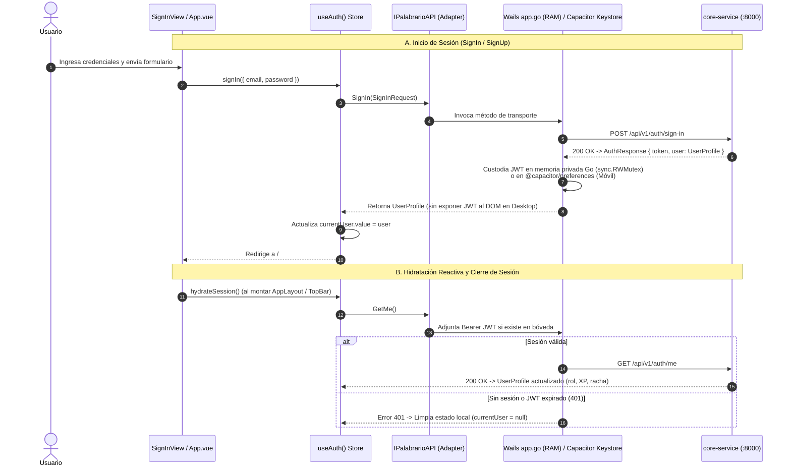
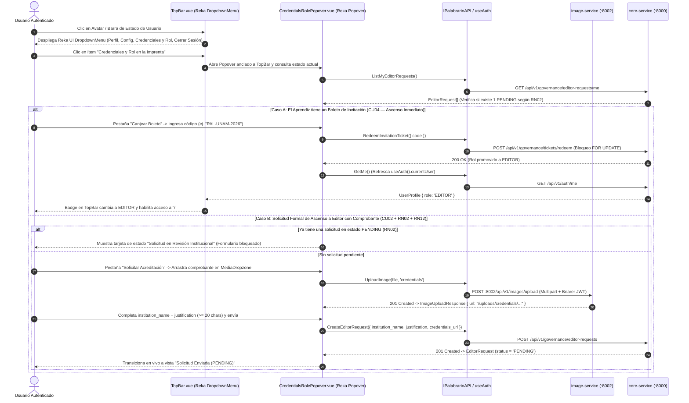
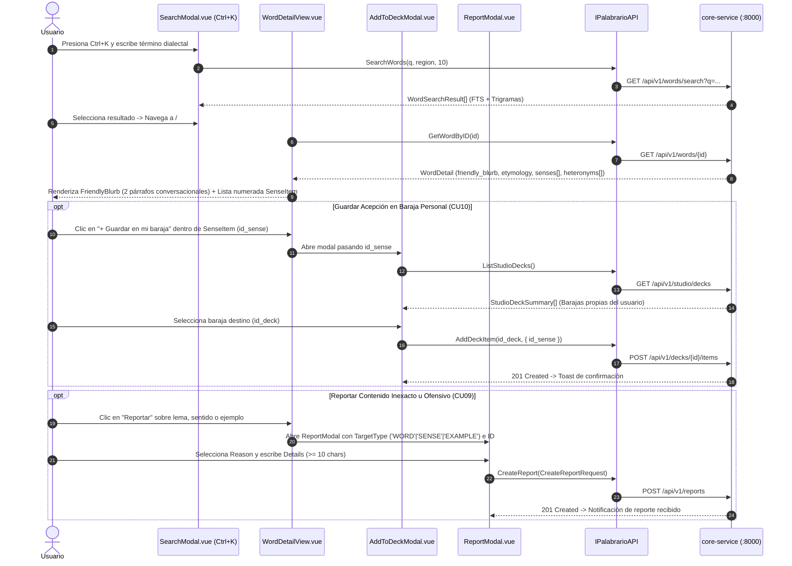
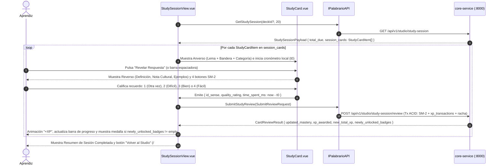
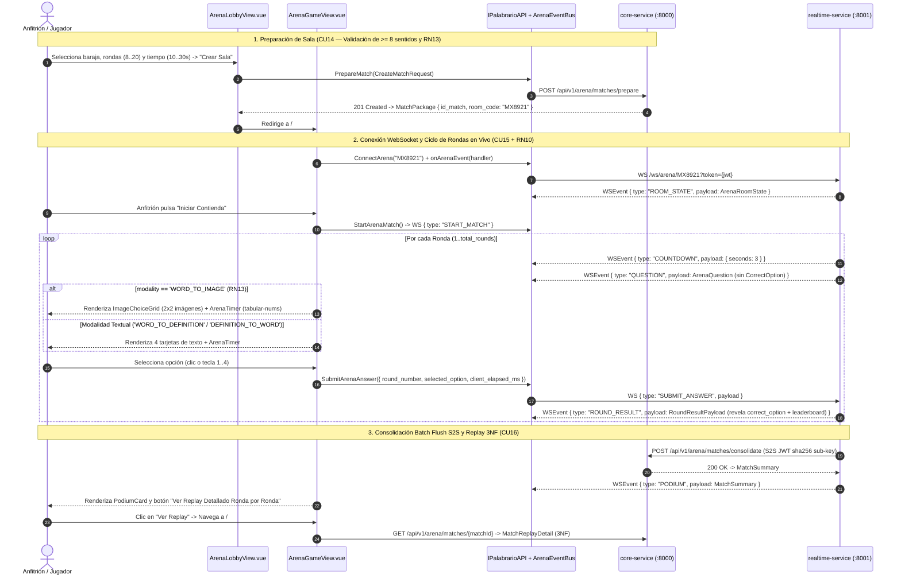
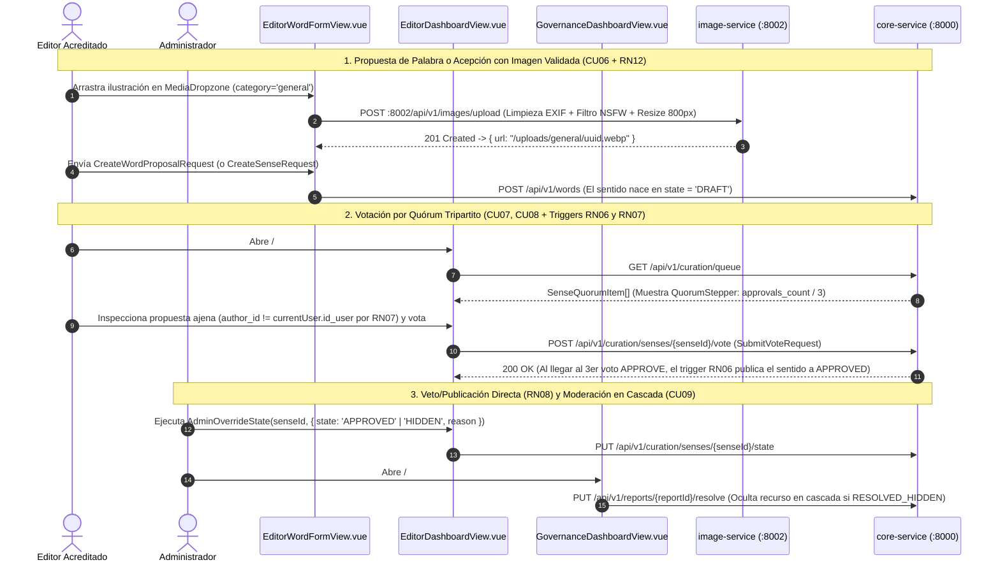

# 🔄 Palabrario — Flujos Interactivos y Diagramas de Secuencia UI $\leftrightarrow$ Puente $\leftrightarrow$ Backend (`.context/UI_FLOWS.md`)

> **Propósito de este documento (SSOT de Comportamiento y Estado Reactivo en Frontend):**  
> Este documento especifica mediante **6 Diagramas de Secuencia y Flujo de Estado** las interacciones más críticas del cliente multiplataforma (`Vue 3 + Reka UI` $\to$ `IPalabrarioAPI` $\to$ `Wails Go BFF / Capacitor` $\to$ `:8000 / :8001 / :8002`).  
> Ningún agente constructor debe improvisar cómo se abren los menús, cómo se hidrata la sesión o cómo fluyen las tramas WebSocket: debe seguir estrictamente estos 6 flujos canónicos.

---

## Flujo 1: Autenticación e Hidratación de Sesión Dual (`Wails RAM` vs `Capacitor Keystore` — `CU01`)

Al iniciar la aplicación o al autenticarse en `/#/auth/sign-in` y `/#/auth/sign-up`, el composable global `useAuth()` coordina la sesión sin exponer jamás el token JWT a `localStorage` en escritorio:

---

## Flujo 2: Menú de Usuario en `TopBar` (`Reka UI DropdownMenu`) + `Popover` de *"Credenciales y Rol en la Imprenta"* (`CU02, CU04, RN02, RN12`)

> **Decisión de Diseño UX:**  
> En lugar de esconder la promoción editorial en el fondo de una página, al hacer clic sobre el avatar/indicador del usuario en el extremo superior derecho de **`TopBar.vue`**, se despliega un **`DropdownMenu` de Reka UI** con:
> 1. **Mi Perfil Público** (`/#/u/:username`)
> 2. **Configuración de Cuenta** (abre modal/drawer de ajustes de perfil y contraseña `CU01`)
> 3. **Credenciales y Rol en la Imprenta** $\to$ Al seleccionarlo, despliega un **`Popover` / `Dialog` interactivo de Reka UI (`CredentialsRolePopover.vue`)** desde la barra superior que gestiona tanto el **Canje de Boleto (`CU04`)** como la **Solicitud de Ascenso a Editor (`CU02`)**.
> 4. **Panel Editorial (`/#/editor`)** / **Gobernanza Admin (`/#/admin/governance`)** *(visibles dinámicamente según `user.role`)*.
> 5. **Cerrar Sesión (`SignOut`)**.

---

## Flujo 3: Exploración Léxica, Ficha Estilo Vocabulary.com (`FriendlyBlurb` + `SenseItem`), Guardado en Baraja y Reporte (`CU05, CU09, CU10`)

Coordina el buscador omnibox (`Ctrl + K`), la lectura de una palabra con advertencia de tabú y las acciones rápidas sobre cada acepción:

---

## Flujo 4: Sesión de Estudio Inmersiva con Motor Matemático SuperMemo SM-2 y Ledger de XP (`CU12, CU13, RN09, RN11`)

Ejecuta el ciclo de tarjetas en `/#/studio/study` (`layout: immersive`), midiendo el tiempo de respuesta en cliente y consolidando cada repaso en una transacción ACID en el backend:

---

## Flujo 5: Arena Multijugador en Tiempo Real (`WebSockets`), Modalidad `WORD_TO_IMAGE` y Replay 3NF (`CU14, CU15, CU16, RN10, RN13`)

Coordina la creación de la sala en `core-service` (`:8000`), la partida síncrona en `realtime-service` (`:8001`) a través de `ArenaEventBus` y el Replay final en 3NF:

---

## Flujo 6: Autoría Léxica con Multimedia (`RN12`), Curaduría por Quórum Tripartito (`RN06, RN07`) y Gobernanza Admin (`CU03, CU06–CU09, RN08`)

Describe cómo los Editores proponen contenido, cómo se vota hasta alcanzar los **3 sellos de aprobación** (triggers `RN06`/`RN07`) y cómo el Administrador ejerce voto directo o resuelve reportes en cascada:

