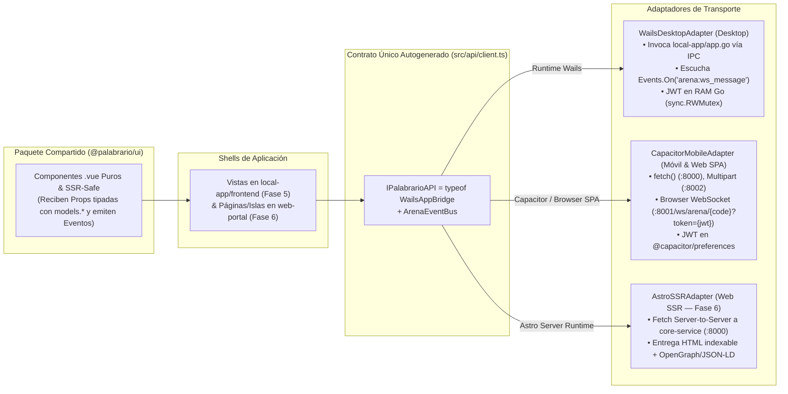

# 🖥️ Palabrario — HUD Maestro de Frontend, Monorepo `@palabrario/ui` y Especificación UI (`.context/UI_SPECIFICATION.md`)

> **Propósito de este documento (Frontend Progressive Disclosure Entrypoint):**  
> Este archivo es el **HUD Central y Enrutador Arquitectónico del Frontend (`packages/ui`, `local-app/frontend` y `web-portal`)** para la Fase 5 y Fase 6 de **Palabrario**.  
> Define las **Reglas de Hierro Anti-Deriva**, la topología del **Monorepo con Bun Workspaces (`@palabrario/ui`)**, el **Adaptador Polimórfico Isomórfico (`Wails IPC` + `Capacitor/Web HTTP & WS` + `Astro SSR`)**, enlaza al **Mapa Canónico de Rutas y Contratos ([`ROUTES_MAP.md`](./ROUTES_MAP.md))** y a los **6 Flujos y Diagramas de Secuencia ([`UI_FLOWS.md`](./UI_FLOWS.md))** con trazabilidad 1:1 hacia los 16 Casos de Uso (`CU01–CU16`), y establece el catálogo de componentes obligatorios.

---

## 🧭 Mapa de Artefactos Vinculados (Single Source of Truth)

Antes de modificar o crear cualquier archivo dentro de `packages/ui/`, `local-app/` o `web-portal/`, consulta el artefacto correspondiente según tu tarea:

| Si necesitas saber... | Consulta este Artefacto |
| :--- | :--- |
| **Qué ruta (`Hash` o SSR), vista `.vue`, guardia de acceso, método `IPalabrarioAPI`, endpoint HTTP/WS y DTO (`models.*`) corresponde a cada pantalla** | **[`.context/ROUTES_MAP.md`](./ROUTES_MAP.md)** *(Matriz Maestra de Rutas $\leftrightarrow$ Endpoints $\leftrightarrow$ DTOs)* |
| **Cómo fluyen paso a paso los 6 procesos críticos (Auth, Popover de Credenciales/Boletos en `TopBar`, Diccionario, SM-2, Arena WS y Quórum)** | **[`.context/UI_FLOWS.md`](./UI_FLOWS.md)** *(6 Diagramas de Secuencia UI $\leftrightarrow$ Puente $\leftrightarrow$ Backend)* |
| **Tokens de color (`paper`, `surface`, `ink`, `brand`, `success`, `warning`, `info`), tipografía `Satoshi`, sombras suaves (`shadow-soft*`) y `uno.config.ts`** | **[`.context/PALETTE.md`](./PALETTE.md)** *(SSOT Visual — Imprenta Táctil Ilustrada)* |
| **Firmas Go de servicios SOA, DTOs canónicos (`pkg/models`), endpoints HTTP/WS y códigos de error** | **[`.context/INTERFACES.md`](./INTERFACES.md)** *(Contrato Sagrado Backend $\leftrightarrow$ Frontend)* |
| **Reglas de negocio (`RN01–RN13`), estados editoriales, algoritmo SM-2 y puntuación monotónica de Arena** | **[`.context/DOMAIN.md`](./DOMAIN.md)** *(Modelo de Dominio DDD)* |
| **Orden de ejecución de las sub-fases de la Fase 5, Fase 6 (Web 100% + SSR) y Fase 7 (Eventos)** | **[`.context/PLAN.md`](./PLAN.md)** *(Tablero de Control Operativo)* |
| **Flujo de trabajo y división de tareas entre Arquitecto (Argón) y Constructores (Flash 3.8)** | **[`AGENT_WORKFLOW.md`](../AGENT_WORKFLOW.md)** *(Orquestación de Agentes)* |

---

## 0. Reglas de Hierro del Frontend (Guardrails Anti-Alucinación)

> [!CAUTION]
> **OBLIGATORIO PARA TODOS LOS AGENTES CONSTRUCTORES EN `packages/ui/` Y `local-app/`:**
> 1. **Cero `fetch()` / `axios` en Vistas o Componentes `.vue`:** Ningún componente Vue realiza llamadas HTTP o WebSocket directas. Todo consumo de datos en las vistas (`local-app/frontend/src/views/`) pasa exclusivamente por el cliente polimórfico `api` (`local-app/frontend/src/api/client.ts`), cuyo contrato TypeScript se deriva automáticamente del puente Go (`export type IPalabrarioAPI = typeof WailsAppBridge` + `local-app/frontend/bindings/`).
> 2. **Cero JWT en `localStorage` o `sessionStorage` en Escritorio:**
>    - En **Desktop (Wails V3)**: El token JWT vive exclusivamente en la memoria RAM privada del proceso Go (`local-app/app.go` protegido con `sync.RWMutex`, inmune a XSS).
>    - En **Móvil / Web SPA (Capacitor / Browser)**: El token se custodia mediante `@capacitor/preferences` (Keystore / Keychain nativo en móvil y almacenamiento aislado gestionado dentro de `CapacitorMobileAdapter`).
> 3. **Fidelidad Estricta a [`.context/PALETTE.md`](./PALETTE.md):** Queda estrictamente prohibido usar colores por defecto de Tailwind/UnoCSS (`bg-red-500`, `text-gray-600`, `shadow-lg`, etc.) o valores hexadecimales sueltos. Se usan únicamente los 4 tokens base (`paper`, `surface`, `ink`, `brand`), los 3 semánticos (`success`, `warning`, `info`) y los atajos canónicos (`card-editorial`, `card-subtle`, `btn-primary`, `btn-secondary`, `btn-ghost`, `input-editorial`, `badge-pill`) con sombras `shadow-soft`, `shadow-soft-lg` y `shadow-soft-brand`. Prohibidos los trazos duros (`border-2 border-ink`).
> 4. **Cero Propiedades JSON o Endpoints Inventados:** Toda prop o estado que represente datos del servidor debe estar tipado con las clases e interfaces autogeneradas en `local-app/frontend/bindings/` (re-exportadas en `@palabrario/ui` mediante `export type *`) y mapeado en [`.context/ROUTES_MAP.md`](./ROUTES_MAP.md).
> 5. **Tipografía Única `Satoshi`:** No importar fuentes secundarias. En temporizadores, marcadores de XP y códigos PIN de Arena es mandatorio usar la clase `tabular-nums`.
> 6. **Iconografía Oficial con `lucide-vue-next`:** La biblioteca oficial y exclusiva de iconos para todos los componentes Vue es **`lucide-vue-next`** (ej. `import { BookOpen, Trophy, Sparkles, Flame, Check, X, ShieldAlert } from 'lucide-vue-next'`). Queda prohibido usar SVGs inline sin tipar, strings HTML crudos o fuentes secundarias. Todo icono se instancia como componente Vue y se estiliza con clases UnoCSS (`w-5 h-5 text-ink`, `stroke-2`, etc.) manteniendo el grosor de trazo editorial.
> 7. **Frontera Estricta `@palabrario/ui` (SSR-Safe) vs Shells de Aplicación (`local-app/frontend` y `web-portal`):**
>    - Todos los componentes reutilizables viven en `packages/ui/src/components/` (`@palabrario/ui`).
>    - **PROHIBIDO** importar `vue-router` (`useRouter`, `useRoute`, `<router-link>`), `useAuth()`, `api.*` o acceder a `window`/`document` fuera de `onMounted` dentro de `packages/ui/`.
>    - Todo componente en `@palabrario/ui` es **100% presentacional e isomórfico (SSR-Safe)**: recibe datos tipados vía `defineProps<...>()` y emite intenciones al padre vía `defineEmits<...>()` (`@navigate`, `@select-word`, `@add-to-deck`, `@report`, `@open-image`, `@select-file`). Así, el mismo componente funciona sin tocar una sola línea tanto en `local-app/frontend` (SPA Desktop/Móvil) como en `web-portal` (Astro SSR + 100% Web en Fase 6).

---

## 1. Arquitectura de Monorepo con Bun Workspaces y Transporte Isomórfico

Para evitar duplicación de código y permitir que Palabrario opere al 100% en **Desktop (Wails V3)**, **Móvil (Capacitor)** y **Web Híbrida (Astro SSR SEO + 100% SPA con WebSockets en Fase 6)**, el repositorio utiliza **Bun Workspaces** desde la raíz:

### 1.1. Árbol Canónico del Monorepo Frontend

```text
Palabrario/
├── package.json                      # Workspace Root: ["packages/*", "local-app/frontend", "web-portal"]
├── tsconfig.base.json                # Configuración TS base compartida
│
├── packages/
│   └── ui/                           # 📦 @palabrario/ui — Sistema de Diseño y Componentes Puros (SSR-Safe)
│       ├── package.json              # name: "@palabrario/ui", exports: ".", "./uno.config", "./styles.css"
│       ├── tsconfig.json
│       └── src/
│           ├── uno.config.ts         # SSOT de PALETTE.md + content.filesystem escaneando packages/ui/src
│           ├── assets/main.css       # Tipografía Satoshi + resets editoriales + .tabular-nums
│           ├── types/models.ts       # Re-exporta `export type *` desde local-app/frontend/bindings
│           ├── components/
│           │   ├── ui/               # TopBar, BottomNav, MediaDropzone, ImageLightboxModal, SearchModal
│           │   ├── dictionary/       # WordCard, FriendlyBlurb, SenseItem, HeteronymPills, TabooWarningDialog, ReportModal
│           │   ├── studio/           # DeckCard, CollectionCard, StudyCard, MasteryProgressBar, AddToDeckModal
│           │   ├── arena/            # ArenaTimer, ImageChoiceGrid, PodiumCard
│           │   └── editorial/        # QuorumStepper, ProposalDiffCard
│           └── index.ts              # Barrel export de todos los componentes y tipos UI
│
├── local-app/                        # 🖥️ CLIENTE NATIVO Y SPA BASE (Fase 5: Sub-Fases 5.1 a 5.9)
│   ├── app.go, main.go               # Puente Go BFF + Custodia JWT en RAM + Cliente WS Go
│   ├── Taskfile.yml                  # Orquestador Wails V3: bindings -> type-check (ui + app) -> build -> go build
│   └── frontend/
│       ├── package.json              # Depende de "@palabrario/ui": "workspace:*"
│       ├── uno.config.ts             # `export { default } from "@palabrario/ui/uno.config"`
│       ├── bindings/                 # Autogenerado por `wails3 generate bindings -ts` desde Go
│       └── src/
│           ├── api/                  # client.ts (IPalabrarioAPI), wails.adapter.ts, capacitor.adapter.ts, arena.events.ts
│           ├── composables/          # useAuth.ts
│           ├── components/ui/        # CredentialsRolePopover.vue (conectado a api.* y useAuth)
│           ├── layouts/              # AppLayout.vue, AuthLayout.vue, ImmersiveLayout.vue
│           ├── router/               # index.ts con createWebHashHistory() y las 23 rutas
│           └── views/                # Las 23 Vistas que consumen `api.*` y montan componentes de `@palabrario/ui`
│
└── web-portal/                       # 🌐 PLATAFORMA WEB 100% HÍBRIDA SSR + SPA (Fase 6)
    ├── package.json                  # Depende de "@palabrario/ui": "workspace:*"
    ├── uno.config.ts                 # `export { default } from "@palabrario/ui/uno.config"`
    └── src/                          # Astro SSR para SEO/OpenGraph (Rutas #3-#10) + 100% de las 23 rutas en navegador
```

### 1.2. Patrón `Transport Adapter` (`IPalabrarioAPI = typeof WailsAppBridge`)



---

## 2. Arquitectura de Navegación y Mapa Canónico de Rutas

> [!IMPORTANT]
> **Consulta la matriz detallada de rutas en [`.context/ROUTES_MAP.md`](./ROUTES_MAP.md) y los diagramas de secuencia en [`.context/UI_FLOWS.md`](./UI_FLOWS.md).**  
> Allí se especifica para cada una de las **23 vistas canónicas**: la ruta `Hash`, el archivo `.vue`, el layout (`default`, `auth`, `immersive`), la guardia de rol (`guestOnly`, `OptionalAuth`, `requireAuth`, `requireRole`), los casos de uso (`CU01–CU16`), los métodos de `IPalabrarioAPI`, los endpoints reales de `core-service/internal/api/router.go` y los structs de `pkg/models`.

### Resumen de Espacios de Navegación

```mermaid
flowchart TD
    subgraph AuthSpace["1. Autenticación & Perfil Social"]
        SignIn["/#/auth/sign-in"]
        SignUp["/#/auth/sign-up"]
        Profile["/#/u/:username (Público + Owner CU01)"]
        TopBarMenu["TopBar DropdownMenu -> Popover 'Credenciales y Rol' (CU02, CU04)"]
    end

    subgraph CommunitySpace["2. Espacio Comunitario & Diccionario (CU05, CU10, CU11)"]
        Home["/#/ (Portada & Palabra del Día)"]
        Dict["/#/dictionary (Explorador & Buscador FTS)"]
        WordDetail["/#/dictionary/:id (Ficha Léxica)"]
        Cols["/#/collections & /#/collections/:id"]
        Decks["/#/decks & /#/decks/:id"]
    end

    subgraph StudioSpace["3. Studio Personal & Motor SM-2 (CU10–CU13)"]
        Studio["/#/studio (Dashboard)"]
        Study["/#/studio/session (Sesión SM-2 Inmersiva)"]
        MyDecks["/#/studio/decks & /#/studio/decks/:id"]
        MyCols["/#/studio/collections & /#/studio/collections/:id"]
        Mastery["/#/studio/mastery (Progreso & XP Ledger)"]
    end

    subgraph ArenaSpace["4. Arena Multijugador & Replay 3NF (CU14–CU16)"]
        Lobby["/#/arena (Lobby & PIN)"]
        Game["/#/arena/room/:code (Partida WS en Vivo)"]
        Replay["/#/arena/matches/:matchId (Replay Ronda x Ronda)"]
    end

    subgraph GovernanceSpace["5. Curaduría por Quórum & Gobernanza (CU02–CU04, CU06–CU09)"]
        Editor["/#/editor (Cola de Quórum Tripartito)"]
        WordForm["/#/editor/words/new & /#/editor/words/:id (Autoría Léxica)"]
        Admin["/#/editor/governance (Roles, Boletos & Reportes)"]
    end

    Home --> Dict --> WordDetail
    Home --> Studio --> Study
    Home --> Lobby --> Game --> Replay
    TopBarMenu --> Editor --> WordForm
```



---

## 3. Catálogo de Componentes Canónicos Reutilizables (`@palabrario/ui` vs `local-app/frontend`)

Todos los componentes reutilizables de interfaz se construyen en **`packages/ui/src/components/` (`@palabrario/ui`)** organizados por responsabilidad, consumiendo exclusivamente los tokens de [`.context/PALETTE.md`](./PALETTE.md) y primitivas de **Reka UI**. Los layouts y envoltorios acoplados al router o estado de sesión viven en **`local-app/frontend/src/`**.

### 3.1. Layouts de Shell (`local-app/frontend/src/layouts/`) y Navegación Compartida (`packages/ui/src/components/ui/`)
- **`AppLayout.vue` (`local-app/frontend/src/layouts/`):** Estructura envolvente principal (`layout: default`) con fondo `bg-paper`, que monta `TopBar` y `BottomNav` desde `@palabrario/ui`, conecta sus eventos con `vue-router` y `useAuth()`, y aloja `CredentialsRolePopover.vue`.
- **`AuthLayout.vue` (`local-app/frontend/src/layouts/`):** Estructura minimalista centrada (`layout: auth`) para `SignInView` y `SignUpView`.
- **`ImmersiveLayout.vue` (`local-app/frontend/src/layouts/`):** Lienzo de foco completo (`layout: immersive`) sin barras de navegación distraídas para `StudySessionView` y `ArenaGameView`.
- **`CredentialsRolePopover.vue` (`local-app/frontend/src/components/ui/`):** **`Popover` / `Dialog` de Reka UI** anclado al menú de usuario (**Flujo 2 de [`UI_FLOWS.md`](./UI_FLOWS.md)**) con dos pestañas para aprendices:
  1. **Canjear Boleto de Invitación (`CU04`):** Input para código institucional (`RedeemInvitationTicket`) que promueve el rol en vivo y refresca `useAuth()`.
  2. **Solicitar Ascenso a Editor (`CU02` + `RN02` + `RN12`):** Verifica con `ListMyEditorRequests()` si ya existe una solicitud `PENDING`; si no, presenta el formulario con `MediaDropzone` (`UploadImage` + `CreateEditorRequest`).
- **`TopBar.vue` (`packages/ui/src/components/ui/`):** Barra de cabecera agnóstica del router: recibe `currentUser`, `activeSpace` y métricas por `props`, muestra logotipo, disparador de búsqueda omnibox (`Ctrl + K`), racha (`🔥`) y **`DropdownMenu` de Reka UI** emitiendo `@navigate(path)`, `@open-search`, `@open-credentials` y `@sign-out`.
- **`BottomNav.vue` (`packages/ui/src/components/ui/`):** Barra de pestañas fija inferior para pantallas móviles (`Home`, `Diccionario`, `Studio`, `Arena`), recibiendo `activePath` por prop y emitiendo `@navigate(path)`.

### 3.2. Componentes de Dominio Léxico y Curaduría (`packages/ui/src/components/dictionary/` y `packages/ui/src/components/editorial/`)
- **`WordCard.vue`:** Tarjeta táctil editorial (`card-editorial`) que renderiza `models.WordSummaryCard` (lema, categoría gramatical, bandera dialectal, definición corta y miniatura) y emite `@select(idWord)`.
- **`FriendlyBlurb.vue` *(Inspirado en la apertura narrativa de Vocabulary.com)*:** Artículo conversacional que encabeza la entrada de una palabra (`WordDetailView`) justo debajo del lema hero, antes de las definiciones técnicas:
  1. **Párrafo Gancho (`word.friendly_blurb`):** Texto principal de mayor cuerpo (`text-lg md:text-xl leading-relaxed text-ink`) que explica la palabra con calidez, humor y una situación cotidiana cercana (resaltando el lema en cursiva).
  2. **Párrafo de Contexto y Origen (`word.etymology`):** Segundo bloque editorial (`text-base leading-relaxed text-ink/80 mt-4`) que profundiza en la historia, raíces y matices culturales panhispánicos del término.
  3. Emite `@open-image` al hacer click en la ilustración opcional.
- **`SenseItem.vue` *(Inspirado en el bloque "Definitions of..." de Vocabulary.com)*:** Ítem numerado (`1.`, `2.`, ...) dentro del contenedor de acepciones (`card-editorial` coronado por un listón `badge-pill bg-brand text-surface` con *"Acepciones de {lemma}"*). Cada `SenseItem` renderiza un `models.SenseDetail` con:
  1. **Línea Principal:** Índice numérico + píldora de categoría/región (`badge-pill` con `flag_emoji`, `region_code`, `part_of_speech` y `cefr_level`) + definición directa (`definition` / `short_definition`).
  2. **Línea de Equivalencias y Alertas:** Integra `HeteronymPills.vue` (*"¿Cómo se dice allá?"*) emitiendo `@select-word(idWord)` y badge de advertencia si `is_taboo_or_vulgar == true` (`bg-warning/20 border-warning`).
  3. **Desplegable `"Ver más ⌄"` (`see more ⌄`):** Sección colapsable accesible (**Reka UI `Collapsible`**) que revela la nota cultural (`usage_note` / `cultural_note`), las oraciones de ejemplo (`examples[]`), la imagen opcional del sentido (`image_url`) y las acciones contextuales que emiten `@add-to-deck(sense)` y `@report(sense)`.
- **`HeteronymPills.vue`:** Lista interactiva de equivalencias transdialectales (`models.HeteronymItem[]`, *"¿Cómo se dice allá?"*) que emite `@select-word(idWord)`.
- **`QuorumStepper.vue` (`packages/ui/src/components/editorial/`):** Indicador visual del quórum tripartito (**RN06**, `reviews_count / 3`), bloqueo de auto-aprobación (**RN07**) y badge de veto administrativo (**RN08**).
- **`ProposalDiffCard.vue` (`packages/ui/src/components/editorial/`):** Inspector detallado de una propuesta léxica mostrando lema, `friendly_blurb`, `etymology`, sentidos, ejemplos e ilustraciones con atribuciones (**RN12**).

### 3.3. Componentes de Studio y Motor SM-2 (`packages/ui/src/components/studio/`)
- **`DeckCard.vue` y `CollectionCard.vue`:** Tarjetas con borde de tinta y sombra táctil para mazos y colecciones temáticas.
- **`StudyCard.vue`:** Ficha interactiva de repaso para sesiones SM-2 (**CU12**): anverso con lema y dialecto, revelación de reverso y botonera de 4 calificaciones SM-2 (`1..4`) con atajos de teclado (`Espacio`, `1..4`), emitiendo `@rate({ qualityScore, responseTimeMs })`.
- **`MasteryProgressBar.vue`:** Barra segmentada con `tabular-nums` que ilustra la proporción de palabras en estados `NEW`, `LEARNING`, `REVIEW` y `MASTERED`.
- **`AddToDeckModal.vue`:** Diálogo Reka UI que recibe la lista de mazos del usuario (`decks`) y emite `@add({ idDeck, idSense })` o `@create-deck(payload)`.

### 3.4. Componentes de la Arena Multijugador (`packages/ui/src/components/arena/`)
- **`ArenaTimer.vue`:** Temporizador regresivo con clase `tabular-nums` sincronizado con `time_limit_secs` (**RN10**).
- **`ImageChoiceGrid.vue`:** Grilla responsiva 2x2 para responder rondas visuales (`question_mode === 'WORD_TO_IMAGE'`, **RN13**), con estados de selección y atajos de teclado (`1–4`), emitiendo `@select-option(option)`.
- **`PodiumCard.vue`:** Tarjeta de premiación final que despliega el podio ordenado por el servidor y emite `@view-replay(matchId)`.

### 3.5. Componentes Globales de Superposición y Diálogos (`packages/ui/src/components/ui/` y `packages/ui/src/components/dictionary/` — Reka UI)
- **`SearchModal.vue` (`packages/ui/src/components/ui/` — `Ctrl + K`):** Omnibox flotante (**Reka UI `Dialog`**) que recibe `results` y `isLoading` por props y emite `@search(query)` (con debounce) y `@select(idWord)`.
- **`ReportModal.vue` (`packages/ui/src/components/dictionary/`):** Diálogo para reportar un lema o sentido (**CU09**), emitiendo `@submit(reportPayload)`.
- **`TabooWarningDialog.vue` (`packages/ui/src/components/dictionary/`):** Alerta de confirmación accesible cuando `is_taboo == true`.
- **`ImageLightboxModal.vue` (`packages/ui/src/components/ui/`):** Visor ampliado para inspeccionar `image_url`, `alt_text` e `image_credit`.
- **`MediaDropzone.vue` (`packages/ui/src/components/ui/`):** Zona de arrastre de archivos (`.png`, `.jpg`, `.webp`, máx 5 MB, **RN12**) que valida formato/tamaño y recibe una función `uploadFn` o emite el archivo validado hacia la vista padre.

---

## 4. Guía de Ejecución para Agentes Constructores (Checklist de Calidad)

Antes de considerar terminada una sub-fase de la Fase 5:
1. **Verificación Automatizada Integral (`wails3 task client:check`):** Debe arrojar **0 errores de compilación** tanto en `@palabrario/ui` como en `local-app/frontend` y el binario Go.
2. **Frontera Limpia `@palabrario/ui`:** Verificar que ningún archivo dentro de `packages/ui/` importe `vue-router` ni realice llamadas directas a `api.*`.
3. **Inspección de Clases UnoCSS:** Comprobar que no existan clases genéricas (`bg-blue-*`, `text-gray-*`, `shadow-lg`); todo debe adherirse a los tokens semánticos de [`.context/PALETTE.md`](./PALETTE.md).
4. **Estados Reactivos de Carga, Vacío y Error:** Toda vista en `local-app/frontend/src/views/` debe manejar explícitamente:
   - Estado de carga (*skeleton* táctil con `bg-ink/10 animate-pulse`).
   - Estado de error amigable mostrando el mensaje devuelto por el backend y botón de reintento.
   - Estado vacío (*Empty State*) con acción clara si la lista no contiene elementos.
