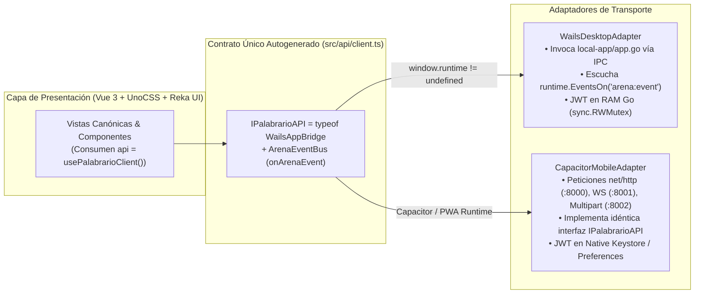

# 🖥️ Palabrario — HUD Maestro de Frontend, Enrutamiento y Especificación UI (`.context/UI_SPECIFICATION.md`)

> **Propósito de este documento (Frontend Progressive Disclosure Entrypoint):**  
> Este archivo es el **HUD Central y Enrutador Arquitectónico del Cliente (`local-app/`)** para la Fase 5 de **Palabrario**.  
> Define las **Reglas de Hierro Anti-Deriva**, la arquitectura del **Adaptador Polimórfico Dual (`Wails IPC` + `Capacitor/PWA`)**, enlaza al **Mapa Canónico de Rutas y Contratos ([`ROUTES_MAP.md`](./ROUTES_MAP.md))** y a los **6 Flujos y Diagramas de Secuencia ([`UI_FLOWS.md`](./UI_FLOWS.md))** con trazabilidad 1:1 hacia los 16 Casos de Uso (`CU01–CU16`), y establece el catálogo de componentes obligatorios.

---

## 🧭 Mapa de Artefactos Vinculados (Single Source of Truth)

Antes de modificar o crear cualquier archivo dentro de `local-app/`, consulta el artefacto correspondiente según tu tarea:

| Si necesitas saber... | Consulta este Artefacto |
| :--- | :--- |
| **Qué ruta (`Hash`), vista `.vue`, guardia de acceso, método `IPalabrarioAPI`, endpoint HTTP/WS y DTO (`models.*`) corresponde a cada pantalla** | **[`.context/ROUTES_MAP.md`](./ROUTES_MAP.md)** *(Matriz Maestra de Rutas $\leftrightarrow$ Endpoints $\leftrightarrow$ DTOs)* |
| **Cómo fluyen paso a paso los 6 procesos críticos (Auth, Popover de Credenciales/Boletos en `TopBar`, Diccionario, SM-2, Arena WS y Quórum)** | **[`.context/UI_FLOWS.md`](./UI_FLOWS.md)** *(6 Diagramas de Secuencia UI $\leftrightarrow$ Puente $\leftrightarrow$ Backend)* |
| **Tokens de color (`paper`, `surface`, `ink`, `brand`, `success`, `warning`, `info`), tipografía `Satoshi`, sombras táctiles y `uno.config.ts`** | **[`.context/PALETTE.md`](./PALETTE.md)** *(SSOT Visual — Imprenta Táctil Ilustrada)* |
| **Firmas Go de servicios SOA, DTOs canónicos (`pkg/models`), endpoints HTTP/WS y códigos de error** | **[`.context/INTERFACES.md`](./INTERFACES.md)** *(Contrato Sagrado Backend $\leftrightarrow$ Frontend)* |
| **Reglas de negocio (`RN01–RN13`), estados editoriales, algoritmo SM-2 y puntuación monotónica de Arena** | **[`.context/DOMAIN.md`](./DOMAIN.md)** *(Modelo de Dominio DDD)* |
| **Orden de ejecución de las sub-fases de la Fase 5 y estado actual** | **[`.context/PLAN.md`](./PLAN.md)** *(Tablero de Control Operativo)* |
| **Flujo de trabajo y división de tareas entre Arquitecto (Argón) y Constructores (Flash 3.8)** | **[`AGENT_WORKFLOW.md`](../AGENT_WORKFLOW.md)** *(Orquestación de Agentes)* |

---

## 0. Reglas de Hierro del Frontend (Guardrails Anti-Alucinación)

> [!CAUTION]
> **OBLIGATORIO PARA TODOS LOS AGENTES CONSTRUCTORES EN `local-app/`:**
> 1. **Cero `fetch()` / `axios` en Vistas o Componentes `.vue`:** Ningún componente Vue realiza llamadas HTTP o WebSocket directas. Todo consumo de datos pasa exclusivamente por el cliente polimórfico `usePalabrarioClient()` (`src/api/client.ts`), cuyo contrato TypeScript se deriva automáticamente del puente Go (`export type IPalabrarioAPI = typeof WailsAppBridge` + `wailsjs/go/models.ts`).
> 2. **Cero JWT en `localStorage` o `sessionStorage`:**
>    - En **Desktop (Wails V3)**: El token JWT vive exclusivamente en la memoria RAM privada del proceso Go (`local-app/app.go` protegido con `sync.RWMutex`, inmune a XSS).
>    - En **Móvil / PWA (Capacitor)**: El token se custodia en el almacenamiento nativo seguro (`@capacitor/preferences` / Keystore / Keychain) gestionado dentro de `CapacitorAdapter`.
> 3. **Fidelidad Estricta a [`.context/PALETTE.md`](./PALETTE.md):** Queda estrictamente prohibido usar colores por defecto de Tailwind/UnoCSS (`bg-red-500`, `text-gray-600`, `shadow-lg`, etc.) o valores hexadecimales sueltos. Se usan únicamente los 4 tokens base (`paper`, `surface`, `ink`, `brand`), los 3 semánticos (`success`, `warning`, `info`) y los atajos canónicos (`card-editorial`, `btn-primary`, `btn-secondary`, `input-editorial`, `badge-pill`, `shadow-tactile`).
> 4. **Cero Propiedades JSON o Endpoints Inventados:** Toda prop o estado que represente datos del servidor debe estar tipado con las clases e interfaces autogeneradas en `wailsjs/go/models.ts` y mapeado en [`.context/ROUTES_MAP.md`](./ROUTES_MAP.md).
> 5. **Tipografía Única `Satoshi`:** No importar fuentes secundarias. En temporizadores, marcadores de XP y códigos PIN de Arena es mandatorio usar la clase `tabular-nums`.

---

## 1. Pila Tecnológica y Arquitectura de Transporte Dual (Desktop + Mobile)

El cliente multiplataforma se estructura bajo **un único código fuente de interfaz (`local-app/frontend/src`)** desacoplado del medio de transporte subyacente:

1. **Stack de Presentación Unificado:**
   - **Framework:** Vue 3 (Composition API estricta con `<script setup lang="ts">`).
   - **Herramienta de Compilación:** Vite + `vue-tsc` (modo estricto).
   - **Motor de Estilos:** UnoCSS con `@unocss/preset-uno` y `@unocss/preset-icons`.
   - **Accesibilidad y Primitivas Headless:** **Reka UI** para modales (`Dialog`), menús contextuales (`DropdownMenu`), pestañas (`Tabs`), popovers (`Popover`) y colapsables (`Collapsible`), estilizados con bordes de tinta y sombras táctiles.
   - **Enrutamiento:** `vue-router` v4 con **Hash History (`createWebHashHistory()`)** para garantizar funcionamiento idéntico en WebView de escritorio y esquemas de Capacitor.

2. **Patrón `Transport Adapter` (`IPalabrarioAPI = typeof WailsAppBridge`):**

---

## 2. Arquitectura de Navegación y Mapa Canónico de Rutas

> [!IMPORTANT]
> **Consulta la matriz detallada de rutas en [`.context/ROUTES_MAP.md`](./ROUTES_MAP.md) y los diagramas de secuencia en [`.context/UI_FLOWS.md`](./UI_FLOWS.md).**  
> Allí se especifica para cada una de las **23 vistas canónicas**: la ruta `Hash`, el archivo `.vue`, el layout (`default`, `auth`, `immersive`), la guardia de rol (`guestOnly`, `OptionalAuth`, `requireAuth`, `requireRole`), los casos de uso (`CU01–CU16`), los métodos de `IPalabrarioAPI`, los endpoints reales de `core-service/internal/api/router.go` y los structs de `pkg/models`.

### Resumen de Espacios de Navegación

---

## 3. Catálogo de Componentes Canónicos Reutilizables

Todos los componentes de interfaz deben colocarse en `src/components/` organizados por responsabilidad, consumiendo exclusivamente los tokens de [`.context/PALETTE.md`](./PALETTE.md) y primitivas de **Reka UI**:

### 3.1. Componentes Estructurales y de Navegación (`src/components/layout/`)
- **`AppLayout.vue`:** Estructura envolvente principal (`layout: default`) con fondo `bg-paper`, barra superior fija y contenedor central responsivo (`max-w-6xl mx-auto`).
- **`AuthLayout.vue`:** Estructura minimalista centrada (`layout: auth`) para `SignInView` y `SignUpView`.
- **`ImmersiveLayout.vue`:** Lienzo de foco completo (`layout: immersive`) sin barras de navegación distraídas para `StudySessionView` y `ArenaGameView`.
- **`TopBar.vue`:** Barra de cabecera con logotipo, disparador de búsqueda omnibox (`Ctrl + K`), indicador de racha (`current_streak`) y barra de estado de usuario con **`DropdownMenu` de Reka UI** (Mi Perfil, Configuraciones, ítem *"Credenciales y Rol en la Imprenta"* que despliega `CredentialsRolePopover.vue`, accesos a Panel Editorial/Gobernanza según rol y Cerrar Sesión).
- **`CredentialsRolePopover.vue`:** **`Popover` / `Dialog` de Reka UI** anclado al menú de usuario en `TopBar.vue` (**Flujo 2 de [`UI_FLOWS.md`](./UI_FLOWS.md)**) con dos pestañas para aprendices:
  1. **Canjear Boleto de Invitación (`CU04`):** Input para código institucional (`RedeemInvitationTicket`) que promueve el rol en vivo y refresca `useAuth()`.
  2. **Solicitar Ascenso a Editor (`CU02` + `RN02` + `RN12`):** Verifica con `ListMyEditorRequests()` si ya existe una solicitud `PENDING`; si no, presenta el formulario con `MediaDropzone` (`UploadImage(file, 'credentials')` + `CreateEditorRequest`).
- **`BottomNav.vue`:** Barra de pestañas fija inferior para pantallas móviles (`Home`, `Diccionario`, `Studio`, `Arena`).

### 3.2. Componentes de Dominio Léxico y Curaduría (`src/components/dictionary/` / `src/components/editorial/`)
- **`WordCard.vue`:** Tarjeta táctil editorial (`card-editorial`) que renderiza `models.WordSummaryCard` (lema, categoría gramatical, bandera dialectal, definición corta y miniatura).
- **`FriendlyBlurb.vue` *(Inspirado en la apertura narrativa de Vocabulary.com)*:** Artículo conversacional que encabeza la entrada de una palabra (`WordDetailView`) justo debajo del lema hero, antes de las definiciones técnicas:
  1. **Párrafo Gancho (`word.friendly_blurb`):** Texto principal de mayor cuerpo (`text-lg md:text-xl leading-relaxed text-ink`) que explica la palabra con calidez, humor y una situación cotidiana cercana (resaltando el lema en cursiva).
  2. **Párrafo de Contexto y Origen (`word.etymology`):** Segundo bloque editorial (`text-base leading-relaxed text-ink/80 mt-4`) que profundiza en la historia, raíces y matices culturales panhispánicos del término.
- **`SenseItem.vue` *(Inspirado en el bloque "Definitions of..." de Vocabulary.com)*:** Ítem numerado (`1.`, `2.`, ...) dentro del contenedor de acepciones (`bg-surface border-2 border-ink rounded-2xl shadow-tactile` coronado por un listón editorial `bg-brand text-surface font-bold px-4 py-1.5` con *"Acepciones de {lemma}"*). Cada `SenseItem` renderiza un `models.SenseDetail` con:
  1. **Línea Principal:** Índice numérico + píldora de categoría/región (`badge-pill` con `flag_emoji`, `region_code`, `part_of_speech` y `cefr_level`) + definición directa (`definition` / `short_definition`).
  2. **Línea de Equivalencias y Alertas:** Enlaces rápidos de heteronimia regional (*"¿Cómo se dice allá?"*) y badge de advertencia si `is_taboo_or_vulgar == true` (`bg-warning/20 border-warning`).
  3. **Desplegable `"Ver más ⌄"` (`see more ⌄`):** Sección colapsable accesible (**Reka UI `Collapsible`**) que revela la nota cultural (`cultural_note`), las oraciones de ejemplo (`examples[]`), la imagen opcional del sentido (`image_url`) y las acciones contextuales (`+ Guardar en mi baraja` y `Reportar`).
- **`HeteronymPills.vue`:** Lista interactiva de equivalencias transdialectales (`models.HeteronymItem[]`, *"¿Cómo se dice allá?"*).
- **`QuorumStepper.vue`:** Indicador visual del quórum tripartito (**RN06**, `approvals_count / 3`), mostrando los sellos `APPROVE` y los votos emitidos (`models.SenseApprovalVote[]`).

### 3.3. Componentes de Studio y Motor SM-2 (`src/components/studio/`)
- **`DeckCard.vue`:** Tarjeta con borde de tinta y sombra táctil para `models.Deck` y `models.StudioDeckSummary` (incluyendo `due_cards_today` y `retention_percent`).
- **`CollectionCard.vue`:** Tarjeta de colección temática (`models.Collection`) con insignia `is_official` / `is_featured`.
- **`StudyCard.vue`:** Ficha interactiva de repaso para `models.StudyCardItem` (**CU12**): anverso con lema y dialecto, revelación de reverso y botonera de 4 calificaciones SM-2 (`quality_rating: 1..4`).
- **`MasteryProgressBar.vue`:** Barra segmentada que ilustra `count_new`, `count_learning`, `count_reviewing` y `count_mastered` de `models.MasteryDashboard`.

### 3.4. Componentes de la Arena Multijugador (`src/components/arena/`)
- **`ArenaTimer.vue`:** Temporizador regresivo con clase `tabular-nums` sincronizado con `time_limit_secs` (**RN10**).
- **`ImageChoiceGrid.vue`:** Grilla responsiva 2x2 para responder rondas visuales (`modality === 'WORD_TO_IMAGE'`), con precarga de las 4 imágenes de `options`, estados de selección/acierto/fallo y atajos de teclado (`1–4`).
- **`PodiumCard.vue`:** Tarjeta de premiación final que despliega el podio (`models.ArenaParticipant[]`) ordenado por el servidor y enlace directo al Replay (`/#/game/:matchId/replay`).

### 3.5. Componentes Globales de Superposición y Diálogos (`src/components/dialogs/` — Reka UI)
- **`SearchModal.vue` (`Ctrl + K`):** Omnibox flotante (**Reka UI `Dialog`**) conectado a `SearchWords(q, region, limit)` (`models.WordSearchResult[]`).
- **`AddToDeckModal.vue`:** Diálogo rápido para invocar `AddDeckItem(deckId, { id_sense })` sobre cualquiera de las barajas del usuario.
- **`ReportModal.vue`:** Diálogo para reportar un lema, sentido o ejemplo (`CreateReport(models.CreateReportRequest)`, **CU09**).
- **`TabooWarningDialog.vue`:** Alerta de confirmación accesible cuando `is_taboo_or_vulgar == true`.
- **`ImageLightboxModal.vue`:** Visor ampliado para inspeccionar `image_url` de palabras o sentidos junto a su nota cultural.
- **`MediaDropzone.vue`:** Zona de arrastre de archivos (`.png`, `.jpg`, `.webp`, máx 5 MB) conectado a `UploadImage(file, category)` hacia `image-service` (`:8002`, **RN12**).

---

## 4. Guía de Ejecución para Agentes Constructores (Checklist de Calidad)

Antes de considerar terminada una pantalla o componente de la Fase 5:
1. **Verificación Estricta de Tipos:** Ejecutar `bun run typecheck` (o `npx vue-tsc --noEmit`). Debe arrojar **0 errores de compilación**.
2. **Cero Dependencias de Red Propias:** Verificar que el archivo solo importe `usePalabrarioClient()` y tipos de `wailsjs/go/models`.
3. **Inspección de Clases UnoCSS:** Comprobar que no existan clases genéricas (`bg-blue-*`, `text-gray-*`, `shadow-lg`); todo debe adherirse a los tokens semánticos de [`.context/PALETTE.md`](./PALETTE.md).
4. **Estados Reactivos de Carga, Vacío y Error:** Toda vista debe manejar explícitamente:
   - Estado de carga (*skeleton* táctil con `bg-ink/10 animate-pulse`).
   - Estado de error amigable mostrando el mensaje devuelto por el backend y botón de reintento.
   - Estado vacío (*Empty State*) con acción clara si la lista no contiene elementos.
