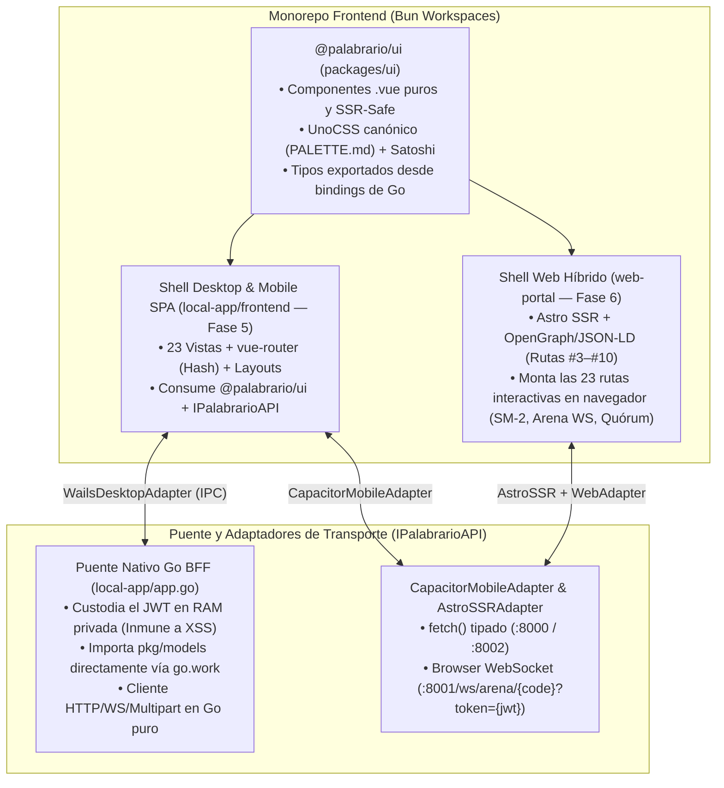

# 🖥️ Palabrario — HUD Maestro de Frontend, Monorepo `@palabrario/ui` y Especificación UI (`.context/UI_SPECIFICATION.md`)

> **Propósito de este documento (Frontend Progressive Disclosure Entrypoint):**  
> Este archivo es el **HUD Central y Enrutador Arquitectónico del Frontend (`packages/ui`, `local-app/frontend` y `web-portal`)** para la Fase 5 y Fase 6 de **Palabrario**.  
> Define las **Reglas de Hierro Anti-Deriva**, la topología del **Monorepo con Bun Workspaces (`@palabrario/ui`)**, el **Adaptador Polimórfico Isomórfico (`Wails IPC` + `Capacitor/Web HTTP & WS` + `Astro SSR`)**, enlaza al **Mapa Canónico de Rutas y Contratos ([`ROUTES_MAP.md`](./ROUTES_MAP.md))** y a los **7 Flujos y Diagramas de Secuencia ([`UI_FLOWS.md`](./UI_FLOWS.md))** con trazabilidad 1:1 hacia los 16 Casos de Uso (`CU01–CU16`), y establece el catálogo de componentes obligatorios.

---

## 🧭 Mapa de Artefactos Vinculados (Single Source of Truth)

Antes de modificar o crear cualquier archivo dentro de `packages/ui/`, `local-app/` o `web-portal/`, consulta el artefacto correspondiente según tu tarea:

| Si necesitas saber... | Consulta este Artefacto |
| :--- | :--- |
| **Qué ruta (`Hash` o SSR), vista `.vue`, guardia de acceso, método `IPalabrarioAPI`, endpoint HTTP/WS y DTO (`models.*`) corresponde a cada pantalla** | **[`.context/ROUTES_MAP.md`](./ROUTES_MAP.md)** *(Matriz Maestra de Rutas $\leftrightarrow$ Endpoints $\leftrightarrow$ DTOs)* |
| **Cómo fluyen paso a paso los 7 procesos críticos (Auth, Popover de Credenciales/Boletos en `TopBar`, Diccionario, SM-2 y Maestría, Arena WS, Quórum y Colecciones)** | **[`.context/UI_FLOWS.md`](./UI_FLOWS.md)** *(7 Diagramas de Secuencia UI $\leftrightarrow$ Puente $\leftrightarrow$ Backend)* |
| **Tokens de color (`paper`, `surface`, `ink`, `brand`, `success`, `warning`, `info`), tipografía `Satoshi`, sombras suaves (`shadow-soft*`) y `uno.config.ts`** | **[`.context/PALETTE.md`](./PALETTE.md)** *(SSOT Visual — Imprenta Táctil Ilustrada)* |
| **Firmas Go de servicios SOA, DTOs canónicos (`pkg/models`), endpoints HTTP/WS y códigos de error** | **[`.context/INTERFACES.md`](./INTERFACES.md)** *(Contrato Sagrado Backend $\leftrightarrow$ Frontend)* |
| **Reglas de negocio (`RN01–RN13`), estados editoriales, algoritmo SM-2 y puntuación monotónica de Arena** | **[`.context/DOMAIN.md`](./DOMAIN.md)** *(Modelo de Dominio DDD)* |
| **Orden de ejecución de las sub-fases de la Fase 5, Fase 6 (Web 100% + SSR) y Fase 7 (Eventos)** | **[`.context/PLAN.md`](./PLAN.md)** *(Tablero de Control Operativo)* |
| **Flujo de trabajo y división de tareas entre Arquitecto (Argón) y Constructores (Flash 3.8)** | **[`AGENT_WORKFLOW.md`](../AGENT_WORKFLOW.md)** *(Orquestación de Agentes)* |

---

## 0. Reglas de Hierro del Frontend (Guardrails Anti-Alucinación)

> [!CAUTION]
> **OBLIGATORIO PARA TODOS LOS AGENTES CONSTRUCTORES EN `packages/ui/` Y `local-app/`:**
> 1. **Cero `fetch()` / `axios` en Vistas o Componentes `.vue`:** Ningún componente Vue realiza llamadas HTTP o WebSocket directas. Todo consumo de datos en las vistas (`local-app/frontend/src/views/`) pasa exclusivamente por el cliente polimórfico `api` (`local-app/frontend/src/api/client.ts`), cuyo contrato TypeScript se deriva automáticamente del puente Go (`export type IPalabrarioAPI = typeof WailsAppBridge` + `local-app/frontend/bindings/`).
> 2. **Cero JWT en `localStorage` o `sessionStorage` en Escritorio:**
>    - En **Desktop (Wails V3)**: El token JWT vive exclusivamente en la memoria RAM privada del proceso Go (`local-app/app.go` protegido con `sync.RWMutex`, inmune a XSS).
>    - En **Móvil / Web SPA (Capacitor / Browser)**: El token se custodia mediante `@capacitor/preferences` (Keystore / Keychain nativo en móvil y almacenamiento aislado gestionado dentro de `CapacitorMobileAdapter`).
> 3. **Fidelidad Estricta a [`.context/PALETTE.md`](./PALETTE.md):** Queda estrictamente prohibido usar colores por defecto de Tailwind/UnoCSS (`bg-red-500`, `text-gray-600`, `shadow-lg`, etc.) o valores hexadecimales sueltos. Se usan únicamente los 4 tokens base (`paper`, `surface`, `ink`, `brand`), los 3 semánticos (`success`, `warning`, `info`) y los atajos canónicos (`card-editorial`, `card-subtle`, `btn-primary`, `btn-secondary`, `btn-ghost`, `input-editorial`, `pill`, `minor-ink-pill`, `brand-pill`, `ink-pill`) con sombras `shadow-soft`, `shadow-soft-lg` y `shadow-soft-brand`. Prohibidos los trazos duros (`border-2 border-ink`).
> 4. **Cero Propiedades JSON o Endpoints Inventados:** Toda prop o estado que represente datos del servidor debe estar tipado con las clases e interfaces autogeneradas en `local-app/frontend/bindings/` (re-exportadas en `@palabrario/ui` mediante `export type *`) y mapeado en [`.context/ROUTES_MAP.md`](./ROUTES_MAP.md).
> 5. **Tipografía Única `Satoshi`:** No importar fuentes secundarias. En temporizadores, marcadores de XP y códigos PIN de Arena es mandatorio usar la clase `tabular-nums`.
> 6. **Iconografía Oficial con `lucide-vue-next`:** La biblioteca oficial y exclusiva de iconos para todos los componentes Vue es **`lucide-vue-next`** (ej. `import { BookOpen, Trophy, Sparkles, Flame, Check, X, ShieldAlert } from 'lucide-vue-next'`). Queda prohibido usar SVGs inline sin tipar, strings HTML crudos o fuentes secundarias. Todo icono se instancia como componente Vue y se estiliza con clases UnoCSS (`w-5 h-5 text-ink`, `stroke-2`, etc.) manteniendo el grosor de trazo editorial.
> 7. **Frontera Estricta `@palabrario/ui` (SSR-Safe) vs Shells de Aplicación (`local-app/frontend` y `web-portal`):**
>    - Todos los componentes reutilizables viven en `packages/ui/src/components/` (`@palabrario/ui`).
>    - **PROHIBIDO** importar `vue-router` (`useRouter`, `useRoute`, `<router-link>`), `useAuth()`, `api.*` o acceder a `window`/`document` fuera de `onMounted` dentro de `packages/ui/`.
>    - Todo componente en `@palabrario/ui` es **100% presentacional e isomórfico (SSR-Safe)**: recibe datos tipados vía `defineProps<...>()` y emite intenciones al padre vía `defineEmits<...>()` (`@navigate`, `@select-term`, `@add-to-deck`, `@report`, `@open-image`, `@select-file`). Así, el mismo componente funciona sin tocar una sola línea tanto en `local-app/frontend` (SPA Desktop/Móvil) como en `web-portal` (Astro SSR + 100% Web en Fase 6).

---

## 1. Arquitectura de Monorepo con Bun Workspaces y Transporte Isomórfico

Palabrario comparte la totalidad del ecosistema Go a través de `go.work` (`.` + `./local-app`), los DTOs de `pkg/models` y los componentes visuales mediante **Bun Workspaces** (`package.json` raíz: `packages/ui`, `local-app/frontend`, `web-portal`).

---

## 2. Los 7 Flujos Canónicos del Frontend (Trazabilidad 1:1 a Casos de Uso)

Cada interacción de la interfaz se mapea contra los 16 Casos de Uso y sus reglas de negocio en [`.context/UI_FLOWS.md`](./UI_FLOWS.md):

1. **Flujo 1: Acceso, Bootstrap y Perfil de Usuario (`CU01`):**  
   Resolución de usuario reactiva, carga del perfil con dialecto ancla y refresco silencioso.
2. **Flujo 2: Credenciales, Boleto VIP y Promoción a Editor (`CU02`, `CU04`):**  
   Menú de usuario accesible en `TopBar` con canje de boleto serializado (`FOR UPDATE`) y formulario institucional.
3. **Flujo 3: Búsqueda Omnibox y Explorador Dialectal (`CU05`):**  
   Búsqueda instantánea con `Ctrl + K`, trigramas difusos y visualización de heterónimos transdialectales.
4. **Flujo 4: Repaso Espaciado SM-2 y Maestría (`CU12`, `CU13`):**  
   Ciclo de tarjetas interactivas, cálculo de intervalos SM-2, micro-recompensas de XP y gráfica de estados.
5. **Flujo 5: Arena Multijugador en Tiempo Real (`CU14`, `CU15`, `CU16`):**  
   Lobby con PIN de 6 caracteres, sincronización por WebSockets, temporizador y consolidación de Replay 3NF.
6. **Flujo 6: Creación Léxica y Quórum Paritario Tripartito (`CU06`, `CU07`, `CU08`):**  
   Formulario de autoría con validación de imágenes, revisión paritaria ciega (RN06/RN07) y veto administrativo (RN08).
7. **Flujo 7: Estudio Personal y Colecciones Temáticas (`CU10`, `CU11`):**  
   Creación de barajas, ordenamiento de series, clonación comunitaria (RN03) y privacidad de recursos (RN04/RN05).

---

## 3. Catálogo de Componentes Compartidos (`@palabrario/ui`)

### 3.1. Componentes Base y Layout (`packages/ui/src/components/ui/`)
- **`TopBar.vue`:** Barra superior flotante (*glass effect*) con logo de Palabrario, navegación segmentada, Omnibox trigger, avatar de usuario y popover de credenciales.
- **`BottomNav.vue`:** Barra de navegación móvil fija inferior con iconos de acceso rápido para pantallas `< 768px`.
- **`HomeHero.vue`:** Cabecera de bienvenida con búsqueda directa y accesos principales.
- **`PasswordInput.vue`:** Input de contraseña con toggle accesible para revelar caracteres.

### 3.2. Componentes de Dominio Léxico y Curaduría (`packages/ui/src/components/dictionary/` y `packages/ui/src/components/editorial/`)
- **`WordCard.vue`:** Tarjeta táctil editorial (`card-editorial`) que renderiza `models.WordSummaryCard` (lema, categoría gramatical, bandera dialectal, definición corta y miniatura) y emite `@select(idWord)`.
- **`FriendlyBlurb.vue` *(Inspirado en la apertura narrativa de Vocabulary.com)*:** Artículo conversacional que encabeza la entrada de una palabra (`WordDetailView`) justo debajo del lema hero, antes de las definiciones técnicas:
  1. **Párrafo Gancho (`word.friendly_blurb`):** Texto principal de mayor cuerpo (`text-lg md:text-xl leading-relaxed text-ink`) que explica la palabra con calidez, humor y una situación cotidiana cercana (resaltando el lema en cursiva).
  2. **Párrafo de Contexto y Origen (`word.etymology`):** Segundo bloque editorial (`text-base leading-relaxed text-ink/80 mt-4`) que profundiza en la historia, raíces y matices culturales panhispánicos del término.
  3. Emite `@open-image` al hacer click en la ilustración opcional.
- **`SenseItem.vue` *(Inspirado en el bloque "Definitions of..." de Vocabulary.com)*:** Ítem numerado (`1.`, `2.`, ...) dentro del contenedor de acepciones (`card-editorial` coronado por un listón `brand-pill` con *"Acepciones de {lemma}"*). Cada `SenseItem` renderiza un `models.SenseDetail` con:
  1. **Línea Principal:** Índice numérico + píldoras estandarizadas (`minor-ink-pill` para región y categoría gramatical, `brand-pill` para nivel MCER, `ink-pill` para tabú) + definición directa (`definition` / `short_definition`).
  2. **Alertas de Contenido:** Badge de advertencia sensible en `ink-pill` si `is_taboo_or_vulgar == true`.
  3. **Desplegable `"Ver más ⌄"` (`see more ⌄`):** Sección colapsable accesible (**Reka UI `Collapsible`**) que revela la nota cultural (`cultural_note`), las oraciones de ejemplo (`examples[]`), la imagen opcional del sentido (`image_url`) y las acciones contextuales que emiten `@add-to-deck(sense)` y `@report(sense)`.
- **`HeteronymPills.vue`:** Lista interactiva de equivalencias transdialectales a nivel lema (`models.HeteronymItem[]`, *"¿Cómo se dice allá?"*) que emite `@select-term(term)`.
- **`QuorumStepper.vue` (`packages/ui/src/components/editorial/`):** Indicador visual del quórum tripartito (**RN06**, `approvals_count / 3`), bloqueo de auto-aprobación (**RN07**) y badge de veto administrativo (**RN08**).
- **`ProposalDiffCard.vue` (`packages/ui/src/components/editorial/`):** Inspector detallado de una propuesta léxica mostrando lema, `friendly_blurb`, `etymology`, sentidos con píldoras canónicas, ejemplos e ilustraciones (**RN12**).

### 3.3. Componentes de Studio y Motor SM-2 (`packages/ui/src/components/studio/`)
- **`DeckCard.vue` y `CollectionCard.vue`:** Tarjetas con borde de tinta y sombra táctil para mazos y colecciones temáticas.
- **`StudyCard.vue`:** Ficha interactiva de repaso para sesiones SM-2 (**CU12**): anverso con lema y dialecto (`minor-ink-pill`), revelación de reverso y botonera de 4 calificaciones SM-2 (`1..4`) con atajos de teclado (`Espacio`, `1..4`), emitiendo `@rate({ qualityRating })` para que `StudySessionView` registre `SubmitReviewRequest { id_sense, quality_rating, time_spent_ms }`.
- **`MasteryProgressBar.vue`:** Barra segmentada con `tabular-nums` que ilustra la proporción de palabras en estados `NEW`, `LEARNING`, `REVIEWING` y `MASTERED`.
- **`AddToDeckModal.vue`:** Diálogo Reka UI que recibe la lista de mazos del usuario (`decks`) y emite `@add({ idDeck, idSense })` (transformado por la vista padre en `api.AddDeckItem(idDeck, { id_sense: idSense })`) o `@create-deck(payload)`.

### 3.4. Componentes de la Arena Multijugador (`packages/ui/src/components/arena/`)
- **`ArenaTimer.vue`:** Temporizador regresivo con clase `tabular-nums` sincronizado con `time_limit_secs` (**RN10**).
- **`ImageChoiceGrid.vue`:** Grilla responsiva 2x2 para responder rondas visuales (`modality === 'WORD_TO_IMAGE'`, **RN13**), con estados de selección y atajos de teclado (`1–4`), emitiendo `@select-option(option)`.
- **`PodiumCard.vue`:** Tarjeta de premiación final que despliega el podio ordenado por el servidor y emite `@view-replay(matchId)`.

### 3.5. Componentes Globales de Superposición y Diálogos (`packages/ui/src/components/ui/` y `packages/ui/src/components/dictionary/` — Reka UI)
- **`SearchModal.vue` (`packages/ui/src/components/ui/` — `Ctrl + K`):** Omnibox flotante (**Reka UI `Dialog`**) que recibe `results` y `isLoading` por props y emite `@search(query)` (con debounce) y `@select(idWord)`.
- **`ReportModal.vue` (`packages/ui/src/components/dictionary/`):** Diálogo para reportar un lema o sentido (**CU09**), emitiendo `@submit(reportPayload)`.
- **`TabooWarningDialog.vue` (`packages/ui/src/components/dictionary/`):** Alerta de confirmación accesible cuando `is_taboo == true`.
- **`ImageLightboxModal.vue` (`packages/ui/src/components/ui/`):** Visor ampliado para inspeccionar `image_url` con soporte de texto descriptivo.
- **`MediaDropzone.vue` (`packages/ui/src/components/ui/`):** Zona de arrastre de archivos (`.png`, `.jpg`, `.webp`, máx 5 MB, **RN12**) que valida formato/tamaño y recibe una función `uploadFn` o emite el archivo validado hacia la vista padre.

---

## 4. Guía de Ejecución para Agentes Constructores (Checklist de Calidad)

Antes de considerar terminada una sub-fase de la Fase 5:
1. **Verificación Automatizada Integral (`wails3 task client:check`):** Debe arrojar **0 errores de compilación** tanto en `@palabrario/ui` como en `local-app/frontend` y el binario Go.
2. **Frontera Limpia `@palabrario/ui`:** Verificar que ningún archivo dentro de `packages/ui/` importe `vue-router` ni realice llamadas directas a `api.*`.
3. **Inspección de Clases UnoCSS:** Comprobar que no existan clases genéricas (`bg-blue-*`, `text-gray-*`, `shadow-lg`); todo debe adherirse a los tokens semánticos de [`.context/PALETTE.md`](./PALETTE.md).
4. **Píldoras Estandarizadas:** Utilizar `minor-ink-pill`, `brand-pill`, `ink-pill` o `pill` para cualquier insignia; no introducir clases de badge heredadas.
5. **Estados Reactivos de Carga, Vacío y Error:** Toda vista en `local-app/frontend/src/views/` debe manejar explícitamente:
   - Estado de carga (*skeleton* táctil con `bg-ink/10 animate-pulse`).
   - Estado de error amigable mostrando el mensaje devuelto por el backend y botón de reintento.
   - Estado vacío (*Empty State*) con acción clara si la lista no contiene elementos.
