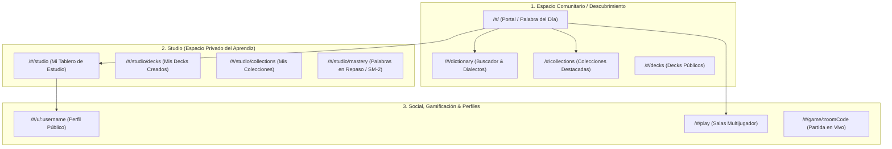
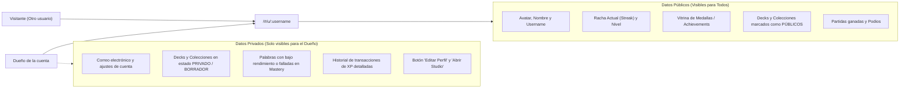

# Sistema de Navegación, Enrutamiento y UI Specification - Palabrario

Este documento define la arquitectura de navegación, el mapa canónico de rutas (`Vue Router`), los contratos de acceso, la distinción entre espacios comunitarios vs personales (**Studio**), el modelo de **Profile público/privado** y el catálogo de componentes globales para el cliente de escritorio (**Wails + Vue 3 + UnoCSS**).

---

## 1. Estrategia de Enrutamiento en Escritorio

Para garantizar la compatibilidad con el runtime de Wails y evitar errores 404 al recargar ventanas nativas en Windows, se utiliza **Hash History** (`createWebHashHistory()`):
* Todas las rutas van prefijadas por `/#/` (ej. `/#/dictionary`, `/#/studio/collections`, `/#/u/mateo_mx`).
* Se utiliza un layout base con slots (`AppLayout.vue`) que incluye una barra superior de estado y el contenedor de navegación.

---

## 2. Los Tres Espacios Fundamentales de Palabrario

1. **Espacio Comunitario (`/`, `/dictionary`, `/collections`, `/decks`):**
   * Es el ágora pública donde se descubre contenido: la palabra del día con su friendly blurb, colecciones destacadas (*"Ruta del Taco y la Jerga Mexicana"*, *"Gira Rioplatense"*), decks oficiales y el explorador de dialectos.
2. **Studio (`/studio`):**
   * El taller y espacio personal del usuario autenticado. Aquí el aprendiz administra **su propio contenido** (sus decks personales, sus carpetas/colecciones lógicas), da seguimiento a sus palabras en curva de olvido (`Mastery`) y puede crear nuevo material.
3. **Perfil Social (`/u/:username`):**
   * Es la tarjeta de presentación de cada usuario. Es **público para la comunidad**, pero con una capa de privacidad inteligente según quién lo mire.

---

## 3. Mapa Canónico de Rutas (Sitemap Completo)

| Ruta | Nombre (`name`) | Acceso | Descripción |
| :--- | :--- | :--- | :--- |
| `/#/` | `home` | Público | Portada: Palabra del día con blurb ameno, accesos directos al buscador y colecciones en tendencia. |
| `/#/dictionary` | `dictionary` | Público | Explorador general de palabras con filtros por país/dialecto y buscador FTS estilo Vocabulary.com. |
| `/#/dictionary/word/:id` | `word-detail` | Público | Ficha completa: etimología, friendly blurb, sentidos (`Sense[]`), ejemplos, audios y advertencias de tabú. |
| `/#/collections` | `collections-index` | Público | Catálogo de colecciones comunitarias y oficiales que agrupan decks temáticos. |
| `/#/collections/:id` | `collection-detail`| Público | Vista detallada de una colección: muestra la ruta de aprendizaje y los Decks que la componen. |
| `/#/decks` | `decks-index` | Público | Buscador y explorador de Decks individuales públicos. |
| `/#/decks/:id` | `deck-detail` | Público | Vista previa de tarjetas de un Deck, botón "Estudiar ahora" y botón "Iniciar partida multijugador". |
| `/#/play` | `play-lobby` | Público | Lobby multijugador: ingresar PIN de sala o anfitrionar nueva partida. |
| `/#/game/:roomCode` | `game-room` | Jugador | Partida en vivo: cuenta regresiva, preguntas con temporizador, puntajes en tiempo real y podio final. |
| `/#/studio` | `studio-dashboard` | Privado (Owner) | Centro de control del estudiante: estadísticas de racha, palabras que tocan repasar hoy y accesos directos. |
| `/#/studio/decks` | `studio-decks` | Privado (Owner) | Mis Decks: creados, clonados o en progreso, con botón para crear nuevo Deck. |
| `/#/studio/collections`| `studio-collections`| Privado (Owner) | Mis Colecciones: organizador lógico para agrupar varios Decks en una sola ruta de estudio. |
| `/#/studio/mastery` | `studio-mastery` | Privado (Owner) | Lista de vocabulario personal clasificada por nivel de retención (`NEW`, `LEARNING`, `MASTERED`). |
| `/#/u/:username` | `user-profile` | Público / Dual | Perfil social del usuario. Se adapta automáticamente si el visitante es el dueño o un tercero. |
| `/#/editor` | `editor-dashboard` | `EDITOR` / `ADMIN` | Portal de gobernanza: bandeja de palabras en `DRAFT`, cola de revisión y aprobaciones colaborativas. |
| `/#/editor/word/:id?` | `editor-word-form` | `EDITOR` / `ADMIN` | Formulario de creación/edición de palabras, sentidos regionales, notas de tabú y ejemplos. |

---

## 4. El Modelo de Perfil (`/u/:username`): Público vs Privado

Para que el perfil sea un instrumento social de gamificación sin comprometer la privacidad:

---

## 5. El Espacio "Studio": El Taller del Aprendiz

El **Studio** (`/#/studio`) es el equivalente al panel de control de un estudiante o creador:
1. **Organizador Lógico de Contenido:**
   * **Crear Deck:** Define título, descripción y selecciona palabras de la base de datos general.
   * **Crear Colección:** Agrupa 2 o más decks bajo un mismo tema (ej. Colección *"Español de Calle"* con Decks: *"Albur Mexicano"*, *"Lunfardo Porteño"*, *"Chilenismos Extremos"*).
2. **Control de Repetición Espaciada (`Mastery Hub`):**
   * Muestra el indicador: *"Tienes 14 palabras listas para repasar hoy antes de que se te olviden"*.
   * Botón de acción rápida: *"Iniciar sesión de repaso de 3 minutos"*.
3. **Acciones Rápidas:**
   * Cambiar visibilidad de sus Decks (Público / Solo yo).
   * Botón para exportar o clonar decks comunitarios a su Studio.

---

## 6. Catálogo de Componentes Globales de UI

### A. Capa de Superposición (Overlays & Modales)
1. **`SearchModal` (`Ctrl + K`):**
   * Buscador flotante omnibox con autocompletado en milisegundos y glosas cortas (como en Vocabulary.com).
2. **`QuickQuizModal`:**
   * Modal sin distracciones para practicar 5 preguntas rápidas de un Deck desde cualquier pantalla.
3. **`TabooWarningDialog`:**
   * Alerta visual cuando una palabra consultada es vulgar o tiene doble sentido sexual en ciertas regiones.
4. **`AddToDeckModal`:**
   * Al estar viendo una palabra en el diccionario, permite guardarla en uno de "Mis Decks" del Studio con un solo clic.

### B. Elementos de Interfaz y Formularios
1. **`WordCard` (Componente de Tarjeta de Vocabulario):**
   * Muestra el lema, categoría gramatical, bandera del dialecto y definición corta.
2. **`CollectionCard` (Componente de Tarjeta de Colección):**
   * Muestra portada, insignia de cuántos Decks contiene (ej. `3 Decks • 45 Palabras`) y si es `Oficial`.
3. **`DeckBuilder` (Dentro de Studio):**
   * Formulario con buscador predictivo para añadir palabras y ordenarlas arrastrando tarjetas.
