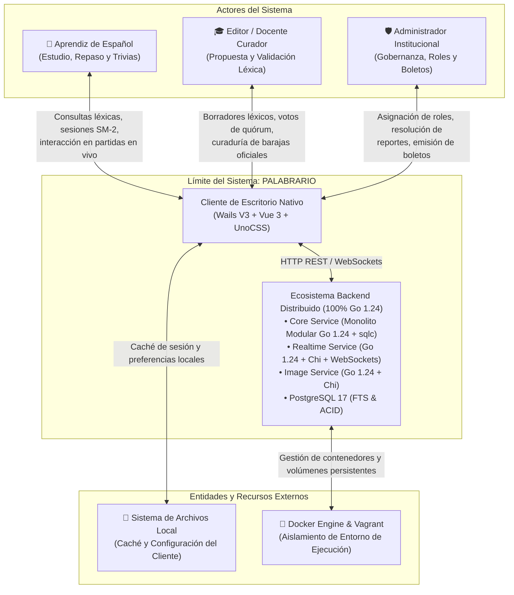

# Documento de Especificación Funcional de Requisitos de Software

**Proyecto:** Palabrario — Plataforma Colaborativa de Vocabulario y Gamificación Dialectal  
**Materia / Contexto:** Ingeniería de Software / Sistemas Distribuidos en Red / Despliegue de Software  
**Equipo de Desarrollo:** [Equipo de Desarrollo de Palabrario]  
**Fecha:** Octubre 2026  
**Versión del Documento:** 1.3.0  
**Estado:** Borrador Canónico para Desarrollo  

---

### Registro de Versiones y Control de Cambios

| Versión | Fecha | Autor(es) | Descripción del Cambio |
| :--- | :--- | :--- | :--- |
| **1.0.0** | Octubre 2026 | Equipo de Desarrollo | Elaboración de la Sección 1: Introducción, Propósito, Delimitación del Alcance y Glosario Exhaustivo de Términos. |
| **1.1.0** | Octubre 2026 | Equipo de Desarrollo | Elaboración de la Sección 2: Contexto del Sistema, Clases de Usuario, Casos de Uso simplificados (CU01-CU16), Especificaciones de Prototipo Figma, Requisitos Funcionales, Requisitos No Funcionales y Restricciones. |
| **1.2.0** | Octubre 2026 | Equipo de Desarrollo | Sincronización del stack de backend a Go 1.24 + Chi v5 + `sqlc` + `pgxpool` para `core-service` e `image-service`, manteniendo `realtime-service` en Bun + Elysia WebSockets. |
| **1.3.0** | Octubre 2026 | Equipo de Desarrollo | Unificación del 100% del backend en Go 1.24 (`realtime-service` con Chi v5 + WebSockets), formalización de autenticación interna S2S con sub-llave derivada, umbral mínimo de 8 sentidos aprobados ($\ge \text{TotalRounds}$) en CU14, sucesión automática de Host en CU15 y desglose relacional en 3NF (`match_rounds` + `quiz_attempts`) para Replay en CU16. |

---

## 1. Introducción

El presente documento constituye la **Especificación Funcional de Requisitos de Software** para la plataforma **Palabrario**, formulado conforme a las buenas prácticas y estándares de la Ingeniería de Requisitos (IEEE 830 / ISO/IEC/IEEE 29148). 

Palabrario surge ante la fractura evidente entre los diccionarios tradicionales en español —caracterizados por definiciones solemnes, desconectadas del contexto regional y pedagógicamente inertes— y las herramientas genéricas de tarjetas de estudio (*flashcards*), las cuales delegan la carga de transcripción en el estudiante sin ofrecer validación filológica ni inmersión cultural. Mediante la articulación armónica entre rigor lexicográfico curado por especialistas, narrativas humorísticas memorables (*friendly blurbs*), algoritmos de repetición espaciada y dinámicas competitivas multijugador en tiempo real, Palabrario redefine el ecosistema de adquisición y consolidación léxica de la lengua española.

Este documento formaliza la línea base conceptual, funcional y operativa sobre la cual se sustentará el ciclo constructivo del software, garantizando trazabilidad total entre las expectativas de los usuarios y las soluciones técnicas implementadas.

---

### 1.1. Propósito del documento

El propósito cardinal de este documento es definir, delimitar y formalizar de manera unívoca los requisitos funcionales, las reglas de negocio, los actores participantes y las restricciones operativas que rigen el comportamiento del sistema Palabrario. 

El documento servirá como marco de referencia y contrato técnico vinculante para las fases subsiguientes del ciclo de vida del proyecto, cumpliendo los siguientes objetivos específicos:

1. **Guía de Diseño e Implementación para el Backend:** Servir de especificación canónica para modelar las entidades de datos (PostgreSQL 17), los contratos de endpoints de la API REST del monolito modular (*Core Service* bajo Go 1.24, Chi v5, `sqlc` y `pgxpool`) y los protocolos orientados a eventos vía WebSockets (*Realtime Service* en Go 1.24 + Chi v5 + WebSockets).
2. **Guía de Desarrollo para el Cliente Nativo:** Proveer las directrices funcionales de interacción, estados de vistas y flujos de navegación para la aplicación de escritorio desarrollada con Wails V3, Vue 3 y UnoCSS.
3. **Validación y Pruebas de Software:** Suministrar los criterios de aceptación y casos de prueba indispensables para los procesos de Aseguramiento de Calidad (QA), verificación de integridad de datos y pruebas de concurrencia en partidas multijugador.
4. **Pacto con los Interesados (Stakeholders):** Alinear las expectativas funcionales del equipo de desarrollo, los docentes y lingüistas curadores de contenido, los administradores de la plataforma y el cuerpo docente evaluador del proyecto.

#### Audiencia Objetivo
Este documento está expresamente dirigido a:
* **Ingenieros de Software y Desarrolladores:** Encargados de implementar la arquitectura de backend, sincronización en red e interfaces de usuario.
* **Diseñadores de Experiencia e Interfaz (UI/UX):** Responsables de traducir las especificaciones de navegación comunitaria, personal (Studio) y multijugador en componentes visuales e interactivos.
* **Comité Editorial y Lingüistas:** Docentes y especialistas responsables de validar la congruencia de los flujos de quórum, anotación transdialectal y categorización CEFR.
* **Evaluadores Académicos y Auditores Técnicos:** Supervisores del rigor metodológico en la aplicación de técnicas de elicitación, análisis y especificación de requisitos.

---

### 1.2. Alcance

El alcance de Palabrario abarca el diseño, desarrollo, despliegue y puesta en marcha de una plataforma distribuida en red, diseñada bajo el paradigma de **Monolito Modular con Servicios Satélite Especializados**. La solución está concebida para funcionar de manera prioritaria como una **aplicación cliente de escritorio nativa de alto rendimiento** (Windows, Linux, macOS) conectada a un conjunto de servicios de backend conteinerizados en Docker.

#### 1.2.1. Funcionalidades Incluidas en el Alcance

El sistema cubrirá de forma exhaustiva las siguientes áreas funcionales:

* **Módulo de Autenticación, Cuentas y Control de Acceso (RBAC):**
  * Registro e inicio de sesión de usuarios con almacenamiento seguro de contraseñas y emisión de credenciales criptográficas (JWT).
  * Gestión de perfiles con distinción entre vista pública comunitaria (estadísticas, medallas, lema dialectal) y panel privado de configuración.
  * Flujo de postulación y acreditación institucional para la promoción de aprendices al rol de Editor.

* **Módulo de Diccionario Panhispánico y Curaduría Editorial Colaborativa:**
  * Catálogo de lemas lematizados con búsqueda rápida por autocompletado y búsqueda difusa tolerante a errores tipográficos (*Fuzzy Full-Text Search* en español sin distinción de tildes).
  * Fichas léxicas multidimensionales que desglosan cada término en sentidos específicos por región geográfica, nivel CEFR, notas de uso cultural, registro de habla y marcas de tabú o vulgaridad.
  * Mapeo de conceptos semánticos transdialectales (heteronimia: p. ej., "palomitas de maíz" frente a "pochoclo", "crispetas" o "cabritas").
  * Mecanismo automatizado de gobernanza editorial basado en quórum colaborativo: un sentido en estado borrador (*DRAFT*) se promueve a aprobado (*APPROVED*) al recibir el voto positivo de tres editores independientes mediante triggers transaccionales en la base de datos.

* **Módulo de Espacio Personal de Aprendizaje (Studio):**
  * Creación y gestión de Barajas (*Decks*) individuales de tarjetas de estudio.
  * Creación y organización de Colecciones temáticas estructuradas como rutas de aprendizaje secuenciales.
  * Adición inmediata de definiciones y sentidos consultados en el diccionario hacia las barajas del usuario con un solo clic.

* **Módulo de Motor de Aprendizaje y Medición de Maestría:**
  * Implementación del algoritmo de repetición espaciada SuperMemo SM-2 para clasificar el estado de dominio de cada sentido estudiado (`NEW`, `LEARNING`, `REVIEWING`, `MASTERED`).
  * Cálculo dinámico de intervalos de repaso óptimos y programación de fechas de estudio basadas en la curva de olvido individual.
  * Registro de intentos y tasa de aciertos por sentido léxico.

* **Módulo de Arenas Multijugador en Tiempo Real:**
  * Creación de salas de juego públicas y privadas protegidas mediante código PIN alfanumérico.
  * Sincronización estricta de rondas con temporizadores compartidos entre todos los clientes conectados.
  * Banco de preguntas curriculares generadas a partir de las barajas de estudio (definición a palabra, palabra a definición, completar oraciones, identificación de variantes dialectales).
  * Gestión del estado de la sala en memoria para latencias en milisegundos y consolidación masiva de resultados, podios, puntos de experiencia (XP) y desglose relacional ronda por ronda (*Replay*) al cierre de cada partida.

* **Módulo de Gamificación, Ledger de Experiencia y Progresión:**
  * Registro transaccional inmutable de puntos de experiencia (`xp_transactions`) por resolución de trivias, rachas diarias consecutivas y victorias en arena.
  * Sistema de niveles de aprendiz y cálculo de rachas activas e históricas (*streaks*).
  * Catálogo de logros con medallas categorizadas por niveles de rareza (*Bronze*, *Silver*, *Gold*, *Platinum*, *Diamond*).

* **Microservicio Satélite de Procesamiento de Imágenes:**
  * Validación, saneamiento, recorte y optimización de dimensiones de imágenes de perfil y portadas para eventos culturales de temporada.

#### 1.2.2. Exclusiones Explícitas del Alcance Inicial

A fin de mantener la viabilidad técnica y operativa del proyecto, se establecen los siguientes límites:

1. **Pasarelas de Pago Monetario:** La plataforma operará bajo un modelo abierto e institucional sustentado en boletos de invitación; no se integrarán procesadores de cobro ni transacciones bancarias directas.
2. **Reconocimiento y Síntesis de Voz en Tiempo Real:** El prototipo se enfocará estrictamente en la adquisición léxica textual, semántica y contextual; la integración de modelos de síntesis de voz fonética queda reservada para fases futuras.
3. **Gobernanza Editorial Descentralizada sin Moderación:** A pesar de contar con quórum automático, el sistema prohíbe la publicación desregulada; los administradores mantendrán siempre facultades de anulación y veto institucional.
4. **Clientes Móviles Nativos:** Si bien la base de código frontend en Vue 3 y la arquitectura de API REST son desacopladas y compatibles con Web/PWA, el alcance de entrega de esta fase se concentra exclusivamente en el cliente de escritorio nativo desarrollado con Wails V3.

---

### 1.3. Definiciones, acrónimos y abreviaturas

A continuación, se define el conjunto de términos técnicos, filológicos y arquitectónicos necesarios para la correcta y unívoca interpretación del presente documento.

| Término / Acrónimo | Categoría | Definición |
| :--- | :--- | :--- |
| **ACID** | Arquitectura de Datos | Siglas de *Atomicity, Consistency, Isolation, Durability*. Propiedades transaccionales garantizadas por PostgreSQL 17 para asegurar que las operaciones de datos sean atómicas y consistentes. |
| **Administrador** | Roles del Sistema | Usuario con el máximo nivel de privilegios; supervisa la comunidad, gestiona boletos de acceso, atiende reportes de contenido y posee facultades de moderación y anulación sobre términos publicados. |
| **Aprendiz (*Learner*)** | Roles del Sistema | Usuario final de la plataforma que interactúa con el diccionario, administra su Studio personal, repasa tarjetas mediante repetición espaciada y participa en partidas multijugador. |
| **Baraja (*Deck*)** | Dominio Pedagógico | Conjunto ordenado de tarjetas de estudio asociadas a sentidos léxicos específicos, diseñado para ser estudiado de forma autónoma o utilizado como base temática en una arena multijugador. |
| **Bun** | Infraestructura | Entorno de ejecución (*runtime*) moderno para JavaScript/TypeScript utilizado en la etapa de prototipado inicial antes de la unificación del *Realtime Service* en Go 1.24. |
| **CEFR / MCER** | Dominio Lingüístico | *Common European Framework of Reference for Languages* (Marco Común Europeo de Referencia para las Lenguas). Estándar internacional que clasifica la competencia lingüística en seis niveles: A1, A2, B1, B2, C1 y C2. |
| **Chi (`go-chi/chi/v5`)** | Infraestructura | Router HTTP ligero, idiomático y modular para Go 1.24, utilizado para construir las rutas RESTful del *Core Service*, el *Realtime Service* y el *Image Service*. |
| **Colección** | Dominio Pedagógico | Agrupación lógica de múltiples barajas (*Decks*) organizadas según una ruta formativa o temática cultural común (ej. "Ruta de la Gastronomía Mexicana", "Gira de Modismos Rioplatenses"). |
| **Editor** | Roles del Sistema | Docente o lingüista acreditado por la plataforma con facultades exclusivas para proponer nuevos lemas, redactar sentidos dialectales, formular preguntas curriculares y emitir votos en el quórum de curaduría. |
| **Elysia** | Infraestructura | Framework web ligero utilizado en la etapa de prototipado inicial del *Realtime Service* antes de su unificación en Go 1.24 + WebSockets. |
| **Friendly Blurb** | Dominio Pedagógico | Breve reseña introductoria redactada con ingenio, humor y contexto cultural, orientada a anclar el significado del vocablo en la memoria del estudiante de manera amena y memorable. |
| **FTS (*Full-Text Search*)** | Arquitectura de Datos | Motor de búsqueda de texto completo integrado en PostgreSQL, configurado con diccionarios de lematización en español (`spanish_stem`) e insensibilidad a tildes (`unaccent`). |
| **GIN** | Arquitectura de Datos | *Generalized Inverted Index*. Tipo de índice de base de datos optimizado para búsquedas veloces sobre vectores de texto completo (`tsvector`) y operadores de trigramas. |
| **Heteronimia Transdialectal** | Dominio Lingüístico | Fenómeno por el cual un mismo concepto semántico abstracto recibe denominaciones léxicas distintas según la región geográfica hispanohablante (ej. *pitillo*, *sorbete*, *pajita*, *popote*, *bombilla*). |
| **JWT** | Seguridad | *JSON Web Token*. Estándar abierto (RFC 7519) utilizado para transmitir información de autenticación e identidad entre el cliente y el backend, así como para llamadas internas Servicio-a-Servicio (S2S) con sub-llave derivada. |
| **Lema (*Lemma*)** | Dominio Lingüístico | Forma canónica de una palabra según las convenciones lexicográficas (ej. verbo en infinitivo, sustantivo en singular masculino); constituye la cabecera que agrupa a múltiples sentidos. |
| **Monolito Modular** | Arquitectura de Software | Patrón arquitectónico donde el núcleo de la aplicación se ejecuta dentro de un único proceso unificado, pero su código fuente y lógica de negocio se encuentran estrictamente desacoplados en módulos delimitados por dominio (*bounded contexts*). |
| **pg_trgm** | Arquitectura de Datos | Extensión de PostgreSQL que habilita el cálculo de similitud alfanumérica basado en trigramas, permitiendo la búsqueda difusa y tolerancia a errores ortográficos al escribir palabras. |
| **Quórum Editorial** | Gobernanza | Mecanismo de validación por consenso donde se requiere un mínimo de tres (3) aprobaciones independientes de usuarios con rol de Editor para que un sentido léxico pase de borrador a publicado. |
| **RBAC** | Seguridad | *Role-Based Access Control* (Control de Acceso Basado en Roles). Mecanismo de autorización que restringe el acceso a operaciones del sistema en función de los roles asignados (`LEARNER`, `EDITOR`, `ADMIN`). |
| **Sentido (*Sense*)** | Dominio Lingüístico | Acepción o significado específico de un lema, contextualizado con una región geográfica, un nivel CEFR, una categoría gramatical, ejemplos de uso y advertencias de tabú. |
| **Servicio Satélite** | Arquitectura de Software | Servicio independiente y especializado desacoplado del monolito modular para gestionar cargas de trabajo que demandan infraestructuras o runtimes específicos (como baja latencia en WebSockets o procesamiento intensivo de archivos). |
| **SM-2** | Dominio Pedagógico | Algoritmo clásico de repetición espaciada (*SuperMemo-2*) que computa los intervalos de tiempo ideales entre sesiones de repaso a partir de la dificultad del reactivo y el historial de aciertos. |
| **`sqlc`** | Arquitectura de Datos | Generador de código que compila consultas SQL nativas de PostgreSQL hacia interfaces y estructuras Go 100% tipadas en tiempo de compilación, operando sobre `pgxpool`. |
| **Studio** | Dominio de UI | Espacio de trabajo personal y privado del estudiante dentro de la interfaz de usuario, orientado a la gestión de sus barajas, colecciones y panel de maestría. |
| **tsvector / tsquery** | Arquitectura de Datos | Tipos de datos nativos de PostgreSQL para almacenar documentos de texto normalizados y ejecutar consultas léxicas ponderadas de alta velocidad. |
| **UnoCSS** | Frontend | Motor atómico de utilidades CSS de alto rendimiento que genera estilos bajo demanda para la interfaz gráfica del cliente en Vue 3. |
| **Wails V3** | Frontend / Runtime | Marco de trabajo que combina el lenguaje de programación Go para el backend nativo de escritorio y tecnologías web estándar (HTML/JS/Vue) para la capa de presentación visual. |
| **WebSocket** | Comunicaciones en Red | Protocolo de comunicación bidireccional y persistente sobre una única conexión TCP, indispensable para la sincronización de rondas y difusión de estados en las arenas de juego en vivo. |
| **XP (*Experience Points*)** | Dominio Pedagógico / Gamificación | Unidad métrica de progreso que mide el esfuerzo del estudiante; se registra en un libro contable auditable (`xp_transactions`) al acertar preguntas, cumplir rachas o triunfar en la arena. |

---

## 2. Requerimientos del Sistema

---

### 2.1. Contexto del sistema

El sistema **Palabrario** opera como una plataforma cliente-servidor distribuida en red, orientada a la interacción pedagógica, colaborativa y competitiva entre aprendices de la lengua española, docentes curadores y administradores institucionales. 

El entorno del sistema se estructura alrededor de un límite perimetral claramente definido entre la capa cliente y los servicios de backend:

1. **Entorno de Cliente (Frontends):**
   - El cliente primario es una **aplicación de escritorio nativa** empaquetada con Wails V3 (Go nativo + motor de renderizado web basado en WebView2 para Windows y WebKitGTK para Linux).
   - El cliente se comunica de forma segura mediante HTTP/REST hacia el núcleo de negocio y mantiene conexiones bidireccionales persistentes sobre WebSockets con el servicio de salas de juego.
   - Diseñado bajo una estrategia desacoplada que permite extender la misma capa visual hacia navegadores web estándar (Web/PWA) en etapas subsecuentes.

2. **Entorno de Backend Conteinerizado:**
   - La plataforma se ejecuta en un ecosistema de micro-contenedores gestionados por Docker Compose dentro de una máquina virtualizada de desarrollo (Vagrant/Debian 12) o Docker Engine local:
     * **Core Service (`core-service`):** Monolito modular en Go 1.24 + Chi v5 + `sqlc` + `pgxpool` que atiende las peticiones HTTP/REST (puerto 8000).
     * **Realtime Service (`realtime-service`):** Servicio satélite en Go 1.24 + Chi v5 + WebSockets para el control de partidas en tiempo real (puerto 8001).
     * **Image Service (`image-service`):** Servicio satélite en Go 1.24 + Chi v5 para saneamiento y optimización de medios (puerto 8002).
     * **PostgreSQL 17:** Base de datos relacional centralizada con extensiones de búsqueda FTS e integridad referencial estricta (puerto 5432).

3. **Límites e Interacciones Externas:**
   - Palabrario no depende de APIs de terceros no controladas para su operación nuclear. Todo el corpus lexicográfico, los algoritmos de repetición espaciada y el motor de arena residen en la infraestructura propia, garantizando autonomía, soberanía de datos y baja latencia.

#### 2.1.1. Diagrama de Contexto del Sistema

#### 2.1.2. Indicaciones para Dibujo Manual del Diagrama de Contexto
Para plasmar este diagrama en lámina o herramienta gráfica manual (p. ej. draw.io, papel o pizarra):
1. **Caja Central (Límite del Sistema):** Dibuja un rectángulo de contorno pronunciado o doble línea en el centro con la leyenda `"Sistema Palabrario"`. En su interior, representa la integración entre la aplicación cliente de escritorio y los servicios de backend.
2. **Entidades Externas (Actores Humanos):** Coloca tres figuras de actor (o cajas rectangulares) en la parte izquierda y superior:
   - `Aprendiz`: Flecha entrante con `"Peticiones de búsqueda, respuestas a reactivos"` y flecha saliente con `"Fichas de palabras, tarjetas SM-2, resultados de arena"`.
   - `Editor`: Flecha entrante con `"Propuestas léxicas, votos de quórum"` y flecha saliente con `"Cola de curaduría, estadísticas de lemas"`.
   - `Administrador`: Flecha entrante con `"Gestión de roles, boletos, moderación"` y flecha saliente con `"Reportes consolidados, auditoría"`.
3. **Sistemas Externos (Hardware / SO):** Coloca en la parte inferior las entidades de infraestructura:
   - `Sistema de Archivos del Host`: Para persistencia de tokens de sesión y logs del cliente de escritorio.
   - `Host de Contenedores (Docker)`: Como entorno de aprovisionamiento de los microservicios backend y la base de datos relacional.

---

### 2.2. Clases de usuario

La plataforma clasifica a sus usuarios en función de sus roles, objetivos pedagógicos, volumen de interacción y nivel de acceso otorgado dentro del modelo RBAC (*Role-Based Access Control*).

| Clase de Usuario | Nivel Técnico / Perfil | Frecuencia de Uso | Responsabilidades Principales | Necesidades Clave en la Plataforma | Permisos y Privilegios Generales |
| :--- | :--- | :--- | :--- | :--- | :--- |
| **Aprendiz (*Learner*)** | Usuario general; estudiantes desde nivel A1 hasta C2 o hablantes de herencia. | Alta (diaria o interdiaria para mantener rachas). | Consultar palabras desconocidas, crear barajas temáticas para su propio estudio, completar repasos diarios mediante repetición espaciada y participar activamente en arenas multijugador. | Interfaz intuitiva y estimulante, retroalimentación inmediata sobre errores, explicaciones culturales amenas y baja latencia en partidas competitivas. | Acceso de lectura al diccionario público, creación/edición de su Studio personal, unión a salas de juego y envío de reportes de contenido. |
| **Editor (*Curator*)** | Docente de lenguas, filólogo, lingüista o estudiante avanzado acreditado. | Media / Periódica (semanal o conforme a convocatorias editoriales). | Enriquecer el lexicón con sentidos regionales, ejemplos contextuales, niveles CEFR y notas de tabú; revisar y votar con rigor las propuestas de sus pares en la cola de curaduría. | Formularios especializados de captura léxica, bandeja de moderación ágil, trazabilidad de versiones de lemas y herramientas de etiquetado gramatical. | Todas las facultades del Aprendiz más: creación de lemas/sentidos en borrador, emisión de votos en quórum colaborativo y postulación de barajas oficiales. |
| **Administrador** | Personal institucional, coordinador académico o administrador técnico. | Baja / Continua (supervisión y auditoría). | Preservar la integridad comunitaria, gestionar la acreditación de editores, moderar o censurar vocablos reportados, generar boletos de acceso y auditar movimientos de XP. | Tableros consolidados de administración, trazabilidad de logs, herramientas de veto directo sobre contenido y gestión centralizada de cuentas. | Control total del sistema: gestión de roles (`LEARNER`, `EDITOR`, `ADMIN`), aprobación/veto unilateral de términos, emisión de boletos y resolución de reportes. |
| **Visitante (No Autenticado)** | Público general o evaluador curioso que abre el cliente por primera vez. | Esporádica. | Conocer la propuesta de la plataforma y explorar las palabras del día antes de registrar una cuenta. | Pantallas de bienvenida fluidas, muestra clara del valor del diccionario y formulario de registro simplificado. | Lectura restringida de la portada y lema del día; sin acceso a Studio, repetición espaciada, arenas ni votaciones. |

#### 2.2.1. Indicaciones para el Diagrama de Clases de Usuario
Para elaborar manualmente el diagrama de jerarquía de usuarios:
* Modela una clase base abstracta denominada `Miembro` que contenga atributos universales: `id_usuario`, `nombre`, `correo`, `dialecto_ancla`, `racha_actual` y `total_xp`.
* Establece relaciones de generalización/herencia (flecha con punta triangular cerrada apuntando hacia `Miembro`) para `Aprendiz`, `Editor` y `Administrador`.
* Detalla para cada especialización sus métodos o responsabilidades operativas exclusivas (ej. `Editor.votarQuorum()`, `Administrador.aprobarBoleto()`).

---

### 2.3. Casos de uso

#### 2.3.1. Indicaciones para el Diagrama de Casos de Uso Manual
Para la elaboración manual del Diagrama de Casos de Uso en formato UML estándar:
1. **Límites del Sistema:** Dibuja un rectángulo grande que abarque los 16 casos de uso agrupados en subsistemas o paquetes lógicos:
   - **Paquete Cuenta y Gobernanza:** CU01, CU02, CU03, CU04.
   - **Paquete Diccionario y Curaduría:** CU05, CU06, CU07, CU08, CU09.
   - **Paquete Estudio y Maestría (Studio):** CU10, CU11, CU12, CU13.
   - **Paquete Arena Multijugador:** CU14, CU15, CU16.
2. **Actores:** Sitúa a los actores humanos a la izquierda (`Aprendiz`, `Editor`, `Administrador` conectados mediante relaciones de herencia con el actor base `Miembro`), y al actor automatizado `Sistema` a la derecha.
3. **Relaciones Estereotipadas:**
   - `CU12 (Estudiar con Repetición Espaciada)` incluye (`<<include>>`) a la actualización de maestría y ledger de XP.
   - `CU16 (Consolidar y Cerrar Partida)` es detonado exclusivamente por el actor `Sistema` al finalizar `CU15 (Participar en Partida Multijugador)`.
   - `CU08 (Publicar Sentido Léxico)` extiende (`<<extend>>`) a `CU07 (Curar Sentidos por Quórum)` bajo la condición de acumular 3 votos independientes.

#### 2.3.2. Catálogo de Casos de Uso

| ID | Módulo | Caso de Uso | Actor Principal | Descripción Breve |
| :--- | :--- | :--- | :--- | :--- |
| **CU01** | Cuenta | Gestionar Perfil de Usuario | Miembro | Consultar y actualizar datos personales, dialecto ancla y preferencias de estudio. |
| **CU02** | Cuenta | Solicitar Promoción a Editor | Aprendiz | Remitir credenciales institucionales para postularse al rol de Editor. |
| **CU03** | Gobernanza | Administrar Usuarios y Roles | Administrador | Consultar cuentas, promover o degradar roles y evaluar solicitudes de acreditación. |
| **CU04** | Gobernanza | Emitir Boletos de Invitación | Administrador | Generar boletos de acceso (uniuso o multiuso) para aprendices o instituciones aliadas. |
| **CU05** | Diccionario | Consultar Diccionario Panhispánico | Miembro | Buscar y explorar términos mediante autocompletado y búsqueda difusa tolerante a tildes. |
| **CU06** | Diccionario | Gestionar Contenido Léxico | Editor | Registrar, actualizar o dar de baja lemas, sentidos regionales, notas de uso y ejemplos. |
| **CU07** | Diccionario | Curar Sentidos por Quórum | Editor | Evaluar y emitir votos de aprobación sobre sentidos propuestos por otros editores. |
| **CU08** | Diccionario | Publicar Sentido Léxico | Sistema | Promover automáticamente un sentido a estado publicado al alcanzar el quórum de 3 votos. |
| **CU09** | Diccionario | Moderar Reportes de Contenido | Administrador | Atender reportes enviados por aprendices, aplicando resoluciones de corrección o censura. |
| **CU10** | Estudio | Gestionar Barajas de Estudio | Miembro | Crear, personalizar, organizar y depurar barajas de tarjetas de vocabulario en Studio. |
| **CU11** | Estudio | Gestionar Colecciones Temáticas | Miembro | Agrupar barajas afines en rutas de aprendizaje y explorar colecciones públicas. |
| **CU12** | Estudio | Estudiar con Repetición Espaciada | Miembro | Repasar vocabulario mediante tarjetas interactivas adaptadas al algoritmo SM-2. |
| **CU13** | Estudio | Consultar Maestría y Progreso | Miembro | Visualizar métricas de retención, palabras dominadas, racha activa y ledger de XP. |
| **CU14** | Arena | Crear y Configurar Arena | Miembro | Configurar una sala multijugador basada en una baraja de estudio ($\ge 8$ sentidos) y obtener código PIN. |
| **CU15** | Arena | Participar en Partida Multijugador | Miembro | Unirse a una sala (máx. 8 jugadores), responder desafíos sincronizados contra reloj y competir en vivo. |
| **CU16** | Arena | Consolidar y Cerrar Partida | Sistema | Finalizar rondas de juego, computar podios, otorgar XP, actualizar maestría y persistir el replay por ronda en lote. |

#### 2.3.3. Reglas de Negocio Vinculadas

| ID | Nombre | Tipo | Enunciado de la Regla |
| :--- | :--- | :--- | :--- |
| **RN01** | Integridad del Perfil | Restricción | El Miembro únicamente puede modificar la información y preferencias pertenecientes a su propia cuenta. |
| **RN02** | Unicidad de Solicitudes | Restricción | El Aprendiz solo puede mantener una solicitud de promoción a Editor en estado pendiente a la vez. |
| **RN03** | Propiedad en Studio | Restricción | El Miembro solo puede modificar, reorganizar o eliminar barajas y colecciones creadas por él en su Studio. |
| **RN04** | Visibilidad de Contenido Privado | Restricción | Las barajas y colecciones marcadas como privadas no aparecerán en búsquedas comunitarias ni podrán ser guardadas por otros usuarios. |
| **RN05** | Curaduría de Contenido Oficial | Autorización | Solo el Editor o el Administrador pueden marcar barajas y colecciones como "Oficiales" y modificar su composición. |
| **RN06** | Quórum Editorial Tripartito | Proceso | Para que un sentido léxico en estado borrador sea publicado automáticamente, debe acumular al menos tres (3) votos favorables de editores distintos, auditando texto, notas culturales e imagen asociada. |
| **RN07** | Imparcialidad Curatorial | Restricción | El Editor que propone un nuevo sentido léxico no puede emitir votos de aprobación sobre su propia propuesta. |
| **RN08** | Veto Administrativo Directo | Autorización | El Administrador posee la facultad de aprobar, rechazar o retirar de publicación de forma inmediata cualquier lema o sentido sin requerir quórum. |
| **RN09** | Algoritmo de Repetición Espaciada | Cálculo | El intervalo de revisión y la fase de dominio (`NEW`, `LEARNING`, `REVIEWING`, `MASTERED`) de cada sentido se computan con base en el desempeño del estudiante (en reactivos textuales y visuales) según el algoritmo SM-2. |
| **RN10** | Sincronización de Arena | Operación | Durante una partida multijugador, todos los participantes reciben los reactivos de manera simultánea (con precarga de recursos en rondas visuales) y cuentan con el mismo tiempo límite por ronda. |
| **RN11** | Transaccionalidad de XP | Consistencia | Cada ganancia o modificación de puntos de experiencia debe registrarse como un movimiento auditable en el ledger (`xp_transactions`), impidiendo inconsistencias de saldo. |
| **RN12** | Integridad y Moderación Multimedia | Restricción | Toda imagen asociada a un lema, sentido o perfil debe procesarse mediante `image-service` (máx. 5 MB, validación de magic bytes, filtro heurístico NSFW en Go puro y limpieza EXIF), prohibiéndose URLs externas arbitrarias. |
| **RN13** | Quórum de Distractores Visuales | Operación | Una ronda multijugador de modalidad `WORD_TO_IMAGE` requiere al menos cuatro (4) sentidos con imagen válida en la baraja; de lo contrario, el sistema degrada automáticamente la ronda a modalidad textual (`WORD_TO_DEFINITION`). |

#### 2.3.4. Especificaciones Textuales de Casos de Uso (Nivel de Análisis)

##### CU01: Gestionar Perfil de Usuario
* **Actor Principal:** El Miembro.
* **Descripción:** El Miembro consulta y actualiza su información personal básica, dialecto ancla preferido y configuraciones de cuenta.
* **Precondiciones:** El Miembro ha iniciado sesión en el Sistema.
* **Poscondiciones:** Los datos del perfil del Miembro quedan actualizados y vigentes para futuras interacciones.
* **Flujo Principal:**
  1. El Miembro solicita gestionar su perfil de usuario.
  2. El Sistema recupera y presenta los datos actuales del Miembro (nombre, dialecto ancla, nivel de autoaprendizaje y racha activa).
  3. El Miembro modifica los campos pertinentes y confirma la actualización.
  4. El Sistema valida que la información cumpla con las restricciones de formato e integridad.
  5. El Sistema almacena los cambios en el perfil del Miembro.
  6. El Sistema notifica al Miembro la confirmación de la operación.
* **Flujos Alternos:**
  * **4a. Datos con formato inválido:** El Sistema notifica los campos que no cumplen los criterios requeridos y solicita su corrección, permaneciendo en el paso 3.
* **Flujos de Excepción:**
  * **5a. Error en la persistencia de datos:** El Sistema informa al Miembro la imposibilidad temporal de registrar los cambios y preserva el estado previo.
* **Reglas de Negocio:** RN01, RN12.

##### CU02: Solicitar Promoción a Editor
* **Actor Principal:** El Aprendiz.
* **Descripción:** El Aprendiz formaliza una solicitud ante la administración para obtener privilegios editoriales, adjuntando acreditaciones pedagógicas o lingüísticas.
* **Precondiciones:** El Aprendiz ha iniciado sesión y no cuenta con una solicitud previa en trámite.
* **Poscondiciones:** Se registra una solicitud en estado pendiente asignada al Aprendiz para la revisión del Administrador.
* **Flujo Principal:**
  1. El Aprendiz solicita postularse al rol de Editor.
  2. El Sistema verifica que el Aprendiz no posea solicitudes pendientes de resolución.
  3. El Aprendiz proporciona la justificación de su postulación y los comprobantes institucionales correspondientes.
  4. El Aprendiz confirma el envío de la postulación.
  5. El Sistema valida la suficiencia de los datos e ingresa la solicitud al buzón de evaluación institucional.
  6. El Sistema notifica al Aprendiz que su postulación ha sido enviada con éxito.
* **Flujos Alternos:**
  * **2a. Solicitud previa existente:** El Sistema notifica al Aprendiz que ya existe una solicitud en revisión y finaliza el caso de uso.
* **Flujos de Excepción:**
  * **5a. Falla de almacenamiento de solicitud:** El Sistema notifica la incidencia y solicita reintentar más tarde.
* **Reglas de Negocio:** RN02, RN12.

##### CU03: Administrar Usuarios y Roles
* **Actor Principal:** El Administrador.
* **Descripción:** El Administrador supervisa el padrón de usuarios, atiende solicitudes de acreditación institucional y ajusta privilegios promoviendo o degradando roles.
* **Precondiciones:** El Administrador ha iniciado sesión con privilegios administrativos vigentes.
* **Poscondiciones:** Los roles asignados a los usuarios seleccionados son modificados en el Sistema.
* **Flujo Principal:**
  1. El Administrador solicita la lista de usuarios o la bandeja de solicitudes de acreditación.
  2. El Sistema presenta los registros disponibles permitiendo búsquedas y filtros por rol y estado.
  3. El Administrador selecciona un usuario o solicitud y define la acción a ejecutar (aprobar promoción, degradar rol o rechazar solicitud).
  4. El Sistema valida que la operación no vulnere las políticas mínimas de seguridad (p. ej., evitar la auto-eliminación del último administrador).
  5. El Sistema actualiza el rol del usuario objetivo y archiva la solicitud correspondiente.
  6. El Sistema informa al Administrador el resultado exitoso de la modificación.
* **Flujos Alternos:**
  * **4a. Operación no permitida:** El Sistema advierte sobre la restricción de seguridad y cancela el cambio.
* **Flujos de Excepción:**
  * **5a. Falla de comunicación con el almacén de datos:** El Sistema emite un aviso de error transaccional.
* **Reglas de Negocio:** RN01, RN08.

##### CU04: Emitir Boletos de Invitación
* **Actor Principal:** El Administrador.
* **Descripción:** El Administrador genera códigos de boleto institucionales o personales para permitir el acceso controlado a la plataforma.
* **Precondiciones:** El Administrador ha iniciado sesión en el Sistema.
* **Poscondiciones:** Se crea uno o más boletos de invitación con sus correspondientes límites de uso y vigencia.
* **Flujo Principal:**
  1. El Administrador solicita generar boletos de invitación.
  2. El Administrador especifica el tipo de boleto (uso único o institucional multiuso), el rol predeterminado y la fecha de vigencia.
  3. El Administrador confirma la generación.
  4. El Sistema produce los códigos únicos de boleto y los registra en la base de datos.
  5. El Sistema entrega los códigos generados al Administrador para su distribución.
* **Flujos de Excepción:**
  * **4a. Error de generación:** El Sistema alerta sobre el fallo de creación y revierte cualquier asignación parcial.
* **Reglas de Negocio:** RN08.

##### CU05: Consultar Diccionario Panhispánico
* **Actor Principal:** El Miembro.
* **Descripción:** El Miembro busca vocablos por lema o texto libre, visualizando fichas lingüísticas con acepciones dialectales, niveles CEFR y notas culturales.
* **Precondiciones:** Ninguna (disponible para cualquier usuario autenticado o visitante).
* **Poscondiciones:** El Sistema entrega la ficha lexicográfica de los términos concordantes.
* **Flujo Principal:**
  1. El Miembro ingresa un criterio de búsqueda (palabra exacta, prefijo o concepto en lenguaje natural).
  2. El Sistema ejecuta una consulta combinando autocompletado y búsqueda difusa (*Full-Text Search* en español e insensibilidad a tildes).
  3. El Sistema presenta un listado de coincidencias relevantes con su glosa rápida y bandera de origen.
  4. El Miembro selecciona un término específico.
  5. El Sistema presenta la ficha completa del término: etimología, reseña amena (*friendly blurb*), sentidos aprobados categorizados por región y nivel CEFR, notas de tabú y ejemplos contextuales.
* **Flujos Alternos:**
  * **3a. Sin coincidencias directas:** El Sistema presenta sugerencias de términos fonética o morfológicamente similares según el cálculo de trigramas.
* **Flujos de Excepción:**
  * **2a. Falla en el servicio de búsqueda:** El Sistema notifica la indisponibilidad momentánea del catálogo léxico.
* **Reglas de Negocio:** RN04, RN06.

##### CU06: Gestionar Contenido Léxico
* **Actor Principal:** El Editor.
* **Descripción:** El Editor crea o actualiza lemas, redacta sentidos dialectales, formula ejemplos pedagógicos y notas culturales.
* **Precondiciones:** El Editor ha iniciado sesión con privilegios editoriales activos.
* **Poscondiciones:** El lema o sentido se registra en el Sistema en estado borrador (*DRAFT*), listo para evaluación de quórum.
* **Flujo Principal:**
  1. El Editor solicita registrar un nuevo término o agregar un nuevo sentido a un lema existente.
  2. El Editor captura los atributos requeridos: lema, categoría gramatical, región dialectal, nivel CEFR, definición técnica, glosa breve, nota cultural y ejemplos.
  3. El Editor confirma la propuesta del contenido.
  4. El Sistema valida que la estructura léxica sea coherente y que no existan duplicados idénticos en borrador.
  5. El Sistema almacena la propuesta en estado borrador y la añade a la cola de curaduría de la comunidad editorial.
  6. El Sistema informa al Editor que su propuesta fue registrada satisfactoriamente.
* **Flujos Alternos:**
  * **2a. Edición de contenido propio en borrador:** El Editor modifica un sentido previamente propuesto por él mientras no haya alcanzado estado publicado. El Sistema actualiza el borrador.
* **Flujos de Excepción:**
  * **5a. Error de integridad en la base de datos:** El Sistema rechaza la transacción y notifica el error.
* **Reglas de Negocio:** RN05, RN07, RN12.

##### CU07: Curar Sentidos por Quórum
* **Actor Principal:** El Editor.
* **Descripción:** El Editor examina propuestas léxicas en borrador remitidas por sus colegas y emite su voto de aprobación filológica.
* **Precondiciones:** El Editor ha iniciado sesión y existen términos pendientes de curaduría propuestos por otros editores.
* **Poscondiciones:** Se registra el voto positivo del Editor vinculado al sentido evaluado.
* **Flujo Principal:**
  1. El Editor accede a la cola de curaduría comunitaria.
  2. El Sistema presenta la lista de sentidos en estado borrador que el Editor aún no ha evaluado.
  3. El Editor selecciona un sentido para su análisis detallado.
  4. El Editor aprueba la propuesta.
  5. El Sistema valida que el Editor no sea el autor original de la propuesta ni haya emitido un voto previo sobre ella.
  6. El Sistema registra formalmente la aprobación en el historial de quórum.
  7. El Sistema confirma la recepción del voto al Editor.
* **Flujos Alternos:**
  * **4a. El Editor solicita correcciones o rechaza:** El Editor registra observaciones pedagógicas para que el autor modifique su borrador.
* **Flujos de Excepción:**
  * **6a. Conflicto de concurrencia:** El Sistema informa si el término cambió de estado durante la revisión y refresca la vista.
* **Reglas de Negocio:** RN06, RN07.

##### CU08: Publicar Sentido Léxico
* **Actor Principal:** El Sistema (o El Administrador por vía de excepción).
* **Descripción:** El Sistema evalúa el cumplimiento de las condiciones de quórum tras cada voto y promueve automáticamente el sentido al catálogo público de definiciones.
* **Precondiciones:** Se ha registrado una nueva aprobación sobre un sentido en estado borrador.
* **Poscondiciones:** El sentido pasa al estado aprobado (*APPROVED*) y se vuelve visible en las búsquedas públicas del diccionario.
* **Flujo Principal:**
  1. El Sistema detecta la inserción de un voto de aprobación sobre un sentido en borrador.
  2. El Sistema contabiliza el número de aprobaciones provenientes de editores únicos e independientes.
  3. El Sistema determina que se ha alcanzado el umbral requerido (3 aprobaciones).
  4. El Sistema actualiza atómicamente el estado del sentido a aprobado (*APPROVED*).
  5. El Sistema regenera el índice de búsqueda de texto completo para incluir el nuevo contenido en las búsquedas generales.
* **Flujos Alternos:**
  * **3a. Quórum no alcanzado:** El Sistema constata que el recuento es menor a 3; preserva el estado de borrador y finaliza el proceso a la espera de nuevos votos.
  * **1b. Aprobación Directa por Administrador:** El Administrador aprueba unilateralmente el sentido. El Sistema omite el conteo de quórum y ejecuta directamente los pasos 4 y 5.
* **Reglas de Negocio:** RN06, RN08.

##### CU09: Moderar Reportes de Contenido
* **Actor Principal:** El Administrador (con apoyo del Aprendiz como emisor).
* **Descripción:** El Aprendiz reporta un término o ejemplo por incorrección o vulgaridad indebida; el Administrador examina el caso y ejecuta las medidas correctivas.
* **Precondiciones:** Existe un reporte emitido por un usuario sobre un elemento léxico visible.
* **Poscondiciones:** El contenido reportado es rectificado, censurado (*HIDDEN*) o el reporte es desestimado.
* **Flujo Principal:**
  1. El Aprendiz identifica un error o anomalía en un sentido léxico y emite un reporte motivado.
  2. El Sistema almacena el reporte en la bandeja de moderación.
  3. El Administrador revisa los reportes pendientes y analiza el contenido objetado.
  4. El Administrador determina la resolución (ocultar el sentido, solicitar enmienda o desechar el reporte por improcedente).
  5. El Sistema aplica el cambio de estado correspondiente sobre el contenido y marca el reporte como resuelto.
  6. El Sistema registra la auditoría de la acción moderadora.
* **Reglas de Negocio:** RN08.

##### CU10: Gestionar Barajas de Estudio
* **Actor Principal:** El Miembro.
* **Descripción:** El Miembro crea barajas temáticas, les asigna tarjetas a partir del diccionario, ajusta su orden o elimina tarjetas obsoletas en su Studio.
* **Precondiciones:** El Miembro ha iniciado sesión en el Sistema.
* **Poscondiciones:** La baraja de estudio refleja los cambios solicitados por su propietario.
* **Flujo Principal:**
  1. El Miembro solicita crear o modificar una baraja en su Studio personal.
  2. El Miembro define los metadatos: título, descripción y nivel de privacidad (pública o privada).
  3. El Miembro añade tarjetas vinculando sentidos consultados en el diccionario o remueve tarjetas existentes.
  4. El Miembro confirma la operación.
  5. El Sistema valida que el Miembro sea el propietario legítimo de la baraja.
  6. El Sistema persiste la baraja y sus asociaciones en la base de datos.
  7. El Sistema confirma la actualización al Miembro.
* **Flujos Alternos:**
  * **3a. Adición rápida desde el diccionario:** El Miembro se encuentra consultando un vocablo en el diccionario y selecciona la opción "Guardar en Baraja". El Sistema vincula el sentido a la baraja elegida y retorna a la consulta.
* **Flujos de Excepción:**
  * **5a. Violación de propiedad:** El Sistema deniega la operación si la baraja pertenece a otro usuario.
* **Reglas de Negocio:** RN03, RN04, RN05.

##### CU11: Gestionar Colecciones Temáticas
* **Actor Principal:** El Miembro (o El Editor para colecciones oficiales).
* **Descripción:** El Miembro agrupa múltiples barajas bajo un eje temático común (rutas formativas) y explora colecciones creadas por la comunidad.
* **Precondiciones:** El Miembro ha iniciado sesión en el Sistema.
* **Poscondiciones:** La colección queda creada, actualizada o incorporada al Studio del Miembro.
* **Flujo Principal:**
  1. El Miembro solicita crear una nueva colección temática en su Studio.
  2. El Miembro introduce el nombre, descripción, privacidad y selecciona las barajas que integrarán la colección.
  3. El Miembro confirma la creación.
  4. El Sistema valida los datos y registra la colección asociada al Miembro.
  5. El Sistema confirma la disponibilidad de la nueva colección en el Studio.
* **Flujos Alternos:**
  * **1a. Guardar colección comunitaria:** El Miembro explora el catálogo público, selecciona una colección de su interés y solicita añadirla a su Studio. El Sistema crea la referencia personal hacia la colección pública.
  * **1b. Proponer colección como oficial:** El Editor postula una colección pública destacada. El Administrador la evalúa y le otorga la categoría de "Oficial".
* **Reglas de Negocio:** RN03, RN04, RN05.

##### CU12: Estudiar con Repetición Espaciada
* **Actor Principal:** El Miembro.
* **Descripción:** El Miembro realiza una sesión de práctica interactiva con una baraja; el Sistema evalúa sus respuestas y recalcula el intervalo óptimo de repaso mediante el algoritmo SM-2.
* **Precondiciones:** El Miembro ha iniciado sesión y la baraja contiene al menos una tarjeta de estudio.
* **Poscondiciones:** Se actualiza el nivel de maestría, fecha de próximo repaso y saldo de experiencia (XP) del Miembro.
* **Flujo Principal:**
  1. El Miembro selecciona una baraja de su Studio y solicita iniciar la sesión de estudio.
  2. El Sistema recupera las tarjetas prioritarias según la curva de olvido y la fecha programada de repaso.
  3. El Sistema presenta un reactivo al Miembro (definición, palabra o contexto oracional).
  4. El Miembro responde al reactivo o autoevalúa su nivel de retención.
  5. El Sistema computa el resultado aplicando el algoritmo SM-2 (actualizando racha de aciertos, factor de facilidad e intervalo en días).
  6. El Sistema otorga los puntos de experiencia (XP) correspondientes y registra la transacción en el ledger.
  7. El Sistema repite los pasos 3 al 6 hasta culminar los reactivos de la sesión.
  8. El Sistema presenta el balance general de desempeño obtenido por el Miembro.
* **Flujos Alternos:**
  * **4a. Respuesta incorrecta:** El Sistema reinicia el contador de aciertos consecutivos para esa tarjeta, programa su repaso inmediato y recalcula su estado a `LEARNING`.
* **Reglas de Negocio:** RN09, RN11.

##### CU13: Consultar Maestría y Progreso
* **Actor Principal:** El Miembro.
* **Descripción:** El Miembro revisa el tablero de métricas de su Studio: nivel general, distribución de palabras según dominio (`NEW`, `LEARNING`, `REVIEWING`, `MASTERED`), racha diaria activa y medallas conseguidas.
* **Precondiciones:** El Miembro ha iniciado sesión en el Sistema.
* **Poscondiciones:** El Sistema presenta la información estadística consolidada del aprendizaje del Miembro.
* **Flujo Principal:**
  1. El Miembro accede a la sección de Maestría y Progreso dentro de su Studio.
  2. El Sistema extrae los registros de dominio léxico, el historial de rachas y las transacciones de experiencia del Miembro.
  3. El Sistema consolida y muestra las métricas:
     * Porcentaje global de retención y palabras en cada etapa de dominio.
     * Días consecutivos de actividad (racha actual y racha histórica récord).
     * Puntos de experiencia acumulados y nivel actual.
     * Vitrina de logros y medallas desbloqueadas.
* **Flujos de Excepción:**
  * **2a. Inconsistencia temporal de métricas:** El Sistema ejecuta un recalculo a partir del libro mayor de transacciones (`xp_transactions`).
* **Reglas de Negocio:** RN09, RN11.

##### CU14: Crear y Configurar Arena
* **Actor Principal:** El Miembro.
* **Descripción:** El Miembro crea una sala de competencia en vivo a partir de una baraja de estudio con al menos 8 sentidos aprobados (y al menos tantos sentidos aprobados como rondas configuradas), fijando número de rondas y visibilidad, para obtener un código PIN de invitación.
* **Precondiciones:** El Miembro ha iniciado sesión y la baraja seleccionada cuenta con al menos 8 sentidos en estado `APPROVED` ($\ge \text{total\_rounds}$).
* **Poscondiciones:** El Sistema persiste la partida en estado `WAITING` junto con sus rondas en Tercera Forma Normal (`match_rounds`) y habilita la sala en memoria a la recepción de hasta 8 competidores.
* **Flujo Principal:**
  1. El Miembro solicita crear una arena multijugador a partir de una baraja de su elección.
  2. El Miembro configura las reglas de la sala (número de rondas entre 8 y 20, tiempo por ronda entre 10 y 30 segundos, y modalidad pública o privada).
  3. El Miembro confirma la apertura de la sala.
  4. El Sistema genera un código PIN alfanumérico único de 6 caracteres para la sala y estructura las rondas sin repetición de sentidos en `match_rounds`.
  5. El Sistema habilita el canal de WebSockets correspondiente y sitúa al Miembro como anfitrión (`Host`) en la sala de espera.
  6. El Sistema entrega el código PIN al Miembro para convocar a otros jugadores.
* **Flujos Alternos:**
  * **1a. Banco de reactivos insuficiente:** El Sistema informa (`422 Unprocessable Entity`) que la baraja no cuenta con el mínimo de 8 sentidos aprobados o suficientes sentidos para el número de rondas solicitadas y solicita seleccionar otra.
* **Reglas de Negocio:** RN04, RN10, RN13.

##### CU15: Participar en Partida Multijugador
* **Actor Principal:** El Miembro.
* **Descripción:** El Miembro ingresa a una arena mediante su PIN (hasta un máximo de 8 participantes), responde las preguntas sincronizadas en tiempo real antes de que expire el temporizador y compite por el podio.
* **Precondiciones:** La sala se encuentra en estado de espera (`WAITING`) y no ha comenzado la partida.
* **Poscondiciones:** Se registran en memoria las respuestas, aciertos, puntajes y tiempos acumulados (`total_time_spent_ms`) de cada participante durante la partida.
* **Flujo Principal:**
  1. El Miembro introduce el código PIN de la sala y solicita unirse.
  2. El Sistema valida el PIN, conecta al Miembro vía WebSockets y añade su identidad al vestíbulo de la sala (capacidad máxima de 8 jugadores).
  3. El anfitrión (`Host`) da la orden exclusiva de iniciar la contienda (`START_MATCH`).
  4. El Sistema emite una cuenta regresiva sincronizada para todos los participantes.
  5. Para cada ronda:
     a. El Sistema envía simultáneamente la pregunta y las opciones a todos los clientes (omitiendo la respuesta correcta).
     b. El Sistema inicia el temporizador de cuenta regresiva de la ronda gobernado por el reloj monotónico del servidor.
     c. El Miembro selecciona y transmite su respuesta antes de que finalice el tiempo.
     d. El Sistema evalúa la respuesta, pondera el puntaje según exactitud y milisegundos transcurridos, acumula `total_time_spent_ms`, y al cierre de la ronda difunde la respuesta correcta y el marcador parcial actualizado.
  6. Al concluir la totalidad de las rondas, la partida finaliza.
* **Flujos Alternos:**
  * **1a. Código PIN inexistente o sala llena:** El Sistema notifica que la sala no está disponible o ha alcanzado el límite de 8 participantes y deniega el acceso.
  * **5c. Expiración de tiempo:** El Miembro no transmite respuesta antes de que expire el temporizador; el Sistema computa cero puntos y suma el tiempo límite de la ronda a su `total_time_spent_ms`.
  * **5e. Desconexión de un participante y sucesión de Host (`RNF-CON-02`):** El Sistema conserva el estado del jugador en memoria durante una ventana de reconexión de 10 segundos. Si no se reconecta tras 10 segundos y era el anfitrión en estado `WAITING`, el Sistema transfiere automáticamente el rol de `Host` al siguiente participante conectado más antiguo (o cierra la sala si queda vacía).
* **Reglas de Negocio:** RN10, RNF-CON-02.

##### CU16: Consolidar y Cerrar Partida
* **Actor Principal:** El Sistema.
* **Descripción:** El Sistema concluye el ciclo de vida de la sala multijugador, proclama al ganador desempatando por aciertos y menor `total_time_spent_ms`, adjudica los premios de experiencia (XP) y persiste los resultados finales y el desglose por ronda (*Replay*) en la base de datos relacional mediante comunicación interna autenticada S2S.
* **Precondiciones:** Se ha agotado la última ronda de la partida multijugador en el servicio en tiempo real.
* **Poscondiciones:** La partida pasa al estado finalizado (`FINISHED`), los resultados, intentos por ronda (`quiz_attempts`), transacciones de XP y maestría SM-2 quedan persistidos de forma permanente en PostgreSQL, permitiendo consultar posteriormente el replay granular de la partida.
* **Flujo Principal:**
  1. El Sistema detecta el fin de la última ronda de la arena multijugador.
  2. El Sistema procesa la tabla final de clasificación ordenando por `Score DESC`, `CorrectAnswers DESC` y `TotalTimeSpentMs ASC`, determinando los puestos del podio y al ganador de la contienda.
  3. El Sistema difunde la pantalla final de premiación y podio a todos los clientes conectados a través del WebSocket.
  4. El Sistema invoca al núcleo relacional autenticándose con un token JWT interno Servicio-a-Servicio (S2S) y abre una transacción ACID en PostgreSQL:
     a. Persiste el cierre de la partida (`matches`) y las estadísticas finales de cada participante (`match_participants`).
     b. Persiste el desglose granular de respuestas ronda por ronda en `quiz_attempts` vinculado a `match_rounds` para consultas de *Replay*.
     c. Inserta los registros de ganancia de XP en el ledger (`xp_transactions`) por victoria y participación.
     d. Actualiza los registros de maestría léxica (`user_mastery`) de los aprendices sobre las palabras puestas en juego mediante el algoritmo SM-2.
  5. El Sistema libera los recursos en memoria de la sala y cierra formalmente las conexiones de la sesión de juego.
* **Flujos de Excepción:**
  * **4a. Falla de persistencia transaccional:** El Sistema registra el incidente en los registros de auditoría y programa un reintento en segundo plano de la consolidación de puntos para evitar pérdida de progreso.
* **Reglas de Negocio:** RN09, RN10, RN11.

---

### 2.4. Prototipo de interfaz de usuario

#### 2.4.2. Wireframes de Baja Fidelidad y Especificación de Pantallas

---

### 2.5. Requisitos funcionales

Los requisitos funcionales expresan de forma formal, verificable y atómica el comportamiento del software. Mantienen trazabilidad directa con los casos de uso descritos en la sección 2.3.

| ID | Nombre del Requisito | Caso de Uso | Prioridad | Descripción Verificable | Criterio de Aceptación |
| :--- | :--- | :--- | :--- | :--- | :--- |
| **RF01** | Autenticación Segura y Emisión de JWT | CU01 | Alta | El sistema validará credenciales de usuario (email y contraseña con hash) y emitirá un token JWT firmado para sesiones autorizadas. | **Dado** un correo y contraseña válidos, **Cuando** se solicita login, **Entonces** el sistema responde con HTTP 200 y el token JWT de acceso. |
| **RF02** | Gestión de Perfil y Dialectos | CU01 | Media | El sistema permitirá al usuario actualizar su nombre para mostrar, avatar y su dialecto ancla preferido. | **Dado** un usuario autenticado, **Cuando** actualiza su dialecto a "CO", **Entonces** el perfil persiste el cambio y los ejemplos priorizan dicho dialecto. |
| **RF03** | Solicitud de Acreditación de Editor | CU02 | Media | El sistema permitirá a un aprendiz registrar una solicitud de ascenso adjuntando comprobante institucional, limitando a 1 solicitud pendiente simultánea. | **Dado** un aprendiz sin solicitudes previas, **Cuando** envía el formulario con soporte, **Entonces** la solicitud queda en estado `PENDING`. |
| **RF04** | Asignación y Revocación de Roles | CU03 | Alta | El sistema permitirá al administrador promover o degradar usuarios entre los roles `LEARNER`, `EDITOR` y `ADMIN`. | **Dado** un administrador autenticado, **Cuando** promueve un usuario a `EDITOR`, **Entonces** los permisos del usuario se actualizan inmediatamente. |
| **RF05** | Emisión de Boletos de Invitación | CU04 | Media | El sistema permitirá generar boletos alfanuméricos uniuso o multiuso con fecha de caducidad para membresías o accesos de prueba. | **Dado** un administrador, **Cuando** genera un boleto para 10 usos, **Entonces** el sistema descuenta un cupo con cada registro consumido. |
| **RF06** | Búsqueda FTS y Tolerancia a Errores | CU05 | Alta | El sistema proveerá búsqueda de palabras por autocompletado y búsqueda difusa (trigramas + FTS en español) ignorando acentos y mayúsculas. | **Dado** el término "facil", **Cuando** el usuario busca en el diccionario, **Entonces** el sistema retorna "fácil" en los primeros 3 resultados. |
| **RF07** | Fichas Léxicas con Metadatos Regionales | CU05 | Alta | El sistema desglosará cada lema en sentidos específicos asociados a región, nivel CEFR, notas culturales, registro y marcas de tabú. | **Dado** un lema con múltiples acepciones, **Cuando** se visualiza su detalle, **Entonces** cada sentido exhibe su bandera de país y nivel CEFR. |
| **RF08** | Registro de Lemas y Sentidos en Borrador | CU06 | Alta | El sistema permitirá a editores registrar lemas y sentidos en estado `DRAFT`, asociando ejemplos y notas de uso obligatorias. | **Dado** un editor autenticado, **Cuando** registra un nuevo sentido, **Entonces** este se almacena con estado `DRAFT` y es visible en la cola editorial. |
| **RF09** | Votación de Curaduría Editorial | CU07 | Alta | El sistema registrará los votos favorables de editores sobre propuestas en borrador, impidiendo que el autor vote por su propio aporte. | **Dado** un editor distinto al autor, **Cuando** vota favorablemente, **Entonces** el sistema registra el voto y actualiza el contador de aprobaciones. |
| **RF10** | Publicación Automática por Quórum Tripartito | CU08 | Alta | El sistema promoverá automáticamente un sentido de `DRAFT` a `APPROVED` en el instante en que reciba su tercera aprobación de editores independientes. | **Dado** un sentido con 2 aprobaciones, **Cuando** se registra el 3er voto válido, **Entonces** un trigger SQL cambia el estado a `APPROVED`. |
| **RF11** | Moderación y Resolución de Reportes | CU09 | Media | El sistema permitirá a los aprendices reportar contenidos y a los administradores ocultar vocablos (`HIDDEN`) o desestimar el reporte. | **Dado** un término reportado, **Cuando** el administrador selecciona "Ocultar", **Entonces** el sentido deja de aparecer en búsquedas públicas. |
| **RF12** | Gestión de Barajas y Colecciones Personales | CU10, CU11 | Alta | El sistema permitirá a los usuarios crear, editar y organizar barajas de tarjetas y colecciones temáticas en su espacio Studio. | **Dado** un usuario en el diccionario, **Cuando** presiona "Guardar en Baraja", **Entonces** la tarjeta se asocia de forma atómica a la baraja elegida. |
| **RF13** | Motor de Repetición Espaciada (SM-2) | CU12 | Alta | El sistema calculará la fecha de próximo repaso y el factor de facilidad de cada tarjeta según las calificaciones de recuerdo obtenidas. | **Dado** un acierto consecutivo de dificultad 4, **Cuando** finaliza el repaso, **Entonces** la fecha de próximo repaso se espacia según la fórmula SM-2. |
| **RF14** | Tablero de Maestría y Ledger de XP | CU13 | Alta | El sistema mantendrá un libro de transacciones de puntos de experiencia (`xp_transactions`) y calculará rachas diarias e insignias de dominio. | **Dado** un usuario que completa su meta diaria, **Cuando** finaliza, **Entonces** se inserta un registro en el ledger y la racha incrementa en 1. |
| **RF15** | Creación y Lobbies de Arena por PIN | CU14 | Alta | El sistema permitirá crear salas de juego en tiempo real vinculadas a una baraja con $\ge 8$ sentidos aprobados, expidiendo un código PIN y persistiendo las rondas en `match_rounds`. | **Dado** un host que crea una sala con una baraja válida, **Cuando** confirma, **Entonces** se expide un PIN de 6 caracteres y se inicializa la sala. |
| **RF16** | Ejecución Sincronizada, Podio y Replay de Arena | CU15, CU16 | Alta | El sistema emitirá preguntas simultáneas vía WebSocket, computará marcadores desempatando por `total_time_spent_ms` y persistirá el podio y el replay por ronda en `quiz_attempts`. | **Dado** el fin de la última ronda, **Cuando** concluye el tiempo, **Entonces** el sistema consolida vía JWT S2S en `matches`, `match_participants` y `quiz_attempts`. |

---

### 2.6. Requisitos no funcionales

Los requisitos no funcionales definen los estándares de calidad arquitectónica, rendimiento, seguridad y condiciones operativas bajo las cuales debe operar Palabrario.

#### 2.6.1. Seguridad (RNF-SEG)
* **RNF-SEG-01 (Cifrado de Credenciales):** Las contraseñas de las cuentas de usuario deberán almacenarse mediante algoritmos de derivación de claves robustos (*Argon2id* o *Bcrypt* con factor de costo $\ge 10$). Está estrictamente prohibido el almacenamiento en texto plano.
* **RNF-SEG-02 (Autenticación y Autorización por Tokens):** La identidad en la API REST deberá validarse mediante tokens criptográficos JWT (*JSON Web Tokens*) firmados con algoritmo HMAC-SHA256, y las llamadas internas entre servicios (`realtime-service` $\to$ `core-service`) emplearán tokens S2S firmados con una sub-llave criptográfica derivada independiente de los tokens de cliente.
* **RNF-SEG-03 (Protección contra Inyecciones):** Todas las consultas a la base de datos PostgreSQL deberán ejecutarse a través de consultas preparadas y parametrizadas compiladas estáticamente con `sqlc` sobre `pgxpool`, mitigando ataques de inyección SQL (SQLi).
* **RNF-SEG-04 (Sanitización y Moderación Multimedia):** Las imágenes procesadas por el `image-service` deberán someterse a inspección de cabeceras binarias, validación heurística de seguridad (filtro NSFW de piel y entropía en Go puro), eliminación de metadatos EXIF y re-codificación forzosa en formato optimizado (*WebP* o *PNG*) para neutralizar archivos maliciosos o inapropiados.

#### 2.6.2. Rendimiento (RNF-REN)
* **RNF-REN-01 (Latencia en Búsqueda FTS):** El tiempo de respuesta del endpoint de autocompletado y búsqueda en el diccionario no superará los **100 milisegundos** para el percentil 95 ($P_{95}$) sobre un catálogo de hasta 50,000 lemas, aprovechando índices GIN y operadores de trigramas.
* **RNF-REN-02 (Baja Latencia en Multijugador):** El tiempo de difusión de eventos de ronda, temporizadores y actualización de marcadores a través del servicio de WebSockets (`realtime-service`) no superará los **50 milisegundos** en redes locales o de banda ancha estándar.
* **RNF-REN-03 (Tiempo de Arranque del Cliente):** La aplicación cliente de escritorio (Wails V3) deberá inicializarse y presentar la portada interactiva en un tiempo no mayor a **2.0 segundos** en equipos con hardware promedio.

#### 2.6.3. Disponibilidad y Confiabilidad (RNF-DIS / RNF-CON)
* **RNF-CON-01 (Transaccionalidad e Integridad ACID):** Toda operación que involucre el saldo de experiencia (`xp_transactions`), la consolidación de partidas (`matches`, `match_participants`, `quiz_attempts`), la asociación de tarjetas a barajas y la auto-aprobación por quórum deberá ejecutarse dentro de transacciones atómicas de PostgreSQL con nivel de aislamiento *Read Committed*.
* **RNF-CON-02 (Tolerancia a Desconexión y Sucesión de Host en Arena):** Si un jugador experimenta una micro-desconexión en la red WebSocket durante una partida, el sistema le permitirá reconectarse automáticamente a la sala dentro de un margen de 10 segundos sin perder su puntaje acumulado; si el Host abandona en estado de espera (`WAITING`) y no reconecta tras 10 segundos, el rol de Host se transferirá automáticamente al jugador conectado más antiguo.
* **RNF-DIS-01 (Resiliencia de Servicios Satélite):** Una degradación o caída del servicio de imágenes (`image-service`) no deberá interrumpir ni degradar las operaciones del diccionario textual, las consultas de Studio ni el desarrollo de partidas multijugador.

#### 2.6.4. Interoperabilidad y Portabilidad (RNF-INT)
* **RNF-INT-01 (Contratos de Datos Estándar):** Toda la comunicación HTTP entre el cliente y el monolito modular deberá regirse por el formato estándar `application/json` con esquemas tipados y validados de extremo a extremo.
* **RNF-INT-02 (Conformidad WebSockets):** El protocolo de tiempo real se ceñirá estrictamente al estándar RFC 6455 para permitir la compatibilidad directa tanto con el cliente de escritorio como con futuros clientes web en navegadores modernos.
* **RNF-INT-03 (Aislamiento de Dependencias):** El backend deberá operar de manera idéntica e independiente del sistema operativo anfitrión (Windows o macOS) mediante contenedores estandarizados de Linux en Docker Engine.

#### 2.6.5. Usabilidad y Accesibilidad (RNF-USA)
* **RNF-USA-01 (Navegabilidad y Atajos de Teclado):** El cliente de escritorio permitirá ejecutar el ciclo completo de búsqueda y repaso de tarjetas exclusivamente mediante el teclado (atajos para búsqueda rápida, selección de opciones con números del 1 al 4 y barra espaciadora para avanzar).
* **RNF-USA-02 (Claridad de Estados de Carga):** Cualquier operación que tome más de 200 ms deberá reflejar un indicador visual de carga (esqueleto animado o spinner) para evitar incertidumbre en el usuario.

---

### 2.7. Restricciones

Las restricciones delimitan las decisiones arquitectónicas, tecnológicas y normativas del proyecto:

1. **Restricciones de Arquitectura y Lenguajes:**
   - El backend de negocio (`core-service`) debe construirse obligatoriamente como un **Monolito Modular Orientado a Servicios (SOA)** utilizando **Golang 1.24**, el router **Chi v5** y acceso a datos tipado en compilación con **`sqlc` y `pgxpool` v5**.
   - El servicio multijugador en tiempo real (`realtime-service`) debe ejecutarse en un proceso desacoplado satélite en **Go 1.24 + Chi v5 + WebSockets**.
   - El procesamiento de imágenes (`image-service`) debe implementarse en un microservicio utilitario satélite en **Golang 1.24 + Chi v5**.
   - No se permite la inclusión de bases de datos NoSQL ni brokers de mensajería externos (Redis, Kafka o RabbitMQ) en la fase de MVP, delegando la persistencia y bloqueos transaccionales a **PostgreSQL 17**.

2. **Restricciones del Cliente de Escritorio:**
   - La aplicación cliente debe compilarse utilizando **Wails V3** con backend nativo en **Go 1.24+** y frontend en **Vue 3 (Composition API) + UnoCSS + Vite**.
   - El enrutamiento de vistas debe utilizar obligatoriamente **Hash History** (`createWebHashHistory()`) para evitar errores de resolución de rutas en el runtime de WebView2/WebKit.

3. **Restricciones de Entorno y Despliegue Local:**
   - El desarrollo en entornos Windows Host con máquina virtual Vagrant (Debian 12) se sincroniza mediante `vagrant rsync-auto`, con exclusión estricta de las carpetas `node_modules` para prevenir conflictos de binarios entre plataformas.
   - Los puertos expuestos en el anfitrión local deben mantenerse inalterados: `8000` (Core), `8001` (Realtime), `8002` (Imágenes) y `5432` (PostgreSQL).

4. **Restricciones de Dominio y Negocio:**
   - El alcance idiomático está estrictamente restringido a la **lengua española** y sus variantes dialectales panhispánicas.
   - La plataforma no admitirá pasarelas de pago monetarias directas; el acceso se gobernará mediante boletos de invitación institucionales o personales emitidos por el Administrador.
   - Las reglas pedagógicas del motor de estudio deben ceñirse rigurosamente al algoritmo matemático de repetición espaciada **SuperMemo SM-2**.
