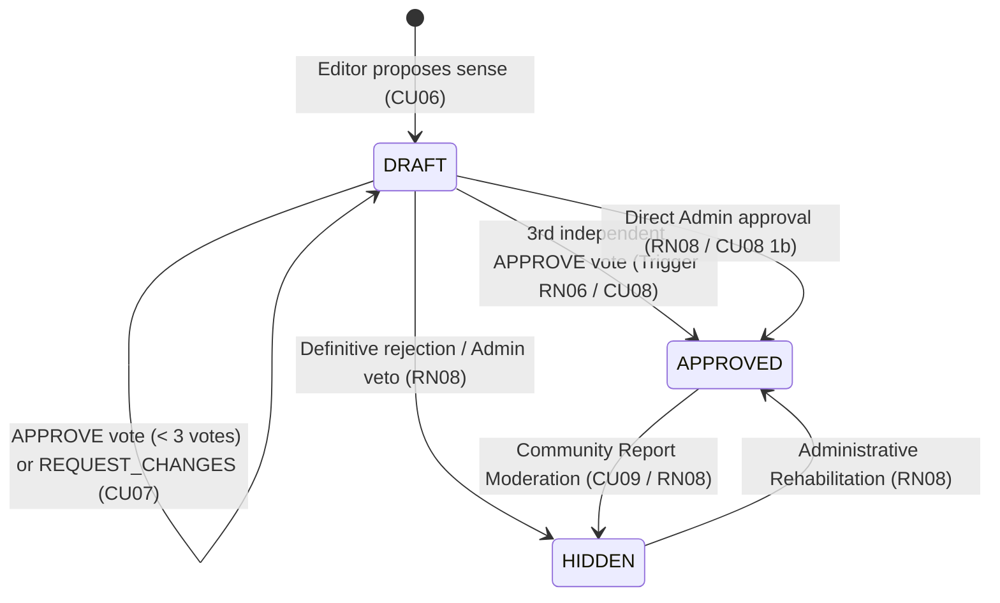

# 🏛️ Palabrario Domain Model (`DOMAIN.md`)

> **Canonical Architectural Document — Domain-Driven Design (DDD)**  
> **Project:** Palabrario — Gamified Learning and Preservation Platform for Pan-Hispanic Dialectal Lexicon  
> **Architectural Approach:** Service-Oriented Modular Monolith (Internal SOA) with Specialized Satellite Services  
> **Canonical Persistence:** PostgreSQL 17 ([`SCHEMA_FINAL.sql`](../SCHEMA_FINAL.sql))

---

## 1. Philosophy and Vision of the Problem Domain

Spanish is a polycentric language spoken by more than 500 million people across more than 20 countries. In the **Palabrario** domain, a word **is never a simple static key-value**: the same lexical form (*lemma*) changes radically in meaning, sociolinguistic register, frequency, and cultural weight depending on geography (*e.g., "guagua" as public transit in the Caribbean versus an infant in arms in the Andean region, or "coger" as an everyday verb in Spain versus a sexual taboo in Mexico and the Río de la Plata*).

To resolve the fragmentation between solemn academic dictionaries and flashcard apps devoid of cultural context, the Palabrario domain articulates five **Bounded Contexts** operating in a continuous cycle:

$$\text{Identity and Governance} \longrightarrow \text{Lexicography and Curation} \longrightarrow \text{Personal Studio} \longrightarrow \text{SM-2 Mastery and Gamification} \longrightarrow \text{Multiplayer Arena}$$

---

## 2. Bounded Context Map and Entity-Relationship Diagram

```mermaid
erDiagram
    ACCOUNTS ||--|| USERS : "1:1 Identity/Profile"
    USERS ||--o{ EDITOR_REQUESTS : "requests promotion (CU02)"
    USERS ||--o{ INVITATION_TICKETS : "issues (CU04)"
    INVITATION_TICKETS ||--o{ TICKET_REDEMPTIONS : "redeems"
    USERS ||--o{ TICKET_REDEMPTIONS : "consumes"

    REGIONS ||--o{ WORDS : "endemic origin"
    REGIONS ||--o{ SENSES : "contextualizes dialect"
    WORDS ||--|{ SENSES : "groups senses"
    SENSES ||--o{ EXAMPLES : "exemplifies in context"
    USERS ||--o{ SENSES : "proposes (id_editor)"
    USERS ||--o{ EXAMPLES : "drafts (id_editor)"

    SEMANTIC_CONCEPTS ||--|{ CONCEPT_MAPPINGS : "unifies meaning"
    SENSES ||--o{ CONCEPT_MAPPINGS : "regional heteronym"

    SENSES ||--o{ SENSE_APPROVALS : "evaluated in quorum (CU07)"
    USERS ||--o{ SENSE_APPROVALS : "rules upon (RN06/RN07)"
    USERS ||--o{ CONTENT_REPORTS : "reports/moderates (CU09)"
    SENSES ||--o{ CONTENT_REPORTS : "report target"

    USERS ||--o{ DECKS : "owner (RN03)"
    DECKS ||--o{ DECK_ITEMS : "contains flashcards"
    SENSES ||--o{ DECK_ITEMS : "studied sense"
    USERS ||--o{ SAVED_DECKS : "saves to Studio"
    DECKS ||--o{ SAVED_DECKS : "referenced"

    USERS ||--o{ COLLECTIONS : "owner (RN03)"
    COLLECTIONS ||--o{ COLLECTION_DECKS : "organizes learning path"
    DECKS ||--o{ COLLECTION_DECKS : "integrates into collection"
    USERS ||--o{ SAVED_COLLECTIONS : "saves to Studio (CU11)"
    COLLECTIONS ||--o{ SAVED_COLLECTIONS : "referenced"

    USERS ||--o{ USER_MASTERY : "SM-2 forgetting curve (CU12)"
    SENSES ||--o{ USER_MASTERY : "mastery per sense"
    SENSES ||--o{ QUESTIONS : "evaluates prompt"
    USERS ||--o{ QUIZ_ATTEMPTS : "records attempt"

    USERS ||--o{ XP_TRANSACTIONS : "auditable ledger (RN11)"
    ACHIEVEMENTS ||--o{ USER_ACHIEVEMENTS : "grants badge"
    USERS ||--o{ USER_ACHIEVEMENTS : "unlocks"

    DECKS ||--o{ MATCHES : "match pool (CU14)"
    MATCHES ||--|{ MATCH_ROUNDS : "structures 3NF rounds (CU14)"
    MATCHES ||--|{ MATCH_PARTICIPANTS : "consolidates podium (CU16)"
    USERS ||--o{ MATCH_PARTICIPANTS : "competes (CU15)"
    MATCH_ROUNDS ||--o{ QUIZ_ATTEMPTS : "round replay breakdown (CU16)"
```

---

## 3. Comprehensive Entity Catalog by Domain Context

### 3.1. Context 1: Identity, Accounts, and Institutional Governance (`Account & Governance`)
Manages cryptographic security, role-based access control (**RBAC**), user dialectal identity, and institutional community growth mechanisms (**CU01, CU02, CU03, CU04**).

#### 1. `Account` (Table: `accounts`)
Represents the authenticated identity and security credential in the system. It is deliberately separated from `User` to isolate cryptographic secrets (`password_hash`) and permissions (`role`) from social and gamification data.
* **Identifier:** `id_account` (`UUID`, PK).
* **Key Attributes:**
  * `email` (`VARCHAR(255)`, unique): Lowercase normalized email address.
  * `password_hash` (`TEXT`): Hash derived with `bcrypt` (cost $\ge 10$). Never exposed in outgoing DTOs.
  * `role` (`account_role`: `LEARNER | EDITOR | ADMIN`): RBAC privilege level. All standard registrations start as `LEARNER`.
  * `is_active` (`BOOLEAN`): Account operational status for administrative suspension.
* **Invariants and Rules:** Only the account holder may modify their credentials (**RN01**), and only an `ADMIN` can alter an account's `role` or prevent the demotion of the last active administrator (**CU03**).

#### 2. `User` / `UserProfile` (Table: `users`)
Represents the member's public/private profile, their linguistic anchor point, and the consolidated state of their gamified progression.
* **Identifier:** `id_user` (`UUID`, PK and $1:1$ FK to `accounts.id_account` with `ON DELETE CASCADE`).
* **Key Attributes:**
  * `name` (`VARCHAR(100)`): Member display name.
  * `user_name` (`VARCHAR(50)`, unique): Public handle (`@username`) for social profiles (`/u/:username`).
  * `avatar_url` (`TEXT`, optional): URL to WebP image optimized by `image-service` (**RN12**).
  * `anchor_dialect` (`VARCHAR(10)`, default `'MX'`): User's **Anchor Dialect**. This is a core domain concept: FTS search and lexical cards prioritize senses and cultural contrasts relative to the student's anchor dialect.
  * `total_xp` (`INTEGER`), `current_level` (`INTEGER`): Cached experience balance (synchronized with the `xp_transactions` ledger) and calculated level.
  * `current_streak` (`INTEGER`), `longest_streak` (`INTEGER`), `last_activity_at` (`TIMESTAMPTZ`): Study consistency metrics (**CU01, CU13**).

#### 3. `EditorRequest` (Table: `editor_requests`)
Formalizes the application record of a `LEARNER` requesting promotion to the `EDITOR` role by demonstrating their teaching, philological, or linguistic background (**CU02, CU03**).
* **Identifier:** `id_request` (`UUID`, PK).
* **Key Attributes:**
  * `id_user` (`UUID`, FK $\to$ `users`): Applying learner.
  * `institution_name` (`VARCHAR(150)`): Affiliated university, academy, or institution.
  * `justification` (`TEXT`): Statement of pedagogical/linguistic intent.
  * `credentials_url` (`TEXT`): Documentary evidence or academic verification link (**RN12**).
  * `status` (`request_status`: `PENDING | APPROVED | REJECTED`).
  * `reviewed_by` (`UUID`, FK $\to$ `users`), `review_notes` (`TEXT`), `resolved_at` (`TIMESTAMPTZ`): Administrative resolution audit trail.
* **Invariants and Rules:** **RN02 (Request Uniqueness):** A learner can only have **one** request in `PENDING` status simultaneously, enforced at the database engine level via the partial unique index `idx_unique_pending_editor_request`.

#### 4. `InvitationTicket` and `TicketRedemption` (Tables: `invitation_tickets`, `ticket_redemptions`)
Materialize the institutional access model without payment gateways (**CU04**). They allow administrators to issue single-use (individual) or multi-use (for academies or school cohorts) alphanumeric tickets, optionally granting a predetermined role.
* **Identifier:** `id_ticket` (`UUID`, PK) and `code` (`VARCHAR(50)`, unique).
* **Key Attributes:**
  * `created_by` (`UUID`, FK $\to$ `users`): Issuing administrator.
  * `granted_role` (`account_role`, default `'LEARNER'`): Role assigned upon ticket redemption.
  * `institution_name` (`VARCHAR(150)`): Institutional partnership label.
  * `max_uses` (`INTEGER`), `current_uses` (`INTEGER`): Capacity control with `CHECK (current_uses <= max_uses)` constraint.
  * `is_active` (`BOOLEAN`), `expires_at` (`TIMESTAMPTZ`): Logical and temporal validity.
* **Invariants and Rules:** **RN08:** Only an `ADMIN` may issue or revoke tickets. Each redemption transactionally increments `current_uses` and logs an entry in `ticket_redemptions (id_ticket, id_user)`.

---

### 3.2. Context 2: Pan-Hispanic Lexicographical Core and Heteronymy (`Lexicon & Dialectology`)
This is the linguistic heart of Palabrario (**CU05, CU06**). It models regional polysemy, speech register, taboo weight, and transdialectal equivalences.

#### 5. `Region` (Table: `regions`)
Represents a Spanish-speaking country or recognized dialectal macro-zone (`MX`, `ES`, `AR`, `CO`, `CL`, `CU`, `CAM`, `PAN`).
* **Identifier:** `id_region` (`UUID`, PK) and natural key `code` (`VARCHAR(10)`, unique).
* **Key Attributes:** `name` (`VARCHAR(100)`), `parent_zone` (`Norteamérica`, `Rioplatense`, `Andina`, `Caribe`, `Peninsular`, `General`), `country_code` (`ISO-3166-1 alpha-2`), `flag_emoji` (`VARCHAR(10)`).

#### 6. `Word` (Table: `words`)
Represents the **Canonical Lemma** (singular noun, infinitive verb, or set phrase). Acts as the Aggregate Root for a word's senses.
* **Identifier:** `id_word` (`SERIAL / INT`, PK).
* **Key Attributes:**
  * `lemma` (`VARCHAR(100)`): Canonical orthographic form with accents and diacritics (e.g., `"apapachar"`, `"tianguis"`).
  * `normalized_lemma` (`VARCHAR(100)`): Unaccented lowercase lemma, indexed with `pg_trgm` (`gin_trgm_ops`) and `varchar_pattern_ops` for instant autocomplete and typo tolerance (**RF06**).
  * `part_of_speech` (`VARCHAR(50)`): Part of speech (`sustantivo`, `verbo`, `adjetivo`, `modismo`).
  * `gender` (`word_gender`: `MALE | FEMALE | NEUTRAL | AMBIGUOUS`).
  * `etymology` (`TEXT`): Historical or indigenous root (Nahuatl, Quechua, Maya, Latin, Lunfardo, etc.).
  * `friendly_blurb` (`TEXT`): **Engaging Cultural Blurb**. Brief narrative written with humor and wit explaining the soul of the word and its contrasts across Spanish-speaking countries.
  * `image_url` (`TEXT`, optional): URL to conceptual or representative image generated and sanitized by `image-service` (**RN12**).
  * `id_origin_region` (`UUID`, optional FK $\to$ `regions`): Identifies the region if the term is endemic to a specific region; if `NULL` or `PAN`, it belongs to general Spanish.
  * `search_vector` (`tsvector` generated and stored): Weights `lemma` with weight `'A'` and `friendly_blurb` with weight `'B'` under the `spanish_unaccent` configuration.

#### 7. `Sense` (Table: `senses`)
Represents a specific **Dialectal Sense or Meaning** of a `Word` in a given `Region`. All study mechanics (`DeckItem`, `UserMastery`, `Question`) point to `Sense` and **not** to `Word`, because the learner studies a concrete meaning within a specific regional context.
* **Identifier:** `id_sense` (`SERIAL / INT`, PK).
* **Key Attributes:**
  * `id_word` (`INT`, FK $\to$ `words`), `id_region` (`UUID`, FK $\to$ `regions`), `id_editor` (`UUID`, FK $\to$ `users`, proposal author).
  * `short_definition` (`VARCHAR(255)`): Concise gloss for the Master-Detail search view and trivia options.
  * `definition` (`TEXT`): Full formal lexicographical definition.
  * `is_primary` (`BOOLEAN`): Indicates whether it is the primary sense of the lemma to prioritize it in searches and trivias.
  * `is_taboo_or_vulgar` (`BOOLEAN`) and `cultural_note` (`TEXT`): Essential pragmatic warning for interdialectal false friends (e.g., `"coger"` in Mexico/Argentina vs Spain).
  * `image_url` (`TEXT`, optional): URL to image specific to the concrete dialectal sense processed by `image-service` (**RN12**).
  * `cefr_level` (`cefr_level`: `A1 | A2 | B1 | B2 | C1 | C2 | NATIVO`) and `usage_frequency` (`EVERYDAY | COMMON | RARE | SLANG | ARCHAIC`).
  * `state` (`review_state`: `DRAFT | APPROVED | HIDDEN`): Editorial lifecycle. Only senses in `APPROVED` state are visible in public dictionary queries (**CU05, CU08**).
  * `sense_search_vector` (`tsvector` generated): Indexes `short_definition` (`A`), `definition` (`B`), and `cultural_note` (`C`).

#### 8. `Example` (Table: `examples`)
Real-world contextual sentence (literary, journalistic, or colloquial) illustrating the pragmatic usage of a `Sense`, serving as input for sentence-completion prompts (`SENTENCE_COMPLETION`).
* **Identifier:** `id_example` (`SERIAL / INT`, PK).
* **Key Attributes:** `id_sense` (`INT`, FK $\to$ `senses`), `id_editor` (`UUID`, FK $\to$ `users`), `sentence` (`TEXT`), `source` (`VARCHAR(255)`).

#### 9. `SemanticConcept` and `ConceptMapping` (Tables: `semantic_concepts`, `concept_mappings`)
Model the phenomenon of **Transdialectal Heteronymy** (*"How do they say it over there?"*).
* **Problem Solved:** Directly associating synonyms word-to-word ($N \times N$) would yield an unmanageable and ambiguous graph whenever a word is polysemous (such as *guagua* = bus and *guagua* = baby).
* **Solution:** `SemanticConcept` defines an unambiguous universal concept (`concept_key = 'public_bus'` vs `concept_key = 'infant_baby'`), and `ConceptMapping` links each specific regional `id_sense` to that concept. Thus, when looking up *guagua* in its Cuban sense (`id_sense = 103`), the system automatically discovers its heteronyms for `public_bus` (*camión*, *colectivo*, *micro*) without conflating them with those for `infant_baby`.

---

### 3.3. Context 3: Collaborative Quorum Curation and Moderation (`Editorial Governance`)
Ensures academic rigor without sacrificing community agility (**CU06, CU07, CU08, CU09**).

#### 10. `SenseApproval` (Table: `sense_approvals`)
Represents the philological ruling issued by a reviewing `EDITOR` on a `Sense` in `DRAFT` state (**CU07**).
* **Composite Identifier:** `(id_sense, id_editor)` — ensures that an editor casts only one countable vote per sense.
* **Key Attributes:**
  * `decision` (`review_decision`: `APPROVE | REQUEST_CHANGES | REJECT`).
  * `feedback_notes` (`TEXT`, optional): Pedagogical feedback when requesting revisions from the author (**CU07 Alternate Flow 4a**).
  * `approved_at` (`TIMESTAMPTZ`).
* **Database Integrity Rules (PL/pgSQL Triggers):**
  * **RN07 (`trg_prevent_self_approval`):** Raises an atomic exception if `NEW.id_editor == senses.id_editor`. No author may vote on their own proposal.
  * **RN06 (`trg_auto_approve_sense`):** Upon accumulating $\ge 3$ records with `decision = 'APPROVE'` for the same `id_sense`, automatically promotes `senses.state = 'APPROVED'` (**CU08**), validating both the textual definition and the suitability of the associated image (**RN12**).

#### 11. `ContentReport` (Table: `content_reports`)
Channels community oversight where any `Member` or `Learner` reports lexicographical errors, missing taboo tags (`OFFENSIVE_UNMARKED`), or vandalism on a lemma, sense, or example, and the `Administrator` rules on its resolution (**CU09**).
* **Identifier:** `id_report` (`UUID`, PK).
* **Key Attributes:** `id_reporter` (`UUID`), `target_type` (`WORD | SENSE | EXAMPLE`), optional FKs (`id_word`, `id_sense`, `id_example`), `reason` (`report_reason`), `details` (`TEXT`), `status` (`PENDING | RESOLVED_HIDDEN | RESOLVED_AMENDED | DISMISSED`), `resolved_by` (`UUID`), `resolution_notes` (`TEXT`).

---

### 3.4. Context 4: Personal Studio, Spaced Repetition (SM-2), and Gamification (`Studio & Mastery`)
Transforms passive dictionary lookups into active long-term retention (**CU10, CU11, CU12, CU13**).

#### 12. `Deck`, `DeckItem`, and `SavedDeck` (Tables: `decks`, `deck_items`, `saved_decks`)
A **Deck (`Deck`)** is an ordered list of lexical senses (`DeckItem`) ready to be reviewed with SM-2 flashcards or played in the Arena.
* **Ownership vs. Subscription:**
  * `decks.id_user` defines the creator-owner, who is solely authorized to edit its metadata or composition (**RN03**), except for decks marked as `is_official = true`, which can be curated by Editors and Administrators (**RN05**).
  * `saved_decks (id_user, id_deck)` allows other members to save public community decks (`is_public = true`, **RN04**) to their Studio without cloning rows unnecessarily.

#### 13. `Collection`, `CollectionDeck`, and `SavedCollection` (Tables: `collections`, `collection_decks`, `saved_collections`)
A **Collection (`Collection`)** groups multiple decks in pedagogical order (`CollectionDeck.sort_order`), forming a thematic learning path (*e.g., "Mexican Gastronomy Path"*).
* **Key Attributes:** `title`, `description`, `is_public` (**RN04**), `is_featured` (featured on home page), `is_official` (**RN05**).
* `saved_collections (id_user, id_collection)` materializes alternate flow **CU11 1a** (*Save community collection to personal Studio*).

#### 14. `UserMastery` (Table: `user_mastery`)
Models the user's long-term memory state for a specific sense using the **SuperMemo SM-2** algorithm (**CU12, CU13, RN09**).
* **Composite Identifier:** `(id_user, id_sense)`.
* **Attributes and SM-2 Mathematics:**
  * Recall rating $q \in \{1, 2, 3, 4\}$ in the UI (mapped to the SM-2 scale):
    * If the response is **incorrect** ($q < 3$): `consecutive_correct` resets to `0`, `current_interval_days` returns to `1`, and `progress_stage` transitions to `LEARNING`.
    * If the response is **correct** ($q \ge 3$): `consecutive_correct` increments by `1`; the interval is computed as $I(1) = 1$, $I(2) = 6$, and for $n > 2$: $I(n) = \lceil I(n-1) \times EF \rceil$.
    * The easiness factor (`easiness_factor`, initial `2.5`, minimum `1.3`) is adjusted according to:
      $$EF' = \max\left(1.3,\; EF + \left(0.1 - (5 - q) \cdot (0.08 + (5 - q) \cdot 0.02)\right)\right)$$
  * **Stage Transitions (`progress_stage`):**
    * `NEW`: Never reviewed (`times_reviewed = 0`).
    * `LEARNING`: In initial acquisition (`consecutive_correct` between `0` and `2`, or interval $< 6$ days).
    * `REVIEWING`: In consolidation (`consecutive_correct` $\ge 3$ and interval between $6$ and $20$ days).
    * `MASTERED`: Mastered long-term (`consecutive_correct` $\ge 5$ and interval $\ge 21$ days).

#### 15. `XPTransaction`, `Achievement`, and `UserAchievement` (Tables: `xp_transactions`, `achievements`, `user_achievements`)
Implement the auditable progression economy (**RN11**).
* **`XPTransaction`:** **Immutable** (*ledger*) (`INSERT`-only). Each point gain (`amount_xp`) records its cause (`QUIZ_CORRECT`, `MATCH_WIN`, `DAILY_STREAK`, `DECK_COMPLETED`, `ACHIEVEMENT_UNLOCKED`) and `metadata_id`. The balance `users.total_xp` is the materialized projection of this ledger, enabling reconstruction and auditing in case of any anomaly (**CU13 2a**).
* **`Achievement` and `UserAchievement`:** Badge catalog by rarity (`BRONZE`, `SILVER`, `GOLD`, `PLATINUM`, `DIAMOND`) and category (`STREAK`, `COMPETITION`, `MASTERY`, `DIALECT_EXPLORER`).

---

### 3.5. Context 5: Curricular Assessment, Real-Time Multiplayer Arena, and 3NF Replay (`Quiz & Realtime Arena`)
Decouples low-latency synchronous competition in RAM from batch relational persistence (**CU14, CU15, CU16, RN10, RN13, RNF-CON-02**), ensuring granular round-by-round traceability (*Replay*) in Third Normal Form (3NF).

#### 16. `Question`, `MatchRound`, and `QuizAttempt` (Tables: `questions`, `match_rounds`, `quiz_attempts`)
* **`Question`:** Curricular prompt curated by an `EDITOR` for a `Sense`, featuring 6 pedagogical modalities (`DEFINITION_TO_WORD`, `WORD_TO_DEFINITION`, `SENTENCE_COMPLETION`, `REGIONAL_EQUIVALENT`, `TONE_OR_REGISTER`, `WORD_TO_IMAGE`), 3 distractors in JSONB (`custom_distractors`), and educational feedback (`explanation`). If a sense in a deck does not yet have a handcrafted question, the engine dynamically generates a prompt by pulling definitions or images from other distinct senses in the same deck.
* **`MatchRound` (Table `match_rounds` in 3NF):** Stores each round generated when preparing a match in a 100% relational manner (without corruptible JSON blobs): (`id_match`, `round_number`, `id_sense`, `id_question`, `modality`, `prompt`, `option_a`, `option_b`, `option_c`, `option_d`, `correct_option`, `explanation`). Ensures a bijective $1\text{ Round} = 1\text{ Unique Sense}$ relationship within the match. In the `WORD_TO_IMAGE` modality, options (`option_a` through `option_d`) and `correct_option` store the URLs of the 4 competing images.
* **`QuizAttempt` (Table `quiz_attempts`):** Records both individual practice attempts and the **granular round-by-round breakdown of each competitor in the Arena** (`id_match`, `round_number`, `id_user`, `id_sense`, `selected_option`, `is_correct`, `time_spent_ms`, `points_earned`), with a composite foreign key referencing `match_rounds(id_match, round_number)` and a `UNIQUE (id_match, round_number, id_user)` constraint. This enables full round-by-round retrospection (*Match Replay*).

#### 17. `Match` and `MatchParticipant` (Tables: `matches`, `match_participants`)
Represent the lifecycle, room operating rules, and consolidated outcome of a multiplayer match in the Arena (**CU14, CU15, CU16**).
* **Arena Domain Rules and Invariants:**
  1. **Deck Limits and Room Opening (`CU14`):**
     * **Absolute floor of 8 senses:** The selected deck (`id_deck`) must have at least **8 senses in `APPROVED` state**; otherwise, the system rejects room opening with `422 Unprocessable Entity` (`ErrUnprocessable`).
     * **Zero repeated questions (`TotalRounds <= ApprovedSenses`):** The number of rounds (`total_rounds`, range `8..20`, default `8`) cannot exceed the quantity of approved senses available in the deck.
     * **Quorum of Visual Distractors (`RN13`):** To generate a `WORD_TO_IMAGE` round, the deck must contain at least 4 unique visual assets (`image_url IS NOT NULL`); if not met, that round automatically degrades to textual modality (`WORD_TO_DEFINITION`).
     * **Initial 3NF persistence:** A record is inserted into `matches` (`WAITING`) with a `room_code` (unique 6-character alphanumeric PIN) and its $N$ rows are immediately inserted into `match_rounds`.
  2. **Room Topology, Host Role, and Automatic Succession (`CU15` / `RNF-CON-02`):**
     * **Maximum capacity:** Up to **8 simultaneous participants** per room (`MaxParticipants = 8`).
     * **Host privileges:** The user who prepares the room is the initial `Host` (`IsHost = true`) and holds the exclusive authority to trigger `START_MATCH` in `WAITING` state. During `IN_PROGRESS`, they compete on completely equal terms (**RN10**).
     * **Reconnection window (`RNF-CON-02`):** In the event of a WebSocket drop, the participant retains their spot, score (`Score`), and timings in RAM for **10 seconds** (`IsReady = false` while disconnected). If they reconnect within 10s, they resume their session without data loss.
     * **Host succession by seniority:** If the `Host` disconnects in `WAITING` state and does not return after the 10-second grace window expires, the `IsHost = true` role is automatically transferred to the **next earliest connected participant** (lowest `JoinedAt`), broadcasting `ROOM_STATE`. If no connected players remain, the room is destroyed in RAM.
  3. **Speed Scoring (`RN10`) and Deterministic Tie-Breaker (`total_time_spent_ms`):**
     * Response time is measured exclusively using the server monotonic clock (`elapsedMs`), awarding between `500` and `1000` points per correct answer based on speed, or `0` on incorrect answer/timeout.
     * In each round, `total_time_spent_ms` accumulates per participant (adding `round_time_sec * 1000` if no answer was submitted before timeout).
     * **Canonical Podium Ordering (Tie-Breaker):** When computing `final_rank` (`1, 2, 3...`) and declaring `winner_user_id`, participants are ranked by:
       $$\text{Score DESC} \;\longrightarrow\; \text{CorrectAnswers DESC} \;\longrightarrow\; \text{TotalTimeSpentMs ASC}$$
  4. **Transactional Consolidation with S2S Security (`CU16`):**
     * Upon concluding the final round (`FINISHED`), `realtime-service` invokes `core-service` authenticated via an **Internal Service-to-Service (S2S) JWT** signed with a derived cryptographic subkey (`HMAC-SHA256`), impossible to forge with client tokens.
     * In a single ACID *Batch Flush* (`pgx.Tx`), `core-service` closes `matches`, inserts `match_participants`, persists the round-by-round breakdown in `quiz_attempts` for *Replay*, records rewards in `xp_transactions` (**RN11**: `+150`, `+100`, `+75`, `+40 XP`), and updates `user_mastery` (**RN09**: `qualityRating = 3` for correct senses and `1` for incorrect senses).
