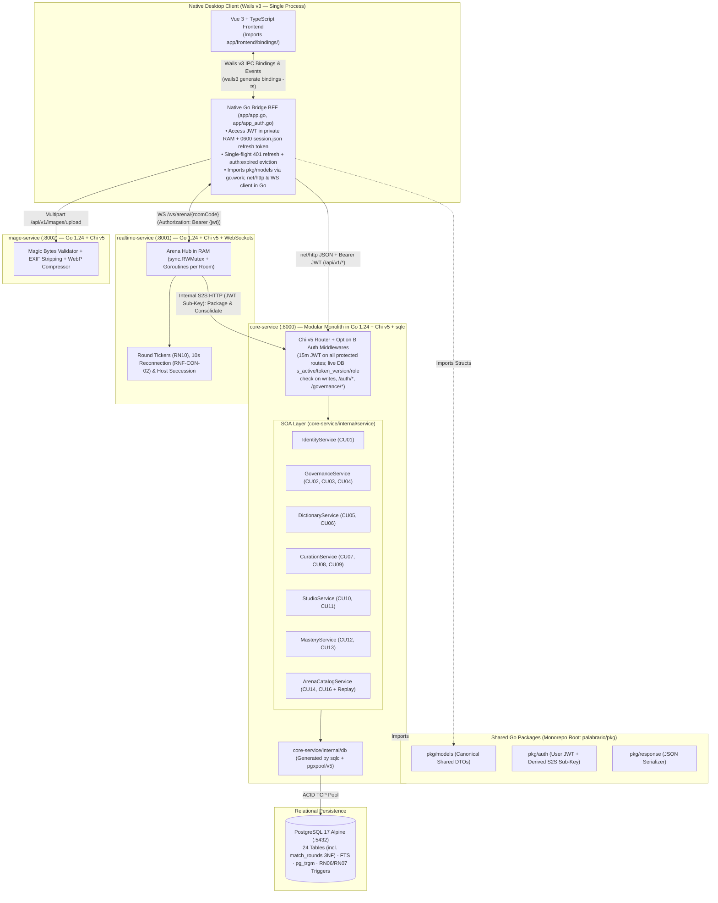

# Palabrario Domain Model — Service Dispatcher (`DOMAIN.md`)

> **Canonical Architectural Document — Domain-Driven Design (DDD)**  
> **Project:** Palabrario — Gamified Learning and Preservation Platform for Pan-Hispanic Dialectal Lexicon  
> **Architectural Approach:** Service-Oriented Modular Monolith (Internal SOA) with Specialized Satellite Services  
> **Canonical Persistence:** PostgreSQL 17 ([`SCHEMA_FINAL.sql`](../SCHEMA_FINAL.sql))
> **Canonical Architectural Document — Single Source of Truth for Backend and Frontend Contracts**  
> **Unified Backend Stack (100% Go):** Go 1.24 + Chi v5 + `sqlc` + `pgxpool/v5` + `golang-jwt/jwt/v5` on PostgreSQL 17 Alpine  
> **Architectural Pattern:** Service-Oriented Modular Monolith (`core-service :8000`) + Satellite Services in Go (`realtime-service :8001`, `image-service :8002`)  
> **Structure:** this file is the **root service dispatcher**. Domain rules and technical contracts are modularized into eight self-contained `*_service.md` files in this directory. Read this file first, then open only the service file(s) a ticket touches.

---

## 1. Philosophy and Vision of the Problem Domain

Spanish is a polycentric language spoken by more than 500 million people across more than 20 countries. In the **Palabrario** domain, a word **is never a simple static key-value**: the same lexical form (*lemma*) changes radically in meaning, sociolinguistic register, frequency, and cultural weight depending on geography (*e.g., "guagua" as public transit in the Caribbean versus an infant in arms in the Andean region, or "coger" as an everyday verb in Spain versus a sexual taboo in Mexico and the Río de la Plata*).

To resolve the fragmentation between solemn academic dictionaries and flashcard apps devoid of cultural context, the Palabrario domain articulates five **Bounded Contexts** operating in a continuous cycle:

$$\text{Identity and Governance} \longrightarrow \text{Lexicography and Curation} \longrightarrow \text{Personal Studio} \longrightarrow \text{SM-2 Mastery and Gamification} \longrightarrow \text{Multiplayer Arena}$$

---

## 2. Service Dispatcher

Open the service file that matches your route or use case. Each file contains both its **domain entities and business rules** (Part A) and its **technical contracts**: DTOs, SOA interface, `sqlc` queries, and HTTP/WS endpoints (Part B). Routes still under construction are marked `TBD`; the live route status is in [`ROUTES.md`](ROUTES.md).

| Route / Context | Service File | Domain & Service | Key Responsibilities & Use Cases |
| :--- | :--- | :--- | :--- |
| `/auth/sign-in`, `/auth/sign-up` | [`services/identity_service.md`](services/identity_service.md) | `IdentityService` | Accounts, profiles, passwords, `RN01` Anchor Dialect (`CU01`) |
| `TBD` | [`services/governance_service.md`](services/governance_service.md) | `GovernanceService` | Roles, promotion, invitation tickets, admin directory (`CU02–CU04`) |
| `/dictionary` | [`services/dictionary_service.md`](services/dictionary_service.md) | `DictionaryService` | Lemmas, senses, FTS search, Word of the Day, heteronyms (`CU05, CU06`) |
| `TBD` | [`services/curation_service.md`](services/curation_service.md) | `CurationService` | Quorum review (`RN06–RN08`), proposals, community reports (`CU07–CU09`) |
| `TBD` | [`services/studio_service.md`](services/studio_service.md) | `StudioService` | Decks & collections catalog, studio management, privacy (`CU10, CU11`) |
| `TBD` | [`services/mastery_service.md`](services/mastery_service.md) | `MasteryService` | Spaced repetition SM-2 engine (`RN09`), immutable XP ledger (`RN11`) (`CU12, CU13`) |
| `TBD` | [`services/arena_service.md`](services/arena_service.md) | `ArenaCatalogService` + `realtime-service` | Real-time WebSocket hub, rounds, speed scoring, 3NF replay (`CU14–CU16`) |
| `TBD` *(Media uploads)* | [`services/media_service.md`](services/media_service.md) | `image-service` | EXIF sanitization, magic bytes, WebP, NSFW filter (`RN12`) |

### 2.1. Business Rule Index (`RN01–RN13`)

| Rule | Topic | Primary service file |
| :--- | :--- | :--- |
| `RN01` | Only the account holder may modify their credentials / profile | [`services/identity_service.md`](services/identity_service.md) |
| `RN02` | One `PENDING` Editor request per learner | [`services/governance_service.md`](services/governance_service.md) |
| `RN03` | Ownership of decks and collections | [`services/studio_service.md`](services/studio_service.md) |
| `RN04` | Resource privacy (public / private) | [`services/studio_service.md`](services/studio_service.md) |
| `RN05` | Official / featured content restricted to Editors and Admins | [`services/studio_service.md`](services/studio_service.md) |
| `RN06` | Quorum of 3 independent `APPROVE` votes auto-approves a sense | [`services/curation_service.md`](services/curation_service.md) |
| `RN07` | No self-approval of own proposals | [`services/curation_service.md`](services/curation_service.md) |
| `RN08` | Admin-only privileges (tickets, override, moderation, rehabilitation); also referenced in [`services/governance_service.md`](services/governance_service.md) and [`services/dictionary_service.md`](services/dictionary_service.md) | [`services/curation_service.md`](services/curation_service.md) |
| `RN09` | SuperMemo SM-2 spaced repetition (also applied on Arena consolidation) | [`services/mastery_service.md`](services/mastery_service.md) |
| `RN10` | Server monotonic clock speed scoring and tie-breaker | [`services/arena_service.md`](services/arena_service.md) |
| `RN11` | Immutable XP ledger (also awards Arena rewards) | [`services/mastery_service.md`](services/mastery_service.md) |
| `RN12` | Image sanitization and NSFW filter | [`services/media_service.md`](services/media_service.md) |
| `RN13` | Quorum of 4 visual distractors for `WORD_TO_IMAGE` rounds | [`services/arena_service.md`](services/arena_service.md) |

> **Bounded-context map:** the former monolithic Entity-Relationship diagram is now split into per-service fragments inside each file's *Entity-Relationship Fragment* section (Part A).

---

## 3. Global Contract-First Rules (Cross-Cutting): Anti-Hallucination Operational Rules for AI Agents (Contract-First)

> [!CAUTION]
> **MANDATORY GOLDEN RULE FOR ALL AI MODELS:**
> 1. **Inventing JSON fields is prohibited:** No HTTP endpoint, WebSocket event, or interface component (`app`) may emit or consume properties that are not explicitly declared in the Go structs and JSON contracts of this document.
> 2. **Strict `snake_case` convention:** All JSON payloads (input and output) use `snake_case` identical to the `json:"..."` tags in [`pkg/models/`](../pkg/models).
> 3. **Mandatory Typed SQL (`sqlc`):** In `core-service`, concatenating raw SQL in handlers is prohibited. Every new query is defined in `sql/queries/*.sql`, compiled with `sqlc generate` into `core-service/internal/db/`, consumed by an implementation in `core-service/internal/service/`, and exposed by a handler in `core-service/internal/api/handlers/`.
> 4. **Single HTTP Error Format:** Every error response (`4xx` / `5xx`) uses [`response.ErrorWithCode(w, status, code, message)`](../pkg/response/json.go) (or `response.Error(w, status, message)` where `code` is omitted):
>    ```json
>    {
>      "code": "MACHINE_READABLE_CODE",
>      "error": "Clear and human-readable description of the error in English"
>    }
>    ```

---

## 4. Shared SOA Architecture (Cross-Cutting): Service-Oriented Architecture (SOA) and Native Wails IPC Bridge in a 100% Go Monorepo

The entire Go ecosystem is connected via [`go.work`](../go.work) (`.` + `./app`) and the root module [`palabrario` (`go.mod`)](../go.mod):
1. **Backend Services (`core-service`, `realtime-service`, `image-service`):** Directly import shared packages [`pkg/models`](../pkg/models), [`pkg/auth`](../pkg/auth), and [`pkg/response`](../pkg/response).
2. **Native IPC Bridge in Desktop Client ([`app/app.go`](../app/app.go), [`app/app_auth.go`](../app/app_auth.go)):**
   - **The WebView (Vue 3 / TypeScript) never executes direct HTTP/WS calls or touches the JWT/refresh tokens.**
   - The Wails Go process (`struct App` in `app/app.go`) acts as a **local BFF (*Backend-For-Frontend*) with dual-token custody**: the short-lived access JWT (`accessToken`) lives exclusively in private Go RAM (`sync.RWMutex`, immune to XSS), while the opaque `refreshToken` is persisted atomically on the host filesystem at `os.UserConfigDir()/palabrario/session.json` (`0700` directory / `0600` file permissions) for restart recovery.
   - `app/app.go` imports the same structs from [`pkg/models`](../pkg/models), executes `net/http` and WebSocket requests to `:8000`, `:8001`, and `:8002` attaching `Authorization: Bearer <accessToken>`, performs single-flight auto-refresh (`refreshMu sync.Mutex` -> `POST /api/v1/auth/refresh`) on `401 Unauthorized` with a single retry, and clears RAM + deletes `session.json` + emits the Wails `"auth:expired"` event on `403 ACCOUNT_SUSPENDED` or failed/exhausted refresh.
   - When running `wails3 task bindings` (`wails3 generate bindings -clean=true -ts`), **Wails v3 automatically generates TypeScript bindings and types** in `app/frontend/bindings/palabrario/app/app.ts` and `app/frontend/bindings/palabrario/pkg/models/models.ts`. Thus, a change in `pkg/models` propagates its static typing from PostgreSQL (`sqlc`) all the way to Vue 3 without human intervention or risk of hallucination.



### 4.1. Target Directory Structure in `core-service`

```text
core-service/
├── main.go                              # Entrypoint, Fail-Fast env check, pgxpool init, graceful shutdown
├── Dockerfile                           # Multi-stage build from root (context: .)
└── internal/
    ├── config/
    │   └── config.go                    # Strict loading and validation of environment variables
    ├── db/                              # CODE AUTOGENERATED BY SQLC (DO NOT EDIT MANUALLY)
    │   ├── db.go
    │   ├── models.go
    │   ├── users.sql.go
    │   ├── dictionary.sql.go
    │   ├── curation.sql.go              # (Phase 3.3)
    │   ├── studio.sql.go                # (Phase 3.4)
    │   ├── mastery.sql.go               # (Phase 3.4)
    │   ├── governance.sql.go            # (Phase 3.5)
    │   └── arena.sql.go                 # (Phase 4)
    ├── service/                         # DOMAIN SOA CONTRACTS AND IMPLEMENTATIONS
    │   ├── errors.go                    # Typed domain errors (ErrNotFound, ErrForbidden, ErrConflict...)
    │   ├── identity_service.go          # IdentityService (CU01)
    │   ├── governance_service.go        # GovernanceService (CU02, CU03, CU04)
    │   ├── dictionary_service.go        # DictionaryService (CU05, CU06)
    │   ├── curation_service.go          # CurationService (CU07, CU08, CU09)
    │   ├── studio_service.go            # StudioService (CU10, CU11)
    │   ├── mastery_service.go           # MasteryService + Pure SM-2 Algorithm (CU12, CU13)
    │   └── arena_catalog_service.go     # ArenaCatalogService (CU14, CU16 + 3NF Replay)
    └── api/
        ├── router.go                    # Chi v5 routes and middlewares mounting
        ├── middleware/
        │   └── auth_middleware.go       # RequireAuth, OptionalAuth, RequireRole, RequireInternalService
        └── handlers/
            ├── health.go
            ├── auth_handler.go
            ├── user_handler.go          # (CU01)
            ├── governance_handler.go    # (CU02, CU03, CU04)
            ├── dictionary_handler.go    # (CU05, CU06)
            ├── curation_handler.go      # (CU07, CU08, CU09)
            ├── studio_handler.go        # (CU10, CU11)
            ├── mastery_handler.go       # (CU12, CU13)
            └── arena_handler.go         # (CU14, CU16)
```

### 4.2. Standard Domain Error to HTTP Status Code Mapping (`core-service/internal/service/errors.go`)

| Domain Error (`service.*`) | HTTP Status Code | Machine-Readable `code` Values | When Triggered |
| :--- | :---: | :--- | :--- |
| `ErrInvalidInput` / `ErrValidation` | `400 Bad Request` | `INVALID_INPUT`, `INPUT_TOO_LONG` (`22001`), `VALIDATION_ERROR` (`23514` / DTO validation), `INVALID_REFERENCE` (`23503`), `INVALID_JSON` | Required fields empty, invalid format/length, password outside `8..72` bytes, invalid dialect, malformed JSON, or DB length/check/FK violation. |
| `ErrUnauthorized` | `401 Unauthorized` | `UNAUTHORIZED`, `MISSING_TOKEN`, `INVALID_TOKEN_FORMAT`, `INVALID_TOKEN`, `TOKEN_EXPIRED`, `TOKEN_REVOKED`, `INVALID_CREDENTIALS` | Missing/malformed/expired/revoked JWT or refresh token, invalid signature, mismatched `token_version`, or incorrect login/current credentials. |
| `ErrForbidden` | `403 Forbidden` | `FORBIDDEN`, `ACCOUNT_SUSPENDED` | Insufficient live DB role (`RBAC`), suspended account (`is_active = false`), attempt to edit another user's resource (`RN01`, `RN03`), private deck (`RN04`), self-approval (`RN07`), or non-internal token on S2S endpoint. |
| `ErrNotFound` | `404 Not Found` | `NOT_FOUND` | Non-existent resource (`id_word`, `id_sense`, `id_deck`, `room_code`, `id_match`, `user_name`), suspended account queried via `/users/u/{username}`, or `HIDDEN`/`DRAFT` sense on a public route. |
| `ErrConflict` | `409 Conflict` | `CONFLICT`, `EMAIL_ALREADY_EXISTS` (`23505`), `USERNAME_ALREADY_EXISTS` (`23505`), `ALREADY_PRIVILEGED`, `REQUEST_ALREADY_RESOLVED`, `LAST_ADMIN_PROTECTED`, `TICKET_REVOKED`, `TICKET_EXPIRED`, `TICKET_EXHAUSTED`, `TICKET_ALREADY_REDEEMED` | Duplicate email/`user_name`, existing `PENDING` Editor request (`RN02`), duplicate vote, last active `ADMIN` protection, exhausted/expired/revoked ticket (`CU04`), or already consolidated match. |
| `ErrUnprocessable` | `422 Unprocessable Entity` | `UNPROCESSABLE_ENTITY` | Selected deck to open an Arena has fewer than 8 `APPROVED` senses or fewer approved senses than the requested number of rounds `total_rounds` (`CU14 1a`). |
