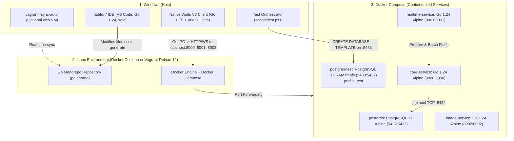

# Infrastructure and Deployment Documentation - Palabrario

This document describes the hybrid development and deployment architecture across **Windows (Host)**, **Vagrant (Linux VM)**, and **Docker Compose (Containers)**, designed to ensure maximum performance, minimal RAM consumption (`< 15 MiB` combined for the entire Go backend), dependency isolation, and static compilation.

---

## 1. 3-Tier Architecture (100% Go Monorepo)



---

## 2. Exposed Services and Ports

All ports are exposed to the local machine (`localhost`):

| Service | Technology / Runtime | Port | RAM Footprint (Docker) | Description |
| :--- | :--- | :---: | :---: | :--- |
| **`postgres`** | PostgreSQL 17 Alpine | `5432` | `~30 MiB` | Primary relational database (`unaccent`, `pg_trgm`, GIN FTS, Triggers `RN06/RN07`). Persisted in the `postgres_data` volume. |
| **`postgres-test`** | PostgreSQL 17 Alpine (`tmpfs` RAM) | `5433` | Ephemeral (Only during tests) | Ephemeral in-memory RAM database (`profiles: ["test"]`). Serves as a master template (`palabrario_test`) to clone isolated databases per test in `~10 ms`. |
| **`core-service`** | Go 1.24 + Chi v5 + `sqlc` + `pgxpool` | `8000` | `< 5 MiB` | Modular SOA monolith (JWT Auth, Governance, FTS Dictionary, Quorum, Studio, SM-2, XP Ledger). |
| **`realtime-service`** | Go 1.24 + Chi v5 + WebSockets | `8001` | `< 5 MiB` | Real-time multiplayer competition rooms in RAM (`ArenaHub` + Goroutines) and closing *Batch Flush* (Go migration in Phase 4). |
| **`image-service`** | Go 1.24 + Chi v5 | `8002` | `< 5 MiB` | Binary validation, EXIF stripping, and image compression to WebP. |

---

## 3. Build Strategy in Unified Go Monorepo (`go.mod` at Root)

In [`docker-compose.yml`](../docker-compose.yml), all three backend services (`core-service`, `realtime-service`, and `image-service`) set their `build.context` at the root (`.`):

```yaml
  core-service:
    build:
      context: .
      dockerfile: ./core-service/Dockerfile
```

* **Rationale:** Allows the multi-stage Go build to access each service's own code (`./core-service`, `./realtime-service`, `./image-service`) as well as shared packages for models and authentication (`./pkg/models`, `./pkg/auth`, `./pkg/response`) and the unified [`go.mod`](../go.mod) manifest, producing statically compiled binaries (`CGO_ENABLED=0`) on `alpine:3.21` of `~27 MB` and `< 5 MiB` of runtime RAM usage.

---

## 4. Database Workflow and Code Generation (`SQL Schema-First` with `sqlc`)

The project follows a strict **SQL Schema-First** architecture:

1. **Canonical Definition:** The entire relational schema lives in [`SCHEMA_FINAL.sql`](../SCHEMA_FINAL.sql) at the root, including domain tables, extensions (`unaccent`, `pg_trgm`), GIN FTS search indexes, integrity triggers (`trg_prevent_self_approval`, `trg_auto_approve_sense`), deterministic seed data, and a final PL/pgSQL block that dynamically synchronizes all `SERIAL` sequences (`setval`).
2. **Automatic Initialization in Docker:**
   In [`docker-compose.yml`](../docker-compose.yml), `SCHEMA_FINAL.sql` is mounted to `/docker-entrypoint-initdb.d/init.sql:ro` so that PostgreSQL 17 executes it automatically upon volume creation.
3. **Compile-Time Typed Queries (`sqlc`):**
   Module SQL queries are written in `sql/queries/*.sql` and compiled into strongly-typed Go code (`core-service/internal/db/*.sql.go`) according to [`sqlc.yaml`](../sqlc.yaml):
   ```powershell
   sqlc generate
   ```

---

## 5. Automated Testing Architecture (80/20 Pyramid + RAM `TEMPLATE` Cloning)

To test actual SQL logic (`RN06`/`RN07` triggers, `unaccent`, `pg_trgm`, `SM-2` algorithm) without polluting the development database (`:5432`) or coupling test code to fixed table names or IDs:

1. **Ephemeral RAM Container (`postgres-test` on `:5433`):**
   Configured under `profiles: ["test"]` with `tmpfs: /var/lib/postgresql/data`. It is not started during normal `docker compose up`; it lives only while tests are running.
2. **Schema-Agnostic Instant Cloning (`core-service/internal/testutil/db.go`):**
   - `SetupTestDB(t)` connects to `postgres` on `:5433` and executes `CREATE DATABASE test_<uuid> TEMPLATE palabrario_test` (takes `~10 ms` in RAM).
   - Upon test completion, `t.Cleanup()` executes `DROP DATABASE IF EXISTS test_<uuid> WITH (FORCE)`.
   - If `SCHEMA_FINAL.sql` changes or adds new tables in the future, **`SetupTestDB` requires no changes**.
3. **80/20 Test Distribution:**
   - **80% Service / DAO Tests (`core-service/internal/service/*_test.go`):** Directly invoke Go methods (`IdentityService`, `DictionaryService`, etc.) against the PostgreSQL clone without HTTP overhead.
   - **20% HTTP Smoke Tests (`core-service/internal/api/*_test.go`):** Verify the Chi router, JWT middlewares (`RequireAuth`, `RequireRole`, `OptionalAuth`), and HTTP status codes using `httptest.NewServer`.

---

## 6. Getting Started Guide and Frequent Commands

### Option A: Direct Execution with Docker Compose (Local)
```powershell
# Spin up database and backend services
docker compose up -d --build

# Verify health of all 3 services
curl http://localhost:8000/health
curl http://localhost:8001/health
curl http://localhost:8002/health
```

### Option B: Automated Test Execution (`scripts/test.ps1`)
```powershell
# Full cycle: Spin up postgres-test in RAM -> Wait for healthcheck -> Run tests -> Stop and destroy
.\scripts\test.ps1

# Fast iteration mode: Keep postgres-test running on :5433 to run 'go test' multiple times
.\scripts\test.ps1 -KeepAlive

# Manually shut down postgres-test when -KeepAlive was used
.\scripts\test.ps1 -Down
```

### Summary Table of Development Commands

| Action | Command (at repository root) |
| :--- | :--- |
| **Generate Go code from SQL (`sqlc`)** | `sqlc generate` |
| **Compile all Go services locally** | `go build ./core-service/... ./image-service/... ./pkg/...` |
| **Run full test suite (Spin up RAM DB + Test + Teardown)** | `.\scripts\test.ps1` |
| **Rebuild container after Go changes** | `docker compose up -d --build core-service` |
| **Reset development database from scratch** | `docker compose down -v && docker compose up -d postgres` |

---

## 7. Graceful Shutdown and Teardown Procedure

To prevent data corruption in **PostgreSQL** and cleanly release resources:

1. **Stop Docker Containers:**
   ```powershell
   docker compose down
   ```
2. **If using Vagrant VM:**
   - Stop `vagrant rsync-auto` (`Ctrl + C`).
   - Exit the SSH session (`exit`) and shut down the virtual machine with `vagrant halt`.
