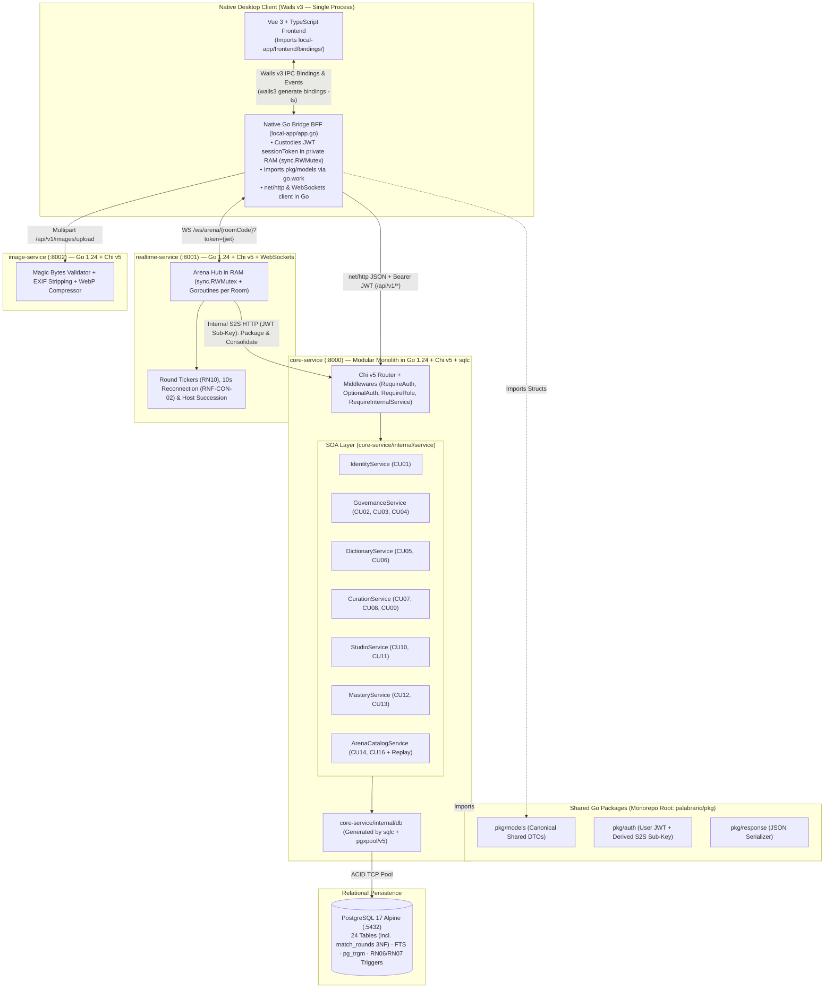

# 🔌 Comprehensive Specification of SOA Services, Go Contracts, `sqlc` Queries, and HTTP/WS Interfaces (`INTERFACES.md`)

> **Canonical Architectural Document — Single Source of Truth for Backend and Frontend Contracts**  
> **Project:** Palabrario — Gamified Learning and Preservation Platform for Pan-Hispanic Dialectal Lexicon  
> **Unified Backend Stack (100% Go):** Go 1.24 + Chi v5 + `sqlc` + `pgxpool/v5` + `golang-jwt/jwt/v5` on PostgreSQL 17 Alpine  
> **Architectural Pattern:** Service-Oriented Modular Monolith (`core-service :8000`) + Satellite Services in Go (`realtime-service :8001`, `image-service :8002`)  
> **Synchronized with:** [`DOMAIN.md`](./DOMAIN.md) · [`SCHEMA_FINAL.sql`](../SCHEMA_FINAL.sql) · [`pkg/models/`](../pkg/models)

---

## 0. Anti-Hallucination Operational Rules for AI Agents (Contract-First)

> [!CAUTION]
> **MANDATORY GOLDEN RULE FOR ALL AI MODELS:**
> 1. **Inventing JSON fields is prohibited:** No HTTP endpoint, WebSocket event, or interface component (`local-app`) may emit or consume properties that are not explicitly declared in the Go structs and JSON contracts of this document.
> 2. **Strict `snake_case` convention:** All JSON payloads (input and output) use `snake_case` identical to the `json:"..."` tags in [`pkg/models/`](../pkg/models).
> 3. **Mandatory Typed SQL (`sqlc`):** In `core-service`, concatenating raw SQL in handlers is prohibited. Every new query is defined in `sql/queries/*.sql`, compiled with `sqlc generate` into `core-service/internal/db/`, consumed by an implementation in `core-service/internal/service/`, and exposed by a handler in `core-service/internal/api/handlers/`.
> 4. **Single HTTP Error Format:** Every error response (`4xx` / `5xx`) exclusively uses [`response.Error(w, status, message)`](../pkg/response/json.go):
>    ```json
>    { "error": "Clear and human-readable description of the error in Spanish" }
>    ```

---

## 1. Service-Oriented Architecture (SOA) and Native Wails IPC Bridge in a 100% Go Monorepo

The entire Go ecosystem is connected via [`go.work`](../go.work) (`.` + `./local-app`) and the root module [`palabrario` (`go.mod`)](../go.mod):
1. **Backend Services (`core-service`, `realtime-service`, `image-service`):** Directly import shared packages [`pkg/models`](../pkg/models), [`pkg/auth`](../pkg/auth), and [`pkg/response`](../pkg/response).
2. **Native IPC Bridge in Desktop Client ([`local-app/app.go`](../local-app/app.go)):**
   - **The WebView (Vue 3 / TypeScript) never executes direct HTTP/WS calls or touches the JWT token.**
   - The Wails Go process (`struct App` in `local-app/app.go`) acts as a **local BFF (*Backend-For-Frontend*) and session vault in RAM** (`sessionToken` protected by `sync.RWMutex`, immune to XSS).
   - `local-app/app.go` imports the same structs from [`pkg/models`](../pkg/models), makes `net/http` or WebSocket requests to `:8000`, `:8001`, and `:8002` attaching `Authorization: Bearer <sessionToken>`, and exposes public Go methods.
   - When running `wails3 generate bindings -ts` (or `wails3 task common:generate:bindings`), **Wails v3 automatically generates TypeScript bindings and types** in `local-app/frontend/bindings/palabrario/local-app/app.ts` and `local-app/frontend/bindings/palabrario/pkg/models/models.ts`. Thus, a change in `pkg/models` propagates its static typing from PostgreSQL (`sqlc`) all the way to Vue 3 without human intervention or risk of hallucination.



### 1.1. Target Directory Structure in `core-service`

```text
core-service/
├── main.go                              # Entrypoint, Fail-Fast env check, pgxpool init, graceful shutdown
├── Dockerfile                           # Multi-stage build from root (context: .)
└── internal/
    ├── config/
    │   └── config.go                    # Strict loading and validation of environment variables
    ├── db/                              # CODE AUTOGENERATED BY SQLC (DO NOT EDIT MANUALLY)
    │   ├── db.go
    │   ├── models.go
    │   ├── users.sql.go
    │   ├── dictionary.sql.go
    │   ├── curation.sql.go              # (Phase 3.3)
    │   ├── studio.sql.go                # (Phase 3.4)
    │   ├── mastery.sql.go               # (Phase 3.4)
    │   ├── governance.sql.go            # (Phase 3.5)
    │   └── arena.sql.go                 # (Phase 4)
    ├── service/                         # DOMAIN SOA CONTRACTS AND IMPLEMENTATIONS
    │   ├── errors.go                    # Typed domain errors (ErrNotFound, ErrForbidden, ErrConflict...)
    │   ├── identity_service.go          # IdentityService (CU01)
    │   ├── governance_service.go        # GovernanceService (CU02, CU03, CU04)
    │   ├── dictionary_service.go        # DictionaryService (CU05, CU06)
    │   ├── curation_service.go          # CurationService (CU07, CU08, CU09)
    │   ├── studio_service.go            # StudioService (CU10, CU11)
    │   ├── mastery_service.go           # MasteryService + Pure SM-2 Algorithm (CU12, CU13)
    │   └── arena_catalog_service.go     # ArenaCatalogService (CU14, CU16 + 3NF Replay)
    └── api/
        ├── router.go                    # Chi v5 routes and middlewares mounting
        ├── middleware/
        │   └── auth_middleware.go       # RequireAuth, OptionalAuth, RequireRole, RequireInternalService
        └── handlers/
            ├── health.go
            ├── auth_handler.go
            ├── user_handler.go          # (CU01)
            ├── governance_handler.go    # (CU02, CU03, CU04)
            ├── dictionary_handler.go    # (CU05, CU06)
            ├── curation_handler.go      # (CU07, CU08, CU09)
            ├── studio_handler.go        # (CU10, CU11)
            ├── mastery_handler.go       # (CU12, CU13)
            └── arena_handler.go         # (CU14, CU16)
```

### 1.2. Standard Domain Error to HTTP Status Code Mapping (`core-service/internal/service/errors.go`)

| Domain Error (`service.*`) | HTTP Status Code | When Triggered |
| :--- | :---: | :--- |
| `ErrInvalidInput` | `400 Bad Request` | Required fields empty, invalid format, `quality_rating` outside `1..4`, etc. |
| `ErrUnauthorized` | `401 Unauthorized` | Missing or expired JWT token, invalid signature, or incorrect login credentials. |
| `ErrForbidden` | `403 Forbidden` | Insufficient role (`RBAC`), attempt to edit another user's resource (`RN01`, `RN03`), attempt to read another user's private deck (`RN04`), attempt to self-approve own sense (`RN07`), or user token attempting to invoke internal S2S endpoint. |
| `ErrNotFound` | `404 Not Found` | Non-existent resource (`id_word`, `id_sense`, `id_deck`, `room_code`, `id_match`, `user_name`), or sense in `HIDDEN`/`DRAFT` state queried from a public route. |
| `ErrConflict` | `409 Conflict` | Duplicate email/`user_name`, existing `PENDING` Editor request (`RN02`), duplicate vote, exhausted/expired ticket (`CU04`), or match already consolidated (`FINISHED`). |
| `ErrUnprocessable` | `422 Unprocessable Entity` | Selected deck to open an Arena has fewer than 8 `APPROVED` senses or fewer approved senses than the requested number of rounds `total_rounds` (`CU14 1a`). |

---

## 2. Detailed Specification by SOA Module

---

### MODULE 1: Identity, Authentication, and Profiles (`IdentityService` — `CU01`)

#### 2.1.1. Data Structures (`pkg/models/auth.go` and `pkg/models/user.go`)

```go
// Existing in pkg/models/auth.go and pkg/models/user.go:
// SignInRequest, SignUpRequest, AuthResponse, AccountRole, Region, UserProfile

// --- NEW DTOs TO ADD IN pkg/models/user.go ---

type UpdateProfileRequest struct {
	Name          string  `json:"name"`                     // Required, 2..100 chars
	AnchorDialect string  `json:"anchor_dialect"`           // Required: 'MX','ES','AR','CO','CL','CU','CAM','PAN'
	AvatarURL     *string `json:"avatar_url,omitempty"`     // Optional, URL generated by image-service
}

type ChangePasswordRequest struct {
	CurrentPassword string `json:"current_password"`        // Required
	NewPassword     string `json:"new_password"`            // Required, min. 8 characters
}

type PublicUserProfile struct {
	IDUser             string              `json:"id_user"`
	Name               string              `json:"name"`
	UserName           string              `json:"user_name"`
	AvatarURL          *string             `json:"avatar_url,omitempty"`
	AnchorDialect      string              `json:"anchor_dialect"`
	Role               AccountRole         `json:"role"`
	TotalXP            int                 `json:"total_xp"`
	CurrentLevel       int                 `json:"current_level"`
	CurrentStreak      int                 `json:"current_streak"`
	LongestStreak      int                 `json:"longest_streak"`
	UnlockedBadges     []AchievementStatus `json:"unlocked_badges"`
	PublicDecks        []Deck              `json:"public_decks"`
	PublicCollections  []Collection        `json:"public_collections"`
	MatchesWon         int                 `json:"matches_won"`
	PodiumCount        int                 `json:"podium_count"`
	IsOwner            bool                `json:"is_owner"`
	// Fields populated ONLY when IsOwner == true:
	Email              *string             `json:"email,omitempty"`
	PrivateDecksCount  *int                `json:"private_decks_count,omitempty"`
	DueReviewsToday    *int                `json:"due_reviews_today,omitempty"`
	CreatedAt          time.Time           `json:"created_at"`
}
```

#### 2.1.2. SOA Interface (`IdentityService`)

```go
type IdentityService interface {
	SignUp(ctx context.Context, req models.SignUpRequest) (*models.AuthResponse, error)
	SignIn(ctx context.Context, req models.SignInRequest) (*models.AuthResponse, error)
	GetMe(ctx context.Context, userID string) (*models.UserProfile, error)
	UpdateProfile(ctx context.Context, userID string, req models.UpdateProfileRequest) (*models.UserProfile, error)
	ChangePassword(ctx context.Context, userID string, req models.ChangePasswordRequest) error
	GetPublicProfileByUsername(ctx context.Context, viewerID *string, username string) (*models.PublicUserProfile, error)
}
```

#### 2.1.3. `sqlc` Queries (`sql/queries/users.sql`)
- **Existing:** `GetAccountByEmail`, `CreateAccount`, `CreateUserProfile`, `GetUserProfileByID`, `CheckEmailOrUsernameExists`.
- **New to add in `sql/queries/users.sql`:**
  - `-- name: UpdateUserProfile :one` $\to$ Updates `name`, `anchor_dialect`, `avatar_url`, `updated_at = now()` in `users` filtering by `id_user` and returns the profile joined with `accounts`.
  - `-- name: GetAccountByID :one` $\to$ Retrieves `id_account, password_hash, is_active` to verify current password.
  - `-- name: UpdateAccountPassword :exec` $\to$ Updates `password_hash` and `updated_at = now()` in `accounts`.
  - `-- name: GetUserProfileByUsername :one` $\to$ Looks up in `users JOIN accounts` by `LOWER(user_name) = LOWER($1)`.

#### 2.1.4. HTTP Endpoints (`/api/v1/auth` and `/api/v1/users`)

| Method | Path | Middleware | Use Case | Status | HTTP Status Codes |
| :---: | :--- | :---: | :---: | :---: | :--- |
| `POST` | `/api/v1/auth/sign-up` | Public | Base Auth | ✅ Ready | `201`, `400`, `409` |
| `POST` | `/api/v1/auth/sign-in` | Public | RF01 | ✅ Ready | `200`, `400`, `401`, `403` (if `is_active=false`) |
| `GET` | `/api/v1/auth/me` | `RequireAuth` | CU01 | ✅ Ready | `200`, `401`, `404` |
| `PUT` | `/api/v1/users/me` | `RequireAuth` | CU01 (RN01) | ✅ Ready | `200`, `400`, `401` |
| `PUT` | `/api/v1/users/me/password` | `RequireAuth` | CU01 (RN01) | ✅ Ready | `204`, `400`, `401` (invalid current password) |
| `GET` | `/api/v1/users/u/{username}` | `OptionalAuth` | CU01 / UI | ✅ Ready | `200`, `404` |

---

### MODULE 2: Institutional Governance, Roles, and Tickets (`GovernanceService` — `CU02, CU03, CU04`)

#### 2.2.1. Data Structures (`pkg/models/governance.go` — New File)

```go
package models

import "time"

type RequestStatus string

const (
	RequestPending  RequestStatus = "PENDING"
	RequestApproved RequestStatus = "APPROVED"
	RequestRejected RequestStatus = "REJECTED"
)

type CreateEditorRequestDTO struct {
	InstitutionName string  `json:"institution_name"`          // Required, 3..150 chars
	Justification   string  `json:"justification"`             // Required, min. 20 chars
	CredentialsURL  *string `json:"credentials_url,omitempty"` // Optional, credential URL
}

type ResolveEditorRequestDTO struct {
	Status      RequestStatus `json:"status"`                  // 'APPROVED' or 'REJECTED'
	ReviewNotes *string       `json:"review_notes,omitempty"`  // Reason for administrative ruling
}

type EditorRequest struct {
	IDRequest       string        `json:"id_request"`
	IDUser          string        `json:"id_user"`
	UserName        string        `json:"user_name"`
	UserFullName    string        `json:"user_full_name"`
	UserEmail       string        `json:"user_email"`
	InstitutionName string        `json:"institution_name"`
	Justification   string        `json:"justification"`
	CredentialsURL  *string       `json:"credentials_url,omitempty"`
	Status          RequestStatus `json:"status"`
	ReviewedBy      *string       `json:"reviewed_by,omitempty"`
	ReviewNotes     *string       `json:"review_notes,omitempty"`
	CreatedAt       time.Time     `json:"created_at"`
	ResolvedAt      *time.Time    `json:"resolved_at,omitempty"`
}

type UpdateUserRoleOrStatusRequest struct {
	Role     *AccountRole `json:"role,omitempty"`      // 'LEARNER', 'EDITOR', 'ADMIN'
	IsActive *bool        `json:"is_active,omitempty"` // Account suspension / reactivation
}

type CreateTicketRequest struct {
	Code            *string     `json:"code,omitempty"`             // If omitted, backend generates e.g. "PAL-UNAM-2026-X9A2"
	GrantedRole     AccountRole `json:"granted_role"`               // 'LEARNER' or 'EDITOR' (default 'LEARNER')
	InstitutionName *string     `json:"institution_name,omitempty"` // E.g. "Facultad de Filosofía y Letras UNAM"
	MaxUses         int         `json:"max_uses"`                   // >= 1 (1 = single-use, >1 = multi-use)
	ExpiresAt       *time.Time  `json:"expires_at,omitempty"`       // Optional
}

type InvitationTicket struct {
	IDTicket        string      `json:"id_ticket"`
	Code            string      `json:"code"`
	CreatedBy       string      `json:"created_by"`
	GrantedRole     AccountRole `json:"granted_role"`
	InstitutionName *string     `json:"institution_name,omitempty"`
	MaxUses         int         `json:"max_uses"`
	CurrentUses     int         `json:"current_uses"`
	IsActive        bool        `json:"is_active"`
	ExpiresAt       *time.Time  `json:"expires_at,omitempty"`
	CreatedAt       time.Time   `json:"created_at"`
}

type RedeemTicketRequest struct {
	Code string `json:"code"` // Required
}
```

#### 2.2.2. SOA Interface (`GovernanceService`)

```go
type GovernanceService interface {
	CreateEditorRequest(ctx context.Context, learnerID string, req models.CreateEditorRequestDTO) (*models.EditorRequest, error)
	ListMyEditorRequests(ctx context.Context, learnerID string) ([]models.EditorRequest, error)
	ListEditorRequests(ctx context.Context, statusFilter *string) ([]models.EditorRequest, error)
	ResolveEditorRequest(ctx context.Context, adminID string, requestID string, req models.ResolveEditorRequestDTO) (*models.EditorRequest, error)

	ListUsers(ctx context.Context, search string, roleFilter *string, limit, offset int) ([]models.UserProfile, int, error)
	UpdateUserRoleOrStatus(ctx context.Context, adminID string, targetUserID string, req models.UpdateUserRoleOrStatusRequest) (*models.UserProfile, error)

	CreateInvitationTicket(ctx context.Context, adminID string, req models.CreateTicketRequest) (*models.InvitationTicket, error)
	ListInvitationTickets(ctx context.Context, activeOnly bool) ([]models.InvitationTicket, error)
	RevokeInvitationTicket(ctx context.Context, adminID string, ticketID string) error
	RedeemInvitationTicket(ctx context.Context, userID string, code string) (*models.UserProfile, error)
}
```

#### 2.2.3. Transactional and Integrity Rules in `GovernanceService`
1. **RN02 in `CreateEditorRequest`:** If the user already has the `EDITOR` or `ADMIN` role, returns `409 Conflict`. If they attempt to create a second request while another is `PENDING`, PostgreSQL's partial unique index `idx_unique_pending_editor_request` (`SQLSTATE 23505`) translates to `409 Conflict ("Ya tienes una solicitud de promoción pendiente de revisión")`.
2. **Atomic Promotion in `ResolveEditorRequest`:** Executes inside `pgx.Tx`. If `req.Status == "APPROVED"`, updates `editor_requests` (`status = 'APPROVED'`, `reviewed_by`, `resolved_at = now()`) **and within the same transaction** executes `UPDATE accounts SET role = 'EDITOR' WHERE id_account = $1`.
3. **Protection of the Last Administrator in `UpdateUserRoleOrStatus` (CU03 4a):** Before demoting the role or deactivating (`is_active = false`) an `ADMIN` user, counts how many active administrators remain (`SELECT count(*) FROM accounts WHERE role = 'ADMIN' AND is_active = true`). If the count is $\le 1$, aborts with `409 Conflict ("No se puede revocar ni desactivar al único Administrador activo del sistema")`.
4. **Atomic Redemption in `RedeemInvitationTicket` (CU04):** Inside `pgx.Tx`, locks the ticket row (`SELECT ... FROM invitation_tickets WHERE code = $1 FOR UPDATE`), verifies `is_active == true`, `(expires_at IS NULL OR expires_at > now())`, and `current_uses < max_uses`. Inserts into `ticket_redemptions`, increments `current_uses = current_uses + 1`, and if `granted_role == 'EDITOR'` and the user was `'LEARNER'`, promotes their account to `'EDITOR'`.

#### 2.2.4. HTTP Endpoints (`/api/v1/governance`)

| Method | Path | Middleware | Use Case | HTTP Status Codes |
| :---: | :--- | :---: | :---: | :--- |
| `POST` | `/api/v1/governance/editor-requests` | `RequireAuth` | CU02 (RN02) | `201`, `400`, `409` (pending request or already an editor) |
| `GET` | `/api/v1/governance/editor-requests/me` | `RequireAuth` | CU02 | `200` |
| `GET` | `/api/v1/governance/editor-requests` | `RequireRole(ADMIN)` | CU03 | `200` (`?status=PENDING`) |
| `PUT` | `/api/v1/governance/editor-requests/{id}/resolve` | `RequireRole(ADMIN)` | CU03 (RN08) | `200`, `400`, `404`, `409` |
| `GET` | `/api/v1/governance/users` | `RequireRole(ADMIN)` | CU03 | `200` (`?q=&role=&limit=20&offset=0`) |
| `PUT` | `/api/v1/governance/users/{id}/access` | `RequireRole(ADMIN)` | CU03 (RN08) | `200`, `404`, `409` (last admin) |
| `POST` | `/api/v1/governance/tickets` | `RequireRole(ADMIN)` | CU04 (RN08) | `201`, `400`, `409` |
| `GET` | `/api/v1/governance/tickets` | `RequireRole(ADMIN)` | CU04 | `200` (`?active_only=true`) |
| `DELETE` | `/api/v1/governance/tickets/{id}` | `RequireRole(ADMIN)` | CU04 | `204`, `404` |
| `POST` | `/api/v1/governance/tickets/redeem` | `RequireAuth` | CU04 | `200`, `400`, `404`, `409` (exhausted, expired, or already redeemed by user) |

---

### MODULE 3: Panhispanic Dictionary, Lexical Authorship, and Heteronymy (`DictionaryService` — `CU05, CU06`)

#### 2.3.1. Complete Data Structures (`pkg/models/dictionary.go`)

In addition to already existing structures (`WordGender`, `WordSearchResult`, `Example`, `HeteronymItem`, `SenseDetail`, `WordDetail`), the following are defined in `pkg/models/dictionary.go`:

```go
// Paginated exploration filter (GET /api/v1/words)
type WordExploreFilter struct {
	Query          string `json:"q"`
	RegionCode     string `json:"region"`          // E.g. 'MX', 'AR', 'ES'
	PartOfSpeech   string `json:"pos"`             // E.g. 'sustantivo', 'verbo', 'adjetivo', 'modismo'
	CEFRLevel      string `json:"cefr"`            // 'A1'..'C2', 'NATIVO'
	UsageFrequency string `json:"frequency"`       // 'EVERYDAY', 'COMMON', 'RARE', 'SLANG', 'ARCHAIC'
	IncludeTaboo   bool   `json:"include_taboo"`   // Default true
	Page           int    `json:"page"`            // Default 1
	Limit          int    `json:"limit"`           // Default 20, max 50
}

type WordSummaryCard struct {
	IDWord           int        `json:"id_word"`
	Lemma            string     `json:"lemma"`
	PartOfSpeech     string     `json:"part_of_speech"`
	Gender           WordGender `json:"gender"`
	FriendlyBlurb    *string    `json:"friendly_blurb,omitempty"`
	ImageURL         *string    `json:"image_url,omitempty"`
	ImageURL         *string    `json:"image_url,omitempty"`
	PrimarySenseID   int        `json:"primary_sense_id"`
	ShortDefinition  string     `json:"short_definition"`
	RegionCode       string     `json:"region_code"`
	RegionName       string     `json:"region_name"`
	FlagEmoji        string     `json:"flag_emoji"`
	CEFRLevel        string     `json:"cefr_level"`
	UsageFrequency   string     `json:"usage_frequency"`
	IsTabooOrVulgar  bool       `json:"is_taboo_or_vulgar"`
	ApprovedSenses   int        `json:"approved_senses_count"`
}

type PaginatedWords struct {
	Items      []WordSummaryCard `json:"items"`
	TotalCount int               `json:"total_count"`
	Page       int               `json:"page"`
	Limit      int               `json:"limit"`
}

// --- EDITORIAL AUTHORSHIP DTOs (CU06) ---

type CreateExampleInput struct {
	Sentence string  `json:"sentence"`          // Required, min. 5 chars
	Source   *string `json:"source,omitempty"`  // Optional
}

type CreateSenseRequest struct {
	RegionCode      string               `json:"region_code"`               // Required ('MX', 'AR', etc.)
	ShortDefinition string               `json:"short_definition"`          // Required, <= 255 chars
	Definition      string               `json:"definition"`                // Required
	IsPrimary       bool                 `json:"is_primary"`
	IsTabooOrVulgar bool                 `json:"is_taboo_or_vulgar"`
	CulturalNote    *string              `json:"cultural_note,omitempty"`
	ImageURL        *string              `json:"image_url,omitempty"`        // Optional, URL processed by image-service (RN12)
	CEFRLevel       string               `json:"cefr_level"`                // Default 'B1'
	UsageFrequency  string               `json:"usage_frequency"`           // Default 'COMMON'
	ConceptIDs      []int                `json:"concept_ids,omitempty"`     // Optional: link heteronyms
	Examples        []CreateExampleInput `json:"examples,omitempty"`        // Initial examples
}

type CreateWordProposalRequest struct {
	Lemma            string             `json:"lemma"`                      // Required
	PartOfSpeech     string             `json:"part_of_speech"`             // Required
	Gender           WordGender         `json:"gender"`                     // Default 'NEUTRAL'
	Etymology        *string            `json:"etymology,omitempty"`
	FriendlyBlurb    *string            `json:"friendly_blurb,omitempty"`
	ImageURL         *string            `json:"image_url,omitempty"`         // Optional, URL processed by image-service (RN12)
	OriginRegionCode *string            `json:"origin_region_code,omitempty"`
	InitialSense     CreateSenseRequest `json:"initial_sense"`              // Required
}

type UpdateWordRequest struct {
	Lemma            string     `json:"lemma"`
	PartOfSpeech     string     `json:"part_of_speech"`
	Gender           WordGender `json:"gender"`
	Etymology        *string    `json:"etymology,omitempty"`
	FriendlyBlurb    *string    `json:"friendly_blurb,omitempty"`
	ImageURL         *string    `json:"image_url,omitempty"`
	ImageURL         *string    `json:"image_url,omitempty"`
	OriginRegionCode *string    `json:"origin_region_code,omitempty"`
}

type UpdateSenseRequest struct {
	RegionCode      string  `json:"region_code"`
	ShortDefinition string  `json:"short_definition"`
	Definition      string  `json:"definition"`
	IsPrimary       bool    `json:"is_primary"`
	IsTabooOrVulgar bool    `json:"is_taboo_or_vulgar"`
	CulturalNote    *string `json:"cultural_note,omitempty"`
	ImageURL        *string `json:"image_url,omitempty"`
	CEFRLevel       string  `json:"cefr_level"`
	UsageFrequency  string  `json:"usage_frequency"`
}

type SemanticConcept struct {
	IDConcept            int    `json:"id_concept"`
	ConceptKey           string `json:"concept_key"`
	UniversalDescription string `json:"universal_description"`
	LinkedSensesCount    int    `json:"linked_senses_count"`
}

type CreateConceptRequest struct {
	ConceptKey           string `json:"concept_key"`           // E.g. 'street_market'
	UniversalDescription string `json:"universal_description"` // E.g. 'Mercado ambulante tradicional al aire libre'
}
```

#### 2.3.2. Exact `sqlc` Queries in `sql/queries/dictionary.sql`

In addition to the 5 base queries (`SearchVocabularyDropdown`, `GetWordByID`, `GetApprovedSensesByWordID`, `GetExamplesBySenseIDs`, `GetHeteronymsByWordID`), it includes:

1. `-- name: ListRegions :many`
   Selects all rows from `regions` ordered by `name ASC`.
2. `-- name: GetRegionByCode :one`
   Retrieves `id_region, code, name, parent_zone, country_code, flag_emoji` where `code = $1`.
3. `-- name: GetWordOfTheDayID :one`
   Deterministically selects an `id_word` that has at least one `APPROVED` sense (prioritizing region `$1` if supplied, using `MOD(EXTRACT(DOY FROM CURRENT_DATE)::INT, COUNT(*))` or `friendly_blurb IS NOT NULL`) to subsequently assemble its complete `WordDetail` using existing queries.
4. `-- name: ExploreWordsPaginated :many` and `-- name: CountExploreWords :one`
   Filters `words w JOIN senses s ON s.id_word = w.id_word AND s.state = 'APPROVED' JOIN regions r ON r.id_region = s.id_region` applying optional filters (`sqlc.narg`): `region_code`, `part_of_speech`, `cefr_level`, `usage_frequency`, `include_taboo`, and search query `q`, paginated with `LIMIT $1 OFFSET $2`.
5. `-- name: GetWordByNormalizedLemmaAndPOS :one`
   Checks if a lemma already exists with `(normalized_lemma = $1 AND part_of_speech = $2)`. If it already exists during `CreateWordProposal`, reuses the existing `id_word` and adds the new `Sense` in `DRAFT` (**CU06 Main Flow Step 2**).
6. `-- name: CreateWord :one`
   Inserts into `words (lemma, normalized_lemma, part_of_speech, gender, etymology, friendly_blurb, id_origin_region)` and returns the created row.
7. `-- name: UpdateWordMetadata :one`
   Updates metadata in `words` and `updated_at = now()` by `id_word`.
8. `-- name: CreateSense :one`
   Inserts into `senses (id_word, id_region, id_editor, short_definition, definition, is_primary, is_taboo_or_vulgar, cultural_note, cefr_level, usage_frequency, state)`.
   - **Business Rule in `CreateSense`:** If the actor has the `ADMIN` role, they may choose to create directly in `'APPROVED'` (`RN08`); if `EDITOR`, it is always inserted with `state = 'DRAFT'` (`CU06 Step 5`).
9. `-- name: GetSenseByID :one`
   Retrieves the sense (any `state`) along with its `id_editor` to verify authorship before edit/delete (`CU06 2a`).
10. `-- name: UpdateSense :one` and `-- name: DeleteSense :exec`
    Updates or deletes a sense. If the actor is `EDITOR` (not `ADMIN`), verifies that `sense.id_editor == actorID` and `sense.state == 'DRAFT'`.
11. `-- name: CreateExample :one`, `-- name: UpdateExample :one`, `-- name: DeleteExample :exec`
    CRUD of example sentences in `examples`.
12. `-- name: ListSemanticConcepts :many`, `-- name: CreateSemanticConcept :one`, `-- name: LinkSenseToConcept :exec`, `-- name: UnlinkSenseFromConcept :exec`
    Management of the heteronym graph in `semantic_concepts` and `concept_mappings`.

#### 2.3.3. Dictionary HTTP Endpoints Specification (`/api/v1/regions`, `/api/v1/words`, `/api/v1/senses`, `/api/v1/concepts`)

| Method | Path | Middleware | Use Case | Status | Successful Response |
| :---: | :--- | :---: | :---: | :---: | :--- |
| `GET` | `/api/v1/regions` | Public | CU05 | ✅ Ready | `200 OK` $\to$ `[]models.Region` |
| `GET` | `/api/v1/words/word-of-the-day` | Public | CU05 | ✅ Ready | `200 OK` $\to$ `models.WordDetail` (`?dialect=MX`) |
| `GET` | `/api/v1/words/search` | Public | CU05 (RF06) | ✅ Ready | `200 OK` $\to$ `[]models.WordSearchResult` (`?q=&dialect=&limit=8`) |
| `GET` | `/api/v1/words` | Public | CU05 (RF07) | ✅ Ready | `200 OK` $\to$ `models.PaginatedWords` |
| `GET` | `/api/v1/words/{id}` | Public | CU05 (RF07) | ✅ Ready | `200 OK` $\to$ `models.WordDetail` |
| `POST` | `/api/v1/words` | `RequireRole(EDITOR, ADMIN)` | CU06 (RF08) | ✅ Ready | `201 Created` $\to$ `models.WordDetail` |
| `PUT` | `/api/v1/words/{id}` | `RequireRole(EDITOR, ADMIN)` | CU06 | ✅ Ready | `200 OK` $\to$ `models.WordDetail` |
| `POST` | `/api/v1/words/{id}/senses` | `RequireRole(EDITOR, ADMIN)` | CU06 (RF08) | ✅ Ready | `201 Created` $\to$ `models.SenseDetail` |
| `PUT` | `/api/v1/senses/{senseId}` | `RequireRole(EDITOR, ADMIN)` | CU06 (2a) | ✅ Ready | `200 OK` $\to$ `models.SenseDetail` (`403` if another editor or already approved) |
| `DELETE` | `/api/v1/senses/{senseId}` | `RequireRole(EDITOR, ADMIN)` | CU06 | ✅ Ready | `204 No Content` |
| `POST` | `/api/v1/senses/{senseId}/examples` | `RequireRole(EDITOR, ADMIN)` | CU06 | ✅ Ready | `201 Created` $\to$ `models.Example` |
| `PUT` | `/api/v1/examples/{exampleId}` | `RequireRole(EDITOR, ADMIN)` | CU06 | ✅ Ready | `200 OK` $\to$ `models.Example` |
| `DELETE` | `/api/v1/examples/{exampleId}` | `RequireRole(EDITOR, ADMIN)` | CU06 | ✅ Ready | `204 No Content` |
| `GET` | `/api/v1/concepts` | Public | CU05 / CU06 | ✅ Ready | `200 OK` $\to$ `[]models.SemanticConcept` (`?q=`) |
| `POST` | `/api/v1/concepts` | `RequireRole(EDITOR, ADMIN)` | CU06 | ✅ Ready | `201 Created` $\to$ `models.SemanticConcept` |
| `POST` | `/api/v1/senses/{senseId}/concepts/{conceptId}` | `RequireRole(EDITOR, ADMIN)` | CU06 | ✅ Ready | `204 No Content` |
| `DELETE` | `/api/v1/senses/{senseId}/concepts/{conceptId}` | `RequireRole(EDITOR, ADMIN)` | CU06 | ✅ Ready | `204 No Content` |

---

### MODULE 4: Editorial Curation by Quorum and Moderation (`CurationService` — `CU07, CU08, CU09`)

#### 2.4.1. Data Structures (`pkg/models/curation.go`)

```go
package models

import "time"

type ReviewDecision string

const (
	DecisionApprove        ReviewDecision = "APPROVE"
	DecisionRequestChanges ReviewDecision = "REQUEST_CHANGES"
	DecisionReject         ReviewDecision = "REJECT"
)

type SenseApprovalVote struct {
	IDSense        int            `json:"id_sense"`
	IDEditor       string         `json:"id_editor"`
	EditorUserName string         `json:"editor_user_name"`
	EditorFullName string         `json:"editor_full_name"`
	EditorDialect  string         `json:"editor_dialect"`
	Decision       ReviewDecision `json:"decision"`
	FeedbackNotes  *string        `json:"feedback_notes,omitempty"`
	ApprovedAt     time.Time      `json:"approved_at"`
}

type SenseQuorumItem struct {
	IDSense          int            `json:"id_sense"`
	IDWord           int            `json:"id_word"`
	Lemma            string         `json:"lemma"`
	PartOfSpeech     string         `json:"part_of_speech"`
	RegionCode       string         `json:"region_code"`
	RegionName       string         `json:"region_name"`
	FlagEmoji        string         `json:"flag_emoji"`
	ShortDefinition  string         `json:"short_definition"`
	Definition       string         `json:"definition"`
	CulturalNote     *string        `json:"cultural_note,omitempty"`
	CEFRLevel        string         `json:"cefr_level"`
	UsageFrequency   string         `json:"usage_frequency"`
	IsTabooOrVulgar  bool           `json:"is_taboo_or_vulgar"`
	State            string         `json:"state"`            // 'DRAFT', 'APPROVED', 'HIDDEN'
	AuthorID         string         `json:"author_id"`
	AuthorUserName   string         `json:"author_user_name"`
	AuthorFullName   string         `json:"author_full_name"`
	ApprovalsCount   int            `json:"approvals_count"`  // Votes with decision = 'APPROVE'
	RequiredQuorum   int            `json:"required_quorum"`  // Constant: 3 (RN06)
	CreatedAt        time.Time      `json:"created_at"`
}

type SenseQuorumDetail struct {
	Proposal SenseQuorumItem     `json:"proposal"`
	Examples []Example           `json:"examples"`
	Votes    []SenseApprovalVote `json:"votes"`
}

type SubmitVoteRequest struct {
	Decision      ReviewDecision `json:"decision"`                 // 'APPROVE', 'REQUEST_CHANGES', 'REJECT'
	FeedbackNotes *string        `json:"feedback_notes,omitempty"` // Required if Decision != 'APPROVE'
}

type AdminOverrideStateRequest struct {
	State  string  `json:"state"`            // 'APPROVED' or 'HIDDEN'
	Reason *string `json:"reason,omitempty"` // Audit note
}

// --- CONTENT REPORT MODERATION DTOs (CU09) ---

type ContentReport struct {
	IDReport        string     `json:"id_report"`
	IDReporter      string     `json:"id_reporter"`
	ReporterName    string     `json:"reporter_user_name"`
	TargetType      string     `json:"target_type"`      // 'WORD', 'SENSE', 'EXAMPLE'
	IDWord          *int       `json:"id_word,omitempty"`
	IDSense         *int       `json:"id_sense,omitempty"`
	IDExample       *int       `json:"id_example,omitempty"`
	TargetPreview   string     `json:"target_preview"`   // Lemma or reported text for quick inspection
	Reason          string     `json:"reason"`           // 'INACCURATE_DEFINITION', 'OFFENSIVE_UNMARKED', 'SPAM_OR_VANDALISM', 'DUPLICATE', 'OTHER'
	Details         string     `json:"details"`
	Status          string     `json:"status"`           // 'PENDING', 'RESOLVED_HIDDEN', 'RESOLVED_AMENDED', 'DISMISSED'
	ResolvedBy      *string    `json:"resolved_by,omitempty"`
	ResolutionNotes *string    `json:"resolution_notes,omitempty"`
	CreatedAt       time.Time  `json:"created_at"`
	ResolvedAt      *time.Time `json:"resolved_at,omitempty"`
}

type CreateReportRequest struct {
	TargetType string `json:"target_type"`          // 'WORD', 'SENSE', 'EXAMPLE'
	IDWord     *int   `json:"id_word,omitempty"`
	IDSense    *int   `json:"id_sense,omitempty"`
	IDExample  *int   `json:"id_example,omitempty"`
	Reason     string `json:"reason"`
	Details    string `json:"details"`              // Required, min. 10 chars
}

type ResolveReportRequest struct {
	Status          string  `json:"status"`           // 'RESOLVED_HIDDEN', 'RESOLVED_AMENDED', 'DISMISSED'
	ResolutionNotes *string `json:"resolution_notes,omitempty"`
}
```

#### 2.4.2. `SubmitQuorumVote` Behavior Against PostgreSQL Triggers (`RN06` and `RN07`)
1. When `SubmitQuorumVote` executes `UpsertSenseApproval` in `sense_approvals`:
   - If `editorID == sense.id_editor`, both Go validation and the `trg_prevent_self_approval` trigger (**RN07**) reject the operation $\to$ the handler responds `403 Forbidden {"error": "Violación de integridad (RN07): Un editor no puede votar ni aprobar su propia contribución"}`.
   - If `req.Decision == "REQUEST_CHANGES"` or `"REJECT"` and `req.FeedbackNotes` is empty $\to$ responds `400 Bad Request {"error": "Debes incluir notas de retroalimentación al solicitar correcciones o rechazar una propuesta"}`.
   - If `req.Decision == "APPROVE"` and with this vote the sum of `decision = 'APPROVE'` reaches **3**, the `trg_auto_approve_sense` trigger (**RN06 / CU08**) automatically updates `senses.state = 'APPROVED'` within the same PostgreSQL operation. Promptly afterward, `SubmitQuorumVote` re-reads `GetProposalInspection` and returns the updated `SenseQuorumDetail` with `state: "APPROVED"` and `approvals_count: 3`.

#### 2.4.3. Curation and Moderation HTTP Endpoints (`/api/v1/curation` and `/api/v1/reports`)

| Method | Path | Middleware | Use Case | Status | Successful Response |
| :---: | :--- | :---: | :---: | :---: | :--- |
| `GET` | `/api/v1/curation/queue` | `RequireRole(EDITOR, ADMIN)` | CU07 (RN06/07) | ✅ Ready | `200 OK` $\to$ `[]models.SenseQuorumItem` (`?region=MX`) |
| `GET` | `/api/v1/curation/my-proposals` | `RequireRole(EDITOR, ADMIN)` | CU06 / CU07 | ✅ Ready | `200 OK` $\to$ `[]models.SenseQuorumItem` (`?state=DRAFT`) |
| `GET` | `/api/v1/curation/senses/{senseId}` | `RequireRole(EDITOR, ADMIN)` | CU07 | ✅ Ready | `200 OK` $\to$ `models.SenseQuorumDetail` |
| `POST` | `/api/v1/curation/senses/{senseId}/vote` | `RequireRole(EDITOR, ADMIN)` | CU07 / CU08 | ✅ Ready | `200 OK` $\to$ `models.SenseQuorumDetail` (`403` on RN07) |
| `PUT` | `/api/v1/curation/senses/{senseId}/state` | `RequireRole(ADMIN)` | CU08 (1b, RN08)| ✅ Ready | `200 OK` $\to$ `models.SenseDetail` |
| `POST` | `/api/v1/reports` | `RequireAuth` | CU09 (RF11) | ✅ Ready | `201 Created` $\to$ `models.ContentReport` |
| `GET` | `/api/v1/reports` | `RequireRole(ADMIN)` | CU09 | ✅ Ready | `200 OK` $\to$ `[]models.ContentReport` (`?status=PENDING`) |
| `PUT` | `/api/v1/reports/{reportId}/resolve` | `RequireRole(ADMIN)` | CU09 (RN08) | ✅ Ready | `200 OK` $\to$ `models.ContentReport` |

---

### MODULE 5: Personal Studio — Decks and Collections (`StudioService` — `CU10, CU11`)

#### 2.5.1. Data Structures in `pkg/models/studio.go`

```go
// Enrichment of Deck for the Personal Studio view (GUIStudioDeckCard):
type StudioDeckSummary struct {
	Deck
	OwnerUserName      string  `json:"owner_user_name"`
	IsSavedFromComm    bool    `json:"is_saved_from_community"`
	DueCardsToday      int     `json:"due_cards_today"`
	RetentionPercent   float32 `json:"retention_percent"`
}

type CreateDeckRequest struct {
	Title       string  `json:"title"`                 // Required, 3..150 chars
	Description *string `json:"description,omitempty"`
	IsPublic    bool    `json:"is_public"`
	IsOfficial  bool    `json:"is_official"`           // Only honored if role IN ('EDITOR', 'ADMIN') (RN05)
	SenseIDs    []int   `json:"sense_ids,omitempty"`   // Optional initial cards
}

type UpdateDeckRequest struct {
	Title       string  `json:"title"`
	Description *string `json:"description,omitempty"`
	IsPublic    bool    `json:"is_public"`
	IsOfficial  bool    `json:"is_official"`
}

type AddDeckItemRequest struct {
	IDSense   int  `json:"id_sense"`
	SortOrder *int `json:"sort_order,omitempty"`
}

type CreateCollectionRequest struct {
	Title       string  `json:"title"`
	Description *string `json:"description,omitempty"`
	IsPublic    bool    `json:"is_public"`
	IsFeatured  bool    `json:"is_featured"` // ADMIN/EDITOR only
	IsOfficial  bool    `json:"is_official"` // ADMIN/EDITOR only (RN05)
	DeckIDs     []int   `json:"deck_ids"`    // Ordered according to array
}

type UpdateCollectionRequest struct {
	Title       string  `json:"title"`
	Description *string `json:"description,omitempty"`
	IsPublic    bool    `json:"is_public"`
	IsFeatured  bool    `json:"is_featured"`
	IsOfficial  bool    `json:"is_official"`
	DeckIDs     []int   `json:"deck_ids,omitempty"`
}
```

#### 2.5.2. Business Rules in `StudioService` (`RN03`, `RN04`, `RN05`)
- **RN03 (Ownership in Studio):** Only the owner (`deck.id_user == userID`) or an `ADMIN` (`RN08`) may execute `PUT` or `DELETE` on a deck/collection or alter its items. If a third party attempts this, returns `403 Forbidden`.
- **RN04 (Resource Privacy):** In `GetDeckDetail`, `GetCollectionDetail`, `SavePublicDeckToStudio`, and `SavePublicCollectionToStudio`, if `is_public == false` and the requester is neither the owner nor `ADMIN`, returns `403 Forbidden`.
- **RN05 (Official Content):** If a `LEARNER` submits `is_official: true` or `is_featured: true`, the service silently forces both flags to `false`.

#### 2.5.3. Studio HTTP Endpoints (`/api/v1/decks`, `/api/v1/collections`, `/api/v1/studio`)

| Method | Path | Middleware | Use Case | Status | Successful Response |
| :---: | :--- | :---: | :---: | :---: | :--- |
| `GET` | `/api/v1/decks` | Public | CU10 (RN04) | ✅ Ready | `200 OK` $\to$ `[]models.Deck` (`?q=&official_only=false`) |
| `GET` | `/api/v1/studio/decks` | `RequireAuth` | CU10 | ✅ Ready | `200 OK` $\to$ `[]models.StudioDeckSummary` (Owned + Saved) |
| `GET` | `/api/v1/decks/{id}` | `OptionalAuth` | CU10 (RN04) | ✅ Ready | `200 OK` $\to$ `models.Deck` (with `Items` and `SenseDetail`) |
| `POST` | `/api/v1/decks` | `RequireAuth` | CU10 (RN03/05)| ✅ Ready | `201 Created` $\to$ `models.Deck` |
| `PUT` | `/api/v1/decks/{id}` | `RequireAuth` | CU10 (RN03/05)| ✅ Ready | `200 OK` $\to$ `models.Deck` |
| `DELETE` | `/api/v1/decks/{id}` | `RequireAuth` | CU10 (RN03) | ✅ Ready | `204 No Content` |
| `POST` | `/api/v1/decks/{id}/items` | `RequireAuth` | CU10 (3a) | ✅ Ready | `201 Created` $\to$ `models.DeckItem` |
| `DELETE` | `/api/v1/decks/{id}/items/{senseId}` | `RequireAuth` | CU10 (RN03) | ✅ Ready | `204 No Content` |
| `POST` | `/api/v1/decks/{id}/save` | `RequireAuth` | CU10 (RN04) | ✅ Ready | `204 No Content` |
| `DELETE` | `/api/v1/decks/{id}/save` | `RequireAuth` | CU10 | ✅ Ready | `204 No Content` |
| `GET` | `/api/v1/collections` | Public | CU11 (RN04) | ✅ Ready | `200 OK` $\to$ `[]models.Collection` (`?featured=true`) |
| `GET` | `/api/v1/studio/collections` | `RequireAuth` | CU11 | ✅ Ready | `200 OK` $\to$ `[]models.Collection` (Owned + Saved) |
| `GET` | `/api/v1/collections/{id}` | `OptionalAuth` | CU11 (RN04) | ✅ Ready | `200 OK` $\to$ `models.Collection` (with `Decks`) |
| `POST` | `/api/v1/collections` | `RequireAuth` | CU11 (RN03/05)| ✅ Ready | `201 Created` $\to$ `models.Collection` |
| `PUT` | `/api/v1/collections/{id}` | `RequireAuth` | CU11 (RN03/05)| ✅ Ready | `200 OK` $\to$ `models.Collection` |
| `DELETE` | `/api/v1/collections/{id}` | `RequireAuth` | CU11 (RN03) | ✅ Ready | `204 No Content` |
| `POST` | `/api/v1/collections/{id}/save` | `RequireAuth` | CU11 (1a) | ✅ Ready | `204 No Content` |
| `DELETE` | `/api/v1/collections/{id}/save` | `RequireAuth` | CU11 | ✅ Ready | `204 No Content` |

---

### MODULE 6: Spaced Repetition SM-2 and XP Ledger (`MasteryService` — `CU12, CU13`)

#### 2.6.1. Data Structures in `pkg/models/studio.go`

```go
type StudyCardItem struct {
	IDSense         int          `json:"id_sense"`
	IDWord          int          `json:"id_word"`
	Lemma           string       `json:"lemma"`
	PartOfSpeech    string       `json:"part_of_speech"`
	RegionCode      string       `json:"region_code"`
	RegionName      string       `json:"region_name"`
	FlagEmoji       string       `json:"flag_emoji"`
	ShortDefinition string       `json:"short_definition"`
	Definition      string       `json:"definition"`
	CulturalNote    *string      `json:"cultural_note,omitempty"`
	Examples        []Example    `json:"examples"`
	CurrentMastery  *UserMastery `json:"current_mastery,omitempty"` // nil if NEW card
}

type StudySessionPayload struct {
	DeckID       *int            `json:"deck_id,omitempty"`
	TotalDue     int             `json:"total_due"`
	SessionCards []StudyCardItem `json:"session_cards"`
}

type SubmitReviewRequest struct {
	IDSense       int `json:"id_sense"`       // Required
	QualityRating int `json:"quality_rating"` // 1: Again (Fail), 2: Hard, 3: Good, 4: Easy
	TimeSpentMs   int `json:"time_spent_ms"`  // Response time in milliseconds
}

type CardReviewResult struct {
	UpdatedMastery     UserMastery         `json:"updated_mastery"`
	XPAwarded          int                 `json:"xp_awarded"`
	NewTotalXP         int                 `json:"new_total_xp"`
	NewLevel           int                 `json:"new_level"`
	CurrentStreak      int                 `json:"current_streak"`
	NewlyUnlockedBadge []AchievementStatus `json:"newly_unlocked_badges,omitempty"`
}

type XPTransactionItem struct {
	IDTransaction string    `json:"id_transaction"`
	AmountXP      int       `json:"amount_xp"`
	Reason        string    `json:"reason"` // 'QUIZ_CORRECT', 'MATCH_WIN', 'DAILY_STREAK', 'DECK_COMPLETED', 'ACHIEVEMENT_UNLOCKED'
	MetadataID    *string   `json:"metadata_id,omitempty"`
	CreatedAt     time.Time `json:"created_at"`
}

type AchievementStatus struct {
	IDAchievement string     `json:"id_achievement"`
	Code          string     `json:"code"`
	Name          string     `json:"name"`
	Description   string     `json:"description"`
	Category      string     `json:"category"`
	Tier          string     `json:"tier"` // 'BRONZE', 'SILVER', 'GOLD', 'PLATINUM', 'DIAMOND'
	IconName      string     `json:"icon_name"`
	XPReward      int        `json:"xp_reward"`
	IsUnlocked    bool       `json:"is_unlocked"`
	UnlockedAt    *time.Time `json:"unlocked_at,omitempty"`
}

type MasteryDashboard struct {
	TotalWordsStudied int                 `json:"total_words_studied"`
	DueTodayCount     int                 `json:"due_today_count"`
	CountNew          int                 `json:"count_new"`
	CountLearning     int                 `json:"count_learning"`
	CountReviewing    int                 `json:"count_reviewing"`
	CountMastered     int                 `json:"count_mastered"`
	GlobalRetention   float32             `json:"global_retention"`
	TotalXP           int                 `json:"total_xp"`
	CurrentLevel      int                 `json:"current_level"`
	CurrentStreak     int                 `json:"current_streak"`
	LongestStreak     int                 `json:"longest_streak"`
	RecentXP          []XPTransactionItem `json:"recent_xp_transactions"`
	Achievements      []AchievementStatus `json:"achievements"`
}
```

#### 2.6.2. SuperMemo SM-2 Deterministic Algorithm in `MasteryService` (`RN09` and `RN11`)

The pure function `CalculateSM2(prev *UserMastery, qualityRating int, now time.Time) (UserMastery, int)` strictly adheres to this specification:
1. **Mapping UI Scale (`1..4`) to SM-2 Scale (`1..5`):**
   - `1` (*Again / Fail*) $\to q = 1$ (Incorrect)
   - `2` (*Hard*) $\to q = 3$ (Correct with serious effort)
   - `3` (*Good*) $\to q = 4$ (Correct with normal pace)
   - `4` (*Easy*) $\to q = 5$ (Perfect instant recall)
2. **Calculation of Easiness Factor ($EF$), Interval ($I$), and Stage (`progress_stage`):**
   - Initial state if `prev == nil`: $EF = 2.5$, `ConsecutiveCorrect = 0`, `TimesReviewed = 0`, `CurrentIntervalDays = 0`.
   - `TimesReviewed = prev.TimesReviewed + 1`.
   - If `qualityRating == 1` ($q < 3$):
     - `ConsecutiveCorrect = 0`
     - `CurrentIntervalDays = 1`
     - $EF' = \max(1.3,\; EF - 0.20)$
     - `ProgressStage = "LEARNING"`
     - `XPAwarded = 5` (Consolation XP for review effort)
   - If `qualityRating >= 2` ($q \ge 3$):
     - `ConsecutiveCorrect = prev.ConsecutiveCorrect + 1`
     - If `ConsecutiveCorrect == 1`: `CurrentIntervalDays = 1`
     - If `ConsecutiveCorrect == 2`: `CurrentIntervalDays = 6`
     - If `ConsecutiveCorrect > 2`: `CurrentIntervalDays = int(math.Ceil(float64(prev.CurrentIntervalDays) * float64(EF)))`
     - $EF' = \max(1.3,\; EF + (0.1 - float32(5-q)*(0.08 + float32(5-q)*0.02)))$
     - Stage classification (`ProgressStage`):
       - If `ConsecutiveCorrect >= 5 && CurrentIntervalDays >= 21` $\to$ `"MASTERED"`, `MasteryPercentage = 100.0`
       - If `ConsecutiveCorrect >= 3 && CurrentIntervalDays >= 6` $\to$ `"REVIEWING"`, `MasteryPercentage = 75.0`
       - Otherwise $\to$ `"LEARNING"`, `MasteryPercentage = 40.0`
     - `XPAwarded = 15` (or `20` if `qualityRating == 4`).
3. **User Level Formula (`current_level`):**
   $$\text{CurrentLevel} = \lfloor \frac{\text{TotalXP}}{1000} \rfloor + 1$$

#### 2.6.3. SM-2 and Mastery HTTP Endpoints (`/api/v1/studio`)

| Method | Path | Middleware | Use Case | Status | Successful Response |
| :---: | :--- | :---: | :---: | :---: | :--- |
| `GET` | `/api/v1/studio/study-session` | `RequireAuth` | CU12 (RN09) | ✅ Ready | `200 OK` $\to$ `models.StudySessionPayload` (`?deck_id=1&limit=15`) |
| `POST` | `/api/v1/studio/study-session/review` | `RequireAuth` | CU12 (RN09/11)| ✅ Ready | `200 OK` $\to$ `models.CardReviewResult` |
| `GET` | `/api/v1/studio/mastery` | `RequireAuth` | CU13 (RN09/11)| ✅ Ready | `200 OK` $\to$ `models.MasteryDashboard` |
| `GET` | `/api/v1/studio/mastery/items` | `RequireAuth` | CU13 | ✅ Ready | `200 OK` $\to$ `[]models.StudyCardItem` (`?stage=MASTERED`) |
| `GET` | `/api/v1/studio/xp-ledger` | `RequireAuth` | CU13 (RN11) | ✅ Ready | `200 OK` $\to$ `[]models.XPTransactionItem` (`?limit=50`) |

---

### MODULE 7: Multiplayer Arena in Go (`ArenaCatalogService` on `:8000` + `realtime-service` on `:8001` — `CU14, CU15, CU16`)

#### 2.7.1. `realtime-service` Design in Go 1.24 (`:8001`) and S2S Security (`pkg/auth`)

`realtime-service` is implemented in **Go 1.24** within the same monorepo (root `go.mod` `palabrario`), utilizing:
- **HTTP Router:** `github.com/go-chi/chi/v5` (exposing `GET /health` and `GET /ws/arena/{roomCode}`).
- **WebSocket Engine:** `github.com/gorilla/websocket` with read/write buffers of `1024 bytes` and `WriteWait` of `5s`.
- **Client Authentication (WebSocket):** Imports `palabrario/pkg/auth` and validates the user JWT token received in `?token={jwt}` or `Authorization: Bearer {jwt}` using `VerifyToken`.
- **Internal Service-to-Service Authentication (`S2S` Impossible for Clients to Forge):**
  - In [`pkg/auth/auth.go`](../pkg/auth/auth.go), `TokenService` derives an exclusive cryptographic sub-key for internal calls:
    $$\text{s2sSecretKey} = \text{SHA256}(\text{JWT\_SECRET} + \text{":palabrario-s2s-internal"})$$
  - `TokenService` exposes:
    - `GenerateInternalToken(serviceName string, matchScope string) (string, error)` $\to$ issues a JWT signed with `s2sSecretKey`, `Issuer: "palabrario-internal-s2s"`, `Subject: serviceName`, `MatchScope: matchScope`, and `TTL = 30s`.
    - `VerifyInternalToken(tokenString string) (*InternalServiceClaims, error)` $\to$ verifies the signature exclusively against `s2sSecretKey` and validates `Issuer == "palabrario-internal-s2s"`.
  - Furthermore, `VerifyToken` (human user tokens) explicitly validates `claims.Issuer == "palabrario-core-service"`, guaranteeing total cryptographic separation: **no player JWT can ever bypass the `RequireInternalService` middleware in `core-service`**.
- **In-Memory RAM Concurrency (`ArenaHub` and `ActiveRoom`):**
  - A global `ArenaHub` protected by `sync.RWMutex` maintains the map `rooms map[string]*ActiveRoom` indexed by `room_code` (6-character uppercase alphanumeric PIN, e.g. `"MX8921"`).
  - **Maximum room capacity:** `MaxParticipants = 8`. If a 9th distinct user attempts to join, it is rejected with a WebSocket error (`"La sala está llena (máximo 8 participantes)"`).
  - Each `ActiveRoom` runs its own coordinator goroutine (`room.RunLoop()`) with typed channels (`joinCh`, `leaveCh`, `answerCh`, `startCh`), eliminating data races when scoring simultaneous responses in milliseconds.
  - **Micro-Disconnection Tolerance (`RNF-CON-02`) and Automatic Host Succession:**
    - When a socket closes during `WAITING` or `IN_PROGRESS`, the player in `ActiveRoom.Participants[userID]` is NOT removed immediately: they are internally marked as `Connected = false` (`IsReady = false` in the `ArenaParticipant` broadcast in `ROOM_STATE`) with a **10-second** expiration timer, preserving their `Score`, `Rank`, previous answers, and accumulated times. If they reconnect before `10s`, their state resumes (`Connected = true`, `IsReady = true`) immediately.
    - **Host Succession in Lobby (`WAITING`):** If the `Host` (`userID == room.HostUserID`) disconnects in the `WAITING` state and the `10 seconds` expire without reconnection:
      1. The disconnected Host is removed from the lobby.
      2. If connected players remain in the room, the longest-connected participant (lowest `JoinedAt` timestamp) is automatically promoted to `room.HostUserID = oldest.IDUser` and their flag changes to `IsHost = true`, broadcasting the new `ROOM_STATE` so the room is not orphaned.
      3. If no connected players remain (`connectedCount == 0`), the room is closed and removed from `ArenaHub`.

#### 2.7.2. Complete Data Structures in `pkg/models/arena.go`

In addition to `MatchStatus`, `ArenaParticipant`, `ArenaQuestion`, `ArenaRoomState`, and `WSEvent`, the following are defined in `pkg/models/arena.go`:

```go
// Client request to core-service to prepare a new room (CU14)
type CreateMatchRequest struct {
	IDDeck       int   `json:"id_deck"`             // Required: Base deck (min. 8 APPROVED senses and >= TotalRounds)
	TotalRounds  int   `json:"total_rounds"`        // 8..20 (default 8)
	RoundTimeSec int   `json:"round_time_sec"`      // 10..30 seconds per round (default 15)
	IsPublic     *bool `json:"is_public,omitempty"` // Optional (default true)
}

// Complete internal prompt (includes CorrectOption for server-side grading and match_rounds persistence;
// when realtime-service emits the WS event "QUESTION" to clients, it sends ArenaQuestion omitting CorrectOption)
type InternalArenaQuestion struct {
	RoundNumber   int      `json:"round_number"`
	IDSense       int      `json:"id_sense"`
	IDQuestion    *int     `json:"id_question,omitempty"`
	Lemma         string   `json:"lemma,omitempty"`
	Modality      string   `json:"modality"`       // 'DEFINITION_TO_WORD', 'WORD_TO_DEFINITION', 'WORD_TO_IMAGE', etc.
	Prompt        string   `json:"prompt"`
	Options       []string `json:"options"`        // 4 shuffled options (option_a..option_d: 1 correct + 3 distractors)
	CorrectOption string   `json:"correct_option"` // NEVER sent in QUESTION event, revealed in ROUND_RESULT
	Explanation   string   `json:"explanation"`
	TimeLimitSecs int      `json:"time_limit_secs"`
}

// Package returned when creating/preparing a room in core-service and hydrating realtime-service
type MatchPackage struct {
	IDMatch      string                  `json:"id_match"`
	RoomCode     string                  `json:"room_code"`      // Unique 6-character PIN, e.g. "MX8921"
	HostUserID   string                  `json:"host_user_id"`
	IDDeck       int                     `json:"id_deck"`
	DeckTitle    string                  `json:"deck_title"`
	IsPublic     bool                    `json:"is_public"`
	TotalRounds  int                     `json:"total_rounds"`
	RoundTimeSec int                     `json:"round_time_sec"`
	Questions    []InternalArenaQuestion `json:"questions"`
}

// Frame sent by the player in WS event "SUBMIT_ANSWER"
type SubmitAnswerPayload struct {
	RoundNumber     int    `json:"round_number"`
	SelectedOption  string `json:"selected_option"`
	ClientElapsedMs int    `json:"client_elapsed_ms"` // Telemetry only; server grades with its monotonic clock
}

// Frame broadcast by the server when closing a round in WS event "ROUND_RESULT"
type RoundResultPayload struct {
	RoundNumber   int                `json:"round_number"`
	IDSense       int                `json:"id_sense"`
	CorrectOption string             `json:"correct_option"`
	Explanation   string             `json:"explanation"`
	Leaderboard   []ArenaParticipant `json:"leaderboard"` // Ordered by Score DESC, CorrectAnswers DESC, TotalTimeSpentMs ASC
}

// Participant response detail in a specific round to persist in quiz_attempts (CU16 Replay)
type ParticipantRoundAttempt struct {
	RoundNumber    int    `json:"round_number"`
	IDSense        int    `json:"id_sense"`
	IDQuestion     *int   `json:"id_question,omitempty"`
	SelectedOption string `json:"selected_option"` // "" if did not answer (timeout)
	IsCorrect      bool   `json:"is_correct"`
	TimeSpentMs    int    `json:"time_spent_ms"`    // Server ElapsedMs (or RoundTimeSec*1000 on timeout)
	PointsEarned   int    `json:"points_earned"`
}

// Batch Flush payload sent from realtime-service to core-service upon match conclusion (CU16)
type ParticipantFinalResult struct {
	IDUser           string                    `json:"id_user"`
	FinalScore       int                       `json:"final_score"`
	AccuracyRate     float32                   `json:"accuracy_rate"`
	FinalRank        int                       `json:"final_rank"`
	TotalTimeSpentMs int                       `json:"total_time_spent_ms"`
	CorrectSenseIDs  []int                     `json:"correct_sense_ids"`
	WrongSenseIDs    []int                     `json:"wrong_sense_ids"`
	RoundAttempts    []ParticipantRoundAttempt `json:"round_attempts"`
}

type ConsolidateMatchRequest struct {
	IDMatch      string                   `json:"id_match"`
	RoomCode     string                   `json:"room_code"`
	Participants []ParticipantFinalResult `json:"participants"`
}

type MatchSummary struct {
	IDMatch      string             `json:"id_match"`
	RoomCode     string             `json:"room_code"`
	IDDeck       int                `json:"id_deck"`
	DeckTitle    string             `json:"deck_title"`
	WinnerUserID *string            `json:"winner_user_id,omitempty"`
	Status       MatchStatus        `json:"status"`
	TotalRounds  int                `json:"total_rounds"`
	RoundTimeSec int                `json:"round_time_sec"`
	Podium       []ArenaParticipant `json:"podium"`
	FinishedAt   string             `json:"finished_at"`
}

// --- RETROSPECTION AND GRANULAR ROUND-BY-ROUND REPLAY DTOs (CU16 Replay 3NF) ---

type ParticipantRoundAnswer struct {
	IDUser         string `json:"id_user"`
	UserName       string `json:"user_name"`
	Name           string `json:"name"`
	AvatarURL      string `json:"avatar_url,omitempty"`
	DialectCode    string `json:"dialect_code"`
	FlagEmoji      string `json:"flag_emoji"`
	SelectedOption string `json:"selected_option"`
	IsCorrect      bool   `json:"is_correct"`
	TimeSpentMs    int    `json:"time_spent_ms"`
	PointsEarned   int    `json:"points_earned"`
}

type MatchRoundReplay struct {
	RoundNumber   int                      `json:"round_number"`
	IDSense       int                      `json:"id_sense"`
	Lemma         string                   `json:"lemma"`
	Modality      string                   `json:"modality"`
	Prompt        string                   `json:"prompt"`
	Options       []string                 `json:"options"`
	CorrectOption string                   `json:"correct_option"`
	Explanation   string                   `json:"explanation"`
	Answers       []ParticipantRoundAnswer `json:"answers"`
}

type MatchReplayDetail struct {
	MatchSummary
	Rounds []MatchRoundReplay `json:"rounds"`
}
```

#### 2.7.3. SOA Interface (`ArenaCatalogService` in `core-service/internal/service/arena_catalog_service.go`)

```go
type ArenaCatalogService interface {
	PrepareMatch(ctx context.Context, hostUserID string, hostRole models.AccountRole, req models.CreateMatchRequest) (*models.MatchPackage, error)
	GetMatchPackageByRoomCode(ctx context.Context, roomCode string) (*models.MatchPackage, error)
	ConsolidateMatch(ctx context.Context, req models.ConsolidateMatchRequest) (*models.MatchSummary, error)
	ListMatchHistory(ctx context.Context, userID string, limit int) ([]models.MatchSummary, error)
	GetMatchReplay(ctx context.Context, viewerID string, viewerRole models.AccountRole, matchID string) (*models.MatchReplayDetail, error)
}
```

#### 2.7.4. Official Speed Scoring Formula (`RN10`), Tie-Breaking, and Rewards (`RN11`)

In `realtime-service`, response time is measured using the server's monotonic clock (`elapsedMs = time.Since(roundStartedAt).Milliseconds()`) to prevent client manipulation:
- If the response arrives after `RoundTimeSec * 1000`, the player does not answer (timeout), or `SelectedOption != CorrectOption`:
  $$\text{Points} = 0$$
  *(If there was a timeout, the round time limit `RoundTimeSec * 1000` is added to their `TotalTimeSpentMs`).*
- If `SelectedOption == CorrectOption` within the time limit ($T_{\text{max}} = \text{RoundTimeSec} \times 1000$):
  $$\text{Points} = \left\lfloor 500 + 500 \times \left(1 - \frac{\min(\text{elapsedMs}, T_{\text{max}})}{T_{\text{max}}}\right) \right\rfloor \in [500, 1000]$$
- **Deterministic Ranking and Tie-Breaking Criteria (`FinalRank`):**
  When sorting the partial `Leaderboard` and final podium (`FinalRank = 1..N`), the following applies:
  1. Higher score (`Score DESC`)
  2. Higher number of correct answers (`len(CorrectSenseIDs) DESC`)
  3. Lower total time spent (`TotalTimeSpentMs ASC`)
- Upon match conclusion (**CU16**), the *Batch Flush* to `core-service` awards auditable experience in `xp_transactions` (with `metadata_id = id_match`):
  - `1st Place (Rank 1)`: `+150 XP` (`reason = 'MATCH_WIN'`)
  - `2nd Place (Rank 2)`: `+100 XP` (`reason = 'QUIZ_CORRECT'`)
  - `3rd Place (Rank 3)`: `+75 XP` (`reason = 'QUIZ_CORRECT'`)
  - `Participation (Rank >= 4)`: `+40 XP` (`reason = 'QUIZ_CORRECT'`)

#### 2.7.5. Arena HTTP and WebSocket Endpoints (`:8000` and `:8001`)

| Service | Method / Protocol | Path | Middleware | Use Case | Description |
| :---: | :---: | :--- | :---: | :---: | :--- |
| `core-service (:8000)` | `POST` | `/api/v1/arena/matches/prepare` | `RequireAuth` | CU14 (RN04/10) | Validates privacy (`RN04`), requires that `Deck` has $\ge 8$ `APPROVED` senses and $\ge \text{TotalRounds}$ (`422` if not), generates unique PIN in `matches` (`WAITING`), persists rounds in `match_rounds` (3NF), and returns `MatchPackage`. |
| `core-service (:8000)` | `GET` | `/api/v1/arena/matches/{roomCode}/package` | `RequireInternalService` (JWT S2S) | CU14 / CU15 | Exclusively allows `realtime-service` to load into RAM the `MatchPackage` of a room in `WAITING` state. |
| `core-service (:8000)` | `POST` | `/api/v1/arena/matches/consolidate` | `RequireInternalService` (JWT S2S) | CU16 (RN09/11)| Executes in a single `pgx.Tx` transaction the closing of `matches` (`FINISHED`), insertion into `match_participants`, breakdown of rounds into `quiz_attempts`, entries in `xp_transactions`, and adjustments in `user_mastery`. |
| `core-service (:8000)` | `GET` | `/api/v1/arena/matches/history` | `RequireAuth` | CU13 / CU16 | Returns recent matches played by the authenticated user (`[]models.MatchSummary`). |
| `core-service (:8000)` | `GET` | `/api/v1/arena/matches/{matchId}` | `RequireAuth` | CU16 (Replay) | Returns complete `models.MatchReplayDetail` with podium and round-by-round breakdown (`match_rounds` + `quiz_attempts`). |
| `realtime-service (:8001)` | `GET` | `/health` | Public | Infra | Verifies Go process health and active room count in RAM. |
| `realtime-service (:8001)` | `WS` | `/ws/arena/{roomCode}?token={jwt}` | JWT (`pkg/auth`) | CU15 / CU16 | Low-latency ($< 50\text{ ms}$) bidirectional channel for events `JOIN_ROOM`, `ROOM_STATE`, `START_MATCH`, `COUNTDOWN`, `QUESTION`, `SUBMIT_ANSWER`, `ROUND_RESULT`, `PODIUM`. |

---

### MODULE 8: Multimedia Processing (`image-service` in Go 1.24 — `:8002`)

| Method | Path | Middleware | Use Case | Description |
| :---: | :--- | :---: | :---: | :--- |
| `GET` | `/health` | Public | Infra | ✅ Implemented in `image-service/main.go`. |
| `POST` | `/api/v1/images/upload` | `RequireAuth` (`pkg/auth`) | CU01 / CU02 / CU06 (RN12) | Receives `multipart/form-data` (`file` max 5 MB + `category`: `avatar\|credentials\|general`), validates magic bytes (`image/jpeg`, `image/png`, `image/webp`), applies heuristic NSFW filter (skin/entropy in pure Go), strips EXIF metadata (`RNF-SEG-04`), stores in local volume, and returns `{"url": "...", "bytes": 24100}`. |
| `GET` | `/uploads/*` | Public | Infra / Media | Statically serves sanitized images from local volume of `image-service`. |
