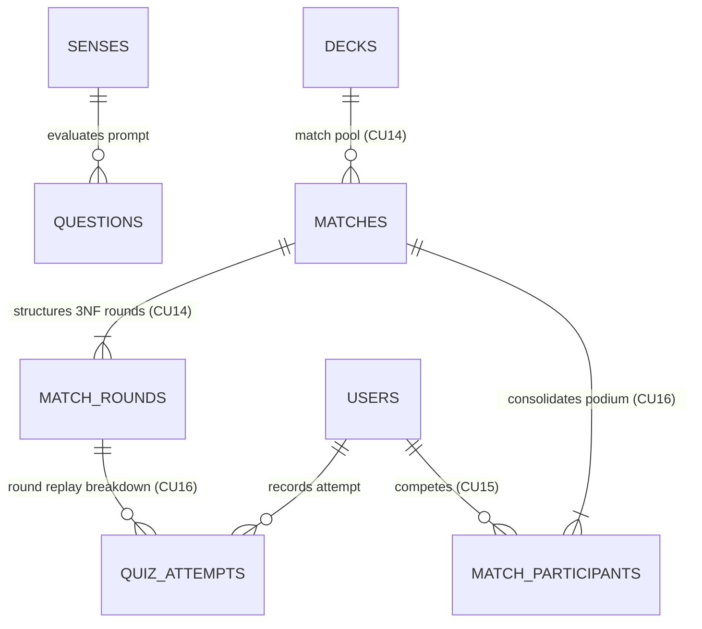

# Arena Service (`arena_service.md`)

> **Domain service file — self-contained.** Combines the domain entities and business rules (from the former `DOMAIN.md`) with the technical contracts: DTOs, SOA interface, `sqlc` queries, and HTTP/WS endpoints (from the former `INTERFACES.md`).
> **Services:** `ArenaCatalogService` (`core-service :8000`) + `realtime-service` (`:8001`) · **Use Cases:** `CU14`, `CU15`, `CU16` · **Business Rules:** `RN10` (Monotonic speed scoring), `RN13` (Image distractor quorum); `RN11` and `RN09` apply on consolidation · **Domain:** 3NF match rounds and replay, S2S token · **Routes:** backend API `/api/v1/arena/matches/*` and WS `/ws/arena/*` (see section 2.7.5); frontend routes: `TBD` (planned `/arena`; see [`ROUTES.md`](../ROUTES.md))
> **Global rules:** the contract-first rules, SOA architecture, and domain-error-to-HTTP mapping shared by every service live in [`DOMAIN.md`](../DOMAIN.md) (sections 3 and 4).
> **Canonical persistence:** PostgreSQL 17 ([`SCHEMA_FINAL.sql`](../../SCHEMA_FINAL.sql)) · **Shared DTOs:** [`pkg/models/`](../../pkg/models)

---

## Part A — Domain Model

### Entity-Relationship Fragment



### 3.5. Context 5: Curricular Assessment, Real-Time Multiplayer Arena, and 3NF Replay (`Quiz & Realtime Arena`)
Decouples low-latency synchronous competition in RAM from batch relational persistence (**CU14, CU15, CU16, RN10, RN13, RNF-CON-02**), ensuring granular round-by-round traceability (*Replay*) in Third Normal Form (3NF).

#### 16. `Question`, `MatchRound`, and `QuizAttempt` (Tables: `questions`, `match_rounds`, `quiz_attempts`)
* **`Question`:** Curricular prompt curated by an `EDITOR` for a `Sense`, featuring 6 pedagogical modalities (`DEFINITION_TO_WORD`, `WORD_TO_DEFINITION`, `SENTENCE_COMPLETION`, `REGIONAL_EQUIVALENT`, `TONE_OR_REGISTER`, `WORD_TO_IMAGE`), 3 distractors in JSONB (`custom_distractors`), and educational feedback (`explanation`). If a sense in a deck does not yet have a handcrafted question, the engine dynamically generates a prompt by pulling definitions or images from other distinct senses in the same deck.
* **`MatchRound` (Table `match_rounds` in 3NF):** Stores each round generated when preparing a match in a 100% relational manner (without corruptible JSON blobs): (`id_match`, `round_number`, `id_sense`, `id_question`, `modality`, `prompt`, `option_a`, `option_b`, `option_c`, `option_d`, `correct_option`, `explanation`). Ensures a bijective $1\text{ Round} = 1\text{ Unique Sense}$ relationship within the match. In the `WORD_TO_IMAGE` modality, options (`option_a` through `option_d`) and `correct_option` store the URLs of the 4 competing images.
* **`QuizAttempt` (Table `quiz_attempts`):** Records both individual practice attempts and the **granular round-by-round breakdown of each competitor in the Arena** (`id_match`, `round_number`, `id_user`, `id_sense`, `selected_option`, `is_correct`, `time_spent_ms`, `points_earned`), with a composite foreign key referencing `match_rounds(id_match, round_number)` and a `UNIQUE (id_match, round_number, id_user)` constraint. This enables full round-by-round retrospection (*Match Replay*).

#### 17. `Match` and `MatchParticipant` (Tables: `matches`, `match_participants`)
Represent the lifecycle, room operating rules, and consolidated outcome of a multiplayer match in the Arena (**CU14, CU15, CU16**).
* **Arena Domain Rules and Invariants:**
  1. **Deck Limits and Room Opening (`CU14`):**
     * **Absolute floor of 8 senses:** The selected deck (`id_deck`) must have at least **8 senses in `APPROVED` state**; otherwise, the system rejects room opening with `422 Unprocessable Entity` (`ErrUnprocessable`).
     * **Zero repeated questions (`TotalRounds <= ApprovedSenses`):** The number of rounds (`total_rounds`, range `8..20`, default `8`) cannot exceed the quantity of approved senses available in the deck.
     * **Quorum of Visual Distractors (`RN13`):** To generate a `WORD_TO_IMAGE` round, the deck must contain at least 4 unique visual assets (`image_url IS NOT NULL`); if not met, that round automatically degrades to textual modality (`WORD_TO_DEFINITION`).
     * **Initial 3NF persistence:** A record is inserted into `matches` (`WAITING`) with a `room_code` (unique 6-character alphanumeric PIN) and its $N$ rows are immediately inserted into `match_rounds`.
  2. **Room Topology, Host Role, and Automatic Succession (`CU15` / `RNF-CON-02`):**
     * **Maximum capacity:** Up to **8 simultaneous participants** per room (`MaxParticipants = 8`).
     * **Host privileges:** The user who prepares the room is the initial `Host` (`IsHost = true`) and holds the exclusive authority to trigger `START_MATCH` in `WAITING` state. During `IN_PROGRESS`, they compete on completely equal terms (**RN10**).
     * **Reconnection window (`RNF-CON-02`):** In the event of a WebSocket drop, the participant retains their spot, score (`Score`), and timings in RAM for **10 seconds** (`IsReady = false` while disconnected). If they reconnect within 10s, they resume their session without data loss.
     * **Host succession by seniority:** If the `Host` disconnects in `WAITING` state and does not return after the 10-second grace window expires, the `IsHost = true` role is automatically transferred to the **next earliest connected participant** (lowest `JoinedAt`), broadcasting `ROOM_STATE`. If no connected players remain, the room is destroyed in RAM.
  3. **Speed Scoring (`RN10`) and Deterministic Tie-Breaker (`total_time_spent_ms`):**
     * Response time is measured exclusively using the server monotonic clock (`elapsedMs`), awarding between `500` and `1000` points per correct answer based on speed, or `0` on incorrect answer/timeout.
     * In each round, `total_time_spent_ms` accumulates per participant (adding `round_time_sec * 1000` if no answer was submitted before timeout).
     * **Canonical Podium Ordering (Tie-Breaker):** When computing `final_rank` (`1, 2, 3...`) and declaring `winner_user_id`, participants are ranked by:
       $$\text{Score DESC} \;\longrightarrow\; \text{CorrectAnswers DESC} \;\longrightarrow\; \text{TotalTimeSpentMs ASC}$$
  4. **Transactional Consolidation with S2S Security (`CU16`):**
     * Upon concluding the final round (`FINISHED`), `realtime-service` invokes `core-service` authenticated via an **Internal Service-to-Service (S2S) JWT** signed with a derived cryptographic subkey (`HMAC-SHA256`), impossible to forge with client tokens.
     * In a single ACID *Batch Flush* (`pgx.Tx`), `core-service` closes `matches`, inserts `match_participants`, persists the round-by-round breakdown in `quiz_attempts` for *Replay*, records rewards in `xp_transactions` (**RN11**: `+150`, `+100`, `+75`, `+40 XP`), and updates `user_mastery` (**RN09**: `qualityRating = 3` for correct senses and `1` for incorrect senses).

---

## Part B — Technical Contracts

> [!IMPORTANT]
> Contract-first rules apply: no invented JSON fields, strict `snake_case`, typed `sqlc` queries only, and `response.Error(w, status, message)` for every error. See [`DOMAIN.md`](../DOMAIN.md#3-global-contract-first-rules-cross-cutting).

### MODULE 7: Multiplayer Arena in Go (`ArenaCatalogService` on `:8000` + `realtime-service` on `:8001` — `CU14, CU15, CU16`)

#### 2.7.1. `realtime-service` Design in Go 1.24 (`:8001`) and S2S Security (`pkg/auth`)

`realtime-service` is implemented in **Go 1.24** within the same monorepo (root `go.mod` `palabrario`), utilizing:
- **HTTP Router:** `github.com/go-chi/chi/v5` (exposing `GET /health` and `GET /ws/arena/{roomCode}`).
- **WebSocket Engine:** `github.com/gorilla/websocket` with read/write buffers of `1024 bytes` and `WriteWait` of `5s`.
- **Client Authentication (WebSocket):** Imports `palabrario/pkg/auth` and validates the user JWT token received in `?token={jwt}` or `Authorization: Bearer {jwt}` using `VerifyToken`.
- **Internal Service-to-Service Authentication (`S2S` Impossible for Clients to Forge):**
  - In [`pkg/auth/auth.go`](../../pkg/auth/auth.go), `TokenService` derives an exclusive cryptographic sub-key for internal calls:
    $$\text{s2sSecretKey} = \text{SHA256}(\text{JWT\_SECRET} + \text{":palabrario-s2s-internal"})$$
  - `TokenService` exposes:
    - `GenerateInternalToken(serviceName string, matchScope string) (string, error)` $\to$ issues a JWT signed with `s2sSecretKey`, `Issuer: "palabrario-internal-s2s"`, `Subject: serviceName`, `MatchScope: matchScope`, and `TTL = 30s`.
    - `VerifyInternalToken(tokenString string) (*InternalServiceClaims, error)` $\to$ verifies the signature exclusively against `s2sSecretKey` and validates `Issuer == "palabrario-internal-s2s"`.
  - Furthermore, `VerifyToken` (human user tokens) explicitly validates `claims.Issuer == "palabrario-core-service"`, guaranteeing total cryptographic separation: **no player JWT can ever bypass the `RequireInternalService` middleware in `core-service`**.
- **In-Memory RAM Concurrency (`ArenaHub` and `ActiveRoom`):**
  - A global `ArenaHub` protected by `sync.RWMutex` maintains the map `rooms map[string]*ActiveRoom` indexed by `room_code` (6-character uppercase alphanumeric PIN, e.g. `"MX8921"`).
  - **Maximum room capacity:** `MaxParticipants = 8`. If a 9th distinct user attempts to join, it is rejected with a WebSocket error (`"La sala está llena (máximo 8 participantes)"`).
  - Each `ActiveRoom` runs its own coordinator goroutine (`room.RunLoop()`) with typed channels (`joinCh`, `leaveCh`, `answerCh`, `startCh`), eliminating data races when scoring simultaneous responses in milliseconds.
  - **Micro-Disconnection Tolerance (`RNF-CON-02`) and Automatic Host Succession:**
    - When a socket closes during `WAITING` or `IN_PROGRESS`, the player in `ActiveRoom.Participants[userID]` is NOT removed immediately: they are internally marked as `Connected = false` (`IsReady = false` in the `ArenaParticipant` broadcast in `ROOM_STATE`) with a **10-second** expiration timer, preserving their `Score`, `Rank`, previous answers, and accumulated times. If they reconnect before `10s`, their state resumes (`Connected = true`, `IsReady = true`) immediately.
    - **Host Succession in Lobby (`WAITING`):** If the `Host` (`userID == room.HostUserID`) disconnects in the `WAITING` state and the `10 seconds` expire without reconnection:
      1. The disconnected Host is removed from the lobby.
      2. If connected players remain in the room, the longest-connected participant (lowest `JoinedAt` timestamp) is automatically promoted to `room.HostUserID = oldest.IDUser` and their flag changes to `IsHost = true`, broadcasting the new `ROOM_STATE` so the room is not orphaned.
      3. If no connected players remain (`connectedCount == 0`), the room is closed and removed from `ArenaHub`.

#### 2.7.2. Complete Data Structures in `pkg/models/arena.go`

```go
type MatchStatus string

const (
	MatchStatusWaiting    MatchStatus = "WAITING"
	MatchStatusInProgress MatchStatus = "IN_PROGRESS"
	MatchStatusFinished   MatchStatus = "FINISHED"
)

type ArenaParticipant struct {
	IDUser      string `json:"id_user"`
	UserName    string `json:"user_name"`
	Name        string `json:"name"`
	AvatarURL   string `json:"avatar_url"`
	Score       int    `json:"score"`
	Rank        int    `json:"rank"`
	IsHost      bool   `json:"is_host"`
	IsReady     bool   `json:"is_ready"`
	DialectCode string `json:"dialect_code"`
	FlagEmoji   string `json:"flag_emoji"`
}

type ArenaQuestion struct {
	RoundNumber   int      `json:"round_number"`
	Modality      string   `json:"modality"` // 'DEFINITION_TO_WORD', 'WORD_TO_DEFINITION', 'WORD_TO_IMAGE', etc.
	Prompt        string   `json:"prompt"`
	Options       []string `json:"options"`
	Explanation   string   `json:"explanation"`
	TimeLimitSecs int      `json:"time_limit_secs"`
}

type ArenaRoomState struct {
	RoomCode     string             `json:"room_code"`
	DeckID       int                `json:"deck_id"`
	DeckTitle    string             `json:"deck_title"`
	Status       MatchStatus        `json:"status"`
	TotalRounds  int                `json:"total_rounds"`
	CurrentRound int                `json:"current_round"`
	RoundTimeSec int                `json:"round_time_sec"`
	Participants []ArenaParticipant `json:"participants"`
}

// WebSocket Event Wrapper
type WSEvent struct {
	Type    string      `json:"type"` // e.g. "ROOM_STATE", "COUNTDOWN", "QUESTION", "ROUND_RESULT", "PODIUM"
	Payload interface{} `json:"payload,omitempty"`
}

// Client request to core-service to prepare a new room (CU14)
type CreateMatchRequest struct {
	IDDeck       int   `json:"id_deck"`             // Required: Base deck (min. 8 APPROVED senses and >= TotalRounds)
	TotalRounds  int   `json:"total_rounds"`        // 8..20 (default 8)
	RoundTimeSec int   `json:"round_time_sec"`      // 10..30 seconds per round (default 15)
	IsPublic     *bool `json:"is_public,omitempty"` // Optional (default true)
}

// Complete internal prompt (includes CorrectOption for server-side grading and match_rounds persistence;
// when realtime-service emits the WS event "QUESTION" to clients, it sends ArenaQuestion omitting CorrectOption)
type InternalArenaQuestion struct {
	RoundNumber   int      `json:"round_number"`
	IDSense       int      `json:"id_sense"`
	IDQuestion    *int     `json:"id_question,omitempty"`
	Lemma         string   `json:"lemma,omitempty"`
	Modality      string   `json:"modality"`       // 'DEFINITION_TO_WORD', 'WORD_TO_DEFINITION', 'WORD_TO_IMAGE', etc.
	Prompt        string   `json:"prompt"`
	Options       []string `json:"options"`        // 4 shuffled options (option_a..option_d: 1 correct + 3 distractors)
	CorrectOption string   `json:"correct_option"` // NEVER sent in QUESTION event, revealed in ROUND_RESULT
	Explanation   string   `json:"explanation"`
	TimeLimitSecs int      `json:"time_limit_secs"`
}

// Package returned when creating/preparing a room in core-service and hydrating realtime-service
type MatchPackage struct {
	IDMatch      string                  `json:"id_match"`
	RoomCode     string                  `json:"room_code"`      // Unique 6-character PIN, e.g. "MX8921"
	HostUserID   string                  `json:"host_user_id"`
	IDDeck       int                     `json:"id_deck"`
	DeckTitle    string                  `json:"deck_title"`
	IsPublic     bool                    `json:"is_public"`
	TotalRounds  int                     `json:"total_rounds"`
	RoundTimeSec int                     `json:"round_time_sec"`
	Questions    []InternalArenaQuestion `json:"questions"`
}

// Frame sent by the player in WS event "SUBMIT_ANSWER"
type SubmitAnswerPayload struct {
	RoundNumber     int    `json:"round_number"`
	SelectedOption  string `json:"selected_option"`
	ClientElapsedMs int    `json:"client_elapsed_ms"` // Telemetry only; server grades with its monotonic clock
}

// Frame broadcast by the server when closing a round in WS event "ROUND_RESULT"
type RoundResultPayload struct {
	RoundNumber   int                `json:"round_number"`
	IDSense       int                `json:"id_sense"`
	CorrectOption string             `json:"correct_option"`
	Explanation   string             `json:"explanation"`
	Leaderboard   []ArenaParticipant `json:"leaderboard"` // Ordered by Score DESC, CorrectAnswers DESC, TotalTimeSpentMs ASC
}

// Participant response detail in a specific round to persist in quiz_attempts (CU16 Replay)
type ParticipantRoundAttempt struct {
	RoundNumber    int    `json:"round_number"`
	IDSense        int    `json:"id_sense"`
	IDQuestion     *int   `json:"id_question,omitempty"`
	SelectedOption string `json:"selected_option"` // "" if did not answer (timeout)
	IsCorrect      bool   `json:"is_correct"`
	TimeSpentMs    int    `json:"time_spent_ms"`    // Server ElapsedMs (or RoundTimeSec*1000 on timeout)
	PointsEarned   int    `json:"points_earned"`
}

// Batch Flush payload sent from realtime-service to core-service upon match conclusion (CU16)
type ParticipantFinalResult struct {
	IDUser           string                    `json:"id_user"`
	FinalScore       int                       `json:"final_score"`
	AccuracyRate     float32                   `json:"accuracy_rate"`
	FinalRank        int                       `json:"final_rank"`
	TotalTimeSpentMs int                       `json:"total_time_spent_ms"`
	CorrectSenseIDs  []int                     `json:"correct_sense_ids"`
	WrongSenseIDs    []int                     `json:"wrong_sense_ids"`
	RoundAttempts    []ParticipantRoundAttempt `json:"round_attempts"`
}

type ConsolidateMatchRequest struct {
	IDMatch      string                   `json:"id_match"`
	RoomCode     string                   `json:"room_code"`
	Participants []ParticipantFinalResult `json:"participants"`
}

type MatchSummary struct {
	IDMatch      string             `json:"id_match"`
	RoomCode     string             `json:"room_code"`
	IDDeck       int                `json:"id_deck"`
	DeckTitle    string             `json:"deck_title"`
	WinnerUserID *string            `json:"winner_user_id,omitempty"`
	Status       MatchStatus        `json:"status"`
	TotalRounds  int                `json:"total_rounds"`
	RoundTimeSec int                `json:"round_time_sec"`
	Podium       []ArenaParticipant `json:"podium"`
	FinishedAt   string             `json:"finished_at"`
}

type PublicMatchItem struct {
	IDMatch          string    `json:"id_match"`
	RoomCode         string    `json:"room_code"`
	IDDeck           int       `json:"id_deck"`
	DeckTitle        string    `json:"deck_title"`
	IsDeckOfficial   bool      `json:"is_deck_official"`
	HostUserID       *string   `json:"host_user_id,omitempty"`
	HostUserName     string    `json:"host_user_name"`
	TotalRounds      int       `json:"total_rounds"`
	RoundTimeSec     int       `json:"round_time_sec"`
	CreatedAt        time.Time `json:"created_at"`
	ParticipantCount int       `json:"participant_count"`
}

// --- RETROSPECTION AND GRANULAR ROUND-BY-ROUND REPLAY DTOs (CU16 Replay 3NF) ---

type ParticipantRoundAnswer struct {
	IDUser         string `json:"id_user"`
	UserName       string `json:"user_name"`
	Name           string `json:"name"`
	AvatarURL      string `json:"avatar_url,omitempty"`
	DialectCode    string `json:"dialect_code"`
	FlagEmoji      string `json:"flag_emoji"`
	SelectedOption string `json:"selected_option"`
	IsCorrect      bool   `json:"is_correct"`
	TimeSpentMs    int    `json:"time_spent_ms"`
	PointsEarned   int    `json:"points_earned"`
}

type MatchRoundReplay struct {
	RoundNumber   int                      `json:"round_number"`
	IDSense       int                      `json:"id_sense"`
	Lemma         string                   `json:"lemma"`
	Modality      string                   `json:"modality"`
	Prompt        string                   `json:"prompt"`
	Options       []string                 `json:"options"`
	CorrectOption string                   `json:"correct_option"`
	Explanation   string                   `json:"explanation"`
	Answers       []ParticipantRoundAnswer `json:"answers"`
}

type MatchReplayDetail struct {
	MatchSummary
	Rounds []MatchRoundReplay `json:"rounds"`
}
```

#### 2.7.3. SOA Interface (`ArenaCatalogService` in `core-service/internal/service/arena_catalog_service.go`)

```go
type ArenaCatalogService interface {
	PrepareMatch(ctx context.Context, hostUserID string, hostRole models.AccountRole, req models.CreateMatchRequest) (*models.MatchPackage, error)
	GetMatchPackageByRoomCode(ctx context.Context, roomCode string) (*models.MatchPackage, error)
	ConsolidateMatch(ctx context.Context, req models.ConsolidateMatchRequest) (*models.MatchSummary, error)
	ListMatchHistory(ctx context.Context, userID string, limit int) ([]models.MatchSummary, error)
	GetMatchReplay(ctx context.Context, viewerID string, viewerRole models.AccountRole, matchID string) (*models.MatchReplayDetail, error)
	ListPublicWaitingMatches(ctx context.Context, limit int) ([]models.PublicMatchItem, error)
}
```

#### 2.7.4. Official Speed Scoring Formula (`RN10`), Tie-Breaking, and Rewards (`RN11`)

In `realtime-service`, response time is measured using the server's monotonic clock (`elapsedMs = time.Since(roundStartedAt).Milliseconds()`) to prevent client manipulation:
- If the response arrives after `RoundTimeSec * 1000`, the player does not answer (timeout), or `SelectedOption != CorrectOption`:
  $$\text{Points} = 0$$
  *(If there was a timeout, the round time limit `RoundTimeSec * 1000` is added to their `TotalTimeSpentMs`).*
- If `SelectedOption == CorrectOption` within the time limit ($T_{\text{max}} = \text{RoundTimeSec} \times 1000$):
  $$\text{Points} = \left\lfloor 500 + 500 \times \left(1 - \frac{\min(\text{elapsedMs}, T_{\text{max}})}{T_{\text{max}}}\right) \right\rfloor \in [500, 1000]$$
- **Deterministic Ranking and Tie-Breaking Criteria (`FinalRank`):**
  When sorting the partial `Leaderboard` and final podium (`FinalRank = 1..N`), the following applies:
  1. Higher score (`Score DESC`)
  2. Higher number of correct answers (`len(CorrectSenseIDs) DESC`)
  3. Lower total time spent (`TotalTimeSpentMs ASC`)
- Upon match conclusion (**CU16**), the *Batch Flush* to `core-service` awards auditable experience in `xp_transactions` (with `metadata_id = id_match`):
  - `1st Place (Rank 1)`: `+150 XP` (`reason = 'MATCH_WIN'`)
  - `2nd Place (Rank 2)`: `+100 XP` (`reason = 'QUIZ_CORRECT'`)
  - `3rd Place (Rank 3)`: `+75 XP` (`reason = 'QUIZ_CORRECT'`)
  - `Participation (Rank >= 4)`: `+40 XP` (`reason = 'QUIZ_CORRECT'`)

#### 2.7.5. Arena HTTP and WebSocket Endpoints (`:8000` and `:8001`)

| Service | Method / Protocol | Path | Middleware | Use Case | Description |
| :---: | :---: | :--- | :---: | :---: | :--- |
| `core-service (:8000)` | `GET` | `/api/v1/arena/matches/public` | Public | CU14 / CU15 | Lists open public arena rooms currently waiting for players (`status = 'WAITING'`, `is_public = true`, `created_at` within 2 hours, participants < 8). Accepts optional `?limit=20` (1..50). Returns `[]models.PublicMatchItem` with `200 OK`. |
| `core-service (:8000)` | `POST` | `/api/v1/arena/matches/prepare` | `RequireAuth` | CU14 (RN04/10) | Validates privacy (`RN04`), requires that `Deck` has $\ge 8$ `APPROVED` senses and $\ge \text{TotalRounds}$ (`422` if not), generates unique PIN in `matches` (`WAITING`), persists rounds in `match_rounds` (3NF), and returns `MatchPackage` with `201 Created`. |
| `core-service (:8000)` | `GET` | `/api/v1/arena/matches/{roomCode}/package` | `RequireInternalService` (JWT S2S) | CU14 / CU15 | Exclusively allows `realtime-service` to load into RAM the `MatchPackage` of a room in `WAITING` state (`200 OK`). A non-S2S token is rejected with `403`; a missing/malformed header with `401`. |
| `core-service (:8000)` | `POST` | `/api/v1/arena/matches/consolidate` | `RequireInternalService` (JWT S2S) | CU16 (RN09/11)| Executes in a single `pgx.Tx` transaction the closing of `matches` (`FINISHED`), insertion into `match_participants`, breakdown of rounds into `quiz_attempts`, entries in `xp_transactions`, and adjustments in `user_mastery`. Returns `models.MatchSummary` with `200 OK`. |
| `core-service (:8000)` | `GET` | `/api/v1/arena/matches/history` | `RequireAuth` | CU13 / CU16 | Returns recent matches played by the authenticated user (`[]models.MatchSummary`; `?limit=20`, valid range `1..50`, otherwise the default `20`). |
| `core-service (:8000)` | `GET` | `/api/v1/arena/matches/{matchId}` | `RequireAuth` | CU16 (Replay) | Returns complete `models.MatchReplayDetail` with podium and round-by-round breakdown (`match_rounds` + `quiz_attempts`). |
| `realtime-service (:8001)` | `GET` | `/health` | Public | Infra | Verifies Go process health and active room count in RAM (`{"status","service","active_rooms","timestamp"}`). |
| `realtime-service (:8001)` | `GET` | `/` | Public | Infra | Welcome message (`{"message": ...}`). |
| `realtime-service (:8001)` | `WS` | `/ws/arena/{roomCode}?token={jwt}` | JWT (`pkg/auth`, validated in the handler via `VerifyToken`; also accepts `Authorization: Bearer {jwt}`) | CU15 / CU16 | Low-latency ($< 50\text{ ms}$) bidirectional channel (see event table below). Pre-upgrade failures: `400` (empty room code), `401` (missing/invalid token), `404` (room package unavailable in `core-service`). |

**WebSocket events (`models.WSEvent{type, payload}`).** Joining a room is implicit: the room join happens when the WebSocket upgrade succeeds (there is **no** client `JOIN_ROOM` event in the code); a successful join (or reconnection) triggers a `ROOM_STATE` broadcast.

| Direction | `type` | Payload |
| :---: | :--- | :--- |
| Client $\to$ Server | `START_MATCH` | none; only honored when sent by the host while the room is `WAITING` |
| Client $\to$ Server | `SUBMIT_ANSWER` | `models.SubmitAnswerPayload` |
| Server $\to$ Clients | `ROOM_STATE` | `models.ArenaRoomState` |
| Server $\to$ Clients | `COUNTDOWN` | `{"seconds": 3}` |
| Server $\to$ Clients | `QUESTION` | `models.ArenaQuestion` (never includes `correct_option`) |
| Server $\to$ Clients | `ROUND_RESULT` | `models.RoundResultPayload` |
| Server $\to$ Clients | `PODIUM` | final standings |
| Server $\to$ Joining client | `ERROR` | `{"error": "..."}` (e.g. match already in progress, room full); the socket is then closed |

#### 2.7.6. `sqlc` Queries (`sql/queries/arena.sql`)
`GetApprovedDeckSensesForArena :many`, `GetCuratedQuestionsBySenseIDs :many`, `CreateMatch :one`, `InsertMatchRound :exec`, `GetMatchByRoomCode :one`, `GetMatchByID :one`, `ListMatchRoundsByMatchID :many`, `UpdateMatchStatus :exec`, `MarkMatchFinished :one`, `UpsertMatchParticipant :exec`, `UpsertMatchRoundQuizAttempt :exec`, `ListUserMatchHistory :many`, `ListMatchParticipantsByMatchIDs :many`, `ListMatchQuizAttemptsByMatchID :many`, `ListPublicWaitingMatches :many`. The service additionally reuses `GetDeckByID` from `studio.sql` (see [`studio_service.md`](studio_service.md)), and `InsertXPTransaction`, `UpsertUserMastery` from `mastery.sql` (see [`mastery_service.md`](mastery_service.md)).
