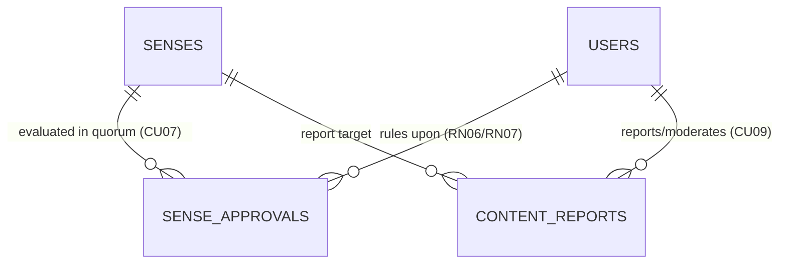
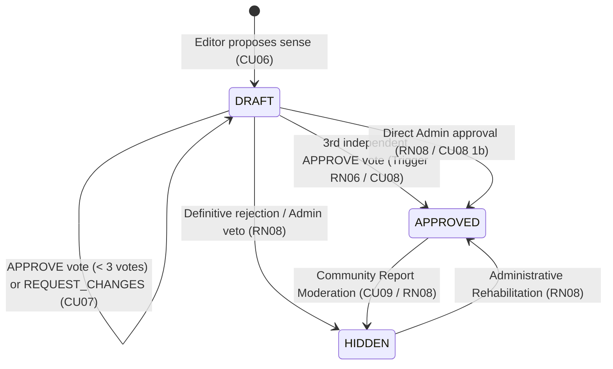

# Curation Service (`curation_service.md`)

> **Domain service file — self-contained.** Combines the domain entities and business rules (from the former `DOMAIN.md`) with the technical contracts: DTOs, SOA interface, `sqlc` queries, and HTTP/WS endpoints (from the former `INTERFACES.md`).
> **Service:** `CurationService` · **Use Cases:** `CU07`, `CU08`, `CU09` · **Business Rules:** `RN06` (Quorum of 3), `RN07` (No self-approval), `RN08` (Admin override) · **Domain:** Authorship, Community Reports · **Routes:** `TBD`
> **Global rules:** the contract-first rules, SOA architecture, and domain-error-to-HTTP mapping shared by every service live in [`DOMAIN.md`](../DOMAIN.md) (sections 3 and 4).
> **Canonical persistence:** PostgreSQL 17 ([`SCHEMA_FINAL.sql`](../../SCHEMA_FINAL.sql)) · **Shared DTOs:** [`pkg/models/`](../../pkg/models)

---

## Part A — Domain Model

### Entity-Relationship Fragment



### 3.3. Context 3: Collaborative Quorum Curation and Moderation (`Editorial Governance`)
Ensures academic rigor without sacrificing community agility (**CU06, CU07, CU08, CU09**).



#### 10. `SenseApproval` (Table: `sense_approvals`)
Represents the philological ruling issued by a reviewing `EDITOR` on a `Sense` in `DRAFT` state (**CU07**).
* **Composite Identifier:** `(id_sense, id_editor)` — ensures that an editor casts only one countable vote per sense.
* **Key Attributes:**
  * `decision` (`review_decision`: `APPROVE | REQUEST_CHANGES | REJECT`).
  * `feedback_notes` (`TEXT`, optional): Pedagogical feedback when requesting revisions from the author (**CU07 Alternate Flow 4a**).
  * `approved_at` (`TIMESTAMPTZ`).
* **Database Integrity Rules (PL/pgSQL Triggers):**
  * **RN07 (`trg_prevent_self_approval`):** Raises an atomic exception if `NEW.id_editor == senses.id_editor`. No author may vote on their own proposal.
  * **RN06 (`trg_auto_approve_sense`):** Upon accumulating $\ge 3$ records with `decision = 'APPROVE'` for the same `id_sense`, automatically promotes `senses.state = 'APPROVED'` (**CU08**), validating both the textual definition and the suitability of the associated image (**RN12**).

#### 11. `ContentReport` (Table: `content_reports`)
Channels community oversight where any `Member` or `Learner` reports lexicographical errors, missing taboo tags (`OFFENSIVE_UNMARKED`), or vandalism on a lemma, sense, or example, and the `Administrator` rules on its resolution (**CU09**).
* **Identifier:** `id_report` (`UUID`, PK).
* **Key Attributes:** `id_reporter` (`UUID`), `target_type` (`WORD | SENSE | EXAMPLE`), optional FKs (`id_word`, `id_sense`, `id_example`), `reason` (`report_reason`), `details` (`TEXT`), `status` (`PENDING | RESOLVED_HIDDEN | RESOLVED_AMENDED | DISMISSED`), `resolved_by` (`UUID`), `resolution_notes` (`TEXT`).

---

## Part B — Technical Contracts

> [!IMPORTANT]
> Contract-first rules apply: no invented JSON fields, strict `snake_case`, typed `sqlc` queries only, and `response.Error(w, status, message)` for every error. See [`DOMAIN.md`](../DOMAIN.md#3-global-contract-first-rules-cross-cutting).

### MODULE 4: Editorial Curation by Quorum and Moderation (`CurationService` — `CU07, CU08, CU09`)

#### 2.4.1. Data Structures (`pkg/models/curation.go`)

```go
package models

import "time"

type ReviewDecision string

const (
	DecisionApprove        ReviewDecision = "APPROVE"
	DecisionRequestChanges ReviewDecision = "REQUEST_CHANGES"
	DecisionReject         ReviewDecision = "REJECT"
)

type SenseApprovalVote struct {
	IDSense        int            `json:"id_sense"`
	IDEditor       string         `json:"id_editor"`
	EditorUserName string         `json:"editor_user_name"`
	EditorFullName string         `json:"editor_full_name"`
	EditorDialect  string         `json:"editor_dialect"`
	Decision       ReviewDecision `json:"decision"`
	FeedbackNotes  *string        `json:"feedback_notes,omitempty"`
	ApprovedAt     time.Time      `json:"approved_at"`
}

type SenseQuorumItem struct {
	IDSense          int            `json:"id_sense"`
	IDWord           int            `json:"id_word"`
	Lemma            string         `json:"lemma"`
	PartOfSpeech     string         `json:"part_of_speech"`
	RegionCode       string         `json:"region_code"`
	RegionName       string         `json:"region_name"`
	FlagEmoji        string         `json:"flag_emoji"`
	ShortDefinition  string         `json:"short_definition"`
	Definition       string         `json:"definition"`
	CulturalNote     *string        `json:"cultural_note,omitempty"`
	CEFRLevel        string         `json:"cefr_level"`
	UsageFrequency   string         `json:"usage_frequency"`
	IsTabooOrVulgar  bool           `json:"is_taboo_or_vulgar"`
	State            string         `json:"state"`            // 'DRAFT', 'APPROVED', 'HIDDEN'
	AuthorID         string         `json:"author_id"`
	AuthorUserName   string         `json:"author_user_name"`
	AuthorFullName   string         `json:"author_full_name"`
	ApprovalsCount   int            `json:"approvals_count"`  // Votes with decision = 'APPROVE'
	RequiredQuorum   int            `json:"required_quorum"`  // Constant: 3 (RN06)
	CreatedAt        time.Time      `json:"created_at"`
}

type SenseQuorumDetail struct {
	Proposal SenseQuorumItem     `json:"proposal"`
	Examples []Example           `json:"examples"`
	Votes    []SenseApprovalVote `json:"votes"`
}

type SubmitVoteRequest struct {
	Decision      ReviewDecision `json:"decision"`                 // 'APPROVE', 'REQUEST_CHANGES', 'REJECT'
	FeedbackNotes *string        `json:"feedback_notes,omitempty"` // Required if Decision != 'APPROVE'
}

type AdminOverrideStateRequest struct {
	State  string  `json:"state"`            // 'APPROVED' or 'HIDDEN'
	Reason *string `json:"reason,omitempty"` // Audit note
}

// --- CONTENT REPORT MODERATION DTOs (CU09) ---

type ContentReport struct {
	IDReport        string     `json:"id_report"`
	IDReporter      string     `json:"id_reporter"`
	ReporterName    string     `json:"reporter_user_name"`
	TargetType      string     `json:"target_type"`      // 'WORD', 'SENSE', 'EXAMPLE'
	IDWord          *int       `json:"id_word,omitempty"`
	IDSense         *int       `json:"id_sense,omitempty"`
	IDExample       *int       `json:"id_example,omitempty"`
	TargetPreview   string     `json:"target_preview"`   // Lemma or reported text for quick inspection
	Reason          string     `json:"reason"`           // 'INACCURATE_DEFINITION', 'OFFENSIVE_UNMARKED', 'SPAM_OR_VANDALISM', 'DUPLICATE', 'OTHER'
	Details         string     `json:"details"`
	Status          string     `json:"status"`           // 'PENDING', 'RESOLVED_HIDDEN', 'RESOLVED_AMENDED', 'DISMISSED'
	ResolvedBy      *string    `json:"resolved_by,omitempty"`
	ResolutionNotes *string    `json:"resolution_notes,omitempty"`
	CreatedAt       time.Time  `json:"created_at"`
	ResolvedAt      *time.Time `json:"resolved_at,omitempty"`
}

type CreateReportRequest struct {
	TargetType string `json:"target_type"`          // 'WORD', 'SENSE', 'EXAMPLE'
	IDWord     *int   `json:"id_word,omitempty"`
	IDSense    *int   `json:"id_sense,omitempty"`
	IDExample  *int   `json:"id_example,omitempty"`
	Reason     string `json:"reason"`
	Details    string `json:"details"`              // Required, min. 10 chars
}

type ResolveReportRequest struct {
	Status          string  `json:"status"`           // 'RESOLVED_HIDDEN', 'RESOLVED_AMENDED', 'DISMISSED'
	ResolutionNotes *string `json:"resolution_notes,omitempty"`
}
```

#### 2.4.2. `SubmitQuorumVote` Behavior Against PostgreSQL Triggers (`RN06` and `RN07`)
1. When `SubmitQuorumVote` executes `UpsertSenseApproval` in `sense_approvals`:
   - If `editorID == sense.id_editor`, both Go validation and the `trg_prevent_self_approval` trigger (**RN07**) reject the operation $\to$ the handler responds `403 Forbidden {"error": "Violación de integridad (RN07): Un editor no puede votar ni aprobar su propia contribución"}`.
   - If `req.Decision == "REQUEST_CHANGES"` or `"REJECT"` and `req.FeedbackNotes` is empty $\to$ responds `400 Bad Request {"error": "Debes incluir notas de retroalimentación al solicitar correcciones o rechazar una propuesta"}`.
   - If `req.Decision == "APPROVE"` and with this vote the sum of `decision = 'APPROVE'` reaches **3**, the `trg_auto_approve_sense` trigger (**RN06 / CU08**) automatically updates `senses.state = 'APPROVED'` within the same PostgreSQL operation. Promptly afterward, `SubmitQuorumVote` re-reads `GetProposalInspection` and returns the updated `SenseQuorumDetail` with `state: "APPROVED"` and `approvals_count: 3`.

#### 2.4.3. Curation and Moderation HTTP Endpoints (`/api/v1/curation` and `/api/v1/reports`)

| Method | Path | Middleware | Use Case | Status | Successful Response |
| :---: | :--- | :---: | :---: | :---: | :--- |
| `GET` | `/api/v1/curation/queue` | `RequireRole(EDITOR, ADMIN)` | CU07 (RN06/07) | ✅ Ready | `200 OK` $\to$ `[]models.SenseQuorumItem` (`?region=MX`) |
| `GET` | `/api/v1/curation/my-proposals` | `RequireRole(EDITOR, ADMIN)` | CU06 / CU07 | ✅ Ready | `200 OK` $\to$ `[]models.SenseQuorumItem` (`?state=DRAFT`) |
| `GET` | `/api/v1/curation/senses/{senseId}` | `RequireRole(EDITOR, ADMIN)` | CU07 | ✅ Ready | `200 OK` $\to$ `models.SenseQuorumDetail` |
| `POST` | `/api/v1/curation/senses/{senseId}/vote` | `RequireRole(EDITOR, ADMIN)` | CU07 / CU08 | ✅ Ready | `200 OK` $\to$ `models.SenseQuorumDetail` (`403` on RN07) |
| `PUT` | `/api/v1/curation/senses/{senseId}/state` | `RequireRole(ADMIN)` | CU08 (1b, RN08)| ✅ Ready | `200 OK` $\to$ `models.SenseDetail` |
| `POST` | `/api/v1/reports` | `RequireAuth` | CU09 (RF11) | ✅ Ready | `201 Created` $\to$ `models.ContentReport` |
| `GET` | `/api/v1/reports` | `RequireRole(ADMIN)` | CU09 | ✅ Ready | `200 OK` $\to$ `[]models.ContentReport` (`?status=PENDING`) |
| `PUT` | `/api/v1/reports/{reportId}/resolve` | `RequireRole(ADMIN)` | CU09 (RN08) | ✅ Ready | `200 OK` $\to$ `models.ContentReport` |
