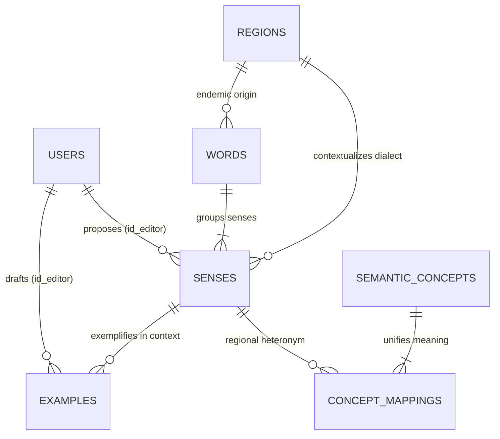

# Dictionary Service (`dictionary_service.md`)

> **Domain service file — self-contained.** Combines the domain entities and business rules (from the former `DOMAIN.md`) with the technical contracts: DTOs, SOA interface, `sqlc` queries, and HTTP/WS endpoints (from the former `INTERFACES.md`).
> **Service:** `DictionaryService` · **Use Cases:** `CU05`, `CU06` · **Domain:** Lexicon, Senses, Heteronyms (`SemanticConcept`/`ConceptMapping`), Full-Text Search · **Routes:** `/dictionary` (see [`ROUTES.md`](../ROUTES.md))
> **Global rules:** the contract-first rules, SOA architecture, and domain-error-to-HTTP mapping shared by every service live in [`DOMAIN.md`](../DOMAIN.md) (sections 3 and 4).
> **Canonical persistence:** PostgreSQL 17 ([`SCHEMA_FINAL.sql`](../../SCHEMA_FINAL.sql)) · **Shared DTOs:** [`pkg/models/`](../../pkg/models)

---

## Part A — Domain Model

### Entity-Relationship Fragment



### 3.2. Context 2: Pan-Hispanic Lexicographical Core and Heteronymy (`Lexicon & Dialectology`)
This is the linguistic heart of Palabrario (**CU05, CU06**). It models regional polysemy, speech register, taboo weight, and transdialectal equivalences.

#### 5. `Region` (Table: `regions`)
Represents a Spanish-speaking country or recognized dialectal macro-zone (`MX`, `ES`, `AR`, `CO`, `CL`, `CU`, `CAM`, `PAN`).
* **Identifier:** `id_region` (`UUID`, PK) and natural key `code` (`VARCHAR(10)`, unique).
* **Key Attributes:** `name` (`VARCHAR(100)`), `parent_zone` (`Norteamérica`, `Rioplatense`, `Andina`, `Caribe`, `Peninsular`, `General`), `country_code` (`ISO-3166-1 alpha-2`), `flag_emoji` (`VARCHAR(10)`).

#### 6. `Word` (Table: `words`)
Represents the **Canonical Lemma** (singular noun, infinitive verb, or set phrase). Acts as the Aggregate Root for a word's senses.
* **Identifier:** `id_word` (`SERIAL / INT`, PK).
* **Key Attributes:**
  * `lemma` (`VARCHAR(100)`): Canonical orthographic form with accents and diacritics (e.g., `"apapachar"`, `"tianguis"`).
  * `normalized_lemma` (`VARCHAR(100)`): Unaccented lowercase lemma, indexed with `pg_trgm` (`gin_trgm_ops`) and `varchar_pattern_ops` for instant autocomplete and typo tolerance (**RF06**).
  * `part_of_speech` (`VARCHAR(50)`): Part of speech (`sustantivo`, `verbo`, `adjetivo`, `modismo`).
  * `gender` (`word_gender`: `MALE | FEMALE | NEUTRAL | AMBIGUOUS`).
  * `etymology` (`TEXT`): Historical or indigenous root (Nahuatl, Quechua, Maya, Latin, Lunfardo, etc.).
  * `friendly_blurb` (`TEXT`): **Engaging Cultural Blurb**. Brief narrative written with humor and wit explaining the soul of the word and its contrasts across Spanish-speaking countries.
  * `image_url` (`TEXT`, optional): URL to conceptual or representative image generated and sanitized by `image-service` (**RN12**).
  * `id_origin_region` (`UUID`, optional FK $\to$ `regions`): Identifies the region if the term is endemic to a specific region; if `NULL` or `PAN`, it belongs to general Spanish.
  * `search_vector` (`tsvector` generated and stored): Weights `lemma` with weight `'A'` and `friendly_blurb` with weight `'B'` under the `spanish_unaccent` configuration.

#### 7. `Sense` (Table: `senses`)
Represents a specific **Dialectal Sense or Meaning** of a `Word` in a given `Region`. All study mechanics (`DeckItem`, `UserMastery`, `Question`) point to `Sense` and **not** to `Word`, because the learner studies a concrete meaning within a specific regional context.
* **Identifier:** `id_sense` (`SERIAL / INT`, PK).
* **Key Attributes:**
  * `id_word` (`INT`, FK $\to$ `words`), `id_region` (`UUID`, FK $\to$ `regions`), `id_editor` (`UUID`, FK $\to$ `users`, proposal author).
  * `short_definition` (`VARCHAR(255)`): Concise gloss for the Master-Detail search view and trivia options.
  * `definition` (`TEXT`): Full formal lexicographical definition.
  * `is_primary` (`BOOLEAN`): Indicates whether it is the primary sense of the lemma to prioritize it in searches and trivias.
  * `is_taboo_or_vulgar` (`BOOLEAN`) and `cultural_note` (`TEXT`): Essential pragmatic warning for interdialectal false friends (e.g., `"coger"` in Mexico/Argentina vs Spain).
  * `image_url` (`TEXT`, optional): URL to image specific to the concrete dialectal sense processed by `image-service` (**RN12**).
  * `cefr_level` (`cefr_level`: `A1 | A2 | B1 | B2 | C1 | C2 | NATIVO`) and `usage_frequency` (`EVERYDAY | COMMON | RARE | SLANG | ARCHAIC`).
  * `state` (`review_state`: `DRAFT | APPROVED | HIDDEN`): Editorial lifecycle. Only senses in `APPROVED` state are visible in public dictionary queries (**CU05, CU08**).
  * `sense_search_vector` (`tsvector` generated): Indexes `short_definition` (`A`), `definition` (`B`), and `cultural_note` (`C`).

#### 8. `Example` (Table: `examples`)
Real-world contextual sentence (literary, journalistic, or colloquial) illustrating the pragmatic usage of a `Sense`, serving as input for sentence-completion prompts (`SENTENCE_COMPLETION`).
* **Identifier:** `id_example` (`SERIAL / INT`, PK).
* **Key Attributes:** `id_sense` (`INT`, FK $\to$ `senses`), `id_editor` (`UUID`, FK $\to$ `users`), `sentence` (`TEXT`), `source` (`VARCHAR(255)`).

#### 9. `SemanticConcept` and `ConceptMapping` (Tables: `semantic_concepts`, `concept_mappings`)
Model the phenomenon of **Transdialectal Heteronymy** (*"How do they say it over there?"*).
* **Problem Solved:** Directly associating synonyms word-to-word ($N \times N$) would yield an unmanageable and ambiguous graph whenever a word is polysemous (such as *guagua* = bus and *guagua* = baby).
* **Solution:** `SemanticConcept` defines an unambiguous universal concept (`concept_key = 'public_bus'` vs `concept_key = 'infant_baby'`), and `ConceptMapping` links each specific regional `id_sense` to that concept. Thus, when looking up *guagua* in its Cuban sense (`id_sense = 103`), the system automatically discovers its heteronyms for `public_bus` (*camión*, *colectivo*, *micro*) without conflating them with those for `infant_baby`.

---

## Part B — Technical Contracts

> [!IMPORTANT]
> Contract-first rules apply: no invented JSON fields, strict `snake_case`, typed `sqlc` queries only, and `response.Error(w, status, message)` for every error. See [`DOMAIN.md`](../DOMAIN.md#3-global-contract-first-rules-cross-cutting).

### MODULE 3: Panhispanic Dictionary, Lexical Authorship, and Heteronymy (`DictionaryService` — `CU05, CU06`)

#### 2.3.1. Complete Data Structures (`pkg/models/dictionary.go`)

```go
type WordGender string

const (
	GenderMale      WordGender = "MALE"
	GenderFemale    WordGender = "FEMALE"
	GenderNeutral   WordGender = "NEUTRAL"
	GenderAmbiguous WordGender = "AMBIGUOUS"
)

type WordSearchResult struct {
	IDWord          int     `json:"id_word"`
	Lemma           string  `json:"lemma"`
	PartOfSpeech    string  `json:"part_of_speech"`
	RegionName      string  `json:"region_name"`
	ShortDefinition string  `json:"short_definition"`
	FlagEmoji       string  `json:"flag_emoji"`
	CountryCode     string  `json:"country_code"`
	Similarity      float32 `json:"similarity"`
}

type Example struct {
	IDExample int     `json:"id_example"`
	IDSense   int     `json:"id_sense"`
	Sentence  string  `json:"sentence"`
	Source    *string `json:"source,omitempty"`
}

type HeteronymItem struct {
	RegionCode  string `json:"region_code"`
	RegionName  string `json:"region_name"`
	CountryCode string `json:"country_code"`
	FlagEmoji   string `json:"flag_emoji"`
	Term        string `json:"term"`
}

type SenseDetail struct {
	IDSense         int       `json:"id_sense"`
	IDWord          int       `json:"id_word"`
	RegionCode      string    `json:"region_code"`
	RegionName      string    `json:"region_name"`
	CountryCode     string    `json:"country_code"`
	FlagEmoji       string    `json:"flag_emoji"`
	ShortDefinition string    `json:"short_definition"`
	Definition      string    `json:"definition"`
	IsPrimary       bool      `json:"is_primary"`
	IsTabooOrVulgar bool      `json:"is_taboo_or_vulgar"`
	CulturalNote    *string   `json:"cultural_note,omitempty"`
	ImageURL        *string   `json:"image_url,omitempty"`
	CEFRLevel       string    `json:"cefr_level"`
	UsageFrequency  string    `json:"usage_frequency"`
	State           string    `json:"state"`
	Examples        []Example `json:"examples"`
}

type WordDetail struct {
	IDWord          int             `json:"id_word"`
	Lemma           string          `json:"lemma"`
	NormalizedLemma string          `json:"normalized_lemma"`
	PartOfSpeech    string          `json:"part_of_speech"`
	Gender          WordGender      `json:"gender"`
	Etymology       *string         `json:"etymology,omitempty"`
	FriendlyBlurb   *string         `json:"friendly_blurb,omitempty"`
	ImageURL        *string         `json:"image_url,omitempty"`
	OriginRegion    *Region         `json:"origin_region,omitempty"` // Region: see identity_service.md
	Senses          []SenseDetail   `json:"senses"`
	Heteronyms      []HeteronymItem `json:"heteronyms"`
	CreatedAt       time.Time       `json:"created_at"`
	UpdatedAt       time.Time       `json:"updated_at"`
}
```

> `Region` (referenced by `WordDetail.OriginRegion`) is defined in `pkg/models/user.go` and documented in [`identity_service.md`](identity_service.md). The `flag_emoji` fields are part of the wire contract but must never be rendered in the UI (see [`CONTEXT.md`](../CONTEXT.md) ground rules).

The following authoring and exploration DTOs are also defined in `pkg/models/dictionary.go`:

```go
// Paginated exploration filter (GET /api/v1/words)
type WordExploreFilter struct {
	Query          string `json:"q"`
	RegionCode     string `json:"region"`          // E.g. 'MX', 'AR', 'ES'
	PartOfSpeech   string `json:"pos"`             // E.g. 'sustantivo', 'verbo', 'adjetivo', 'modismo'
	CEFRLevel      string `json:"cefr"`            // 'A1'..'C2', 'NATIVO'
	UsageFrequency string `json:"frequency"`       // 'EVERYDAY', 'COMMON', 'RARE', 'SLANG', 'ARCHAIC'
	IncludeTaboo   bool   `json:"include_taboo"`   // Default true
	Page           int    `json:"page"`            // Default 1
	Limit          int    `json:"limit"`           // Default 20, max 50
}

type WordSummaryCard struct {
	IDWord           int        `json:"id_word"`
	Lemma            string     `json:"lemma"`
	PartOfSpeech     string     `json:"part_of_speech"`
	Gender           WordGender `json:"gender"`
	FriendlyBlurb    *string    `json:"friendly_blurb,omitempty"`
	ImageURL         *string    `json:"image_url,omitempty"`
	PrimarySenseID   int        `json:"primary_sense_id"`
	ShortDefinition  string     `json:"short_definition"`
	RegionCode       string     `json:"region_code"`
	RegionName       string     `json:"region_name"`
	FlagEmoji        string     `json:"flag_emoji"`
	CEFRLevel        string     `json:"cefr_level"`
	UsageFrequency   string     `json:"usage_frequency"`
	IsTabooOrVulgar  bool       `json:"is_taboo_or_vulgar"`
	ApprovedSenses   int        `json:"approved_senses_count"`
}

type PaginatedWords struct {
	Items      []WordSummaryCard `json:"items"`
	TotalCount int               `json:"total_count"`
	Page       int               `json:"page"`
	Limit      int               `json:"limit"`
}

// --- EDITORIAL AUTHORSHIP DTOs (CU06) ---

type CreateExampleInput struct {
	Sentence string  `json:"sentence"`          // Required, min. 5 chars
	Source   *string `json:"source,omitempty"`  // Optional
}

type CreateSenseRequest struct {
	RegionCode      string               `json:"region_code"`               // Required ('MX', 'AR', etc.)
	ShortDefinition string               `json:"short_definition"`          // Required, <= 255 chars
	Definition      string               `json:"definition"`                // Required
	IsPrimary       bool                 `json:"is_primary"`
	IsTabooOrVulgar bool                 `json:"is_taboo_or_vulgar"`
	CulturalNote    *string              `json:"cultural_note,omitempty"`
	ImageURL        *string              `json:"image_url,omitempty"`        // Optional, URL processed by image-service (RN12)
	CEFRLevel       string               `json:"cefr_level"`                // Default 'B1'
	UsageFrequency  string               `json:"usage_frequency"`           // Default 'COMMON'
	ConceptIDs      []int                `json:"concept_ids,omitempty"`     // Optional: link heteronyms
	Examples        []CreateExampleInput `json:"examples,omitempty"`        // Initial examples
}

type CreateWordProposalRequest struct {
	Lemma            string             `json:"lemma"`                      // Required
	PartOfSpeech     string             `json:"part_of_speech"`             // Required
	Gender           WordGender         `json:"gender"`                     // Default 'NEUTRAL'
	Etymology        *string            `json:"etymology,omitempty"`
	FriendlyBlurb    *string            `json:"friendly_blurb,omitempty"`
	ImageURL         *string            `json:"image_url,omitempty"`         // Optional, URL processed by image-service (RN12)
	OriginRegionCode *string            `json:"origin_region_code,omitempty"`
	InitialSense     CreateSenseRequest `json:"initial_sense"`              // Required
}

type UpdateWordRequest struct {
	Lemma            string     `json:"lemma"`
	PartOfSpeech     string     `json:"part_of_speech"`
	Gender           WordGender `json:"gender"`
	Etymology        *string    `json:"etymology,omitempty"`
	FriendlyBlurb    *string    `json:"friendly_blurb,omitempty"`
	ImageURL         *string    `json:"image_url,omitempty"`
	OriginRegionCode *string    `json:"origin_region_code,omitempty"`
}

type UpdateSenseRequest struct {
	RegionCode      string  `json:"region_code"`
	ShortDefinition string  `json:"short_definition"`
	Definition      string  `json:"definition"`
	IsPrimary       bool    `json:"is_primary"`
	IsTabooOrVulgar bool    `json:"is_taboo_or_vulgar"`
	CulturalNote    *string `json:"cultural_note,omitempty"`
	ImageURL        *string `json:"image_url,omitempty"`
	CEFRLevel       string  `json:"cefr_level"`
	UsageFrequency  string  `json:"usage_frequency"`
}

type SemanticConcept struct {
	IDConcept            int    `json:"id_concept"`
	ConceptKey           string `json:"concept_key"`
	UniversalDescription string `json:"universal_description"`
	LinkedSensesCount    int    `json:"linked_senses_count"`
}

type CreateConceptRequest struct {
	ConceptKey           string `json:"concept_key"`           // E.g. 'street_market'
	UniversalDescription string `json:"universal_description"` // E.g. 'Mercado ambulante tradicional al aire libre'
}
```

#### 2.3.1b. SOA Interface (`DictionaryService`)

```go
type DictionaryService interface {
	SearchDropdown(ctx context.Context, query string, userDialect string, limit int) ([]models.WordSearchResult, error)
	GetWordDetail(ctx context.Context, wordID int) (*models.WordDetail, error)
	ListRegions(ctx context.Context) ([]models.Region, error)
	GetWordOfTheDay(ctx context.Context, dialect string) (*models.WordDetail, error)
	ExploreWords(ctx context.Context, filter models.WordExploreFilter) (*models.PaginatedWords, error)
	CreateWordProposal(ctx context.Context, actorID string, actorRole models.AccountRole, req models.CreateWordProposalRequest) (*models.WordDetail, error)
	UpdateWord(ctx context.Context, actorID string, actorRole models.AccountRole, wordID int, req models.UpdateWordRequest) (*models.WordDetail, error)
	CreateSense(ctx context.Context, actorID string, actorRole models.AccountRole, wordID int, req models.CreateSenseRequest) (*models.SenseDetail, error)
	UpdateSense(ctx context.Context, actorID string, actorRole models.AccountRole, senseID int, req models.UpdateSenseRequest) (*models.SenseDetail, error)
	DeleteSense(ctx context.Context, actorID string, actorRole models.AccountRole, senseID int) error
	CreateExample(ctx context.Context, actorID string, actorRole models.AccountRole, senseID int, req models.CreateExampleInput) (*models.Example, error)
	UpdateExample(ctx context.Context, actorID string, actorRole models.AccountRole, exampleID int, req models.CreateExampleInput) (*models.Example, error)
	DeleteExample(ctx context.Context, actorID string, actorRole models.AccountRole, exampleID int) error
	ListSemanticConcepts(ctx context.Context, search string) ([]models.SemanticConcept, error)
	CreateSemanticConcept(ctx context.Context, req models.CreateConceptRequest) (*models.SemanticConcept, error)
	LinkSenseToConcept(ctx context.Context, senseID int, conceptID int) error
	UnlinkSenseFromConcept(ctx context.Context, senseID int, conceptID int) error
}
```

#### 2.3.2. Exact `sqlc` Queries in `sql/queries/dictionary.sql`

In addition to the base queries (`SearchVocabularyDropdown`, `GetWordDetailByID`, `GetApprovedSensesByWordID`, `GetExamplesByWordID`, `GetHeteronymsByWordID`), it includes:

1. `-- name: ListRegions :many`
   Selects all rows from `regions` ordered by `name ASC`.
2. `-- name: GetRegionByCode :one`
   Retrieves `id_region, code, name, parent_zone, country_code, flag_emoji` where `code = $1`.
3. `-- name: GetWordOfTheDayID :one`
   Deterministically selects an `id_word` that has at least one `APPROVED` sense (prioritizing region `$1` if supplied, using `MOD(EXTRACT(DOY FROM CURRENT_DATE)::INT, COUNT(*))` or `friendly_blurb IS NOT NULL`) to subsequently assemble its complete `WordDetail` using existing queries.
4. `-- name: ExploreWordsPaginated :many` and `-- name: CountExploreWords :one`
   Filters `words w JOIN senses s ON s.id_word = w.id_word AND s.state = 'APPROVED' JOIN regions r ON r.id_region = s.id_region` applying optional filters (`sqlc.narg`): `region_code`, `part_of_speech`, `cefr_level`, `usage_frequency`, `include_taboo`, and search query `q`, paginated with `LIMIT $1 OFFSET $2`.
5. `-- name: GetWordByNormalizedLemmaAndPOS :one`
   Checks if a lemma already exists with `(normalized_lemma = $1 AND part_of_speech = $2)`. If it already exists during `CreateWordProposal`, reuses the existing `id_word` and adds the new `Sense` in `DRAFT` (**CU06 Main Flow Step 2**).
6. `-- name: CreateWord :one`
   Inserts into `words (lemma, normalized_lemma, part_of_speech, gender, etymology, friendly_blurb, image_url, id_origin_region)` and returns the created row.
7. `-- name: UpdateWordMetadata :one`
   Updates metadata in `words` (including `image_url`) and `updated_at = now()` by `id_word`.
8. `-- name: CreateSense :one`
   Inserts into `senses (id_word, id_region, id_editor, short_definition, definition, is_primary, is_taboo_or_vulgar, cultural_note, image_url, cefr_level, usage_frequency, state)`.
   - **Business Rule in `CreateSense`:** If the actor has the `ADMIN` role, they may choose to create directly in `'APPROVED'` (`RN08`); if `EDITOR`, it is always inserted with `state = 'DRAFT'` (`CU06 Step 5`).
9. `-- name: GetSenseByID :one`
   Retrieves the sense (any `state`) along with its `id_editor` to verify authorship before edit/delete (`CU06 2a`).
10. `-- name: UpdateSense :one` and `-- name: DeleteSense :exec`
    Updates or deletes a sense. If the actor is `EDITOR` (not `ADMIN`), verifies that `sense.id_editor == actorID` and `sense.state == 'DRAFT'`.
11. `-- name: CreateExample :one`, `-- name: GetExampleByID :one`, `-- name: GetExamplesBySenseID :many`, `-- name: UpdateExample :one`, `-- name: DeleteExample :exec`
    CRUD of example sentences in `examples`.
12. `-- name: ListSemanticConcepts :many`, `-- name: CreateSemanticConcept :one`, `-- name: LinkSenseToConcept :exec`, `-- name: UnlinkSenseFromConcept :exec`
    Management of the heteronym graph in `semantic_concepts` and `concept_mappings`.

#### 2.3.3. Dictionary HTTP Endpoints Specification (`/api/v1/regions`, `/api/v1/words`, `/api/v1/senses`, `/api/v1/examples`, `/api/v1/concepts`)

Authoring routes are registered in `core-service/internal/api/router.go` inside a group with `RequireAuth` followed by `RequireRole(EDITOR, ADMIN)` (`401` without a valid token, `403` for a `LEARNER`). `OptionalAuth` injects the JWT claims when a valid Bearer token is sent but never rejects anonymous requests; the handlers use `claims.AnchorDialect` as the default dialect.

| Method | Path | Middleware | Use Case | Status | Successful Response |
| :---: | :--- | :---: | :---: | :---: | :--- |
| `GET` | `/api/v1/regions` | Public | CU05 | ✅ Ready | `200 OK` $\to$ `[]models.Region` |
| `GET` | `/api/v1/words/word-of-the-day` | `OptionalAuth` | CU05 | ✅ Ready | `200 OK` $\to$ `models.WordDetail` (`?dialect=MX`; if omitted, falls back to the caller's `AnchorDialect` claim; with no dialect, or if no word matches the region, the service picks from all regions; `404` if no words are available) |
| `GET` | `/api/v1/words/search` | `OptionalAuth` | CU05 (RF06) | ✅ Ready | `200 OK` $\to$ `[]models.WordSearchResult` (`?q=&dialect=&limit=10`; empty `q` returns `[]`; `dialect` defaults to the `AnchorDialect` claim, else `MX`) |
| `GET` | `/api/v1/words` | Public | CU05 (RF07) | ✅ Ready | `200 OK` $\to$ `models.PaginatedWords` (`?q=&region=&pos=&cefr=&frequency=&include_taboo=true&page=1&limit=20`; `limit` must be `1..50`, otherwise the default `20` is used) |
| `GET` | `/api/v1/words/{id}` | Public | CU05 (RF07) | ✅ Ready | `200 OK` $\to$ `models.WordDetail` |
| `POST` | `/api/v1/words` | `RequireAuth` + `RequireRole(EDITOR, ADMIN)` | CU06 (RF08) | ✅ Ready | `201 Created` $\to$ `models.WordDetail` |
| `PUT` | `/api/v1/words/{id}` | `RequireAuth` + `RequireRole(EDITOR, ADMIN)` | CU06 | ✅ Ready | `200 OK` $\to$ `models.WordDetail` |
| `POST` | `/api/v1/words/{id}/senses` | `RequireAuth` + `RequireRole(EDITOR, ADMIN)` | CU06 (RF08) | ✅ Ready | `201 Created` $\to$ `models.SenseDetail` |
| `PUT` | `/api/v1/senses/{senseId}` | `RequireAuth` + `RequireRole(EDITOR, ADMIN)` | CU06 (2a) | ✅ Ready | `200 OK` $\to$ `models.SenseDetail` (`403` if another editor or already approved) |
| `DELETE` | `/api/v1/senses/{senseId}` | `RequireAuth` + `RequireRole(EDITOR, ADMIN)` | CU06 | ✅ Ready | `204 No Content` |
| `POST` | `/api/v1/senses/{senseId}/examples` | `RequireAuth` + `RequireRole(EDITOR, ADMIN)` | CU06 | ✅ Ready | `201 Created` $\to$ `models.Example` |
| `PUT` | `/api/v1/examples/{exampleId}` | `RequireAuth` + `RequireRole(EDITOR, ADMIN)` | CU06 | ✅ Ready | `200 OK` $\to$ `models.Example` (body: `models.CreateExampleInput`) |
| `DELETE` | `/api/v1/examples/{exampleId}` | `RequireAuth` + `RequireRole(EDITOR, ADMIN)` | CU06 | ✅ Ready | `204 No Content` |
| `GET` | `/api/v1/concepts` | Public | CU05 / CU06 | ✅ Ready | `200 OK` $\to$ `[]models.SemanticConcept` (`?q=`) |
| `POST` | `/api/v1/concepts` | `RequireAuth` + `RequireRole(EDITOR, ADMIN)` | CU06 | ✅ Ready | `201 Created` $\to$ `models.SemanticConcept` |
| `POST` | `/api/v1/senses/{senseId}/concepts/{conceptId}` | `RequireAuth` + `RequireRole(EDITOR, ADMIN)` | CU06 | ✅ Ready | `204 No Content` |
| `DELETE` | `/api/v1/senses/{senseId}/concepts/{conceptId}` | `RequireAuth` + `RequireRole(EDITOR, ADMIN)` | CU06 | ✅ Ready | `204 No Content` |
