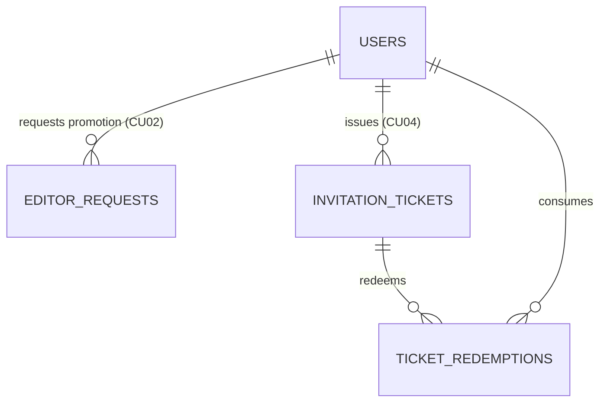

# Governance Service (`governance_service.md`)

> **Domain service file — self-contained.** Combines the domain entities and business rules (from the former `DOMAIN.md`) with the technical contracts: DTOs, SOA interface, `sqlc` queries, and HTTP/WS endpoints (from the former `INTERFACES.md`).
> **Service:** `GovernanceService` · **Use Cases:** `CU02`, `CU03`, `CU04` · **Business Rules:** `RN02` (Editor Promotion request uniqueness), `RN08` (Admin-only ticket issuance), VIP invitation tickets, Last Admin Protection · **Routes:** backend API `/api/v1/governance/*` (see section 2.2.4); frontend routes: see [`ROUTES.md`](../ROUTES.md)
> **Global rules:** the contract-first rules, SOA architecture, and domain-error-to-HTTP mapping shared by every service live in [`DOMAIN.md`](../DOMAIN.md) (sections 3 and 4).
> **Canonical persistence:** PostgreSQL 17 ([`SCHEMA_FINAL.sql`](../../SCHEMA_FINAL.sql)) · **Shared DTOs:** [`pkg/models/`](../../pkg/models)

---

## Part A — Domain Model

### Entity-Relationship Fragment



### 3.1. Context 1: Identity, Accounts, and Institutional Governance (`Account & Governance`)
Manages cryptographic security, role-based access control (**RBAC**), user dialectal identity, and institutional community growth mechanisms (**CU01, CU02, CU03, CU04**).

#### 3. `EditorRequest` (Table: `editor_requests`)
Formalizes the application record of a `LEARNER` requesting promotion to the `EDITOR` role by demonstrating their teaching, philological, or linguistic background (**CU02, CU03**).
* **Identifier:** `id_request` (`UUID`, PK).
* **Key Attributes:**
  * `id_user` (`UUID`, FK $\to$ `users`): Applying learner.
  * `institution_name` (`VARCHAR(150)`): Affiliated university, academy, or institution.
  * `justification` (`TEXT`): Statement of pedagogical/linguistic intent.
  * `credentials_url` (`TEXT`): Documentary evidence or academic verification link (**RN12**).
  * `status` (`request_status`: `PENDING | APPROVED | REJECTED`).
  * `reviewed_by` (`UUID`, FK $\to$ `users`), `review_notes` (`TEXT`), `resolved_at` (`TIMESTAMPTZ`): Administrative resolution audit trail.
* **Invariants and Rules:** **RN02 (Request Uniqueness):** A learner can only have **one** request in `PENDING` status simultaneously, enforced at the database engine level via the partial unique index `idx_unique_pending_editor_request`.

#### 4. `InvitationTicket` and `TicketRedemption` (Tables: `invitation_tickets`, `ticket_redemptions`)
Materialize the institutional access model without payment gateways (**CU04**). They allow administrators to issue single-use (individual) or multi-use (for academies or school cohorts) alphanumeric tickets, optionally granting a predetermined role.
* **Identifier:** `id_ticket` (`UUID`, PK) and `code` (`VARCHAR(50)`, unique).
* **Key Attributes:**
  * `created_by` (`UUID`, FK $\to$ `users`): Issuing administrator.
  * `granted_role` (`account_role`, default `'LEARNER'`): Role assigned upon ticket redemption.
  * `institution_name` (`VARCHAR(150)`): Institutional partnership label.
  * `max_uses` (`INTEGER`), `current_uses` (`INTEGER`): Capacity control with `CHECK (current_uses <= max_uses)` constraint.
  * `is_active` (`BOOLEAN`), `expires_at` (`TIMESTAMPTZ`): Logical and temporal validity.
* **Invariants and Rules:** **RN08:** Only an `ADMIN` may issue or revoke tickets. Each redemption transactionally increments `current_uses` and logs an entry in `ticket_redemptions (id_ticket, id_user)`.

---

## Part B — Technical Contracts

> [!IMPORTANT]
> Contract-first rules apply: no invented JSON fields, strict `snake_case`, typed `sqlc` queries only, and English error responses using `response.ErrorWithCode(w, status, code, message)` (`{ "code", "error" }`) — or `response.Error` when `code` is omitted. See [`DOMAIN.md`](../DOMAIN.md#3-global-contract-first-rules-cross-cutting).

### MODULE 2: Institutional Governance, Roles, and Tickets (`GovernanceService` — `CU02, CU03, CU04`)

#### 2.2.1. Data Structures (`pkg/models/governance.go`)

> `ListUsers` and `UpdateUserRoleOrStatus` return `models.UserProfile` (documented in [`identity_service.md`](identity_service.md)); `AccountRole` is defined in `pkg/models/user.go`.

```go
package models

import "time"

type RequestStatus string

const (
	RequestPending  RequestStatus = "PENDING"
	RequestApproved RequestStatus = "APPROVED"
	RequestRejected RequestStatus = "REJECTED"
)

type CreateEditorRequestDTO struct {
	InstitutionName string  `json:"institution_name"`          // Required, 3..150 chars
	Justification   string  `json:"justification"`             // Required, min. 20 chars
	CredentialsURL  *string `json:"credentials_url,omitempty"` // Optional, credential URL
}

type ResolveEditorRequestDTO struct {
	Status      RequestStatus `json:"status"`                  // 'APPROVED' or 'REJECTED'
	ReviewNotes *string       `json:"review_notes,omitempty"`  // Reason for administrative ruling
}

type EditorRequest struct {
	IDRequest       string        `json:"id_request"`
	IDUser          string        `json:"id_user"`
	UserName        string        `json:"user_name"`
	UserFullName    string        `json:"user_full_name"`
	UserEmail       string        `json:"user_email"`
	InstitutionName string        `json:"institution_name"`
	Justification   string        `json:"justification"`
	CredentialsURL  *string       `json:"credentials_url,omitempty"`
	Status          RequestStatus `json:"status"`
	ReviewedBy      *string       `json:"reviewed_by,omitempty"`
	ReviewNotes     *string       `json:"review_notes,omitempty"`
	CreatedAt       time.Time     `json:"created_at"`
	ResolvedAt      *time.Time    `json:"resolved_at,omitempty"`
}

type UpdateUserRoleOrStatusRequest struct {
	Role     *AccountRole `json:"role,omitempty"`      // 'LEARNER', 'EDITOR', 'ADMIN'
	IsActive *bool        `json:"is_active,omitempty"` // Account suspension / reactivation
}

type CreateTicketRequest struct {
	Code            *string     `json:"code,omitempty"`             // If omitted, backend generates e.g. "PAL-UNAM-2026-X9A2"
	GrantedRole     AccountRole `json:"granted_role"`               // 'LEARNER' or 'EDITOR' (default 'LEARNER')
	InstitutionName *string     `json:"institution_name,omitempty"` // E.g. "Facultad de Filosofía y Letras UNAM"
	MaxUses         int         `json:"max_uses"`                   // >= 1 (1 = single-use, >1 = multi-use)
	ExpiresAt       *time.Time  `json:"expires_at,omitempty"`       // Optional
}

type InvitationTicket struct {
	IDTicket        string      `json:"id_ticket"`
	Code            string      `json:"code"`
	CreatedBy       string      `json:"created_by"`
	GrantedRole     AccountRole `json:"granted_role"`
	InstitutionName *string     `json:"institution_name,omitempty"`
	MaxUses         int         `json:"max_uses"`
	CurrentUses     int         `json:"current_uses"`
	IsActive        bool        `json:"is_active"`
	ExpiresAt       *time.Time  `json:"expires_at,omitempty"`
	CreatedAt       time.Time   `json:"created_at"`
}

type RedeemTicketRequest struct {
	Code string `json:"code"` // Required
}
```

#### 2.2.2. SOA Interface (`GovernanceService`)

```go
type GovernanceService interface {
	CreateEditorRequest(ctx context.Context, learnerID string, req models.CreateEditorRequestDTO) (*models.EditorRequest, error)
	ListMyEditorRequests(ctx context.Context, learnerID string) ([]models.EditorRequest, error)
	ListEditorRequests(ctx context.Context, statusFilter *string) ([]models.EditorRequest, error)
	ResolveEditorRequest(ctx context.Context, adminID string, requestID string, req models.ResolveEditorRequestDTO) (*models.EditorRequest, error)

	ListUsers(ctx context.Context, search string, roleFilter *string, limit, offset int) ([]models.UserProfile, int, error)
	UpdateUserRoleOrStatus(ctx context.Context, adminID string, targetUserID string, req models.UpdateUserRoleOrStatusRequest) (*models.UserProfile, error)

	CreateInvitationTicket(ctx context.Context, adminID string, req models.CreateTicketRequest) (*models.InvitationTicket, error)
	ListInvitationTickets(ctx context.Context, activeOnly bool) ([]models.InvitationTicket, error)
	RevokeInvitationTicket(ctx context.Context, adminID string, ticketID string) error
	RedeemInvitationTicket(ctx context.Context, userID string, code string) (*models.UserProfile, error)
}
```

#### 2.2.3. Transactional and Integrity Rules in `GovernanceService`
1. **RN02 in `CreateEditorRequest`:** If the user already has the `EDITOR` or `ADMIN` role, returns `409 Conflict` (`ALREADY_PRIVILEGED`: `"User already has the Editor or Administrator role."`). If they attempt to create a second request while another is `PENDING`, PostgreSQL's partial unique index `idx_unique_pending_editor_request` (`SQLSTATE 23505`) translates to `409 Conflict` (`"You already have a pending promotion request."`).
2. **Atomic Promotion & Token Invalidation in `ResolveEditorRequest`:** Executes inside `pgx.Tx`. If `req.Status == "APPROVED"`, updates `editor_requests` (`status = 'APPROVED'`, `reviewed_by`, `resolved_at = now()`) **and within the same transaction** promotes `role = 'EDITOR'` and calls `IncrementAccountTokenVersion` so stale learner JWTs are invalidated immediately.
3. **Protection of the Last Administrator & Session Revocation in `UpdateUserRoleOrStatus` (CU03 4a):** Inside `pgx.Tx`, before demoting the role or deactivating (`is_active = false`) an `ADMIN` user, counts active administrators (`CountActiveAdmins`). If the count is $\le 1$, aborts with `409 Conflict` (`LAST_ADMIN_PROTECTED`: `"Cannot demote or deactivate the only active administrator."`). Whenever `req.Role != nil` or `is_active = false`, executes `IncrementAccountTokenVersion`; when deactivating (`is_active = false`), also executes `RevokeAllRefreshTokensForAccount`.
4. **Atomic Redemption in `RedeemInvitationTicket` (CU04):** Inside `pgx.Tx`, locks the ticket row (`SELECT ... FROM invitation_tickets WHERE code = $1 FOR UPDATE`), verifies `is_active == true`, `(expires_at IS NULL OR expires_at > now())`, and `current_uses < max_uses`. Inserts into `ticket_redemptions`, increments `current_uses = current_uses + 1`, and if `granted_role == 'EDITOR'` and the user was `'LEARNER'`, promotes their account to `'EDITOR'` and calls `IncrementAccountTokenVersion`.

#### 2.2.4. HTTP Endpoints (`/api/v1/governance`)

All routes are registered in `core-service/internal/api/router.go` inside a `RequireAuth` group; because every `/api/v1/governance/*` route falls under **Option B** strict DB verification, `RequireAuth` verifies `is_active`, `token_version`, and syncs live DB `role` before downstream `RequireRole(ADMIN)` executes (`401` on missing/expired/revoked tokens, `403 ACCOUNT_SUSPENDED` on suspended accounts, `403 FORBIDDEN` if the live DB role is not `ADMIN`).

| Method | Path | Middleware | Use Case | HTTP Status Codes |
| :---: | :--- | :---: | :---: | :--- |
| `POST` | `/api/v1/governance/editor-requests` | `RequireAuth` (Option B) | CU02 (RN02) | `201`, `400`, `401`, `403` (`ACCOUNT_SUSPENDED`), `409` (pending request or already an editor) |
| `GET` | `/api/v1/governance/editor-requests/me` | `RequireAuth` (Option B) | CU02 | `200`, `401`, `403` (`ACCOUNT_SUSPENDED`) |
| `POST` | `/api/v1/governance/tickets/redeem` | `RequireAuth` (Option B) | CU04 | `200`, `400`, `401`, `403` (`ACCOUNT_SUSPENDED`), `404`, `409` (exhausted, expired, or already redeemed by user) |
| `GET` | `/api/v1/governance/editor-requests` | `RequireAuth` (Option B) + `RequireRole(ADMIN)` | CU03 | `200` (`?status=PENDING`), `401`, `403` |
| `PUT` | `/api/v1/governance/editor-requests/{id}/resolve` | `RequireAuth` (Option B) + `RequireRole(ADMIN)` | CU03 (RN08) | `200`, `400`, `401`, `403`, `404`, `409` |
| `GET` | `/api/v1/governance/users` | `RequireAuth` (Option B) + `RequireRole(ADMIN)` | CU03 | `200` (`?q=&role=&limit=20&offset=0`; total returned in the `X-Total-Count` response header), `401`, `403` |
| `PUT` | `/api/v1/governance/users/{id}/access` | `RequireAuth` (Option B) + `RequireRole(ADMIN)` | CU03 (RN08) | `200`, `401`, `403`, `404`, `409` (`LAST_ADMIN_PROTECTED`) |
| `POST` | `/api/v1/governance/tickets` | `RequireAuth` (Option B) + `RequireRole(ADMIN)` | CU04 (RN08) | `201`, `400`, `401`, `403`, `409` |
| `GET` | `/api/v1/governance/tickets` | `RequireAuth` (Option B) + `RequireRole(ADMIN)` | CU04 | `200` (`?active_only=true`), `401`, `403` |
| `DELETE` | `/api/v1/governance/tickets/{id}` | `RequireAuth` (Option B) + `RequireRole(ADMIN)` | CU04 | `204`, `401`, `403`, `404` |

#### 2.2.5. `sqlc` Queries (`sql/queries/governance.sql`)
`CreateEditorRequest :one`, `ListMyEditorRequests :many`, `ListEditorRequests :many`, `GetEditorRequestByID :one`, `ResolveEditorRequest :one`, `UpdateAccountRole :exec`, `CountActiveAdmins :one`, `UpdateUserRoleOrStatus :one`, `ListUsers :many`, `CountUsers :one`, `CreateInvitationTicket :one`, `ListInvitationTickets :many`, `GetInvitationTicketByID :one`, `RevokeInvitationTicket :exec`, `GetInvitationTicketByCodeForUpdate :one`, `HasUserRedeemedTicket :one`, `CreateTicketRedemption :exec`, `IncrementTicketUses :one`. The service additionally reuses `GetAccountByID`, `GetUserProfileByID`, `IncrementAccountTokenVersion`, and `RevokeAllRefreshTokensForAccount` from `users.sql` (see [`identity_service.md`](identity_service.md)).
