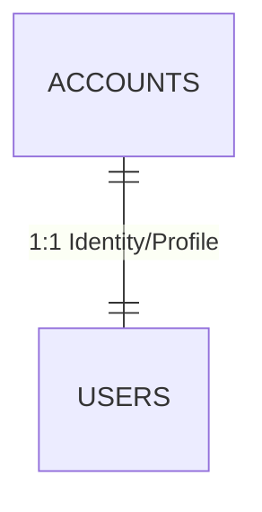

# Identity Service (`identity_service.md`)

> **Domain service file — self-contained.** Combines the domain entities and business rules (from the former `DOMAIN.md`) with the technical contracts: DTOs, SOA interface, `sqlc` queries, and HTTP/WS endpoints (from the former `INTERFACES.md`).
> **Service:** `IdentityService` · **Use Case:** `CU01` · **Business Rule:** `RN01` (Anchor Dialect / credential ownership) · **Routes:** `/auth/sign-in`, `/auth/sign-up` (see [`ROUTES.md`](../ROUTES.md))
> **Global rules:** the contract-first rules, SOA architecture, and domain-error-to-HTTP mapping shared by every service live in [`DOMAIN.md`](../DOMAIN.md) (sections 3 and 4).
> **Canonical persistence:** PostgreSQL 17 ([`SCHEMA_FINAL.sql`](../../SCHEMA_FINAL.sql)) · **Shared DTOs:** [`pkg/models/`](../../pkg/models)

---

## Part A — Domain Model

### Entity-Relationship Fragment



### 3.1. Context 1: Identity, Accounts, and Institutional Governance (`Account & Governance`)
Manages cryptographic security, role-based access control (**RBAC**), user dialectal identity, and institutional community growth mechanisms (**CU01, CU02, CU03, CU04**).

#### 1. `Account` (Table: `accounts`)
Represents the authenticated identity and security credential in the system. It is deliberately separated from `User` to isolate cryptographic secrets (`password_hash`) and permissions (`role`) from social and gamification data.
* **Identifier:** `id_account` (`UUID`, PK).
* **Key Attributes:**
  * `email` (`VARCHAR(255)`, unique): Lowercase normalized email address.
  * `password_hash` (`TEXT`): Hash derived with `bcrypt` (cost $\ge 10$). Never exposed in outgoing DTOs.
  * `role` (`account_role`: `LEARNER | EDITOR | ADMIN`): RBAC privilege level. All standard registrations start as `LEARNER`.
  * `is_active` (`BOOLEAN`): Account operational status for administrative suspension.
* **Invariants and Rules:** Only the account holder may modify their credentials (**RN01**), and only an `ADMIN` can alter an account's `role` or prevent the demotion of the last active administrator (**CU03**).

#### 2. `User` / `UserProfile` (Table: `users`)
Represents the member's public/private profile, their linguistic anchor point, and the consolidated state of their gamified progression.
* **Identifier:** `id_user` (`UUID`, PK and $1:1$ FK to `accounts.id_account` with `ON DELETE CASCADE`).
* **Key Attributes:**
  * `name` (`VARCHAR(100)`): Member display name.
  * `user_name` (`VARCHAR(50)`, unique): Public handle (`@username`) for social profiles (`/u/:username`).
  * `avatar_url` (`TEXT`, optional): URL to WebP image optimized by `image-service` (**RN12**).
  * `anchor_dialect` (`VARCHAR(10)`, default `'MX'`): User's **Anchor Dialect**. This is a core domain concept: FTS search and lexical cards prioritize senses and cultural contrasts relative to the student's anchor dialect.
  * `total_xp` (`INTEGER`), `current_level` (`INTEGER`): Cached experience balance (synchronized with the `xp_transactions` ledger) and calculated level.
  * `current_streak` (`INTEGER`), `longest_streak` (`INTEGER`), `last_activity_at` (`TIMESTAMPTZ`): Study consistency metrics (**CU01, CU13**).

---

## Part B — Technical Contracts

> [!IMPORTANT]
> Contract-first rules apply: no invented JSON fields, strict `snake_case`, typed `sqlc` queries only, and `response.Error(w, status, message)` for every error. See [`DOMAIN.md`](../DOMAIN.md#3-global-contract-first-rules-cross-cutting).

### MODULE 1: Identity, Authentication, and Profiles (`IdentityService` — `CU01`)

#### 2.1.1. Data Structures (`pkg/models/auth.go` and `pkg/models/user.go`)

```go
// Existing in pkg/models/auth.go and pkg/models/user.go:
// SignInRequest, SignUpRequest, AuthResponse, AccountRole, Region, UserProfile

// --- NEW DTOs TO ADD IN pkg/models/user.go ---

type UpdateProfileRequest struct {
	Name          string  `json:"name"`                     // Required, 2..100 chars
	AnchorDialect string  `json:"anchor_dialect"`           // Required: 'MX','ES','AR','CO','CL','CU','CAM','PAN'
	AvatarURL     *string `json:"avatar_url,omitempty"`     // Optional, URL generated by image-service
}

type ChangePasswordRequest struct {
	CurrentPassword string `json:"current_password"`        // Required
	NewPassword     string `json:"new_password"`            // Required, min. 8 characters
}

type PublicUserProfile struct {
	IDUser             string              `json:"id_user"`
	Name               string              `json:"name"`
	UserName           string              `json:"user_name"`
	AvatarURL          *string             `json:"avatar_url,omitempty"`
	AnchorDialect      string              `json:"anchor_dialect"`
	Role               AccountRole         `json:"role"`
	TotalXP            int                 `json:"total_xp"`
	CurrentLevel       int                 `json:"current_level"`
	CurrentStreak      int                 `json:"current_streak"`
	LongestStreak      int                 `json:"longest_streak"`
	UnlockedBadges     []AchievementStatus `json:"unlocked_badges"`
	PublicDecks        []Deck              `json:"public_decks"`
	PublicCollections  []Collection        `json:"public_collections"`
	MatchesWon         int                 `json:"matches_won"`
	PodiumCount        int                 `json:"podium_count"`
	IsOwner            bool                `json:"is_owner"`
	// Fields populated ONLY when IsOwner == true:
	Email              *string             `json:"email,omitempty"`
	PrivateDecksCount  *int                `json:"private_decks_count,omitempty"`
	DueReviewsToday    *int                `json:"due_reviews_today,omitempty"`
	CreatedAt          time.Time           `json:"created_at"`
}
```

#### 2.1.2. SOA Interface (`IdentityService`)

```go
type IdentityService interface {
	SignUp(ctx context.Context, req models.SignUpRequest) (*models.AuthResponse, error)
	SignIn(ctx context.Context, req models.SignInRequest) (*models.AuthResponse, error)
	GetMe(ctx context.Context, userID string) (*models.UserProfile, error)
	UpdateProfile(ctx context.Context, userID string, req models.UpdateProfileRequest) (*models.UserProfile, error)
	ChangePassword(ctx context.Context, userID string, req models.ChangePasswordRequest) error
	GetPublicProfileByUsername(ctx context.Context, viewerID *string, username string) (*models.PublicUserProfile, error)
}
```

#### 2.1.3. `sqlc` Queries (`sql/queries/users.sql`)
- **Existing:** `GetAccountByEmail`, `CreateAccount`, `CreateUserProfile`, `GetUserProfileByID`, `CheckEmailOrUsernameExists`.
- **New to add in `sql/queries/users.sql`:**
  - `-- name: UpdateUserProfile :one` $\to$ Updates `name`, `anchor_dialect`, `avatar_url`, `updated_at = now()` in `users` filtering by `id_user` and returns the profile joined with `accounts`.
  - `-- name: GetAccountByID :one` $\to$ Retrieves `id_account, password_hash, is_active` to verify current password.
  - `-- name: UpdateAccountPassword :exec` $\to$ Updates `password_hash` and `updated_at = now()` in `accounts`.
  - `-- name: GetUserProfileByUsername :one` $\to$ Looks up in `users JOIN accounts` by `LOWER(user_name) = LOWER($1)`.

#### 2.1.4. HTTP Endpoints (`/api/v1/auth` and `/api/v1/users`)

| Method | Path | Middleware | Use Case | Status | HTTP Status Codes |
| :---: | :--- | :---: | :---: | :---: | :--- |
| `POST` | `/api/v1/auth/sign-up` | Public | Base Auth | ✅ Ready | `201`, `400`, `409` |
| `POST` | `/api/v1/auth/sign-in` | Public | RF01 | ✅ Ready | `200`, `400`, `401`, `403` (if `is_active=false`) |
| `GET` | `/api/v1/auth/me` | `RequireAuth` | CU01 | ✅ Ready | `200`, `401`, `404` |
| `PUT` | `/api/v1/users/me` | `RequireAuth` | CU01 (RN01) | ✅ Ready | `200`, `400`, `401` |
| `PUT` | `/api/v1/users/me/password` | `RequireAuth` | CU01 (RN01) | ✅ Ready | `204`, `400`, `401` (invalid current password) |
| `GET` | `/api/v1/users/u/{username}` | `OptionalAuth` | CU01 / UI | ✅ Ready | `200`, `404` |
