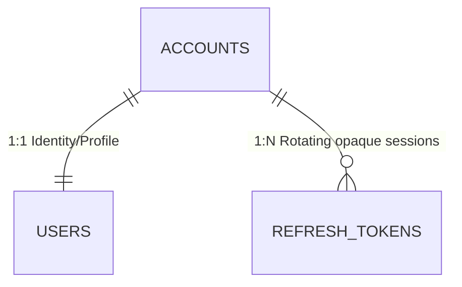

# Identity Service (`identity_service.md`)

> **Domain service file — self-contained.** Combines the domain entities and business rules (from the former `DOMAIN.md`) with the technical contracts: DTOs, SOA interface, `sqlc` queries, and HTTP/WS endpoints (from the former `INTERFACES.md`).
> **Service:** `IdentityService` · **Use Case:** `CU01` · **Business Rule:** `RN01` (Anchor Dialect / credential ownership) · **Routes:** `/auth/sign-in`, `/auth/sign-up` (see [`ROUTES.md`](../ROUTES.md))
> **Global rules:** the contract-first rules, SOA architecture, and domain-error-to-HTTP mapping shared by every service live in [`DOMAIN.md`](../DOMAIN.md) (sections 3 and 4).
> **Canonical persistence:** PostgreSQL 17 ([`SCHEMA_FINAL.sql`](../../SCHEMA_FINAL.sql)) · **Shared DTOs:** [`pkg/models/`](../../pkg/models)

---

## Part A — Domain Model

### Entity-Relationship Fragment



### 3.1. Context 1: Identity, Accounts, and Institutional Governance (`Account & Governance`)
Manages cryptographic security, role-based access control (**RBAC**), user dialectal identity, and institutional community growth mechanisms (**CU01, CU02, CU03, CU04**).

#### 1. `Account` (Table: `accounts`)
Represents the authenticated identity and security credential in the system. It is deliberately separated from `User` to isolate cryptographic secrets (`password_hash`) and permissions (`role`) from social and gamification data.
* **Identifier:** `id_account` (`UUID`, PK).
* **Key Attributes:**
  * `email` (`VARCHAR(255)`, unique case-insensitively via `idx_accounts_email_lower` on `LOWER(email)`): Lowercase normalized email address.
  * `password_hash` (`TEXT`): Hash derived with `bcrypt` (cost $\ge 10$; input bounded to `8..72` bytes). Never exposed in outgoing DTOs.
  * `role` (`account_role`: `LEARNER | EDITOR | ADMIN`): RBAC privilege level. All standard registrations start as `LEARNER`.
  * `is_active` (`BOOLEAN`): Account operational status for administrative suspension. Suspended accounts (`is_active = false`) cannot sign in, refresh sessions, use write/auth/governance routes (`403 ACCOUNT_SUSPENDED`), or appear on public profile lookups (`/api/v1/users/u/:username` returns `404`).
  * `token_version` (`INTEGER`, default `1`): Monotonic session generation counter embedded inside every access JWT. Incremented on password changes, role updates, and account suspensions to immediately invalidate existing tokens under **Option B** middleware verification.
* **Invariants and Rules:** Only the account holder may modify their credentials (**RN01**), and only an `ADMIN` can alter an account's `role` or prevent the demotion of the last active administrator (**CU03**).

#### 2. `RefreshToken` (Table: `refresh_tokens`)
Represents a persistent, single-use opaque refresh credential for rotating short-lived access JWTs (`15m` default TTL, `168h` refresh TTL).
* **Identifier:** `id_token` (`UUID`, PK).
* **Key Attributes:**
  * `id_account` (`UUID`, FK $\to$ `accounts.id_account` with `ON DELETE CASCADE`): Owning account.
  * `token_hash` (`VARCHAR(64)`, unique): Lowercase SHA-256 hex digest of the 32-byte random base64url token; raw refresh tokens are never stored in the database.
  * `expires_at` (`TIMESTAMPTZ`): Expiration timestamp (`now() + REFRESH_TOKEN_TTL_HOURS`).
  * `revoked_at` (`TIMESTAMPTZ`, nullable): Non-null once rotated, signed out, or revoked on password change / suspension.
* **Invariants and Rules:** `RefreshToken` executes an atomic `SELECT ... FOR UPDATE` rotation inside `pgx.Tx` — any attempt to reuse a revoked token fails with `401 TOKEN_REVOKED`, expired tokens fail with `401 TOKEN_EXPIRED`, and refreshing for a suspended account revokes all account tokens and fails with `403 ACCOUNT_SUSPENDED`.

#### 3. `User` / `UserProfile` (Table: `users`)
Represents the member's public/private profile, their linguistic anchor point, and the consolidated state of their gamified progression.
* **Identifier:** `id_user` (`UUID`, PK and $1:1$ FK to `accounts.id_account` with `ON DELETE CASCADE`).
* **Key Attributes:**
  * `name` (`VARCHAR(100)`): Member display name (`CHECK (char_length(trim(name)) BETWEEN 2 AND 100)`).
  * `user_name` (`VARCHAR(50)`, unique case-insensitively via `idx_users_user_name_lower` on `LOWER(user_name)`): Public handle (`@username`) matching `^[a-z0-9][a-z0-9_-]{2,49}$` for social profiles (`/u/:username`).
  * `avatar_url` (`TEXT`, optional): URL to WebP image optimized by `image-service` (**RN12**).
  * `anchor_dialect` (`VARCHAR(10)`, default `'MX'`, FK $\to$ `regions(code)`): User's **Anchor Dialect** (`MX`, `ES`, `AR`, `CO`, `CL`, `CU`, `CAM`, `PAN`). This is a core domain concept: FTS search and lexical cards prioritize senses and cultural contrasts relative to the student's anchor dialect.
  * `total_xp` (`INTEGER`), `current_level` (`INTEGER`): Cached experience balance (synchronized with the `xp_transactions` ledger) and calculated level.
  * `current_streak` (`INTEGER`), `longest_streak` (`INTEGER`), `last_activity_at` (`TIMESTAMPTZ`): Study consistency metrics (**CU01, CU13**).

---

## Part B — Technical Contracts

> [!IMPORTANT]
> Contract-first rules apply: no invented JSON fields, strict `snake_case`, typed `sqlc` queries only, and English error responses using `response.ErrorWithCode(w, status, code, message)` (`{ "code", "error" }`) — or `response.Error` when `code` is omitted. See [`DOMAIN.md`](../DOMAIN.md#3-global-contract-first-rules-cross-cutting). Option B middleware verifies `is_active`, `token_version`, and live `role` against PostgreSQL on all write methods (`POST`/`PUT`/`DELETE`), `/api/v1/auth/*`, and `/api/v1/governance/*`.

### MODULE 1: Identity, Authentication, and Profiles (`IdentityService` — `CU01`)

#### 2.1.1. Data Structures (`pkg/models/auth.go` and `pkg/models/user.go`)

```go
// --- pkg/models/auth.go ---

type SignInRequest struct {
	Email    string `json:"email"`
	Password string `json:"password"`
}

type SignUpRequest struct {
	Email         string `json:"email"`
	Password      string `json:"password"`
	Name          string `json:"name"`
	UserName      string `json:"user_name"`
	AnchorDialect string `json:"anchor_dialect"`
}

type RefreshTokenRequest struct {
	RefreshToken string `json:"refresh_token"`
}

type SignOutRequest struct {
	RefreshToken string `json:"refresh_token"`
}

type AuthResponse struct {
	Token        string      `json:"token"`
	RefreshToken string      `json:"refresh_token"`
	User         UserProfile `json:"user"`
}

// --- pkg/models/user.go ---

type AccountRole string

const (
	RoleLearner AccountRole = "LEARNER"
	RoleEditor  AccountRole = "EDITOR"
	RoleAdmin   AccountRole = "ADMIN"
)

type Region struct {
	IDRegion    string  `json:"id_region"`
	Code        string  `json:"code"`         // 'MX', 'ES', 'AR', 'CO', 'CL', 'CU', 'CAM', 'PAN'
	Name        string  `json:"name"`         // 'México', 'España'
	ParentZone  string  `json:"parent_zone"`  // 'Norteamérica', 'Rioplatense'
	CountryCode *string `json:"country_code"` // 'MX', 'ES'
	FlagEmoji   string  `json:"flag_emoji"`   // '🇲🇽', '🇪🇸' (never rendered in the UI; see CONTEXT.md ground rules)
}

type UserProfile struct {
	IDUser        string      `json:"id_user"`
	Email         string      `json:"email"`
	Name          string      `json:"name"`
	UserName      string      `json:"user_name"`
	AvatarURL     *string     `json:"avatar_url,omitempty"`
	AnchorDialect string      `json:"anchor_dialect"`
	TotalXP       int         `json:"total_xp"`
	CurrentLevel  int         `json:"current_level"`
	CurrentStreak int         `json:"current_streak"`
	LongestStreak int         `json:"longest_streak"`
	Role          AccountRole `json:"role"`
	CreatedAt     time.Time   `json:"created_at"`
	UpdatedAt     time.Time   `json:"updated_at"`
}

type UpdateProfileRequest struct {
	Name          string  `json:"name"`                     // Required, 2..100 chars
	AnchorDialect string  `json:"anchor_dialect"`           // Required: 'MX','ES','AR','CO','CL','CU','CAM','PAN'
	AvatarURL     *string `json:"avatar_url,omitempty"`     // Optional, URL generated by image-service
}

type ChangePasswordRequest struct {
	CurrentPassword string `json:"current_password"`        // Required
	NewPassword     string `json:"new_password"`            // Required, 8..72 bytes
}

type PublicUserProfile struct {
	IDUser             string              `json:"id_user"`
	Name               string              `json:"name"`
	UserName           string              `json:"user_name"`
	AvatarURL          *string             `json:"avatar_url,omitempty"`
	AnchorDialect      string              `json:"anchor_dialect"`
	Role               AccountRole         `json:"role"`
	TotalXP            int                 `json:"total_xp"`
	CurrentLevel       int                 `json:"current_level"`
	CurrentStreak      int                 `json:"current_streak"`
	LongestStreak      int                 `json:"longest_streak"`
	UnlockedBadges     []AchievementStatus `json:"unlocked_badges"`
	PublicDecks        []Deck              `json:"public_decks"`
	PublicCollections  []Collection        `json:"public_collections"`
	MatchesWon         int                 `json:"matches_won"`
	PodiumCount        int                 `json:"podium_count"`
	IsOwner            bool                `json:"is_owner"`
	// Fields populated ONLY when IsOwner == true:
	Email              *string             `json:"email,omitempty"`
	PrivateDecksCount  *int                `json:"private_decks_count,omitempty"`
	DueReviewsToday    *int                `json:"due_reviews_today,omitempty"`
	CreatedAt          time.Time           `json:"created_at"`
}
```

> **Cross-linked types:** `PublicUserProfile` references `Deck` and `Collection` (defined in `pkg/models/studio.go`, see [`studio_service.md`](studio_service.md)) and `AchievementStatus` (defined in `pkg/models/studio.go`, see [`mastery_service.md`](mastery_service.md)).

#### 2.1.2. SOA Interface (`IdentityService`)

```go
type IdentityService interface {
	SignUp(ctx context.Context, req models.SignUpRequest) (*models.AuthResponse, error)
	SignIn(ctx context.Context, req models.SignInRequest) (*models.AuthResponse, error)
	RefreshToken(ctx context.Context, refreshToken string) (*models.AuthResponse, error)
	SignOut(ctx context.Context, refreshToken string) error
	GetMe(ctx context.Context, userID string) (*models.UserProfile, error)
	UpdateProfile(ctx context.Context, userID string, req models.UpdateProfileRequest) (*models.UserProfile, error)
	ChangePassword(ctx context.Context, userID string, req models.ChangePasswordRequest) error
	GetPublicProfileByUsername(ctx context.Context, viewerID *string, username string) (*models.PublicUserProfile, error)
}
```

#### 2.1.3. `sqlc` Queries (`sql/queries/users.sql`)
All queries below are implemented. Uniqueness conflicts on `email` / `user_name` are detected via the DB unique constraint on `CreateAccount` / `CreateUserProfile` (mapped through `MapDBError` to `409 EMAIL_ALREADY_EXISTS` / `409 USERNAME_ALREADY_EXISTS`); there is no separate `CheckEmailOrUsernameExists` query.
- **Accounts & Session State:** `CreateAccount :one`, `GetAccountByEmail :one`, `GetAccountWithProfileByEmail :one` (single-query `SignIn` join returning `accounts` + `users`), `GetAccountByID :one`, `GetAuthAccountStateByID :one` (Option B middleware lookup returning `id_account, role, is_active, token_version`), `IncrementAccountTokenVersion :one`, `UpdateAccountPassword :exec` (sets `password_hash`, `updated_at = now()`).
- **Refresh Tokens:** `CreateRefreshToken :one`, `GetRefreshTokenForUpdate :one`, `RevokeRefreshTokenByID :exec`, `RevokeRefreshTokenByHash :exec`, `RevokeAllRefreshTokensForAccount :exec`.
- **Profiles:** `CreateUserProfile :one`, `GetUserProfileByID :one` (includes `token_version`), `GetUserProfileByUsername :one` (`users JOIN accounts` by `LOWER(user_name) = LOWER($1)` filtering `AND a.is_active = true`), `UpdateUserProfile :one` (updates `name`, `anchor_dialect`, `avatar_url`, `updated_at = now()` and returns the profile joined with `accounts`).
- **Public-profile aggregates (used by `GetPublicProfileByUsername`):** `CountUserPrivateDecks :one`, `ListUserPublicDecks :many`, `ListUserPublicCollections :many`, `GetUserArenaStats :one` (`matches_won`, `podium_count`). Also reuses `ListUserAchievements` (`sql/queries/mastery.sql`, see [`mastery_service.md`](mastery_service.md)) for `unlocked_badges` and `CountDueStudySessionCardsAll` (`mastery.sql`) for `due_reviews_today`.


#### 2.1.4. HTTP Endpoints (`/api/v1/auth` and `/api/v1/users`)

| Method | Path | Middleware | Use Case | Status | HTTP Status Codes |
| :---: | :--- | :---: | :---: | :---: | :--- |
| `POST` | `/api/v1/auth/sign-up` | Public | Base Auth | ✅ Ready | `201`, `400` (`VALIDATION_ERROR` / `INPUT_TOO_LONG`), `409` (`EMAIL_ALREADY_EXISTS` / `USERNAME_ALREADY_EXISTS`) |
| `POST` | `/api/v1/auth/sign-in` | Public | RF01 | ✅ Ready | `200`, `400`, `401` (`INVALID_CREDENTIALS`), `403` (`ACCOUNT_SUSPENDED`) |
| `POST` | `/api/v1/auth/refresh` | Public | Session Rotation | ✅ Ready | `200`, `400`, `401` (`TOKEN_EXPIRED` / `TOKEN_REVOKED`), `403` (`ACCOUNT_SUSPENDED`) |
| `POST` | `/api/v1/auth/sign-out` | Public | Session Revocation | ✅ Ready | `204`, `400` (`INVALID_JSON`) |
| `GET` | `/api/v1/auth/me` | `RequireAuth` (Option B) | CU01 | ✅ Ready | `200`, `401` (`MISSING_TOKEN` / `TOKEN_EXPIRED` / `TOKEN_REVOKED` / `UNAUTHORIZED`), `403` (`ACCOUNT_SUSPENDED`) |
| `PUT` | `/api/v1/users/me` | `RequireAuth` (Option B) | CU01 (RN01) | ✅ Ready | `200`, `400`, `401`, `403` (`ACCOUNT_SUSPENDED`) |
| `PUT` | `/api/v1/users/me/password` | `RequireAuth` (Option B) | CU01 (RN01) | ✅ Ready | `204`, `400`, `401` (`INVALID_CREDENTIALS` / `TOKEN_REVOKED`), `403` (`ACCOUNT_SUSPENDED`) |
| `GET` | `/api/v1/users/u/{username}` | `OptionalAuth` | CU01 / UI | ✅ Ready | `200`, `401` (if malformed/expired `Authorization` header), `404` (`NOT_FOUND`, including suspended accounts) |
