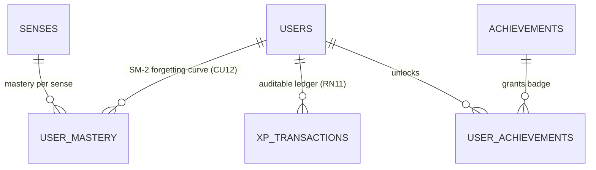

# Mastery Service (`mastery_service.md`)

> **Domain service file — self-contained.** Combines the domain entities and business rules (from the former `DOMAIN.md`) with the technical contracts: DTOs, SOA interface, `sqlc` queries, and HTTP/WS endpoints (from the former `INTERFACES.md`).
> **Service:** `MasteryService` · **Use Cases:** `CU12`, `CU13` · **Business Rules:** `RN09` (SM-2 spaced repetition), `RN11` (Immutable XP ledger) · **Domain:** Streaks, Achievements, Mastery Dashboard · **Routes:** `TBD`
> **Global rules:** the contract-first rules, SOA architecture, and domain-error-to-HTTP mapping shared by every service live in [`DOMAIN.md`](../DOMAIN.md) (sections 3 and 4).
> **Canonical persistence:** PostgreSQL 17 ([`SCHEMA_FINAL.sql`](../../SCHEMA_FINAL.sql)) · **Shared DTOs:** [`pkg/models/`](../../pkg/models)

---

## Part A — Domain Model

### Entity-Relationship Fragment



### 3.4. Context 4: Personal Studio, Spaced Repetition (SM-2), and Gamification (`Studio & Mastery`)
Transforms passive dictionary lookups into active long-term retention (**CU10, CU11, CU12, CU13**).

#### 14. `UserMastery` (Table: `user_mastery`)
Models the user's long-term memory state for a specific sense using the **SuperMemo SM-2** algorithm (**CU12, CU13, RN09**).
* **Composite Identifier:** `(id_user, id_sense)`.
* **Attributes and SM-2 Mathematics:**
  * Recall rating $q \in \{1, 2, 3, 4\}$ in the UI (mapped to the SM-2 scale):
    * If the response is **incorrect** ($q < 3$): `consecutive_correct` resets to `0`, `current_interval_days` returns to `1`, and `progress_stage` transitions to `LEARNING`.
    * If the response is **correct** ($q \ge 3$): `consecutive_correct` increments by `1`; the interval is computed as $I(1) = 1$, $I(2) = 6$, and for $n > 2$: $I(n) = \lceil I(n-1) \times EF \rceil$.
    * The easiness factor (`easiness_factor`, initial `2.5`, minimum `1.3`) is adjusted according to:
      $$EF' = \max\left(1.3,\; EF + \left(0.1 - (5 - q) \cdot (0.08 + (5 - q) \cdot 0.02)\right)\right)$$
  * **Stage Transitions (`progress_stage`):**
    * `NEW`: Never reviewed (`times_reviewed = 0`).
    * `LEARNING`: In initial acquisition (`consecutive_correct` between `0` and `2`, or interval $< 6$ days).
    * `REVIEWING`: In consolidation (`consecutive_correct` $\ge 3$ and interval between $6$ and $20$ days).
    * `MASTERED`: Mastered long-term (`consecutive_correct` $\ge 5$ and interval $\ge 21$ days).

#### 15. `XPTransaction`, `Achievement`, and `UserAchievement` (Tables: `xp_transactions`, `achievements`, `user_achievements`)
Implement the auditable progression economy (**RN11**).
* **`XPTransaction`:** **Immutable** (*ledger*) (`INSERT`-only). Each point gain (`amount_xp`) records its cause (`QUIZ_CORRECT`, `MATCH_WIN`, `DAILY_STREAK`, `DECK_COMPLETED`, `ACHIEVEMENT_UNLOCKED`) and `metadata_id`. The balance `users.total_xp` is the materialized projection of this ledger, enabling reconstruction and auditing in case of any anomaly (**CU13 2a**).
* **`Achievement` and `UserAchievement`:** Badge catalog by rarity (`BRONZE`, `SILVER`, `GOLD`, `PLATINUM`, `DIAMOND`) and category (`STREAK`, `COMPETITION`, `MASTERY`, `DIALECT_EXPLORER`).

---

## Part B — Technical Contracts

> [!IMPORTANT]
> Contract-first rules apply: no invented JSON fields, strict `snake_case`, typed `sqlc` queries only, and English error responses using `response.ErrorWithCode(w, status, code, message)` / `response.Error(w, status, message)` (`{ "code", "error" }`). See [`DOMAIN.md`](../DOMAIN.md#3-global-contract-first-rules-cross-cutting). Option B middleware verifies `is_active`, `token_version`, and live `role` against PostgreSQL on all write methods (`POST`/`PUT`/`DELETE`).

### MODULE 6: Spaced Repetition SM-2 and XP Ledger (`MasteryService` — `CU12, CU13`)

#### 2.6.1. Data Structures in `pkg/models/studio.go`

```go
type MasteryStage string

const (
	StageNew       MasteryStage = "NEW"
	StageLearning  MasteryStage = "LEARNING"
	StageReviewing MasteryStage = "REVIEWING"
	StageMastered  MasteryStage = "MASTERED"
)

const (
	XPReasonQuizCorrect         = "QUIZ_CORRECT"
	XPReasonMatchWin            = "MATCH_WIN"
	XPReasonDailyStreak         = "DAILY_STREAK"
	XPReasonDeckCompleted       = "DECK_COMPLETED"
	XPReasonAchievementUnlocked = "ACHIEVEMENT_UNLOCKED"
)

type UserMastery struct {
	IDUser              string       `json:"id_user"`
	IDSense             int          `json:"id_sense"`
	ProgressStage       MasteryStage `json:"progress_stage"`
	MasteryPercentage   float32      `json:"mastery_percentage"`
	ConsecutiveCorrect  int          `json:"consecutive_correct"`
	TimesReviewed       int          `json:"times_reviewed"`
	EasinessFactor      float32      `json:"easiness_factor"`
	CurrentIntervalDays int          `json:"current_interval_days"`
	NextReviewAt        time.Time    `json:"next_review_at"`
	LastReviewedAt      time.Time    `json:"last_reviewed_at"`
}

type StudyCardItem struct {
	IDSense         int          `json:"id_sense"`
	IDWord          int          `json:"id_word"`
	Lemma           string       `json:"lemma"`
	PartOfSpeech    string       `json:"part_of_speech"`
	RegionCode      string       `json:"region_code"`
	RegionName      string       `json:"region_name"`
	FlagEmoji       string       `json:"flag_emoji"`
	ShortDefinition string       `json:"short_definition"`
	Definition      string       `json:"definition"`
	CulturalNote    *string      `json:"cultural_note,omitempty"`
	Examples        []Example    `json:"examples"`
	CurrentMastery  *UserMastery `json:"current_mastery,omitempty"` // nil if NEW card
}

type StudySessionPayload struct {
	DeckID       *int            `json:"deck_id,omitempty"`
	TotalDue     int             `json:"total_due"`
	SessionCards []StudyCardItem `json:"session_cards"`
}

type SubmitReviewRequest struct {
	IDSense       int `json:"id_sense"`       // Required
	QualityRating int `json:"quality_rating"` // 1: Again (Fail), 2: Hard, 3: Good, 4: Easy
	TimeSpentMs   int `json:"time_spent_ms"`  // Response time in milliseconds
}

type CardReviewResult struct {
	UpdatedMastery     UserMastery         `json:"updated_mastery"`
	XPAwarded          int                 `json:"xp_awarded"`
	NewTotalXP         int                 `json:"new_total_xp"`
	NewLevel           int                 `json:"new_level"`
	CurrentStreak      int                 `json:"current_streak"`
	NewlyUnlockedBadge []AchievementStatus `json:"newly_unlocked_badges,omitempty"`
}

type XPTransactionItem struct {
	IDTransaction string    `json:"id_transaction"`
	AmountXP      int       `json:"amount_xp"`
	Reason        string    `json:"reason"` // 'QUIZ_CORRECT', 'MATCH_WIN', 'DAILY_STREAK', 'DECK_COMPLETED', 'ACHIEVEMENT_UNLOCKED'
	MetadataID    *string   `json:"metadata_id,omitempty"`
	CreatedAt     time.Time `json:"created_at"`
}

type AchievementStatus struct {
	IDAchievement string     `json:"id_achievement"`
	Code          string     `json:"code"`
	Name          string     `json:"name"`
	Description   string     `json:"description"`
	Category      string     `json:"category"`
	Tier          string     `json:"tier"` // 'BRONZE', 'SILVER', 'GOLD', 'PLATINUM', 'DIAMOND'
	IconName      string     `json:"icon_name"`
	XPReward      int        `json:"xp_reward"`
	IsUnlocked    bool       `json:"is_unlocked"`
	UnlockedAt    *time.Time `json:"unlocked_at,omitempty"`
}

type MasteryDashboard struct {
	TotalWordsStudied int                 `json:"total_words_studied"`
	DueTodayCount     int                 `json:"due_today_count"`
	CountNew          int                 `json:"count_new"`
	CountLearning     int                 `json:"count_learning"`
	CountReviewing    int                 `json:"count_reviewing"`
	CountMastered     int                 `json:"count_mastered"`
	GlobalRetention   float32             `json:"global_retention"`
	TotalXP           int                 `json:"total_xp"`
	CurrentLevel      int                 `json:"current_level"`
	CurrentStreak     int                 `json:"current_streak"`
	LongestStreak     int                 `json:"longest_streak"`
	RecentXP          []XPTransactionItem `json:"recent_xp_transactions"`
	Achievements      []AchievementStatus `json:"achievements"`
}
```

> `Example` (used by `StudyCardItem.Examples`) is defined in `pkg/models/dictionary.go`; see [`dictionary_service.md`](dictionary_service.md). `AchievementStatus` is also embedded in `PublicUserProfile.UnlockedBadges` ([`identity_service.md`](identity_service.md)). `StudyCardItem.flag_emoji` is part of the wire contract but must never be rendered in the UI.

#### 2.6.1b. SOA Interface (`MasteryService`)

```go
type MasteryService interface {
	GetStudySession(ctx context.Context, userID string, userRole models.AccountRole, deckID *int, limit int) (*models.StudySessionPayload, error)
	SubmitReview(ctx context.Context, userID string, req models.SubmitReviewRequest) (*models.CardReviewResult, error)
	GetMasteryDashboard(ctx context.Context, userID string) (*models.MasteryDashboard, error)
	ListMasteryItems(ctx context.Context, userID string, stage *string) ([]models.StudyCardItem, error)
	ListXPLedger(ctx context.Context, userID string, limit int) ([]models.XPTransactionItem, error)
}
```

#### 2.6.2. SuperMemo SM-2 Deterministic Algorithm in `MasteryService` (`RN09` and `RN11`)

The pure function `CalculateSM2(prev *UserMastery, qualityRating int, now time.Time) (UserMastery, int)` strictly adheres to this specification:
1. **Mapping UI Scale (`1..4`) to SM-2 Scale (`1..5`):**
   - `1` (*Again / Fail*) $\to q = 1$ (Incorrect)
   - `2` (*Hard*) $\to q = 3$ (Correct with serious effort)
   - `3` (*Good*) $\to q = 4$ (Correct with normal pace)
   - `4` (*Easy*) $\to q = 5$ (Perfect instant recall)
2. **Calculation of Easiness Factor ($EF$), Interval ($I$), and Stage (`progress_stage`):**
   - Initial state if `prev == nil`: $EF = 2.5$, `ConsecutiveCorrect = 0`, `TimesReviewed = 0`, previous interval defaults to `1` day (`prevInterval := 1` in `CalculateSM2`; only consumed when `ConsecutiveCorrect > 2`).
   - `TimesReviewed = prev.TimesReviewed + 1`.
   - If `qualityRating == 1` ($q < 3$):
     - `ConsecutiveCorrect = 0`
     - `CurrentIntervalDays = 1`
     - $EF' = \max(1.3,\; EF - 0.20)$
     - `ProgressStage = "LEARNING"`, `MasteryPercentage = 20.0`
     - `XPAwarded = 5` (Consolation XP for review effort)
   - If `qualityRating >= 2` ($q \ge 3$):
     - `ConsecutiveCorrect = prev.ConsecutiveCorrect + 1`
     - If `ConsecutiveCorrect == 1`: `CurrentIntervalDays = 1`
     - If `ConsecutiveCorrect == 2`: `CurrentIntervalDays = 6`
     - If `ConsecutiveCorrect > 2`: `CurrentIntervalDays = int(math.Ceil(float64(prev.CurrentIntervalDays) * float64(EF)))`
     - $EF' = \max(1.3,\; EF + (0.1 - float32(5-q)*(0.08 + float32(5-q)*0.02)))$
     - Stage classification (`ProgressStage`):
       - If `ConsecutiveCorrect >= 5 && CurrentIntervalDays >= 21` $\to$ `"MASTERED"`, `MasteryPercentage = 100.0`
       - If `ConsecutiveCorrect >= 3 && CurrentIntervalDays >= 6` $\to$ `"REVIEWING"`, `MasteryPercentage = 75.0`
       - Otherwise $\to$ `"LEARNING"`, `MasteryPercentage = 40.0`
     - `XPAwarded = 15` (or `20` if `qualityRating == 4`).
3. **User Level Formula (`current_level`):**
   $$\text{CurrentLevel} = \lfloor \frac{\text{TotalXP}}{1000} \rfloor + 1$$

#### 2.6.3. SM-2 and Mastery HTTP Endpoints (`/api/v1/studio`)

Registered in `core-service/internal/api/router.go` under `/api/v1/studio` inside a single `RequireAuth` group (`401` without a valid token).

| Method | Path | Middleware | Use Case | Status | Successful Response |
| :---: | :--- | :---: | :---: | :---: | :--- |
| `GET` | `/api/v1/studio/study-session` | `RequireAuth` | CU12 (RN09) | ✅ Ready | `200 OK` $\to$ `models.StudySessionPayload` (`?deck_id=1&limit=15`; an invalid `deck_id` is ignored, `limit` defaults to `15` and is clamped to `50` by the service) |
| `POST` | `/api/v1/studio/study-session/review` | `RequireAuth` | CU12 (RN09/11)| ✅ Ready | `200 OK` $\to$ `models.CardReviewResult` |
| `GET` | `/api/v1/studio/mastery` | `RequireAuth` | CU13 (RN09/11)| ✅ Ready | `200 OK` $\to$ `models.MasteryDashboard` |
| `GET` | `/api/v1/studio/mastery/items` | `RequireAuth` | CU13 | ✅ Ready | `200 OK` $\to$ `[]models.StudyCardItem` (`?stage=MASTERED`) |
| `GET` | `/api/v1/studio/xp-ledger` | `RequireAuth` | CU13 (RN11) | ✅ Ready | `200 OK` $\to$ `[]models.XPTransactionItem` (`?limit=50`; default `50`, clamped to `100` by the service) |

#### 2.6.4. `sqlc` Queries (`sql/queries/mastery.sql`)
`GetStudySessionCardsByDeck :many`, `CountDueStudySessionCardsByDeck :one`, `GetStudySessionCardsAll :many`, `CountDueStudySessionCardsAll :one`, `GetUserMasteryForSense :one`, `UpsertUserMastery :one`, `InsertXPTransaction :one`, `AddUserXPAndUpdateStreak :one` (recomputes `current_level = (total_xp / 1000) + 1` and the streak), `GetMasteryStageCounts :one`, `GetUserGamificationProfile :one`, `ListUserAchievements :many`, `UnlockUserAchievement :exec`, `ListMasteryCardsByStage :many`, `ListRecentXPTransactions :many`, `GetExamplesForSenses :many`. The service additionally reuses `GetDeckByID` from `studio.sql` (see [`studio_service.md`](studio_service.md)).
