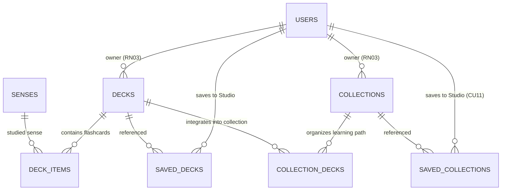

# Studio Service (`studio_service.md`)

> **Domain service file — self-contained.** Combines the domain entities and business rules (from the former `DOMAIN.md`) with the technical contracts: DTOs, SOA interface, `sqlc` queries, and HTTP/WS endpoints (from the former `INTERFACES.md`).
> **Service:** `StudioService` · **Use Cases:** `CU10`, `CU11` · **Business Rules:** `RN03` (Ownership), `RN04` (Privacy), `RN05` (Official content) · **Domain:** Decks, Collections, Saved Decks/Collections · **Routes:** `TBD` (planned `/decks`, `/collections`, `/studio`; see [`ROUTES.md`](../ROUTES.md))
> **Global rules:** the contract-first rules, SOA architecture, and domain-error-to-HTTP mapping shared by every service live in [`DOMAIN.md`](../DOMAIN.md) (sections 3 and 4).
> **Canonical persistence:** PostgreSQL 17 ([`SCHEMA_FINAL.sql`](../../SCHEMA_FINAL.sql)) · **Shared DTOs:** [`pkg/models/`](../../pkg/models)

---

## Part A — Domain Model

### Entity-Relationship Fragment



### 3.4. Context 4: Personal Studio, Spaced Repetition (SM-2), and Gamification (`Studio & Mastery`)
Transforms passive dictionary lookups into active long-term retention (**CU10, CU11, CU12, CU13**).

#### 12. `Deck`, `DeckItem`, and `SavedDeck` (Tables: `decks`, `deck_items`, `saved_decks`)
A **Deck (`Deck`)** is an ordered list of lexical senses (`DeckItem`) ready to be reviewed with SM-2 flashcards or played in the Arena.
* **Ownership vs. Subscription:**
  * `decks.id_user` defines the creator-owner, who is solely authorized to edit its metadata or composition (**RN03**), except for decks marked as `is_official = true`, which can be curated by Editors and Administrators (**RN05**).
  * `saved_decks (id_user, id_deck)` allows other members to save public community decks (`is_public = true`, **RN04**) to their Studio without cloning rows unnecessarily.

#### 13. `Collection`, `CollectionDeck`, and `SavedCollection` (Tables: `collections`, `collection_decks`, `saved_collections`)
A **Collection (`Collection`)** groups multiple decks in pedagogical order (`CollectionDeck.sort_order`), forming a thematic learning path (*e.g., "Mexican Gastronomy Path"*).
* **Key Attributes:** `title`, `description`, `is_public` (**RN04**), `is_featured` (featured on home page), `is_official` (**RN05**).
* `saved_collections (id_user, id_collection)` materializes alternate flow **CU11 1a** (*Save community collection to personal Studio*).

---

## Part B — Technical Contracts

> [!IMPORTANT]
> Contract-first rules apply: no invented JSON fields, strict `snake_case`, typed `sqlc` queries only, and `response.Error(w, status, message)` for every error. See [`DOMAIN.md`](../DOMAIN.md#3-global-contract-first-rules-cross-cutting).

### MODULE 5: Personal Studio — Decks and Collections (`StudioService` — `CU10, CU11`)

#### 2.5.1. Data Structures in `pkg/models/studio.go`

```go
// Base Deck item (flashcard association)
type DeckItem struct {
	IDDeck    int          `json:"id_deck"`
	IDSense   int          `json:"id_sense"`
	SortOrder int          `json:"sort_order"`
	Sense     *SenseDetail `json:"sense,omitempty"`
}

// Canonical Deck model (pkg/models/studio.go)
type Deck struct {
	IDDeck      int        `json:"id_deck"`
	IDUser      string     `json:"id_user"`
	Title       string     `json:"title"`
	Description *string    `json:"description,omitempty"`
	IsPublic    bool       `json:"is_public"`
	IsOfficial  bool       `json:"is_official"`
	ItemCount   int        `json:"item_count"`
	Items       []DeckItem `json:"items,omitempty"`
	CreatedAt   time.Time  `json:"created_at"`
	UpdatedAt   time.Time  `json:"updated_at"`
}

// Enrichment of Deck for the Personal Studio view (GUIStudioDeckCard):
type StudioDeckSummary struct {
	Deck
	OwnerUserName      string  `json:"owner_user_name"`
	IsSavedFromComm    bool    `json:"is_saved_from_community"`
	DueCardsToday      int     `json:"due_cards_today"`
	RetentionPercent   float32 `json:"retention_percent"`
}

type CreateDeckRequest struct {
	Title       string  `json:"title"`                 // Required, 3..150 chars
	Description *string `json:"description,omitempty"`
	IsPublic    bool    `json:"is_public"`
	IsOfficial  bool    `json:"is_official"`           // Only honored if role IN ('EDITOR', 'ADMIN') (RN05)
	SenseIDs    []int   `json:"sense_ids,omitempty"`   // Optional initial cards
}

type UpdateDeckRequest struct {
	Title       string  `json:"title"`
	Description *string `json:"description,omitempty"`
	IsPublic    bool    `json:"is_public"`
	IsOfficial  bool    `json:"is_official"`
}

type AddDeckItemRequest struct {
	IDSense   int  `json:"id_sense"`
	SortOrder *int `json:"sort_order,omitempty"`
}

type CreateCollectionRequest struct {
	Title       string  `json:"title"`
	Description *string `json:"description,omitempty"`
	IsPublic    bool    `json:"is_public"`
	IsFeatured  bool    `json:"is_featured"` // ADMIN/EDITOR only
	IsOfficial  bool    `json:"is_official"` // ADMIN/EDITOR only (RN05)
	DeckIDs     []int   `json:"deck_ids"`    // Ordered according to array
}

type UpdateCollectionRequest struct {
	Title       string  `json:"title"`
	Description *string `json:"description,omitempty"`
	IsPublic    bool    `json:"is_public"`
	IsFeatured  bool    `json:"is_featured"`
	IsOfficial  bool    `json:"is_official"`
	DeckIDs     []int   `json:"deck_ids,omitempty"`
}
```

#### 2.5.2. Business Rules in `StudioService` (`RN03`, `RN04`, `RN05`)
- **RN03 (Ownership in Studio):** Only the owner (`deck.id_user == userID`) or an `ADMIN` (`RN08`) may execute `PUT` or `DELETE` on a deck/collection or alter its items. If a third party attempts this, returns `403 Forbidden`.
- **RN04 (Resource Privacy):** In `GetDeckDetail`, `GetCollectionDetail`, `SavePublicDeckToStudio`, and `SavePublicCollectionToStudio`, if `is_public == false` and the requester is neither the owner nor `ADMIN`, returns `403 Forbidden`.
- **RN05 (Official Content):** If a `LEARNER` submits `is_official: true` or `is_featured: true`, the service silently forces both flags to `false`.

#### 2.5.3. Studio HTTP Endpoints (`/api/v1/decks`, `/api/v1/collections`, `/api/v1/studio`)

| Method | Path | Middleware | Use Case | Status | Successful Response |
| :---: | :--- | :---: | :---: | :---: | :--- |
| `GET` | `/api/v1/decks` | Public | CU10 (RN04) | ✅ Ready | `200 OK` $\to$ `[]models.Deck` (`?q=&official_only=false`) |
| `GET` | `/api/v1/studio/decks` | `RequireAuth` | CU10 | ✅ Ready | `200 OK` $\to$ `[]models.StudioDeckSummary` (Owned + Saved) |
| `GET` | `/api/v1/decks/{id}` | `OptionalAuth` | CU10 (RN04) | ✅ Ready | `200 OK` $\to$ `models.Deck` (with `Items` and `SenseDetail`) |
| `POST` | `/api/v1/decks` | `RequireAuth` | CU10 (RN03/05)| ✅ Ready | `201 Created` $\to$ `models.Deck` |
| `PUT` | `/api/v1/decks/{id}` | `RequireAuth` | CU10 (RN03/05)| ✅ Ready | `200 OK` $\to$ `models.Deck` |
| `DELETE` | `/api/v1/decks/{id}` | `RequireAuth` | CU10 (RN03) | ✅ Ready | `204 No Content` |
| `POST` | `/api/v1/decks/{id}/items` | `RequireAuth` | CU10 (3a) | ✅ Ready | `201 Created` $\to$ `models.DeckItem` |
| `DELETE` | `/api/v1/decks/{id}/items/{senseId}` | `RequireAuth` | CU10 (RN03) | ✅ Ready | `204 No Content` |
| `POST` | `/api/v1/decks/{id}/save` | `RequireAuth` | CU10 (RN04) | ✅ Ready | `204 No Content` |
| `DELETE` | `/api/v1/decks/{id}/save` | `RequireAuth` | CU10 | ✅ Ready | `204 No Content` |
| `GET` | `/api/v1/collections` | Public | CU11 (RN04) | ✅ Ready | `200 OK` $\to$ `[]models.Collection` (`?featured=true`) |
| `GET` | `/api/v1/studio/collections` | `RequireAuth` | CU11 | ✅ Ready | `200 OK` $\to$ `[]models.Collection` (Owned + Saved) |
| `GET` | `/api/v1/collections/{id}` | `OptionalAuth` | CU11 (RN04) | ✅ Ready | `200 OK` $\to$ `models.Collection` (with `Decks`) |
| `POST` | `/api/v1/collections` | `RequireAuth` | CU11 (RN03/05)| ✅ Ready | `201 Created` $\to$ `models.Collection` |
| `PUT` | `/api/v1/collections/{id}` | `RequireAuth` | CU11 (RN03/05)| ✅ Ready | `200 OK` $\to$ `models.Collection` |
| `DELETE` | `/api/v1/collections/{id}` | `RequireAuth` | CU11 (RN03) | ✅ Ready | `204 No Content` |
| `POST` | `/api/v1/collections/{id}/save` | `RequireAuth` | CU11 (1a) | ✅ Ready | `204 No Content` |
| `DELETE` | `/api/v1/collections/{id}/save` | `RequireAuth` | CU11 | ✅ Ready | `204 No Content` |
