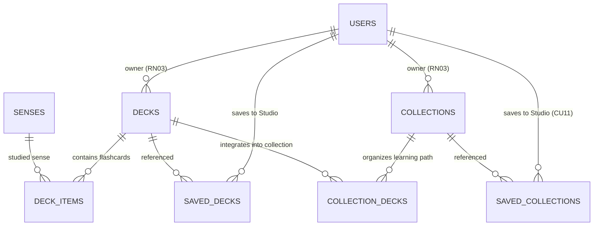

# Studio Service (`studio_service.md`)

> **Domain service file — self-contained.** Combines the domain entities and business rules (from the former `DOMAIN.md`) with the technical contracts: DTOs, SOA interface, `sqlc` queries, and HTTP/WS endpoints (from the former `INTERFACES.md`).
> **Service:** `StudioService` · **Use Cases:** `CU10`, `CU11` · **Business Rules:** `RN03` (Ownership), `RN04` (Privacy), `RN05` (Official content) · **Domain:** Decks, Collections, Saved Decks/Collections · **Routes:** backend API `/api/v1/decks`, `/api/v1/collections`, `/api/v1/studio/{decks,collections}` (see section 2.5.3); frontend routes: `TBD` (planned `/decks`, `/collections`, `/studio`; see [`ROUTES.md`](../ROUTES.md))
> **Global rules:** the contract-first rules, SOA architecture, and domain-error-to-HTTP mapping shared by every service live in [`DOMAIN.md`](../DOMAIN.md) (sections 3 and 4).
> **Canonical persistence:** PostgreSQL 17 ([`SCHEMA_FINAL.sql`](../../SCHEMA_FINAL.sql)) · **Shared DTOs:** [`pkg/models/`](../../pkg/models)

---

## Part A — Domain Model

### Entity-Relationship Fragment



### 3.4. Context 4: Personal Studio, Spaced Repetition (SM-2), and Gamification (`Studio & Mastery`)
Transforms passive dictionary lookups into active long-term retention (**CU10, CU11, CU12, CU13**).

#### 12. `Deck`, `DeckItem`, and `SavedDeck` (Tables: `decks`, `deck_items`, `saved_decks`)
A **Deck (`Deck`)** is an ordered list of lexical senses (`DeckItem`) ready to be reviewed with SM-2 flashcards or played in the Arena.
* **Ownership vs. Subscription:**
  * `decks.id_user` defines the creator-owner, who is solely authorized to edit its metadata or composition (**RN03**), except for decks marked as `is_official = true`, which can be curated by Editors and Administrators (**RN05**).
  * `saved_decks (id_user, id_deck)` allows other members to save public community decks (`is_public = true`, **RN04**) to their Studio without cloning rows unnecessarily.

#### 13. `Collection`, `CollectionDeck`, and `SavedCollection` (Tables: `collections`, `collection_decks`, `saved_collections`)
A **Collection (`Collection`)** groups multiple decks in pedagogical order (`CollectionDeck.sort_order`), forming a thematic learning path (*e.g., "Mexican Gastronomy Path"*).
* **Key Attributes:** `title`, `description`, `is_public` (**RN04**), `is_featured` (featured on home page), `is_official` (**RN05**).
* `saved_collections (id_user, id_collection)` materializes alternate flow **CU11 1a** (*Save community collection to personal Studio*).

---

## Part B — Technical Contracts

> [!IMPORTANT]
> Contract-first rules apply: no invented JSON fields, strict `snake_case`, typed `sqlc` queries only, and English error responses using `response.ErrorWithCode(w, status, code, message)` / `response.Error(w, status, message)` (`{ "code", "error" }`). See [`DOMAIN.md`](../DOMAIN.md#3-global-contract-first-rules-cross-cutting). Option B middleware verifies `is_active`, `token_version`, and live `role` against PostgreSQL on all write methods (`POST`/`PUT`/`DELETE`).

### MODULE 5: Personal Studio — Decks and Collections (`StudioService` — `CU10, CU11`)

#### 2.5.1. Data Structures in `pkg/models/studio.go`

```go
// Base Deck item (flashcard association)
type DeckItem struct {
	IDDeck    int          `json:"id_deck"`
	IDSense   int          `json:"id_sense"`
	SortOrder int          `json:"sort_order"`
	Sense     *SenseDetail `json:"sense,omitempty"`
}

// Canonical Deck model (pkg/models/studio.go)
type Deck struct {
	IDDeck      int        `json:"id_deck"`
	IDUser      string     `json:"id_user"`
	Title       string     `json:"title"`
	Description *string    `json:"description,omitempty"`
	IsPublic    bool       `json:"is_public"`
	IsOfficial  bool       `json:"is_official"`
	ItemCount   int        `json:"item_count"`
	Items       []DeckItem `json:"items,omitempty"`
	CreatedAt   time.Time  `json:"created_at"`
	UpdatedAt   time.Time  `json:"updated_at"`
}

// Canonical Collection model (pkg/models/studio.go)
type Collection struct {
	IDCollection int       `json:"id_collection"`
	IDUser       string    `json:"id_user"`
	Title        string    `json:"title"`
	Description  *string   `json:"description,omitempty"`
	IsPublic     bool      `json:"is_public"`
	IsFeatured   bool      `json:"is_featured"`
	IsOfficial   bool      `json:"is_official"`
	Decks        []Deck    `json:"decks,omitempty"`
	CreatedAt    time.Time `json:"created_at"`
	UpdatedAt    time.Time `json:"updated_at"`
}

// Enrichment of Deck for the Personal Studio view (GUIStudioDeckCard).
// `Deck` is embedded (its JSON fields are flattened into this object):
type StudioDeckSummary struct {
	Deck
	OwnerUserName    string  `json:"owner_user_name"`
	IsSavedFromComm  bool    `json:"is_saved_from_community"`
	DueCardsToday    int     `json:"due_cards_today"`
	RetentionPercent float32 `json:"retention_percent"`
}

type DeckSearchResult struct {
	IDDeck        int     `json:"id_deck"`
	Title         string  `json:"title"`
	Description   *string `json:"description,omitempty"`
	RegionName    string  `json:"region_name"`
	OwnerUserName string  `json:"owner_user_name"`
	ItemCount     int     `json:"item_count"`
	IsOfficial    bool    `json:"is_official"`
}

type CollectionSearchResult struct {
	IDCollection  int     `json:"id_collection"`
	Title         string  `json:"title"`
	Description   *string `json:"description,omitempty"`
	OwnerUserName string  `json:"owner_user_name"`
	DeckCount     int     `json:"deck_count"`
	ItemCount     int     `json:"item_count"`
	IsOfficial    bool    `json:"is_official"`
	IsFeatured    bool    `json:"is_featured"`
}

type CreateDeckRequest struct {
	Title       string  `json:"title"`                 // Required, 3..150 chars
	Description *string `json:"description,omitempty"`
	IsPublic    bool    `json:"is_public"`
	IsOfficial  bool    `json:"is_official"`           // Only honored if role IN ('EDITOR', 'ADMIN') (RN05)
	SenseIDs    []int   `json:"sense_ids,omitempty"`   // Optional initial cards
}

type UpdateDeckRequest struct {
	Title       string  `json:"title"`
	Description *string `json:"description,omitempty"`
	IsPublic    bool    `json:"is_public"`
	IsOfficial  bool    `json:"is_official"`
}

type AddDeckItemRequest struct {
	IDSense   int  `json:"id_sense"`
	SortOrder *int `json:"sort_order,omitempty"`
}

type CreateCollectionRequest struct {
	Title       string  `json:"title"`
	Description *string `json:"description,omitempty"`
	IsPublic    bool    `json:"is_public"`
	IsFeatured  bool    `json:"is_featured"` // ADMIN/EDITOR only
	IsOfficial  bool    `json:"is_official"` // ADMIN/EDITOR only (RN05)
	DeckIDs     []int   `json:"deck_ids"`    // Ordered according to array
}

type UpdateCollectionRequest struct {
	Title       string  `json:"title"`
	Description *string `json:"description,omitempty"`
	IsPublic    bool    `json:"is_public"`
	IsFeatured  bool    `json:"is_featured"`
	IsOfficial  bool    `json:"is_official"`
	DeckIDs     []int   `json:"deck_ids,omitempty"`
}
```

> `DeckItem.Sense` references `SenseDetail` (defined in `pkg/models/dictionary.go`; see [`dictionary_service.md`](dictionary_service.md)). `Deck` and `Collection` are also embedded in `PublicUserProfile` ([`identity_service.md`](identity_service.md)).

#### 2.5.1b. SOA Interface (`StudioService`)

```go
type StudioService interface {
	// Barajas (CU10)
	ListPublicDecks(ctx context.Context, query *string, officialOnly *bool) ([]models.Deck, error)
	ListStudioDecks(ctx context.Context, userID string) ([]models.StudioDeckSummary, error)
	GetDeckDetail(ctx context.Context, viewerID *string, viewerRole *models.AccountRole, deckID int) (*models.Deck, error)
	CreateDeck(ctx context.Context, userID string, userRole models.AccountRole, req models.CreateDeckRequest) (*models.Deck, error)
	UpdateDeck(ctx context.Context, userID string, userRole models.AccountRole, deckID int, req models.UpdateDeckRequest) (*models.Deck, error)
	DeleteDeck(ctx context.Context, userID string, userRole models.AccountRole, deckID int) error
	AddDeckItem(ctx context.Context, userID string, userRole models.AccountRole, deckID int, req models.AddDeckItemRequest) (*models.DeckItem, error)
	RemoveDeckItem(ctx context.Context, userID string, userRole models.AccountRole, deckID int, senseID int) error
	SaveDeck(ctx context.Context, userID string, userRole models.AccountRole, deckID int) error
	UnsaveDeck(ctx context.Context, userID string, deckID int) error
	SearchDecks(ctx context.Context, query string, limit int) ([]models.DeckSearchResult, error)

	// Colecciones (CU11)
	ListPublicCollections(ctx context.Context, featuredOnly *bool) ([]models.Collection, error)
	ListStudioCollections(ctx context.Context, userID string) ([]models.Collection, error)
	GetCollectionDetail(ctx context.Context, viewerID *string, viewerRole *models.AccountRole, collectionID int) (*models.Collection, error)
	CreateCollection(ctx context.Context, userID string, userRole models.AccountRole, req models.CreateCollectionRequest) (*models.Collection, error)
	UpdateCollection(ctx context.Context, userID string, userRole models.AccountRole, collectionID int, req models.UpdateCollectionRequest) (*models.Collection, error)
	DeleteCollection(ctx context.Context, userID string, userRole models.AccountRole, collectionID int) error
	SaveCollection(ctx context.Context, userID string, userRole models.AccountRole, collectionID int) error
	UnsaveCollection(ctx context.Context, userID string, collectionID int) error
	SearchCollections(ctx context.Context, query string, limit int) ([]models.CollectionSearchResult, error)
}
```

#### 2.5.2. Business Rules in `StudioService` (`RN03`, `RN04`, `RN05`)
- **RN03 (Ownership in Studio):** Only the owner (`deck.id_user == userID`) or an `ADMIN` (`RN08`) may execute `PUT` or `DELETE` on a deck/collection or alter its items. If a third party attempts this, returns `403 Forbidden`.
- **RN04 (Resource Privacy):** In `GetDeckDetail`, `GetCollectionDetail`, `SaveDeck`, and `SaveCollection`, if `is_public == false` and the requester is neither the owner nor `ADMIN`, returns `403 Forbidden`.
- **RN05 (Official Content):** If a `LEARNER` submits `is_official: true` or `is_featured: true`, the service silently forces both flags to `false`.

#### 2.5.3. Studio HTTP Endpoints (`/api/v1/decks`, `/api/v1/collections`, `/api/v1/studio`)

| Method | Path | Middleware | Use Case | Status | Successful Response |
| :---: | :--- | :---: | :---: | :---: | :--- |
| `GET` | `/api/v1/decks` | Public | CU10 (RN04) | ✅ Ready | `200 OK` $\to$ `[]models.Deck` (`?q=&official_only=false`) |
| `GET` | `/api/v1/decks/search` | Public | CU10 | ✅ Ready | `200 OK` $\to$ `[]models.DeckSearchResult` (`?q=&limit=10`) |
| `GET` | `/api/v1/studio/decks` | `RequireAuth` | CU10 | ✅ Ready | `200 OK` $\to$ `[]models.StudioDeckSummary` (Owned + Saved) |
| `GET` | `/api/v1/decks/{id}` | `OptionalAuth` | CU10 (RN04) | ✅ Ready | `200 OK` $\to$ `models.Deck` (with `Items` and `SenseDetail`) |
| `POST` | `/api/v1/decks` | `RequireAuth` | CU10 (RN03/05)| ✅ Ready | `201 Created` $\to$ `models.Deck` |
| `PUT` | `/api/v1/decks/{id}` | `RequireAuth` | CU10 (RN03/05)| ✅ Ready | `200 OK` $\to$ `models.Deck` |
| `DELETE` | `/api/v1/decks/{id}` | `RequireAuth` | CU10 (RN03) | ✅ Ready | `204 No Content` |
| `POST` | `/api/v1/decks/{id}/items` | `RequireAuth` | CU10 (3a) | ✅ Ready | `201 Created` $\to$ `models.DeckItem` |
| `DELETE` | `/api/v1/decks/{id}/items/{senseId}` | `RequireAuth` | CU10 (RN03) | ✅ Ready | `204 No Content` |
| `POST` | `/api/v1/decks/{id}/save` | `RequireAuth` | CU10 (RN04) | ✅ Ready | `204 No Content` |
| `DELETE` | `/api/v1/decks/{id}/save` | `RequireAuth` | CU10 | ✅ Ready | `204 No Content` |
| `GET` | `/api/v1/collections` | Public | CU11 (RN04) | ✅ Ready | `200 OK` $\to$ `[]models.Collection` (`?featured=true`) |
| `GET` | `/api/v1/collections/search` | Public | CU11 | ✅ Ready | `200 OK` $\to$ `[]models.CollectionSearchResult` (`?q=&limit=10`) |
| `GET` | `/api/v1/studio/collections` | `RequireAuth` | CU11 | ✅ Ready | `200 OK` $\to$ `[]models.Collection` (Owned + Saved) |
| `GET` | `/api/v1/collections/{id}` | `OptionalAuth` | CU11 (RN04) | ✅ Ready | `200 OK` $\to$ `models.Collection` (with `Decks`) |
| `POST` | `/api/v1/collections` | `RequireAuth` | CU11 (RN03/05)| ✅ Ready | `201 Created` $\to$ `models.Collection` |
| `PUT` | `/api/v1/collections/{id}` | `RequireAuth` | CU11 (RN03/05)| ✅ Ready | `200 OK` $\to$ `models.Collection` |
| `DELETE` | `/api/v1/collections/{id}` | `RequireAuth` | CU11 (RN03) | ✅ Ready | `204 No Content` |
| `POST` | `/api/v1/collections/{id}/save` | `RequireAuth` | CU11 (1a) | ✅ Ready | `204 No Content` |
| `DELETE` | `/api/v1/collections/{id}/save` | `RequireAuth` | CU11 | ✅ Ready | `204 No Content` |

#### 2.5.4. `sqlc` Queries (`sql/queries/studio.sql`)
`ListPublicDecks :many`, `ListStudioDecks :many`, `GetDeckByID :one`, `ListDeckItemsByDeckID :many`, `CreateDeck :one`, `UpdateDeck :one`, `DeleteDeck :exec`, `AddDeckItem :one`, `RemoveDeckItem :exec`, `SaveDeck :exec`, `UnsaveDeck :exec`, `IsDeckSavedByUser :one`, `SearchDecksDropdown :many`, `ListPublicCollections :many`, `ListStudioCollections :many`, `GetCollectionByID :one`, `ListCollectionDecks :many`, `CreateCollection :one`, `UpdateCollection :one`, `DeleteCollection :exec`, `AddCollectionDeck :exec`, `ClearCollectionDecks :exec`, `SaveCollection :exec`, `UnsaveCollection :exec`, `IsCollectionSavedByUser :one`, `SearchCollectionsDropdown :many`. The service additionally reuses `GetExamplesForSenses` from `sql/queries/mastery.sql` (see [`mastery_service.md`](mastery_service.md)) to hydrate `DeckItem.Sense.Examples`.
