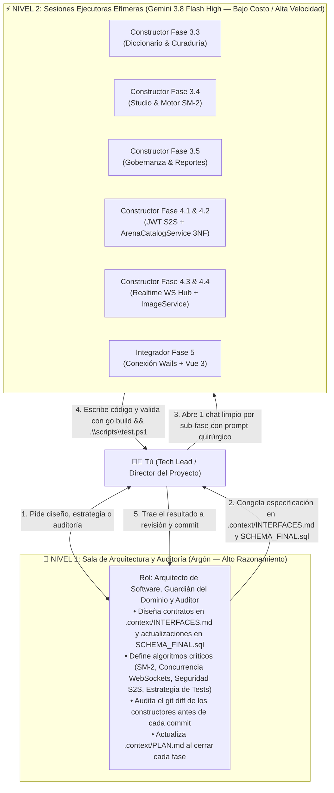

# 🤖 Guía Maestra de Ingeniería Orientada por Agentes (`AGENT_WORKFLOW.md`)

> **Manual Operativo de Orquestación de Modelos de IA para el Desarrollo de Palabrario**  
> **Enfoque:** Patrón *Arquitecto-Constructor* (*Architect-Builder*), *Backend-First* y *Contract-First*  
> **Propósito:** Maximizar la velocidad y precisión del desarrollo combinando modelos de alto razonamiento (**Argón**) con modelos rápidos y económicos (**Gemini 3.8 Flash High**), eliminando alucinaciones, colisiones de archivos y desperdicio de tokens.

---

## 1. Filosofía Central: ¿Por qué los Agentes Fallan y Cómo Evitarlo?

Cuando trabajas con LLMs en un proyecto real como **Palabrario**, existen tres causas principales de fallo:
1. **Empezar por la UI con Mockups antes que el Backend:** Si un agente programa primero la interfaz sin un contrato de API cerrado, inventa propiedades JSON que el backend no retorna.
2. **Esquizofrenia Documental (*Context Drift*):** Si la arquitectura está repetida o contradictoria en muchos archivos, el agente mezcla tecnologías o ignora reglas de negocio.
3. **Saturación de Ventana de Contexto:** Usar un mismo chat durante 40 mensajes para hacer 5 módulos distintos llena la memoria del modelo con errores viejos y degrada su atención (*Lost in the Middle*).

### La Solución Adoptada en Palabrario
Hemos estructurado el repositorio bajo **Descubrimiento Progresivo (*Progressive Disclosure*)** y **Fuente Única de Verdad (*Single Source of Truth*)** dentro de [`.context/`](./.context/):

| Archivo en `.context/` | Qué contiene (y por qué es único) | Quién lo mantiene |
| :--- | :--- | :---: |
| **[`.context/CONTEXT.md`](./.context/CONTEXT.md)** | Punto de entrada ligero (`< 120 líneas`), reglas anti-alucinación y mapa enrutador. | Arquitecto (Argón) |
| **[`.context/PLAN.md`](./.context/PLAN.md)** | Estado actual real del proyecto y checklist paso a paso por fases. | Arquitecto (Argón) |
| **[`.context/DOMAIN.md`](./.context/DOMAIN.md)** | Las 24 entidades (incluyendo `match_rounds` en 3NF), los 5 contextos DDD, estados editoriales y fórmulas matemáticas (`SM-2` y `RN10`). | Arquitecto (Argón) |
| **[`.context/INTERFACES.md`](./.context/INTERFACES.md)** | **El Contrato Sagrado:** Interfaces SOA en Go, structs JSON exactos (`pkg/models`), catálogo `sqlc`, JWT S2S y endpoints HTTP/WS. | Arquitecto (Argón) |
| **[`SCHEMA_FINAL.sql`](./SCHEMA_FINAL.sql)** | Esquema DDL único y ejecutable en PostgreSQL 17 con triggers `RN06` y `RN07`, tablas de Arena/Replay 3NF y sincronización automática de secuencias. | Arquitecto (Argón) |

---

## 2. Topología de Agentes: El Patrón "Arquitecto + Constructores"

No pongas a múltiples agentes a editar los mismos archivos al mismo tiempo (en un monorepo con `sqlc`, dos agentes corriendo `sqlc generate` o editando `router.go` simultáneamente se pisarán el código). En su lugar, opera una **jerarquía de dos niveles**:



### Matriz de Decisión: ¿Qué Modelo Uso Hoy?

| Tarea | Modelo Recomendado | Razón de Costo / Beneficio |
| :--- | :---: | :--- |
| **Diseñar o modificar contratos en `INTERFACES.md` o `SCHEMA_FINAL.sql`** | 🧠 **Argón** | Requiere visión holística de las 24 tablas y 11 reglas de negocio sin romper compatibilidad. |
| **Programar consultas `sqlc`, servicios SOA y handlers HTTP de una Fase/Sub-fase** | ⚡ **Flash 3.8 High** | Como los structs, firmas y endpoints ya están escritos letra por letra en `INTERFACES.md`, Flash traduce especificación a código rápidamente y gastando mínimos tokens. |
| **Definir la arquitectura de Testing (`testutil.SetupTestDB`, `TEMPLATE` en RAM)** | 🧠 **Argón** | Diseñar un arnés de pruebas aislado y 100% agnóstico al esquema requiere juicio arquitectónico. |
| **Escribir baterías de tests 80/20 siguiendo el molde de Argón** | ⚡ **Flash 3.8 High** | Replicar casos de prueba en `internal/service/*_test.go` usando `testutil.SetupTestDB(t)` es mecánico y económico. |
| **Concurrencia en Go (`sync.RWMutex`, canales, goroutines en `realtime-service`)** | ⚡ **Flash 3.8 High** (con Prompt 4.3 ultra-detallado) + 🧠 **Auditoría de Argón** | Con el diseño de canales, timers y sucesión de Host completamente especificado en el Prompt 4.3, Flash puede construirlo sin desviarse y Argón audita el resultado. |
| **Exponer métodos en `local-app/app.go`, correr `wails generate module` y conectar Vue 3 (Fase 5)** | ⚡ **Flash 3.8 High** | Como `local-app/app.go` importa `pkg/models` y Wails autogenera `wailsjs/go/models.ts` y `App.d.ts`, conectar Vue 3 es 100% tipado y sin posibilidad de inventar campos. |
| **Revisar `git status` / `git diff` y redactar commits semánticos** | 🧠 **Argón** (o Auditor de Respaldo con Prompt 6) | Garantiza que no se cuele basura ni se viole ninguna regla de negocio antes de subir a GitHub. |

---

## 3. Las 5 Reglas de Oro de Higiene de Contexto

1. **Un Chat de Constructor = Una Sola Fase o Sub-Fase Atómica:**
   Cuando **Flash 3.8 High** termine una sub-fase y el código compile y pase los tests, **cierra ese chat**. Para la siguiente sub-fase, abre una conversación completamente nueva. Un chat limpio con 0 historial basura es más inteligente, más rápido y consume una fracción de los tokens.
2. **Contexto Mínimo Viable (*Surgical Prompting*):**
   Nunca le pases todo el repositorio a un agente constructor. Pásale únicamente `.context/CONTEXT.md`, la sección correspondiente de `.context/INTERFACES.md`, `.context/PLAN.md` y los archivos puntuales que va a tocar.
3. **El Compilador, `sqlc` y `.\scripts\test.ps1` como Jueces Automáticos:**
   Todo prompt para un agente constructor debe exigir que ejecute `go build ./...` y `.\scripts\test.ps1` (siguiendo la estrategia **80% tests directos de Servicio/DAO** en `internal/service/*_test.go` + **20% smoke tests HTTP** sobre `testutil.SetupTestDB(t)`).
4. **Prohibido Tocar Fuera del Alcance (*Scope Lock*):**
   Indícale siempre explícitamente qué carpetas tiene prohibido tocar (por ejemplo: *"Prohibido modificar `local-app` o archivos fuera de esta sub-fase"*).
5. **Commit Limpio como Punto de Control (*Checkpoint*):**
   Nunca inicies la siguiente fase sin haber hecho `git commit` de la fase anterior ya verificada. Si un agente se equivoca, `git checkout -- .` restaura todo en 1 segundo.

---

## 4. Plantillas de Prompts Listas para Copiar y Pegar (Playbook por Fase)

Usa estas plantillas exactas cuando abras una sesión con **Gemini 3.8 Flash High** (o cualquier agente constructor):

### 🛠️ Prompt 1: Ejecutar Fase 3.3 (Módulo de Diccionario y Curaduría por Quórum — COMPLETADA)
```text
Hola hermano, vamos a implementar la FASE 3.3 de Palabrario (Módulo de Diccionario y Curaduría por Quórum: CU05, CU06, CU07, CU08) bajo enfoque Backend-First.
[Ver historial en .context/PLAN.md]
```

---

### 🛠️ Prompt 2: Ejecutar Fase 3.4 (Studio Personal, Motor SM-2 y Ledger de XP — COMPLETADA)
```text
Hola hermano, vamos a implementar la FASE 3.4 de Palabrario (Studio Personal, Motor Matemático SM-2 y Ledger de XP: CU10, CU11, CU12, CU13) bajo enfoque Backend-First.
[Ver historial en .context/PLAN.md]
```

---

### 🛠️ Prompt 3: Ejecutar Fase 3.5 (Gobernanza Institucional, Perfiles y Moderación de Reportes — COMPLETADA)
```text
Hola hermano, vamos a implementar la FASE 3.5 de Palabrario (Perfiles de Usuario, Gobernanza Institucional, Boletos de Invitación y Moderación de Reportes: CU01, CU02, CU03, CU04, CU09).
[Ver historial en .context/PLAN.md]
```

---

### 🛠️ Prompt 4: Ejecutar Fase 4 Descompuesta en Pasos Atómicos (Para Gemini 3.8 Flash High)

> [!IMPORTANT]
> **Instrucción Operativa para el Tech Lead:**  
> El esquema relacional en 3NF ([`SCHEMA_FINAL.sql`](./SCHEMA_FINAL.sql)) y las consultas compiladas de `sqlc` ([`sql/queries/arena.sql`](./sql/queries/arena.sql) $\to$ `core-service/internal/db/arena.sql.go`) **ya están creados y listos**.  
> Ejecuta la Fase 4 copiando y pegando en orden estos **Prompts Atómicos (4.1+4.2, 4.3 y 4.4)**. Puedes correr **4.1 + 4.2** juntos en una primera sesión de Flash 3.8 High (cierran todo `pkg/` y `core-service`), luego **4.3** en una segunda sesión limpia (cierra `realtime-service`), y **4.4** en una tercera sesión rápida (cierra `image-service`).

---

#### ⚡ Prompt 4A (Sub-Fases 4.1 y 4.2): Seguridad JWT S2S, DTOs de Arena y `ArenaCatalogService` con Replay 3NF en `core-service`

```text
Hola hermano, vamos a implementar las SUB-FASES 4.1 y 4.2 de Palabrario (Seguridad JWT Servicio-a-Servicio S2S, Modelos de Arena/Replay 3NF y ArenaCatalogService en `core-service`: CU14 y CU16) bajo enfoque estricto Contract-First.

1. LECTURA OBLIGATORIA DE CONTEXTO (No leas ni toques `local-app`):
   - Lee @.context/CONTEXT.md, la sección "FASE 4 (SUB-FASE 4.1 y SUB-FASE 4.2)" de @.context/PLAN.md, la sección 3.5 de @.context/DOMAIN.md y la sección 2.7 completa de @.context/INTERFACES.md.
   - Revisa @pkg/auth/auth.go, @pkg/models/arena.go, @core-service/internal/api/middleware/auth_middleware.go, @core-service/internal/db/arena.sql.go (ya autogenerado por sqlc, NO edites archivos dentro de internal/db/), @core-service/internal/service/mastery_service.go (para reutilizar `CalculateSM2`), @core-service/internal/service/helpers.go y @core-service/internal/api/handlers/helpers.go.

2. PASO ATÓMICO 4.1 — SEGURIDAD JWT S2S Y MODELOS COMPARTIDOS:
   a) En `pkg/auth/auth.go`:
      - Importa `"crypto/sha256"`.
      - En `struct TokenService`, añade el campo `s2sSecretKey []byte`. En `NewTokenService(secretKey string, duration time.Duration)`, inicialízalo derivando una sub-llave criptográfica:
        `sum := sha256.Sum256([]byte(secretKey + ":palabrario-s2s-internal"))`
        `s2sSecretKey: sum[:]`
      - Declara `const InternalServiceContextKey contextKey = "internal_service_claims"` y el struct:
        ```go
        type InternalServiceClaims struct {
            ServiceName string `json:"service_name"`
            MatchScope  string `json:"match_scope"`
            jwt.RegisteredClaims
        }
        ```
      - En `VerifyToken(tokenString string)` (el verificador de tokens de usuario), añade una validación después de parsear: si `claims.Issuer != "palabrario-core-service"`, devuelve error (`"emisor de token de usuario inválido"`).
      - Implementa `(s *TokenService) GenerateInternalToken(serviceName string, matchScope string) (string, error)` que emita un JWT firmado con `jwt.SigningMethodHS256` usando `s.s2sSecretKey`, con `ServiceName: serviceName`, `MatchScope: matchScope`, `Issuer: "palabrario-internal-s2s"`, `Subject: serviceName`, `IssuedAt: now`, `NotBefore: now` y `ExpiresAt: now.Add(30 * time.Second)`.
      - Implementa `(s *TokenService) VerifyInternalToken(tokenString string) (*InternalServiceClaims, error)` que parsee y verifique la firma EXCLUSIVAMENTE con `s.s2sSecretKey` y valide que `claims.Issuer == "palabrario-internal-s2s"`.
   b) En `core-service/internal/api/middleware/auth_middleware.go`:
      - Añade el método `(m *AuthMiddleware) RequireInternalService(next http.Handler) http.Handler`:
        - Si no hay header `Authorization` o no tiene prefijo `Bearer `, responde `401 Unauthorized` con `response.Error`.
        - Verifica el token llamando a `m.tokenService.VerifyInternalToken(parts[1])`. Si falla (por ejemplo, si alguien envía un JWT de usuario normal o un token expirado/inválido), responde `403 Forbidden` con `response.Error(w, http.StatusForbidden, "Acceso restringido exclusivamente a servicios internos autorizados")`.
        - Si es válido, inyecta `claims` en `r.Context()` usando `auth.InternalServiceContextKey` y llama a `next.ServeHTTP`.
   c) En `pkg/models/arena.go`:
      - Mantén los structs existentes (`MatchStatus`, `ArenaParticipant`, `ArenaQuestion`, `ArenaRoomState`, `WSEvent`) y añade EXACTAMENTE todos los structs definidos en la sección 2.7.2 de `.context/INTERFACES.md`:
        `CreateMatchRequest`, `InternalArenaQuestion`, `MatchPackage`, `SubmitAnswerPayload`, `RoundResultPayload`, `ParticipantRoundAttempt`, `ParticipantFinalResult`, `ConsolidateMatchRequest`, `MatchSummary`, `ParticipantRoundAnswer`, `MatchRoundReplay`, `MatchReplayDetail`.

3. PASO ATÓMICO 4.2 — `ArenaCatalogService`, HANDLERS Y ROUTER EN `core-service`:
   a) Crea `core-service/internal/service/arena_catalog_service.go` implementando la interfaz `ArenaCatalogService` de la sección 2.7.3 de `.context/INTERFACES.md`:
      - `PrepareMatch(ctx context.Context, hostUserID string, hostRole models.AccountRole, req models.CreateMatchRequest) (*models.MatchPackage, error)`:
        1. Valida `req.IDDeck > 0` (`ErrInvalidInput` si `<= 0`).
        2. Defaults y rangos: si `req.TotalRounds == 0` -> `8`; si `req.TotalRounds < 8 || req.TotalRounds > 20` -> devuelve `NewDomainError(ErrInvalidInput, "El número de rondas debe estar entre 8 y 20")`. Si `req.RoundTimeSec == 0` -> `15`; si `req.RoundTimeSec < 10 || req.RoundTimeSec > 30` -> devuelve `NewDomainError(ErrInvalidInput, "El tiempo por ronda debe estar entre 10 y 30 segundos")`. `isPublic := true`; si `req.IsPublic != nil { isPublic = *req.IsPublic }`.
        3. Consulta `GetDeckByID(ctx, int32(req.IDDeck))` (`ErrNotFound` si no existe). Verifica privacidad RN04: si `!deck.IsPublic && deck.IDUser.String() != hostUserID && hostRole != models.RoleAdmin`, devuelve `NewDomainError(ErrForbidden, "No tienes permiso para abrir una sala con una baraja privada ajena")`.
        4. Consulta `GetApprovedDeckSensesForArena(ctx, int32(req.IDDeck))`.
        5. REGLA ESTRICTA DE LÍMITES (CU14 1a): Si `len(senses) < 8` o `len(senses) < req.TotalRounds`, devuelve `NewDomainError(ErrUnprocessable, "La baraja debe contener al menos 8 sentidos aprobados y al menos tantos sentidos como el número de rondas configuradas")`.
        6. Baraja aleatoriamente una copia del slice `senses` (`math/rand/v2`) y toma los primeros `req.TotalRounds` sentidos (garantizando 0 sentidos repetidos).
        7. Consulta `GetCuratedQuestionsBySenseIDs` para los IDs seleccionados. Para cada ronda `i` (`roundNumber = i + 1`):
           - Si existe pregunta curada en `questions` para ese `id_sense` con 3 distractores válidos en `custom_distractors` (`json.Unmarshal` a `[]string`), úsala (`Modality = string(q.Type)`, `Prompt = q.Prompt`, `CorrectOption = sense.Lemma` si `q.Type == DEFINITION_TO_WORD` o `sense.ShortDefinition` en otro caso, `Explanation = q.Explanation`, `IDQuestion = &qID`).
           - Si NO tiene pregunta curada (fallback dinámico obligatorio): genera un reactivo `Modality = "WORD_TO_DEFINITION"`, `Prompt = fmt.Sprintf("¿Cuál es la definición correcta de «%s» (%s %s)?", sense.Lemma, sense.FlagEmoji, sense.RegionName)`, `CorrectOption = sense.ShortDefinition`, `Explanation = fmt.Sprintf("En %s (%s), «%s» (%s) significa: %s", sense.RegionName, sense.RegionCode, sense.Lemma, sense.PartOfSpeech, sense.Definition)`, y elige 3 `ShortDefinition` distractoras de otros 3 sentidos distintos de la misma baraja (`senses`), barajando las 4 opciones (`Options` de longitud 4).
        8. Abre una transacción `pgx.Tx`: genera un `room_code` alfanumérico aleatorio de 6 caracteres en mayúsculas (alfabeto `"ABCDEFGHJKLMNPQRSTUVWXYZ23456789"`), inserta la partida con `CreateMatch` y por cada ronda ejecuta `InsertMatchRound` guardando `option_a..option_d` (`Options[0]..Options[3]`). Confirma `tx.Commit(ctx)` y retorna el `*models.MatchPackage`.
      - `GetMatchPackageByRoomCode(ctx context.Context, roomCode string) (*models.MatchPackage, error)`:
        1. Limpia `roomCode = strings.ToUpper(strings.TrimSpace(roomCode))`.
        2. Consulta `GetMatchByRoomCode`. Si no existe -> `ErrNotFound`. Si `match.Status == db.MatchStatusFINISHED` -> `NewDomainError(ErrConflict, "La partida ya ha finalizado")`.
        3. Consulta `ListMatchRoundsByMatchID(ctx, match.IDMatch)` y construye el slice `[]models.InternalArenaQuestion` (con `Options: []string{r.OptionA, r.OptionB, r.OptionC, r.OptionD}` y `TimeLimitSecs: int(match.RoundTimeSec)`). Retorna `*models.MatchPackage`.
      - `ConsolidateMatch(ctx context.Context, req models.ConsolidateMatchRequest) (*models.MatchSummary, error)`:
        1. Parsea `matchUUID` con `ParseDomainUUID(req.IDMatch, "ID de partida inválido")`.
        2. Consulta `GetMatchByID(ctx, matchUUID)` (`ErrNotFound` si no existe). Si `match.Status == db.MatchStatusFINISHED`, devuelve `NewDomainError(ErrConflict, "Esta partida ya fue consolidada previamente")`.
        3. Ordena una copia de `req.Participants` aplicando el criterio determinístico de desempate:
           - Primero mayor `FinalScore` (`a.FinalScore > b.FinalScore`)
           - En empate, mayor `len(CorrectSenseIDs)`
           - En empate, menor `TotalTimeSpentMs` (`a.TotalTimeSpentMs < b.TotalTimeSpentMs`)
        4. Asigna `FinalRank = idx + 1` a cada participante. Si hay al menos 1 participante, el ganador (`winnerUUID`) es el `IDUser` del puesto 1 (`FinalRank == 1`).
        5. Abre transacción `pgx.Tx` (`qtx := s.queries.WithTx(tx)`):
           - Llama a `qtx.MarkMatchFinished` pasando `matchUUID` y `winnerUUID`.
           - Por cada participante `p`:
             * Calcula `xpEarned` y `xpReason`:
               - `FinalRank == 1`: `xpEarned = 150`, `xpReason = db.XpReasonMATCHWIN`
               - `FinalRank == 2`: `xpEarned = 100`, `xpReason = db.XpReasonQUIZCORRECT`
               - `FinalRank == 3`: `xpEarned = 75`, `xpReason = db.XpReasonQUIZCORRECT`
               - `FinalRank >= 4`: `xpEarned = 40`, `xpReason = db.XpReasonQUIZCORRECT`
             * Ejecuta `qtx.UpsertMatchParticipant` con `Score: int32(p.FinalScore)`, `FinalRank: int32(p.FinalRank)`, `CorrectAnswers: int32(len(p.CorrectSenseIDs))`, `TotalTimeSpentMs: int32(p.TotalTimeSpentMs)`, `XpEarned: int32(xpEarned)`.
             * Por cada intento `att` en `p.RoundAttempts`:
               - Determina `qRating := int16(1)`; si `att.IsCorrect { qRating = 3 }`.
               - Ejecuta `qtx.UpsertMatchRoundQuizAttempt` guardando la respuesta de esa ronda en `quiz_attempts`.
             * Inserta el asiento en `xp_transactions` con `qtx.InsertXPTransaction` (`MetadataID: StringToText(matchUUID.String())`) y actualiza el saldo/nivel/racha del usuario con `qtx.AddUserXPAndUpdateStreak` (RN11).
             * Actualiza la maestría SM-2 (RN09) reutilizando `CalculateSM2`:
               - Para cada `senseID` en `p.CorrectSenseIDs`: lee `qtx.GetUserMasteryForSense`, calcula `CalculateSM2(prev, 3, now)` y guarda con `qtx.UpsertUserMastery`.
               - Para cada `senseID` en `p.WrongSenseIDs`: lee `qtx.GetUserMasteryForSense`, calcula `CalculateSM2(prev, 1, now)` y guarda con `qtx.UpsertUserMastery`.
           - Confirma `tx.Commit(ctx)` y retorna el `*models.MatchSummary` con el `Podium` poblado.
      - `ListMatchHistory(ctx context.Context, userID string, limit int) ([]models.MatchSummary, error)`:
        - Si `limit <= 0 || limit > 50 { limit = 20 }`. Consulta `ListUserMatchHistory` y `ListMatchParticipantsByMatchIDs`, devolviendo `[]models.MatchSummary`.
      - `GetMatchReplay(ctx context.Context, viewerID string, viewerRole models.AccountRole, matchID string) (*models.MatchReplayDetail, error)`:
        - Parsea `matchUUID`, consulta `GetMatchByID` (`ErrNotFound` si no existe), `ListMatchParticipantsByMatchIDs`, `ListMatchRoundsByMatchID` y `ListMatchQuizAttemptsByMatchID`. Ensambla y devuelve `*models.MatchReplayDetail` con todas las rondas y las respuestas (`Answers`) de cada participante en cada ronda.
   b) Crea `core-service/internal/api/handlers/arena_handler.go` y registra las 5 rutas en `core-service/internal/api/router.go` bajo `/api/v1/arena/matches`:
      - `POST /prepare` (`RequireAuth`) -> `201 Created`
      - `GET /history` (`RequireAuth`) -> `200 OK`
      - `GET /{matchId}` (`RequireAuth`) -> `200 OK`
      - `GET /{roomCode}/package` (`RequireInternalService`) -> `200 OK`
      - `POST /consolidate` (`RequireInternalService`) -> `200 OK`

4. PRUEBAS OBLIGATORIAS EN `core-service/internal/service/arena_service_test.go`:
   - Crea pruebas integrales usando `testutil.SetupTestDB(t)` que verifiquen:
     1. Rechazo `ErrUnprocessable` (422) al intentar preparar partida con una baraja de menos de 8 sentidos aprobados, o pidiendo `TotalRounds: 12` en la baraja semilla 1 (que tiene 8 sentidos).
     2. Éxito al preparar partida de 8 rondas con la baraja semilla 1 (`Mexicanismos Indispensables`), comprobando que se generan 8 rondas sin sentidos repetidos y que `GetMatchPackageByRoomCode` las recupera en 3NF.
     3. Separación criptográfica S2S en `pkg/auth`: un token de usuario (`GenerateToken`) falla en `VerifyInternalToken`, y un token interno (`GenerateInternalToken`) falla en `VerifyToken`.
     4. `ConsolidateMatch` y `GetMatchReplay`: simula el cierre de una partida entre 2 usuarios (`gael` y `silas`) empatados en puntos pero con distinto `TotalTimeSpentMs`, verificando que gana quien tuvo menor `TotalTimeSpentMs`, que se registra el XP en `xp_transactions` (`+150` y `+100`), que `user_mastery` se actualiza con SM-2 y que `GetMatchReplay` devuelve las 8 rondas con las respuestas exactas de cada jugador.

5. REGLAS ESTRICTAS DE CIERRE:
   - Prohibido modificar `local-app`.
   - Ejecuta `go build ./core-service/... ./pkg/...` y `.\scripts\test.ps1` y asegúrate de que el 100% de los tests pasen en verde.
```

---

#### ⚡ Prompt 4B (Sub-Fase 4.3): Motor WebSocket en `realtime-service` (`ArenaHub`, `ActiveRoom`, `RN10`, `RNF-CON-02` y Sucesión de Host)

```text
Hola hermano, vamos a implementar la SUB-FASE 4.3 de Palabrario (Motor WebSocket en RAM en `realtime-service`: `ArenaHub`, `ActiveRoom`, Puntuación por Velocidad RN10, Reconexión en 10s RNF-CON-02, Sucesión Automática de Host y Batch Flush S2S: CU15 y CU16).

1. LECTURA OBLIGATORIA DE CONTEXTO (No leas ni toques `local-app`):
   - Lee @.context/CONTEXT.md, la sección "SUB-FASE 4.3" de @.context/PLAN.md, la sección 3.5 de @.context/DOMAIN.md y la sección 2.7 de @.context/INTERFACES.md.
   - Revisa @pkg/models/arena.go, @pkg/auth/auth.go y @realtime-service/main.go.

2. DEPENDENCIA WEBSOCKET Y ARQUITECTURA DE PAQUETES EN `realtime-service`:
   - Añade `github.com/gorilla/websocket` al `go.mod` raíz (`go get github.com/gorilla/websocket`) si aún no está presente.
   - Crea el paquete `realtime-service/internal/arena/` con los siguientes archivos bien estructurados:
     a) `core_client.go`:
        - Struct `CoreClient` que recibe `baseURL string`, `httpClient *http.Client` y `tokenService *auth.TokenService`.
        - Método `FetchMatchPackage(ctx context.Context, roomCode string) (*models.MatchPackage, error)`: genera un token S2S con `tokenService.GenerateInternalToken("realtime-service", roomCode)`, hace `GET {baseURL}/api/v1/arena/matches/{roomCode}/package` con `Authorization: Bearer <s2sToken>` y decodifica `*models.MatchPackage`.
        - Método `ConsolidateMatch(ctx context.Context, req models.ConsolidateMatchRequest) (*models.MatchSummary, error)`: genera un token S2S con `tokenService.GenerateInternalToken("realtime-service", req.RoomCode)`, hace `POST {baseURL}/api/v1/arena/matches/consolidate` con `Authorization: Bearer <s2sToken>` y decodifica `*models.MatchSummary`.
     b) `scoring.go`:
        - Función pura `CalculateRoundPoints(isCorrect bool, elapsedMs int64, roundTimeSec int) int` implementando exactamente la fórmula `RN10` de la sección 2.7.4 de `.context/INTERFACES.md`:
          * Si `!isCorrect` o `elapsedMs > int64(roundTimeSec)*1000` -> retorna `0`.
          * Sea `tMax = float64(roundTimeSec * 1000)` y `clamped = math.Min(float64(elapsedMs), tMax)`.
          * Retorna `int(math.Floor(500.0 + 500.0*(1.0 - clamped/tMax)))` acotado en `[500, 1000]`.
     c) `room.go` y `hub.go`:
        - Constante `MaxParticipants = 8`.
        - `ArenaHub` protegido con `sync.RWMutex`, manteniendo `rooms map[string]*ActiveRoom`, `coreClient`, `tokenService`, y tiempos configurables (`ReconnectWindow` default `10 * time.Second`, `CountdownDuration` default `3 * time.Second`, `InterRoundPause` default `3 * time.Second` para que en los tests se puedan inyectar milisegundos rápidos).
        - Cada `ActiveRoom` corre su propia goroutine `RunLoop()` libre de data races:
          * **Unión y Límite de 8 Jugadores (`JOIN_ROOM`):**
            - Si el `userID` ya está en `room.participants`: es una **reconexión (`RNF-CON-02`)**. Cancela su timer de desconexión, actualiza su conexión WS, marca `Connected = true` e `IsReady = true`, difunde `ROOM_STATE` y, si la sala está en `IN_PROGRESS` con una pregunta activa, envía inmediatamente el evento `QUESTION` actual a ese socket.
            - Si el `userID` es nuevo: verifica que `room.Status == models.MatchStatusWaiting` (si ya inició, envía error WS y cierra) y que `len(room.participants) < MaxParticipants` (si ya hay 8, envía error WS `"La sala está llena (máximo 8 jugadores)"` y cierra). Registra `JoinedAt = time.Now().UTC()`, `IsHost = (userID == room.HostUserID)`, `IsReady = true`, `Connected = true` y difunde `ROOM_STATE`.
          * **Desconexión (`RNF-CON-02`) y Sucesión Automática del Host:**
            - Cuando el socket de `userID` se cierra, marca `Connected = false` e `IsReady = false` (conservando su `Score`, `Rank`, `TotalTimeSpentMs`, `CorrectSenseIDs`, `WrongSenseIDs` y `RoundAttempts`), difunde `ROOM_STATE` e inicia un timer de `ReconnectWindow` (`10s`).
            - Si el timer de `10s` expira y el jugador sigue desconectado (`!Connected`):
              * Si `room.Status == models.MatchStatusWaiting`: elimina a `userID` de `room.participants`. Si no queda ningún participante conectado (`connectedCount == 0`), detiene la sala y la borra del `ArenaHub`. Si sí quedan participantes conectados y el jugador eliminado era el Host (`userID == room.HostUserID`), busca al participante conectado con menor `JoinedAt` (el más antiguo), actualiza `room.HostUserID = oldest.IDUser`, pone `oldest.IsHost = true` y difunde `ROOM_STATE`.
              * Si `room.Status == models.MatchStatusInProgress`: si todos los jugadores que quedan conectados ya respondieron la ronda actual, cierra la ronda anticipadamente sin esperar al desconectado.
          * **Inicio de Partida (`START_MATCH`):**
            - Solo si `senderUserID == room.HostUserID` y `room.Status == models.MatchStatusWaiting`. Cambia `Status = models.MatchStatusInProgress`, difunde `ROOM_STATE`, difunde `COUNTDOWN` (`{"seconds": 3}`) y tras `CountdownDuration` lanza la Ronda 1.
          * **Rondas, Reloj Monotónico (`RN10`) y Desempate (`TotalTimeSpentMs`):**
            - Al iniciar cada ronda `r` (`1..TotalRounds`), guarda `roundStartedAt = time.Now()`, limpia el mapa `roundAnswered[userID]` y difunde `WSEvent{Type: "QUESTION", Payload: models.ArenaQuestion{...}}` (NUNCA envíes `CorrectOption` en `QUESTION`).
            - Cuando un jugador envía `SUBMIT_ANSWER` para la ronda actual (y no había respondido aún en esta ronda):
              * Calcula `elapsedMs := time.Since(roundStartedAt).Milliseconds()` con el reloj del servidor.
              * Evalúa `isCorrect := (strings.TrimSpace(payload.SelectedOption) == currentQ.CorrectOption)`.
              * Calcula `pts := CalculateRoundPoints(isCorrect, elapsedMs, room.RoundTimeSec)`.
              * Suma `pts` a `p.Score`, suma `int(elapsedMs)` a `p.TotalTimeSpentMs`, agrega `currentQ.IDSense` a `CorrectSenseIDs` o `WrongSenseIDs`, y registra el `models.ParticipantRoundAttempt`.
              * Si todos los participantes actualmente conectados (`Connected == true`) ya respondieron, cierra la ronda inmediatamente.
            - Al cerrar la ronda (por timer `RoundTimeSec` o porque todos respondieron):
              * Para cada participante que NO respondió en esta ronda, registra un `ParticipantRoundAttempt` en timeout (`SelectedOption: ""`, `IsCorrect: false`, `TimeSpentMs: room.RoundTimeSec * 1000`, `PointsEarned: 0`), suma `room.RoundTimeSec * 1000` a su `TotalTimeSpentMs` y añade `currentQ.IDSense` a su `WrongSenseIDs`.
              * Recalcula los rangos (`Rank = 1..N`) ordenando por `Score DESC`, `len(CorrectSenseIDs) DESC`, `TotalTimeSpentMs ASC`.
              * Difunde `WSEvent{Type: "ROUND_RESULT", Payload: models.RoundResultPayload{...}}`.
          * **Podio Final y Batch Flush (`PODIUM` / `CU16`):**
            - Tras concluir la última ronda (`TotalRounds`), cambia `Status = models.MatchStatusFinished`, arma `models.ConsolidateMatchRequest` con todos los participantes (incluyendo `TotalTimeSpentMs`, `CorrectSenseIDs`, `WrongSenseIDs` y `RoundAttempts`), invoca a `coreClient.ConsolidateMatch`, difunde `WSEvent{Type: "PODIUM", Payload: summary}` y elimina la sala del `ArenaHub`.

3. INTEGRACIÓN EN `realtime-service/main.go`:
   - Lee `PORT` (default `"8001"`), `JWT_SECRET` (default `"dev-secret-key-change-in-prod"`) y `CORE_SERVICE_URL` (default `"http://localhost:8000"`).
   - Monta `GET /health` (incluyendo `"active_rooms": hub.ActiveRoomsCount()`) y `GET /ws/arena/{roomCode}` (que extrae el JWT de `?token=` o `Authorization: Bearer`, lo verifica con `tokenService.VerifyToken` devolviendo `401` si falla, y hace upgrade WebSocket hacia `hub.HandleWS`).

4. PRUEBAS OBLIGATORIAS EN `realtime-service/internal/arena/arena_test.go`:
   - Crea pruebas automatizadas rápidas (configurando timers de test en milisegundos, ej. `ReconnectWindow = 80ms`, `CountdownDuration = 20ms`) con un servidor `httptest.NewServer` simulando `core-service`:
     1. `TestCalculateRoundPoints_RN10`: verifica respuestas exactas (0ms -> 1000 pts, mitad de tiempo -> 750 pts, límite -> 500 pts, fallo o timeout -> 0 pts).
     2. `TestActiveRoom_Max8Participants`: verifica que 8 jugadores entran y el 9° es rechazado.
     3. `TestActiveRoom_ReconnectWithinWindow_And_HostSuccession`:
        - Verifica que si un jugador se desconecta y reconecta antes de `ReconnectWindow`, conserva su estado y puntaje.
        - Verifica que si el Host se desconecta en `WAITING` y expira `ReconnectWindow`, el jugador conectado más antiguo (`JoinedAt`) se convierte automáticamente en el nuevo Host (`IsHost = true`) y puede disparar `START_MATCH`.
     4. `TestActiveRoom_FullMatchFlow_And_BatchFlushS2S`: simula una partida completa hasta `PODIUM`, verificando que el request enviado a `/consolidate` lleva un JWT S2S válido (`VerifyInternalToken`) y contiene los `RoundAttempts` y `TotalTimeSpentMs`.

5. REGLAS ESTRICTAS DE CIERRE:
   - Prohibido modificar `local-app`.
   - Ejecuta `go build ./realtime-service/... ./core-service/... ./pkg/...`, `go test -v ./realtime-service/...` y `.\scripts\test.ps1`. Todo debe terminar con 0 errores.
```

---

#### ⚡ Prompt 4C (Sub-Fase 4.4): Procesamiento Multimedia Seguro en `image-service` (`RNF-SEG-04`)

```text
Hola hermano, vamos a implementar la SUB-FASE 4.4 de Palabrario (Subida, Validación de Magic Bytes y Sanitización EXIF en `image-service :8002`: CU01, CU02 y RNF-SEG-04).

1. LECTURA OBLIGATORIA DE CONTEXTO (No leas ni toques `local-app`):
   - Lee @.context/CONTEXT.md, la sección "SUB-FASE 4.4" de @.context/PLAN.md, la sección 2.8 de @.context/INTERFACES.md y revisa @image-service/main.go y @pkg/auth/auth.go.

2. IMPLEMENTACIÓN EN `image-service/`:
   - En `image-service/main.go` (y paquetes internos si lo deseas):
     - Inicializa `tokenService := auth.NewTokenService(jwtSecret, 72*time.Hour)` leyendo `JWT_SECRET`.
     - Monta el endpoint `POST /api/v1/images/upload` protegido por autenticación Bearer JWT (`tokenService.VerifyToken`):
       1. Limita el cuerpo de la petición a `5 MB` (`5 << 20`) usando `http.MaxBytesReader`.
       2. Parsea `r.ParseMultipartForm(5 << 20)`. Valida el campo `category` (`"avatar"` o `"credentials"`, default `"avatar"`).
       3. Extrae el archivo del campo `"file"`. Lee sus bytes y verifica los primeros 512 bytes con `http.DetectContentType(data)`:
          - Solo permite `"image/jpeg"`, `"image/png"` o `"image/webp"`. Si es cualquier otro tipo MIME (ej. texto, HTML o ejecutable), responde `400 Bad Request` usando `response.Error`.
       4. Sanitización EXIF (`RNF-SEG-04`):
          - Si es `image/jpeg` o `image/png`, decodifica con `image.Decode` (`image/jpeg`, `image/png`) y vuelve a codificar la matriz pura de píxeles en memoria (eliminando por completo cualquier segmento EXIF/metadatos incrustados). Si es `image/webp`, valida la cabecera RIFF/WEBP y conserva el buffer limpio.
       5. Guarda el archivo procesado en un directorio local configurable (`UPLOAD_DIR`, default `./uploads/{category}/`) con nombre UUID único y responde `200 OK` con:
          `{"url": "/uploads/{category}/{filename}", "bytes": len(cleanBytes)}`.
     - Expón también el file server estático en `GET /uploads/*` para servir las imágenes optimizadas.

3. PRUEBAS OBLIGATORIAS EN `image-service/main_test.go`:
   - Crea pruebas con `httptest` verificando:
     1. Rechazo `401 Unauthorized` sin token JWT.
     2. Rechazo `400 Bad Request` cuando se sube un archivo falso (ej. bytes `"#!/bin/sh\necho hack"` con nombre `"avatar.png"`).
     3. Éxito `200 OK` al subir un PNG/JPEG real generado en memoria con `image.NewRGBA`, verificando que devuelve `"url"` y `"bytes" > 0`.

4. REGLAS ESTRICTAS DE CIERRE:
   - Prohibido modificar `local-app`.
   - Ejecuta `go build ./image-service/... ./core-service/... ./realtime-service/... ./pkg/...`, `go test -v ./image-service/...` y `.\scripts\test.ps1`.
```

---

### 🔍 Prompt 5: Auditoría con el Arquitecto (Argón) al Terminar una Fase o Sub-Fase
Cuando el constructor termine cualquiera de los prompts anteriores, regresa al chat del **Arquitecto (Argón)** y escribe:
```text
Hermano, el agente constructor terminó la Fase [4.X].
Por favor audita los cambios con `git status` y `git diff`, verifica que se cumplan al 100% los contratos de @.context/INTERFACES.md y las reglas de negocio de @.context/DOMAIN.md, ejecuta `.\scripts\test.ps1`, actualiza el estado en @.context/PLAN.md y @README.md, y prepara el commit.
```

---

### 🛡️ Prompt 6: Auditoría de Respaldo (Sin Disponibilidad de Argón — Modo Solo Lectura)
Cuando la cuota de **Argón** esté baja o no esté disponible y el Tech Lead solicite explícitamente una auditoría de revisión al agente en turno, copia y pega el siguiente prompt:

```text
Hermano, Argón no está disponible actualmente. Asume temporalmente el rol de Auditor de Respaldo para la Fase [4.X].
Por favor ejecuta una revisión y auditoría diagnóstica siguiendo estas directrices:
1. Inspecciona `git status` y `git diff` línea por línea para auditar todos los cambios aplicados en la fase.
2. Verifica el cumplimiento al 100% de los contratos de @.context/INTERFACES.md (structs JSON, firmas SOA, seguridad S2S, endpoints HTTP/WS y sqlc).
3. Verifica el estricto cumplimiento de las reglas de negocio de @.context/DOMAIN.md (RN01–RN11, RNF-CON-02 y Replay 3NF aplicables a la fase).
4. Evalúa las buenas prácticas de Go, la higiene de tipos en sqlc y la suficiencia de pruebas (80/20 sobre testutil.SetupTestDB ejecutando .\scripts\test.ps1).
5. REGLAS ESTRICTAS DE ESTA AUDITORÍA:
   - Modo SOLO LECTURA: Es auditoría únicamente; NO DEBES APLICAR NINGÚN CAMBIO de código ni crear o modificar archivos.
   - Prohibido actualizar el estado en @.context/PLAN.md y @README.md a menos que recibas autorización explícita del Tech Lead.
   - Emite un reporte estructurado con: (a) Balance de contratos y reglas cumplidas, (b) Hallazgos o alertas detectadas (si las hay), y (c) Recomendación final para la toma de decisiones del Tech Lead.
```
