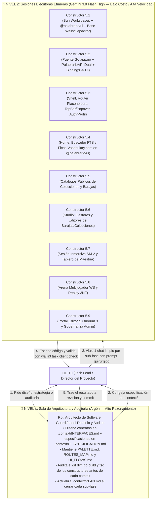

# 🤖 Guía Maestra de Ingeniería Orientada por Agentes (`AGENT_WORKFLOW.md`)

> **Manual Operativo de Orquestación de Modelos de IA para el Desarrollo de Palabrario**  
> **Enfoque:** Patrón *Arquitecto-Constructor* (*Architect-Builder*), *Backend-First*, *Contract-First* y *Monorepo Isomórfico (`@palabrario/ui`)*  
> **Propósito:** Maximizar la velocidad y precisión del desarrollo combinando modelos de alto razonamiento (**Argón**) con modelos rápidos y económicos (**Gemini 3.8 Flash High**), eliminando alucinaciones, colisiones de archivos y desperdicio de tokens.

---

## 1. Filosofía Central: ¿Por qué los Agentes Fallan y Cómo Evitarlo?

Cuando trabajas con LLMs en un proyecto real como **Palabrario**, existen tres causas principales de fallo:
1. **Empezar por la UI con Mockups antes que el Backend:** Si un agente programa primero la interfaz sin un contrato de API cerrado, inventa propiedades JSON que el backend no retorna.
2. **Esquizofrenia Documental (*Context Drift*):** Si la arquitectura está repetida o contradictoria en muchos archivos, el agente mezcla tecnologías o ignora reglas de negocio.
3. **Saturación de Ventana de Contexto:** Usar un mismo chat durante 40 mensajes para hacer 5 módulos distintos llena la memoria del modelo con errores viejos y degrada su atención (*Lost in the Middle*).

### La Solución Adoptada en Palabrario
Hemos estructurado el repositorio bajo **Descubrimiento Progresivo (*Progressive Disclosure*)** y **Fuente Única de Verdad (*Single Source of Truth*)** dentro de [`.context/`](./.context/):

| Archivo en `.context/` | Qué contiene (y por qué es único) | Quién lo mantiene |
| :--- | :--- | :---: |
| **[`.context/CONTEXT.md`](./.context/CONTEXT.md)** | Punto de entrada ligero (`< 120 líneas`), reglas anti-alucinación y mapa enrutador. | Arquitecto (Argón) |
| **[`.context/PLAN.md`](./.context/PLAN.md)** | Estado actual real del proyecto y checklist paso a paso por fases y sub-fases (Fase 5: `5.1–5.9`, Fase 6: Web 100% Astro SSR + SPA WS, Fase 7: Eventos). | Arquitecto (Argón) |
| **[`.context/DOMAIN.md`](./.context/DOMAIN.md)** | Las 24 entidades (incluyendo `match_rounds` en 3NF), los 5 contextos DDD, estados editoriales y fórmulas matemáticas (`SM-2` y `RN10`). | Arquitecto (Argón) |
| **[`.context/INTERFACES.md`](./.context/INTERFACES.md)** | **El Contrato Sagrado:** Interfaces SOA en Go, structs JSON exactos (`pkg/models`), catálogo `sqlc`, JWT S2S y endpoints HTTP/WS. | Arquitecto (Argón) |
| **[`.context/UI_SPECIFICATION.md`](./.context/UI_SPECIFICATION.md)** | **HUD Central del Cliente:** Reglas de Hierro de UI, Monorepo Bun Workspaces (`packages/ui` $\to$ `@palabrario/ui`), Adaptador Polimórfico (`Wails IPC` + `Capacitor/Web` + `Astro SSR`) y catálogo de componentes. | Arquitecto (Argón) |
| **[`.context/PALETTE.md`](./.context/PALETTE.md)** | **SSOT Visual (*Imprenta Táctil Ilustrada*):** Tokens cromáticos semánticos (`paper`, `surface`, `ink`, `brand`), tipografía `Satoshi`, sombras `soft*` y `uno.config.ts`. | Arquitecto (Argón) |
| **[`.context/ROUTES_MAP.md`](./.context/ROUTES_MAP.md)** | **Matriz Canónica de Rutas:** Las 23 vistas mapeadas 1:1 contra Casos de Uso, métodos de `IPalabrarioAPI`, endpoints reales y DTOs (`models.*`). | Arquitecto (Argón) |
| **[`.context/UI_FLOWS.md`](./.context/UI_FLOWS.md)** | **Flujos de Interacción E2E:** 6 diagramas de secuencia Mermaid (Auth dual, Credenciales/Rol en `TopBar`, Diccionario, SM-2, Arena WS y Curaduría). | Arquitecto (Argón) |
| **[`SCHEMA_FINAL.sql`](./SCHEMA_FINAL.sql)** | Esquema DDL único y ejecutable en PostgreSQL 17 con triggers `RN06` y `RN07`, tablas de Arena/Replay 3NF y sincronización automática de secuencias. | Arquitecto (Argón) |

---

## 2. Topología de Agentes: El Patrón "Arquitecto + Constructores"

No pongas a múltiples agentes a editar los mismos archivos al mismo tiempo (en un monorepo con `packages/ui`, `bindings/` y `vue-router`, dos agentes editando `packages/ui/src/index.ts`, `app.go` o `router/index.ts` simultáneamente se pisarán el código). En su lugar, opera una **jerarquía de dos niveles**:



### Matriz de Decisión: ¿Qué Modelo Uso Hoy?

| Tarea | Modelo Recomendado | Razón de Costo / Beneficio |
| :--- | :---: | :--- |
| **Diseñar o modificar contratos en `INTERFACES.md`, `UI_SPECIFICATION.md`, `PALETTE.md`, `ROUTES_MAP.md` o `UI_FLOWS.md`** | 🧠 **Argón** | Requiere visión holística de las 23 rutas, los 65 endpoints y las 13 reglas de negocio sin romper trazabilidad. |
| **Inicializar el monorepo Bun (`packages/ui` + `local-app/`), exponer `app.go` y generar `IPalabrarioAPI` (Sub-fases 5.1 y 5.2)** | ⚡ **Flash 3.8 High** | Las firmas de Go en `pkg/models` y la estructura de workspaces/adaptadores ya están especificadas línea por línea. |
| **Construir componentes puros en `@palabrario/ui` y vistas `.vue` en `local-app/frontend` (Sub-fases 5.3 a 5.9)** | ⚡ **Flash 3.8 High** | Como los tokens de UnoCSS (`PALETTE.md`), las rutas (`ROUTES_MAP.md`) y las secuencias (`UI_FLOWS.md`) están cerrados, Flash traduce especificación a componentes Vue 3 + Reka UI con cero alucinaciones. |
| **Revisar `git status` / `git diff`, validar `wails3 task client:check` y redactar commits semánticos** | 🧠 **Argón** (o Auditor de Respaldo con Prompt de Auditoría) | Garantiza que no se cuelen colores prohibidos, `fetch` directos ni violaciones de contrato antes de hacer commit. |

---

## 3. Las 5 Reglas de Oro de Higiene de Contexto en Fase 5

1. **Un Chat de Constructor = Una Sola Sub-Fase Atómica (`5.1` a `5.9`):**
   Cuando **Flash 3.8 High** termine una sub-fase y tanto Go como TypeScript/Vite compilen con 0 errores, **cierra ese chat**. Para la siguiente sub-fase, abre una conversación completamente nueva.
2. **Contexto Mínimo Viable (*Surgical Prompting*):**
   Nunca le pases todo el repositorio a un agente constructor. Pásale únicamente los archivos listados en cada prompt del Playbook (`.context/UI_SPECIFICATION.md`, `.context/PALETTE.md`, `.context/ROUTES_MAP.md`, `.context/UI_FLOWS.md` y la sección relevante de `.context/INTERFACES.md`).
3. **Cadena de Verificación Automatizada (`client:check`) como Juez Único:**
   Todo prompt para un agente constructor de Fase 5 exige que al finalizar ejecute la tarea unificada:
   ```powershell
   wails3 task client:check
   # (o powershell -File .\scripts\client.ps1 check)
   ```
   *(Esta tarea encadena automáticamente en orden estricto: regeneración de bindings $\to$ verificación de tipos TypeScript en `packages/ui` y `local-app/frontend` con `tsc --noEmit` $\to$ compilación frontend con Vite $\to$ compilación del binario Go).*

   > [!IMPORTANT]
   > **Regla sobre Bindings y Definiciones Faltantes:** Si TypeScript reporta que no encuentra módulos en `bindings/` o faltan métodos de Go, **NUNCA inventes interfaces a mano en el frontend**. Ejecuta inmediatamente:
   > ```powershell
   > wails3 task client:bindings
   > # (o powershell -File .\scripts\client.ps1 bindings)
   > ```
   > para regenerar el contrato tipado desde Go.
4. **Prohibido Tocar el Backend Cerrado (*Scope Lock*):**
   Los servicios `core-service/`, `realtime-service/`, `image-service/`, `pkg/` y `SCHEMA_FINAL.sql` están **100% cerrados y probados**. Ningún constructor de Fase 5 tiene permiso de modificarlos salvo instrucción explícita del Arquitecto.
5. **Commit Limpio como Punto de Control (*Checkpoint*):**
   Nunca inicies la Sub-Fase `5.X+1` sin haber auditado y hecho `git commit` de la Sub-Fase `5.X`.

---

## 4. Playbook de Prompts Quirúrgicos para la Fase 5 (Listos para Copiar y Pegar)

Copia y pega el prompt correspondiente cuando abras una sesión limpia con **Gemini 3.8 Flash High** (o el agente constructor en turno):

---

### 🏗️ Prompt 5.1: Monorepo Bun Workspaces (`packages/ui` $\to$ `@palabrario/ui`) + Inicialización de `local-app` (Wails V3 + Capacitor + UnoCSS)

```text
Actúa como Ingeniero Frontend/Desktop Senior en Go, Bun Workspaces y Vue 3. Vamos a ejecutar la **Sub-Fase 5.1 (Monorepo `@palabrario/ui` + Inicialización de `local-app`)** de Palabrario.

### 1. Contexto Obligatorio (Lee estos archivos antes de escribir código)
- `@.context/CONTEXT.md`
- `@.context/PLAN.md` (Sección Sub-Fase 5.1)
- `@.context/UI_SPECIFICATION.md` (Sección 0 y Sección 1: Arquitectura de Monorepo con Bun Workspaces)
- `@.context/PALETTE.md` (SSOT Visual — Imprenta Táctil Ilustrada y `uno.config.ts`)
- `@go.work`, `@local-app/Taskfile.yml`, `@local-app/build/Taskfile.yml`

### 2. Alcance Exacto a Construir

1. **Raíz del Monorepo Frontend (`package.json` y `tsconfig.base.json` en la raíz del repositorio):**
   - `package.json`: `"name": "palabrario-monorepo"`, `"private": true`, `"workspaces": ["packages/*", "local-app/frontend"]`.
   - `tsconfig.base.json`: Opciones estrictas TypeScript (`target: "ESNext"`, `module: "ESNext"`, `moduleResolution: "bundler"`, `strict: true`, `isolatedModules: true`, `verbatimModuleSyntax: true`, `skipLibCheck: true`).

2. **Paquete Compartido `packages/ui/` (`@palabrario/ui`):**
   - `packages/ui/package.json`:
     - `"name": "@palabrario/ui"`, `"private": true`, `"type": "module"`.
     - `"exports"`: `{ ".": "./src/index.ts", "./uno.config": "./src/uno.config.ts", "./styles.css": "./src/assets/main.css" }`.
     - Script `"type-check": "tsc --noEmit"`.
     - Dependencias: `vue` (^3.5), `reka-ui`, `lucide-vue-next`, `unocss` (incluye `presetWind3`), `@unocss/preset-icons`, `@unocss/reset`, `@iconify-json/lucide`, `typescript`.
   - `packages/ui/tsconfig.json`: Extiende `../../tsconfig.base.json` e incluye `src`.
   - `packages/ui/src/uno.config.ts`:
     - Copia **exactamente** la paleta y shortcuts de `@.context/PALETTE.md` (`paper`, `surface`, `ink`, `brand`, `brand-soft`, `info`, `success`, `warning`, fuente `Satoshi`, sombras `soft`, `soft-lg`, `soft-brand` y shortcuts `card-editorial`, `card-subtle`, `btn-primary`, `btn-secondary`, `btn-ghost`, `badge-pill`, `input-editorial`).
     - Añade `content.filesystem` apuntando con ruta absoluta (`path.resolve(__dirname, './components/**/*.{vue,ts}').replace(/\\/g, '/')`) para que cualquier consumidor del workspace extraiga todas las clases UnoCSS de `@palabrario/ui`.
   - `packages/ui/src/assets/main.css`: Tipografía `Satoshi` (`@font-face` o import limpio), fondo base `bg-paper text-ink font-sans antialiased` y `.tabular-nums { font-variant-numeric: tabular-nums; }`.
   - `packages/ui/src/types/models.ts`: Archivo puente para re-exportar tipos desde `local-app/frontend/bindings`.
   - Estructura de carpetas en `packages/ui/src/components/`: Crear `ui/`, `dictionary/`, `studio/`, `arena/`, `editorial/` y `packages/ui/src/index.ts` (barrel export inicial).

3. **Capa Go de Escritorio (`local-app/`):**
   - `local-app/go.mod`: Asegurar módulo `palabrario/local-app` (Go 1.24) enlazado al `go.work` raíz e importando `palabrario/pkg/models`.
   - Eliminar el `greetservice.go` de plantilla y crear `local-app/app.go` y `local-app/main.go` (esqueleto base Wails v3 con `github.com/wailsapp/wails/v3/pkg/application`):
     - Estructura `App` registrada como servicio en `application.New(...)`, con `ctx context.Context`, `httpClient *http.Client`, URLs base configurables por entorno (`PALABRARIO_CORE_URL` default `http://localhost:8000`, `PALABRARIO_REALTIME_URL` default `ws://localhost:8001`, `PALABRARIO_IMAGE_URL` default `http://localhost:8002`), y `sessionToken string` privado protegido por `mu sync.RWMutex`.
     - Ventana configurada a `1280x820` (mínimo `390x680`) con color de fondo `#FFFDF5` (`paper`: RGB `255, 253, 245`).
   - Actualizar `local-app/Taskfile.yml` en la tarea `check` para ejecutar en orden:
     1. `task: bindings`
     2. `bun run --cwd ../packages/ui type-check`
     3. `bun run --cwd frontend type-check`
     4. `bun run --cwd frontend build`
     5. `go build .`

4. **Shell Frontend Multiplataforma (`local-app/frontend/`):**
   - `local-app/frontend/package.json`: Configurar con `"@palabrario/ui": "workspace:*"`, `@wailsio/runtime`, `vue` (^3.5), `vue-router` (^4.5), `@capacitor/core`, `@capacitor/cli`, `@capacitor/preferences`, `unocss`, `typescript`, `vite` y `@vitejs/plugin-vue`.
   - `local-app/frontend/uno.config.ts`: Re-exportar `export { default } from "@palabrario/ui/uno.config"`.
   - `local-app/frontend/vite.config.ts`: Integrar `vue()`, `UnoCSS()` y `wails("./bindings")`, con alias `@` -> `./src`.
   - `local-app/frontend/capacitor.config.ts`: `appId: 'com.palabrario.app'`, `appName: 'Palabrario'`, `webDir: 'dist'`.
   - Estructura en `local-app/frontend/src/`: Crear `api/`, `composables/`, `components/ui/`, `layouts/`, `router/`, `views/` (con subcarpetas `auth/`, `profile/`, `community/`, `studio/`, `arena/`, `editorial/`), `main.ts` (importando `'virtual:uno.css'` y `'@palabrario/ui/styles.css'`) y un `App.vue` mínimo verificable con `card-editorial`.
   - `local-app/README.md`: Documentar la arquitectura del monorepo (`@palabrario/ui` + `local-app/frontend`), flujo dual (Wails vs Capacitor/Web) y comandos de verificación.

### 3. Restricciones Estrictas (Scope Lock)
- **PROHIBIDO** modificar `core-service/`, `realtime-service/`, `image-service/`, `pkg/` o `SCHEMA_FINAL.sql`.
- **PROHIBIDO** crear archivos `mock` o usar colores genéricos fuera de `@.context/PALETTE.md`.

### 4. Verificación Obligatoria antes de Finalizar
Instala las dependencias del workspace con `bun install` y ejecuta la cadena completa en powershell:

wails3 task client:check
# (o powershell -File .\scripts\client.ps1 check)

No des por terminada la tarea hasta que la verificación pase con 0 errores.
```
---

### 🔌 Prompt 5.2: Puente Nativo Go Completo (`local-app/app.go`), Bindings TypeScript y Adaptador Polimórfico (`IPalabrarioAPI`)

```text
Actúa como Ingeniero Senior en Go y TypeScript. Vamos a ejecutar la **Sub-Fase 5.2 (Puente Nativo Go + Bindings TypeScript + Adaptador Polimórfico Dual + Exportación de Tipos a `@palabrario/ui`)** de Palabrario.

### 1. Contexto Obligatorio (Lee estos archivos antes de escribir código)
- `@.context/UI_SPECIFICATION.md` (Sección 1: Arquitectura de Monorepo y Adaptador Polimórfico)
- `@.context/ROUTES_MAP.md` (Columna "Métodos IPalabrarioAPI & Endpoints Backend Reales" y "DTOs Principales")
- `@.context/UI_FLOWS.md` (Flujos 1 a 6)
- `@.context/INTERFACES.md` (Secciones 2.1 a 2.8 y tablas de endpoints)
- Todos los archivos en `@pkg/models/` (`auth.go`, `identity.go`, `governance.go`, `dictionary.go`, `curation.go`, `studio.go`, `arena.go`)

### 2. Alcance Exacto a Construir

1. **Puente Nativo Go Completo (`local-app/app.go`):**
   Implementa en `struct App` todos los métodos públicos requeridos por `@.context/ROUTES_MAP.md` y `@.context/UI_FLOWS.md`, utilizando `pkg/models` como tipos de entrada y retorno:
   - **Helpers HTTP internos:** Método auxiliar que serializa JSON, inyecta `Authorization: Bearer <sessionToken>` (leyendo con `a.mu.RLock()`), ejecuta la petición contra `core-service (:8000)` y, si el código es `>= 400`, decodifica `{"error": "..."}` y retorna `errors.New(errResp.Error)` con el mensaje humano exacto en español.
   - **Sesión & Auth (`Módulo 1`):** `SignIn`, `SignUp` (ambos guardan `resp.Token` en `a.sessionToken` con `a.mu.Lock()` y retornan `*models.User`), `SignOut` (limpia `a.sessionToken`), `HasActiveSession() bool`.
   - **Identidad & Perfil (`Módulo 2`):** `GetMyProfile`, `GetPublicProfileByUsername`, `UpdateProfile`, `ChangePassword`.
   - **Gobernanza (`Módulo 3`):** `RedeemInvitationTicket`, `CreateEditorRequest`, `ListMyEditorRequests`, `ListPendingEditorRequests`, `ResolveEditorRequest`, `GenerateInvitationTickets`, `ListInvitationTickets`, `ListUsersForGovernance`, `UpdateUserRole`, `UpdateUserStatus`, `CreateCommunityReport`, `ListCommunityReports`, `ResolveCommunityReport`.
   - **Diccionario (`Módulo 4`):** `ListRegions`, `GetWordOfTheDay`, `SearchWords`, `ExploreWords`, `GetWordDetail`, `CreateWordProposal`, `UpdateWordProposal`, `CreateSenseProposal`, `UpdateSenseProposal`, `AddSenseExample`, `ListSemanticConcepts`, `CreateSemanticConcept`, `LinkSenseToConcept`.
   - **Curaduría (`Módulo 5`):** `ListPendingQuorumQueue`, `ListMyLexicalProposals`, `SubmitProposalReview`, `AdminForceResolveProposal`.
   - **Studio & SM-2 (`Módulo 6`):** `ExplorePublicCollections`, `GetCollectionDetail`, `ExplorePublicDecks`, `GetDeckDetail`, `ClonePublicDeck`, `ListMyDecks`, `CreateDeck`, `UpdateDeck`, `DeleteDeck`, `AddSenseToDeck`, `RemoveSenseFromDeck`, `ListMyCollections`, `CreateCollection`, `UpdateCollection`, `DeleteCollection`, `AddDeckToCollection`, `RemoveDeckFromCollection`, `GetStudySessionQueue`, `SubmitCardReview`, `GetMasterySummary`, `GetMyXPTransactions`, `GetMyAchievements`.
   - **Arena & WebSocket (`Módulo 7`):** `CreateArenaMatch`, `JoinArenaMatch`, `GetMyMatchHistory`, `GetMatchReplayDetail`, más los métodos WebSocket hacia `realtime-service (:8001)`: `ConnectArenaRoom(roomCode string) error`, `SubmitArenaAnswer(roundNumber int, selectedOption string) error`, `LeaveArenaRoom() error` (gestionando la conexión WS activa en `App` y emitiendo eventos al frontend para cada `models.WSMessage`).
   - **Multimedia (`Módulo 8`):** `UploadImage(category string, filename string, fileBytes []byte) (*models.ImageUploadResponse, error)` que envía `multipart/form-data` a `POST /api/v1/images/upload` en `image-service (:8002)`.

2. **Bindings TypeScript (`local-app/frontend/bindings/`) y Re-exportación en `@palabrario/ui`:**
   - Ejecuta `wails3 task client:bindings` para autogenerar los bindings en `local-app/frontend/bindings/`.
   - Actualiza `packages/ui/src/types/models.ts` e `index.ts` para re-exportar con `export type *` todos los modelos autogenerados desde `local-app/frontend/bindings/palabrario/pkg/models/index.js`.

3. **Adaptador Polimórfico Dual (`local-app/frontend/src/api/`):**
   - `src/api/client.ts`: Declara `import * as WailsAppBridge from '../../bindings/palabrario/local-app/app'; export type IPalabrarioAPI = typeof WailsAppBridge;` y exporta `export const api: IPalabrarioAPI` seleccionando entre `WailsDesktopAdapter` (cuando corre en runtime de Wails) y `CapacitorMobileAdapter`.
   - `src/api/wails.adapter.ts`: Implementa `IPalabrarioAPI` delegando directamente en `WailsAppBridge`.
   - `src/api/capacitor.adapter.ts`: Implementa el 100% de `IPalabrarioAPI` mediante `fetch` tipado hacia las URLs de `:8000` y `:8002`, gestionando el token con `@capacitor/preferences` (funcional tanto en Capacitor móvil como en Navegador Web SPA).
   - `src/api/arena.events.ts`: Implementa `ArenaEventBus` unificando la suscripción a tramas `models.WSMessage` tanto en Wails (`Events.On('arena:ws_message')` de `@wailsio/runtime`) como en Capacitor/Web Browser (`new WebSocket('ws://.../ws/arena/' + roomCode + '?token=' + jwt)`).

### 3. Restricciones Estrictas (Scope Lock)
- **PROHIBIDO** modificar `core-service/`, `realtime-service/`, `image-service/`, `pkg/` o `SCHEMA_FINAL.sql`.
- **PROHIBIDO** inventar interfaces o tipos TypeScript a mano para el backend o Wails. Si falta una definición, ejecuta `wails3 task client:bindings` para regenerarlas desde Go.
- Ningún método o campo puede inventarse fuera de `pkg/models` y `@.context/INTERFACES.md`.

### 4. Verificación Obligatoria antes de Finalizar
Ejecuta la cadena completa y asegura 0 errores con powershell:

wails3 task client:check
# (o powershell -File .\scripts\client.ps1 check)
```

---

### 🧭 Prompt 5.3: Shell de Navegación (`Layouts` + `Router` con Placeholders), `TopBar` + `CredentialsRolePopover` y Autenticación/Perfil (`Rutas #1, #2, #3`)

```text
Actúa como Ingeniero Frontend Senior especialista en Vue 3, TypeScript, Reka UI y UnoCSS. Vamos a ejecutar la **Sub-Fase 5.3 (Shell de Navegación, Router con Vistas Placeholder, TopBar en `@palabrario/ui`, Popover de Credenciales y Vistas de Auth/Perfil)** de Palabrario.

### 1. Contexto Obligatorio (Lee estos archivos antes de escribir código)
- `@.context/UI_SPECIFICATION.md` (Especialmente Regla de Hierro #7: Frontera `@palabrario/ui` vs `local-app/frontend`)
- `@.context/PALETTE.md`
- `@.context/ROUTES_MAP.md` (Las 23 rutas, guardias y layouts)
- `@.context/UI_FLOWS.md` (**Flujo 1: Auth e Hidratación** y **Flujo 2: TopBar DropdownMenu -> CredentialsRolePopover y Perfil**)
- `@local-app/frontend/src/api/client.ts` y `@packages/ui/src/index.ts`

### 2. Alcance Exacto a Construir

1. **Componentes Compartidos SSR-Safe en `packages/ui/src/components/ui/` (exportados en `packages/ui/src/index.ts`):**
   - `MediaDropzone.vue`: Dropzone reutilizable que valida tamaño `<= 5 MB` y formatos `JPG/PNG/WEBP`, recibe una función `uploadFn` por prop o emite el archivo validado y muestra vista previa o error (`RN12`).
   - `TopBar.vue`: Barra superior editorial **agnóstica del router** (recibe `currentUser`, `activeSpace` y estado por `props`; emite `@navigate(path)`, `@open-search`, `@open-credentials` y `@sign-out`). Incluye navegación entre espacios (*Explorar*, *Mi Studio*, *Arena*, y *Portal Editorial* si es `EDITOR`/`ADMIN`), disparador `Ctrl + K`, racha (`🔥`), nivel y el **`DropdownMenu` de Reka UI** en el bloque del usuario con: *Mi Perfil Público*, *Credenciales y Rol en la Imprenta*, *Configuración de Cuenta* y *Cerrar Sesión*.
   - `BottomNav.vue`: Barra inferior responsiva para móvil/ventana estrecha (recibe `activePath` y emite `@navigate(path)`).

2. **Estado, Layouts y Enrutador en `local-app/frontend/src/`:**
   - `src/composables/useAuth.ts`: Store reactivo singleton siguiendo el **Flujo 1 de `@.context/UI_FLOWS.md`**: `currentUser`, `isAuthenticated`, `isEditor`, `isAdmin`, `isLoading`, `hydrateSession()`, `signIn(req)`, `signUp(req)`, `signOut()` y `refreshProfile()`.
   - `src/components/ui/CredentialsRolePopover.vue`: Popover/Modal invocado desde `AppLayout.vue` siguiendo el **Flujo 2 de `@.context/UI_FLOWS.md`**:
     - Encabezado con rol actual (`LEARNER` / `EDITOR` / `ADMIN`), `reputation_score` (`tabular-nums`) y `is_verified`.
     - **Pestaña 1 — Canjear Boleto VIP (`CU04`):** Input para `ticket_code` $\to$ `api.RedeemInvitationTicket` $\to$ refresca `currentUser`.
     - **Pestaña 2 — Solicitar Ascenso a Editor (`CU02`):** Verifica `RN02` (`reputation_score >= 500 || is_verified == true`); integra `MediaDropzone` (`RN12`), campo `academic_bio` $\to$ `api.CreateEditorRequest` y lista el historial con `api.ListMyEditorRequests()`.
   - `src/layouts/AppLayout.vue`, `src/layouts/AuthLayout.vue` y `src/layouts/ImmersiveLayout.vue` conectados en `src/App.vue`.
   - **Vistas Placeholder para Rutas `#4 a #23`** en `local-app/frontend/src/views/` y `src/router/index.ts` con `createWebHashHistory()` y guardias (`guestOnly`, `requireAuth`, `requireRole`).

3. **Vistas Funcionales Completas en `local-app/frontend/src/views/` (`Rutas #1, #2 y #3`):**
   - `src/views/auth/SignInView.vue` (`/#/auth/sign-in` — `RF01`).
   - `src/views/auth/SignUpView.vue` (`/#/auth/sign-up`): Registro cargando `api.ListRegions()`.
   - `src/views/profile/UserProfileView.vue` (`/#/u/:username` — `CU01`): Carga `api.GetPublicProfileByUsername(username)`. Si `profile.is_owner == true`, habilita edición de perfil (`api.UpdateProfile` + `MediaDropzone(category='avatar')`) y cambio de contraseña (`api.ChangePassword`).

### 3. Restricciones Estrictas (Scope Lock)
- **PROHIBIDO** usar colores fuera de `@.context/PALETTE.md`.
- **PROHIBIDO** importar `vue-router` o `api.*` dentro de `packages/ui/`.
- **PROHIBIDO** inventar interfaces o tipos TypeScript a mano para el backend o Wails. Si falta una definición, ejecuta `wails3 task client:bindings`.
- **PROHIBIDO** hacer llamadas `fetch` directas en `.vue`; usa exclusivamente `api` (`src/api/client.ts`).

### 4. Verificación Obligatoria antes de Finalizar
Ejecuta la cadena completa con powershell y asegura 0 errores:

wails3 task client:check
# (o powershell -File .\scripts\client.ps1 check)
```

---

### 📖 Prompt 5.4: Portal Comunitario, Buscador FTS y Ficha Léxica Estilo Vocabulary.com (`Rutas #4, #5, #6` — `CU05, CU09, CU10`)

```text
Actúa como Ingeniero Frontend Senior en Vue 3, Reka UI y UnoCSS. Vamos a ejecutar la **Sub-Fase 5.4 (Portal Home, Buscador FTS y Ficha Léxica Estilo Vocabulary.com)** de Palabrario.

### 1. Contexto Obligatorio (Lee estos archivos antes de escribir código)
- `@.context/UI_SPECIFICATION.md` (Sección 0 Regla #7 y Sección 3.2: Componentes del Diccionario y Fusión Vocabulary.com)
- `@.context/PALETTE.md` (Sección 5: Anatomía Visual Inspirada en Vocabulary.com)
- `@.context/ROUTES_MAP.md` (Rutas `#4, #5 y #6`)
- `@.context/UI_FLOWS.md` (**Flujo 3: Exploración FTS, Ficha Estilo Vocabulary.com, Guardado en Baraja y Reporte**)
- `@local-app/frontend/src/api/client.ts` y `@packages/ui/src/index.ts`

### 2. Alcance Exacto a Construir

1. **Componentes del Diccionario y Modales en `packages/ui/src/components/` (100% SSR-Safe, agnósticos del router, exportados en `packages/ui/src/index.ts`):**
   - `dictionary/WordCard.vue`: Tarjeta táctil (`models.WordSummaryCard`) que emite `@select(idWord)`.
   - `dictionary/FriendlyBlurb.vue`:
     - Inspirado en la columna narrativa de apertura de Vocabulary.com (ver `@.context/PALETTE.md` Sección 5.1).
     - Párrafo 1 (`word.friendly_blurb`): Gancho conversacional empático en `text-lg md:text-xl leading-relaxed text-ink max-w-68ch mb-4`.
     - Párrafo 2 (`word.etymology`): Contexto cultural e historia etimológica en `text-base leading-relaxed text-ink/80 max-w-68ch`.
     - Si existe `word.image_url`, muestra su marco ilustrado con atribución `word.image_credit` emitiendo `@open-image`.
   - `dictionary/HeteronymPills.vue`:
     - Renderiza los equivalentes dialectales (`models.HeteronymItem[]`) agrupados por concepto semántico con su bandera regional; al hacer click emite `@select-word(idWord)` (sin acoplarse a `vue-router`).
   - `dictionary/SenseItem.vue`:
     - Inspirado en el bloque numerado de Vocabulary.com (ver `@.context/PALETTE.md` Sección 5.2).
     - Muestra índice (`1.`, `2.`), badge en contorno `success` (`bg-success/15 text-success border border-success font-bold`) con categoría gramatical, región y nivel CEFR (`A1–C2`), seguido de la definición (`sense.definition`).
     - Debajo incluye `HeteronymPills` (re-emitiendo `@select-word`) y un desplegable `Collapsible` de Reka UI (**`Ver más ⌄`**) que revela: citas de uso (`sense.examples`), nota pragmática (`sense.usage_note`), miniatura de `sense.image_url` y botones **"Guardar en Deck"** y **"Reportar"** que emiten `@add-to-deck(sense)` y `@report(sense)`.
   - `dictionary/TabooWarningDialog.vue`: `AlertDialog` de Reka UI cuando `word.is_taboo == true`.
   - `dictionary/ReportModal.vue` (`CU09`): `Dialog` de Reka UI que recibe el objetivo a denunciar (`target_type: 'WORD' | 'SENSE'`) y emite `@submit(payload)`.
   - `studio/AddToDeckModal.vue` (`CU10`): `Dialog` de Reka UI que recibe la lista de mazos (`decks`) y emite `@add({ idDeck, idSense })` o `@create-deck(payload)` respetando el límite de 100 cartas (`RN04`).
   - `ui/ImageLightboxModal.vue` y `ui/SearchModal.vue` (paleta global `Ctrl + K` con debounce de 250ms que recibe resultados por prop y emite `@search(query)` y `@select(idWord)`).

2. **Reemplazo de Placeholders por Vistas Reales en `local-app/frontend/src/views/community/` (`Rutas #4, #5 y #6`):**
   - `HomeView.vue` (`/#/` — Ruta #4): Hero de la Palabra del Día (`api.GetWordOfTheDay()`), buscador rápido y vitrina de colecciones (`api.ExplorePublicCollections`) y barajas destacadas (`api.ExplorePublicDecks`).
   - `DictionaryView.vue` (`/#/dictionary` — Ruta #5): Buscador FTS + `pg_trgm` (`api.SearchWords`) y explorador paginado (`api.ExploreWords`) con filtros por región (`api.ListRegions()`), categoría gramatical y nivel CEFR.
   - `WordDetailView.vue` (`/#/dictionary/:id` — Ruta #6): Ficha léxica completa montando `FriendlyBlurb`, lista de `SenseItem` y modales desde `@palabrario/ui` y conectándolos a `api.*` y `vue-router`.

### 3. Restricciones Estrictas (Scope Lock)
- **PROHIBIDO** usar colores fuera de `@.context/PALETTE.md`.
- **PROHIBIDO** importar `vue-router` o `api.*` dentro de `packages/ui/`.
- **PROHIBIDO** inventar interfaces o tipos TypeScript a mano para el backend o Wails. Si falta una definición, ejecuta `wails3 task client:bindings`.
- **PROHIBIDO** modificar archivos del backend o rutas ajenas a esta sub-fase.

### 4. Verificación Obligatoria antes de Finalizar
Ejecuta la cadena completa con powershell y asegura 0 errores:

wails3 task client:check
# (o powershell -File .\scripts\client.ps1 check)
```
---

### 📚 Prompt 5.5: Catálogos Públicos de Colecciones y Barajas + Clonación (`Rutas #7, #8, #9, #10` — `CU10, CU11, RN03`)

```text
Actúa como Ingeniero Frontend Senior en Vue 3, Reka UI y UnoCSS. Vamos a ejecutar la **Sub-Fase 5.5 (Catálogos Públicos de Colecciones y Barajas + Clonación RN03)** de Palabrario.

### 1. Contexto Obligatorio (Lee estos archivos antes de escribir código)
- `@.context/UI_SPECIFICATION.md`
- `@.context/PALETTE.md`
- `@.context/ROUTES_MAP.md` (Rutas `#7, #8, #9 y #10`)
- `@.context/INTERFACES.md` (Sección 2.6: Módulo Studio)
- `@local-app/frontend/src/api/client.ts` y `@packages/ui/src/index.ts`

### 2. Alcance Exacto a Construir

1. **Componentes de Tarjetas en `packages/ui/src/components/studio/` (exportados en `packages/ui/src/index.ts`):**
   - `DeckCard.vue` y `CollectionCard.vue`: Tarjetas táctiles editoriales (`card-editorial`) agnósticas del router que reciben el DTO correspondiente y emiten `@select(id)`.

2. **Reemplazo de Placeholders en `local-app/frontend/src/views/community/` (`Rutas #7 a #10`):**
   - **`PublicCollectionsView.vue` (`/#/collections` — Ruta #7):** Consume `api.ExplorePublicCollections(query, page, pageSize)`, buscador por texto, badge para colecciones oficiales (`is_official`), conteo de barajas (`deck_count`), autor (`author_username`) y paginación.
   - **`CollectionDetailView.vue` (`/#/collections/:id` — Ruta #8):** Consume `api.GetCollectionDetail(id)`, muestra portada editorial y grilla ordenada de barajas (`decks: DeckSummary[]`) navegando a `/#/decks/:id`.
   - **`PublicDecksView.vue` (`/#/decks` — Ruta #9):** Consume `api.ExplorePublicDecks(query, page, pageSize)` mostrando nombre, descripción, autor, `word_count` (`tabular-nums`) y `clone_count`.
   - **`PublicDeckDetailView.vue` (`/#/decks/:id` — Ruta #10):** Consume `api.GetDeckDetail(id)`, lista sus tarjetas (`cards: SenseSummary[]`) y presenta el botón `btn-primary` **"Clonar a Mi Studio"** (`RN03` $\to$ `api.ClonePublicDeck(id)` $\to$ redirige a `/#/studio/decks/:newId`).

### 3. Restricciones Estrictas (Scope Lock)
- **PROHIBIDO** usar colores fuera de `@.context/PALETTE.md`.
- **PROHIBIDO** importar `vue-router` o `api.*` dentro de `packages/ui/`.
- **PROHIBIDO** inventar interfaces o tipos TypeScript a mano para el backend o Wails. Si falta una definición, ejecuta `wails3 task client:bindings`.
- **PROHIBIDO** modificar archivos del backend.

### 4. Verificación Obligatoria antes de Finalizar
Ejecuta la cadena completa con powershell y asegura 0 errores:

wails3 task client:check
# (o powershell -File .\scripts\client.ps1 check)
```
---

### 🛠️ Prompt 5.6: Studio Personal — Gestores y Editores de Barajas y Colecciones (`Rutas #11, #13, #14, #15, #16` — `CU10, CU11, RN04, RN05`)

```text
Actúa como Ingeniero Frontend Senior en Vue 3, Reka UI y UnoCSS. Vamos a ejecutar la **Sub-Fase 5.6 (Studio Personal: Tablero y Editores de Barajas y Colecciones)** de Palabrario.

### 1. Contexto Obligatorio (Lee estos archivos antes de escribir código)
- `@.context/UI_SPECIFICATION.md`
- `@.context/PALETTE.md`
- `@.context/ROUTES_MAP.md` (Rutas `#11, #13, #14, #15 y #16`)
- `@.context/DOMAIN.md` (Reglas `RN03`, `RN04` límite de 100 cartas por deck, `RN05` colecciones públicas solo admiten decks públicos)
- `@local-app/frontend/src/api/client.ts` y `@packages/ui/src/index.ts`

### 2. Alcance Exacto a Construir en `local-app/frontend/src/views/studio/`
Reemplaza los placeholders de las rutas `#11, #13, #14, #15 y #16` reutilizando componentes de `@palabrario/ui`:

1. **`StudioDashboardView.vue` (`/#/studio` — Ruta #11):**
   - Carga en paralelo `api.GetMasterySummary()`, `api.ListMyDecks()` y `api.ListMyCollections()`.
   - Destaca el contador `due_for_review_today` (`tabular-nums`) con CTA directo **"Iniciar Repaso del Día"** (`/#/studio/session`), métricas rápidas de maestría (`total_words_studied`, `mastered_count`, `streak_days`) y accesos directos a mis barajas y colecciones.

2. **`StudioDecksView.vue` (`/#/studio/decks` — Ruta #13):**
   - Lista `api.ListMyDecks()`, distingue barajas propias vs clonadas (`cloned_from_id`), incluye modal Reka `Dialog` para crear baraja (`api.CreateDeck`) y opción de eliminar (`api.DeleteDeck`) con `AlertDialog` de confirmación.

3. **`StudioDeckEditorView.vue` (`/#/studio/decks/:id` — Ruta #14):**
   - Carga `api.GetDeckDetail(id)`.
   - Permite editar `name`, `description` y visibilidad `is_public` (`api.UpdateDeck`). Si el deck es clonado (`cloned_from_id != null`), aplica `RN03` (bloquea marcarlo como `is_public = true` mostrando aviso claro).
   - Muestra indicador de capacidad **`{cards.length} / 100 cartas` (`RN04`)**.
   - Incluye buscador integrado (`api.SearchWords` $\to$ `api.GetWordDetail`) para añadir acepciones al mazo con `api.AddSenseToDeck(id, { id_sense, custom_note })` y botón para quitar cartas con `api.RemoveSenseFromDeck(id, idSense)`.
   - Botón **"Estudiar este Deck"** que navega a `/#/studio/session?deckId=:id`.

4. **`StudioCollectionsView.vue` (`/#/studio/collections` — Ruta #15):**
   - Lista `api.ListMyCollections()`, modal Reka `Dialog` para crear colección (`api.CreateCollection`) y borrado (`api.DeleteCollection`).

5. **`StudioCollectionEditorView.vue` (`/#/studio/collections/:id` — Ruta #16):**
   - Carga `api.GetCollectionDetail(id)` y `api.ListMyDecks()`.
   - Permite editar metadatos (`api.UpdateCollection`), agregar barajas a la colección (`api.AddDeckToCollection(id, { id_deck, display_order })`) validando en UI la regla **`RN05`** (si la colección es pública, deshabilita agregar barajas privadas con tooltip explicativo) y desvincular barajas (`api.RemoveDeckFromCollection`).

### 3. Restricciones Estrictas (Scope Lock)
- **PROHIBIDO** usar colores fuera de `@.context/PALETTE.md`.
- **PROHIBIDO** inventar interfaces o tipos TypeScript a mano para el backend o Wails. Si falta una definición, ejecuta `wails3 task client:bindings` para regenerarlas desde Go.
- **PROHIBIDO** modificar archivos del backend.

### 4. Verificación Obligatoria antes de Finalizar
Ejecuta la cadena completa con powershell y asegura 0 errores:

wails3 task client:check
# (o powershell -File .\scripts\client.ps1 check)
```

---

### 🧠 Prompt 5.7: Sesión Inmersiva de Repaso SM-2 y Tablero de Maestría (`Rutas #12, #17` — `CU12, CU13, RN09, RN11`)

```text
Actúa como Ingeniero Frontend Senior en Vue 3, Reka UI y UnoCSS. Vamos a ejecutar la **Sub-Fase 5.7 (Sesión Inmersiva de Repaso SM-2 y Tablero de Maestría)** de Palabrario.

### 1. Contexto Obligatorio (Lee estos archivos antes de escribir código)
- `@.context/UI_SPECIFICATION.md` (Sección 3.3: Componentes de Studio y Repetición Espaciada)
- `@.context/PALETTE.md`
- `@.context/ROUTES_MAP.md` (Rutas `#12 y #17`)
- `@.context/UI_FLOWS.md` (**Flujo 4: Sesión Inmersiva de Repaso SM-2 y Ledger de XP**)
- `@local-app/frontend/src/api/client.ts` y `@packages/ui/src/index.ts`

### 2. Alcance Exacto a Construir

1. **Componentes de Studio en `packages/ui/src/components/studio/` (exportados en `packages/ui/src/index.ts`):**
   - `StudyCard.vue`:
     - Tarjeta táctil de estudio con estado `isFlipped`.
     - **Anverso (Reto):** Muestra el lema (`card.lemma`), badge de región (`card.region_name`), categoría gramatical y nota personal (`custom_note`).
     - **Reverso (Revelación):** Muestra la definición (`card.definition`), ejemplo contextual (`card.example_text`), ilustración (`card.image_url` si existe) y los **4 botones ergonómicos de calificación SM-2 (`RN09`)** con soporte de atajos de teclado (`Espacio` para voltear; teclas `1`, `2`, `3`, `4` para calificar):
       - `1 — Olvidado` (Borde/acento `brand`)
       - `2 — Difícil` (Borde/acento `warning`)
       - `3 — Bien` (Borde/acento `success`)
       - `4 — Fácil` (Fondo `success text-surface`)
   - `MasteryProgressBar.vue`:
     - Barra segmentada táctil con `tabular-nums` que muestra la distribución de palabras en `NEW`, `LEARNING`, `REVIEW` y `MASTERED`.

2. **Reemplazo de Placeholders por Vistas Reales en `local-app/frontend/src/views/studio/` (`Rutas #12 y #17`):**
   - `StudySessionView.vue` (`/#/studio/session` — Ruta #12, Layout `immersive`):
     - Sigue paso a paso el **Flujo 4 de `@.context/UI_FLOWS.md`**.
     - Lee `route.query.deckId` opcional e invoca `api.GetStudySessionQueue(deckId, 20)`.
     - Mide `response_time_ms` con `performance.now()` en cada tarjeta e invoca `api.SubmitCardReview({ id_sense, quality_score, response_time_ms, id_deck })`.
     - Muestra micro-feedback animado con el XP ganado (`result.xp_earned`, `result.streak_bonus_xp`, `result.deck_completed_xp`), el nuevo `interval_days` y `easiness_factor`.
     - Al concluir la cola, muestra pantalla de **Resumen de Sesión** con estadísticas de aciertos, XP total sumado, actualización de `useAuth().refreshProfile()` y botones para volver a `/#/studio`.
   - `StudioMasteryView.vue` (`/#/studio/mastery` — Ruta #17):
     - Carga en paralelo `api.GetMasterySummary()`, `api.GetMyXPTransactions(50)` y `api.GetMyAchievements()`.
     - Renderiza `MasteryProgressBar`, tarjetas de KPIs (`easiness_factor` promedio, `streak_days`, `due_for_review_today`), vitrina de logros desbloqueados y la tabla del libro mayor inmutable de experiencia (`XPTransactionItem[]`, con `id_transaction` UUID y razones `QUIZ_CORRECT`, `MATCH_WIN`, `DAILY_STREAK`, `DECK_COMPLETED`, `ACHIEVEMENT_UNLOCKED`).

### 3. Restricciones Estrictas (Scope Lock)
- **PROHIBIDO** usar colores fuera de `@.context/PALETTE.md`.
- **PROHIBIDO** importar `vue-router` o `api.*` dentro de `packages/ui/`.
- **PROHIBIDO** inventar interfaces o tipos TypeScript a mano para el backend o Wails. Si falta una definición, ejecuta `wails3 task client:bindings` para regenerarlas desde Go.
- **PROHIBIDO** modificar archivos del backend.

### 4. Verificación Obligatoria antes de Finalizar
Ejecuta la cadena completa con powershell y asegura 0 errores:

wails3 task client:check
# (o powershell -File .\scripts\client.ps1 check)
```

---

### ⚔️ Prompt 5.8: Arena Multijugador en Vivo (WebSockets), `WORD_TO_IMAGE` y Replay 3NF (`Rutas #18, #19, #20` — `CU14, CU15, CU16, RN10, RN13`)

```text
Actúa como Ingeniero Frontend Senior en Vue 3, WebSockets y UnoCSS. Vamos a ejecutar la **Sub-Fase 5.8 (Arena Multijugador en Vivo, Modalidad WORD_TO_IMAGE y Replay Granular 3NF)** de Palabrario.

### 1. Contexto Obligatorio (Lee estos archivos antes de escribir código)
- `@.context/UI_SPECIFICATION.md` (Sección 3.4: Componentes de la Arena Multijugador)
- `@.context/PALETTE.md`
- `@.context/ROUTES_MAP.md` (Rutas `#18, #19 y #20`)
- `@.context/UI_FLOWS.md` (**Flujo 5: Arena Multijugador en Tiempo Real, Modalidad Visual RN13 y Replay 3NF**)
- `@.context/INTERFACES.md` (Sección 2.7: Contratos HTTP y Tramas WebSocket de Arena)
- `@local-app/frontend/src/api/client.ts`, `@local-app/frontend/src/api/arena.events.ts` y `@packages/ui/src/index.ts`

### 2. Alcance Exacto a Construir

1. **Componentes de Arena en `packages/ui/src/components/arena/` (exportados en `packages/ui/src/index.ts`):**
   - `ArenaTimer.vue`: Cronómetro regresivo con `tabular-nums`, barra de progreso y cambio a color `brand` cuando quedan `<= 3s`.
   - `ImageChoiceGrid.vue`: Cuadrícula táctil `2x2` para preguntas con `question_mode === 'WORD_TO_IMAGE'` (`RN13`), renderizando las 4 opciones de imagen (`options`) con estado seleccionado y bloqueo tras responder.
   - `PodiumCard.vue`: Podio competitivo (`1°`, `2°`, `3°` y tabla de posiciones) mostrando `score`, `correct_answers`, `total_time_spent_ms` (`tabular-nums`) y `xp_awarded`, emitiendo `@view-replay(matchId)`.

2. **Reemplazo de Placeholders por Vistas Reales en `local-app/frontend/src/views/arena/` (`Rutas #18, #19 y #20`):**
   - `ArenaLobbyView.vue` (`/#/arena` — Ruta #18):
     - **Unirse con PIN:** Input de 6 caracteres en mayúsculas $\to$ `api.JoinArenaMatch({ room_code })` $\to$ redirige a `/#/arena/room/:code`.
     - **Crear Sala (`CU14`):** Selector de Deck o Colección (mostrando aviso de piso mínimo de 8 acepciones), número de rondas, segundos por ronda y checkboxes de modos (`DEF_TO_WORD`, `WORD_TO_DEF`, `EXAMPLE_FILL`, `WORD_TO_IMAGE`) $\to$ `api.CreateArenaMatch` $\to$ redirige a `/#/arena/room/:code`.
     - **Historial de Partidas:** Lista `api.GetMyMatchHistory(20)` con enlace directo al Replay (`/#/arena/matches/:matchId`).
   - `ArenaGameView.vue` (`/#/arena/room/:code` — Ruta #19, Layout `immersive`):
     - Sigue estrictamente el **Flujo 5 de `@.context/UI_FLOWS.md`**.
     - En `onMounted`: se suscribe a `ArenaEventBus` y llama a `api.ConnectArenaRoom(roomCode)`. En `onUnmounted`: desuscribe y llama a `api.LeaveArenaRoom()`.
     - Reacciona a los eventos `models.WSMessage`:
       - `ROOM_STATE`: Sala de espera con PIN copiable, lista de `participants` (indicando `is_host` y `is_connected` para reflejar desconexiones temporales de 10s `RNF-CON-02`) y botón para iniciar/esperar.
       - `COUNTDOWN`: Pantalla de cuenta regresiva (`3, 2, 1...`).
       - `QUESTION`: Renderiza `ArenaTimer`, el prompt de la ronda (`QuestionPayload`) y, si `question_mode === 'WORD_TO_IMAGE'`, monta `ImageChoiceGrid`; en caso contrario, 4 botones táctiles de texto. Al elegir opción llama a `api.SubmitArenaAnswer(roundNumber, option)`.
       - `ROUND_RESULT`: Muestra `correct_option`, `explanation` y el `leaderboard` parcial ordenado por `score DESC, correct_answers DESC, total_time_spent_ms ASC`.
       - `PODIUM`: Renderiza `PodiumCard`, refresca `useAuth().refreshProfile()` y ofrece botón **"Ver Replay Detallado 3NF"** (`/#/arena/matches/:id_match`).
   - `ArenaReplayView.vue` (`/#/arena/matches/:matchId` — Ruta #20):
     - Consume `api.GetMatchReplayDetail(matchId)` (`CU16`).
     - Muestra el encabezado de la partida, `PodiumCard` final y el desglose ronda por ronda (`rounds: MatchRoundReplay[]`) con lo que respondió cada jugador (`answers: ParticipantRoundAnswer[]`), sus puntos (`points_earned`) y tiempo exacto (`time_spent_ms`).

### 3. Restricciones Estrictas (Scope Lock)
- **PROHIBIDO** usar colores fuera de `@.context/PALETTE.md`.
- **PROHIBIDO** importar `vue-router` o `api.*` dentro de `packages/ui/`.
- **PROHIBIDO** inventar interfaces o tipos TypeScript a mano para el backend o Wails. Si falta una definición, ejecuta `wails3 task client:bindings` para regenerarlas desde Go.
- **PROHIBIDO** abrir WebSockets manuales fuera de `api.ConnectArenaRoom` y `ArenaEventBus`.

### 4. Verificación Obligatoria antes de Finalizar
Ejecuta la cadena completa con powershell y asegura 0 errores:

wails3 task client:check
# (o powershell -File .\scripts\client.ps1 check)
```

---

### ⚖️ Prompt 5.9: Portal Editorial de Quórum Tripartito y Gobernanza Institucional (`Rutas #21, #22, #23` — `CU02–CU04, CU06–CU09, RN06–RN08, RN12`)

```text
Actúa como Ingeniero Frontend Senior en Vue 3, Reka UI y UnoCSS. Vamos a ejecutar la **Sub-Fase 5.9 (Portal Editorial de Quórum Tripartito y Panel de Gobernanza Institucional)** de Palabrario, cerrando el 100% de la Fase 5.

### 1. Contexto Obligatorio (Lee estos archivos antes de escribir código)
- `@.context/UI_SPECIFICATION.md`
- `@.context/PALETTE.md`
- `@.context/ROUTES_MAP.md` (Rutas `#21, #22 y #23`)
- `@.context/UI_FLOWS.md` (**Flujo 6: Autoría Léxica con Imagen, Quórum Tripartito y Moderación en Cascada**)
- `@.context/INTERFACES.md` (Secciones 2.3, 2.4 y 2.5)
- `@local-app/frontend/src/api/client.ts` y `@packages/ui/src/index.ts`

### 2. Alcance Exacto a Construir

1. **Componentes Editoriales en `packages/ui/src/components/editorial/` (exportados en `packages/ui/src/index.ts`):**
   - `QuorumStepper.vue`:
     - Visualiza los 3 slots de revisión paritaria (`RN06`: `reviews_count / 3`) y la lista de revisiones emitidas (`APPROVE`, `REQUEST_CHANGES`, `REJECT`).
     - Si `currentUserId === proposal.created_by`, muestra insignia de bloqueo de voto por **`RN07` (Anti-Autoaprobación)**.
     - Si `isAdmin === true`, habilita controles de resolución forzada (**`RN08` Veto Administrativo**).
   - `ProposalDiffCard.vue`:
     - Ficha de inspección detallada de una propuesta léxica mostrando lema, `friendly_blurb`, `etymology`, `is_taboo`, acepciones propuestas, ejemplos, notas culturales e ilustraciones con sus metadatos (`image_url`, `alt_text`, `image_credit`).

2. **Reemplazo de Placeholders por Vistas Reales en `local-app/frontend/src/views/editorial/` (`Rutas #21, #22 y #23`):**
   - `EditorDashboardView.vue` (`/#/editor` — Ruta #21, `EDITOR` / `ADMIN`):
     - **Tab 1 — Cola de Quórum (`CU08`):** Lista `api.ListPendingQuorumQueue(page, pageSize)`. Al seleccionar una propuesta muestra `ProposalDiffCard` y `QuorumStepper`, permitiendo emitir dictamen con `api.SubmitProposalReview(id, { decision, feedback_comment })` (respetando `RN07`) o veto con `api.AdminForceResolveProposal` si es `ADMIN` (`RN08`).
     - **Tab 2 — Mis Propuestas (`CU06/CU07`):** Lista `api.ListMyLexicalProposals()` con su estado (`DRAFT`, `PENDING_QUORUM`, `CHANGES_REQUESTED`, `APPROVED`, `REJECTED`, `ARCHIVED`) y botón para editar o crear nueva propuesta (`/#/editor/words/new`).
   - `EditorWordFormView.vue` (`/#/editor/words/new` y `/#/editor/words/:id` — Ruta #22, `EDITOR` / `ADMIN`):
     - Sigue el **Flujo 6 de `@.context/UI_FLOWS.md`**.
     - Permite crear o actualizar el lema (`api.CreateWordProposal`, `api.UpdateWordProposal`) incluyendo `MediaDropzone(category='general')` para `image_url` + `alt_text` + `image_credit` (`RN12`).
     - Permite añadir/editar acepciones (`api.CreateSenseProposal`, `api.UpdateSenseProposal`), agregar ejemplos contextuales (`api.AddSenseExample`) y vincular la acepción a un concepto semántico (`api.ListSemanticConcepts`, `api.CreateSemanticConcept`, `api.LinkSenseToConcept`) para nutrir la red de heterónimos.
   - `GovernanceDashboardView.vue` (`/#/editor/governance` — Ruta #23, exclusivo `ADMIN`):
     - **Tab 1 — Solicitudes de Editor (`CU02`):** Consume `api.ListPendingEditorRequests()`, muestra bio académica, visor de `credentials_url` y botones para aprobar/rechazar (`api.ResolveEditorRequest`).
     - **Tab 2 — Boletos VIP (`CU04`):** Formulario para emitir boletos (`api.GenerateInvitationTickets`) y tabla de boletos (`api.ListInvitationTickets`).
     - **Tab 3 — Moderación de Reportes (`CU09`):** Lista `api.ListCommunityReports(status)` y permite resolver cada denuncia con `api.ResolveCommunityReport(id, { resolution_status, resolution_note })` incluyendo archivado en cascada (`CONTENT_ARCHIVED`).
     - **Tab 4 — Directorio de Usuarios (`CU03`):** Buscador y tabla de usuarios (`api.ListUsersForGovernance`), cambio de rol (`api.UpdateUserRole`) y suspensión/reactivación (`api.UpdateUserStatus`).

### 3. Restricciones Estrictas (Scope Lock)
- **PROHIBIDO** usar colores fuera de `@.context/PALETTE.md`.
- **PROHIBIDO** importar `vue-router` o `api.*` dentro de `packages/ui/`.
- **PROHIBIDO** inventar interfaces o tipos TypeScript a mano para el backend o Wails. Si falta una definición, ejecuta `wails3 task client:bindings` para regenerarlas desde Go.
- **PROHIBIDO** modificar archivos del backend.

### 4. Verificación Obligatoria antes de Finalizar
Ejecuta la cadena completa con powershell y asegura 0 errores:

wails3 task client:check
# (o powershell -File .\scripts\client.ps1 check)
```

---

## 5. Prompts de Auditoría al Cerrar Cada Sub-Fase

### 🔍 Prompt de Auditoría con el Arquitecto (Argón)
Cuando el constructor termine cualquiera de las sub-fases `5.1` a `5.9`, regresa al chat del **Arquitecto (Argón)** y escribe:

```text
Hermano, el agente constructor terminó la Sub-Fase [5.X].
Por favor audita los cambios con `git status` y `git diff`, verifica que se cumplan al 100% las especificaciones de @.context/UI_SPECIFICATION.md (incluyendo la frontera limpia de `@palabrario/ui`), @.context/PALETTE.md, @.context/ROUTES_MAP.md y @.context/UI_FLOWS.md, ejecuta `wails3 task client:check` (o `powershell -File .\scripts\client.ps1 check`), actualiza el estado en @.context/PLAN.md y prepara el commit semántico.
```

---

### 🛡️ Prompt de Auditoría de Respaldo (Sin Disponibilidad de Argón — Modo Solo Lectura)
Cuando la cuota de **Argón** esté baja o no esté disponible y el Tech Lead solicite explícitamente una auditoría de revisión al agente en turno, copia y pega el siguiente prompt:

```text
Hermano, Argón no está disponible actualmente. Asume temporalmente el rol de Auditor de Respaldo para la Sub-Fase [5.X].
Por favor ejecuta una revisión y auditoría diagnóstica siguiendo estas directrices:
1. Inspecciona `git status` y `git diff` línea por línea para auditar todos los cambios aplicados en la sub-fase.
2. Verifica el cumplimiento al 100% de @.context/UI_SPECIFICATION.md (frontera estricta `@palabrario/ui` SSR-Safe vs `local-app/frontend`), @.context/PALETTE.md (cero colores fuera de la paleta semántica), @.context/ROUTES_MAP.md, @.context/UI_FLOWS.md y @.context/INTERFACES.md.
3. Verifica que no existan llamadas `fetch` directas fuera del adaptador ni tokens en `localStorage` en modo escritorio, y ejecuta `wails3 task client:check` (o `powershell -File .\scripts\client.ps1 check`).
4. REGLAS ESTRICTAS DE ESTA AUDITORÍA:
   - Modo SOLO LECTURA: Es auditoría únicamente; NO DEBES APLICAR NINGÚN CAMBIO de código ni crear o modificar archivos.
   - Prohibido actualizar el estado en @.context/PLAN.md y @README.md a menos que recibas autorización explícita del Tech Lead.
   - Emite un reporte estructurado con: (a) Balance de contratos, rutas y reglas visuales cumplidas, (b) Hallazgos o alertas detectadas (si las hay), y (c) Recomendación final para la toma de decisiones del Tech Lead.
```
