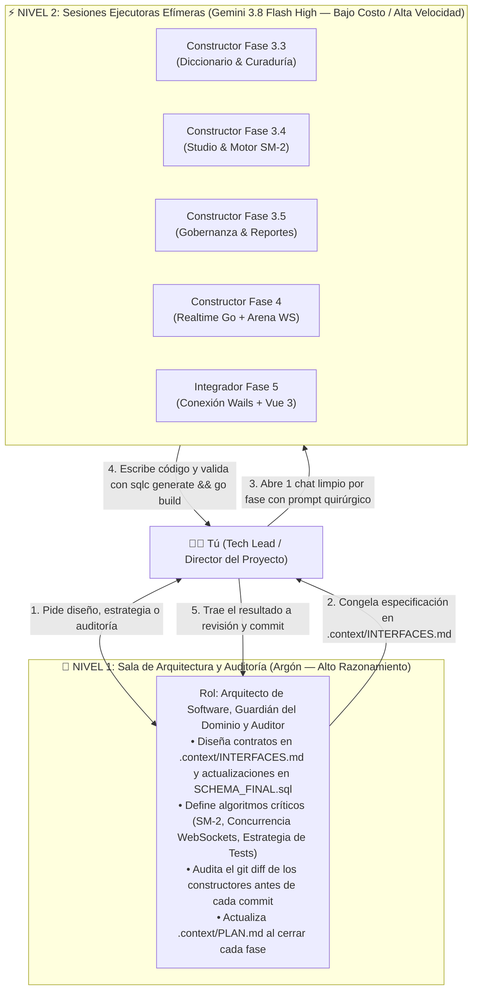

# 🤖 Guía Maestra de Ingeniería Orientada por Agentes (`AGENT_WORKFLOW.md`)

> **Manual Operativo de Orquestación de Modelos de IA para el Desarrollo de Palabrario**  
> **Enfoque:** Patrón *Arquitecto-Constructor* (*Architect-Builder*), *Backend-First* y *Contract-First*  
> **Propósito:** Maximizar la velocidad y precisión del desarrollo combinando modelos de alto razonamiento (**Argón**) con modelos rápidos y económicos (**Gemini 3.8 Flash High**), eliminando alucinaciones, colisiones de archivos y desperdicio de tokens.

---

## 1. Filosofía Central: ¿Por qué los Agentes Fallan y Cómo Evitarlo?

Cuando trabajas con LLMs en un proyecto real como **Palabrario**, existen tres causas principales de fallo:
1. **Empezar por la UI con Mockups antes que el Backend:** Si un agente programa primero la interfaz sin un contrato de API cerrado, inventa propiedades JSON que el backend no retorna.
2. **Esquizofrenia Documental (*Context Drift*):** Si la arquitectura está repetida o contradictoria en muchos archivos, el agente mezcla tecnologías o ignora reglas de negocio.
3. **Saturación de Ventana de Contexto:** Usar un mismo chat durante 40 mensajes para hacer 5 módulos distintos llena la memoria del modelo con errores viejos y degrada su atención (*Lost in the Middle*).

### La Solución Adoptada en Palabrario
Hemos estructurado el repositorio bajo **Descubrimiento Progresivo (*Progressive Disclosure*)** y **Fuente Única de Verdad (*Single Source of Truth*)** dentro de [`.context/`](./.context/):

| Archivo en `.context/` | Qué contiene (y por qué es único) | Quién lo mantiene |
| :--- | :--- | :---: |
| **[`.context/CONTEXT.md`](./.context/CONTEXT.md)** | Punto de entrada ligero (`< 120 líneas`), reglas anti-alucinación y mapa enrutador. | Arquitecto (Argón) |
| **[`.context/PLAN.md`](./.context/PLAN.md)** | Estado actual real del proyecto y checklist paso a paso por fases. | Arquitecto (Argón) |
| **[`.context/DOMAIN.md`](./.context/DOMAIN.md)** | Las 23 entidades, los 5 contextos DDD, estados editoriales y fórmulas matemáticas (`SM-2`). | Arquitecto (Argón) |
| **[`.context/INTERFACES.md`](./.context/INTERFACES.md)** | **El Contrato Sagrado:** Interfaces SOA en Go, structs JSON exactos (`pkg/models`), catálogo `sqlc` y endpoints HTTP/WS. | Arquitecto (Argón) |
| **[`SCHEMA_FINAL.sql`](./SCHEMA_FINAL.sql)** | Esquema DDL único y ejecutable en PostgreSQL 17 con triggers `RN06` y `RN07`. | Arquitecto (Argón) |

---

## 2. Topología de Agentes: El Patrón "Arquitecto + Constructores"

No pongas a múltiples agentes a editar los mismos archivos al mismo tiempo (en un monorepo con `sqlc`, dos agentes corriendo `sqlc generate` o editando `router.go` simultáneamente se pisarán el código). En su lugar, opera una **jerarquía de dos niveles**:



### Matriz de Decisión: ¿Qué Modelo Uso Hoy?

| Tarea | Modelo Recomendado | Razón de Costo / Beneficio |
| :--- | :---: | :--- |
| **Diseñar o modificar contratos en `INTERFACES.md` o `SCHEMA_FINAL.sql`** | 🧠 **Argón** | Requiere visión holística de las 23 tablas y 11 reglas de negocio sin romper compatibilidad. |
| **Programar consultas `sqlc`, servicios SOA y handlers HTTP de una Fase** | ⚡ **Flash 3.8 High** | Como los structs, firmas y endpoints ya están escritos letra por letra en `INTERFACES.md`, Flash traduce especificación a código rápidamente y gastando mínimos tokens. |
| **Definir la arquitectura de Testing (`setupTestServer`, helpers, mocks)** | 🧠 **Argón** | Diseñar un arnés de pruebas limpio y aislado requiere juicio arquitectónico. |
| **Escribir baterías de tests repetitivos siguiendo el molde de Argón** | ⚡ **Flash 3.8 High** | Replicar casos de prueba sobre un molde ya creado es mecánico y económico. |
| **Concurrencia en Go (`sync.RWMutex`, canales, goroutines en `realtime-service`)** | 🧠 **Argón** (o Flash auditado por Argón) | Las condiciones de carrera (*data races*) y cierres de sockets en tiempo real son sutiles; requieren razonamiento profundo. |
| **Reemplazar datos mock en Vue 3 por llamadas reales (Fase 5)** | ⚡ **Flash 3.8 High** | Con el backend 100% terminado y probado, conectar un componente Vue tras otro es directo y rápido. |
| **Revisar `git status` / `git diff` y redactar commits semánticos** | 🧠 **Argón** | Garantiza que no se cuele basura ni se viole ninguna regla de negocio antes de subir a GitHub. |

---

## 3. Las 5 Reglas de Oro de Higiene de Contexto

1. **Un Chat de Constructor = Una Sola Fase (o Sub-Módulo):**
   Cuando **Flash 3.8 High** termine la **Fase 3.3** y el código compile, **cierra ese chat**. Para la **Fase 3.4**, abre una conversación completamente nueva. Un chat limpio con 0 historial basura es más inteligente, más rápido y consume una fracción de los tokens.
2. **Contexto Mínimo Viable (*Surgical Prompting*):**
   Nunca le pases todo el repositorio a un agente constructor. Pásale únicamente `.context/CONTEXT.md`, la sección correspondiente de `.context/INTERFACES.md` y `SCHEMA_FINAL.sql`.
3. **El Compilador y `sqlc` como Jueces Automáticos:**
   Todo prompt para un agente constructor debe exigir que ejecute `sqlc generate` y `go build ./...` antes de responderte. Así el propio agente corrige sus errores de tipos en el mismo turno.
4. **Prohibido Tocar Fuera del Alcance (*Scope Lock*):**
   Indícale siempre explícitamente qué carpetas tiene prohibido tocar (por ejemplo: *"Prohibido modificar `local-app` o archivos de pruebas fuera de esta fase"*).
5. **Commit Limpio como Punto de Control (*Checkpoint*):**
   Nunca inicies la siguiente fase sin haber hecho `git commit` de la fase anterior ya verificada. Si un agente se equivoca, `git checkout -- .` restaura todo en 1 segundo.

---

## 4. Plantillas de Prompts Listas para Copiar y Pegar (Playbook por Fase)

Usa estas plantillas exactas cuando abras una sesión con **Gemini 3.8 Flash High** (o cualquier agente constructor):

### 🛠️ Prompt 1: Ejecutar Fase 3.3 (Módulo de Diccionario y Curaduría por Quórum)
```text
Hola hermano, vamos a implementar la FASE 3.3 de Palabrario (Módulo de Diccionario y Curaduría por Quórum: CU05, CU06, CU07, CU08) bajo enfoque Backend-First.

1. Lee primero @.context/CONTEXT.md y la sección "FASE 3.3" de @.context/PLAN.md.
2. Lee detenidamente las secciones 0, 1, 2.3 y 2.4 de @.context/INTERFACES.md, así como las tablas correspondientes en @SCHEMA_FINAL.sql y las consultas actuales en @sql/queries/dictionary.sql.
3. Ejecuta exactamente las siguientes tareas:
   - Amplía `pkg/models/dictionary.go` y crea `pkg/models/curation.go` con los DTOs exactos especificados en las secciones 2.3.1 y 2.4.1 de `.context/INTERFACES.md`.
   - Amplía `sql/queries/dictionary.sql` y crea `sql/queries/curation.sql` con las consultas tipadas de las secciones 2.3.2 y 2.4 de `.context/INTERFACES.md`. Ejecuta `sqlc generate`.
   - Crea `core-service/internal/service/errors.go`, `dictionary_service.go` y `curation_service.go` respetando las reglas RN06 (quórum de 3 votos), RN07 (prohibición de auto-aprobación devolviendo 403 Forbidden) y RN08 (aprobación/ocultación directa por ADMIN).
   - Actualiza `core-service/internal/api/handlers/dictionary_handler.go`, crea `curation_handler.go` y monta las rutas en `core-service/internal/api/router.go`.
4. Reglas estrictas:
   - Prohibido inventar campos JSON fuera de `.context/INTERFACES.md`.
   - Prohibido tocar `local-app` o archivos de frontend.
   - No des por terminada la tarea hasta que `sqlc generate` y `go build ./core-service/... ./pkg/...` compilen con 0 errores.
```

---

### 🛠️ Prompt 2: Ejecutar Fase 3.4 (Studio Personal, Motor SM-2 y Ledger de XP)
```text
Hola hermano, vamos a implementar la FASE 3.4 de Palabrario (Studio Personal, Motor Matemático SM-2 y Ledger de XP: CU10, CU11, CU12, CU13) bajo enfoque Backend-First.

1. Lee primero @.context/CONTEXT.md y la sección "FASE 3.4" de @.context/PLAN.md.
2. Lee detenidamente las secciones 0, 1, 2.5 y 2.6 de @.context/INTERFACES.md y revisa las tablas de Studio, Mastery y XP en @SCHEMA_FINAL.sql.
3. Ejecuta exactamente las siguientes tareas:
   - Amplía `pkg/models/studio.go` con todos los DTOs de las secciones 2.5.1 y 2.6.1 de `.context/INTERFACES.md`.
   - Crea `sql/queries/studio.sql` y `sql/queries/mastery.sql` y ejecuta `sqlc generate`.
   - Crea `core-service/internal/service/studio_service.go` haciendo cumplir RN03 (propiedad en Studio), RN04 (privacidad de recursos `is_public`) y RN05 (`is_official` exclusivo de EDITOR/ADMIN).
   - Crea `core-service/internal/service/mastery_service.go` implementando la función determinística `CalculateSM2` exactamente con las fórmulas de la sección 2.6.2 de `.context/INTERFACES.md` y ejecutando las revisiones en una transacción `pgx.Tx` que actualice `user_mastery`, inserte en `xp_transactions` (RN11) y actualice el saldo/racha en `users`.
   - Crea `studio_handler.go` y `mastery_handler.go` y registra los endpoints en `core-service/internal/api/router.go`.
4. Reglas estrictas:
   - Prohibido tocar `local-app`.
   - Verifica que `sqlc generate` y `go build ./core-service/... ./pkg/...` terminen con 0 errores.
```

---

### 🛠️ Prompt 3: Ejecutar Fase 3.5 (Gobernanza Institucional, Perfiles y Moderación de Reportes)
```text
Hola hermano, vamos a implementar la FASE 3.5 de Palabrario (Perfiles de Usuario, Gobernanza Institucional, Boletos de Invitación y Moderación de Reportes: CU01, CU02, CU03, CU04, CU09).

1. Lee primero @.context/CONTEXT.md y la sección "FASE 3.5" de @.context/PLAN.md.
2. Lee detenidamente las secciones 0, 1, 2.1, 2.2 y 2.4.1 (bloque de reportes) de @.context/INTERFACES.md y las tablas `accounts`, `users`, `editor_requests`, `invitation_tickets`, `ticket_redemptions` y `content_reports` en @SCHEMA_FINAL.sql.
3. Ejecuta exactamente las siguientes tareas:
   - Amplía `pkg/models/user.go` (sección 2.1.1) y crea `pkg/models/governance.go` (sección 2.2.1).
   - Amplía `sql/queries/users.sql`, crea `sql/queries/governance.sql` y añade las consultas de `content_reports` en `sql/queries/curation.sql`. Ejecuta `sqlc generate`.
   - Implementa `identity_service.go` (`UpdateProfile`, `ChangePassword`, `GetPublicProfileByUsername` respetando RN01) y `governance_service.go` respetando RN02 (máximo 1 solicitud PENDING por aprendiz), la promoción transaccional a EDITOR, la protección del último ADMIN activo (CU03 4a) y la redención transaccional con `FOR UPDATE` de boletos de invitación (CU04).
   - Completa los métodos de reportes (`CU09`) en `curation_service.go`.
   - Crea `user_handler.go`, `governance_handler.go`, actualiza `curation_handler.go` y monta todas las rutas en `core-service/internal/api/router.go`.
4. Reglas estrictas:
   - Prohibido tocar `local-app`.
   - Verifica que `sqlc generate` y `go build ./core-service/... ./pkg/...` terminen con 0 errores.
```

---

### 🛠️ Prompt 4: Ejecutar Fase 4 (Migración de `realtime-service` a Go 1.24 + Arena Multijugador)
```text
Hola hermano, vamos a implementar la FASE 4 de Palabrario (Migración de `realtime-service` a Go 1.24, Coordinación de Arena en `core-service` y Motor WebSocket con Batch Flush: CU14, CU15, CU16).

1. Lee primero @.context/CONTEXT.md y la sección "FASE 4" de @.context/PLAN.md.
2. Lee detenidamente la sección 2.7 de @.context/INTERFACES.md y revisa `@image-service/main.go`, `@image-service/Dockerfile` y `@docker-compose.yml` como referencia de servicio satélite en Go.
3. Ejecuta exactamente las siguientes tareas:
   - Amplía `pkg/models/arena.go` con todos los structs de la sección 2.7.2 de `.context/INTERFACES.md`.
   - En `core-service`: crea `sql/queries/arena.sql`, ejecuta `sqlc generate`, e implementa `arena_catalog_service.go` y `arena_handler.go` (`POST /api/v1/arena/matches/prepare`, `GET /api/v1/arena/matches/{roomCode}/package`, `POST /api/v1/arena/matches/consolidate` con Batch Flush ACID en `matches`, `match_participants`, `xp_transactions` y `user_mastery`, y `GET /api/v1/arena/matches/history`).
   - En `realtime-service`: elimina los archivos de Bun/TypeScript, migra el servicio a Go 1.24 + Chi v5 + WebSockets compartiendo el `go.mod` raíz, actualiza `realtime-service/Dockerfile` y `docker-compose.yml` (`context: .`), e implementa el `ArenaHub` en RAM con goroutines por sala, reloj monotónico para puntaje por velocidad (RN10), reconexión en ventana de 10s (RNF-CON-02) y disparo del Batch Flush al finalizar la partida.
4. Reglas estrictas:
   - Prohibido tocar `local-app`.
   - Verifica que `go build ./core-service/... ./realtime-service/... ./image-service/... ./pkg/...` compile con 0 errores.
```

---

### 🔍 Prompt 5: Auditoría con el Arquitecto (Argón) al Terminar una Fase
Cuando el constructor termine cualquiera de los prompts anteriores, regresa al chat del **Arquitecto (Argón)** y escribe:
```text
Hermano, el agente constructor terminó la Fase [3.X].
Por favor audita los cambios con `git status` y `git diff`, verifica que se cumplan al 100% los contratos de @.context/INTERFACES.md y las reglas de negocio de @.context/DOMAIN.md, corrige cualquier detalle si hace falta, actualiza el estado en @.context/PLAN.md y @README.md, y prepara el commit.
```
