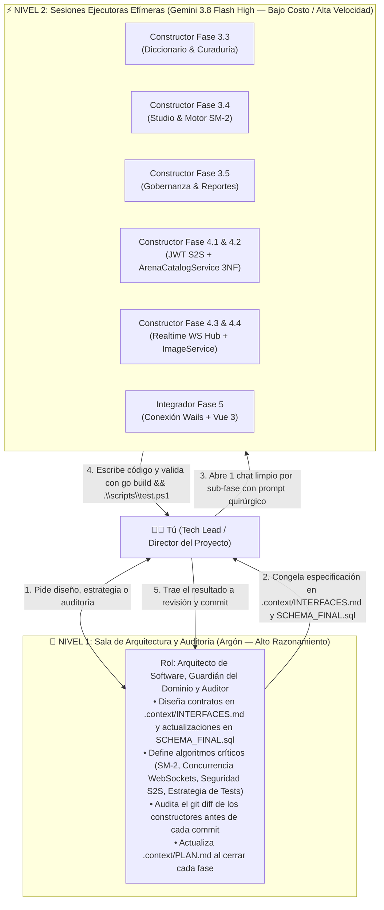

# 🤖 Guía Maestra de Ingeniería Orientada por Agentes (`AGENT_WORKFLOW.md`)

> **Manual Operativo de Orquestación de Modelos de IA para el Desarrollo de Palabrario**  
> **Enfoque:** Patrón *Arquitecto-Constructor* (*Architect-Builder*), *Backend-First* y *Contract-First*  
> **Propósito:** Maximizar la velocidad y precisión del desarrollo combinando modelos de alto razonamiento (**Argón**) con modelos rápidos y económicos (**Gemini 3.8 Flash High**), eliminando alucinaciones, colisiones de archivos y desperdicio de tokens.

---

## 1. Filosofía Central: ¿Por qué los Agentes Fallan y Cómo Evitarlo?

Cuando trabajas con LLMs en un proyecto real como **Palabrario**, existen tres causas principales de fallo:
1. **Empezar por la UI con Mockups antes que el Backend:** Si un agente programa primero la interfaz sin un contrato de API cerrado, inventa propiedades JSON que el backend no retorna.
2. **Esquizofrenia Documental (*Context Drift*):** Si la arquitectura está repetida o contradictoria en muchos archivos, el agente mezcla tecnologías o ignora reglas de negocio.
3. **Saturación de Ventana de Contexto:** Usar un mismo chat durante 40 mensajes para hacer 5 módulos distintos llena la memoria del modelo con errores viejos y degrada su atención (*Lost in the Middle*).

### La Solución Adoptada en Palabrario
Hemos estructurado el repositorio bajo **Descubrimiento Progresivo (*Progressive Disclosure*)** y **Fuente Única de Verdad (*Single Source of Truth*)** dentro de [`.context/`](./.context/):

| Archivo en `.context/` | Qué contiene (y por qué es único) | Quién lo mantiene |
| :--- | :--- | :---: |
| **[`.context/CONTEXT.md`](./.context/CONTEXT.md)** | Punto de entrada ligero (`< 120 líneas`), reglas anti-alucinación y mapa enrutador. | Arquitecto (Argón) |
| **[`.context/PLAN.md`](./.context/PLAN.md)** | Estado actual real del proyecto y checklist paso a paso por fases. | Arquitecto (Argón) |
| **[`.context/DOMAIN.md`](./.context/DOMAIN.md)** | Las 24 entidades (incluyendo `match_rounds` en 3NF), los 5 contextos DDD, estados editoriales y fórmulas matemáticas (`SM-2` y `RN10`). | Arquitecto (Argón) |
| **[`.context/INTERFACES.md`](./.context/INTERFACES.md)** | **El Contrato Sagrado:** Interfaces SOA en Go, structs JSON exactos (`pkg/models`), catálogo `sqlc`, JWT S2S y endpoints HTTP/WS. | Arquitecto (Argón) |
| **[`SCHEMA_FINAL.sql`](./SCHEMA_FINAL.sql)** | Esquema DDL único y ejecutable en PostgreSQL 17 con triggers `RN06` y `RN07`, tablas de Arena/Replay 3NF y sincronización automática de secuencias. | Arquitecto (Argón) |

---

## 2. Topología de Agentes: El Patrón "Arquitecto + Constructores"

No pongas a múltiples agentes a editar los mismos archivos al mismo tiempo (en un monorepo con `sqlc`, dos agentes corriendo `sqlc generate` o editando `router.go` simultáneamente se pisarán el código). En su lugar, opera una **jerarquía de dos niveles**:



### Matriz de Decisión: ¿Qué Modelo Uso Hoy?

| Tarea | Modelo Recomendado | Razón de Costo / Beneficio |
| :--- | :---: | :--- |
| **Diseñar o modificar contratos en `INTERFACES.md` o `SCHEMA_FINAL.sql`** | 🧠 **Argón** | Requiere visión holística de las 24 tablas y 11 reglas de negocio sin romper compatibilidad. |
| **Programar consultas `sqlc`, servicios SOA y handlers HTTP de una Fase/Sub-fase** | ⚡ **Flash 3.8 High** | Como los structs, firmas y endpoints ya están escritos letra por letra en `INTERFACES.md`, Flash traduce especificación a código rápidamente y gastando mínimos tokens. |
| **Definir la arquitectura de Testing (`testutil.SetupTestDB`, `TEMPLATE` en RAM)** | 🧠 **Argón** | Diseñar un arnés de pruebas aislado y 100% agnóstico al esquema requiere juicio arquitectónico. |
| **Escribir baterías de tests 80/20 siguiendo el molde de Argón** | ⚡ **Flash 3.8 High** | Replicar casos de prueba en `internal/service/*_test.go` usando `testutil.SetupTestDB(t)` es mecánico y económico. |
| **Concurrencia en Go (`sync.RWMutex`, canales, goroutines en `realtime-service`)** | ⚡ **Flash 3.8 High** (con Prompt 4.3 ultra-detallado) + 🧠 **Auditoría de Argón** | Con el diseño de canales, timers y sucesión de Host completamente especificado en el Prompt 4.3, Flash puede construirlo sin desviarse y Argón audita el resultado. |
| **Exponer métodos en `local-app/app.go`, correr `wails generate module` y conectar Vue 3 (Fase 5)** | ⚡ **Flash 3.8 High** | Como `local-app/app.go` importa `pkg/models` y Wails autogenera `wailsjs/go/models.ts` y `App.d.ts`, conectar Vue 3 es 100% tipado y sin posibilidad de inventar campos. |
| **Revisar `git status` / `git diff` y redactar commits semánticos** | 🧠 **Argón** (o Auditor de Respaldo con Prompt 6) | Garantiza que no se cuele basura ni se viole ninguna regla de negocio antes de subir a GitHub. |

---

## 3. Las 5 Reglas de Oro de Higiene de Contexto

1. **Un Chat de Constructor = Una Sola Fase o Sub-Fase Atómica:**
   Cuando **Flash 3.8 High** termine una sub-fase y el código compile y pase los tests, **cierra ese chat**. Para la siguiente sub-fase, abre una conversación completamente nueva. Un chat limpio con 0 historial basura es más inteligente, más rápido y consume una fracción de los tokens.
2. **Contexto Mínimo Viable (*Surgical Prompting*):**
   Nunca le pases todo el repositorio a un agente constructor. Pásale únicamente `.context/CONTEXT.md`, la sección correspondiente de `.context/INTERFACES.md`, `.context/PLAN.md` y los archivos puntuales que va a tocar.
3. **El Compilador, `sqlc` y `.\scripts\test.ps1` como Jueces Automáticos:**
   Todo prompt para un agente constructor debe exigir que ejecute `go build ./...` y `.\scripts\test.ps1` (siguiendo la estrategia **80% tests directos de Servicio/DAO** en `internal/service/*_test.go` + **20% smoke tests HTTP** sobre `testutil.SetupTestDB(t)`).
4. **Prohibido Tocar Fuera del Alcance (*Scope Lock*):**
   Indícale siempre explícitamente qué carpetas tiene prohibido tocar (por ejemplo: *"Prohibido modificar `local-app` o archivos fuera de esta sub-fase"*).
5. **Commit Limpio como Punto de Control (*Checkpoint*):**
   Nunca inicies la siguiente fase sin haber hecho `git commit` de la fase anterior ya verificada. Si un agente se equivoca, `git checkout -- .` restaura todo en 1 segundo.

---

## 4. Plantillas de Prompts Listas para Copiar y Pegar (Playbook por Fase)

Usa estas plantillas exactas cuando abras una sesión con **Gemini 3.8 Flash High** (o cualquier agente constructor):

---

### 🔍 Prompt 5: Auditoría con el Arquitecto (Argón) al Terminar una Fase o Sub-Fase
Cuando el constructor termine cualquiera de los prompts anteriores, regresa al chat del **Arquitecto (Argón)** y escribe:
```text
Hermano, el agente constructor terminó la Fase [4.X].
Por favor audita los cambios con `git status` y `git diff`, verifica que se cumplan al 100% los contratos de @.context/INTERFACES.md y las reglas de negocio de @.context/DOMAIN.md, ejecuta `.\scripts\test.ps1`, actualiza el estado en @.context/PLAN.md y @README.md, y prepara el commit.
```

---

### 🛡️ Prompt 6: Auditoría de Respaldo (Sin Disponibilidad de Argón — Modo Solo Lectura)
Cuando la cuota de **Argón** esté baja o no esté disponible y el Tech Lead solicite explícitamente una auditoría de revisión al agente en turno, copia y pega el siguiente prompt:

```text
Hermano, Argón no está disponible actualmente. Asume temporalmente el rol de Auditor de Respaldo para la Fase [4.X].
Por favor ejecuta una revisión y auditoría diagnóstica siguiendo estas directrices:
1. Inspecciona `git status` y `git diff` línea por línea para auditar todos los cambios aplicados en la fase.
2. Verifica el cumplimiento al 100% de los contratos de @.context/INTERFACES.md (structs JSON, firmas SOA, seguridad S2S, endpoints HTTP/WS y sqlc).
3. Verifica el estricto cumplimiento de las reglas de negocio de @.context/DOMAIN.md (RN01–RN11, RNF-CON-02 y Replay 3NF aplicables a la fase).
4. Evalúa las buenas prácticas de Go, la higiene de tipos en sqlc y la suficiencia de pruebas (80/20 sobre testutil.SetupTestDB ejecutando .\scripts\test.ps1).
5. REGLAS ESTRICTAS DE ESTA AUDITORÍA:
   - Modo SOLO LECTURA: Es auditoría únicamente; NO DEBES APLICAR NINGÚN CAMBIO de código ni crear o modificar archivos.
   - Prohibido actualizar el estado en @.context/PLAN.md y @README.md a menos que recibas autorización explícita del Tech Lead.
   - Emite un reporte estructurado con: (a) Balance de contratos y reglas cumplidas, (b) Hallazgos o alertas detectadas (si las hay), y (c) Recomendación final para la toma de decisiones del Tech Lead.
```
