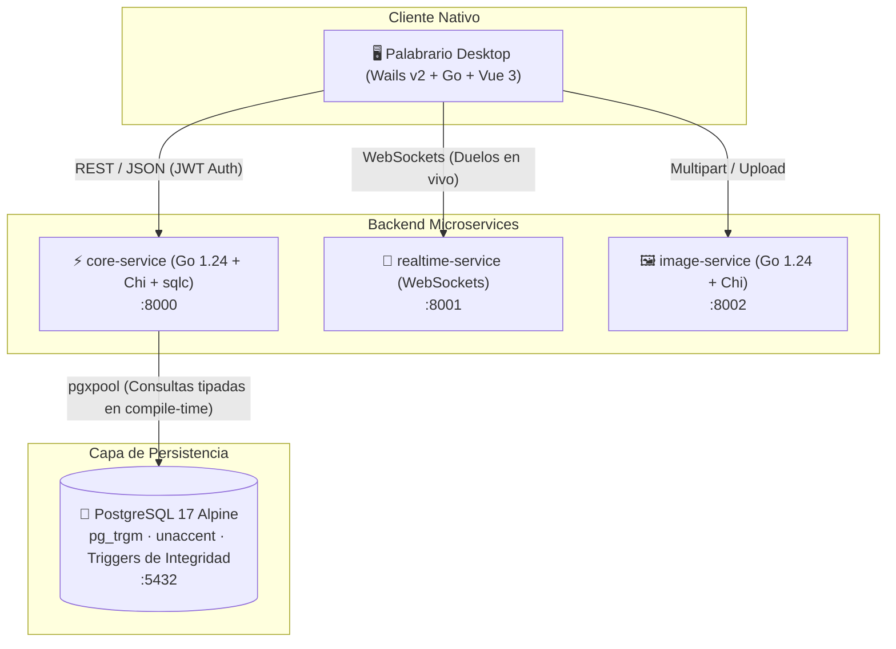

# 📚 Palabrario

> **Plataforma Gamificada de Aprendizaje y Preservación del Léxico Dialectal Panhispánico.**  
> *Proyecto desarrollado para la cátedra de Despliegue de Software (Software Deployment).*

---

## 🎯 1. Visión y Propósito del Proyecto

El español cuenta con más de 500 millones de hablantes nativos distribuidos en más de 20 países. A pesar de compartir una misma base lingüística, la fragmentación léxica y los choques semánticos (*false friends* dialectales) son un desafío cotidiano:

- Una **guagua** es un autobús en Cuba y Canarias, pero un bebé de brazos en Chile y la región andina.
- Un **popote** (México) es un **pitillo** (Colombia/Venezuela), una **bombilla** (Chile) o un **sorbete/pajita** (Argentina/España).
- Expresiones de afecto profundo como **apapachar** (*acariciar con el alma*) carecen de traducción directa y son patrimonio dialectal vivo.

**Palabrario** resuelve esta brecha mediante un ecosistema tecnológico moderno, combinando:
1. **Diccionario dialectal inteligente:** Búsqueda fonética y por similitud de trigramas ajustada al dialecto ancla del usuario.
2. **Motor de repetición espaciada (SM-2 Dialectal):** Algoritmo de retención de memoria a largo plazo optimizado por intervalo y factor de facilidad (*easiness factor*).
3. **Arena multijugador en tiempo real:** Duelos sincronizados para competir identificando variantes regionales y expresiones idiomáticas.
4. **Taller de contribución y revisión por pares:** Flujo de moderación lingüística con validación de integridad (anti-autoaprobación y control de roles).

---

## 🏛️ 2. Arquitectura del Sistema y Decisiones de Ingeniería

Palabrario está diseñado bajo una arquitectura de **microservicios ligeros de alto rendimiento**, priorizando la eficiencia en el uso de recursos, la rapidez de despliegue y la integridad de datos:



### Justificación Tecnológica y Trade-offs de Despliegue

| Componente | Elección Tecnológica | Alternativa Descartada | Justificación Técnica de Despliegue |
| :--- | :--- | :--- | :--- |
| **Backend Core** | **Golang (Go 1.24)** | Node.js / Python | Binarios estáticos compilados sin dependencias externas en runtime. Consumo de memoria reducido a **< 5 MiB** por microservicio en Docker (vs. ~150-250 MiB de stacks tradicionales). |
| **Acceso a Datos** | **`sqlc` + `pgxpool`** | ORMs pesados (GORM, Prisma) | Consultas SQL 100% tipadas en tiempo de compilación. Cero costo de reflexión en runtime, rendimiento nativo de base de datos y prevención absoluta de SQL Injections. |
| **Gestión de UUID** | **`github.com/google/uuid`** | Funciones caseras / strings | Estandarización RFC 4122, soporte nativo como `driver.Valuer`/`sql.Scanner` con `pgx` y mapeo transparente en `sqlc`. |
| **Cliente Desktop** | **Wails v2 (Go + Vue 3)** | Electron | Empaqueta un binario nativo que reutiliza el webview del sistema operativo. Huella de RAM de **~30 MiB** (frente a los >250 MiB del runtime Chromium de Electron). |
| **Persistencia** | **PostgreSQL 17** | NoSQL / SQLite | Índices trigramáticos (`pg_trgm`), soporte de diacríticos (`unaccent`), funciones almacenadas determinísticas y triggers relacionales estrictos (RN07 anti-autoaprobación). |

---

## ⚙️ 3. Topología de Servicios y Puertos

| Contenedor / Servicio | Lenguaje / Runtime | Puerto Interno | Puerto Host | Descripción |
| :--- | :--- | :---: | :---: | :--- |
| **`postgres`** | PostgreSQL 17 Alpine | `5432` | `5432` | Base de datos relacional y funciones FTS |
| **`core-service`** | Go 1.24 (Alpine) | `8000` | `8000` | API REST principal: Auth, Diccionario, SM-2 |
| **`realtime-service`**| TypeScript / Bun | `8001` | `8001` | Sincronización WebSockets para la Arena multijugador |
| **`image-service`** | Go 1.24 (Alpine) | `8002` | `8002` | Procesamiento, compresión y validación multimedia |
| **`local-app`** | Wails v2 (Go + Vue 3) | N/A | Nativo | Interfaz gráfica de usuario para escritorio |

---

## 🚀 4. Guía de Puesta en Marcha (Getting Started)

### Requisitos Previos
- **Docker** (v24.0+) y **Docker Compose** (v2.20+)
- **Go** (v1.24+) *(opcional, solo para desarrollo local y generación con sqlc)*
- **Vagrant** & **VirtualBox** *(si se levanta la infraestructura en máquina virtual aislada)*

### 1. Configuración del Entorno (Principio *Fail-Fast*)
Palabrario implementa el principio **Fail-Fast** de la metodología *12-Factor App*. Los microservicios **se niegan a iniciar** si variables críticas (`DATABASE_URL`, `JWT_SECRET`) faltan o son inseguras.

Copia la plantilla de configuración:
```bash
cp .env.example .env
```

> [!IMPORTANT]
> Revisa el archivo [`.env.example`](.env.example) para entender el propósito y restricciones de cada variable. En particular, `JWT_SECRET` debe tener una longitud mínima de 32 caracteres.

### 2. Despliegue con Docker Compose
Para levantar la base de datos y el servicio central:
```bash
docker compose up -d --build postgres core-service
```

### 3. Verificación de Salud (*Health Check*)
Comprueba el estado de la API y su conectividad con PostgreSQL:
```bash
curl http://localhost:8000/health
```
Respuesta esperada:
```json
{
  "status": "ok",
  "database": "connected",
  "engine": "PostgreSQL 17 (pgxpool)",
  "service": "palabrario-core-service"
}
```

---

## 👥 5. Cuentas y Datos Semilla Determinísticos

La base de datos se inicializa automáticamente con datos semilla representativos de diversas variantes panhispánicas (`MX`, `ES`, `AR`, `CO`, `CL`, `CU`, `CAM`, `PAN`):

| Rol | Correo Electrónico | Contraseña | Dialecto Ancla | XP Inicial | Nivel |
| :--- | :--- | :--- | :---: | :---: | :---: |
| **ADMIN** | `admin@palabrario.org` | `password123` | MX | 15,000 | 10 |
| **EDITOR** | `silas@palabrario.org` | `password123` | MX | 8,500 | 7 |
| **LEARNER** | `gael@palabrario.org` | `password123` | MX | 4,850 | 4 |

### Ejemplos de Palabras Precargadas
- **`popote`** (Sustantivo, MX): Incluye comparativa dialectal (*pitillo*, *bombilla*, *sorbete*).
- **`apapachar`** (Verbo, MX): Con etimología náhuatl y definición afectiva.
- **`guagua`** (Sustantivo, Poligenético): Ejemplos de uso simultáneos para transporte (Caribe) y bebé (Andes).

---

## 🛠️ 6. Flujo de Desarrollo

### Generación de Código Tipado con `sqlc`
Cualquier modificación o adición de consultas SQL en `sql/queries/*.sql` se compila directamente a estructuras Go fuertemente tipadas:
```bash
sqlc generate
```

### Estrategia de Testing y Aislamiento de Entornos
> [!NOTE]
> Siguiendo las mejores prácticas de la industria, las pruebas automatizadas de integración **nunca se ejecutan contra bases de datos productivas**. Utilizan la variable `TEST_DATABASE_URL` y limpian sus registros automáticamente mediante hooks `t.Cleanup()`.

Para ejecutar las pruebas en desarrollo local:
```bash
go test -v ./core-service/...
```

---

## 🗺️ 7. Estado del Despliegue (Roadmap de Fases)

- [x] **Fase 1: Modelo Relacional y Reglas de Integridad**
  - Esquema unificado en PostgreSQL 17 (`SCHEMA_FINAL.sql`).
  - Triggers de integridad: anti-autoaprobación de aportaciones (RN07).
  - Algoritmo de similitud de vocabulario (`search_vocabulary_dropdown`).
  - Datos semilla determinísticos (regiones, usuarios, palabras, mazos).
- [x] **Fase 2: Espacio de Trabajo y Modelos de Dominio**
  - Configuración del monorrepositorio Go (`go.mod`).
  - Modelos compartidos de dominio en `pkg/models/`.
- [x] **Fase 3.1 & 3.6: Arquitectura Base de Microservicios**
  - Migración completa de `core-service` a Go (Chi + `pgxpool`).
  - Construcción multi-stage de Docker (imagen final de ~27 MB y ~3 MiB de RAM).
  - Migración básica de `image-service` a Go.
- [x] **Fase 3.2: Módulo de Autenticación y Cuentas**
  - Hashing seguro con `bcrypt` y emisión de tokens JWT HMAC-SHA256.
  - Middlewares `RequireAuth` y `RequireRole`.
  - Consultas tipadas con `sqlc` y adopción de `google/uuid`.
  - Validación *Fail-Fast* centralizada de variables de entorno y documentación en `.env.example`.
- [ ] **Fase 3.3: Módulo de Diccionario y Búsqueda Dialectal**
  - Endpoints de búsqueda fonética y consulta detallada de vocabulario.
- [ ] **Fase 3.4: Motor de Repetición Espaciada (SM-2)**
  - Cálculo de intervalos, factor de facilidad y revisión diaria de mazos.
- [ ] **Fase 3.5: Taller de Contribución y Revisión por Pares**
  - Propuestas de nuevos términos y votación editorial.
- [ ] **Fase 4: Arena Multijugador (WebSockets)**
  - Duelos en tiempo real con salas y emparejamiento.
- [ ] **Fase 5: Empaquetado Desktop y Pipeline CI/CD**
  - Compilación final con Wails v2 y automatización de despliegue.

---

## 📄 Licencia

Proyecto académico desarrollado bajo fines educativos para la materia de **Despliegue de Software**.
