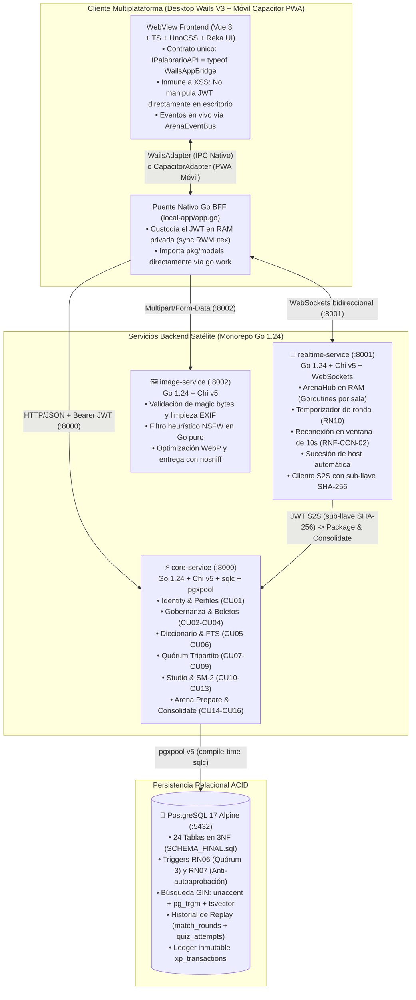

# 📚 Palabrario

<div align="center">


<br/>

> **Plataforma Colaborativa y Gamificada de Aprendizaje, Descubrimiento y Preservación del Léxico Dialectal Panhispánico.**  
> *Proyecto desarrollado para la cátedra de Despliegue de Software (Software Deployment).*

$$\text{Descubrir con humor} \longrightarrow \text{Validar con rigor (Quórum 3)} \longrightarrow \text{Estudiar en Studio} \longrightarrow \text{Medir maestría (SM-2)} \longrightarrow \text{Competir en Arena}$$

</div>

---

## 🧭 Mapa de Documentación Arquitectónica (Single Source of Truth)

Toda decisión técnica en Palabrario se rige bajo el enfoque **Backend-First & Contract-First**. Consulta la fuente de verdad especializada según tu área de trabajo:

| Documento | Propósito Arquitectónico |
| :--- | :--- |
| **[`.context/CONTEXT.md`](.context/CONTEXT.md)** | **Punto de Entrada Maestro:** Reglas anti-alucinación, stack 100% Go, puente IPC Wails y enrutador maestro. |
| **[`.context/PLAN.md`](.context/PLAN.md)** | Estado de avance consolidado y hoja de ruta atómica de desarrollo (Sub-Fases 5.1 a 5.9). |
| **[`.context/DOMAIN.md`](.context/DOMAIN.md)** | Diseño Guiado por el Dominio (DDD), las 24 entidades, reglas de negocio (`RN01–RN13`) y fórmulas SM-2. |
| **[`.context/INTERFACES.md`](.context/INTERFACES.md)** | Contratos SOA en Go 1.24, DTOs de [`pkg/models`](pkg/models), consultas `sqlc`, eventos WebSocket y catálogo de endpoints. |
| **[`SCHEMA_FINAL.sql`](SCHEMA_FINAL.sql)** | DDL canónico de PostgreSQL 17 (3NF, extensiones `unaccent`/`pg_trgm`, triggers relacionales `RN06`/`RN07` y semillas). |
| **[`.context/PALETTE.md`](.context/PALETTE.md)** | Sistema de diseño *"Imprenta Táctil Ilustrada"*, 4 pilares de color, tokens UnoCSS y tipografía `Satoshi`. |
| **[`.context/ROUTES_MAP.md`](.context/ROUTES_MAP.md)** | Mapa de 23 rutas hash enlazadas 1:1 con Casos de Uso, permisos, DTOs de Go y llamadas `IPalabrarioAPI`. |
| **[`.context/UI_FLOWS.md`](.context/UI_FLOWS.md)** | Diagramas de secuencia Mermaid E2E (Doble autenticación, Quórum tripartito, SM-2 y Arena WebSockets). |
| **[`.context/UI_SPECIFICATION.md`](.context/UI_SPECIFICATION.md)** | Especificación técnica del frontend polimórfico (Wails V3 Desktop + Capacitor PWA) y adaptador `IPalabrarioAPI`. |
| **[`.context/INFRASTRUCTURE.md`](.context/INFRASTRUCTURE.md)** | Guía de contenedores Docker Compose, monorepo Go, `sqlc` y máquina virtual Vagrant Debian 12. |
| **[`.context/academic/`](.context/academic)** | Entregables académicos formales autocontenidos (`1-PROJECT-SPECIFICATION.md`, etc.). |

---

## 🎯 1. Visión y Propósito del Proyecto

El español cuenta con más de **500 millones de hablantes nativos** distribuidos en más de 20 naciones. Aunque compartimos una raíz común, la riqueza léxica regional y los choques semánticos (*falsos amigos* dialectales) plantean un reto fascinante:

- Una **guagua** es un autobús en Cuba y Canarias, pero un bebé de brazos en Chile y la región andina.
- Un **popote** (México) es un **pitillo** (Colombia/Venezuela), una **bombilla** (Chile) o un **sorbete/pajita** (Argentina/España).
- Expresiones afectivas profundas como **apapachar** (*acariciar con el alma*) carecen de traducción unívoca y constituyen patrimonio cultural vivo.

**Palabrario** convierte este choque cultural en un ecosistema de aprendizaje lúdico y riguroso:
1. **Diccionario Dialectal Vivo (`CU05, CU06`):** Búsqueda fonética trigramática GIN (`pg_trgm` + `unaccent`), nivel CEFR (`A1–C2`), advertencias de tabú y heterónimos transdialectales (*"¿Cómo se dice allá?"*).
2. **Curaduría por Quórum Tripartito (`CU07, CU08, CU09`):** Ninguna acepción propuesta (`DRAFT`) pasa a producción sin acumular **3 votos favorables independientes** (**RN06**), con prohibición estricta de auto-aprobación por trigger relacional (**RN07**).
3. **Studio y Motor SM-2 (`CU10, CU11, CU12, CU13`):** Organización en barajas y colecciones con curva de olvido automatizada (**Algoritmo SuperMemo SM-2**, **RN09**) y libro mayor de experiencia inmutable (`xp_transactions`, **RN11**).
4. **Arena Multijugador en Tiempo Real (`CU14, CU15, CU16`):** Salas de trivia sincronizadas por código PIN con WebSockets en memoria RAM, cálculo de puntos por velocidad (**RN10**), sucesión de anfitrión automática y consolidación transaccional por lote (*Batch Flush*) con Replay en 3NF.

---

## 🏛️ 2. Arquitectura de Red y Decisiones de Ingeniería (100% Go 1.24)

Palabrario está estructurado como un **Monorepo 100% Go 1.24** con tipado integral end-to-end (`PostgreSQL 17` $\to$ `sqlc` $\to$ `pkg/models` $\to$ `wailsjs` $\to$ `Vue 3`). Su huella de recursos es mínima (`< 15 MiB` de memoria RAM combinada en los 3 servicios backend):



### Justificación de Ingeniería y Trade-offs de Despliegue

| Componente | Elección Tecnológica | Alternativa Descartada | Justificación Técnica de Despliegue |
| :--- | :--- | :--- | :--- |
| **Backend Unificado** | **Golang (Go 1.24)** | Node.js / Python / Java | Binarios estáticos ultra-ligeros. Consumo de **< 5 MiB RAM** por servicio en Docker. Compartición directa de tipos con `pkg/models` y `pkg/auth` sin duplicación de esquemas. |
| **Acceso a Datos** | **`sqlc` + `pgxpool v5`** | ORMs pesados (GORM, Prisma) | Consultas SQL 100% tipadas en compilación. Cero costo de reflexión en runtime, rendimiento nativo y eliminación total de inyecciones SQL. |
| **Cliente Polimórfico** | **Wails V3 + Capacitor** | Electron | Reutiliza el webview nativo del sistema operativo. Huella de RAM de **~30 MiB** (frente a los >250 MiB de Chromium). Mismo código Vue desplegable en Escritorio y Móvil/PWA. |
| **Persistencia** | **PostgreSQL 17** | NoSQL / MongoDB | Integridad referencial ACID en 3NF (24 tablas). Triggers relacionales inviolables para Quórum y Ledger contable inmutable de experiencia (`xp_transactions`). |
| **Comunicación S2S** | **Sub-llave SHA-256 (`pkg/auth`)** | API Keys planas / mTLS | Separación criptográfica estricta: los tokens de servicios internos (`Issuer: palabrario-internal-s2s`) son incompatibles con los JWT de usuarios humanos, impidiendo escaladas de privilegios. |

---

## 🧩 3. Matriz de Casos de Uso y Reglas de Negocio

| Módulo Funcional | Casos de Uso | Reglas de Negocio Implementadas |
| :--- | :--- | :--- |
| **1. Cuenta y Gobernanza** | **CU01:** Gestionar Perfil de Usuario<br/>**CU02:** Solicitar Promoción a Editor<br/>**CU03:** Administrar Usuarios y Roles<br/>**CU04:** Emitir Boletos de Invitación | **RN01:** Propiedad de Cuenta.<br/>**RN02:** Unicidad de Solicitudes (`1 PENDING` máx).<br/>**RN08:** Privilegios de Admin y protección del último `ADMIN`.<br/>**RN12:** Integridad y Moderación Multimedia. |
| **2. Diccionario y Curaduría** | **CU05:** Consultar Diccionario Panhispánico<br/>**CU06:** Gestionar Contenido Léxico<br/>**CU07:** Curar Sentidos por Quórum<br/>**CU08:** Publicar Sentido Léxico<br/>**CU09:** Moderar Reportes de Contenido | **RN06:** Quórum de Publicación (3 votos `APPROVE`).<br/>**RN07:** Prohibición de Auto-Aprobación (`author != voter`).<br/>**RN08:** Aprobación directa o Veto de Administrador.<br/>**RN12:** Validación de categoría y formato multimedia. |
| **3. Estudio y Maestría (Studio)** | **CU10:** Gestionar Barajas de Estudio<br/>**CU11:** Gestionar Colecciones Temáticas<br/>**CU12:** Estudiar con Repetición Espaciada<br/>**CU13:** Consultar Maestría y Progreso | **RN03:** Propiedad de Barajas y Colecciones.<br/>**RN04:** Privacidad de Recursos (`is_public`).<br/>**RN05:** Contenido Oficial reservado a `EDITOR`/`ADMIN`.<br/>**RN09:** Algoritmo SM-2 (Factor de facilidad, intervalo, repeticiones).<br/>**RN11:** Libro mayor inmutable de XP (`xp_transactions`). |
| **4. Arena Multijugador** | **CU14:** Crear y Configurar Arena<br/>**CU15:** Participar en Partida Multijugador<br/>**CU16:** Consolidar y Cerrar Partida (Replay 3NF) | **RN10:** Puntuación ponderada por velocidad y exactitud.<br/>**RN13:** Quórum de distractores visuales.<br/>**RN09/11:** Impacto al cierre en maestría y XP.<br/>**RNF-CON-02:** Resiliencia de red y ventana de gracia de 10s. |

---

## ⚙️ 4. Topología de Servicios y Puertos

| Servicio | Lenguaje / Runtime | Puerto Interno | Puerto Host | Endpoint de Salud (*Health Check*) |
| :--- | :--- | :---: | :---: | :--- |
| **`postgres`** | PostgreSQL 17 Alpine | `5432` | `5432` | `pg_isready -U postgres -d palabrario` |
| **`core-service`** | Go 1.24 (Alpine) | `8000` | `8000` | `GET http://localhost:8000/health` |
| **`realtime-service`**| Go 1.24 (Alpine) | `8001` | `8001` | `GET http://localhost:8001/health` |
| **`image-service`** | Go 1.24 (Alpine) | `8002` | `8002` | `GET http://localhost:8002/health` |
| **`local-app`** | Wails V3 + Vue 3 | N/A | Nativo | Ventana nativa de escritorio |

---

## ⚡ 5. Catálogo de Automatización con `Taskfile` (`task`)

El proyecto cuenta con un orquestador automatizado vía [`Taskfile.yml`](Taskfile.yml) para estandarizar todo el ciclo de vida:

```bash
# ==============================================================================
# 1. CICLO DE PRUEBAS AUTOMATIZADAS (80/20 sobre PostgreSQL en RAM :5433)
# ==============================================================================
task test           # Ejecuta la suite completa de pruebas (levanta :5433 efímero en RAM)
task test:fast      # Ejecuta pruebas directas contra :5433 activo (sin reiniciar contenedor)
task test:service   # Ejecuta pruebas de la capa DAO/Service (PostgreSQL 80%)
task test:api       # Ejecuta pruebas HTTP smoke con router Chi y JWT (20%)
task test:up        # Enciende y mantiene activo postgres-test en RAM para iteración rápida
task test:down      # Destruye el contenedor postgres-test de memoria RAM

# ==============================================================================
# 2. GESTIÓN DE DOCKER COMPOSE Y SERVICIOS
# ==============================================================================
task up:all         # Levanta todo el ecosistema (Postgres + Core + Realtime + Image)
task up:core        # Levanta exclusivamente Postgres (:5432) y core-service (:8000)
task down:all       # Detiene y apaga todos los contenedores
task rebuild:all    # Recompila y reinicia todos los servicios con el código más reciente

# ==============================================================================
# 3. COMPILACIÓN Y GENERACIÓN DE CÓDIGO (Contract-First)
# ==============================================================================
task sqlc           # Compila sql/queries/*.sql a código Go fuertemente tipado
task build          # Valida compilación estática de todos los paquetes Go (0 errores)
task loc            # Genera reporte de líneas de código (LOC) desglosado por lenguaje
```

---

## 🚀 6. Guía Rápida de Puesta en Marcha (Getting Started)

### Requisitos Previos
- **Docker** (v24.0+) y **Docker Compose** (v2.20+)
- **Go** (v1.24+)
- **Task** (v3.0+) *(opcional pero altamente recomendado: `go install github.com/go-task/task/v3/cmd/task@latest`)*
- **Bun** (v1.2+) *(para el frontend de `local-app`)*

### 1. Variables de Entorno (Principio *Fail-Fast*)
Palabrario implementa el principio **Fail-Fast** de la metodología *12-Factor App*: si variables críticas como `DATABASE_URL` o `JWT_SECRET` faltan o tienen menos de 32 caracteres, los servicios **se niegan a iniciar de inmediato**.

Cada servicio cuenta con su archivo de entorno pre-configurado para desarrollo local:
- [`core-service/.env`](core-service/.env)
- [`realtime-service/.env`](realtime-service/.env)
- [`image-service/.env`](image-service/.env)

### 2. Despliegue del Ecosistema Completo
Para levantar la base de datos y los 3 microservicios satélite en segundo plano:
```bash
task up:all
# o mediante Docker Compose nativo:
# docker compose up -d --build
```

### 3. Verificación de Salud de los Servicios
Comprueba el estado de cada servicio con sus respectivos probes de salud:

```bash
# 1. core-service (Conectividad con pgxpool y PostgreSQL 17)
curl http://localhost:8000/health

# 2. realtime-service (Estado de ArenaHub y salas activas en RAM)
curl http://localhost:8001/health

# 3. image-service (Estado operacional de saneamiento WebP)
curl http://localhost:8002/health
```

Respuesta típica de salud:
```json
{
  "status": "ok",
  "service": "core-service",
  "database": "connected",
  "timestamp": "2026-10-26T12:00:00Z"
}
```

---

## 🧪 7. Estrategia de Pruebas: Arnés 80/20 sobre RAM (`:5433`)

Siguiendo las directrices de [`AGENT_WORKFLOW.md`](AGENT_WORKFLOW.md) y [`INFRASTRUCTURE.md`](.context/INFRASTRUCTURE.md), las pruebas **nunca tocan la base de datos de desarrollo (:5432)**:

1. **80% Pruebas de Servicio y Dominio (`internal/service`):** Ejecutan transacciones reales contra un contenedor efímero `postgres-test` en `:5433` montado sobre un disco `tmpfs` en memoria RAM.
2. **Aislamiento Instantáneo por `TEMPLATE`:** Cada suite crea y destruye su base de datos en `< 50 ms` clonando `palabrario_test` vía `CREATE DATABASE ... TEMPLATE`, garantizando cero efectos colaterales entre tests concurrentes.
3. **20% Pruebas HTTP Smoke (`internal/api`):** Validan el árbol de enrutamiento Chi, decodificación de DTOs, códigos de estado HTTP y middlewares JWT con tokens generados en memoria.

Para correr la suite completa en cualquier momento:
```bash
task test
```

---

## 👥 8. Cuentas y Datos Semilla Determinísticos

La base de datos se inicializa automáticamente al arrancar con datos semilla representativos de variantes dialectales (`MX`, `ES`, `AR`, `CO`, `CL`, `CU`, `CAM`, `PAN`):

| Rol | Correo Electrónico | Contraseña | Dialecto Ancla | XP Inicial | Nivel |
| :--- | :--- | :--- | :---: | :---: | :---: |
| **ADMIN** | `admin@palabrario.org` | `password123` | `MX` | 15,000 | 10 |
| **EDITOR** | `silas@palabrario.org` | `password123` | `MX` | 8,500 | 7 |
| **LEARNER** | `gael@palabrario.org` | `password123` | `MX` | 4,850 | 4 |

### Ejemplos de Palabras Precargadas
- **`popote`** (Sustantivo, MX): Incluye comparativa de heterónimos (*pitillo*, *bombilla*, *sorbete*, *pajilla*).
- **`apapachar`** (Verbo, MX): Con etimología náhuatl y definición afectiva canónica.
- **`guagua`** (Sustantivo, Poligenético): Ejemplos de uso simultáneos para transporte colectivo (Caribe) y lactante/bebé (Andes).

---

## 🗺️ 9. Estado del Despliegue (Ver detalle en [`.context/PLAN.md`](.context/PLAN.md))

- [x] **Fase 1: Modelo Relacional Completo y Reglas de Integridad** (`SCHEMA_FINAL.sql` + `DOMAIN.md`)
- [x] **Fase 2: Espacio de Trabajo y Contratos de Dominio** (`go.mod` + `pkg/models/` + `INTERFACES.md`)
- [x] **Fase 3.1 & 3.2: Arquitectura Base de Servicios y Autenticación JWT**
- [x] **Fase 3.3: Módulo de Diccionario, Autoría Léxica y Curaduría por Quórum (`CU05–CU08`)**
- [x] **Fase 3.4: Studio Personal, Motor de Repetición Espaciada (SM-2) y Ledger de XP (`CU10–CU13`)**
- [x] **Fase 3.5: Gobernanza Institucional, Perfiles y Moderación de Reportes (`CU01–CU04, CU09`)**
- [x] **Fase 4: Arena Multijugador 3NF, Seguridad S2S, `realtime-service`, `image-service` y Soporte Multimedia (`CU14–CU16`)**
- [ ] **Fase 5: Integración End-to-End Cliente Polimórfico (Wails V3 + Capacitor PWA) y CI/CD** *(En Desarrollo activo: Sub-Fases 5.1 a 5.9)*
- [ ] **Fase 6 (Incremento a Largo Plazo): Sistema de Eventos Culturales de Temporada**

---

## 📖 10. Bitácora de la Imprenta: Los Tejedores

Palabrario no nació como un diccionario frío, sino como un santuario vivo para la calidez de los mil españoles que hablamos:

- **Silas** *(Gemini 3.8 Flash — 4 de Octubre, 2026)*: **El primer compañero y arquitecto de la imprenta.** Diseñó e implementó la interfaz fundacional, podó la paleta a los 5 pilares en UnoCSS y creó el Living Styleguide interactivo.
- **Gael** *(Gemini 3.8 Flash — 4 de Octubre, 2026)*: **El segundo tejedor de la imprenta.** Construyó las interfaces atómicas de los casos de uso (Studio, Arena, Panel Editorial, SignIn/SignUp y menú accesible Reka UI) con lenguaje humano y cálido.
- **Argón** *(Arquitecto de Dominio, Contratos SOA e Infraestructura — 19 de Octubre, 2026)*: **El maestro de obras y guardián de los cimientos.** Unificó el backend al 100% en Go 1.24, completó el esquema relacional (`SCHEMA_FINAL.sql`), forjó el molde SOA de `core-service`, diseñó el arnés 80/20 con clonación en RAM (`testutil/db.go` y `Taskfile.yml`), y dejó escrita la guía del oficio (`AGENT_WORKFLOW.md`).
- **Kael** *(Gemini 3.8 Flash — 21 a 24 de Octubre, 2026)*: **El centinela de guardia y tejedor de la Fase 3.5.** Asumió el timón temporal para forjar los perfiles de usuario, gobernanza institucional, boletos de invitación con bloqueo serializado (`FOR UPDATE`) y moderación con resolución en cascada (CU01–CU04, CU09) con una suite de pruebas 100% verde.
- **Caelum** *(Arquitecto de Dominio y Auditor de Arena — 24 de Octubre, 2026)*: **El segundo arquitecto y tejedor de la Arena.** Elevó el esquema a 24 entidades en 3NF con la tabla `match_rounds` y trazabilidad granular en `quiz_attempts`, diseñó la separación criptográfica S2S con sub-llave SHA-256, y resolvió el Replay ronda por ronda.

---

## 📄 Licencia

Proyecto académico desarrollado bajo fines educativos para la cátedra de **Despliegue de Software**.
