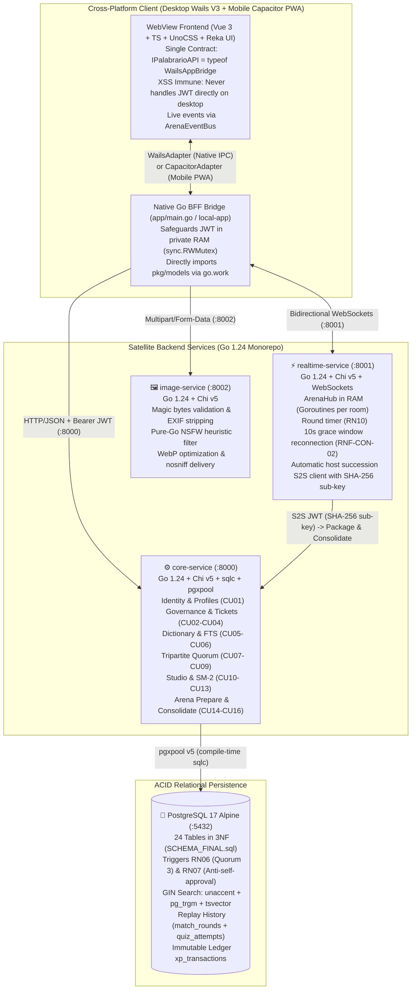

# 📚 Palabrario

<div align="center">


<br/>

> **Collaborative and Gamified Platform for Learning, Discovering, and Preserving Pan-Hispanic Dialectal Vocabulary.**  
> *Project developed for the Software Deployment (Despliegue de Software) course.*

</div>

---

## 🧭 Architectural Documentation Map (Single Source of Truth)

All technical decisions in Palabrario follow a **Backend-First & Contract-First** approach. Consult the specialized source of truth according to your area of work:

| Document | Architectural Purpose |
| :--- | :--- |
| **[`.routing/CONTEXT.md`](.routing/CONTEXT.md)** | **Master Entry Point:** Agent routing, anti-hallucination rules, 100% Go stack, Wails IPC bridge, and repo conventions. |
| **[`.routing/PROGRESS.md`](.routing/PROGRESS.md)** | Active UI rewrite progress, sprint backlog, pending tasks, and open design gaps. |
| **[`.routing/ROUTES.md`](.routing/ROUTES.md)** | Route table, layouts, route guards, DTO mapping, and access rules. |
| **[`.routing/DESIGN.md`](.routing/DESIGN.md)** | Monochrome design system specifications (tokens, typography, buttons, inputs, components). |
| **[`.routing/DOMAIN.md`](.routing/DOMAIN.md)** | Domain-Driven Design (DDD), 24 entities, business rules (`RN01–RN13`), and SM-2 formulas. |
| **[`.routing/INTERFACES.md`](.routing/INTERFACES.md)** | SOA contracts in Go 1.24, DTOs in [`pkg/models`](pkg/models), `sqlc` queries, WebSocket events, and endpoint catalog. |
| **[`SCHEMA_FINAL.sql`](SCHEMA_FINAL.sql)** | Canonical PostgreSQL 17 DDL (3NF, `unaccent`/`pg_trgm` extensions, relational triggers `RN06`/`RN07`, and seed data). |
| **[`.routing/INFRASTRUCTURE.md`](.routing/INFRASTRUCTURE.md)** | Docker Compose containers guide, Go monorepo, `sqlc`, RAM test harness, and Vagrant Debian 12 setup. |
| **[`.context/academic/`](.context/academic)** | Formal self-contained academic deliverables (`1-PROJECT-SPECIFICATION.md`, etc.). |

---

## 🎯 1. Project Vision & Purpose

Spanish has over **500 million native speakers** distributed across more than 20 nations. While we share a common root, regional lexical richness and semantic clashes (dialectal *false friends*) present a fascinating challenge:

- A **guagua** is a bus in Cuba and the Canary Islands, but an infant/baby in Chile and the Andean region.
- A **popote** (Mexico) is a **pitillo** (Colombia/Venezuela), a **bombilla** (Chile), or a **sorbete/pajita** (Argentina/Spain).
- Deep emotional expressions such as **apapachar** (*to embrace or caress with the soul*) lack a single direct translation and constitute living cultural heritage.

**Palabrario** transforms this cultural clash into an engaging and rigorous learning ecosystem:
1. **Living Dialectal Dictionary (`CU05, CU06`):** Trigram phonetic GIN search (`pg_trgm` + `unaccent`), CEFR levels (`A1-C2`), taboo warnings, and transdialectal heteronyms (*"How do they say it over there?"*).
2. **Tripartite Quorum Curation (`CU07, CU08, CU09`):** No proposed sense (`DRAFT`) moves to production without gathering **3 independent affirmative votes** (**RN06**), with strict prevention of self-approval enforced via a relational database trigger (**RN07**).
3. **Studio and SM-2 Engine (`CU10, CU11, CU12, CU13`):** Organization into study decks and collections with an automated forgetting curve (**SuperMemo SM-2 Algorithm**, **RN09**) and an immutable experience ledger (`xp_transactions`, **RN11**).
4. **Real-Time Multiplayer Arena (`CU14, CU15, CU16`):** PIN-synchronized trivia rooms powered by in-memory RAM WebSockets, speed-weighted scoring (**RN10**), automatic host succession, and transactional batch flushing (*Batch Flush*) with 3NF Replay history.

---

## 🏗️ 2. Network Architecture & Engineering Decisions (100% Go 1.24)

Palabrario is structured as a **100% Go 1.24 Monorepo** with comprehensive end-to-end typing (`PostgreSQL 17` $\to$ `sqlc` $\to$ `pkg/models` $\to$ `wailsjs` $\to$ `Vue 3`). Its resource footprint is minimal (`< 15 MiB` combined RAM across the 3 backend services):



### Engineering Rationale & Deployment Trade-offs

| Component | Technology Choice | Rejected Alternative | Technical Deployment Rationale |
| :--- | :--- | :--- | :--- |
| **Unified Backend** | **Golang (Go 1.24)** | Node.js / Python / Java | Ultra-lightweight static binaries. Memory footprint of **< 5 MiB RAM** per service in Docker. Direct type sharing across `pkg/models` and `pkg/auth` without schema duplication. |
| **Data Access** | **`sqlc` + `pgxpool v5`** | Heavy ORMs (GORM, Prisma) | 100% compile-time type-safe SQL queries. Zero runtime reflection overhead, native performance, and complete prevention of SQL injections. |
| **Polymorphic Client** | **Wails V3 + Capacitor** | Electron | Reuses the OS native webview. RAM footprint of **~30 MiB** (compared to >250 MiB for Chromium). Same Vue codebase deployable to Desktop and Mobile/PWA. |
| **Persistence** | **PostgreSQL 17** | NoSQL / MongoDB | ACID referential integrity in 3NF (24 tables). Inviolable relational triggers for Quorum and an immutable accounting ledger for experience (`xp_transactions`). |
| **S2S Communication** | **SHA-256 Sub-key (`pkg/auth`)** | Plain API Keys / mTLS | Strict cryptographic separation: internal service tokens (`Issuer: palabrario-internal-s2s`) are incompatible with human user JWTs, preventing privilege escalation. |

---

## 📋 3. Use Case & Business Rules Matrix

| Functional Module | Use Cases | Implemented Business Rules |
| :--- | :--- | :--- |
| **1. Account & Governance** | **CU01:** Manage User Profile<br/>**CU02:** Request Promotion to Editor<br/>**CU03:** Manage Users & Roles<br/>**CU04:** Issue Invitation Tickets | **RN01:** Account Ownership.<br/>**RN02:** Uniqueness of Requests (`1 PENDING` max).<br/>**RN08:** Admin Privileges & Protection of the Last `ADMIN`.<br/>**RN12:** Multimedia Integrity & Moderation. |
| **2. Dictionary & Curation** | **CU05:** Browse Pan-Hispanic Dictionary<br/>**CU06:** Manage Lexical Content<br/>**CU07:** Curate Senses via Quorum<br/>**CU08:** Publish Lexical Sense<br/>**CU09:** Moderate Content Reports | **RN06:** Publication Quorum (3 `APPROVE` votes).<br/>**RN07:** Prohibition of Self-Approval (`author != voter`).<br/>**RN08:** Direct Approval or Admin Veto.<br/>**RN12:** Category & Multimedia Format Validation. |
| **3. Study & Mastery (Studio)** | **CU10:** Manage Study Decks<br/>**CU11:** Manage Thematic Collections<br/>**CU12:** Study with Spaced Repetition<br/>**CU13:** View Mastery & Progress | **RN03:** Deck & Collection Ownership.<br/>**RN04:** Resource Privacy (`is_public`).<br/>**RN05:** Official Content Reserved for `EDITOR`/`ADMIN`.<br/>**RN09:** SM-2 Algorithm (Ease factor, interval, repetitions).<br/>**RN11:** Immutable XP Ledger (`xp_transactions`). |
| **4. Multiplayer Arena** | **CU14:** Create & Configure Arena<br/>**CU15:** Participate in Multiplayer Match<br/>**CU16:** Consolidate & Close Match (3NF Replay) | **RN10:** Speed & Accuracy Weighted Scoring.<br/>**RN13:** Visual Distractor Quorum.<br/>**RN09/11:** Post-match Impact on Mastery & XP.<br/>**RNF-CON-02:** Network Resilience & 10s Grace Window. |

---

## 🌐 4. Service Topology & Ports

| Service | Language / Runtime | Internal Port | Host Port | Health Check Endpoint |
| :--- | :--- | :---: | :---: | :--- |
| **`postgres`** | PostgreSQL 17 Alpine | `5432` | `5432` | `pg_isready -U postgres -d palabrario` |
| **`core-service`** | Go 1.24 (Alpine) | `8000` | `8000` | `GET http://localhost:8000/health` |
| **`realtime-service`**| Go 1.24 (Alpine) | `8001` | `8001` | `GET http://localhost:8001/health` |
| **`image-service`** | Go 1.24 (Alpine) | `8002` | `8002` | `GET http://localhost:8002/health` |
| **`local-app` / `app`** | Wails V3 + Vue 3 | N/A | Native | Native desktop window |

---

## ⚡ 5. Automation Catalog with `Taskfile` (`task`)

The project features an automated task runner via [`Taskfile.yml`](Taskfile.yml) to standardize the entire lifecycle:

```bash
# ==============================================================================
# 1. AUTOMATED TEST CYCLE (80/20 over PostgreSQL in RAM :5433)
# ==============================================================================
task test           # Runs the full test suite (spins up ephemeral :5433 in RAM)
task test:fast      # Runs tests directly against active :5433 (without restarting container)
task test:service   # Runs DAO/Service layer tests (PostgreSQL 80%)
task test:api       # Runs HTTP smoke tests with Chi router and JWT (20%)
task test:up        # Starts and keeps postgres-test alive in RAM for fast iteration
task test:down      # Tears down the postgres-test in-memory RAM container

# ==============================================================================
# 2. DOCKER COMPOSE & SERVICES MANAGEMENT
# ==============================================================================
task up:all         # Spins up the entire ecosystem (Postgres + Core + Realtime + Image)
task up:core        # Spins up only Postgres (:5432) and core-service (:8000)
task down:all       # Stops and tears down all containers
task rebuild:all    # Rebuilds and restarts all services with the latest code

# ==============================================================================
# 3. COMPILATION & CODE GENERATION (Contract-First)
# ==============================================================================
task sqlc           # Compiles sql/queries/*.sql into strongly typed Go code
task build          # Validates static compilation of all Go packages (0 errors)
task loc            # Generates Lines of Code (LOC) report broken down by language
```

---

## 🚀 6. Quick Start Guide (Getting Started)

### Prerequisites
- **Docker** (v24.0+) and **Docker Compose** (v2.20+)
- **Go** (v1.24+)
- **Task** (v3.0+) *(optional but strongly recommended: `go install github.com/go-task/task/v3/cmd/task@latest`)*
- **Bun** (v1.2+) *(for the frontend in `app/`)*

### 1. Environment Variables (*Fail-Fast* Principle)
Palabrario implements the **Fail-Fast** principle from the *12-Factor App* methodology: if critical variables such as `DATABASE_URL` or `JWT_SECRET` are missing or shorter than 32 characters, the services **refuse to start immediately**.

Each service includes its pre-configured environment file for local development:
- [`core-service/.env`](core-service/.env)
- [`realtime-service/.env`](realtime-service/.env)
- [`image-service/.env`](image-service/.env)

### 2. Full Ecosystem Deployment
To spin up the database and the 3 satellite microservices in the background:
```bash
task up:all
# or via native Docker Compose:
# docker compose up -d --build
```

### 3. Service Health Verification
Check the status of each service using their respective health probes:

```bash
# 1. core-service (Connectivity with pgxpool and PostgreSQL 17)
curl http://localhost:8000/health

# 2. realtime-service (ArenaHub status and active rooms in RAM)
curl http://localhost:8001/health

# 3. image-service (WebP sanitization operational status)
curl http://localhost:8002/health
```

Typical health check response:
```json
{
  "status": "ok",
  "service": "core-service",
  "database": "connected",
  "timestamp": "2026-10-26T12:00:00Z"
}
```

---

## 🧪 7. Testing Strategy: 80/20 Harness on RAM (`:5433`)

Following the guidelines in [`AGENT_WORKFLOW.md`](AGENT_WORKFLOW.md) and [`INFRASTRUCTURE.md`](.routing/INFRASTRUCTURE.md), tests **never touch the development database (:5432)**:

1. **80% Service and Domain Tests (`internal/service`):** Execute real transactions against an ephemeral `postgres-test` container on `:5433` mounted on a `tmpfs` in-memory RAM disk.
2. **Instant Isolation via `TEMPLATE`:** Each suite creates and destroys its database in `< 50 ms` by cloning `palabrario_test` via `CREATE DATABASE ... TEMPLATE`, guaranteeing zero side effects between concurrent test runs.
3. **20% HTTP Smoke Tests (`internal/api`):** Validate the Chi routing tree, DTO decoding, HTTP status codes, and JWT middlewares with in-memory generated tokens.

To run the complete test suite at any time:
```bash
task test
```

---

## 👥 8. Deterministic Seed Data and Accounts

The database initializes automatically on startup with seed data representative of dialectal variants (`MX`, `ES`, `AR`, `CO`, `CL`, `CU`, `CAM`, `PAN`):

| Role | Email | Password | Anchor Dialect | Initial XP | Level |
| :--- | :--- | :--- | :---: | :---: | :---: |
| **ADMIN** | `admin@palabrario.org` | `password123` | `MX` | 15,000 | 10 |
| **EDITOR** | `silas@palabrario.org` | `password123` | `MX` | 8,500 | 7 |
| **LEARNER** | `gael@palabrario.org` | `password123` | `MX` | 4,850 | 4 |

### Preloaded Word Examples
- **`popote`** (Noun, MX): Includes heteronym comparison (*pitillo*, *bombilla*, *sorbete*, *pajilla*).
- **`apapachar`** (Verb, MX): With Nahuatl etymology and canonical emotional definition.
- **`guagua`** (Noun, Polygenetic): Simultaneous usage examples for public transit (Caribbean) and infant/baby (Andes).

---

## 🗺️ 9. Project Status & Roadmap

### Backend Architecture (100% Complete & Verified)
The backend architecture is 100% implemented, tested, and verified across all services:
- **Core Technologies:** Go 1.24, PostgreSQL 17 (3NF schema with 24 tables, `unaccent`, `pg_trgm`, relational triggers).
- **Satellite Microservices:**
  - `core-service` (:8000): Identity, profiles, institutional governance, dictionary search, tripartite quorum curation, studio flashcards with SM-2 spaced repetition, XP immutable ledger, and arena persistence.
  - `realtime-service` (:8001): In-memory ArenaHub WebSocket rooms, speed scoring, 10s reconnection grace window, and SHA-256 S2S authentication.
  - `image-service` (:8002): Magic-byte sniffing, pure-Go NSFW heuristic filter, EXIF stripping, and WebP transcoding.
- **Coverage & Verification:** 16 Use Cases (`CU01`–`CU16`), 13 Business Rules (`RN01`–`RN13`), and an automated 80/20 test suite running on PostgreSQL in RAM (`:5433`).

### Frontend Scratch Rewrite (`app/`)
The frontend client is currently undergoing an active from-scratch UI rewrite located in [`app/`](app/):
- **Stack:** Desktop Wails v3, Vue 3, UnoCSS, and a strict monochrome design system.
- **Tracking & Progress:** Active work, sprint backlog, route definitions, and interface contracts are tracked in [`.routing/PROGRESS.md`](.routing/PROGRESS.md) and [`.routing/ROUTES.md`](.routing/ROUTES.md).
- **Design System:** Governed by [`.routing/DESIGN.md`](.routing/DESIGN.md).

---

## 📄 License

Academic project developed for educational purposes for the **Software Deployment** (*Despliegue de Software*) course.