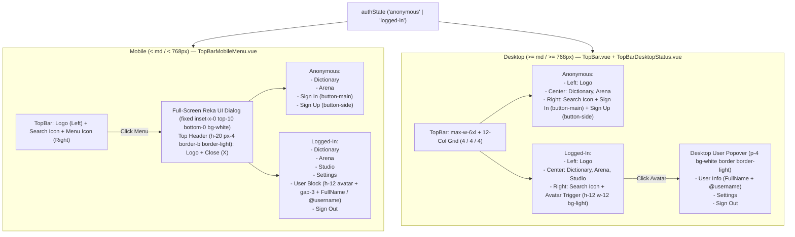

# TopBar

`TopBar.vue` is the sticky header rendered by `AppLayout.vue` on every non-auth route.

The mobile menu lives in `TopBarMobileMenu.vue` and the desktop auth controls in `TopBarDesktopStatus.vue`. Both receive `authState` and `user` as props and emit `sign-out` to `TopBar.vue`, which owns the state.

## Layout: `max-w-6xl` + `grid-cols-12`

The `<header>` is `h-20 sticky top-10 z-40` (it sits below the `h-10` `WindowBar`). Inside it, a `max-w-6xl h-full w-full mx-auto px-4` wrapper uses `grid grid-cols-12 items-center gap-4`:

| Column | Mobile (`< md`) | Desktop (`>= md`) | Content |
| :--- | :--- | :--- | :--- |
| Left | `col-span-6` | `col-span-4` | `Palabrario` wordmark link |
| Center | hidden | `col-span-4`, `justify-center` | `Dictionary`, `Arena`, and `Studio` (logged-in only) |
| Right | `col-span-6`, `justify-end` | `col-span-4`, `justify-end` | `Search` button, then menu or auth controls |

`WindowBar.vue` uses the same 4/4/4 split, so the center navigation lines up with the window title. Equal-width side columns are what keep the center column centered regardless of how wide the right-side controls are. A `flex justify-between` layout would push the links left.

## Surface hierarchy

- `bg-ground` (`#FAFAFA`): page canvas, set on `<body>` in `index.html`.
- `bg-ground/50` + `backdrop-blur-sm` with `border-light`: the TopBar itself, translucent over the canvas.
- `bg-white` + `border-light`: elevated surfaces (the desktop user popover and the mobile full-screen menu), so they stand out against `bg-ground`.
- `bg-light`: `button-icon` background and the user miniature.

## State machine: `authState` x viewport

`authState` is `"anonymous" | "logged-in"`. It is local mock state; real auth wiring comes later. `Sign Out` sets it to `"anonymous"`.

| | Mobile (`< md`) | Desktop (`>= md`) |
| :--- | :--- | :--- |
| **anonymous** | Bar: `Search` + `Menu`. Menu opens the full-screen dialog with `Dictionary`, `Arena`, then `Sign In` (`button-main`) and `Sign Up` (`button-side`). | Center nav: `Dictionary`, `Arena`. Right: `Search`, `Sign In`, `Sign Up`. |
| **logged-in** | Bar: `Search` + `Menu`. Menu opens the full-screen dialog with `Dictionary`, `Arena`, `Studio`, `Settings`, the user block (miniature, name, `@username`), and `Sign Out`. | Center nav: `Dictionary`, `Arena`, `Studio`. Right: `Search` and the user miniature, which opens a popover with name, `@username`, `Settings`, and `Sign Out`. |

### Mobile full-screen dialog (`DialogRoot`)

Reka UI `DialogRoot` (`v-model:open="open"` in `TopBarMobileMenu.vue`), not a Popover: Reka positions `PopoverContent` inside a transformed floating wrapper, which breaks `fixed` full-screen placement. `DialogContent` renders straight into the portal. The content is `fixed inset-x-0 top-10 bottom-0 z-50 w-screen bg-white`, covering the TopBar and the viewport below the `WindowBar`. It has its own `h-20` header with the wordmark and a `DialogClose` (`X`) button. Every link closes the dialog.

### Desktop user popover (`PopoverRoot`)

Reka UI `PopoverRoot` (`v-model:open="open"` in `TopBarDesktopStatus.vue`), `align="end"`, `side-offset="8"`, `bg-white border border-solid border-light`.
