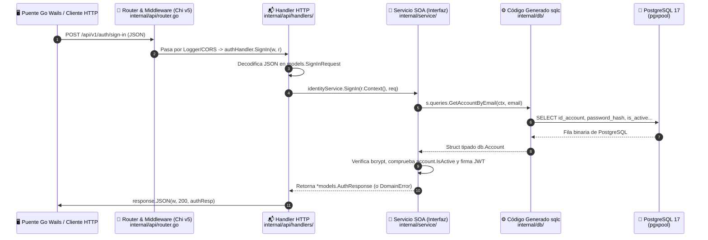

# 🐹 Guía Práctica del Stack de Go en Palabrario (`learning/GO-STACK.md`)

> **Manual de Aprendizaje e Inmersión Técnica para el Desarrollador**  
> **Proyecto:** Palabrario — Backend 100% en Go 1.24 + PostgreSQL 17  
> **Objetivo:** Explicar con claridad cómo funciona cada tecnología de nuestro backend, cómo se conectan entre sí y cómo leer, escribir y depurar código en este stack usando ejemplos reales del propio repositorio.

---

## 1. Mapa Mental: ¿Qué hace cada pieza del Stack?

A diferencia de frameworks "mágicos" (como NestJS, Laravel o Django) donde todo ocurre detrás de decoradores invisibles, **la filosofía de Go es la explicitud total**: nada ocurre por magia ni por reflexión lenta en tiempo de ejecución.

Aquí tienes las **6 piezas clave** de nuestro stack y su equivalente si vienes del ecosistema TypeScript/Node o Python:

| Tecnología en Palabrario | Paquete en `go.mod` | Equivalente en Node / TS | ¿Qué problema resuelve y por qué la elegimos? |
| :--- | :--- | :--- | :--- |
| **1. Go 1.24 (Lenguaje y Runtime)** | Estándar (`net/http`, `context`, `sync`) | Node.js / Bun + TypeScript | Compila a un único binario nativo de máquina (`~15 MB`) que arranca en milisegundos y consume **`< 5 MiB` de RAM** en Docker. |
| **2. Chi v5 (Router HTTP)** | `github.com/go-chi/chi/v5` | Express / Elysia / Hono | Enruta peticiones (`/api/v1/words/{id}`) y encadena middlewares (`RequireAuth`, `CORS`, `Logger`) siendo 100% compatible con la librería estándar `net/http` de Go. |
| **3. `pgx/v5` + `pgxpool` (Driver y Pool TCP)** | `github.com/jackc/pgx/v5` | `pg` (`node-postgres`) | Mantiene un pool de conexiones TCP binarias de alto rendimiento hacia PostgreSQL 17 y maneja transacciones ACID (`tx, err := pool.Begin(ctx)`). |
| **4. `sqlc` (Compilador SQL $\to$ Go)** | Herramienta CLI (`sqlc.yaml`) | Prisma / Drizzle (pero sin costo en runtime) | Tú escribes consultas `.sql` puras en `sql/queries/*.sql`; `sqlc` lee `SCHEMA_FINAL.sql`, valida que las columnas existan y genera funciones Go fuertemente tipadas en `core-service/internal/db/`. |
| **5. `golang-jwt/jwt/v5` + `bcrypt`** | `github.com/golang-jwt/jwt/v5`<br>`golang.org/x/crypto/bcrypt` | `jsonwebtoken` + `bcrypt` | Hashea contraseñas de forma segura y firma/verifica tokens JWT HMAC-SHA256 (`pkg/auth/auth.go`). |
| **6. `google/uuid`** | `github.com/google/uuid` | `crypto.randomUUID()` | Maneja identificadores `UUID` nativos de PostgreSQL (`id_account`, `id_user`, `id_region`) sin convertirlos manualmente de bytes. |

---

## 2. Anatomía de una Petición HTTP de Principio a Fin

Para entender cómo funciona `core-service`, sigamos el viaje exacto de una petición desde que el cliente llama a la API hasta que PostgreSQL responde:



### ¿Qué responsabilidad tiene cada carpeta en `core-service`?

1. **[`pkg/`](../pkg) (En la raíz del monorepo — Compartido por todos los servicios):**
   - **`pkg/models/`:** Contiene los **DTOs (Data Transfer Objects)**: los structs con etiquetas `` `json:"..."` `` que entran y salen por HTTP o WebSockets.
   - **`pkg/auth/`:** Firma y valida tokens JWT y hashea contraseñas. Vive en `pkg/` porque tanto `core-service` como `realtime-service` e `image-service` lo usan.
   - **`pkg/response/`:** Tiene dos funciones simples (`response.JSON` y `response.Error`) para responder siempre con `Content-Type: application/json; charset=utf-8`.
2. **[`core-service/internal/api/`](../core-service/internal/api) (La Capa de Transporte HTTP):**
   - **`router.go`:** Conecta todas las piezas al arrancar (Inyección de Dependencias manual y explícita) y declara qué URL va a qué función.
   - **`middleware/auth_middleware.go`:** Intercepta la cabecera `Authorization: Bearer <token>`. Si la ruta usa `RequireAuth`, rechaza con `401` si no hay token. Si usa `OptionalAuth`, extrae el usuario si viene token o lo deja pasar como anónimo si no viene.
   - **`handlers/*.go`:** Son **delgados**. Su único trabajo es: (1) leer parámetros de la URL o el JSON del `r.Body`, (2) llamar a la interfaz del servicio SOA, y (3) devolver `response.JSON` o `response.Error`. **Nunca escriben SQL ni lógica de negocio.**
3. **[`core-service/internal/service/`](../core-service/internal/service) (La Capa de Negocio SOA):**
   - Aquí viven las interfaces definidas en [`.context/INTERFACES.md`](../.context/INTERFACES.md) (`IdentityService`, `DictionaryService`, etc.).
   - Aquí se validan las Reglas de Negocio (`RN01–RN11`), se abren transacciones SQL cuando hay que tocar varias tablas a la vez y se convierten los structs de base de datos (`db.*`) a structs limpios de dominio (`models.*`).
4. **[`sql/queries/*.sql`](../sql/queries) $\to$ [`core-service/internal/db/`](../core-service/internal/db) (La Capa de Datos con `sqlc`):**
   - Tú **solo editas** los archivos `.sql` dentro de `sql/queries/`.
   - Los archivos `.go` dentro de `core-service/internal/db/` los genera automáticamente el comando `sqlc generate`. **Nunca se editan a mano.**

---

## 3. Conceptos Fundamentales de Go Explicados con Nuestro Código

Si eres nuevo en Go, estos conceptos te permitirán leer el 100% del código del proyecto sin sentirte perdido:

---

### 3.1. ¿Por qué `ctx context.Context` va en todas las funciones?

Verás que casi todos los métodos en Go empiezan así:
```go
func (s *dictionaryService) GetWordDetail(ctx context.Context, wordID int) (*models.WordDetail, error)
```

- **¿Qué es `ctx`?** Es una señal de control de ciclo de vida que viaja desde que entra la petición HTTP (`r.Context()`) hasta la consulta SQL en PostgreSQL.
- **¿Para qué sirve?**
  1. **Cancelación automática:** Si un usuario busca una palabra y cierra la aplicación a los 10 milisegundos, `ctx` se cancela automáticamente y le avisa a PostgreSQL que aborte la consulta de inmediato para no gastar CPU ni bloquear conexiones.
  2. **Timeouts:** En [`database/db.go`](../core-service/internal/database/db.go), usamos `context.WithTimeout(ctx, 5*time.Second)` para decirle a Go: *"Si PostgreSQL no responde al ping en 5 segundos, aborta y devuelve error"*.
  3. **Transporte de sesión en HTTP:** El middleware [`RequireAuth`](../core-service/internal/api/middleware/auth_middleware.go) guarda los datos del token JWT dentro del contexto de la petición (`context.WithValue`), y el handler los extrae antes de llamar al servicio.

---

### 3.2. Interfaces Implícitas e Inyección de Dependencias (SOA en Go)

En lenguajes como Java o TypeScript tienes que escribir `class IdentityServiceImpl implements IdentityService`. **En Go no existe la palabra `implements`.**
Si un `struct` tiene los mismos métodos que pide una `interface`, Go sabe automáticamente que cumple la interfaz:

```go
// 1. Declaramos el Contrato SOA (Interfaz):
type DictionaryService interface {
    SearchDropdown(ctx context.Context, query string, userDialect string, limit int) ([]models.WordSearchResult, error)
    GetWordDetail(ctx context.Context, wordID int) (*models.WordDetail, error)
}

// 2. Creamos el struct privado (empieza con minúscula) que tiene la conexión a BD:
type dictionaryService struct {
    db      *database.DB
    queries *db.Queries
}

// 3. Su constructor devuelve la INTERFAZ pública, no el struct privado:
func NewDictionaryService(databaseInstance *database.DB) DictionaryService {
    return &dictionaryService{
        db:      databaseInstance,
        queries: db.New(databaseInstance.Pool),
    }
}
```
> **Truco de Go (Mayúsculas vs. Minúsculas):** En Go no existen las palabras `public` ni `private`. Todo lo que empieza con **Mayúscula** (`DictionaryService`, `GetWordDetail`, `IDWord`) es **público/exportado** fuera del paquete. Todo lo que empieza con **minúscula** (`dictionaryService`, `queries`) es **privado** del paquete.

---

### 3.3. Cómo Funciona `sqlc` (El Superpoder del Proyecto)

El archivo [`sqlc.yaml`](../sqlc.yaml) en la raíz le dice a `sqlc`:
1. *"Lee las tablas en [`SCHEMA_FINAL.sql`](../SCHEMA_FINAL.sql)"*.
2. *"Lee las consultas en [`sql/queries/`](../sql/queries)"*.
3. *"Genera código Go en [`core-service/internal/db/`](../core-service/internal/db)"*.

Mira cómo un comentario especial encima de tu consulta SQL se transforma en una función Go:

```sql
-- En sql/queries/users.sql:
-- name: GetAccountByEmail :one
SELECT id_account, email, password_hash, role, is_active, created_at, updated_at
FROM accounts
WHERE email = $1
LIMIT 1;
```

El comentario `-- name: GetAccountByEmail :one` tiene tres partes:
- `GetAccountByEmail`: El nombre exacto que tendrá la función en Go (`s.queries.GetAccountByEmail(ctx, email)`).
- `:one`: Le dice a `sqlc` que la consulta devuelve **1 sola fila** (por lo que en Go retorna `(db.Account, error)`).
  - Si pones `:many`, retorna un arreglo/slice `([]db.Row, error)`.
  - Si pones `:exec`, ejecuta un `UPDATE` o `DELETE` que no devuelve filas y retorna solo `error`.

#### ¿Qué pasa cuando una columna en SQL puede ser `NULL` (`pgtype.Text` vs `*string`)?
En PostgreSQL, columnas como `avatar_url`, `etymology` o `cultural_note` pueden ser `NULL`.
- `sqlc` genera esos campos anulables como `pgtype.Text` (un struct que tiene `{String: "valor", Valid: true/false}`).
- En nuestros modelos JSON (`pkg/models`), usamos punteros `*string` (donde `nil` se convierte en `null` o se omite con `omitempty` en JSON).
- Por eso en [`core-service/internal/service/errors.go`](../core-service/internal/service/errors.go) tenemos el helper `TextToPtr(row.AvatarUrl)` que convierte limpiamente de `pgtype.Text` a `*string`.

---

### 3.4. Transacciones ACID con `pgx` y `sqlc` (`Begin` / `WithTx` / `Commit`)

Cuando una operación modifica **más de una tabla** (por ejemplo, `SignUp` que inserta en `accounts` y luego en `users`, o aprobar una solicitud de Editor que actualiza `editor_requests` y cambia el rol en `accounts`), **ambas deben ocurrir dentro de una transacción** para que, si la segunda falla, la primera se deshaga automáticamente.

En Go con `pgx` y `sqlc`, el patrón canónico que verás en [`identity_service.go`](../core-service/internal/service/identity_service.go) es siempre este bloque de 4 pasos:

```go
// 1. Iniciar la transacción en el pool de conexiones
tx, err := s.db.Pool.Begin(ctx)
if err != nil {
    return nil, fmt.Errorf("error iniciando transacción: %w", err)
}
// 2. defer asegura que si ocurre CUALQUIER error antes del Commit, se haga Rollback automático.
// (Si tx.Commit(ctx) ya se ejecutó con éxito, este Rollback no hace nada).
defer func() { _ = tx.Rollback(ctx) }()

// 3. Envolver las consultas de sqlc dentro de la transacción (qtx)
qtx := s.queries.WithTx(tx)

// Ejecutar todas las operaciones SQL usando 'qtx' en lugar de 's.queries'
account, err := qtx.CreateAccount(ctx, ...)
if err != nil {
    return nil, err // Aquí sale de la función y el 'defer' ejecuta tx.Rollback(ctx)
}

userProfile, err := qtx.CreateUserProfile(ctx, ...)
if err != nil {
    return nil, err // Aquí también hace Rollback automático de CreateAccount
}

// 4. Confirmar los cambios definitivamente en PostgreSQL
if err := tx.Commit(ctx); err != nil {
    return nil, fmt.Errorf("error confirmando transacción: %w", err)
}
```

---

### 3.5. Manejo Explícito de Errores y Códigos de PostgreSQL (`errors.Is` / `errors.As`)

En Go no existen los bloques `try / catch`. Las funciones devuelven el error como último valor de retorno (`resultado, err := funcion()`), obligándote a decidir qué hacer con él en el momento.

En [`core-service/internal/service/errors.go`](../core-service/internal/service/errors.go) implementamos un sistema de errores en dos capas:
1. **`MapDBError(err, "mensaje")`:** Toma un error crudo de PostgreSQL y usa `errors.As(err, &pgErr)` para leer el código oficial `SQLSTATE` de PostgreSQL:
   - `pgx.ErrNoRows` $\to$ `ErrNotFound` (`404 Not Found`).
   - `SQLSTATE 23505` (*unique_violation*, ej. correo repetido o 2da solicitud `PENDING` en **RN02**) $\to$ `ErrConflict` (`409 Conflict`).
   - `SQLSTATE P0001` (*raise_exception*, lanzado por nuestro trigger `trg_prevent_self_approval` cuando un editor intenta auto-aprobarse en **RN07**) $\to$ `ErrForbidden` (`403 Forbidden`) conservando el mensaje del trigger.
   - `SQLSTATE 23514` (*check_violation*) $\to$ `ErrUnprocessable` (`422 Unprocessable Entity`).
2. **`HTTPStatusAndMessage(err, "fallback")`:** El handler HTTP llama a esta función y obtiene automáticamente el código HTTP exacto (`400`, `401`, `403`, `404`, `409`, `422` o `500`) para enviarlo con `response.Error(w, status, msg)`.

---

### 3.6. Cómo se Comunica el Frontend con el Backend: El Puente Nativo Go de Wails (`local-app/app.go`)

En una aplicación web tradicional, el frontend en Vue haría `fetch("http://localhost:8000/api/v1/...")` y guardaría el token JWT en `localStorage` (donde cualquier vulnerabilidad XSS en JavaScript podría robarlo).

En **Palabrario**, gracias a **Wails v2** y a nuestro workspace unificado ([`go.work`](../go.work)), la comunicación es mucho más segura y 100% tipada:

1. **Bóveda de Sesión en RAM (`local-app/app.go`):**
   Cuando el usuario inicia sesión (`a.SignIn(email, password)`), es el proceso Go de escritorio (`local-app/app.go`) quien hace la petición HTTP a `core-service`. Al recibir el `AuthResponse`, **Go guarda el `sessionToken` JWT en una variable privada en memoria RAM (`a.sessionToken` protegida con `sync.RWMutex`)** y le devuelve a Vue únicamente el `UserProfile`. El navegador/WebView jamás ve el token JWT.
2. **Compartición Directa de `pkg/models`:**
   Como [`go.work`](../go.work) une la raíz (`.`) y `./local-app`, el archivo [`local-app/app.go`](../local-app/app.go) importa directamente `"palabrario/pkg/models"`.
3. **Generación Automática de TypeScript (`wails generate module`):**
   Cada método público que agregas a `func (a *App) MiMetodo(...) (*models.MiStruct, error)` en `local-app/app.go` es leído por Wails y transpilado automáticamente a:
   - `local-app/frontend/wailsjs/go/main/App.js` y `App.d.ts` (funciones listas para importar en Vue con `async/await`).
   - `local-app/frontend/wailsjs/go/models.ts` (clases e interfaces TypeScript generadas directamente desde `pkg/models/*.go`).

---

### 3.7. Arquitectura de Pruebas en Go: Pirámide 80/20 + Clonado `TEMPLATE` en RAM

Si vienes de probar **DAOs directamente contra la base de datos**, nuestra arquitectura de pruebas en [`core-service/internal/testutil/db.go`](../core-service/internal/testutil/db.go) te resultará familiar y resuelve de raíz el problema de que un test ensucie los datos de otro o se rompa cuando cambia `SCHEMA_FINAL.sql`:

1. **Contenedor Efímero en RAM (`postgres-test` en `:5433`):**
   Definido en [`docker-compose.yml`](../docker-compose.yml) bajo `profiles: ["test"]` con `tmpfs: /var/lib/postgresql/data`. Vive 100% en memoria RAM y nunca toca tu base de datos de desarrollo (`:5432`).
2. **Clonación Instantánea Agnóstica al Esquema (`CREATE DATABASE ... TEMPLATE`):**
   Cuando un test llama a `testDB := testutil.SetupTestDB(t)`:
   - Go clona la base de datos maestra `palabrario_test` en `~10 ms` ejecutando `CREATE DATABASE test_<uuid> TEMPLATE palabrario_test`.
   - El test puede insertar, borrar o incluso hacer `UPDATE` destructivos sobre usuarios semilla (como suspender a Silas).
   - Al terminar el test, `t.Cleanup()` ejecuta `DROP DATABASE IF EXISTS test_<uuid> WITH (FORCE)`.
   - **Cero acoplamiento:** No hay un solo nombre de tabla ni ID quemado en `SetupTestDB`. Si mañana agregas 10 tablas a `SCHEMA_FINAL.sql`, el sistema de pruebas sigue funcionando sin tocar una línea.
3. **Estrategia 80% DAO/Service vs. 20% HTTP Smoke Tests:**
   - **80% Pruebas de Servicio / DAO ([`core-service/internal/service/service_test.go`](../core-service/internal/service/service_test.go)):** Llamas directamente en Go a `identitySvc.SignIn(...)` o `dictSvc.GetWordDetail(...)` sin armar peticiones HTTP ni serializar JSON.
   - **20% Pruebas de Humo HTTP ([`core-service/internal/api/auth_test.go`](../core-service/internal/api/auth_test.go)):** Prueban que el router Chi y los middlewares JWT conecten bien.
4. **Ejecución ergonómica con Taskfile (`task`) o PowerShell:**
   Gracias a [`Taskfile.yml`](../Taskfile.yml), tienes comandos cortos en memoria muscular:
   ```powershell
   # Levanta postgres-test en RAM -> Corre todas las pruebas -> Reporta -> Destruye el contenedor
   .\scripts\test.ps1
   task test         # Ejecuta el ciclo completo de pruebas
   task test:fast    # Corre pruebas en 2s si postgres-test ya está encendido
   task test:service # Prueba solo la capa 80% (DAO / Service)
   task test:api     # Prueba solo la capa 20% (HTTP Smoke tests)
   task test:up      # Enciende postgres-test en RAM y lo deja corriendo
   task test:down    # Apaga postgres-test de RAM
   ```

---

### 3.8. Orquestación Rápida de Entorno y Servicios con `Taskfile.yml` (`task`)

Para que no tengas que recordar comandos largos de Vagrant, Docker Compose o Go, hemos integrado **[Task (go-task)](https://taskfile.dev/)** mediante [`Taskfile.yml`](../Taskfile.yml) en la raíz del repositorio.

Escribe `task` o `task --list` para ver el catálogo completo:

| Categoría | Comando | Acción Realizada |
| :--- | :--- | :--- |
| **Pruebas** | `task test` | Levanta DB efímera en RAM si está apagada, corre suite completa y reporta. |
| | `task test:fast` | Corre `go test` directo contra `:5433` sin ciclos de Docker. |
| | `task test:service` | Ejecuta exclusivamente los tests de `internal/service/` (80% DAO/Service). |
| | `task test:api` | Ejecuta exclusivamente los tests de `internal/api/` (20% HTTP Smoke). |
| | `task test:up` | Enciende `postgres-test` en RAM (:5433) y lo deja activo para desarrollo. |
| | `task test:down` | Destruye `postgres-test` de la memoria RAM. |
| **Servicios** | `task up:core` | Sincroniza código con Vagrant y levanta **PostgreSQL 17** (:5432) + **`core-service`** (:8000). |
| | `task up:all` | Sincroniza y levanta todos los servicios (`postgres`, `core-service`, `image-service`, `realtime-service`). |
| | `task down:all` | Detiene todos los contenedores en la VM. |
| | `task rebuild:core` | Recompila el binario Go de `core-service` dentro de Docker y reinicia su contenedor. |
| | `task rebuild:all` | Recompila y reinicia todos los servicios. |
| **Vagrant VM**| `task vm:up` | Enciende la máquina virtual Debian 12 (`vagrant up`). |
| | `task vm:sync` | Sincroniza cambios de código hacia la VM (`vagrant rsync`). |
| | `task vm:status` | Revisa el estado de la VM y la lista de contenedores (`docker ps`). |
| | `task vm:reload` | Reinicia la VM aplicando cambios de puertos en `Vagrantfile` (`vagrant reload`). |
| | `task vm:down` | Apaga la máquina virtual (`vagrant halt`). |
| **Código** | `task sqlc` | Compila consultas SQL a Go tipado (`sqlc generate`). |
| | `task build` | Compila todos los servicios en Go verificando 0 errores de sintaxis o tipos. |
| | `task wails:gen` | Regenera los contratos TypeScript en `local-app/frontend/wailsjs/` desde Go. |

---

## 4. Ciclo de Trabajo Diario: ¿Cómo Agrego un Nuevo Endpoint?

Cada vez que tú (o un agente siguiendo [`AGENT_WORKFLOW.md`](../AGENT_WORKFLOW.md)) quieras agregar una funcionalidad al backend, siempre seguirás exactamente estos **6 pasos en orden**:

1. **Paso 1 — Define el struct JSON en [`pkg/models/`](../pkg/models):**
   Agrega el struct de entrada/salida con sus etiquetas `` `json:"nombre_en_snake_case"` ``.
2. **Paso 2 — Escribe la consulta SQL en [`sql/queries/*.sql`](../sql/queries) y genera el código:**
   Escribe tu `SELECT / INSERT / UPDATE` con el comentario `-- name: NombreFuncion :one` y corre:
   ```powershell
   task sqlc
   ```
   Esto creará instantáneamente la función Go tipada dentro de `core-service/internal/db/`.
3. **Paso 3 — Agrega el método al Servicio SOA en [`core-service/internal/service/`](../core-service/internal/service):**
   Añade la firma a la interfaz (`DictionaryService`, `StudioService`, etc.) e impleméntala llamando a `s.queries.NombreFuncion(ctx, ...)`.
4. **Paso 4 — Crea el método en el Handler HTTP en [`core-service/internal/api/handlers/`](../core-service/internal/api/handlers):**
   Lee los parámetros de `r`, llama al servicio SOA y responde con `response.JSON(w, http.StatusOK, resultado)`.
5. **Paso 5 — Registra la ruta en [`core-service/internal/api/router.go`](../core-service/internal/api/router.go), escribe su test en `internal/service/` y verifica con `task test`:**
   ```powershell
   task test
   ```
6. **Paso 6 (En Fase 5) — Expón el método en [`local-app/app.go`](../local-app/app.go) y genera TypeScript con Wails:**
   Agrega el método en `struct App` retornando el struct de `pkg/models` y corre:
   ```powershell
   task wails:gen
   ```
   Con eso tendrás la función y los tipos TypeScript autogenerados en `wailsjs/go/` listos para usarse en Vue 3 con cero posibilidad de desfase entre backend y frontend.
