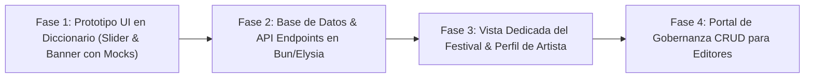

# Propuesta Técnica: Sistema de Eventos de Temporada y Galería Cultural de Arte (Palabrario)

**Estado:** Propuesta de Arquitectura & Diseño  
**Fecha:** Septiembre 2026  
**Autores:** Equipo de Arquitectura de Palabrario  
**Objetivo:** Transformar a Palabrario en un festival cultural dinámico mediante eventos estacionales basados en tradiciones hispanas, integrando obras de artistas comunitarios (o arte conceptual por IA), múltiples colecciones temáticas en carrusel y un sistema integral de administración (CRUD).

---

## 1. Visión y Justificación Cultural

A diferencia de diccionarios tradicionales estáticos o aplicaciones de gamificación con estética corporativa genérica, **Palabrario** sitúa al lenguaje en su contexto humano y festivo:
* **El idioma como tradición viva:** Las celebraciones hispanas (*Día de Muertos*, *Semana Santa*, *Las Fallas*, *Inti Raymi*, *Feria de las Flores*, *Noche de San Juan*) generan vocabulario, dichos, gastronomía y ritos que no se comprenden en palabras aisladas, sino en universos temáticos.
* **Vitrina de arte hispanoamericano:** Conectar la lingüística con el arte visual. Los ilustradores hispanohablantes tienen una ventana de difusión cultural masiva con atribución explícita (créditos, enlaces a portafolio, país), iniciando en una primera etapa con arte conceptual generado por IA con transparencia de curaduría.
* **Multi-colección por evento:** Un evento festivo no es solo un mazo de tarjetas; es un compendio de rutas de aprendizaje (p. ej., gastronomía ritual, jerga popular, rimas/literatura y tradiciones funerarias).

---

## 2. Elementos de UI y Especificación de Interfaz

### 2.1. Módulo de Festival en el Diccionario (`GUIDictionaryView.vue`)

El banner de temporada es el protagonista visual en la parte superior del explorador del diccionario, diseñado bajo el **Design Language retro-cálido** de Palabrario:

```
+---------------------------------------------------------------------------------------------------------+
|  🌸 EVENTO ESPECIAL • 28 OCT - 03 NOV • EN CURSO (QUEDAN 4 DÍAS)              [ Ver evento completo ➔ ] |
|                                                                                                         |
|  +--------------------+   DÍA DE MUERTOS 🇲🇽💀                                                           |
|  |                    |   "ENTRE FLORES DE CEMPASÚCHIL Y DICHOS SOBRE LA MUERTE"                        |
|  |   [ ILUSTRACIÓN    |                                                                                 |
|  |     ARTÍSTICA ]    |   Explora las ofrendas rituales, la sátira de las calaveritas y las frases      |
|  |                    |   mexicanas más entrañables para hablar del más allá sin solemnidad.            |
|  |  🎨 Mariana Vega   |                                                                                 |
|  |     Oaxaca, MX     |   [ Practicar Trivia Festiva ➔ ]   [ Guardar Colecciones en Studio ]            |
|  +--------------------+                                                                                 |
|                                                                                                         |
|  -- COLECCIONES DESTACADAS DEL EVENTO ----------------------------------------------------------------- |
|                                                                                                         |
|  < [◀]                                                                                            [▶] > |
|  +----------------------+  +----------------------+  +----------------------+  +----------------------+ |
|  | 🌼 El Altar y la     |  | 🎭 Dichos y Calaveras|  | 📜 La Muerte en la   |  | 🍞 Gastronomía Ritual| |
|  |    Ofrenda           |  |    Mexicana          |  |    Poesía Popular    |  |    de Difuntos       | |
|  | 4 Decks • 38 Palabras|  | 3 Decks • 25 Palabras|  | 2 Decks • 18 Palabras|  | 3 Decks • 24 Palabras| |
|  | [ Ver Colección ➔ ]  |  | [ Ver Colección ➔ ]  |  | [ Ver Colección ➔ ]  |  | [ Ver Colección ➔ ]  | |
|  +----------------------+  +----------------------+  +----------------------+  +----------------------+ |
|                                                                                                         |
|  [ Ver las 6 colecciones completas del evento ➔ ]                                                       |
+---------------------------------------------------------------------------------------------------------+
```

#### Anatomía del Banner:
1. **Contenedor Principal:**
   - Geometría: `rounded-[32px]` con borde suave de contraste `border-2 border-[#EFC1AC]`.
   - Paleta: Fondo melocotón cálido o tintado con el acento del evento (p. ej. `#FAF0E8` con borde cempasúchil `#F9D5A7`).
   - Sombra: `shadow-md hover:shadow-lg transition-all`.
2. **Cápsula de la Obra de Arte (`Artwork Frame`):**
   - Dimensiones: Ratio aproximado `4:3` o `1:1` con esquinas pronunciadas `rounded-[24px]` y borde blanco cremoso.
   - Imagen: Ilustración artística de alta resolución con carga diferida (*lazy loading*) y fallback placeholder.
   - **Tarjeta de Crédito Flotante:** Píldora translúcida en la esquina inferior (`bg-white/90 backdrop-blur-xs text-[#5C2B16] text-[10px] font-black uppercase`) que indica:
     - Artista comunitario: `🎨 Mariana Vega • Oaxaca, MX` (con enlace a su portafolio).
     - Arte IA: `🎨 Palabrario Studio (IA) • Estilo Grabado Posada`.
3. **Bloque Informativo y Acciones:**
   - Badges superiores limpios: Píldora de vigencia `Del 28 Oct al 03 Nov` y bandera regional `México 🇲🇽` (sin códigos ISO diminutos desalineados).
   - Titular Display: `text-3xl md:text-4xl font-black uppercase tracking-tight text-[#5C2B16]`.
   - Párrafo cultural: `text-sm text-[#6E3620] leading-relaxed`.
   - Botón de Acción Principal (Pill): `bg-[#8D3B2B] text-white hover:bg-[#722A1E]` para iniciar práctica o trivia del evento.
4. **Slider / Carrusel de Colecciones del Evento:**
   - Carrusel horizontal con scroll snap nativo (`scroll-smooth snap-x flex gap-4 overflow-x-auto pb-2`).
   - Controles de navegación laterales discretos `<` y `>` con estilo botón circular de la paleta.
   - Cada tarjeta de colección incluye:
     - Portada miniatura o icono de colección.
     - Título en mayúsculas `font-black text-[#5C2B16]`.
     - Indicador numérico de contenido: `N Decks • M Palabras`.
     - Botón de exploración directa.
5. **Tarjeta Terminal / Enlace Completo:**
   - Al final del carrusel, una tarjeta interactiva con borde punteado o de acento:
     *"Ver las N colecciones completas del evento ➔"*, navegando hacia la página dedicada del festival.

---

### 2.2. Vista de Página Completa del Evento (`/#/events/:slug`)

Para usuarios que desean sumergirse de lleno en la festividad:
* **Hero Inmersivo:** Ilustración a pantalla ancha con biografía extendida del ilustrador o contexto de la tradición.
* **Filtros por categoría dentro del evento:** Píldoras para alternar entre *Tradición*, *Jerga*, *Comida*, *Literatura*.
* **Cuadrícula completa de Colecciones y Mazos:** Despliegue en grid `sm:grid-cols-2 lg:grid-cols-3` de todas las rutas de estudio.
* **Podio / Leaderboard Festivo:** Puntos de experiencia (XP) ganados exclusivamente estudiando palabras de este evento durante su vigencia.

---

### 2.3. Módulo de Administración y Gobernanza (`/#/editor/events`)

Para los roles `EDITOR` y `ADMIN`, integrado en el portal de gobernanza:
* **Lista de Eventos:** Tabla con estado (`ACTIVO`, `PROGRAMADO`, `EXPIRADO`), rango de fechas, arte asignado y número de colecciones.
* **Formulario Modal / Vista de Edición (`SeasonEventEditor`):**
  - Campos: Título, Slug único (autogenerado con slugify), Subtítulo, Región cultural, Fechas `start_date` y `end_date`.
  - Selector/Uploader de Artwork: Seleccionar de la galería existente o registrar nueva obra con los créditos del artista (nombre, Instagram/portafolio, país, toggle `is_ai_generated`).
  - Selector Ordenable de Colecciones: Lista interactiva para asociar colecciones y ordenarlas numéricamente para el slider.

---

## 3. Diseño de Base de Datos y Modelo Relacional

A continuación se define el esquema DDL para PostgreSQL, diseñado para integrarse con `SCHEMA_FINAL.sql` y el ORM Drizzle.

```sql
-- ============================================================================
-- 1. TABLA DE OBRAS ARTÍSTICAS (ARTWORK & COMMUNITY CREATORS)
-- ============================================================================
CREATE TABLE IF NOT EXISTS artwork (
    id_artwork SERIAL PRIMARY KEY,
    title VARCHAR(150) NOT NULL,
    image_url TEXT NOT NULL,
    thumbnail_url TEXT,
    alt_text VARCHAR(255) NOT NULL,
    
    -- Atribución del creador o modelo de IA
    artist_name VARCHAR(120) NOT NULL,              -- Ej: 'Mariana Vega' o 'Palabrario Studio'
    artist_handle VARCHAR(80),                      -- Ej: '@marianavega_art'
    artist_country_code VARCHAR(2),                 -- Ej: 'MX', 'AR', 'CO', 'ES'
    artist_portfolio_url TEXT,                      -- URL de Behance, Artstation, Instagram, etc.
    is_ai_generated BOOLEAN NOT NULL DEFAULT FALSE,
    ai_prompt_metadata JSONB,                       -- Prompt exacto, modelo (Midjourney/Imagen 3), semillas
    
    license_type VARCHAR(50) NOT NULL DEFAULT 'COMMUNITY_FEATURED', -- 'COMMUNITY_FEATURED', 'CC_BY_SA', 'PUBLIC_DOMAIN'
    created_at TIMESTAMPTZ NOT NULL DEFAULT NOW()
);

-- ============================================================================
-- 2. TABLA DE EVENTOS DE TEMPORADA (SEASON EVENTS)
-- ============================================================================
CREATE TABLE IF NOT EXISTS season_event (
    id_event SERIAL PRIMARY KEY,
    slug VARCHAR(100) UNIQUE NOT NULL,              -- Ej: 'dia-de-muertos-2026', 'semana-santa-sevilla'
    title VARCHAR(150) NOT NULL,                    -- Ej: 'Día de Muertos: Entre Flores y Calaveras'
    subtitle VARCHAR(255) NOT NULL,
    description TEXT NOT NULL,
    culture_region VARCHAR(100) NOT NULL,           -- Ej: 'México 🇲🇽', 'Andina 🇵🇪 🇧🇴', 'Río de la Plata 🇦🇷'
    
    -- Fechas de vigencia para activación y expiración automática
    start_date DATE NOT NULL,
    end_date DATE NOT NULL,
    is_active BOOLEAN NOT NULL DEFAULT TRUE,
    
    -- Personalización visual de acento (opcional para el tema del banner)
    banner_accent_color VARCHAR(7) DEFAULT '#EFC1AC', -- Código HEX decorativo
    
    -- Relación con la obra de arte principal
    id_artwork INT REFERENCES artwork(id_artwork) ON DELETE SET NULL,
    
    created_at TIMESTAMPTZ NOT NULL DEFAULT NOW(),
    updated_at TIMESTAMPTZ NOT NULL DEFAULT NOW(),

    CONSTRAINT chk_event_dates CHECK (end_date >= start_date)
);

-- ============================================================================
-- 3. TABLA PIVOTE: RELACIÓN EVENTO <-> COLECCIONES (N:M CON ORDEN EN SLIDER)
-- ============================================================================
CREATE TABLE IF NOT EXISTS season_event_collection (
    id_event INT NOT NULL REFERENCES season_event(id_event) ON DELETE CASCADE,
    id_collection INT NOT NULL REFERENCES collection(id_collection) ON DELETE CASCADE,
    display_order INT NOT NULL DEFAULT 1,
    is_featured_in_slider BOOLEAN NOT NULL DEFAULT TRUE,
    added_at TIMESTAMPTZ NOT NULL DEFAULT NOW(),
    
    PRIMARY KEY (id_event, id_collection)
);

-- ============================================================================
-- 4. ACTUALIZACIÓN A LA TABLA EXISTENTE 'collection' (OPCIONAL ARTWORK)
-- ============================================================================
ALTER TABLE collection ADD COLUMN IF NOT EXISTS id_artwork INT REFERENCES artwork(id_artwork) ON DELETE SET NULL;

-- ============================================================================
-- 5. ÍNDICES DE RENDIMIENTO (QUERY DE EVENTO ACTIVO EN < 1MS)
-- ============================================================================
CREATE INDEX IF NOT EXISTS idx_season_event_active_dates 
ON season_event (start_date, end_date) 
WHERE is_active = TRUE;

CREATE INDEX IF NOT EXISTS idx_season_event_collection_order 
ON season_event_collection (id_event, display_order);
```

---

## 4. Rutas Requeridas (Frontend & Backend)

### 4.1. Mapa de Rutas de Frontend (`Vue Router` - Hash History)

| Ruta | Nombre de Ruta | Acceso | Propósito |
| :--- | :--- | :--- | :--- |
| `/#/dictionary` | `dictionary` | Público | Incorpora el banner del evento activo con el slider de colecciones. |
| `/#/events` | `events-catalog` | Público | Explorador de eventos de temporada (en curso, pasados e históricos). |
| `/#/events/:slug` | `event-detail` | Público | Página inmersiva del festival: arte ampliado, bio del artista, todas las colecciones y mazos. |
| `/#/editor/events` | `editor-events-list` | `EDITOR` / `ADMIN` | Tabla de gestión y gobernanza de eventos. |
| `/#/editor/events/new` | `editor-event-create` | `EDITOR` / `ADMIN` | Formulario de alta de nuevo evento con asignador de colecciones y obra. |
| `/#/editor/events/:id/edit` | `editor-event-edit` | `EDITOR` / `ADMIN` | Formulario de actualización, cambio de fechas y reordenamiento de colecciones. |

### 4.2. Contratos de API (`core-service` / Bun + Elysia)

#### Endpoints Públicos:
* **`GET /api/events/active`**
  - **Propósito:** Devuelve el evento vigente en la fecha actual (`CURRENT_DATE BETWEEN start_date AND end_date AND is_active = TRUE`). Si hay más de uno, devuelve el de fecha de fin más cercana.
  - **Respuesta:**
    ```json
    {
      "event": {
        "id_event": 1,
        "slug": "dia-de-muertos-2026",
        "title": "Día de Muertos: Entre Flores y Calaveras",
        "subtitle": "Celebrando el viaje de las ánimas y el léxico del recuerdo",
        "culture_region": "México 🇲🇽",
        "start_date": "2026-10-28",
        "end_date": "2026-11-03",
        "days_remaining": 4,
        "banner_accent_color": "#F9D5A7",
        "artwork": {
          "id_artwork": 10,
          "title": "Calaveras en Alfeñique",
          "image_url": "/assets/art/dia_muertos_2026.webp",
          "artist_name": "Mariana Vega",
          "artist_handle": "@marianavega_art",
          "artist_country_code": "MX",
          "artist_portfolio_url": "https://instagram.com/marianavega_art",
          "is_ai_generated": false
        },
        "slider_collections": [
          {
            "id_collection": 101,
            "title": "El Altar y la Ofrenda",
            "description": "Cempasúchil, copal, alfeñique y elementos del altar tradicional.",
            "deck_count": 4,
            "word_count": 38,
            "display_order": 1
          }
        ],
        "total_collections_count": 6
      }
    }
    ```
* **`GET /api/events/:slug`**
  - **Propósito:** Retorna la información completa de un evento, incluyendo todas sus colecciones, los mazos contenidos en cada colección y las palabras asociadas.
* **`GET /api/events`**
  - **Propósito:** Lista paginada de todos los eventos anuales pasados y programados.

#### Endpoints de Gobernanza (`EDITOR` / `ADMIN`):
* **`POST /api/events`:** Alta de nuevo evento (valida formato de fechas, slug único y crea el registro).
* **`PUT /api/events/:id`:** Edición de metadatos, estado y fechas.
* **`DELETE /api/events/:id`:** Desactivación lógica (`is_active = false`) o eliminación física si no tiene dependencias.
* **`PUT /api/events/:id/collections`:** Actualización por lote de las colecciones asociadas y su `display_order`.
* **`POST /api/artworks`:** Carga y registro de una nueva obra artística con metadatos de atribución.
* **`GET /api/artworks`:** Catálogo de obras artísticas para asignación rápida.

---

## 5. Análisis de Complejidad y Matriz de Esfuerzo

| Módulo / Componente | Complejidad | Puntos Clave & Riesgos Técnicos | Estimación |
| :--- | :---: | :--- | :---: |
| **1. Esquema SQL & Migraciones Drizzle** | **Baja** | 3 tablas bien definidas, constraints de fechas y clave compuesta. Sin breaking changes en tablas existentes. | 0.5 días |
| **2. API Endpoints en `core-service`** | **Media** | Consultas agregadas con Drizzle para devolver colecciones, conteo de decks/palabras y cálculo de `days_remaining`. | 1 día |
| **3. Banner & Slider en `GUIDictionaryView`** | **Media-Alta** | Carrusel responsivo con scroll suave, tarjetas pastel del Design System, estado empty si no hay evento activo, botones de crédito de arte. | 1.5 días |
| **4. Vista Detalle de Evento (`/#/events/:slug`)** | **Media** | Presentación inmersiva, biografía de artista, renderizado de colecciones y mazos hijos. | 1 día |
| **5. Panel CRUD de Gestión (`/#/editor/events`)** | **Media-Alta** | Modal con formulario reactivo, selector ordenable de colecciones (drag & drop o selectores de orden) y selector de arte. | 2 días |

---

## 6. Plan de Implementación por Fases



1. **Fase 1 (Inmediata - Frontend):**
   - Construir en `GUIDictionaryView.vue` el **Banner de Festival** y el **Slider de Colecciones** utilizando datos de muestra (*mock*) y una primera obra artística generada para *Día de Muertos*.
   - Probar ergonomía de la interfaz, scroll horizontal y balance visual con el Design Language.
2. **Fase 2 (Backend & Base de Datos):**
   - Incorporar las tablas `artwork`, `season_event` y `season_event_collection` a `SCHEMA_FINAL.sql` y ejecutar `db:pull` con Drizzle.
   - Implementar las rutas de lectura (`GET /api/events/active` y `GET /api/events/:slug`).
3. **Fase 3 (Vistas Extendidas):**
   - Crear la vista de festival completo `/#/events/:slug` y conectar el botón *"Ver todas las colecciones del evento"*.
4. **Fase 4 (Gobernanza & Operación):**
   - Desarrollar las interfaces del CRUD en `/#/editor/events` para que los administradores programen los eventos del año sin tocar código.
